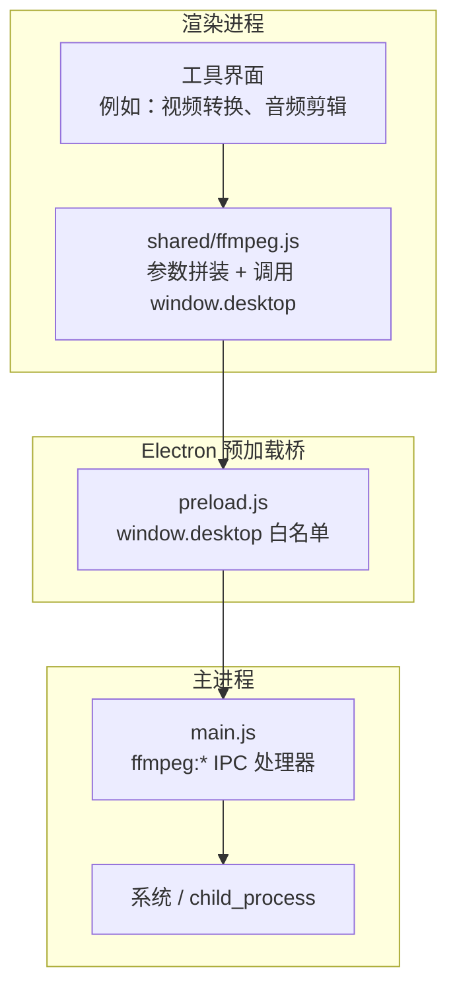
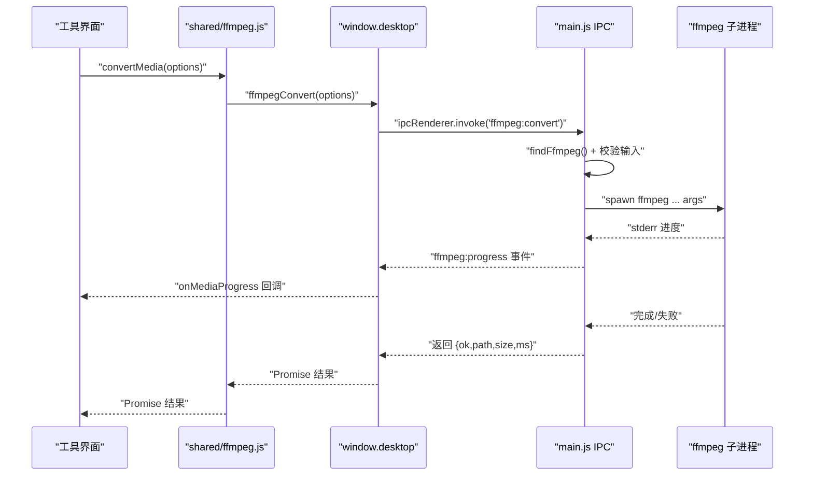
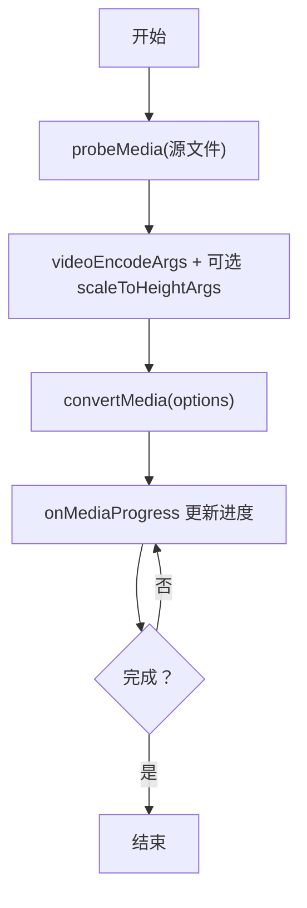
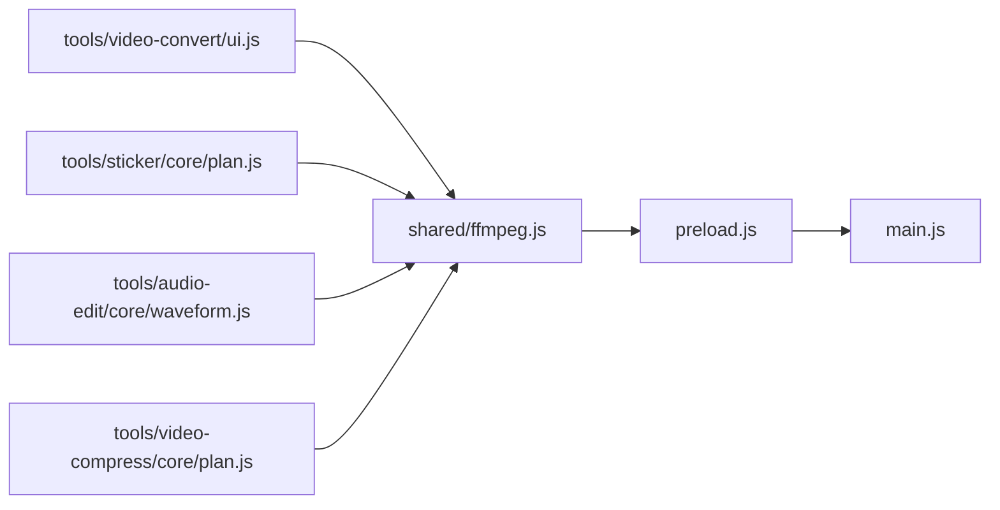

# FFmpeg 封装模块

<cite>
**本文引用的文件**   
- [ffmpeg.js](file://app/src/shared/ffmpeg.js)
- [preload.js](file://app/preload.js)
- [main.js](file://app/main.js)
- [video-convert/ui.js](file://app/src/tools/video-convert/ui.js)
- [audio-edit/core/waveform.js](file://app/src/tools/audio-edit/core/waveform.js)
- [sticker/core/plan.js](file://app/src/tools/sticker/core/plan.js)
- [video-compress/core/plan.js](file://app/src/tools/video-compress/core/plan.js)
- [spec/modules/video-convert.md](file://spec/modules/video-convert.md)
</cite>

## 目录
1. [引言](#引言)
2. [项目结构](#项目结构)
3. [核心 API 参考](#核心-api-参考)
4. [架构总览](#架构总览)
5. [参数拼装逻辑详解](#参数拼装逻辑详解)
6. [IPC 通信机制](#ipc-通信机制)
7. [使用示例与常见场景](#使用示例与常见场景)
8. [进度回调、取消与错误处理](#进度回调取消与错误处理)
9. [依赖关系分析](#依赖关系分析)
10. [性能优化建议](#性能优化建议)
11. [故障排查指南](#故障排查指南)
12. [结论](#结论)

## 引言
FFmpeg 封装模块位于 `app/src/shared/ffmpeg.js`，是跨工具复用的媒体处理公共层。它不直接调用操作系统或子进程，而是把“如何拼装 ffmpeg 参数”和“界面侧如何调用主进程能力”统一起来；真正的进程执行由 Electron 主进程在 `app/main.js` 中完成，并通过 `window.desktop` 暴露给渲染进程。

该模块面向视频格式转换、动图与视频互转、音频剪辑、图片格式转换等工具，目标是让不同工具产出的编码参数一致，同时避免界面进程直接持有大文件或调用 Node/Electron 底层能力。

## 项目结构
从模块职责看，FFmpeg 相关代码分布在三层：

| 层级 | 文件 | 职责 |
|---|---|---|
| 共享封装层 | `app/src/shared/ffmpeg.js` | 导出 `ffmpegStatus`、`probeMedia`、`convertMedia`、`convertMediaTwoPass`、`convertMediaMulti`、`transformImageBytes`、`transformFileToBytes`、`cancelMediaJob`、`onMediaProgress`，以及所有参数生成器 |
| 安全桥接层 | `app/preload.js` | 通过 `contextBridge` 暴露 `window.desktop`，将渲染进程调用映射到 `ipcRenderer.invoke` 和 `ipcRenderer.on` |
| 主进程执行层 | `app/main.js` | 注册 `ffmpeg:*` IPC 处理器，查找 ffmpeg 可执行文件，spawn 子进程，管理任务、进度和取消 |



**图表来源**
- [ffmpeg.js:1-20](file://app/src/shared/ffmpeg.js#L1-L20)
- [preload.js:1-193](file://app/preload.js#L1-L193)
- [main.js:1577-1913](file://app/main.js#L1577-L1913)

**章节来源**
- [ffmpeg.js:1-20](file://app/src/shared/ffmpeg.js#L1-L20)
- [preload.js:1-193](file://app/preload.js#L1-L193)
- [main.js:1577-1913](file://app/main.js#L1577-L1913)

## 核心 API 参考

### 状态与探测

| API | 输入 | 返回 | 说明 |
|---|---|---|---|
| `ffmpegStatus()` | 无 | `{ found, where, version }` | 查询 ffmpeg 是否可用、来源（加装包或系统）及版本 |
| `probeMedia(filePath)` | `filePath` | `{ ok, durationSec, width, height, fps, hasAudio, videoCodec, format }` | 读取媒体信息，常用于决定分辨率、码率或输出容器 |

实现要点：
- 两个函数都直接转发到 `window.desktop.ffmpegStatus()` 和 `window.desktop.ffmpegProbe()`。
- 真正执行在 `main.js` 的 `ffmpeg:status` 与 `ffmpeg:probe` IPC 处理器中。

**章节来源**
- [ffmpeg.js:10-28](file://app/src/shared/ffmpeg.js#L10-L28)
- [preload.js:86-102](file://app/preload.js#L86-L102)
- [main.js:1577-1628](file://app/main.js#L1577-L1628)

### 文件级转码

| API | 输入 | 返回 | 说明 |
|---|---|---|---|
| `convertMedia(options)` | `{ inputPath, outputDir?, baseName?, ext, inputArgs?, args, durationMs?, jobId? }` | `{ ok, path, size, ms }` 或 `{ ok:false, message }` | 单输入转码，结果直接写入磁盘 |
| `convertMediaTwoPass(options)` | `{ inputPath, outputDir?, baseName?, ext, inputArgs?, pass1Args[], pass2Args[], durationMs?, jobId? }` | 同上 | 两遍编码，适合目标体积模式 |
| `convertMediaMulti(options)` | `{ inputPaths[], outputDir?, baseName?, ext, args[], durationMs?, jobId? }` | 同上 | 多输入拼接，用于音频剪辑 concat |

关键约定：
- `args`、`pass1Args`、`pass2Args` 是由共享模块生成的 ffmpeg 参数数组。
- `jobId` 用于进度订阅和取消；同一任务应传相同值。
- `durationMs` 是可选时长，便于进度计算。

**章节来源**
- [ffmpeg.js:30-68](file://app/src/shared/ffmpeg.js#L30-L68)
- [preload.js:94-108](file://app/preload.js#L94-L108)
- [main.js:1697-1904](file://app/main.js#L1697-L1904)

### 图片字节与按路径变换

| API | 输入 | 返回 | 说明 |
|---|---|---|---|
| `transformImageBytes(bytes, ext, args)` | 图片字节、扩展名、ffmpeg 参数 | `{ ok, bytes }` 或 `{ ok:false, message }` | 从内存字节转为 TIFF/GIF/AVIF/APNG/WebP 等浏览器内核可能不支持的格式 |
| `transformFileToBytes(inputPath, ext, args)` | 本地文件路径、扩展名、ffmpeg 参数 | `{ ok, bytes }` 或 `{ ok:false, message }` | 从本地文件取小产物时优先使用，避免把 GB 级源读进界面进程 |
| `cancelMediaJob(jobId)` | `jobId` | 取消结果 | 取消正在运行的 ffmpeg 任务树 |
| `onMediaProgress(callback)` | 回调函数 | 取消订阅函数 | 订阅 `ffmpeg:progress` 事件，组件卸载时必须调用返回值 |

重要约束：
- `transformImageBytes` 会把整个输入字节传给主进程，不适合大视频。
- `transformFileToBytes` 由主进程直接操作临时文件和 ffmpeg，只把最终小产物回传。
- `onMediaProgress` 必须保存返回的清理函数，否则会产生事件监听泄漏。

**章节来源**
- [ffmpeg.js:70-93](file://app/src/shared/ffmpeg.js#L70-L93)
- [preload.js:94-111](file://app/preload.js#L94-L111)
- [main.js:1872-1913](file://app/main.js#L1872-L1913)

## 架构总览



**图表来源**
- [ffmpeg.js:30-68](file://app/src/shared/ffmpeg.js#L30-L68)
- [preload.js:94-111](file://app/preload.js#L94-L111)
- [main.js:1697-1820](file://app/main.js#L1697-L1820)

## 参数拼装逻辑详解

### 质量预设 `QUALITY_PRESETS`

| 档位 | CRF | 音频码率 | 标签 | 适用场景 |
|---|---:|---:|---|---|
| `high` | 20 | 192k | 高质量 | 归档、后期编辑 |
| `standard` | 23 | 128k | 标准 | 通用平衡选择 |
| `small` | 28 | 96k | 小体积 | 网络传输、预览 |

`videoEncodeArgs(target, quality, options)` 根据目标容器选择不同的编码器：

| 目标容器 | 视频编码器 | 音频编码器 | 备注 |
|---|---|---|---|
| `webm` | libvpx-vp9 | libopus | 支持 `-row-mt` 多线程 |
| `avi` | mpeg4 | libmp3lame | 用 `-q:v` 而非 `-crf` |
| `mkv` | libx264 | aac | 加 `yuv420p` 提升兼容性 |
| `mov` / `mp4` | libx264 | aac | 加 `+faststart` 支持边下边播 |

`options.mute = true` 时会移除音轨。

**章节来源**
- [ffmpeg.js:95-109](file://app/src/shared/ffmpeg.js#L95-L109)
- [ffmpeg.js:125-163](file://app/src/shared/ffmpeg.js#L125-L163)

### 分辨率预设 `RESOLUTION_PRESETS`

预设高度包括：保持原样、2160p、1080p、720p、480p、360p。配合 `fitSize`、`scaleToHeightArgs`、`evenSize` 使用：

- `evenSize(n)`：保证宽高为偶数，满足 yuv420p 要求。
- `fitSize(srcW, srcH, targetHeight)`：等比缩放，只降不升。
- `fitSizeByWidth(srcW, srcH, targetWidth)`：按宽度等比缩放。
- `scaleToHeightArgs(...)`：返回 `-vf scale=...` 参数。

**章节来源**
- [ffmpeg.js:111-123](file://app/src/shared/ffmpeg.js#L111-L123)
- [ffmpeg.js:125-163](file://app/src/shared/ffmpeg.js#L125-L163)

### 视频转 GIF 参数 `videoToGifArgs`

采用两遍调色板策略：
1. 先 `palettegen` 生成调色板。
2. 再 `paletteuse` 用调色板编码 GIF。
3. 支持 lanczos 缩放、fps、colors、loop。

这是业界常用的高质量 GIF 生成方式，能显著改善颜色断层。

**章节来源**
- [ffmpeg.js:171-185](file://app/src/shared/ffmpeg.js#L171-L185)

### 视频转 WebP 参数 `videoToWebpArgs`

使用 `libwebp_anim` 编码器，支持：
- `fps`
- `loop`
- `quality`
- `compression_level`
- 可选缩放滤镜

**章节来源**
- [ffmpeg.js:187-193](file://app/src/shared/ffmpeg.js#L187-L193)

### 视频转 APNG 参数 `videoToApngArgs`

APNG 动图需显式指定 `-f apng`，并设置 `-plays` 控制循环行为；尺寸处理同样遵循偶数化和 lanczos 缩放。

**章节来源**
- [ffmpeg.js:195-204](file://app/src/shared/ffmpeg.js#L195-L204)

### 动图转视频参数 `animToVideoArgs`

把 GIF 等无音轨动图转为普通视频，强制输出 `yuv420p`，并可添加 fps。

**章节来源**
- [ffmpeg.js:206-211](file://app/src/shared/ffmpeg.js#L206-L211)

### 音频编码参数 `audioEncodeArgs`

支持 MP3、M4A、WAV、FLAC、OGG、Opus、WMA、AMR、AAC、ALAC、AIFF、CAF、WavPack、TTA、AC3、EAC3、MP2、Speex、AU、W64、RealAudio 等目标。

其中 AMR 固定为 8kHz 单声道、最高窄带码率；MP2 在低采样率下会重采样到 44.1kHz 以避免非法参数。

**章节来源**
- [ffmpeg.js:213-266](file://app/src/shared/ffmpeg.js#L213-L266)

### 音频剪辑参数

| 生成器 | 用途 | 关键行为 |
|---|---|---|
| `atrimArgs({ startMs, endMs })` | 截取时间段 | 放在 `-i` 前，配合 `-c:a copy` 可实现近乎瞬时裁剪 |
| `audioFilterArgs(o)` | 音量增益、标准化、淡入淡出 | 支持 `normalize` 响度标准化 |
| `concatAudioArgs({ count })` | 多段音频拼接 | 使用 `-filter_complex` 和 `-map`，容忍采样率和声道差异 |

**章节来源**
- [ffmpeg.js:296-341](file://app/src/shared/ffmpeg.js#L296-L341)

### 视频压缩与两遍编码

| 概念 | 定义 |
|---|---|
| `SIZE_TARGETS` | 用户选择的“目标 MB 以内”档位 |
| `COMPRESS_AUDIO_KBPS` | 目标体积模式下为音频预留的码率档 |
| `planTargetBitrate` | 根据时长和目标体积反推视频 kbps，下限 50 |
| `twoPassArgs` | 第一遍只统计，第二遍落盘并启用 faststart |

两遍编码更适合“目标体积”需求，因为单遍 VBR 存在波动，主进程会在压完后实测文件大小并自动降码率重试。

**章节来源**
- [ffmpeg.js:268-294](file://app/src/shared/ffmpeg.js#L268-L294)
- [main.js:1747-1820](file://app/main.js#L1747-L1820)

## IPC 通信机制

渲染进程不能直接调用 Node/Electron 底层能力。`preload.js` 通过 `contextBridge.exposeInMainWorld('desktop', {...})` 暴露一个白名单对象，其中 FFmpeg 相关方法如下：

| 渲染进程调用 | 对应 IPC 通道 | 方向 |
|---|---|---|
| `window.desktop.ffmpegStatus()` | `ffmpeg:status` | invoke |
| `window.desktop.ffmpegProbe(path)` | `ffmpeg:probe` | invoke |
| `window.desktop.ffmpegConvert(options)` | `ffmpeg:convert` | invoke |
| `window.desktop.ffmpegConvertTwoPass(options)` | `ffmpeg:convert-two-pass` | invoke |
| `window.desktop.ffmpegConvertMulti(options)` | `ffmpeg:convert-multi` | invoke |
| `window.desktop.ffmpegTransform(options)` | `ffmpeg:transform` | invoke |
| `window.desktop.ffmpegTransformFile(options)` | `ffmpeg:transform-file` | invoke |
| `window.desktop.ffmpegCancel(jobId)` | `ffmpeg:cancel` | invoke |
| `window.desktop.ffmpegOnProgress(callback)` | `ffmpeg:progress` | on |

进度回调采用“返回取消订阅函数”的模式：
```js
const unsubscribe = onMediaProgress(data => {
  // 更新进度条
});
// 组件卸载时调用
unsubscribe();
```

**章节来源**
- [preload.js:86-111](file://app/preload.js#L86-L111)
- [ffmpeg.js:70-93](file://app/src/shared/ffmpeg.js#L70-L93)

## 使用示例与常见场景

### 示例一：视频转 MP4

典型流程：
1. 调用 `probeMedia` 获取源宽高、时长、是否有音频。
2. 根据目标容器调用 `videoEncodeArgs('mp4', 'standard')`。
3. 如需缩放，调用 `scaleToHeightArgs(width, height, targetHeight)`。
4. 调用 `convertMedia`，传入 `inputPath`、`outputDir`、`baseName`、`ext`、`args`。
5. 使用 `onMediaProgress` 显示进度。



**图表来源**
- [ffmpeg.js:10-68](file://app/src/shared/ffmpeg.js#L10-L68)
- [ffmpeg.js:125-163](file://app/src/shared/ffmpeg.js#L125-L163)

实际调用方可见：
- [video-convert/ui.js](file://app/src/tools/video-convert/ui.js)

**章节来源**
- [ffmpeg.js:10-68](file://app/src/shared/ffmpeg.js#L10-L68)
- [video-convert/ui.js](file://app/src/tools/video-convert/ui.js)

### 示例二：目标体积视频压缩

典型流程：
1. 根据目标 MB 和音频码率调用 `planTargetBitrate`。
2. 调用 `twoPassArgs({ pass: 1, videoKbps, audioKbps })` 跑第一遍。
3. 调用 `twoPassArgs({ pass: 2, videoKbps, audioKbps })` 跑第二遍。
4. 使用 `convertMediaTwoPass` 提交任务。
5. 完成后检查文件大小，必要时降低码率重试。

**章节来源**
- [ffmpeg.js:268-294](file://app/src/shared/ffmpeg.js#L268-L294)
- [video-compress/core/plan.js](file://app/src/tools/video-compress/core/plan.js)
- [main.js:1747-1820](file://app/main.js#L1747-L1820)

### 示例三：音频剪辑与拼接

典型流程：
1. 对单个片段使用 `atrimArgs({ startMs, endMs })` 截取。
2. 需要音量调整时使用 `audioFilterArgs`。
3. 拼接多个片段时使用 `concatAudioArgs({ count })`。
4. 调用 `convertMediaMulti`，传入 `inputPaths` 和含 `filter_complex`、`map` 的 `args`。
5. 使用波形预览时可结合 `transformFileToBytes` 提取音频波形数据。

**章节来源**
- [ffmpeg.js:296-341](file://app/src/shared/ffmpeg.js#L296-L341)
- [audio-edit/core/waveform.js](file://app/src/tools/audio-edit/core/waveform.js)

### 示例四：视频转 GIF 或 WebP 动图

典型流程：
1. 用 `probeMedia` 获取 `srcW`、`srcH`。
2. 调用 `videoToGifArgs({ fps, colors, loop, width, srcW, srcH })` 或 `videoToWebpArgs`。
3. 使用 `convertMedia` 或 `convertMediaTwoPass` 输出动图。
4. 如果是从内存图片字节生成动图，使用 `transformImageBytes`。

**章节来源**
- [ffmpeg.js:171-193](file://app/src/shared/ffmpeg.js#L171-L193)
- [sticker/core/plan.js](file://app/src/tools/sticker/core/plan.js)

## 进度回调、取消与错误处理

### 进度回调

进度通过 `ffmpeg:progress` 事件传递。封装层 `onMediaProgress` 返回取消订阅函数，工具页面卸载时必须调用，防止多次挂载导致重复回调。

最佳实践：
- 保存 `unsubscribe` 引用。
- 在 React/Vue/Svelte 等框架的卸载钩子里调用。
- 不要长期缓存未使用的进度回调。

**章节来源**
- [ffmpeg.js:90-93](file://app/src/shared/ffmpeg.js#L90-L93)
- [preload.js:106-111](file://app/preload.js#L106-L111)

### 任务取消

`cancelMediaJob(jobId)` 会查找主进程中以 `jobId` 注册的 ffmpeg 子进程，并终止其进程树。若任务已结束或不存在，主进程返回 `ok:false`。

注意：
- `jobId` 应由调用方稳定生成，并在同一任务的多次调用中保持一致。
- 取消后进度回调可能仍触发一次“已结束”事件，调用方应做幂等处理。

**章节来源**
- [ffmpeg.js:88-90](file://app/src/shared/ffmpeg.js#L88-L90)
- [main.js:1683-1690](file://app/main.js#L1683-L1690)

### 错误处理模式

所有公开 API 返回 Promise，成功时包含 `ok:true`，失败时包含 `ok:false` 和 `message`。常见错误包括：
- 未检测到 ffmpeg。
- 缺少输入文件。
- 拼接文件少于两个。
- 找不到输入文件。
- ffmpeg 子进程退出码异常。

推荐处理：
- 始终检查 `result.ok`。
- 向用户展示 `result.message` 中的可读消息。
- 对 `ffmpegStatus()` 返回 `found:false` 的情况提示安装或重启软件。
- 对大文件优先使用 `transformFileToBytes`，避免界面进程内存溢出。

**章节来源**
- [main.js:1697-1913](file://app/main.js#L1697-L1913)

## 依赖关系分析



**图表来源**
- [ffmpeg.js:1-20](file://app/src/shared/ffmpeg.js#L1-L20)
- [preload.js:86-111](file://app/preload.js#L86-L111)
- [main.js:1577-1913](file://app/main.js#L1577-L1913)

耦合性分析：
- `shared/ffmpeg.js` 是纯逻辑层，不感知 Electron，仅依赖 `window.desktop`。
- `preload.js` 是唯一桥接层，集中维护 IPC 白名单。
- `main.js` 承担资源管理和进程生命周期。
- 各工具通过共享参数生成器保证输出一致性，降低重复实现风险。

潜在风险：
- 如果新增 ffmpeg IPC 但未在 `preload.js` 暴露，渲染进程无法调用。
- 如果工具直接使用 `window.desktop` 绕过 `shared/ffmpeg.js`，可能导致参数拼装不一致。

**章节来源**
- [ffmpeg.js:1-20](file://app/src/shared/ffmpeg.js#L1-L20)
- [preload.js:86-111](file://app/preload.js#L86-L111)

## 性能优化建议

### 两遍编码的使用场景

| 场景 | 推荐方式 | 原因 |
|---|---|---|
| 追求稳定体积 | 两遍编码 | 第一遍统计、第二遍精确控制码率 |
| 快速预览或实时转码 | 单遍编码 | 减少耗时，但体积可能有波动 |
| 目标体积超过阈值 | 自动降码率重试 | 主进程会检测文件大小并重新估算 |

**章节来源**
- [ffmpeg.js:268-294](file://app/src/shared/ffmpeg.js#L268-L294)
- [main.js:1747-1820](file://app/main.js#L1747-L1820)

### 并发控制

- 每个 ffmpeg 任务应有唯一 `jobId`。
- 不要在同一个工具页内同时发起大量大文件转码。
- 建议结合应用的任务队列（如 `taskqueue`）限制并发数量。
- 大文件优先走主进程管道，不要让界面进程复制完整媒体数据。

### 内存管理

- 小产物：`transformImageBytes`。
- 大源文件取小产物：`transformFileToBytes`。
- 完整文件转码：`convertMedia` / `convertMediaTwoPass` / `convertMediaMulti`。
- 避免在渲染进程保留长生命周期的 Buffer 或 Blob。
- 及时取消不再需要的进度订阅。

### 编码参数优化

- 默认使用 `standard` 质量档，兼顾体积与画质。
- 网页传播优先 MP4/H.264/AAC，移动端或存档可考虑 MKV。
- WebM/VP9 适合现代浏览器；AVI/mpeg4 适合老设备。
- GIF 使用两遍调色板；WebP 动图可使用更高 compression_level。
- 输出 MP4/MOV 时保留 `+faststart`，利于流式播放。

[本节为通用性能指导，不直接分析具体代码行]

## 故障排查指南

### 常见问题与定位步骤

| 现象 | 可能原因 | 排查步骤 |
|---|---|---|
| 所有 ffmpeg 功能返回“未检测到 ffmpeg” | 加装包未解压或路径不对 | 查看 `ffmpegStatus().where`，确认 `addons/ffmpeg` 是否存在 |
| 转码立即失败并返回“缺少输入文件” | `inputPath` 为空或无效 | 检查 `convertMedia` 参数 |
| 拼接失败并提示至少需要两个文件 | `inputPaths` 长度不足 | 检查 `convertMediaMulti` 参数 |
| 进度一直不更新 | 未调用 `onMediaProgress` 或组件已卸载 | 检查订阅是否正确注册 |
| 点击取消后仍有进度回调 | 未清理订阅或未做幂等处理 | 调用返回的取消函数，并忽略已完成任务 |
| 大文件转图片内存暴涨 | 误用 `transformImageBytes` | 改用 `transformFileToBytes` |
| GIF 颜色断层严重 | 未使用两遍调色板 | 使用 `videoToGifArgs` |
| AVI 输出黑屏或兼容性问题 | 像素格式或编码器不匹配 | 使用 `videoEncodeArgs('avi', ...)` 并保持 yuv420p |

**章节来源**
- [main.js:1577-1913](file://app/main.js#L1577-L1913)
- [ffmpeg.js:125-204](file://app/src/shared/ffmpeg.js#L125-L204)

### 日志与调试

主进程有全局未捕获异常和未处理 Promise 拒绝日志，写入用户数据目录的 `logs/main.log`。当 ffmpeg 子进程崩溃或意外退出时，可优先查看该日志。

**章节来源**
- [main.js:1-120](file://app/main.js#L1-L120)

## 结论

FFmpeg 封装模块通过三层设计实现了清晰职责分离：共享层负责参数拼装与 API 契约，预加载层负责安全桥接，主进程负责真实执行和资源管理。`QUALITY_PRESETS`、`RESOLUTION_PRESETS`、`videoEncodeArgs`、`videoToGifArgs`、`videoToWebpArgs`、`audioEncodeArgs`、`twoPassArgs` 等生成器保证了不同工具之间的输出一致性。

对于使用者而言，最关键的实践是：
1. 使用 `probeMedia` 获取元数据后再拼装参数。
2. 使用共享参数生成器，而不是在各工具里手写 ffmpeg 字符串。
3. 大文件优先走主进程，避免界面进程内存爆炸。
4. 始终处理 `ok:false` 的失败结果。
5. 订阅进度并正确取消订阅。
6. 目标体积场景优先使用两遍编码。

这些约定共同构成了本项目的跨工具 FFmpeg 复用基础，也是后续新增音视频工具时应遵循的接口规范。