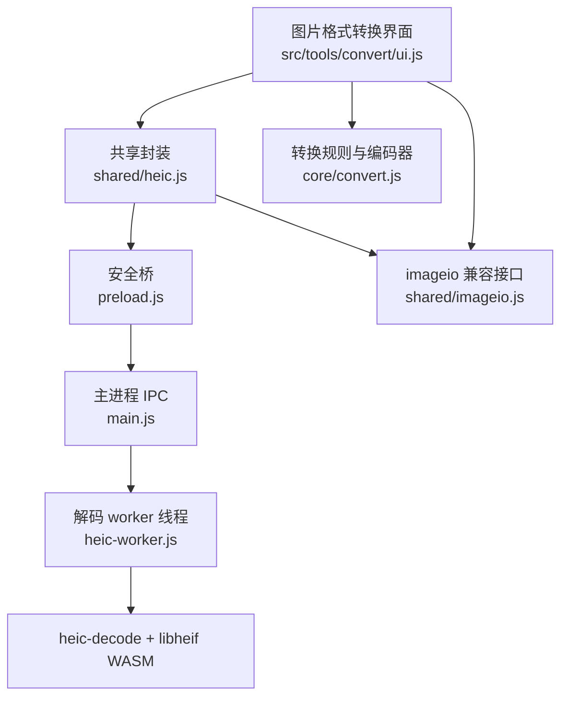
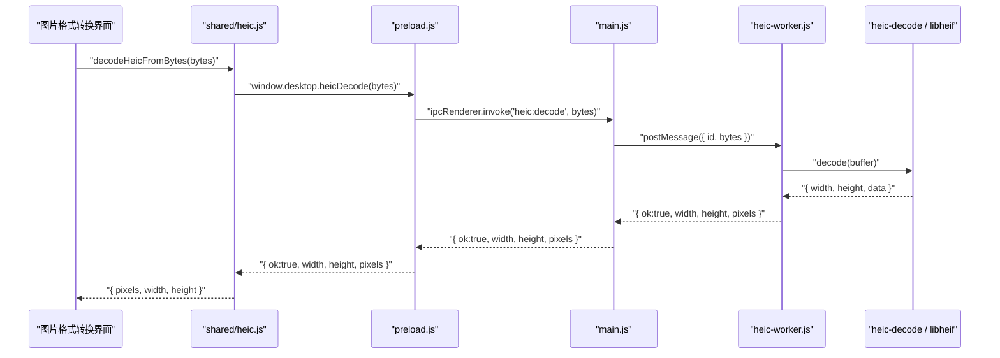
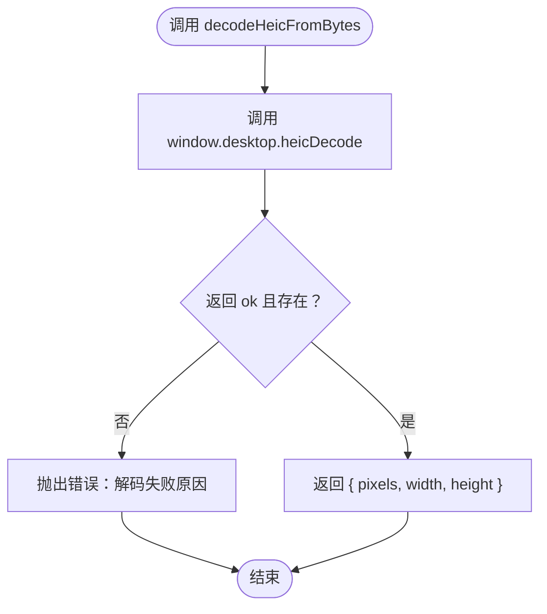
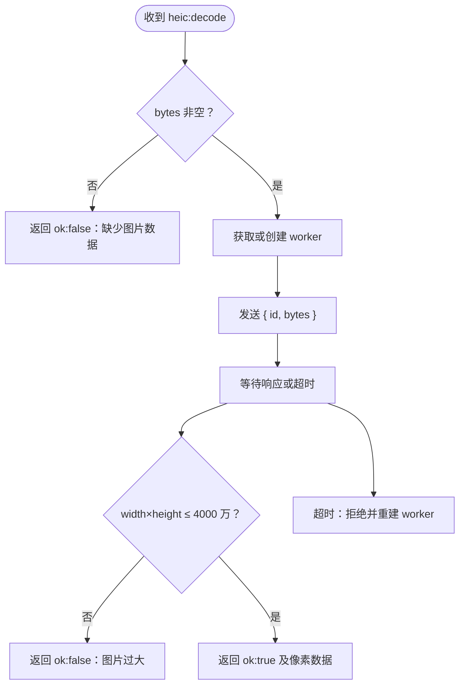
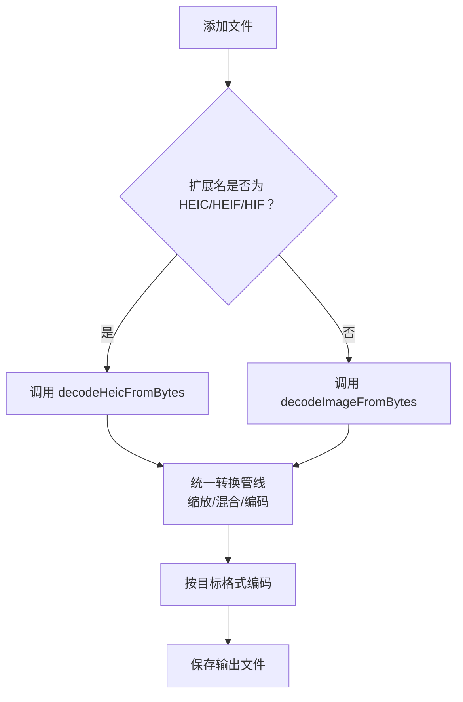
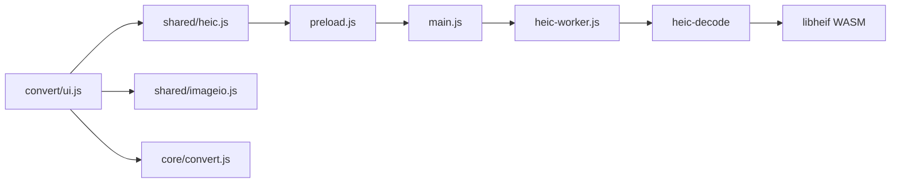

# HEIC 格式支持模块

<cite>
**本文引用的文件**   
- [heic.js](file://app/src/shared/heic.js)
- [imageio.js](file://app/src/shared/imageio.js)
- [main.js](file://app/main.js)
- [preload.js](file://app/preload.js)
- [heic-worker.js](file://app/heic-worker.js)
- [convert.js](file://app/src/tools/convert/core/convert.js)
- [ui.js](file://app/src/tools/convert/ui.js)
- [media-test.js](file://app/tests/media-test.js)
</cite>

## 目录
1. [简介](#简介)
2. [项目结构](#项目结构)
3. [核心组件](#核心组件)
4. [架构总览](#架构总览)
5. [详细组件分析](#详细组件分析)
6. [依赖关系分析](#依赖关系分析)
7. [性能与内存特性](#性能与内存特性)
8. [错误处理与故障排查](#错误处理与故障排查)
9. [与其他图片处理模块的集成模式](#与其他图片处理模块的集成模式)
10. [结论](#结论)

## 简介
本模块为 Electron 桌面工具中的 HEIC/HEIF/HIF（手机拍照格式）解码能力。Chromium 内核不支持 HEIC 解码，因此界面进程不能直接用 `createImageBitmap` 打开这类文件；本方案通过主进程的 worker 线程调用 libheif WASM 引擎完成解码，并把结果统一成 RGBA 像素缓冲，再交给 imageio 和工具层统一的图像处理管线。

对外暴露两个关键 API：
- `heicStatus()`：查询 heic-decode/libheif WASM 是否可用及版本。
- `decodeHeicFromBytes(bytes)`：把 HEIC/HEIF/HIF 字节转为 `{ pixels, width, height }`，失败时抛出带原因的错误对象。

返回数据结构与 `shared/imageio.js` 的 `decodeImageFromBytes` 同构，因此 HEIC 解码后的像素可以直接进入 PNG/JPG/WebP 编码、缩放、透明底色填充等既有逻辑，无需在工具代码中做分支适配。

**章节来源**
- [heic.js:1-23](file://app/src/shared/heic.js#L1-L23)
- [imageio.js:1-40](file://app/src/shared/imageio.js#L1-L40)

## 项目结构
HEIC 支持横跨渲染进程、预加载桥、主进程 IPC、worker 线程与图片转换工具五层：

**图表来源**
- [ui.js:1-20](file://app/src/tools/convert/ui.js#L1-L20)
- [heic.js:1-23](file://app/src/shared/heic.js#L1-L23)
- [preload.js:100-130](file://app/preload.js#L100-L130)
- [main.js:1920-2040](file://app/main.js#L1920-L2040)
- [heic-worker.js:1-23](file://app/heic-worker.js#L1-L23)
- [imageio.js:1-40](file://app/src/shared/imageio.js#L1-L40)
- [convert.js:1-35](file://app/src/tools/convert/core/convert.js#L1-L35)

**章节来源**
- [ui.js:1-20](file://app/src/tools/convert/ui.js#L1-L20)
- [heic.js:1-23](file://app/src/shared/heic.js#L1-L23)
- [main.js:1920-2040](file://app/main.js#L1920-L2040)
- [heic-worker.js:1-23](file://app/heic-worker.js#L1-L23)

## 核心组件
本节聚焦对外 API 及其行为契约。

### `heicStatus()`
- 职责：返回 HEIC 解码引擎状态，类型为 `{ found, version }`。
- 返回值含义：
  - `found`：true 表示 heic-decode 可被主进程解析到，即随包分发的依赖存在。
  - `version`：尝试读取 heic-decode 包版本号，若 exports 字段阻止子路径访问则可能为空，但不影响功能。
- 调用位置：渲染进程通过 `window.desktop.heicStatus()` 触发 `ipcRenderer.invoke('heic:status')`，由 main.js 缓存并返回。
- 典型用途：
  - 工具启动时检查能力。
  - 测试用例断言 HEIC 输入链路与 PNG 产物可被 ffmpeg 回读。

**章节来源**
- [heic.js:12-17](file://app/src/shared/heic.js#L12-L17)
- [preload.js:100-110](file://app/preload.js#L100-L110)
- [main.js:1986-2001](file://app/main.js#L1986-L2001)
- [media-test.js:212-265](file://app/tests/media-test.js#L212-L265)

### `decodeHeicFromBytes(bytes)`
- 参数：`ArrayBuffer | Uint8Array` 形式的 HEIC/HEIF/HIF 文件字节。
- 返回值：`Promise<{ pixels: Uint8ClampedArray, width: number, height: number }>`。
- 成功流程：
  1. 调用 `window.desktop.heicDecode(bytes)`。
  2. 如果返回对象不存在或 `ok` 为 false，抛出错误，消息来自底层解码器。
  3. 否则返回与 `imageio.decodeImageFromBytes` 同构的对象，供后续图像处理使用。
- 失败语义：
  - 不是有效 HEIC/HEIF 文件、文件损坏、数据为空、超过 4000 万像素上限、解码超时、worker 崩溃等情况都会以错误形式返回给调用方。
  - 上层工具通常用 try/catch 捕获后标记单张失败，不影响其他图片转换。

**章节来源**
- [heic.js:19-23](file://app/src/shared/heic.js#L19-L23)
- [preload.js:100-110](file://app/preload.js#L100-L110)
- [main.js:2009-2040](file://app/main.js#L2009-L2040)

## 架构总览
下图展示一次 HEIC 解码请求的完整时序：

**图表来源**
- [heic.js:19-23](file://app/src/shared/heic.js#L19-L23)
- [preload.js:100-110](file://app/preload.js#L100-L110)
- [main.js:1962-2040](file://app/main.js#L1962-L2040)
- [heic-worker.js:1-23](file://app/heic-worker.js#L1-L23)

## 详细组件分析

### 渲染进程封装：`shared/heic.js`
该文件是 HEIC 能力的统一入口，隐藏了 IPC 细节，只暴露两个函数：

| API | 输入 | 输出 | 异常行为 |
|---|---|---|---|
| `heicStatus()` | 无 | `{ found, version }` | 不抛错，直接透传主进程状态 |
| `decodeHeicFromBytes(bytes)` | `ArrayBuffer \| Uint8Array` | Promise 解析为 `{ pixels, width, height }` | 非空且 `ok=true` 时返回；否则抛 Error |

实现要点：
- 所有调用都经过 `window.desktop`，避免渲染进程直接接触 Node/Electron。
- 返回值结构与 `imageio.decodeImageFromBytes` 一致，使工具代码可以按统一接口处理普通图片与 HEIC。
- 注释明确说明 irot/imir 旋转属性由引擎自动应用，竖拍照片方向正确。

**图表来源**
- [heic.js:12-23](file://app/src/shared/heic.js#L12-L23)

**章节来源**
- [heic.js:1-23](file://app/src/shared/heic.js#L1-L23)

### 安全桥：`preload.js`
preload 将 `heicStatus` 与 `heicDecode` 暴露为 `window.desktop` 上的方法，并通过 `ipcRenderer.invoke` 转发到主进程。这是渲染进程访问 HEIC 解码能力的唯一白名单入口。

关键点：
- `heicStatus()`：对应 `heic:status` IPC。
- `heicDecode(bytes)`：对应 `heic:decode` IPC，传入原始字节。
- 与 OCR、ffmpeg、视频下载等其他主进程能力共用同一桥接模式，便于统一权限控制。

**章节来源**
- [preload.js:100-110](file://app/preload.js#L100-L110)

### 主进程 IPC 与 worker 管理：`main.js`
主进程承担三个职责：
1. 维护 heic-decode 可用性缓存。
2. 管理 worker 生命周期，包括启动、错误恢复、超时清理。
3. 校验像素总量上限，防止超大图像耗尽内存。

#### 状态查询
- `ipcMain.handle('heic:status', ...)`：首次调用时尝试 `require.resolve('heic-decode')`，记录 `found` 与可选 `version`，之后返回缓存结果。
- 正常打包后依赖随包分发，因此 `found` 通常为 true。

#### Worker 生命周期
- 首次解码时懒创建 worker。
- 使用 `getHeicWorker()` 保证并发请求复用同一个 worker。
- worker 发生 error 或 exit 时，清空引用并拒绝所有 pending 请求。
- 解码超时默认 60 秒，超时时重建 worker 并拒绝等待中的请求。

#### 解码处理
- 空字节立即返回 `ok:false`。
- 成功时先检查 `width * height > 40_000_000`，超限则拒绝。
- 成功路径返回 `{ ok:true, width, height, pixels }`。
- 失败路径对包含 “not a HEIC” 的消息做友好提示，其他错误原样包装。

**图表来源**
- [main.js:1962-2040](file://app/main.js#L1962-L2040)

**章节来源**
- [main.js:1920-2040](file://app/main.js#L1920-L2040)

### 解码执行器：`heic-worker.js`
worker 运行在主进程 worker_threads 中，避免同步 WASM 计算阻塞主事件循环。

职责：
- 监听父进程消息 `{ id, bytes }`。
- 调用 `heic-decode` 的 `decode({ buffer: bytes })`。
- 成功后返回 `r.width`、`r.height` 与 `r.data`。
- 使用 `postMessage(..., [buffer])` 进行零拷贝传输。
- 解码失败时返回 `{ id, ok:false, message }`。

设计动机：
- heic-decode 的 WASM 解码是同步计算。
- 直接在主进程事件循环执行会导致对话框、文件读写等 IPC 排队卡顿。
- 批量处理手机照片时，worker 能显著降低界面发顿风险。

**章节来源**
- [heic-worker.js:1-23](file://app/heic-worker.js#L1-L23)

### 与 imageio 的数据兼容设计
`shared/imageio.js` 提供通用图片解码接口：

| 接口 | 输入 | 输出 | 特点 |
|---|---|---|---|
| `decodeImageFromBytes(bytes)` | ArrayBuffer/Uint8Array | Promise<{ pixels, width, height }> | 基于 Chromium 内核，不支持 HEIC |
| `encodeImageToBytes(pixels, w, h, options)` | RGBA 像素 | Promise<Uint8Array> | 支持 PNG/JPG |
| `drawPixelsToCanvas(canvas, pixels, w, h)` | RGBA 像素 | 无 | 用于预览 |
| `makeThumbnail(pixels, w, h, maxSize)` | RGBA 像素 | Promise<HTMLCanvasElement> | 生成缩略图 |

HEIC 解码结果与 `decodeImageFromBytes` 同构，因此：
- 工具代码可以把 HEIC 和普通图片统一视为 `{ pixels, width, height }`。
- 透明底色填充、尺寸缩放、JPG/WebP/ICO/BMP/TIFF/GIF/AVIF 编码可直接复用。
- `makeThumbnailFromBytes` 走 Chromium 内核，不能用于 HEIC；HEIC 必须先解码成像素再用 `makeThumbnail(pixels, …)`。

**章节来源**
- [imageio.js:1-141](file://app/src/shared/imageio.js#L1-L141)
- [heic.js:1-11](file://app/src/shared/heic.js#L1-L11)

### 图片格式转换工具中的使用方式
`src/tools/convert/core/convert.js` 定义了支持的输入扩展名：

- 普通图片：png、jpg、jpeg、webp、gif、bmp、ico、avif、svg 等。
- HEIC/HEIF/HIF：`heic`、`heif`、`hif`。
- 老格式图片：tif、tiff、pcx、tga、psd、dds、jp2、j2k，走 ffmpeg 首帧解码。

`ui.js` 的处理流程大致为：
1. 用户添加文件或拖入文件夹。
2. 判断扩展名是否在 `INPUT_EXTS` 中。
3. 如果是 HEIF 扩展名，调用 `decodeHeicFromBytes`。
4. 如果不是 HEIF，调用 `decodeImageFromBytes`。
5. 得到 `{ pixels, width, height }` 后进入统一转换管线。
6. 根据目标格式选择 PNG/JPG/WebP/ICO/BMP/TIFF/GIF/AVIF 编码器。

**图表来源**
- [convert.js:18-35](file://app/src/tools/convert/core/convert.js#L18-L35)
- [ui.js:1-20](file://app/src/tools/convert/ui.js#L1-L20)

**章节来源**
- [convert.js:1-175](file://app/src/tools/convert/core/convert.js#L1-L175)
- [ui.js:1-40](file://app/src/tools/convert/ui.js#L1-L40)

## 依赖关系分析

**图表来源**
- [ui.js:1-20](file://app/src/tools/convert/ui.js#L1-L20)
- [heic.js:1-23](file://app/src/shared/heic.js#L1-L23)
- [main.js:1920-2040](file://app/main.js#L1920-L2040)
- [heic-worker.js:1-23](file://app/heic-worker.js#L1-L23)

耦合关系说明：
- 工具层仅依赖 `shared/heic.js` 和 `shared/imageio.js`，不直接关心 IPC。
- `shared/heic.js` 仅依赖 `window.desktop`，不感知主进程实现。
- 主进程负责 worker 管理、超时、错误分类与像素上限保护。
- worker 与 heic-decode 强耦合，但被隔离在主进程线程内。

**章节来源**
- [ui.js:1-20](file://app/src/tools/convert/ui.js#L1-L20)
- [heic.js:1-23](file://app/src/shared/heic.js#L1-L23)
- [main.js:1920-2040](file://app/main.js#L1920-L2040)

## 性能与内存特性

### 为什么必须用 worker
- heic-decode 的 WASM 解码是同步计算。
- 实测表明中等分辨率 HEIC 解码耗时明显，大分辨率可达秒级。
- 如果在主进程事件循环执行，会阻塞对话框、文件 I/O 和其他 IPC。

### 像素容量限制
- `shared/imageio.js` 与 `main.js` 均使用 4000 万像素作为上限。
- 超过上限时，不会尝试分配整幅 RGBA 缓冲，而是直接报错。
- 这与 4000 万像素 × 4 字节 ≈ 160MB 的内存量级一致。

### 零拷贝优化
- worker 使用 `postMessage` 的 transferable buffer 传递 `Uint8ClampedArray` 底层 buffer。
- 这避免在主进程与 worker 之间复制大块像素数据。

### 推荐实践
- 批量转换时尽量串行处理单张大图，避免同时加载多张超高像素 HEIC。
- 对只需要预览的场景，优先使用 `imageio.makeThumbnailFromBytes`，但该路径不支持 HEIC；HEIC 需先解码再缩略。
- 对需要完整像素处理的场景，使用 `decodeHeicFromBytes` 后进入统一管线。

**章节来源**
- [heic-worker.js:1-23](file://app/heic-worker.js#L1-L23)
- [imageio.js:1-40](file://app/src/shared/imageio.js#L1-L40)
- [main.js:2009-2040](file://app/main.js#L2009-L2040)

## 错误处理与故障排查

### 常见错误与含义
| 现象 | 可能原因 | 建议处理 |
|---|---|---|
| `heicStatus().found` 为 false | heic-decode 未安装或依赖不可解析 | 确认安装包包含依赖；开发环境检查 npm install |
| `decodeHeicFromBytes` 抛出“不是有效的 HEIC/HEIF 文件” | 文件损坏、扩展名与实际内容不符 | 跳过该文件，继续处理其他图片 |
| 抛出“缺少图片数据” | 传入空字节或无效缓冲区 | 检查文件读取与类型转换 |
| 抛出“图片过大” | 宽高乘积超过 4000 万 | 提示用户图片太大，或改用缩略图流程 |
| 抛出“HEIC 解码超时” | 超大图或 worker 长时间计算 | 查看日志，考虑分批处理或升级硬件 |
| worker 异常或退出 | heic-decode 内部崩溃 | 主进程已重建 worker；重试单次任务 |

### 调试建议
1. 先调用 `heicStatus()` 确认引擎存在。
2. 对可疑文件先用小样本验证，例如测试脚本中使用的 HEIC 样本。
3. 查看主进程日志目录下的 `logs/main.log`，其中会记录未捕获异常与未处理拒绝。
4. 如果是批量导入，建议单张 try/catch 失败，不要中断整个队列。
5. 注意 HEIC 产物应先写入磁盘，再由外部工具或 ffmpeg 回读校验，避免仅凭内存判断。

### 测试覆盖
媒体测试中包含 HEIC 相关断言：
- 检查 `heicStatus()` 返回状态。
- 解码 HEIC 样本。
- 将 HEIC 转换为 PNG。
- 使用 ffmpeg 验证 PNG 产物可解码。
- 在缺少 ffmpeg 时给出降级说明。

**章节来源**
- [main.js:1962-2040](file://app/main.js#L1962-L2040)
- [media-test.js:212-265](file://app/tests/media-test.js#L212-L265)

## 与其他图片处理模块的集成模式

### 与 `shared/imageio.js` 的兼容性
- `decodeHeicFromBytes` 返回 `{ pixels, width, height }`，与 `decodeImageFromBytes` 同构。
- 工具代码不需要区分“HEIC 解码结果”和“内核解码结果”，统一进入：
  - 透明底色填充：`flattenOnColor`。
  - 尺寸调整：`resizePixels`。
  - 编码：PNG/JPG/WebP 走 imageio 或 convert 内置 WebP 编码；TIFF/GIF/AVIF 走 ffmpeg。

### 与图片压缩模块的关系
- 图片压缩模块主要基于 Chromium 内核解码，其规格文档明确输入为内核可解码格式。
- HEIC 不在内核解码范围内，因此图片压缩模块不应直接调用 `decodeImageFromBytes` 处理 HEIC。
- 如果未来扩展图片压缩支持 HEIC，应复用 `decodeHeicFromBytes`，而不是绕过 imageio。

### 与 FFmpeg 模块的关系
- HEIC 解码不走 ffmpeg，而是走 libheif WASM。
- FFmpeg 主要用于：
  - 老格式图片首帧解码。
  - TIFF/GIF/AVIF 输出。
- 测试脚本会把 HEIC 转 PNG，再用 ffmpeg 验证产物可解码，从而间接验证 HEIC→RGBA→PNG 链路。

### 最佳实践清单
1. 输入判断阶段：识别 `.heic/.heif/.hif` 并使用 `decodeHeicFromBytes`。
2. 其他图片使用 `decodeImageFromBytes`。
3. 统一消费 `{ pixels, width, height }`。
4. 对 JPG 输出时按需调用透明底色填充。
5. 对超大图提前拦截，避免内存溢出。
6. 单张失败不中断批量任务。
7. 保留原始文件名与扩展名信息，以便生成合适输出路径。
8. 如需预览，先解码再调用 `makeThumbnail`；不要用 `makeThumbnailFromBytes` 直接处理 HEIC。

**章节来源**
- [imageio.js:1-141](file://app/src/shared/imageio.js#L1-L141)
- [convert.js:1-175](file://app/src/tools/convert/core/convert.js#L1-L175)
- [ui.js:1-40](file://app/src/tools/convert/ui.js#L1-L40)
- [media-test.js:212-265](file://app/tests/media-test.js#L212-L265)

## 结论
HEIC 格式支持模块通过四层协作解决了 Chromium 内核无法解码 HEIC 的问题：
- 渲染进程封装 `heicStatus` 与 `decodeHeicFromBytes`。
- preload 暴露安全桥。
- 主进程管理 worker 与 IPC。
- worker 调用 heic-decode/libheif WASM 完成真实解码。

该设计的核心价值在于：
- 对外 API 简单稳定。
- 返回数据结构与 imageio 完全同构。
- HEIC 解码后的像素可以直接进入统一的图像处理管线。
- 通过 worker 与像素上限保护兼顾性能与稳定性。
- 与图片格式转换工具、测试脚本、ffmpeg 验证链路形成闭环。

对于手机拍摄的 HEIC/HEIF/HIF 文件，推荐始终通过 `decodeHeicFromBytes` 进入统一管线，而不是尝试让 Chromium 内核直接解码。这样既能获得正确的像素数据，也能继承现有的错误处理、内存保护和编码能力。