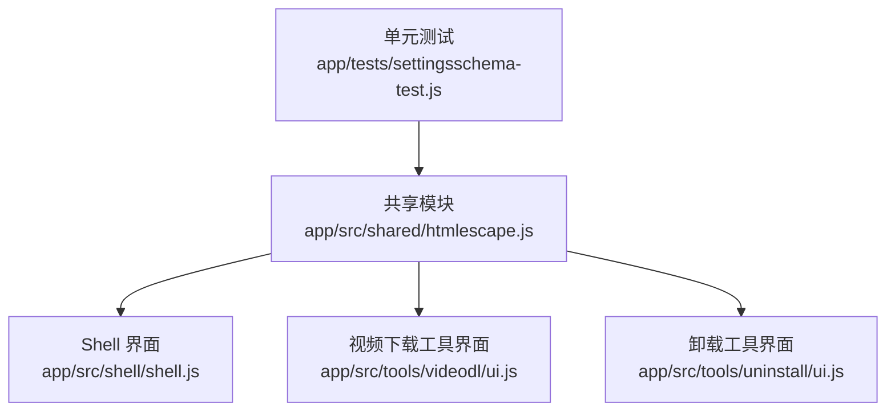
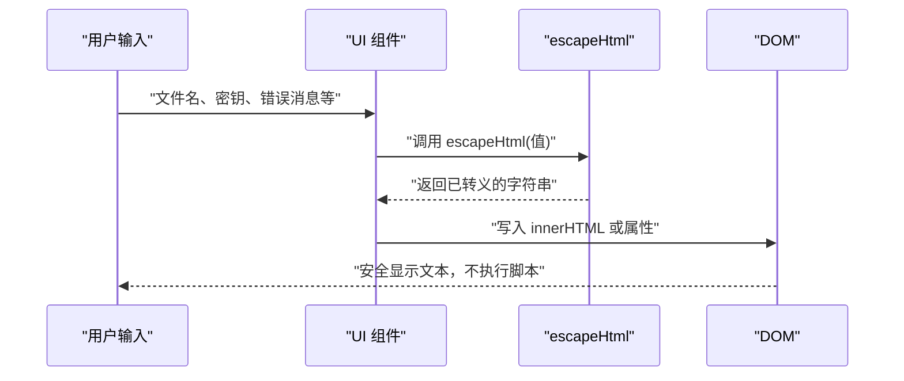
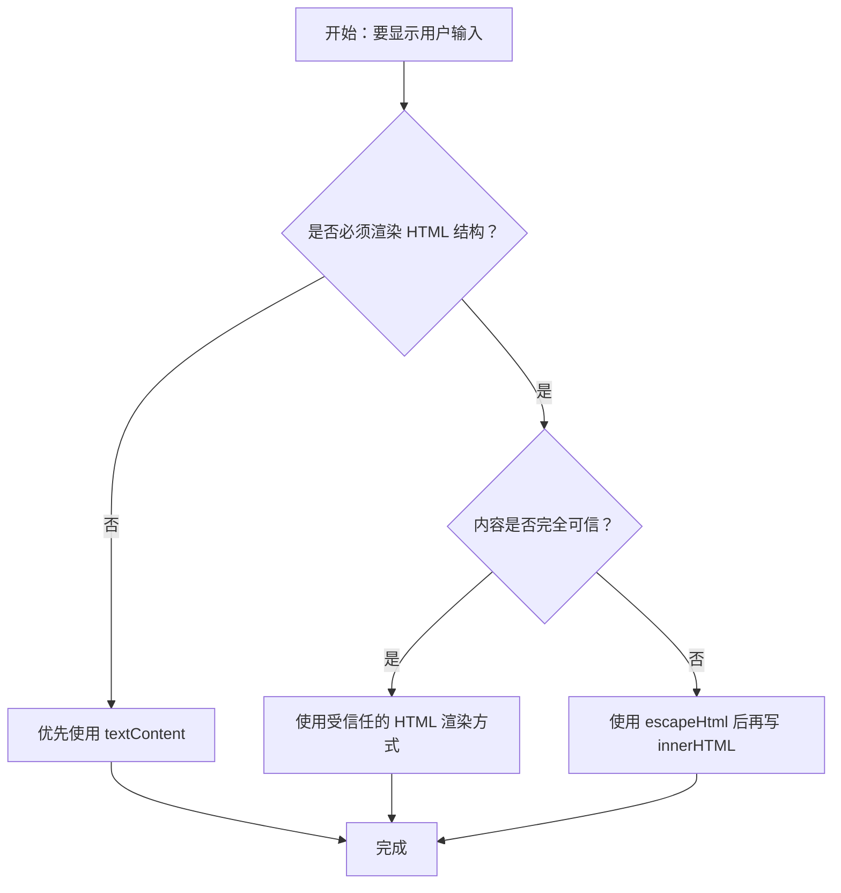

# HTML 转义工具

<cite>
**本文引用的文件**   
- [htmlescape.js](file://app/src/shared/htmlescape.js)
- [shell.js](file://app/src/shell/shell.js)
- [ui.js（视频下载）](file://app/src/tools/videodl/ui.js)
- [ui.js（卸载工具）](file://app/src/tools/uninstall/ui.js)
- [settingsschema-test.js](file://app/tests/settingsschema-test.js)
- [CHANGELOG.md](file://CHANGELOG.md)
</cite>

## 目录
1. [简介](#简介)
2. [项目结构中的位置](#项目结构中的位置)
3. [核心 API：escapeHtml](#核心-apiescapehtml)
4. [架构与调用关系](#架构与调用关系)
5. [使用指南与安全原则](#使用指南与安全原则)
6. [在不同 UI 组件中的用法](#在不同-ui-组件中的用法)
7. [与 textContent 的选择原则](#与-textcontent-的选择原则)
8. [测试与验证](#测试与验证)
9. [常见问题与排错](#常见问题与排错)
10. [结论](#结论)

## 简介
HTML 转义工具提供 `escapeHtml` 函数，用于把用户可控的值安全地嵌入到 `innerHTML` 模板中。它通过转义 `&`、`<`、`>`、`"`、`'` 等字符，防止恶意输入破坏 HTML 结构或触发跨站脚本攻击。该实现是纯函数，放在共享目录供 shell 和各工具复用，便于单元测试。

需要强调：`escapeHtml` 只负责“值不破坏 HTML 结构”，并不等同于完整的安全模型。对于只需要显示纯文本的场景，应优先使用 `textContent`，因为它更简单、更安全且性能更好。

## 项目结构中的位置
`escapeHtml` 位于共享能力模块中，被多个界面层引用：

**图表来源**
- [htmlescape.js:1-8](file://app/src/shared/htmlescape.js#L1-L8)
- [shell.js:7](file://app/src/shell/shell.js#L7)
- [ui.js（视频下载）:6](file://app/src/tools/videodl/ui.js#L6)
- [ui.js（卸载工具）:157](file://app/src/tools/uninstall/ui.js#L157)
- [settingsschema-test.js:9](file://app/tests/settingsschema-test.js#L9)

**章节来源**
- [htmlescape.js:1-8](file://app/src/shared/htmlescape.js#L1-L8)

## 核心 API：escapeHtml
`escapeHtml` 接收任意可转为字符串的值，返回一个已对 HTML 敏感字符进行转义的字符串。

### 函数签名
- 名称：`escapeHtml`
- 参数：`s` —— 任意值，会被转换为字符串处理
- 返回值：字符串
- 行为：
  - 将 `&` 转义为 `&amp;`
  - 将 `<` 转义为 `&lt;`
  - 将 `>` 转义为 `&gt;`
  - 将 `"` 转义为 `&quot;`
  - 将 `'` 转义为 `&#39;`
- 特点：
  - 输入不是字符串时先转为字符串
  - 输出可直接拼接到 `innerHTML` 模板中
  - 不执行脚本，只改变字符的展示形式

### 支持的转义规则
| 原始字符 | 转义结果 | 用途说明 |
|---|---:|---|
| `&` | `&amp;` | 防止打断已有实体序列 |
| `<` | `&lt;` | 防止被浏览器解析为新标签 |
| `>` | `&gt;` | 避免提前结束标签边界 |
| `"` | `&quot;` | 防止在双引号属性中逃逸 |
| `'` | `&#39;` | 防止在单引号属性中逃逸 |

这些规则共同保证：即使用户输入包含完整 HTML 片段或 JavaScript 表达式，也不会直接作为可执行标签或属性注入页面。

**章节来源**
- [htmlescape.js:1-8](file://app/src/shared/htmlescape.js#L1-L8)
- [settingsschema-test.js:153-168](file://app/tests/settingsschema-test.js#L153-L168)

## 架构与调用关系
`escapeHtml` 是底层安全原语，UI 层在其基础上构建安全的模板渲染逻辑。

**图表来源**
- [shell.js:714-730](file://app/src/shell/shell.js#L714-L730)
- [ui.js（视频下载）:165-209](file://app/src/tools/videodl/ui.js#L165-L209)
- [ui.js（卸载工具）:112](file://app/src/tools/uninstall/ui.js#L112)

**章节来源**
- [shell.js:714-730](file://app/src/shell/shell.js#L714-L730)
- [ui.js（视频下载）:165-209](file://app/src/tools/videodl/ui.js#L165-L209)
- [ui.js（卸载工具）:112](file://app/src/tools/uninstall/ui.js#L112)

## 使用指南与安全原则

### 何时使用 `escapeHtml`
适合以下场景：
- 需要将用户输入拼接到 `innerHTML` 模板中
- 需要在 HTML 属性值中显示用户可控数据
- 需要保留 HTML 结构的上下文，但值本身不能执行

典型输入包括：
- 文件名
- 输出目录路径
- 密钥或令牌
- 错误消息
- 任务状态、阶段信息
- URL、日志行

### 何时优先使用 `textContent`
如果只需要显示纯文本，例如：
- 状态栏文字
- 按钮标签
- 列表项内容
- 提示消息

应优先设置 `textContent`，而不是拼接 `innerHTML`。这样既不需要手动转义，也能避免误用模板插值。

### 安全注意事项
- `escapeHtml` 能阻止值直接成为新标签或属性，但不代表所有 HTML 都绝对安全。
- 不要把 `escapeHtml` 当作万能沙箱；它只是防御“值破坏 HTML 结构”的一层措施。
- 不要对用户输入的富文本直接写入 `innerHTML`。如果需要富文本，应使用专门的内容信任策略或富文本编辑器提供的安全 API。
- 对可能包含 HTML 元数据的值，始终视为不可信输入。
- 即使 CSP 会阻止部分脚本执行，也不能依赖 CSP 替代正确的输出编码。

**章节来源**
- [htmlescape.js:1-8](file://app/src/shared/htmlescape.js#L1-L8)
- [CHANGELOG.md:177-178](file://CHANGELOG.md#L177-L178)

## 在不同 UI 组件中的用法

### Shell 设置弹窗
Shell 界面在生成表单时，会把用户配置值传入 `escapeHtml`，再放入 `value` 属性：

- 块大小输入框
- JPEG 质量输入框
- 默认密钥输入框
- 输出目录输入框

这些字段都可能包含路径、密钥或数字字符串，因此必须转义后再进入 `innerHTML`。

**章节来源**
- [shell.js:714-730](file://app/src/shell/shell.js#L714-L730)

### 视频下载工具
视频下载工具在渲染任务列表时，广泛使用 `escapeHtml` 保护：
- 引擎日志行
- 任务标题
- 任务状态类名
- 任务阶段
- 附加元信息
- 文件路径

这能防止恶意文件名、URL 或日志内容破坏界面布局或注入属性。

**章节来源**
- [ui.js（视频下载）:165-209](file://app/src/tools/videodl/ui.js#L165-L209)

### 卸载工具
卸载工具在显示引擎路径时，使用 `escapeHtml` 包裹路径值，避免路径中包含特殊字符导致 HTML 结构异常。

此外，该文件中还存在一个本地同名函数，但共享能力模块是统一入口，应优先引用共享实现，避免多处维护不同转义逻辑。

**章节来源**
- [ui.js（卸载工具）:112](file://app/src/tools/uninstall/ui.js#L112)
- [ui.js（卸载工具）:157](file://app/src/tools/uninstall/ui.js#L157)

## 与 textContent 的选择原则

### 选择流程

### 对比要点
| 维度 | `textContent` | `innerHTML + escapeHtml` |
|---|---|---|
| 安全性 | 更高，不会解析 HTML | 较高，但仍需正确使用 |
| 复杂度 | 低 | 中等 |
| 适用场景 | 纯文本 | 需要嵌入 HTML 结构的模板 |
| 性能 | 通常更好 | 略高，因为涉及模板拼接 |
| 推荐程度 | 首选 | 仅在确实需要 HTML 时使用 |

### 实践建议
1. 显示文件名、密钥、错误消息等普通文本时，优先使用 `textContent`。
2. 只有当模板本身需要固定 HTML 结构，而其中某一段来自用户输入时，才使用 `escapeHtml`。
3. 不要把整个用户输入交给 `innerHTML`。
4. 在表单 `value`、`title`、占位符等属性中插入用户输入时，务必使用 `escapeHtml`。
5. 对动态生成的 CSS 类名、事件处理器、`src`、`href`、`style` 等特殊属性，应使用专门的编码或白名单校验，不能仅依赖 `escapeHtml`。

**章节来源**
- [htmlescape.js:1-8](file://app/src/shared/htmlescape.js#L1-L8)
- [shell.js:61-121](file://app/src/shell/shell.js#L61-L121)

## 测试与验证
单元测试覆盖了 `escapeHtml` 的关键行为：

- 五个敏感字符都会被正确转义
- 转义后的值不会再组成新的标签
- 非字符串输入会被转为字符串处理

这些用例保证了设置弹窗和其他模板渲染中，即使合法路径也包含 HTML 字符时，也不会破坏界面。

**章节来源**
- [settingsschema-test.js:153-168](file://app/tests/settingsschema-test.js#L153-L168)

## 常见问题与排错

### 为什么已经用了 CSP，仍要转义？
CSP 可以阻止脚本执行，但不能阻止恶意输入破坏页面布局、覆盖样式、伪造提示或干扰用户操作。转义是输出编码层面的基础防护，不应依赖 CSP 作为唯一防线。

**章节来源**
- [CHANGELOG.md:177-178](file://CHANGELOG.md#L177-L178)

### 为什么有的地方还在用本地 `escapeHtml`？
应避免重复实现。若发现工具内部自行定义同名函数，应改为从共享模块导入，以保证行为一致、易于测试和维护。

**章节来源**
- [ui.js（卸载工具）:157](file://app/src/tools/uninstall/ui.js#L157)

### 为什么有些错误消息改用 `textContent`？
过去某些预览失败提示曾把错误消息拼进 `innerHTML`，存在 XSS 和结构破坏风险。修复后改为创建元素并设置 `textContent`，使错误消息只能作为纯文本显示。

**章节来源**
- [CHANGELOG.md:177](file://CHANGELOG.md#L177)

### 如何判断是否应该使用 `escapeHtml`？
如果你要把用户输入放进：
- `innerHTML`
- 属性值如 `value`、`title`、`placeholder`
- 模板字符串中的 HTML 片段

就应当使用 `escapeHtml`。  
如果只是设置元素文本内容，请优先使用 `textContent`。

**章节来源**
- [shell.js:714-730](file://app/src/shell/shell.js#L714-L730)
- [ui.js（视频下载）:165-209](file://app/src/tools/videodl/ui.js#L165-L209)

## 结论
`escapeHtml` 是一个轻量、明确、可测试的安全工具函数，核心职责是把用户可控值安全地嵌入 HTML 模板。它在 Shell 设置弹窗、视频下载工具和卸载工具等多个界面中被复用，体现了“共享安全能力”的设计思路。

实际开发中应遵循以下原则：
- 显示纯文本时优先使用 `textContent`
- 必须在 `innerHTML` 中插入用户输入时，使用 `escapeHtml`
- 不把整个用户输入交给 `innerHTML`
- 对属性、CSS、URL、脚本等上下文使用对应更强的安全措施
- 通过单元测试覆盖敏感字符和非字符串输入

这样可以在保持界面灵活性的同时，有效防止 XSS 攻击和 HTML 结构破坏。