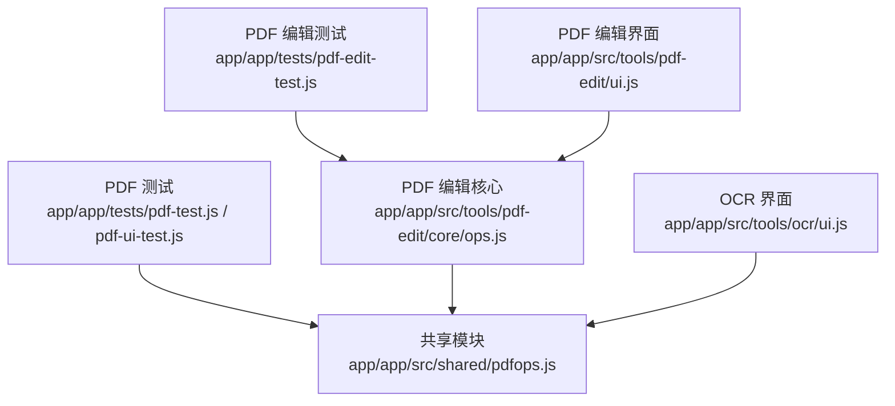
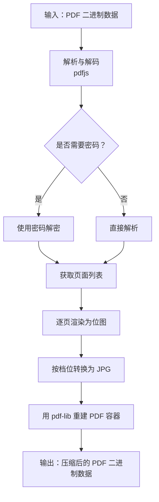
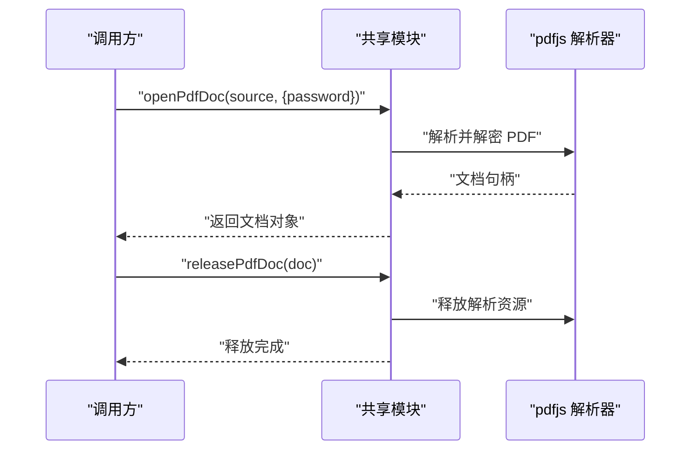
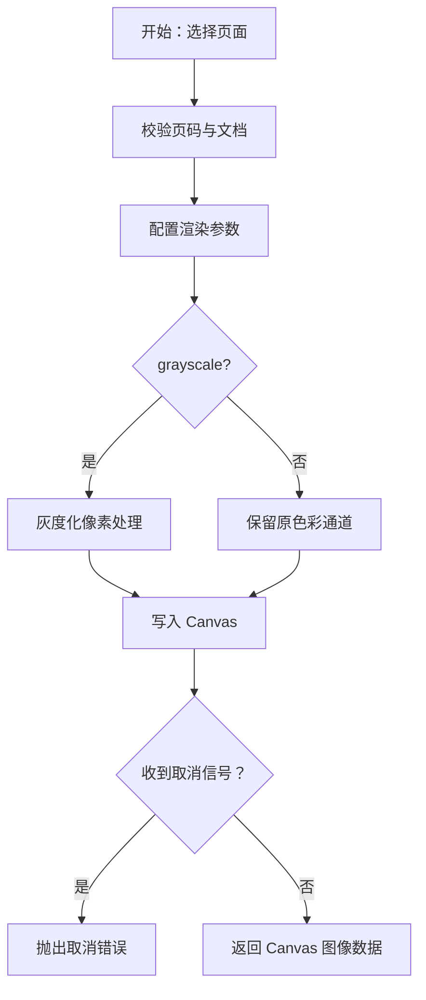
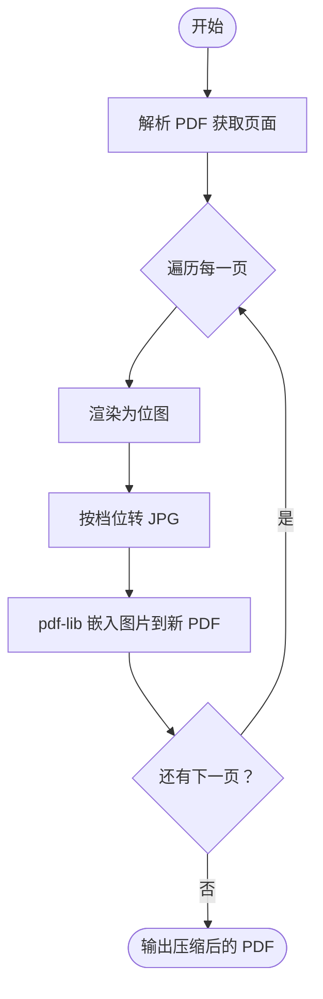
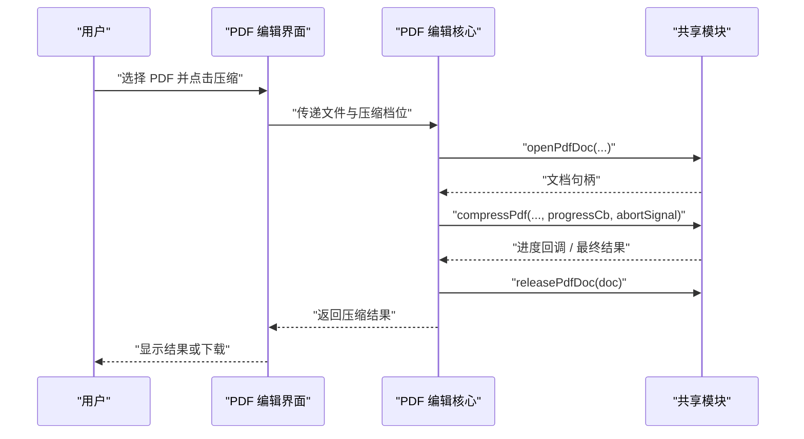
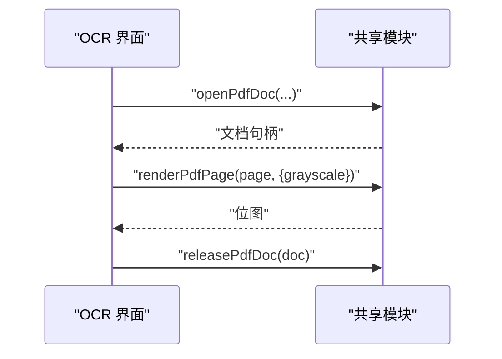
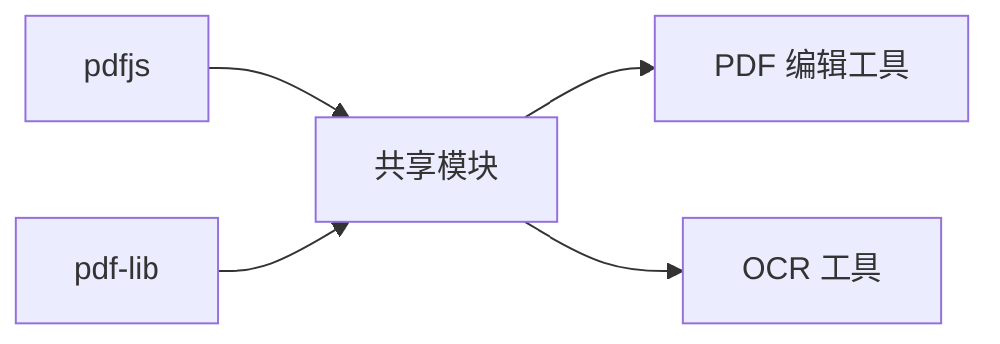

# PDF 操作模块

<cite>
**本文引用的文件**   
- [pdfops.js](file://app/app/src/shared/pdfops.js)
- [pdf-edit ops.js](file://app/app/src/tools/pdf-edit/core/ops.js)
- [pdf-edit ui.js](file://app/app/src/tools/pdf-edit/ui.js)
- [ocr ui.js](file://app/app/src/tools/ocr/ui.js)
- [pdf-edit-test.js](file://app/app/tests/pdf-edit-test.js)
- [pdf-test.js](file://app/app/tests/pdf-test.js)
- [pdf-ui-test.js](file://app/app/tests/pdf-ui-test.js)
- [compress compress.js](file://app/app/src/tools/compress/core/compress.js)
</cite>

## 目录
1. [简介](#简介)
2. [项目结构](#项目结构)
3. [核心组件](#核心组件)
4. [架构总览](#架构总览)
5. [详细组件分析](#详细组件分析)
6. [依赖关系分析](#依赖关系分析)
7. [性能考量](#性能考量)
8. [故障排查指南](#故障排查指南)
9. [结论](#结论)
10. [附录：API 参考与用法示例](#附录api-参考与用法示例)

## 简介
本文件面向需要复用或扩展 PDF 能力的开发者，系统化梳理基于 pdfjs 与 pdf-lib 的 PDF 共享模块。重点覆盖以下能力：
- 打开、渲染、释放 PDF 文档对象；
- 按档位批量压缩 PDF，将每页重编码为 JPG 后由 pdf-lib 重新装箱；
- 灰度化对扫描件体积优化的影响；
- 进度回调、取消机制与错误处理；
- 与 pdf-edit、ocr 工具的集成模式；
- 内存管理与 releasePdfDoc 的最佳实践。

该模块在仓库中作为共享能力被多个工具复用，是理解整个 PDF 工作流的关键入口。

## 项目结构
PDF 相关代码主要分布在以下位置：
- 共享层：app/app/src/shared/pdfops.js，提供 openPdfDoc、renderPdfPage、compressPdf、releasePdfDoc 等基础 API；
- 工具层：app/app/src/tools/pdf-edit 与 app/app/src/tools/ocr，分别消费共享层的 PDF 能力；
- 测试层：app/app/tests 下存在 pdf-test.js、pdf-ui-test.js、pdf-edit-test.js 等用例，展示调用方式与边界行为。

图表来源
- [pdfops.js](file://app/app/src/shared/pdfops.js)
- [pdf-edit ops.js](file://app/app/src/tools/pdf-edit/core/ops.js)
- [pdf-edit ui.js](file://app/app/src/tools/pdf-edit/ui.js)
- [ocr ui.js](file://app/app/src/tools/ocr/ui.js)
- [pdf-test.js](file://app/app/tests/pdf-test.js)
- [pdf-ui-test.js](file://app/app/tests/pdf-ui-test.js)
- [pdf-edit-test.js](file://app/app/tests/pdf-edit-test.js)

章节来源
- [pdfops.js](file://app/app/src/shared/pdfops.js)
- [pdf-edit ops.js](file://app/app/src/tools/pdf-edit/core/ops.js)
- [pdf-edit ui.js](file://app/app/src/tools/pdf-edit/ui.js)
- [ocr ui.js](file://app/app/src/tools/ocr/ui.js)
- [pdf-test.js](file://app/app/tests/pdf-test.js)
- [pdf-ui-test.js](file://app/app/tests/pdf-ui-test.js)
- [pdf-edit-test.js](file://app/app/tests/pdf-edit-test.js)

## 核心组件
本节从使用方视角抽象出共享模块对外暴露的能力。实际实现细节位于 pdfops.js，但此处先给出统一 API 语义，便于跨工具理解。

- openPdfDoc(source, options)
  - 功能：加载本地 ArrayBuffer/Blob/URL 或 Base64 形式的 PDF，返回可后续使用的文档句柄；支持密码保护场景。
  - 关键参数：
    - source：PDF 数据源；
    - options：可选，包含 password（字符串）、disableAutoDecode（布尔）等；
  - 返回值：文档对象，供 renderPdfPage、页面计数、元数据读取等调用；
  - 失败情形：权限不足、损坏文件、不支持的加密算法。

- renderPdfPage(doc, pageIndex, canvasOrContext, scale, grayscale, abortSignal)
  - 功能：将指定页面绘制到 Canvas 或 OffscreenCanvas；支持缩放、灰度化与中断信号；
  - 关键参数：
    - doc：openPdfDoc 返回的文档对象；
    - pageIndex：从零开始的页码；
    - canvasOrContext：Canvas 元素或 2D 上下文；
    - scale：渲染缩放倍数；
    - grayscale：是否灰度化；
    - abortSignal：用于取消渲染；
  - 返回值：完成后的 Canvas 图像数据；
  - 失败情形：无效页码、渲染失败、被取消。

- compressPdf(inputSource, presetKey, options, progressCb, abortSignal)
  - 功能：按预设档位对 PDF 进行“位图重绘 + JPG 重编码 + pdf-lib 重建”的压缩；
  - 关键参数：
    - inputSource：原始 PDF 数据；
    - presetKey：light、standard、strong、extreme 之一；
    - options：可选，如 grayscale、maxPages、targetSizeRatio 等；
    - progressCb：进度回调，含已处理页数、总体页数、当前文件大小估算等；
    - abortSignal：用于中断压缩；
  - 返回值：压缩后的 PDF 字节数组；
  - 失败情形：无可用页面、JPG 编码失败、内存不足、被取消。

- releasePdfDoc(doc)
  - 功能：显式释放 PDF 文档占用的资源，避免长期驻留内存；
  - 使用建议：在不再需要文档句柄时立即调用；
  - 失败情形：重复释放或传入非文档对象时应做防御性处理。

章节来源
- [pdfops.js](file://app/app/src/shared/pdfops.js)

## 架构总览
共享模块以“渲染引擎 + 封装器”的方式组织：底层使用 pdfjs 负责解析与光栅化，使用 pdf-lib 负责重建 PDF 容器。上层工具通过统一 API 访问，屏蔽具体实现差异。

图表来源
- [pdfops.js](file://app/app/src/shared/pdfops.js)

## 详细组件分析

### 打开与释放文档：openPdfDoc 与 releasePdfDoc
- openPdfDoc
  - 负责安全地解析 PDF，包括处理密码保护；
  - 内部维护一个轻量级文档句柄，避免多次解析相同数据；
  - 推荐与 cancel/abort 机制配合，防止长时间阻塞。
- releasePdfDoc
  - 应遵循“谁创建谁释放”原则；
  - 在异常路径也需确保释放，建议使用 try/finally 包裹；
  - 若模块内部缓存了文档，释放后会失效，再次使用需重新打开。

图表来源
- [pdfops.js](file://app/app/src/shared/pdfops.js)

章节来源
- [pdfops.js](file://app/app/src/shared/pdfops.js)

### 页面渲染：renderPdfPage
- 渲染管线
  - 校验页码与文档状态；
  - 配置 pdfjs 渲染目标（Canvas/OffscreenCanvas）；
  - 根据 grayscale 决定像素通道处理；
  - 支持 abortSignal 中断。
- 灰度化处理
  - 将彩色位图转换为单通道灰度图，减少后续 JPG 编码的数据量；
  - 对扫描件尤为有效，通常可显著降低体积；
  - 对彩色图文较多的 PDF，会牺牲色彩保真度，需谨慎启用。

图表来源
- [pdfops.js](file://app/app/src/shared/pdfops.js)

章节来源
- [pdfops.js](file://app/app/src/shared/pdfops.js)

### 压缩流程与压缩档位：compressPdf 与 PDF_COMPRESS_PRESETS
- 整体流程
  - 解析 PDF 获取页面数；
  - 逐页渲染为位图；
  - 按档位转换为 JPG，控制质量、采样与尺寸；
  - 用 pdf-lib 新建 PDF，将 JPG 嵌入每页；
  - 输出新的 PDF 二进制数据。
- 压缩档位 PDF_COMPRESS_PRESETS
  - light：轻度压缩，适合仍需较高清晰度的文档；
  - standard：标准压缩，平衡清晰度与体积；
  - strong：强力压缩，适合扫描件为主、对体积敏感的场景；
  - extreme：极致压缩，体积最小，可能明显损失清晰度；
  - 各档位内部通常包含 quality、samplingFactor、maxDimension 等参数，按“轻→强”逐步降低质量与分辨率。
- 进度与取消
  - progressCb 可上报：当前页、总页数、累计大小估计、阶段名称；
  - abortSignal 可在任意阶段触发取消，避免长任务卡死 UI。

图表来源
- [pdfops.js](file://app/app/src/shared/pdfops.js)

章节来源
- [pdfops.js](file://app/app/src/shared/pdfops.js)

### 与 pdf-edit 工具的集成
- pdf-edit 的核心逻辑位于 ops.js，UI 层在 ui.js；
- 典型集成点：
  - 打开待编辑 PDF；
  - 调用 compressPdf 执行压缩；
  - 使用 renderPdfPage 生成预览缩略图；
  - 完成后调用 releasePdfDoc 释放资源。
- 交互时序

图表来源
- [pdf-edit ops.js](file://app/app/src/tools/pdf-edit/core/ops.js)
- [pdf-edit ui.js](file://app/app/src/tools/pdf-edit/ui.js)
- [pdfops.js](file://app/app/src/shared/pdfops.js)

章节来源
- [pdf-edit ops.js](file://app/app/src/tools/pdf-edit/core/ops.js)
- [pdf-edit ui.js](file://app/app/src/tools/pdf-edit/ui.js)
- [pdfops.js](file://app/app/src/shared/pdfops.js)

### 与 OCR 工具的集成
- OCR 工具通常在识别前对扫描型 PDF 进行预处理：
  - 使用 renderPdfPage 将页面转为位图；
  - 可选开启 grayscale 提升识别效率与降低内存占用；
  - 如需进一步减小体积，可再走 compressPdf 流水线；
  - 识别结束后释放中间资源。
- 典型调用链

图表来源
- [ocr ui.js](file://app/app/src/tools/ocr/ui.js)
- [pdfops.js](file://app/app/src/shared/pdfops.js)

章节来源
- [ocr ui.js](file://app/app/src/tools/ocr/ui.js)
- [pdfops.js](file://app/app/src/shared/pdfops.js)

## 依赖关系分析
- 外部依赖
  - pdfjs：负责 PDF 解析、解密与页面光栅化；
  - pdf-lib：负责重建 PDF 容器与嵌入图片；
  - 浏览器 Canvas API：承载渲染位图；
  - AbortController/AbortSignal：提供取消能力。
- 模块耦合
  - pdf-edit 与 ocr 均依赖共享模块，形成“多消费者—单提供者”的结构；
  - 共享模块对底层库的封装降低了工具层的复杂度，提高一致性。

图表来源
- [pdfops.js](file://app/app/src/shared/pdfops.js)
- [pdf-edit ops.js](file://app/app/src/tools/pdf-edit/core/ops.js)
- [ocr ui.js](file://app/app/src/tools/ocr/ui.js)

章节来源
- [pdfops.js](file://app/app/src/shared/pdfops.js)
- [pdf-edit ops.js](file://app/app/src/tools/pdf-edit/core/ops.js)
- [ocr ui.js](file://app/app/src/tools/ocr/ui.js)

## 性能考量
- 渲染与内存
  - 大文档分页渲染，避免一次性加载全部页面；
  - 使用 OffscreenCanvas 可减少主线程压力；
  - grayscale 能显著降低位图数据量，从而降低 JPG 编码与存储成本；
  - 及时调用 releasePdfDoc 释放解析缓存。
- 压缩策略
  - 对于扫描件为主的 PDF，standard 或 strong 档位在体积与清晰度之间较均衡；
  - 极端压缩可能导致文字边缘模糊，不适合矢量信息丰富的文档；
  - 建议结合 maxPages 与 targetSizeRatio 做分批处理与自适应调整。
- 并发与 UI
  - 通过 progressCb 更新 UI，避免长时间无反馈；
  - 使用 abortSignal 允许用户主动中止；
  - 对超大文档可采用分片压缩，降低峰值内存。

[本节为通用指导，不直接分析具体文件]

## 故障排查指南
- 打开失败
  - 常见原因：密码错误、文件损坏、加密方案不受支持；
  - 排查要点：确认 password 正确，检查文件完整性，查看错误类型提示。
- 渲染失败
  - 常见原因：页码越界、Canvas 上下文不可用、内存不足；
  - 排查要点：校验 pageIndex，确保 Canvas 尺寸合理，必要时降低 scale。
- 压缩失败
  - 常见原因：JPG 编码失败、页面为空、取消信号触发；
  - 排查要点：检查 progressCb 的阶段日志，确认 abortSignal 未被误触发。
- 内存泄漏
  - 症状：长时间运行后内存持续增长；
  - 解决：确保所有 openPdfDoc 均有对应的 releasePdfDoc，且在异常分支也能释放。

章节来源
- [pdfops.js](file://app/app/src/shared/pdfops.js)

## 结论
共享 PDF 模块通过统一的 API 封装了 pdfjs 与 pdf-lib 的使用差异，提供了从打开、渲染到压缩、释放的完整生命周期管理。借助 PDF_COMPRESS_PRESETS 的档位化配置与 grayscale 选项，能够在不同业务场景中取得较好的体积与清晰度平衡。与 pdf-edit、ocr 工具的集成体现了良好的复用性与可扩展性。建议在大规模处理时严格遵循进度与取消机制，并落实 releasePdfDoc 的资源释放规范。

[本节为总结性内容，不直接分析具体文件]

## 附录：API 参考与用法示例

### API 定义摘要
- openPdfDoc(source, options)
  - 入参：source（ArrayBuffer/Blob/URL/Base64），options（password、disableAutoDecode 等）；
  - 返回：文档句柄；
  - 用途：打开并解析 PDF，支持密码保护。
- renderPdfPage(doc, pageIndex, canvasOrContext, scale, grayscale, abortSignal)
  - 入参：doc、pageIndex、canvasOrContext、scale、grayscale、abortSignal；
  - 返回：Canvas 图像数据；
  - 用途：将指定页面渲染到位图，支持灰度化与取消。
- compressPdf(inputSource, presetKey, options, progressCb, abortSignal)
  - 入参：inputSource（PDF 二进制）、presetKey（light/standard/strong/extreme）、options、progressCb、abortSignal；
  - 返回：压缩后的 PDF 二进制；
  - 用途：按档位批量压缩 PDF。
- releasePdfDoc(doc)
  - 入参：文档句柄；
  - 用途：释放解析与缓存资源。

章节来源
- [pdfops.js](file://app/app/src/shared/pdfops.js)

### 使用示例指引
- 打开密码保护的 PDF
  - 步骤：调用 openPdfDoc，传入 source 与 { password }；成功后再进行渲染或压缩；
  - 参考路径：[pdf-test.js](file://app/app/tests/pdf-test.js)、[pdf-ui-test.js](file://app/app/tests/pdf-ui-test.js)。
- 渲染指定页面
  - 步骤：获取文档句柄后调用 renderPdfPage，传入 pageIndex、Canvas 与 scale；
  - 参考路径：[pdf-ui-test.js](file://app/app/tests/pdf-ui-test.js)。
- 执行批量压缩
  - 步骤：调用 compressPdf，选择 presetKey，传入 progressCb 观察进度，必要时使用 abortSignal 取消；
  - 参考路径：[pdf-edit-test.js](file://app/app/tests/pdf-edit-test.js)、[pdfops.js](file://app/app/src/shared/pdfops.js)。
- 灰度化优化
  - 步骤：在 renderPdfPage 中开启 grayscale，适用于扫描件；
  - 参考路径：[pdfops.js](file://app/app/src/shared/pdfops.js)。
- 释放资源
  - 步骤：在 finally 块中调用 releasePdfDoc，确保异常路径也能释放；
  - 参考路径：[pdfops.js](file://app/app/src/shared/pdfops.js)。

[示例部分以步骤说明为主，未直接粘贴代码；对应源码请参考所列路径]