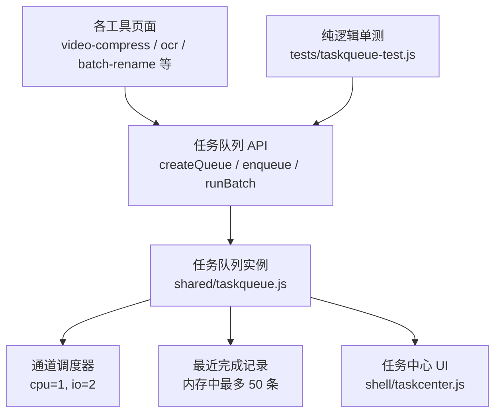
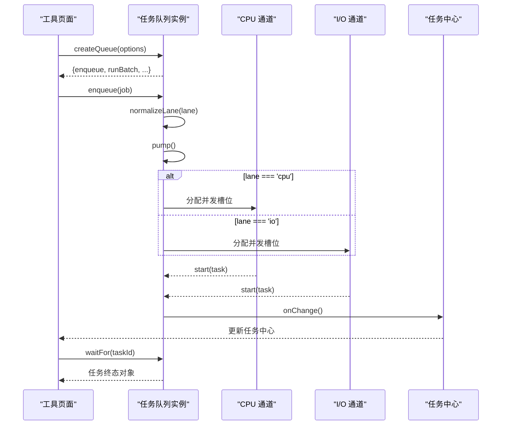
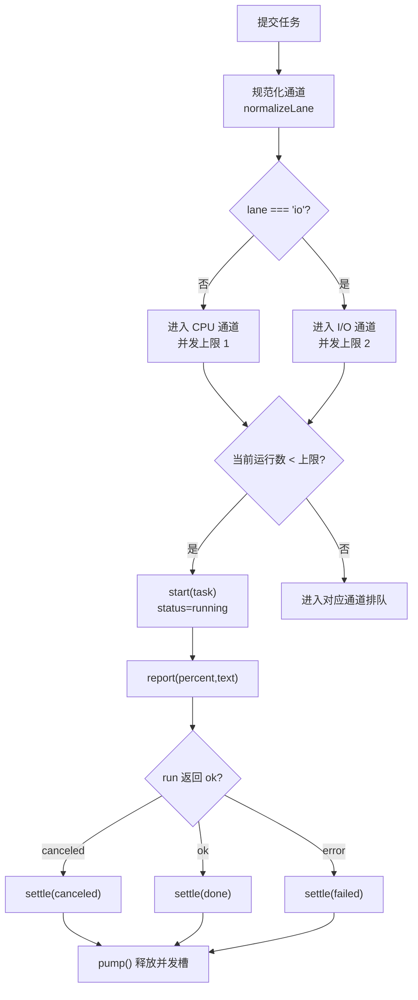
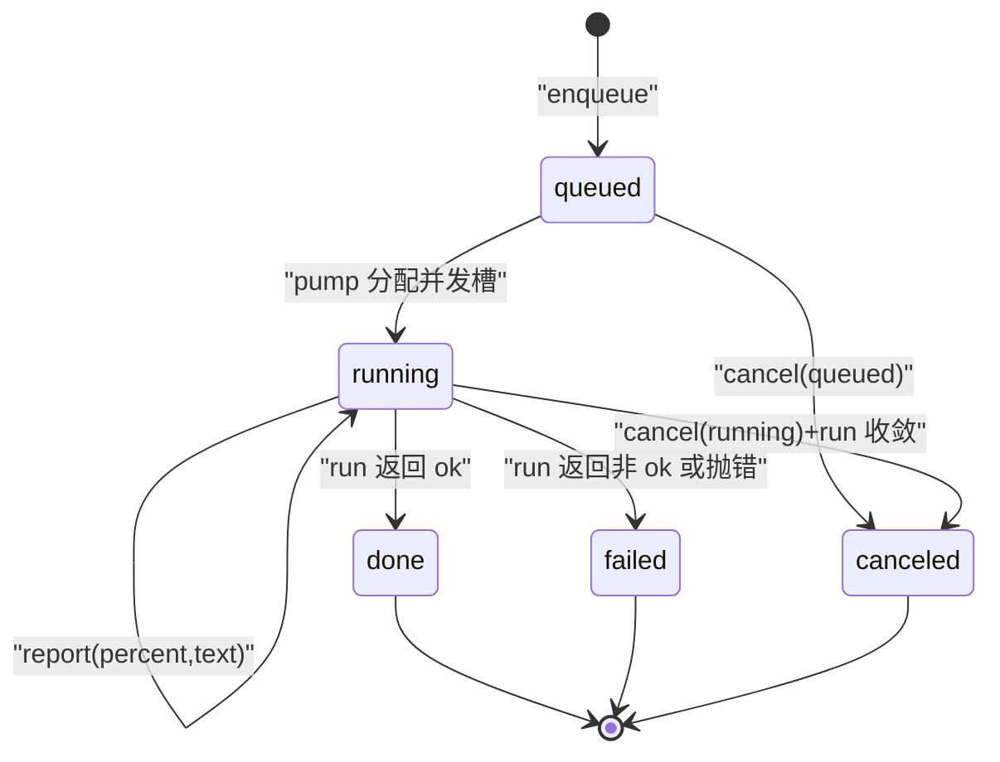
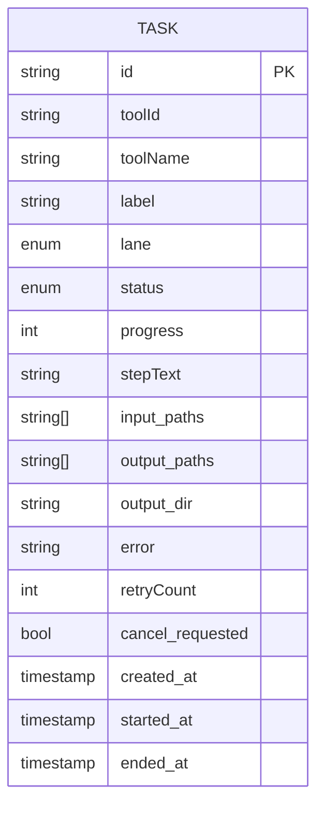
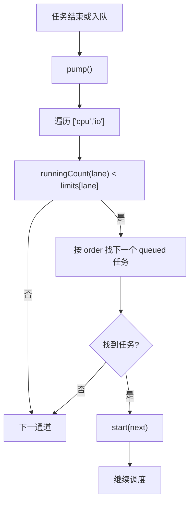
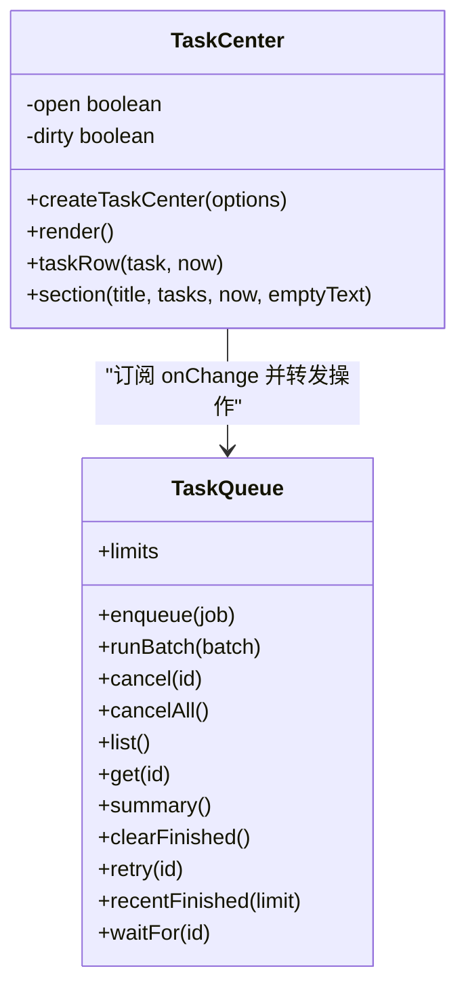
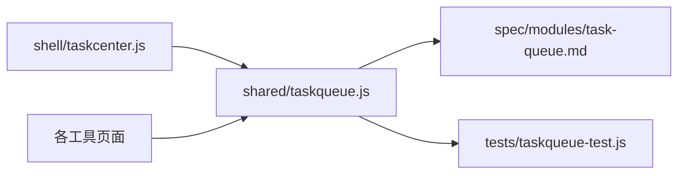

# 任务队列模块

<cite>
**本文引用的文件**   
- [taskqueue.js](file://app/src/shared/taskqueue.js)
- [taskcenter.js](file://app/src/shell/taskcenter.js)
- [task-queue.md](file://spec/modules/task-queue.md)
- [taskqueue-test.js](file://app/tests/taskqueue-test.js)
</cite>

## 目录
1. [引言](#引言)
2. [项目结构](#项目结构)
3. [核心 API 参考](#核心-api-参考)
4. [架构总览](#架构总览)
5. [双通道并发模型](#双通道并发模型)
6. [任务生命周期与状态机](#任务生命周期与状态机)
7. [详细组件分析](#详细组件分析)
8. [依赖关系分析](#依赖关系分析)
9. [性能优化建议](#性能优化建议)
10. [故障排查指南](#故障排查指南)
11. [结论](#结论)
12. [附录：代码示例路径](#附录代码示例路径)

## 引言
本模块是跨工具任务调度的核心基础设施，解决两个关键问题：
- 批量任务不再由各工具自行串行循环执行，而是统一由任务队列调度；用户切换工具页后仍可看到整体进度。
- 工具页存在 LRU 保活上限，被回收时会调用 `unmount()`；旧实现会取消运行中的任务，导致“切工具切多了，后台任务连坐被杀”。任务入队后归属队列，不归属工具页，LRU 回收只退订 UI，不会取消任务。

该模块是纯逻辑实现，无 DOM、可被 Node 直接单测；界面侧通过任务中心展示和转发操作。

**章节来源**
- [task-queue.md:1-30](file://spec/modules/task-queue.md#L1-L30)

## 项目结构
任务队列相关代码集中在以下位置：
- 核心队列实现：`app/src/shared/taskqueue.js`
- 任务中心 UI：`app/src/shell/taskcenter.js`
- 规格说明：`spec/modules/task-queue.md`
- 纯逻辑测试：`app/tests/taskqueue-test.js`

**图表来源**
- [taskqueue.js:1-354](file://app/src/shared/taskqueue.js#L1-L354)
- [taskcenter.js:1-200](file://app/src/shell/taskcenter.js#L1-L200)
- [task-queue.md:1-30](file://spec/modules/task-queue.md#L1-L30)

**章节来源**
- [taskqueue.js:1-30](file://app/src/shared/taskqueue.js#L1-L30)
- [task-queue.md:1-30](file://spec/modules/task-queue.md#L1-L30)

## 核心 API 参考

### createQueue(options)
创建并返回一个任务队列实例。

| 参数 | 类型 | 默认值 | 说明 |
| --- | --- | --- | --- |
| options.concurrency.cpu | number | 1 | CPU 通道最大并发数 |
| options.concurrency.io | number | 2 | I/O 通道最大并发数 |
| options.onChange | function | 空函数 | 队列任何变化时回调，用于刷新 UI |
| options.onTaskDone | function | 空函数 | 单个任务到达终态时回调 |
| options.historyLimit | number | 50 | 最近完成记录保留条数 |

返回值包含：
- `enqueue(job)`
- `runBatch(batch)`
- `cancel(taskId)`
- `cancelAll()`
- `list()`
- `get(taskId)`
- `summary()`
- `clearFinished()`
- `retry(taskId)`
- `recentFinished(limit)`
- `waitFor(taskId)`
- `limits`（当前通道并发限制）

**章节来源**
- [taskqueue.js:31-75](file://app/src/shared/taskqueue.js#L31-L75)
- [taskqueue.js:285-354](file://app/src/shared/taskqueue.js#L285-L354)

### enqueue(job)
提交一个单任务。

job 字段：
- `toolId`: string，工具标识
- `toolName`: string，工具显示名
- `label`: string，任务名称
- `lane`: 'cpu' | 'io'，默认 'cpu'
- `run(ctx)`: Promise，执行体
- `onCancel(task)`: function，可选取消钩子
- `inputPaths`: string[]，输入文件列表
- `outputDir`: string，输出目录

返回 taskId。

ctx.report({percent?, text?}) 上报进度；ctx.isCancelled() 判断是否已请求取消。

**章节来源**
- [taskqueue.js:130-175](file://app/src/shared/taskqueue.js#L130-L175)

### runBatch(batch)
批量入队同一工具的若干“单文件任务”，并等待全部到达终态。

batch 字段：
- `toolId`: string
- `toolName`: string
- `lane`: 'cpu' | 'io'，默认 'cpu'
- `jobs`: object[]，每个 job 结构与 enqueue 的 job 一致

返回 Promise<object[]>，结果数组与 jobs 同序，且每项都是已终态的任务对象。

**章节来源**
- [taskqueue.js:201-210](file://app/src/shared/taskqueue.js#L201-L210)

### waitFor(taskId)
等待某任务到达终态。若任务已终态则立即 resolve；未找到 taskId 时返回 null。

适合需要保持原有“跑完再汇总”的界面行为。

**章节来源**
- [taskqueue.js:335-346](file://app/src/shared/taskqueue.js#L335-L346)

### cancel(taskId) / cancelAll()
- `cancel(taskId)`：对排队任务直接标记为 canceled；对运行中任务设置取消标志并调用 onCancel。
- `cancelAll()`：对所有未完成任务执行取消。

返回布尔或取消数量。

**章节来源**
- [taskqueue.js:212-235](file://app/src/shared/taskqueue.js#L212-L235)

### list() / get(taskId)
- `list()`：按入队顺序返回全部任务（含尚未清除的终态任务）。
- `get(taskId)`：获取单个任务对象。

**章节来源**
- [taskqueue.js:237-245](file://app/src/shared/taskqueue.js#L237-L245)

### summary()
返回汇总统计：
- queued、running、done、failed、canceled、total、percent

percent 按任务条数加权平均：
- 终态任务记 100（失败/取消也算已结束）
- 运行中记自身 progress
- 排队记 0

**章节来源**
- [taskqueue.js:247-283](file://app/src/shared/taskqueue.js#L247-L283)

### clearFinished()
清除已结束（done/failed/canceled）的任务与最近完成记录，返回清除条数。

**章节来源**
- [taskqueue.js:285-306](file://app/src/shared/taskqueue.js#L285-L306)

### retry(taskId)
失败或取消的任务重新入队，retryCount+1，其余参数复用原任务。

不做自动重试，避免产物被重复覆盖。

**章节来源**
- [taskqueue.js:308-333](file://app/src/shared/taskqueue.js#L308-L333)

### recentFinished(limit)
返回最近完成记录，新的在前，默认返回 10 条。

**章节来源**
- [taskqueue.js:335-339](file://app/src/shared/taskqueue.js#L335-L339)

## 架构总览

**图表来源**
- [taskqueue.js:31-75](file://app/src/shared/taskqueue.js#L31-L75)
- [taskqueue.js:130-175](file://app/src/shared/taskqueue.js#L130-L175)
- [taskqueue.js:201-210](file://app/src/shared/taskqueue.js#L201-L210)
- [taskqueue.js:237-283](file://app/src/shared/taskqueue.js#L237-L283)
- [taskcenter.js:1-200](file://app/src/shell/taskcenter.js#L1-L200)

## 双通道并发模型

### 为什么 CPU 通道串行而 I/O 通道并行
- CPU 通道默认并发为 1，适用于 ffmpeg、PDF、OCR 等吃满 CPU 的任务。串行执行最稳，避免多路编解码争抢 CPU 资源。
- I/O 通道默认并发为 2，适用于 canvas 图片解码/编码/落盘类任务。这类任务更多受磁盘或图像库限制，适度并行能提升吞吐。
- 未知通道名一律归为 cpu，保守串行，防止写错通道名把 CPU 打满。
- 通道之间互不挤占额度：cpu 通道占用不影响 io 通道，反之亦然。

**图表来源**
- [taskqueue.js:17-25](file://app/src/shared/taskqueue.js#L17-L25)
- [taskqueue.js:130-175](file://app/src/shared/taskqueue.js#L130-L175)
- [taskqueue.js:201-210](file://app/src/shared/taskqueue.js#L201-L210)

**章节来源**
- [taskqueue.js:17-25](file://app/src/shared/taskqueue.js#L17-L25)
- [taskqueue.js:130-175](file://app/src/shared/taskqueue.js#L130-L175)
- [task-queue.md:15-24](file://spec/modules/task-queue.md#L15-L24)

## 任务生命周期与状态机

任务有五种状态：
- queued：已入队但尚未开始
- running：正在执行
- done：成功完成
- failed：执行失败
- canceled：被取消

关键规则：
- 终态集合：done、failed、canceled
- report 仅在 running 状态写入进度；迟到进度丢弃
- cancel(queued) 直接 settle(canceled)，不占后续并发
- cancel(running) 设置 cancelRequested 并调用 onCancel；run 收敛后无论 ok 还是抛错都视为取消
- failed 不自动重试，需显式 retry
- historyLimit 控制最近完成记录长度，新记录插入头部，超出则丢弃尾部

**章节来源**
- [taskqueue.js:17-25](file://app/src/shared/taskqueue.js#L17-L25)
- [taskqueue.js:76-129](file://app/src/shared/taskqueue.js#L76-L129)
- [taskqueue.js:212-235](file://app/src/shared/taskqueue.js#L212-L235)
- [taskqueue.js:247-283](file://app/src/shared/taskqueue.js#L247-L283)
- [taskqueue.js:285-333](file://app/src/shared/taskqueue.js#L285-L333)

## 详细组件分析

### 任务数据结构
任务对象包含：
- id：时间戳 + 自增序号，可读便于排障
- toolId、toolName、label：工具与任务描述
- lane：'cpu' | 'io'
- status：五种状态之一
- progress：0..100
- stepText：最新 step 文本
- input.paths：输入文件列表
- output.paths、output.dir：输出路径与目录
- error：失败原因字符串
- retryCount：重试次数
- cancelRequested：是否已请求取消
- createdAt、startedAt、endedAt：时间戳

**图表来源**
- [taskqueue.js:130-175](file://app/src/shared/taskqueue.js#L130-L175)
- [task-queue.md:25-40](file://spec/modules/task-queue.md#L25-L40)

**章节来源**
- [taskqueue.js:130-175](file://app/src/shared/taskqueue.js#L130-L175)
- [task-queue.md:25-40](file://spec/modules/task-queue.md#L25-L40)

### 调度器与并发控制
- 每个通道维护 runningCount，按入队顺序挑选下一个 queued 任务启动。
- limits 暴露给调用方，便于监控或动态调整。
- pump 在每次任务结束或开始时触发，确保槽位被及时利用。

**图表来源**
- [taskqueue.js:76-129](file://app/src/shared/taskqueue.js#L76-L129)
- [taskqueue.js:130-175](file://app/src/shared/taskqueue.js#L130-L175)

**章节来源**
- [taskqueue.js:76-129](file://app/src/shared/taskqueue.js#L76-L129)

### 任务中心 UI
任务中心负责：
- 显示汇总（进行中、排队、完成、失败）
- 显示总体进度条
- 列出活跃任务与最近完成任务
- 提供取消、重试、清空已完成等操作
- 面板开关不影响任务执行，仅做展示与转发

**图表来源**
- [taskcenter.js:1-200](file://app/src/shell/taskcenter.js#L1-L200)
- [taskqueue.js:285-354](file://app/src/shared/taskqueue.js#L285-L354)

**章节来源**
- [taskcenter.js:1-200](file://app/src/shell/taskcenter.js#L1-L200)
- [task-queue.md:41-70](file://spec/modules/task-queue.md#L41-L70)

## 依赖关系分析

- shared/taskqueue.js 不得反向 import 任何工具，单向依赖保证框架层稳定。
- taskcenter.js 仅持有队列实例并转发 UI 操作，不持有任务状态。
- 测试直接 import createQueue，验证纯逻辑行为。

**图表来源**
- [taskqueue.js:1-30](file://app/src/shared/taskqueue.js#L1-L30)
- [taskcenter.js:1-20](file://app/src/shell/taskcenter.js#L1-L20)
- [task-queue.md:1-30](file://spec/modules/task-queue.md#L1-L30)

**章节来源**
- [taskqueue.js:1-30](file://app/src/shared/taskqueue.js#L1-L30)
- [taskcenter.js:1-20](file://app/src/shell/taskcenter.js#L1-L20)

## 性能优化建议

### 并发度调优
- 默认 cpu=1、io=2 已在常见媒体处理场景中平衡稳定性与吞吐。
- 若工具内任务多为轻量 I/O，可适当提高 io 并发；若任务重 CPU，应保持 cpu=1。
- 不建议盲目拉高并发，因为报告与 UI 刷新频率也会增加。

### 内存管理
- 历史完成记录默认最多 50 条，可通过 historyLimit 调整。
- clearFinished 会清理终态任务与历史，避免长期积累。
- waitFor 使用 waiters Map，任务终态后自动清理。

### 批量任务最佳实践
- 使用 runBatch 替代工具内部 for 循环，保持任务归属队列。
- 一个“整体操作”算一个任务；逐文件处理算 N 个任务。
- 批量任务仍 await 全部结束，以保留原有“跑完汇总 + 按钮恢复”的界面行为。

**章节来源**
- [taskqueue.js:17-25](file://app/src/shared/taskqueue.js#L17-L25)
- [taskqueue.js:285-306](file://app/src/shared/taskqueue.js#L285-L306)
- [taskqueue.js:201-210](file://app/src/shared/taskqueue.js#L201-L210)
- [task-queue.md:55-70](file://spec/modules/task-queue.md#L55-L70)

## 故障排查指南

### 常见问题
- 任务切走工具页后被取消：确认工具 unmount() 中没有取消队列任务的逻辑；LRU 回收只应退订 UI。
- 进度不更新：检查 run(ctx) 是否正确调用 ctx.report({percent,text})；只有 running 状态的进度才会写入。
- 取消无效：确认 cancel(taskId) 已被调用；对运行中任务需等待 run 收敛后状态才变为 canceled。
- 失败后自动重试：队列不自动重试；需调用 retry(taskId)。
- 任务不在任务中心：未接入任务队列的工具不会出现在任务中心；功能不受影响。

### 调试技巧
- 使用 summary().percent 观察整体进度聚合。
- 使用 recentFinished(limit) 查看最近完成记录。
- 使用 list() 和 get(taskId) 检查任务状态、错误信息、重试次数。
- 通过 onTaskDone 监听单个任务终态，定位失败原因。
- 纯逻辑测试可直接运行 tests/taskqueue-test.js 验证并发、进度、取消、失败与重试行为。

**章节来源**
- [taskqueue.js:76-129](file://app/src/shared/taskqueue.js#L76-L129)
- [taskqueue.js:212-235](file://app/src/shared/taskqueue.js#L212-L235)
- [taskqueue.js:247-333](file://app/src/shared/taskqueue.js#L247-L333)
- [taskqueue-test.js:1-200](file://app/tests/taskqueue-test.js#L1-L200)

## 结论
任务队列模块通过双通道并发模型与严格的状态机，实现了跨工具任务的统一调度、进度可视化和取消重试能力。它将任务从工具页解耦，保证 LRU 回收不影响后台任务；同时提供简洁 API 与完整测试，使工具接入成本低、行为可预测。

[本节不直接分析具体文件]

## 附录：代码示例路径

- 创建队列并订阅变化：
  - [createQueue 定义](file://app/src/shared/taskqueue.js#L31-L75)
  - [onChange 回调触发](file://app/src/shared/taskqueue.js#L53-L63)

- 提交单任务：
  - [enqueue 实现](file://app/src/shared/taskqueue.js#L130-L175)
  - [report 与 isCancelled 用法](file://app/src/shared/taskqueue.js#L87-L115)

- 批量任务：
  - [runBatch 实现](file://app/src/shared/taskqueue.js#L201-L210)

- 等待任务完成：
  - [waitFor 实现](file://app/src/shared/taskqueue.js#L335-L346)

- 取消与重试：
  - [cancel 与 cancelAll](file://app/src/shared/taskqueue.js#L212-L235)
  - [retry](file://app/src/shared/taskqueue.js#L308-L333)

- 进度与汇总：
  - [summary 计算逻辑](file://app/src/shared/taskqueue.js#L247-L283)

- 任务中心展示：
  - [任务中心渲染](file://app/src/shell/taskcenter.js#L1-L200)

- 单测用例参考：
  - [并发与通道隔离](file://app/tests/taskqueue-test.js#L1-L120)
  - [进度聚合](file://app/tests/taskqueue-test.js#L120-L170)
  - [取消与失败](file://app/tests/taskqueue-test.js#L170-L298)

**章节来源**
- [taskqueue.js:31-L354](file://app/src/shared/taskqueue.js#L31-L354)
- [taskcenter.js:1-L200](file://app/src/shell/taskcenter.js#L1-L200)
- [taskqueue-test.js:1-L298](file://app/tests/taskqueue-test.js#L1-L298)