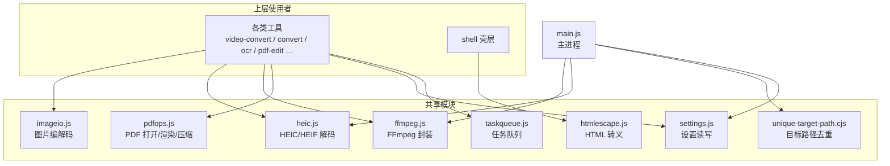
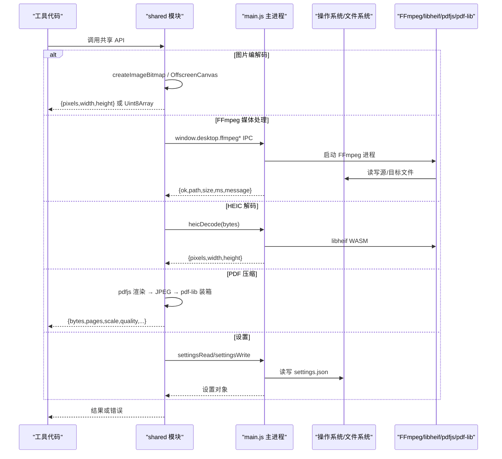
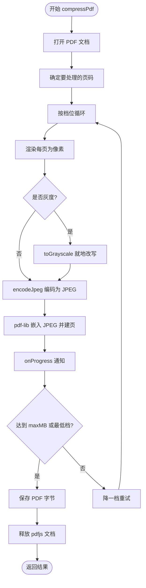
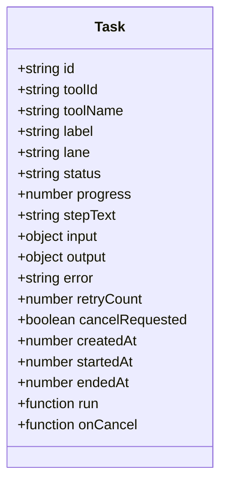
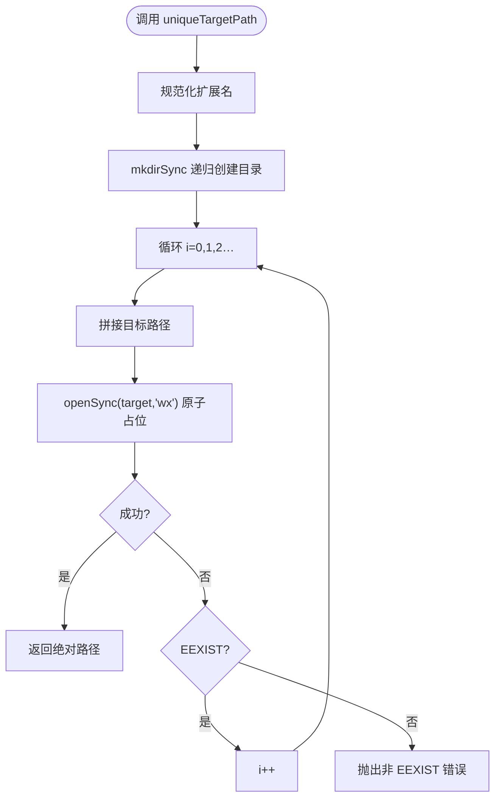
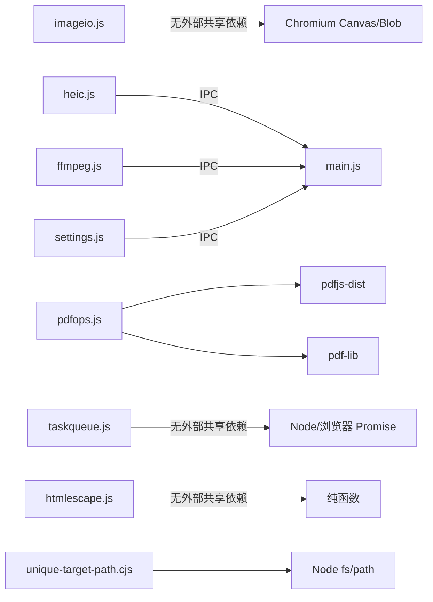

# 共享模块

<cite>
**本文引用的文件**   
- [ffmpeg.js](file://app/src/shared/ffmpeg.js)
- [heic.js](file://app/src/shared/heic.js)
- [imageio.js](file://app/src/shared/imageio.js)
- [pdfops.js](file://app/src/shared/pdfops.js)
- [settings.js](file://app/src/shared/settings.js)
- [taskqueue.js](file://app/src/shared/taskqueue.js)
- [htmlescape.js](file://app/src/shared/htmlescape.js)
- [unique-target-path.cjs](file://app/src/shared/unique-target-path.cjs)
</cite>

## 目录
1. [简介](#简介)
2. [项目结构](#项目结构)
3. [核心组件](#核心组件)
4. [架构总览](#架构总览)
5. [详细组件参考](#详细组件参考)
6. [依赖关系分析](#依赖关系分析)
7. [性能与内存管理](#性能与内存管理)
8. [错误处理与健壮性](#错误处理与健壮性)
9. [版本兼容性与向后兼容](#版本兼容性与向后兼容)
10. [常见问题排查](#常见问题排查)
11. [结论](#结论)

## 简介
本仓库的“共享模块”位于 `app/src/shared`，是跨工具复用的底层能力层。它把图片编解码、FFmpeg 封装、HEIC 支持、PDF 操作、设置管理、任务队列、HTML 转义和路径去重等通用逻辑集中实现，供各工具（如视频转换、图片压缩、OCR、PDF 编辑等）调用。其设计目标是：
- 统一行为：避免不同工具各自实现同一类逻辑导致产出不一致。
- 降低耦合：工具之间禁止互相 import，必须通过 shared 层交互。
- 明确边界：界面进程负责 UI 与轻量计算；重型 I/O、原生库调用交给主进程 IPC。
- 可测试：纯函数逻辑尽量可被 Node 单测覆盖。

## 项目结构
共享模块按职责拆分为八个独立文件，每个文件对应一个关注点：

**图表来源**
- [ffmpeg.js:1-20](file://app/src/shared/ffmpeg.js#L1-L20)
- [heic.js:1-10](file://app/src/shared/heic.js#L1-L10)
- [imageio.js:1-10](file://app/src/shared/imageio.js#L1-L10)
- [pdfops.js:1-15](file://app/src/shared/pdfops.js#L1-L15)
- [settings.js:1-12](file://app/src/shared/settings.js#L1-L12)
- [taskqueue.js:1-20](file://app/src/shared/taskqueue.js#L1-L20)
- [htmlescape.js:1-6](file://app/src/shared/htmlescape.js#L1-L6)
- [unique-target-path.cjs:1-10](file://app/src/shared/unique-target-path.cjs#L1-L10)

**章节来源**
- [ffmpeg.js:1-20](file://app/src/shared/ffmpeg.js#L1-L20)
- [heic.js:1-10](file://app/src/shared/heic.js#L1-L10)
- [imageio.js:1-10](file://app/src/shared/imageio.js#L1-L10)
- [pdfops.js:1-15](file://app/src/shared/pdfops.js#L1-L15)
- [settings.js:1-12](file://app/src/shared/settings.js#L1-L12)
- [taskqueue.js:1-20](file://app/src/shared/taskqueue.js#L1-L20)
- [htmlescape.js:1-6](file://app/src/shared/htmlescape.js#L1-L6)
- [unique-target-path.cjs:1-10](file://app/src/shared/unique-target-path.cjs#L1-L10)

## 核心组件
| 模块 | 主要职责 | 运行环境 | 关键约束 |
|---|---|---|---|
| 图片编解码 imageio | 将图片字节解码为 RGBA 像素，或把像素编码回 PNG/JPG；生成缩略图 | 界面进程（Chromium） | 像素总量上限约 4000 万，防止整图摊开导致 OOM |
| FFmpeg 封装 ffmpeg | 统一拼 FFmpeg 参数，并通过 `window.desktop.*` 调用主进程 IPC | 界面进程 | 真正进程调用在 main.js；大文件优先走文件通道，不读入界面内存 |
| HEIC 支持 heic | 解码手机 HEIC/HEIF/HIF 输入，返回与 imageio 同构的像素对象 | 界面进程封装 + 主进程 libheif WASM | Chromium 内核不支持 HEIC，需走主进程 |
| PDF 操作 pdfops | 打开 PDF、渲染页到像素、按档位压缩并重建 PDF | 界面进程 + pdfjs/pdf-lib | 释放 pdfjs 文档，避免 worker 缓存泄漏 |
| 设置管理 settings | 加载、读取、更新、重置全局设置，落盘到 userdata/settings.json | 界面进程 + 主进程 IPC | 失败时退回默认值，保持界面可用 |
| 任务队列 taskqueue | 多通道并发队列，承载批量任务、进度、取消、重试、最近完成记录 | 纯逻辑，可在 Node 单测 | 入队后任务归属队列，工具 unmount 不得取消任务 |
| HTML 转义 htmlescape | 对可控字符串做 HTML 实体转义 | 纯函数 | 只防结构破坏，展示纯文本优先用 textContent |
| 路径去重 unique-target-path | 原子占位方式分配唯一输出文件名 | 主进程（CommonJS） | openSync wx 模式保证并发下不覆盖 |

**章节来源**
- [imageio.js:1-141](file://app/src/shared/imageio.js#L1-L141)
- [ffmpeg.js:1-200](file://app/src/shared/ffmpeg.js#L1-L200)
- [heic.js:1-23](file://app/src/shared/heic.js#L1-L23)
- [pdfops.js:1-198](file://app/src/shared/pdfops.js#L1-L198)
- [settings.js:1-83](file://app/src/shared/settings.js#L1-L83)
- [taskqueue.js:1-354](file://app/src/shared/taskqueue.js#L1-L354)
- [htmlescape.js:1-8](file://app/src/shared/htmlescape.js#L1-L8)
- [unique-target-path.cjs:1-43](file://app/src/shared/unique-target-path.cjs#L1-L43)

## 架构总览
共享模块的整体数据流如下：

**图表来源**
- [ffmpeg.js:1-20](file://app/src/shared/ffmpeg.js#L1-L20)
- [heic.js:1-23](file://app/src/shared/heic.js#L1-L23)
- [imageio.js:1-141](file://app/src/shared/imageio.js#L1-L141)
- [pdfops.js:1-198](file://app/src/shared/pdfops.js#L1-L198)
- [settings.js:1-83](file://app/src/shared/settings.js#L1-L83)

## 详细组件参考

### 图片编解码模块 imageio
该模块提供浏览器侧图片 I/O，使用 `createImageBitmap` 和 `OffscreenCanvas`，不引入第三方图像库。

#### 公开接口

| 函数 | 参数 | 返回值 | 异常 |
|---|---|---|---|
| `decodeImageFromBytes(bytes)` | `bytes: ArrayBuffer \| Uint8Array` | `Promise<{pixels: Uint8ClampedArray, width: number, height: number}>` | 格式不支持或损坏时抛错；超过像素上限抛错 |
| `encodeImageToBytes(pixels, width, height, options)` | `pixels: Uint8ClampedArray` `width: number` `height: number` `options?: {format?: 'png'|'jpg', quality?: number}` | `Promise<Uint8Array>` | Canvas 编码异常时抛错 |
| `drawPixelsToCanvas(canvas, pixels, width, height)` | `canvas: HTMLCanvasElement` `pixels: Uint8ClampedArray` `width: number` `height: number` | `void` | 无显式返回；参数无效可能导致绘制异常 |
| `makeThumbnail(pixels, width, height, maxSize)` | `pixels: Uint8ClampedArray` `width: number` `height: number` `maxSize?: number` | `Promise<HTMLCanvasElement>` | 无显式异常 |
| `makeThumbnailFromBytes(bytes, maxSize)` | `bytes: ArrayBuffer \| Uint8Array` `maxSize?: number` | `Promise<{thumb: HTMLCanvasElement, width: number, height: number}>` | 解码失败或超限抛错 |

#### 关键行为
- `MAX_PIXELS = 40_000_000`，用于阻止超大图片直接摊成 RGBA 缓冲。
- `decodeImageFromBytes` 会创建 bitmap、绘制到 canvas、取 `ImageData.data`，并在成功路径关闭 bitmap。
- `encodeImageToBytes` 根据 format 选择 PNG 或 JPG，JPG 质量范围 0~100。
- `makeThumbnailFromBytes` 专为“只取缩略图和原图尺寸”的场景优化，避免整图像素重复展开。

#### 使用示例说明
- 当工具需要完整像素做滤镜处理时，使用 `decodeImageFromBytes`。
- 当添加文件只需要预览缩略图时，优先用 `makeThumbnailFromBytes`。
- 如果输入来自 HEIC，应先用 `heic.js` 解码得到像素，再用 `makeThumbnail(pixels, ...)`。

**章节来源**
- [imageio.js:1-141](file://app/src/shared/imageio.js#L1-L141)

### FFmpeg 封装模块 ffmpeg
该模块统一封装 FFmpeg 调用、进度订阅、质量预设、分辨率缩放和编码参数拼装。真正的进程执行由主进程 IPC 完成。

#### 公开接口

| 函数 | 参数 | 返回值 | 异常 |
|---|---|---|---|
| `ffmpegStatus()` | 无 | `object` | 无 |
| `probeMedia(filePath)` | `filePath: string` | `object` | IPC 失败时由主进程返回错误语义 |
| `convertMedia(options)` | `options: {inputPath, outputDir?, baseName?, ext, inputArgs?, args, durationMs?, jobId?}` | `Promise<{ok, path, size, ms}|{ok:false, message}>` | 转码失败返回 `{ok:false, message}` |
| `convertMediaTwoPass(options)` | 两遍编码选项 | 同上 | 同上 |
| `convertMediaMulti(options)` | 多输入选项 | 同上 | 同上 |
| `transformImageBytes(bytes, ext, args)` | 图片字节+扩展名+FFmpeg 参数 | `Promise<Uint8Array>` | 内核不支持或参数错误 |
| `transformFileToBytes(inputPath, ext, args)` | 源文件路径+扩展名+参数 | `Promise<Uint8Array>` | 大文件场景推荐此方法 |
| `cancelMediaJob(jobId)` | `jobId: string` | `Promise` | 任务不存在可能无效果 |
| `onMediaProgress(callback)` | `callback` | 取消订阅函数 | 回调内部抛错不影响订阅本身 |

#### 预设与工具函数

| 名称 | 类型 | 说明 |
|---|---|---|
| `QUALITY_PRESETS` | 常量对象 | high/standard/small 三档 CRF 与音频码率 |
| `RESOLUTION_PRESETS` | 数组 | 标准分辨率档位，0 表示保持原样 |
| `evenSize(n)` | 函数 | 宽高偶数化，满足 yuv420p 要求 |
| `fitSize(srcW, srcH, targetHeight)` | 函数 | 按高度等比缩放，返回 `{w,h}` 或 null |
| `fitSizeByWidth(srcW, srcH, targetWidth)` | 函数 | 按宽度等比缩放 |
| `scaleToHeightArgs(srcW, srcH, targetHeight)` | 函数 | 返回 `-vf scale=...` 参数数组 |
| `videoEncodeArgs(target, quality, options)` | 函数 | mp4/webm/mkv/mov/avi 的视频编码参数 |
| `VIDEO_TARGETS` | 常量数组 | 容器选择器：value/ext/label |
| `videoToGifArgs(o)` | 函数 | 高质量两遍调色板 GIF 参数 |
| `videoToWebpArgs(o)` | 函数 | WebP 动图参数 |
| `videoToApngArgs(o)` | 函数 | APNG 参数 |

#### 使用示例说明
- 视频格式转换：先 `probeMedia` 获取宽高、时长，再按目标容器调用 `videoEncodeArgs` 拼接参数，最后调用 `convertMedia`。
- 视频压缩目标体积模式：使用 `convertMediaTwoPass`。
- 音频剪辑拼接：使用 `convertMediaMulti`，并在 `args` 中传入 filter_complex 与 map。
- 从视频中提取小片段：优先 `transformFileToBytes`，避免把整个视频读进界面内存。

**章节来源**
- [ffmpeg.js:1-200](file://app/src/shared/ffmpeg.js#L1-L200)

### HEIC 格式支持模块 heic
Chromium 内核不解码 HEIC，因此该模块仅做界面侧封装，实际解码由主进程的 libheif WASM 引擎完成。

#### 公开接口

| 函数 | 参数 | 返回值 | 异常 |
|---|---|---|---|
| `heicStatus()` | 无 | `object` | 无 |
| `decodeHeicFromBytes(bytes)` | `ArrayBuffer \| Uint8Array` | `Promise<{pixels: Uint8ClampedArray, width: number, height: number}>` | 解码失败抛 Error |

#### 关键行为
- 返回结构与 `imageio.decodeImageFromBytes` 同构，便于进入统一转换管线。
- 引擎会应用 HEIF 容器的 irot/imir 旋转属性，竖拍照片方向正确。
- 若 `window.desktop.heicDecode` 返回非 ok，则抛出带消息的 Error。

**章节来源**
- [heic.js:1-23](file://app/src/shared/heic.js#L1-L23)

### PDF 操作模块 pdfops
该模块提供 PDF 打开、页面渲染和压缩能力，使用 pdfjs 渲染为位图，再以 pdf-lib 重新装箱。

#### 公开接口

| 函数 | 参数 | 返回值 | 异常 |
|---|---|---|---|
| `openPdfDoc(bytes, password?)` | `Uint8Array\|ArrayBuffer` `password?: string` | `Promise<object>` pdfjs 文档代理 | 密码保护抛“需要先输入密码”，无效 PDF 抛“不是有效 PDF”，其他抛包装错误 |
| `renderPdfPage(pdf, pageNumber, options?)` | `pdf` `pageNumber: number` `options?: {scale?: number}` | `Promise<{pixels, width, height, viewport}>` | 页面渲染异常 |
| `compressPdf(bytes, options?)` | `bytes` `options?: {preset?, grayscale?, maxMB?, pages?, password?, onProgress?, shouldCancel?}` | `Promise<{bytes, originalBytes, pages, scale, quality, preset, grayscale, attempts, cancelled}>` | 打开失败抛错；取消返回 `cancelled:true` |

#### 常量

| 名称 | 类型 | 说明 |
|---|---|---|
| `PDFJS_VERSION` | 常量 | 当前使用的 pdfjs 版本 |
| `PDF_COMPRESS_PRESETS` | 数组 | light/standard/strong/extreme 四档，含 scale 与 quality |
| `presetOf(value)` | 函数 | 取档位配置，未知档位退回 standard |

#### 压缩流程

**图表来源**
- [pdfops.js:60-198](file://app/src/shared/pdfops.js#L60-L198)

**章节来源**
- [pdfops.js:1-198](file://app/src/shared/pdfops.js#L1-L198)

### 设置管理模块 settings
该模块维护全局设置对象，并提供加载、读取、更新、重置接口。

#### 公开接口

| 函数 | 参数 | 返回值 | 异常 |
|---|---|---|---|
| `loadSettings()` | 无 | `Promise<object>` | 读取失败时退回默认值 |
| `getSettings()` | 无 | `object` | 同步读取内存态 |
| `reloadSettings()` | 无 | `Promise<object>` | 强制从磁盘重新加载 |
| `updateSettings(patch)` | `patch: object` | `Promise<object>` | 落盘失败仍保留内存值 |
| `resetSettings()` | 无 | `Promise<object>` | 恢复默认设置 |

#### 默认设置字段
- `blockSize`：方块数，默认即手机版行为。
- `jpegQuality`：gilbert 模式保存 JPG 画质。
- `defaultDoubleKey`：PE1/PE2 输入框默认值。
- `outputDir`：空字符串表示与原图同目录。
- `askSavePath`：保存前是否询问路径。
- `collapsedGroups`：左侧导航收起分组状态。
- `navOrder`：导航手动排序。
- `theme`：system/light/dark。
- `videodlDir`：视频下载保存目录。
- `videodlAutoCheck`：自动检查引擎更新。

**章节来源**
- [settings.js:1-83](file://app/src/shared/settings.js#L1-L83)

### 任务队列模块 taskqueue
该模块提供跨工具的并发任务队列，支持 cpu/io 双通道、进度上报、取消、重试、最近完成记录和汇总统计。

#### 工厂与生命周期

| 函数 | 参数 | 返回值 | 说明 |
|---|---|---|---|
| `createQueue(options)` | `concurrency?` `onChange?` `onTaskDone?` `historyLimit?` | 队列实例 | 默认并发：cpu=1、io=2；历史默认 50 条 |

#### 队列实例方法

| 方法 | 参数 | 返回值 | 行为 |
|---|---|---|---|
| `enqueue(job)` | `toolId, toolName, label, lane?, run, onCancel?, inputPaths?, outputDir?` | `string taskId` | 入队任务，立即尝试调度 |
| `runBatch(batch)` | `toolId, toolName, lane?, jobs[]` | `Promise<object[]>` | 批量入队并等待全部终态 |
| `cancel(taskId)` | `taskId: string` | `boolean` | 取消单个任务 |
| `cancelAll()` | 无 | `number` | 取消所有未完成 |
| `list()` | 无 | `object[]` | 按入队顺序返回全部任务 |
| `get(taskId)` | `taskId: string` | `object|null` | 查询单个任务 |
| `summary()` | 无 | `object` | 统计 queued/running/done/failed/canceled/total/percent |
| `clearFinished()` | 无 | `number` | 清除已结束任务与历史 |
| `retry(taskId)` | `taskId: string` | `string|null` | 失败/取消任务重新入队，retryCount+1 |
| `recentFinished(limit?)` | `limit?: number` | `object[]` | 最近完成记录 |
| `waitFor(taskId)` | `taskId: string` | `Promise<object|null>` | 等待任务到达终态 |

#### 任务对象模型

**图表来源**
- [taskqueue.js:100-190](file://app/src/shared/taskqueue.js#L100-L190)

#### 使用示例说明
- 工具应将原本串行 for 循环改为一次 `runBatch`，减少 UI 保活和进度丢失问题。
- 工具提供的 `run(ctx)` 应使用 `ctx.report({percent,text})` 上报进度，并用 `ctx.isCancelled()` 判断取消。
- 队列不会自动重试，因为产物可能被重复覆盖，应由用户显式调用 `retry`。

**章节来源**
- [taskqueue.js:1-354](file://app/src/shared/taskqueue.js#L1-L354)

### HTML 转义模块 htmlescape
该模块提供一个纯函数，用于把用户可控值安全地嵌入 HTML。

| 函数 | 参数 | 返回值 | 说明 |
|---|---|---|---|
| `escapeHtml(s)` | `s: any` | `string` | 转义 `& < > " '` |

注意：该函数只防止 HTML 结构破坏，不替代服务端安全策略。展示纯文本时应优先使用 DOM 的 `textContent`。

**章节来源**
- [htmlescape.js:1-8](file://app/src/shared/htmlescape.js#L1-L8)

### 路径去重模块 unique-target-path.cjs
该模块为主进程输出文件命名，确保并发写入时不会静默覆盖已有文件。

| 函数 | 参数 | 返回值 | 异常 |
|---|---|---|---|
| `uniqueTargetPath(dir, baseName, ext)` | `dir: string` `baseName: string` `ext: string` | `string` 已占位的绝对路径 | EEXIST 以外的系统 IO 错误 |

#### 算法流程

**图表来源**
- [unique-target-path.cjs:1-43](file://app/src/shared/unique-target-path.cjs#L1-L43)

**章节来源**
- [unique-target-path.cjs:1-43](file://app/src/shared/unique-target-path.cjs#L1-L43)

## 依赖关系分析
共享模块之间的依赖关系如下：

- 工具可以引用 shared，但 shared 不能反向 import tools。
- FFmpeg、HEIC、设置均通过 `window.desktop.*` 与主进程通信。
- PDF 模块直接依赖 pdfjs-dist 与 pdf-lib，但 shared 层自行装配 worker 和 CMap。
- 任务队列是纯逻辑模块，既可运行于界面进程，也可在 Node 单测中运行。

**图表来源**
- [ffmpeg.js:1-20](file://app/src/shared/ffmpeg.js#L1-L20)
- [heic.js:1-10](file://app/src/shared/heic.js#L1-L10)
- [pdfops.js:1-25](file://app/src/shared/pdfops.js#L1-L25)
- [settings.js:1-12](file://app/src/shared/settings.js#L1-L12)
- [taskqueue.js:1-20](file://app/src/shared/taskqueue.js#L1-L20)
- [unique-target-path.cjs:1-10](file://app/src/shared/unique-target-path.cjs#L1-L10)

## 性能与内存管理
### 图片与像素
- 图片解码存在 `MAX_PIXELS = 40_000_000` 限制，防止一次性摊开超大 RGBA 缓冲。
- `decodeImageFromBytes` 会创建 bitmap 和 canvas，成功后应关闭 bitmap；`makeThumbnailFromBytes` 专门用于“只需缩略图+原图尺寸”的场景，避免整图像素二次展开。
- 对于 HEIC 输入，由于 Chromium 内核不支持，必须先经 `heic.js` 解码得到像素，再使用 `makeThumbnail(pixels, ...)`。

### FFmpeg 与大文件
- 从大文件或视频中提取少量产物时，应使用 `transformFileToBytes`，让主进程直接处理文件，而不是 `transformImageBytes` 把字节读进界面进程。
- 视频编码参数统一通过 `videoEncodeArgs`、`videoToGifArgs`、`videoToWebpArgs` 生成，避免各工具硬编码参数造成产出不一致。

### PDF 渲染与释放
- `renderPdfPage` 在 finally 中调用 `page.cleanup()`。
- `releasePdfDoc` 兼容 pdfjs 新旧版本：优先 `doc.destroy()`，否则尝试 `doc.loadingTask.destroy()`。
- 批量压缩多个 PDF 时必须释放文档，否则 worker 侧页面和字体缓存只涨不落，可能 OOM。

### 任务队列并发
- 默认 cpu 通道并发为 1，适合 FFmpeg、PDF、OCR 等吃满 CPU 的任务。
- io 通道并发为 2，适合 Canvas 等相对轻量的并行任务。
- 任务结束后进入历史列表，最多保留 `historyLimit` 条，避免无限增长。

### 输出路径并发安全
- `uniqueTargetPath` 使用 `openSync(target, 'wx')` 原子占位，避免两个 io 任务同时探测到同名文件后覆盖。
- 目录不存在时会先创建；占位留下 0 字节文件，随后被真实写入覆盖，失败时由调用方删除。

**章节来源**
- [imageio.js:1-141](file://app/src/shared/imageio.js#L1-L141)
- [ffmpeg.js:1-200](file://app/src/shared/ffmpeg.js#L1-L200)
- [pdfops.js:60-198](file://app/src/shared/pdfops.js#L60-L198)
- [taskqueue.js:1-354](file://app/src/shared/taskqueue.js#L1-L354)
- [unique-target-path.cjs:1-43](file://app/src/shared/unique-target-path.cjs#L1-L43)

## 错误处理与健壮性
| 模块 | 典型错误 | 处理方式 |
|---|---|---|
| imageio | 解码失败、图片过大 | 抛出明确错误信息，包含宽高与像素上限提示 |
| heic | 主进程解码失败 | 检查 `res.ok`，抛出带消息的 Error |
| ffmpeg | 转码失败、任务取消 | 返回 `{ok:false, message}` 或通过取消标志收敛 |
| pdfops | 密码 PDF、无效 PDF、渲染失败 | 转换为统一中文错误文案；释放文档避免泄漏 |
| settings | 磁盘读写失败 | 捕获异常并退回默认值，保持界面可用 |
| taskqueue | run 抛错、onChange/onTaskDone/onCancel 回调抛错 | 捕获并记录日志，不中断队列调度 |
| htmlescape | 非字符串输入 | 先 `String(s)` 再转义 |
| unique-target-path | 非 EEXIST 的系统错误 | 向上抛出原始错误 |

最佳实践：
- 对外暴露的异步 API 应始终返回 Promise，并以错误对象或明确字段表达失败。
- 用户可见错误应转换为友好中文文案，而非直接透传底层堆栈。
- 资源释放（bitmap、canvas、pdfjs 文档、FFmpeg 任务）应在成功和失败分支都考虑。

**章节来源**
- [imageio.js:1-141](file://app/src/shared/imageio.js#L1-L141)
- [heic.js:1-23](file://app/src/shared/heic.js#L1-L23)
- [pdfops.js:25-60](file://app/src/shared/pdfops.js#L25-L60)
- [settings.js:20-83](file://app/src/shared/settings.js#L20-L83)
- [taskqueue.js:120-220](file://app/src/shared/taskqueue.js#L120-L220)
- [unique-target-path.cjs:1-43](file://app/src/shared/unique-target-path.cjs#L1-L43)

## 版本兼容性与向后兼容
### 已知兼容性约束
- **HEIC**：Chromium 内核不支持 HEIC，必须通过主进程 libheif WASM 解码；工具不应假设浏览器可直接 decode HEIC 字节。
- **PDF 文档释放**：pdfjs 6 起 `PDFDocumentProxy` 不再提供 `destroy()`，需改用 `loadingTask.destroy()`；shared 层已通过兼容逻辑处理。
- **FFmpeg 进程调用**：FFmpeg 实际调用不在 shared 内，而在 main.js 的 IPC；shared 只负责参数拼装与统一封装。
- **任务队列语义**：框架层必须遵守“入队后的任务归属队列，工具 unmount 不得取消任务”的硬契约。

### 向后兼容建议
- 新增共享 API 时，应保持旧签名不变，新增可选参数时使用默认值。
- 对用户可见的错误文案应保持稳定，底层错误细节可通过日志或开发模式暴露。
- 对 pdfjs、pdf-lib、FFmpeg 等外部依赖升级时，应在 shared 层适配差异，避免工具感知变化。
- 任务队列的状态机（queued/running/done/failed/canceled）和 `runBatch` 语义属于稳定契约，不应随意变更。

[本节为通用兼容性说明，不直接分析具体代码行]

## 常见问题排查
| 现象 | 可能原因 | 排查建议 |
|---|---|---|
| 拖入大图后界面卡顿或崩溃 | 整图被摊成 RGBA 缓冲 | 使用 `makeThumbnailFromBytes` 或限制输入尺寸 |
| HEIC 图片无法预览 | 浏览器内核不支持 HEIC | 使用 `decodeHeicFromBytes` 经主进程解码 |
| 视频导出体积不稳定 | 未使用统一编码参数 | 使用 `videoEncodeArgs` 和 `QUALITY_PRESETS` |
| 批量 PDF 压缩后内存上涨 | 未释放 pdfjs 文档 | 确认调用链释放文档或使用 `compressPdf` |
| 任务切走工具后进度丢失 | 任务归属队列，UI 订阅未及时重建 | 使用 `taskqueue.list()` 和 `summary()` 重建 UI |
| 并发任务输出被覆盖 | 未使用原子占位文件名 | 使用 `uniqueTargetPath` |
| 设置修改后工具仍读到旧值 | 内存缓存未刷新 | 调用 `reloadSettings()` |
| HTML 显示出现标签乱入 | 直接 innerHTML 用户输入 | 使用 `escapeHtml` 或改用 `textContent` |

**章节来源**
- [imageio.js:60-141](file://app/src/shared/imageio.js#L60-L141)
- [heic.js:1-23](file://app/src/shared/heic.js#L1-L23)
- [pdfops.js:60-198](file://app/src/shared/pdfops.js#L60-L198)
- [taskqueue.js:1-354](file://app/src/shared/taskqueue.js#L1-L354)
- [unique-target-path.cjs:1-43](file://app/src/shared/unique-target-path.cjs#L1-L43)
- [settings.js:20-83](file://app/src/shared/settings.js#L20-L83)
- [htmlescape.js:1-8](file://app/src/shared/htmlescape.js#L1-L8)

## 结论
共享模块构成了本项目的通用基础设施层：图片与 HEIC 解码解决浏览器能力差异，FFmpeg 封装统一音视频处理能力，PDF 模块提供扫描件压缩路径，设置管理提供全局配置，任务队列保障批量任务稳定性，HTML 转义和路径去重分别解决 XSS 风险与并发写冲突。使用时应遵循以下原则：
- 优先使用共享模块，不要在各工具中重复实现同类逻辑。
- 对大文件和重型 I/O 保持谨慎，优先走主进程或文件通道。
- 对资源释放、错误文案、任务归属有明确约定，避免隐性泄漏和 UI 不一致。
- 升级外部依赖时，在 shared 层做兼容适配，保持工具调用稳定。