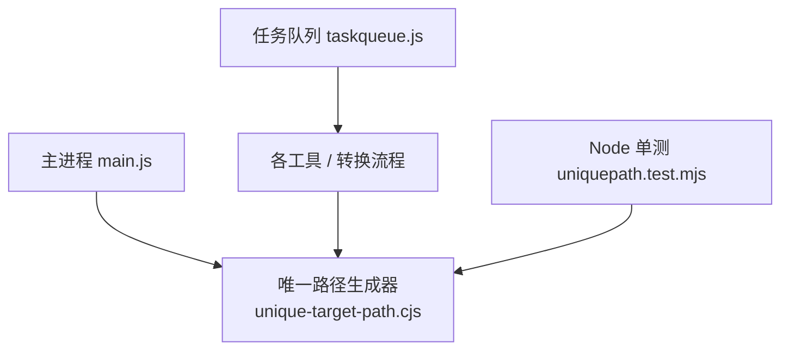
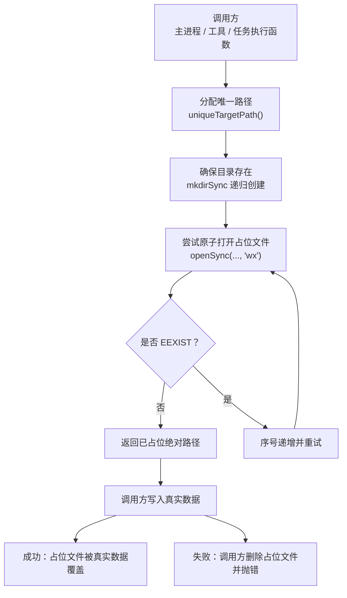
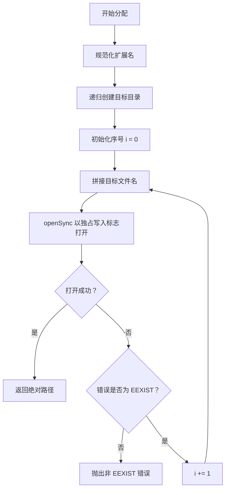
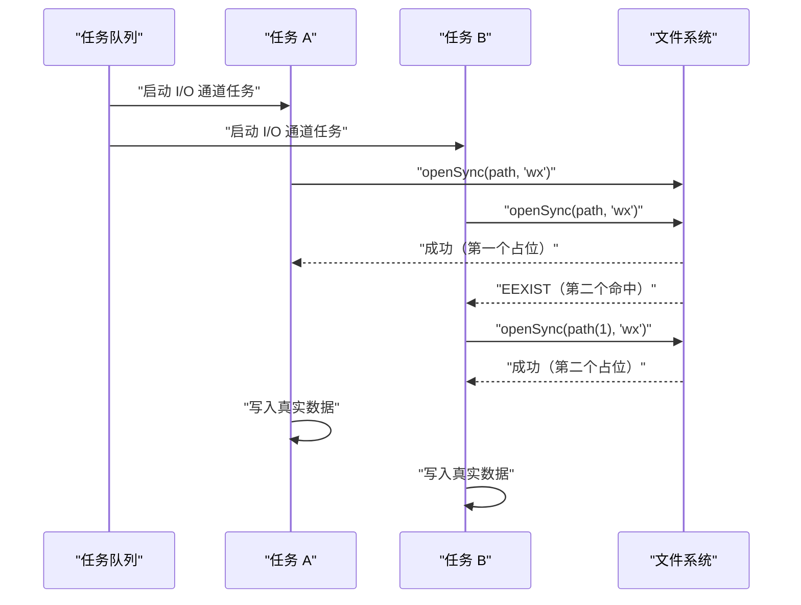
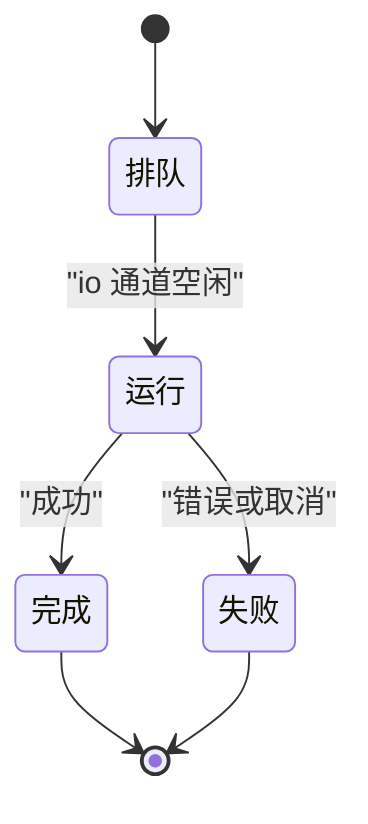
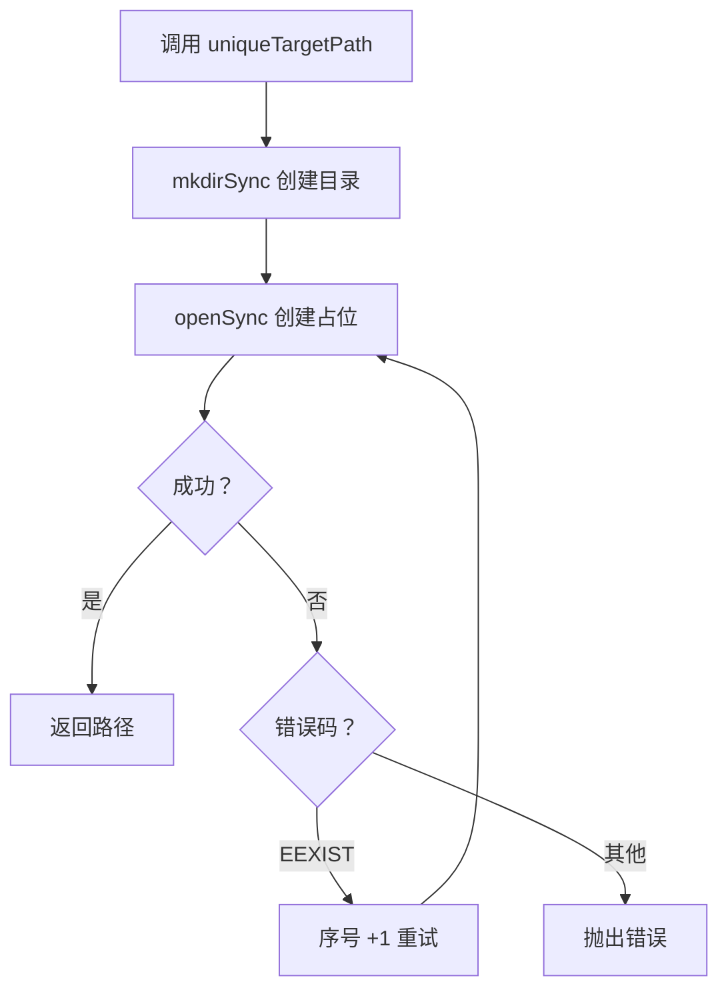

# 唯一路径生成器

<cite>
**本文引用的文件**   
- [unique-target-path.cjs](file://app/src/shared/unique-target-path.cjs)
- [uniquepath.test.mjs](file://app/tests/uniquepath.test.mjs)
- [taskqueue.js](file://app/src/shared/taskqueue.js)
</cite>

## 目录
1. [简介](#简介)
2. [项目结构中的位置](#项目结构中的位置)
3. [核心 API：uniqueTargetPath](#核心-apicontrollertargetpath)
4. [架构总览](#架构总览)
5. [详细实现分析](#详细实现分析)
6. [并发竞争条件与原子占位机制](#并发竞争条件与原子占位机制)
7. [任务队列协作模式](#任务队列协作模式)
8. [错误处理与异常传播](#错误处理与异常传播)
9. [性能与批量处理最佳实践](#性能与批量处理最佳实践)
10. [故障排查指南](#故障排查指南)
11. [结论](#结论)

## 简介
唯一路径生成器是主进程侧的“输出文件名分配器”，用于在目标目录中选择一个不会被覆盖的输出路径。它通过“原子文件占位”的方式，避免在任务队列并发执行时出现同名文件被静默覆盖的问题。其对外只暴露一个函数 `uniqueTargetPath`，供工具层、转换流程、下载器等任何需要落盘产物的模块调用。

该模块的关键设计原则是：**“挑名字”和“占住名字”必须是一个原子操作**。如果仅用存在性探测（例如 `existsSync`）再延迟写入，在并发任务下会出现两个任务拿到同一个文件名、后写者静默覆盖先写者的数据丢失问题。

## 项目结构中的位置
- 实现位于共享模块目录，采用 CommonJS 导出，以便主进程 `main.js` 与 Node 单测都能直接 `require`。
- 测试位于独立单测文件，可通过 Node 直接运行，用来钉住并发语义与命名规则。
- 与任务队列共享同一 `shared` 层，但反向依赖禁令禁止任务队列引用具体工具；本模块也不依赖 Electron，保持纯逻辑可测。

**图示来源**
- [unique-target-path.cjs:1-43](file://app/src/shared/unique-target-path.cjs#L1-L43)
- [uniquepath.test.mjs:1-133](file://app/tests/uniquepath.test.mjs#L1-L133)
- [taskqueue.js:1-200](file://app/src/shared/taskqueue.js#L1-L200)

**章节来源**
- [unique-target-path.cjs:1-43](file://app/src/shared/unique-target-path.cjs#L1-L43)
- [uniquepath.test.mjs:1-133](file://app/tests/uniquepath.test.mjs#L1-L133)
- [taskqueue.js:1-200](file://app/src/shared/taskqueue.js#L1-L200)

## 核心 API：uniqueTargetPath

### 函数签名与职责
- **输入参数**
  - `dir`：目标目录字符串。
  - `baseName`：不含扩展名的基础文件名。
  - `ext`：扩展名，支持带前导点或不带前导点两种写法。
- **返回值**
  - 返回已占位的绝对路径字符串。
- **副作用**
  - 若目标目录不存在，自动递归创建。
  - 在目标目录下创建一个 0 字节文件作为“原子占位”。

### 使用方式（概念示例）
在主进程中，典型用法是先确定输出目录和基础文件名，然后调用 `uniqueTargetPath` 得到安全路径，再把真实内容写入该路径。伪代码流程如下：

1. 计算输出目录。
2. 从原始文件名或任务元数据中提取 `baseName` 与 `ext`。
3. 调用 `uniqueTargetPath(dir, baseName, ext)` 获得已占位路径。
4. 将实际产物写入该路径。
5. 如果写入失败，由调用方删除占位文件并上报错误。

这个顺序保证：**路径选择阶段不会覆盖已有文件，而最终写入失败也不会留下半产物**。

**章节来源**
- [unique-target-path.cjs:12-43](file://app/src/shared/unique-target-path.cjs#L12-L43)
- [uniquepath.test.mjs:20-133](file://app/tests/uniquepath.test.mjs#L20-L133)

## 架构总览
唯一路径生成器处于“工具执行层”和“文件系统层”之间。它不关心具体是图片压缩、视频转码、OCR 还是文档转换，只负责产出安全的输出路径；真正的 I/O 工作由上层工具完成。

**图示来源**
- [unique-target-path.cjs:18-43](file://app/src/shared/unique-target-path.cjs#L18-L43)

## 详细实现分析

### 文件名冲突解决策略
函数的命名规则是严格的递增序列：

| 调用次序 | 生成的文件名模式 | 说明 |
|---|---|---|
| 第一次 | `原名.扩展名` | 优先使用原始名称 |
| 第二次 | `原名(1).扩展名` | 原名称已被占用时使用序号 1 |
| 第三次 | `原名(2).扩展名` | 继续递增 |
| 第 N 次 | `原名(N-1).扩展名` | 按连续整数递增 |

测试用例验证了以下行为：
- 空目录首次分配得到原名。
- 连续两次分配即使中间没有真正写入，也会得到不同路径。
- 若已有同名文件，则自动加序号。
- 序号连续递增：`原名 → (1) → (2) → (3)`。
- 如果删除某个中间占位文件，后续分配会重新回收该空号，而不是无限增长。

**图示来源**
- [unique-target-path.cjs:18-43](file://app/src/shared/unique-target-path.cjs#L18-L43)

**章节来源**
- [unique-target-path.cjs:18-43](file://app/src/shared/unique-target-path.cjs#L18-L43)
- [uniquepath.test.mjs:35-110](file://app/tests/uniquepath.test.mjs#L35-L110)

### 为什么不能使用简单的 existsSync 探测
旧实现如果仅使用存在性探测，会在“检查是否存在”和“真正写入”之间留下时间窗口。任务队列的 I/O 通道默认并发度为 2，因此可能出现以下竞态：

1. 任务 A 检查目标文件不存在。
2. 任务 B 也检查目标文件不存在。
3. 任务 A 开始写入。
4. 任务 B 也写入同一路径，覆盖任务 A 的内容。
5. 两个任务都报告成功，但用户只能看到后写者留下的文件。

这就是单测注释中所说的“后写的静默覆盖先写的，两条都报成功——用户只会发现少了一个产物”。

**章节来源**
- [unique-target-path.cjs:12-20](file://app/src/shared/unique-target-path.cjs#L12-L20)
- [uniquepath.test.mjs:1-24](file://app/tests/uniquepath.test.mjs#L1-L24)

### 原子文件占位机制
函数使用 `fs.openSync(target, 'wx')` 创建独占写入句柄。关键含义如下：

| 操作系统行为 | 对函数的影响 |
|---|---|
| 文件不存在 | `openSync` 成功创建 0 字节文件，函数立即返回该路径 |
| 文件已存在 | `openSync` 抛出 `EEXIST`，函数递增序号重试 |
| 其他系统错误 | 直接向上抛出，不吞掉错误 |

这种方式的优点是：
- 名称选择与占位在同一系统调用内完成。
- 不需要额外锁或全局状态。
- 即使在多个 Node 线程或主进程并发调用中，也能保证每个占位路径唯一。
- 占位文件体积为 0，避免无谓磁盘开销。

**章节来源**
- [unique-target-path.cjs:12-43](file://app/src/shared/unique-target-path.cjs#L12-L43)

### 目录自动创建机制
`uniqueTargetPath` 在尝试创建文件前，先调用 `fs.mkdirSync(dir, { recursive: true })` 确保目录存在。这样做的原因是：
- `openSync` 不会自动创建父目录。
- 使用 `recursive: true` 后，如果目录已经存在，再次调用也是幂等操作。
- 当传入的不是目录而是普通文件路径时，`mkdirSync` 会抛出错误，从而阻止函数继续返回一个无效路径。

**章节来源**
- [unique-target-path.cjs:23-24](file://app/src/shared/unique-target-path.cjs#L23-L24)
- [uniquepath.test.mjs:91-100](file://app/tests/uniquepath.test.mjs#L91-L100)

### 扩展名处理
函数会判断扩展名是否以点开头：
- 如果已带点，直接使用。
- 如果没带点，自动补点。
- 空扩展名也会被安全处理，避免产生异常拼接。

测试覆盖了 `.mp4` 与 `mp4` 两种写法结果一致的情况。

**章节来源**
- [unique-target-path.cjs:23-24](file://app/src/shared/unique-target-path.cjs#L23-L24)
- [uniquepath.test.mjs:104-110](file://app/tests/uniquepath.test.mjs#L104-L110)

## 并发竞争条件与原子占位机制

### 竞态风险模型
假设任务队列的 I/O 通道并发度为 2，且调用方在取得路径后异步写入真实数据：

如果没有原子占位，而是改为：
1. A 检查文件不存在。
2. B 检查文件不存在。
3. A 写入。
4. B 写入覆盖 A。

就会出现数据丢失。

**图示来源**
- [unique-target-path.cjs:12-43](file://app/src/shared/unique-target-path.cjs#L12-L43)

### 为什么测试要模拟“中间不落盘”
单测中有一项专门断言：连续调用两次 `uniqueTargetPath`，即使两次调用之间没有写入真实文件，也必须返回不同路径。这对应的是“抢占命名空间但不立即写入”的场景，正是任务队列并发执行时的真实情况。

**章节来源**
- [uniquepath.test.mjs:40-50](file://app/tests/uniquepath.test.mjs#L40-L50)

## 任务队列协作模式

### 任务队列的并发模型
任务队列维护两个通道：
- `cpu` 通道：默认并发度 1，适合 CPU 密集型任务。
- `io` 通道：默认并发度 2，适合图片、Canvas 等可并行 I/O 的任务。

这意味着，同一个工具的 I/O 任务可能同时运行两个。如果它们都要向相同目录写出产物，就必须保证路径唯一。

**图示来源**
- [taskqueue.js:1-120](file://app/src/shared/taskqueue.js#L1-L120)

### 调用链建议
推荐调用链如下：

1. 工具把单个文件任务提交给任务队列。
2. 任务执行函数内部调用 `uniqueTargetPath` 获取输出路径。
3. 写入完成后，将输出路径加入任务的 `output.paths`。
4. 任务结束回调中，队列会把输出路径记录到任务对象中，便于 UI 展示和后续清理。

这样，路径分配、任务调度、结果收集三者解耦，既方便测试，也方便追踪错误来源。

**章节来源**
- [taskqueue.js:1-120](file://app/src/shared/taskqueue.js#L1-L120)
- [uniquepath.test.mjs:1-24](file://app/tests/uniquepath.test.mjs#L1-L24)

### 占位文件的清理责任
占位文件是 0 字节临时文件，生命周期如下：

| 阶段 | 责任方 | 行为 |
|---|---|---|
| 路径分配 | 唯一路径生成器 | 创建 0 字节占位文件 |
| 正常写入 | 调用方 | 用真实数据覆盖占位文件 |
| 写入失败 | 调用方 | 删除占位文件，避免留下垃圾 |
| 任务取消或失败 | 调用方或工具框架 | 根据业务策略清理未完成的输出 |

实现注释明确指出：写入失败时由调用方删除占位文件，主进程中 ffmpeg 相关通道的失败分支也会执行删除操作。

**章节来源**
- [unique-target-path.cjs:20-22](file://app/src/shared/unique-target-path.cjs#L20-L22)

## 错误处理与异常传播

### 错误分类
| 错误类型 | 触发条件 | 行为 |
|---|---|---|
| `EEXIST` | 目标文件已存在 | 递增序号，继续尝试下一个名称 |
| 非 `EEXIST` 系统错误 | 权限不足、路径非法、目录不可写等 | 直接抛出，不吞错 |
| 目录参数不是目录 | `mkdirSync` 失败 | 抛出错误，阻止返回无效路径 |
| 写入失败 | 调用方写入真实数据失败 | 应由调用方捕获并删除占位文件 |

### 错误传播图

**图示来源**
- [unique-target-path.cjs:18-43](file://app/src/shared/unique-target-path.cjs#L18-L43)

### 测试覆盖的错误场景
- 传入已存在的文件作为目录时，函数应抛错。
- 并发分配 20 个同名任务，应全部互不相同。
- 占位文件大小应为 0。
- 扩点前缀不影响最终文件名。

**章节来源**
- [uniquepath.test.mjs:35-133](file://app/tests/uniquepath.test.mjs#L35-L133)

## 性能与批量处理最佳实践

### 时间复杂度
- 每次分配尝试最多进行一次 `openSync`。
- 最坏情况下，若前 `k` 个名称都被占用，循环执行 `k+1` 次。
- 平均情况下，通常只需 1 到 2 次尝试。

### 空间复杂度
- 不使用全局缓存或索引表。
- 依赖文件系统本身的状态。
- 内存占用极低。

### 批量文件处理建议
1. **逐个分配路径**：不要提前计算所有路径再批量写入，因为写入可能失败。
2. **先占位，再写入**：确保每个任务都有唯一路径后再开始重 I/O。
3. **失败时清理占位文件**：避免批处理中断后留下大量 0 字节文件。
4. **合理设置任务队列并发度**：CPU 任务用 `cpu` 通道，I/O 任务用 `io` 通道。
5. **避免超大序号膨胀**：如果业务允许，尽量复用输出目录并在任务结束后清理产物。
6. **日志中包含输出路径**：便于排查“哪个任务输出了哪个文件”。

### 与任务队列配合的注意事项
- 不要在任务队列之外手动管理同名文件状态。
- 不要把 `uniqueTargetPath` 当作“检测文件是否存在”的工具；它是“分配并占有唯一路径”的工具。
- 不要在多个任务间共享同一个可变的基础文件名，除非你明确希望它们竞争命名空间。

**章节来源**
- [unique-target-path.cjs:12-43](file://app/src/shared/unique-target-path.cjs#L12-L43)
- [taskqueue.js:1-60](file://app/src/shared/taskqueue.js#L1-L60)
- [uniquepath.test.mjs:50-110](file://app/tests/uniquepath.test.mjs#L50-L110)

## 故障排查指南

### 常见问题与定位方法

| 现象 | 可能原因 | 排查步骤 |
|---|---|---|
| 输出文件数量少于任务数 | 旧实现使用了存在性探测导致覆盖 | 确认使用的是 `uniqueTargetPath`，并检查是否误用 `existsSync` |
| 目录不存在时报错 | 调用方传入了无效目录路径 | 检查 `dir` 参数是否为字符串且具备写权限 |
| 占位文件残留 | 写入失败但没有清理 | 检查调用方的写入逻辑和异常分支 |
| 并发分配出现重复 | 自定义实现绕过了唯一路径生成器 | 核对是否直接拼接文件名 |
| 批量处理后磁盘变脏 | 部分任务失败但未清理 | 增加统一清理逻辑，或在任务终态回调中清理未完成产物 |

### 调试建议
- 在批量任务开始前打印任务数和预期输出数。
- 在任务结束时打印 `output.paths`。
- 对失败任务打印完整错误堆栈。
- 临时启用更详细的日志，观察占位文件创建与删除时机。

**章节来源**
- [uniquepath.test.mjs:1-133](file://app/tests/uniquepath.test.mjs#L1-L133)

## 结论
唯一路径生成器通过原子占位机制解决了任务队列并发 I/O 下的文件名竞争问题。它不依赖外部锁，不依赖全局状态，也不依赖 Electron，是一个高内聚、低耦合、可独立测试的核心模块。

对于使用者来说，最重要的约定是：
- 使用 `uniqueTargetPath` 获取输出路径。
- 成功后用真实数据覆盖占位文件。
- 失败时删除占位文件并上报错误。
- 不要绕过该模块自行拼接文件名。

这样就能保证：无论任务队列并发度是多少，无论有多少个任务同时运行，都不会出现静默覆盖用户产物的严重数据丢失问题。