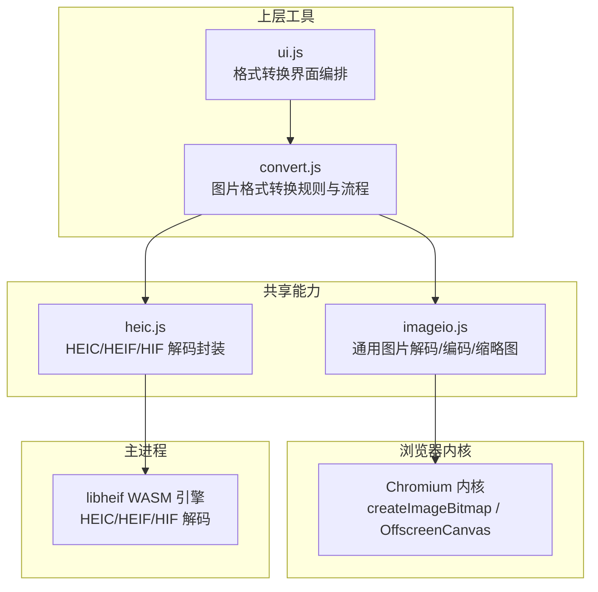
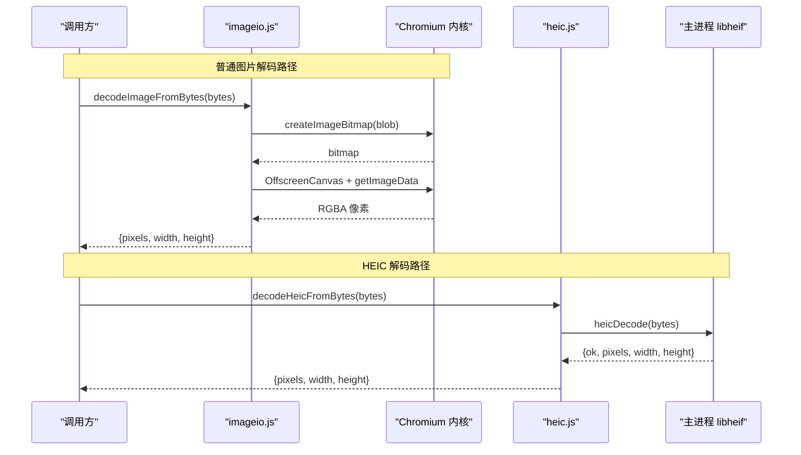
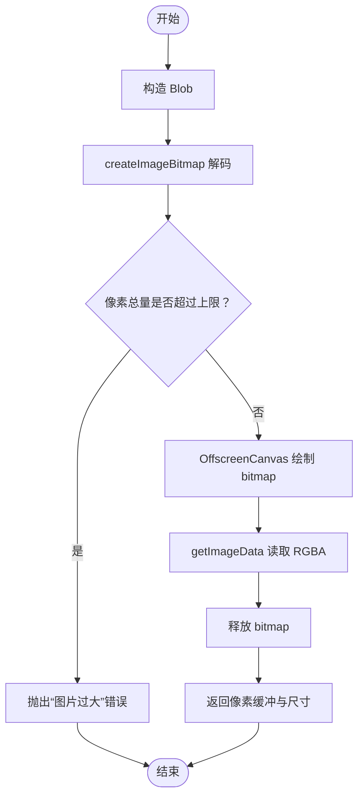
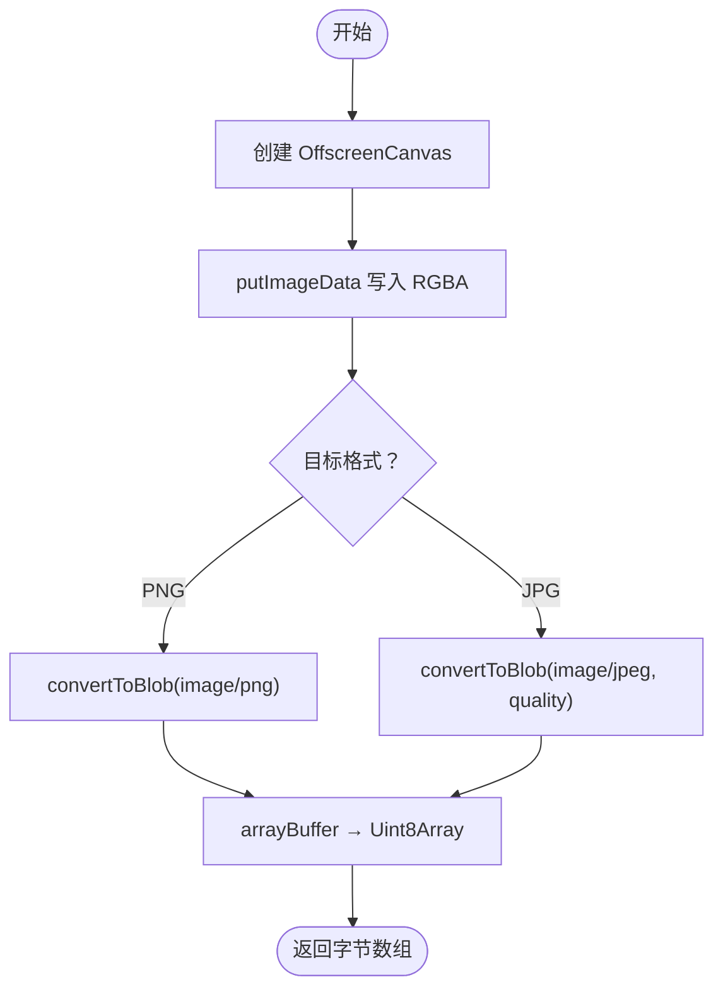
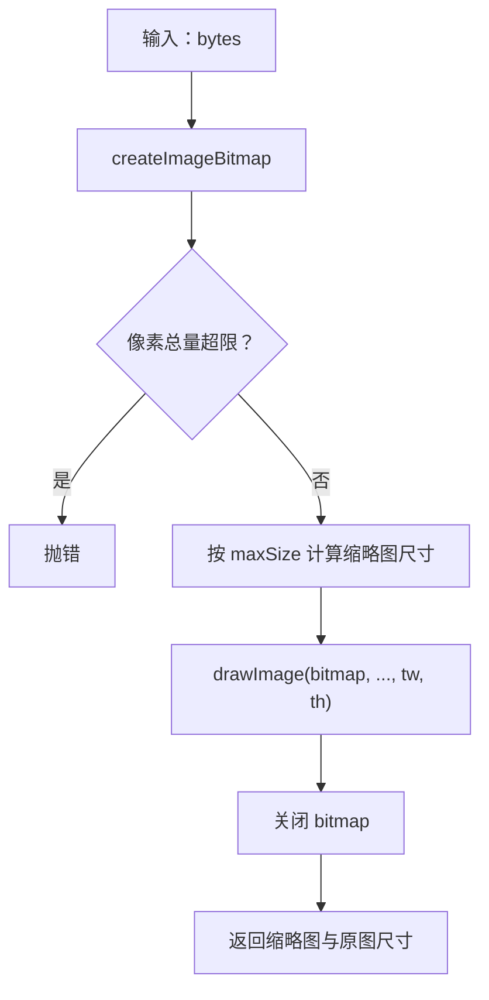
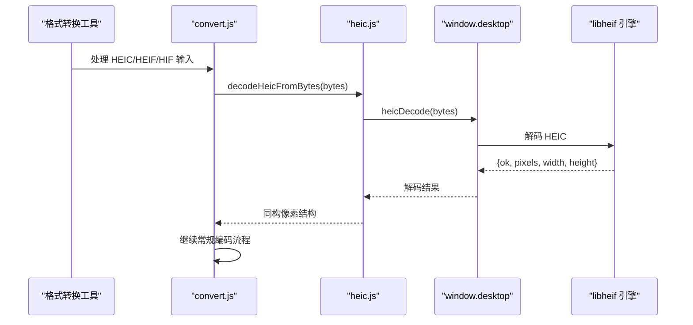
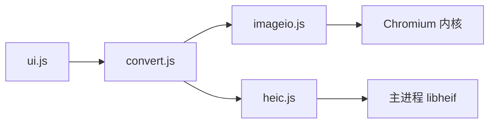

# 图片编解码模块

<cite>
**本文引用的文件**
- [imageio.js](file://app/src/shared/imageio.js)
- [heic.js](file://app/src/shared/heic.js)
- [convert.js](file://app/src/tools/convert/core/convert.js)
- [ui.js（格式转换界面）](file://app/src/tools/convert/ui.js)
</cite>

## 目录
1. [引言](#引言)
2. [项目结构](#项目结构)
3. [核心组件](#核心组件)
4. [架构总览](#架构总览)
5. [详细组件分析](#详细组件分析)
6. [依赖关系分析](#依赖关系分析)
7. [性能与内存管理](#性能与内存管理)
8. [错误处理策略](#错误处理策略)
9. [使用案例与最佳实践](#使用案例与最佳实践)
10. [故障排查](#故障排查)
11. [结论](#结论)

## 引言
本模块是应用内“图片编解码共享能力”，位于 `shared` 目录，供多个工具复用。其设计目标是：
- 在浏览器渲染进程中，优先使用 Chromium 内核自带的 `createImageBitmap` 与 `OffscreenCanvas` 完成图片解码、像素读取、编码和缩略图生成。
- 不引入第三方图像库，避免额外体积和平台差异。
- 为 HEIC/HEIF/HIF 等 Chromium 不支持的格式提供统一入口，交由主进程 libheif WASM 引擎解码，并返回与内置解码器同构的数据结构。
- 为批量导入、预览、缩略图生成和图片格式转换提供稳定 API。

模块包含两个关键文件：
- `imageio.js`：通用图片读写、像素绘制、缩略图生成。
- `heic.js`：HEIC/HEIF/HIF 解码封装，对齐 `decodeImageFromBytes` 返回结构。

## 项目结构

**图表来源**
- [imageio.js:1-141](file://app/src/shared/imageio.js#L1-L141)
- [heic.js:1-23](file://app/src/shared/heic.js#L1-L23)
- [convert.js:1-175](file://app/src/tools/convert/core/convert.js#L1-L175)

**章节来源**
- [imageio.js:1-10](file://app/src/shared/imageio.js#L1-L10)
- [heic.js:1-10](file://app/src/shared/heic.js#L1-L10)

## 核心组件
### 1. `decodeImageFromBytes(bytes)`
- 输入：图片字节（`ArrayBuffer` 或 `Uint8Array`）。
- 输出：`Promise<{pixels: Uint8ClampedArray, width: number, height: number}>`。
- 行为：
  - 将字节包装为 `Blob`，调用 `createImageBitmap` 解码。
  - 校验像素总量，超过 4000 万则主动拒绝。
  - 通过 `OffscreenCanvas` + `getImageData` 提取 RGBA 像素缓冲。
  - 释放 `bitmap`，减少内存占用。
- 适用场景：需要完整像素数据进行处理、滤镜、重采样、转码的工具。

**章节来源**
- [imageio.js:14-44](file://app/src/shared/imageio.js#L14-L44)

### 2. `encodeImageToBytes(pixels, width, height, options)`
- 输入：RGBA 像素缓冲、宽高、可选格式与质量。
- 输出：`Promise<Uint8Array>`。
- 行为：
  - 创建 `OffscreenCanvas`，写入 `ImageData`。
  - 根据 `format` 选择 PNG 或 JPEG；JPEG 支持 `quality`（0–100）。
  - 通过 `canvas.convertToBlob` 生成二进制字节。
- 注意：PNG 无质量参数；JPEG 会忽略透明通道语义，需在上层做底色混合。

**章节来源**
- [imageio.js:47-72](file://app/src/shared/imageio.js#L47-L72)

### 3. `drawPixelsToCanvas(canvas, pixels, width, height)`
- 作用：把 RGBA 像素直接绘制到 HTML Canvas，用于预览。
- 特点：轻量同步操作，适合 UI 快速展示已解码像素。

**章节来源**
- [imageio.js:75-85](file://app/src/shared/imageio.js#L75-L85)

### 4. `makeThumbnail(pixels, width, height, maxSize)`
- 输入：已有 RGBA 像素缓冲及原图尺寸。
- 输出：`Promise<HTMLCanvasElement>`，缩略图为等比缩放后的 `<canvas>`。
- 行为：
  - 计算缩放比例，以最长边不超过 `maxSize`。
  - 用 `OffscreenCanvas` 承载原像素，再绘制到目标 `<canvas>`。
- 适用场景：已经持有整图像素，且需要缩略图进行预览或缓存。

**章节来源**
- [imageio.js:88-106](file://app/src/shared/imageio.js#L88-L106)

### 5. `makeThumbnailFromBytes(bytes, maxSize)`
- 输入：图片字节、缩略图最大边长。
- 输出：`Promise<{thumb: HTMLCanvasElement, width: number, height: number}>`。
- 关键优势：**全程不摊开整图 RGBA 缓冲**。直接从 `createImageBitmap` 缩放绘制，解码后立刻关闭 bitmap。
- 适用场景：批量添加图片时只需尺寸和一张小缩略图，避免整图解码带来的瞬时内存峰值。

**章节来源**
- [imageio.js:109-141](file://app/src/shared/imageio.js#L109-L141)

### 6. `decodeHeicFromBytes(bytes)`
- 输入：HEIC/HEIF/HIF 文件字节。
- 输出：与 `decodeImageFromBytes` 同构的结构 `{pixels, width, height}`。
- 行为：调用主进程 `window.desktop.heicDecode`，由 libheif WASM 引擎解码。
- 重要约束：只有 HEIC/HEIF/HIF 走这条路径；其他格式仍应使用 `decodeImageFromBytes`。

**章节来源**
- [heic.js:12-23](file://app/src/shared/heic.js#L12-L23)

## 架构总览

**图表来源**
- [imageio.js:14-44](file://app/src/shared/imageio.js#L14-L44)
- [heic.js:12-23](file://app/src/shared/heic.js#L12-L23)

## 详细组件分析

### 图片解码与像素缓冲
#### 数据结构
- `pixels`：`Uint8ClampedArray`，按 RGBA 顺序排列。
- `width`：像素宽度。
- `height`：像素高度。
- 内存大小约为 `width × height × 4` 字节；例如 4000 万像素对应约 160MB RGBA 缓冲。

#### 处理逻辑

**图表来源**
- [imageio.js:14-44](file://app/src/shared/imageio.js#L14-L44)

#### 复杂度与时间空间特性
- 时间复杂度：与像素数量近似线性，主要开销来自解码、绘制和像素拷贝。
- 空间复杂度：除原始字节外，还需一个 `width × height × 4` 的 RGBA 缓冲；在某些实现中还会临时存在 bitmap 和 canvas 数据。
- 优化点：仅在需要整图像素时使用 `decodeImageFromBytes`；如果只需要缩略图，优先用 `makeThumbnailFromBytes`。

**章节来源**
- [imageio.js:14-44](file://app/src/shared/imageio.js#L14-L44)

### 图片编码
#### 流程

**图表来源**
- [imageio.js:47-72](file://app/src/shared/imageio.js#L47-L72)

#### 注意事项
- PNG：无损，保留透明通道。
- JPG：丢弃透明通道；若上层需要保留视觉一致性，应先对透明像素做底色混合。
- WebP 编码不在 `imageio.js` 中暴露，而是由转换工具内部实现。

**章节来源**
- [imageio.js:47-72](file://app/src/shared/imageio.js#L47-L72)

### 缩略图生成
#### `makeThumbnail` 与 `makeThumbnailFromBytes` 的区别
- `makeThumbnail`：基于已有像素缓冲生成缩略图，适合已经解码的场景。
- `makeThumbnailFromBytes`：从字节直接解码并缩放，避免整图像素展开，适合批量导入预览。

**图表来源**
- [imageio.js:109-141](file://app/src/shared/imageio.js#L109-L141)

**章节来源**
- [imageio.js:88-106](file://app/src/shared/imageio.js#L88-L106)
- [imageio.js:109-141](file://app/src/shared/imageio.js#L109-L141)

### HEIC 协作路径

**图表来源**
- [heic.js:12-23](file://app/src/shared/heic.js#L12-L23)
- [convert.js:321-333](file://app/src/tools/convert/core/convert.js#L321-L333)

**章节来源**
- [heic.js:1-23](file://app/src/shared/heic.js#L1-23)
- [convert.js:321-333](file://app/src/tools/convert/core/convert.js#L321-L333)

## 依赖关系分析

**图表来源**
- [imageio.js:1-10](file://app/src/shared/imageio.js#L1-L10)
- [heic.js:1-10](file://app/src/shared/heic.js#L1-L10)
- [convert.js:1-10](file://app/src/tools/convert/core/convert.js#L1-L10)

**章节来源**
- [convert.js:1-10](file://app/src/tools/convert/core/convert.js#L1-L10)

## 性能与内存管理
### 像素总量限制
- 常量 `MAX_PIXELS = 40_000_000`，约 4000 万像素。
- 超过限制会直接抛错，避免瞬间分配数百 MB 像素缓冲导致界面卡顿或崩溃。
- 对于 4000 万像素的图片，单张 RGBA 缓冲约 160MB；同时持有多个大图时更容易触发内存压力。

### 推荐策略
- 只读缩略图时：优先使用 `makeThumbnailFromBytes`，避免整图像素展开。
- 需要整图像素时：使用 `decodeImageFromBytes`，但应在处理后及时释放引用，让垃圾回收回收像素缓冲。
- 预览绘制：使用 `drawPixelsToCanvas`，避免重复解码。
- 批量处理：串行或小批量并行，避免同时解码多张大图。
- JPEG 编码前：如需去除透明背景，先对像素做底色混合，防止出现意外黑底或白底。

**章节来源**
- [imageio.js:11-13](file://app/src/shared/imageio.js#L11-L13)
- [imageio.js:14-44](file://app/src/shared/imageio.js#L14-L44)
- [imageio.js:109-141](file://app/src/shared/imageio.js#L109-L141)

## 错误处理策略
### 解码失败
- `decodeImageFromBytes`：当 `createImageBitmap` 失败时，抛出“解码图片失败，可能是格式不支持或文件损坏”。
- `makeThumbnailFromBytes`：同样捕获解码异常并抛出可读错误。
- `decodeHeicFromBytes`：若主进程返回 `ok=false`，抛出带原因的 HEIC 解码错误。

### 图片过大
- 当 `width × height > MAX_PIXELS` 时，显式抛出“图片过大”错误，并提示像素上限。
- 该检查发生在解码成功后、展开像素前，能避免进一步放大内存风险。

### 编码失败
- `encodeImageToBytes`：依赖浏览器内核能力；若内核不支持目标类型，可能抛出底层错误。
- 转换工具中对 ffmpeg 相关转换也做了成功标志检查，并在失败时转换为统一错误信息。

**章节来源**
- [imageio.js:14-44](file://app/src/shared/imageio.js#L14-L44)
- [imageio.js:109-141](file://app/src/shared/imageio.js#L109-L141)
- [heic.js:12-23](file://app/src/shared/heic.js#L12-L23)

## 使用案例与最佳实践

### 1. 解码图片并预览
- 步骤：
  1. 读取文件字节。
  2. 调用 `decodeImageFromBytes`。
  3. 使用 `drawPixelsToCanvas` 绘制到页面 Canvas。
- 适用：用户查看原图、编辑工具加载像素。

**章节来源**
- [imageio.js:14-44](file://app/src/shared/imageio.js#L14-L44)
- [imageio.js:75-85](file://app/src/shared/imageio.js#L75-L85)

### 2. 生成缩略图并显示
- 步骤：
  1. 对普通图片调用 `makeThumbnailFromBytes`。
  2. 直接使用返回的 `thumb` Canvas 作为缩略图。
  3. 同时获得原图 `width`、`height`，用于布局或元数据展示。
- 适用：批量导入图片列表、相册预览。

**章节来源**
- [imageio.js:109-141](file://app/src/shared/imageio.js#L109-L141)

### 3. 从像素生成缩略图
- 步骤：
  1. 已通过其他方式得到像素缓冲。
  2. 调用 `makeThumbnail`。
  3. 使用返回 Canvas 作为缩略图。
- 适用：滤镜、编辑流程中间态，已经持有整图像素。

**章节来源**
- [imageio.js:88-106](file://app/src/shared/imageio.js#L88-L106)

### 4. 图片格式转换
- 普通图片：`decodeImageFromBytes` → 转换规则 → `encodeImageToBytes`。
- HEIC/HEIF/HIF：`decodeHeicFromBytes` → 后续转换流程相同。
- 老格式（TIFF、PSD、DDS、JP2 等）：通过 ffmpeg 解码为首帧 PNG，再进入统一转换流程。
- 输出格式：
  - PNG/JPG：走 `imageio.js`。
  - WebP/BMP/ICO：走转换工具内部实现。
  - TIFF/GIF/AVIF：走 ffmpeg 加装包。

**章节来源**
- [convert.js:1-175](file://app/src/tools/convert/core/convert.js#L1-L175)
- [convert.js:321-333](file://app/src/tools/convert/core/convert.js#L321-L333)

### 5. 批量图片处理
- 建议模式：
  - 批量导入阶段：全部使用 `makeThumbnailFromBytes` 获取缩略图和尺寸，不展开整图像素。
  - 需要处理阶段：逐个图片调用 `decodeImageFromBytes`，处理后尽快释放引用。
  - 控制并发：避免同时解码大量大图。
- 优点：降低峰值内存，减少界面冻结。

**章节来源**
- [imageio.js:109-141](file://app/src/shared/imageio.js#L109-L141)

### 6. 为什么某些场景必须走不同路径
- `makeThumbnailFromBytes` 不能用于 HEIC：因为 Chromium 内核不解码 HEIC，所以无法直接用 `createImageBitmap`。
- 已经需要整图像素的工具：例如图片混淆、像素级编辑，不适合只走缩略图路径，因为它们最终仍需 `decodeImageFromBytes` 或 `decodeHeicFromBytes`。
- 设计意图：`imageio.js` 负责通用路径；`heic.js` 补齐特殊容器格式；上层工具根据扩展名选择分支。

**章节来源**
- [imageio.js:109-126](file://app/src/shared/imageio.js#L109-L126)
- [heic.js:1-10](file://app/src/shared/heic.js#L1-L10)

## 故障排查
### 常见问题
- “解码图片失败，可能是格式不支持或文件损坏”
  - 可能原因：文件格式不受支持、文件头损坏、非图片字节。
  - 解决：确认输入是否为有效图片；HEIC 应走 `decodeHeicFromBytes`。
- “图片过大，超过 4000 万像素上限”
  - 可能原因：分辨率过高，或宽×高乘积超过限制。
  - 解决：先缩小再处理，或使用仅缩略图路径；不要一次性加载过多大图。
- HEIC 解码失败
  - 可能原因：主进程 libheif 引擎不可用、文件损坏、HEIC 版本不支持。
  - 解决：检查 `heicStatus`，确认主进程解码能力；确认文件来源。

### 定位建议
- 先判断输入扩展名：HEIC/HEIF/HIF 走 HEIC 路径，其余走通用路径。
- 如果是缩略图需求，优先验证 `makeThumbnailFromBytes`。
- 如果后续需要像素处理，再验证 `decodeImageFromBytes` 或 `decodeHeicFromBytes`。
- 如果是输出问题，检查目标格式是否受当前内核支持，以及是否需要 ffmpeg 加装包。

**章节来源**
- [imageio.js:14-44](file://app/src/shared/imageio.js#L14-L44)
- [imageio.js:109-141](file://app/src/shared/imageio.js#L109-L141)
- [heic.js:12-23](file://app/src/shared/heic.js#L12-L23)

## 结论
图片编解码共享模块以浏览器内核能力为核心，兼顾性能与可维护性：
- `decodeImageFromBytes`、`encodeImageToBytes`、`drawPixelsToCanvas`、`makeThumbnail`、`makeThumbnailFromBytes` 构成通用图片处理主干。
- `decodeHeicFromBytes` 补齐 HEIC/HEIF/HIF 解码缺口，并与通用像素结构保持一致。
- 4000 万像素上限是重要的安全边界，能有效防止大图导致的内存崩溃。
- 正确选择解码路径和缩略图路径，是保证批量处理和预览体验的关键。
- 上层工具如图片格式转换，通过扩展名判断走不同解码分支，最终统一进入像素处理和编码管线。