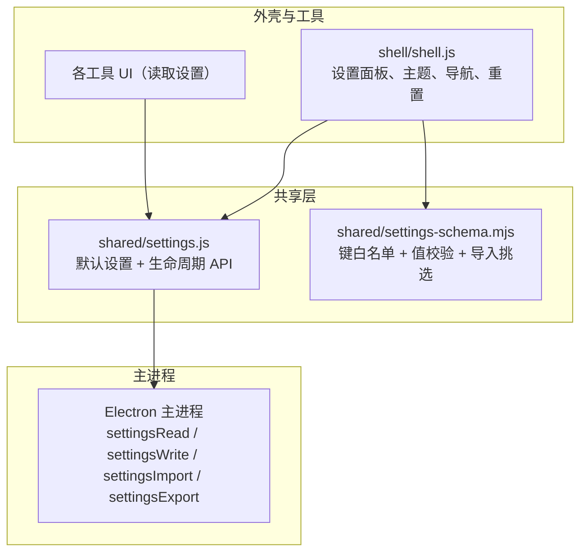
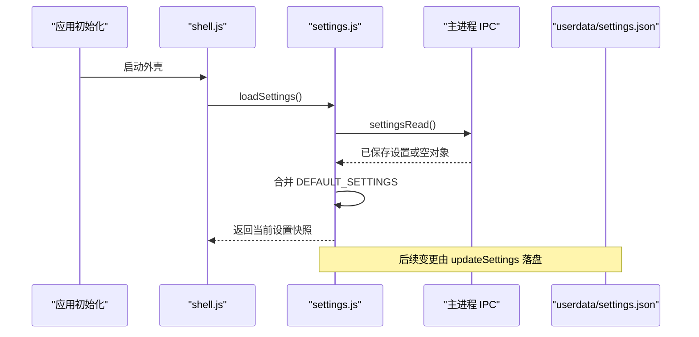
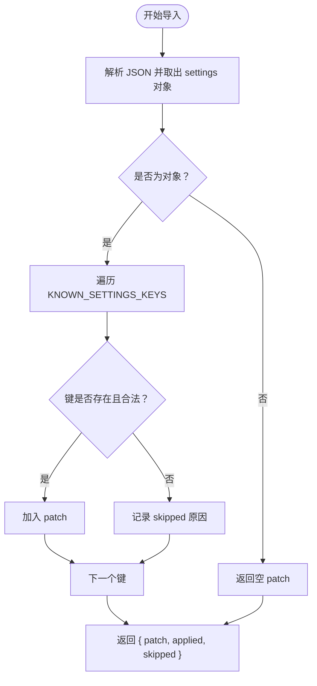
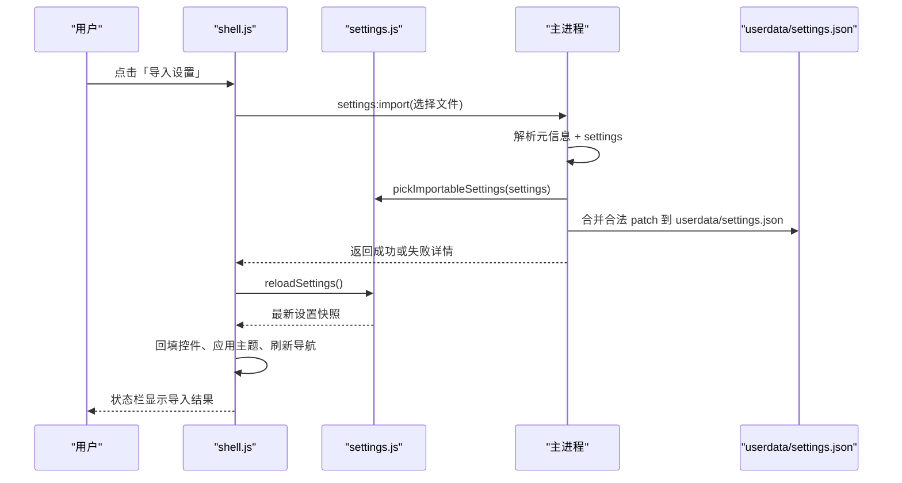
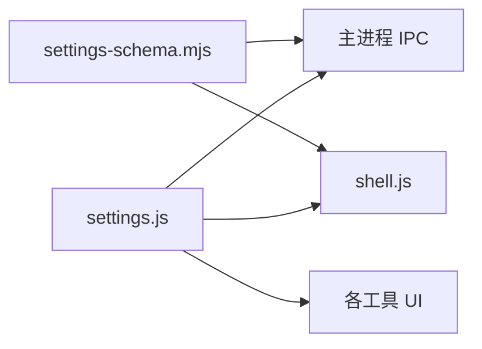

# 设置管理模块

<cite>
**本文引用的文件**
- [settings.js](file://app/src/shared/settings.js)
- [settings-schema.mjs](file://app/src/shared/settings-schema.mjs)
- [shell.js](file://app/src/shell/shell.js)
- [settings.md](file://spec/modules/settings.md)
- [settings-io.md](file://spec/modules/settings-io.md)
- [settingsschema-test.js](file://app/tests/settingsschema-test.js)
- [settingsio-test.js](file://app/tests/settingsio-test.js)
</cite>

## 目录
1. [简介](#简介)
2. [项目结构](#项目结构)
3. [核心组件](#核心组件)
4. [架构总览](#架构总览)
5. [详细组件分析](#详细组件分析)
6. [依赖关系分析](#依赖关系分析)
7. [性能与一致性](#性能与一致性)
8. [故障排查指南](#故障排查指南)
9. [最佳实践](#最佳实践)
10. [结论](#结论)

## 简介
本模块负责桌面版工具箱的全局用户设置：定义默认配置、加载和持久化用户偏好、提供更新与重置能力，并支撑设置导入导出。它遵循“绿色版”约定——将 `userdata/settings.json` 放在软件目录下，整个文件夹拷贝即可带走配置；不引入云同步或多配置方案。

模块职责边界：
- 内存态：维护当前生效的设置快照。
- 持久态：通过 Electron 主进程提供的 `window.desktop.settingsRead` / `window.desktop.settingsWrite` 读写配置文件。
- 校验层：对导入的配置进行白名单与值域校验，拒绝非法键和非法值。
- 界面联动：被外壳和工具读取，用于渲染 UI、控制行为、驱动主题和导航排序等。

**章节来源**
- [settings.md:1-24](file://spec/modules/settings.md#L1-L24)

## 项目结构
设置相关代码主要位于共享层与外壳模块中：

**图表来源**
- [settings.js:1-83](file://app/src/shared/settings.js#L1-L83)
- [settings-schema.mjs:1-104](file://app/src/shared/settings-schema.mjs#L1-L104)
- [shell.js:69-754](file://app/src/shell/shell.js#L69-L754)

**章节来源**
- [settings.js:1-12](file://app/src/shared/settings.js#L1-L12)
- [settings-io.md:1-53](file://spec/modules/settings-io.md#L1-L53)

## 核心组件
- 默认配置常量：`DEFAULT_SETTINGS`
- 生命周期函数：
  - `loadSettings()`
  - `getSettings()`
  - `reloadSettings()`
  - `updateSettings(patch)`
  - `resetSettings()`
- 校验与导入挑选：
  - `KNOWN_SETTINGS_KEYS`
  - `validateSettingValue(key, value)`
  - `pickImportableSettings(incoming)`

这些 API 共同构成“默认值 → 磁盘 → 内存 → 界面/工具”的完整链路。

**章节来源**
- [settings.js:14-83](file://app/src/shared/settings.js#L14-L83)
- [settings-schema.mjs:1-104](file://app/src/shared/settings-schema.mjs#L1-L104)

## 架构总览
设置数据在应用启动时从磁盘加载一次，之后所有工具通过 `getSettings()` 获取内存快照；写入走 `updateSettings()`，由主进程合并补丁到配置文件；导入场景通过 `reloadSettings()` 刷新内存，保证界面与工具读到最新配置。

**图表来源**
- [settings.js:29-51](file://app/src/shared/settings.js#L29-L51)
- [shell.js:906-906](file://app/src/shell/shell.js#L906-L906)

**章节来源**
- [settings.js:14-51](file://app/src/shared/settings.js#L14-L51)

## 详细组件分析

### 默认配置项 DEFAULT_SETTINGS
`DEFAULT_SETTINGS` 是全局设置的权威默认值，也是“恢复默认”行为的基准。各字段含义如下：

| 字段 | 类型 | 默认值 | 含义与用途 |
|---|---|---:|---|
| `blockSize` | 整数 | `32` | 图片混淆 B 模式的方块数；默认即手机版行为。合法范围由校验层约束为 `2~256`。 |
| `jpegQuality` | 整数 | `95` | Gilbert 模式保存 JPG 时的画质；合法范围为 `1~100`。 |
| `defaultDoubleKey` | 字符串 | `'0.666'` | PE1/PE2 输入框默认密钥；必须是开区间 `(0,1)` 内的数值字符串。 |
| `outputDir` | 字符串 | `''` | 输出目录；空串表示与原图同目录。 |
| `askSavePath` | 布尔 | `false` | 每次保存前是否询问文件名/目录；默认关闭以提升易用性。 |
| `collapsedGroups` | `null` 或字符串数组 | `null` | 左侧导航中被收起的分组 id 列表；`null` 表示未手动设置过。 |
| `navOrder` | `null` 或对象 | `null` | 左侧导航手动排序；`null` 表示按默认排序；对象结构交由导航规划器净化。 |
| `theme` | 字符串 | `'system'` | 外观主题；`system` 跟随系统，`light`/`dark` 为固定主题。 |
| `videodlDir` | 字符串 | `''` | 视频下载保存目录；空串使用默认子目录。 |
| `videodlAutoCheck` | 布尔 | `true` | 是否每周自动检查视频下载引擎更新。 |

注意：
- `collapsedGroups` 与 `navOrder` 是“未设置”语义：`null` 不等于空集合，而是“用户尚未自定义”。
- `theme` 的合法取值严格限制为 `system`、`light`、`dark`，避免无效主题污染界面。
- 视频下载相关字段与独立规范对齐，保持行为一致。

**章节来源**
- [settings.js:14-41](file://app/src/shared/settings.js#L14-L41)
- [settings-schema.mjs:10-27](file://app/src/shared/settings-schema.mjs#L10-L27)
- [settingsschema-test.js:18-115](file://app/tests/settingsschema-test.js#L18-L115)

### 生命周期 API

#### loadSettings
- 作用：应用启动时一次性加载磁盘配置。
- 缓存策略：内部 `loaded` 标志保证只加载一次；重复调用直接返回内存快照副本。
- 容错：若读取失败，回退到 `DEFAULT_SETTINGS`，不会中断应用启动。
- 返回值：当前设置的浅拷贝，避免外部意外修改内存态。

典型调用位置：应用初始化阶段，确保外壳和各工具能安全读取初始设置。

**章节来源**
- [settings.js:29-41](file://app/src/shared/settings.js#L29-L41)
- [shell.js:906-906](file://app/src/shell/shell.js#L906-L906)

#### getSettings
- 作用：同步读取当前内存中的设置快照。
- 特点：无副作用，适合频繁调用，例如渲染 UI、计算导航顺序、判断是否询问保存路径等。
- 安全性：返回浅拷贝，防止外部篡改全局状态。

常见用法：
- 根据 `theme` 切换主题。
- 根据 `collapsedGroups` 和 `navOrder` 渲染左侧导航。
- 根据 `askSavePath` 决定是否弹出保存对话框。
- 根据 `outputDir` 决定输出目录逻辑。

**章节来源**
- [settings.js:43-46](file://app/src/shared/settings.js#L43-L46)
- [shell.js:513-513](file://app/src/shell/shell.js#L513-L513)
- [shell.js:701-701](file://app/src/shell/shell.js#L701-L701)

#### reloadSettings
- 作用：强制从磁盘重新加载，覆盖内存态，并重置“只加载一次”缓存。
- 使用场景：导入设置文件后，必须调用以让 `getSettings()` 返回最新值。
- 容错：读取失败时回退到 `DEFAULT_SETTINGS`，但不会抛错给调用方。

典型流程：
1. 主进程完成设置文件导入并落盘。
2. 渲染进程调用 `reloadSettings()`。
3. 外壳刷新控件、应用主题、重渲染导航。

**章节来源**
- [settings.js:48-59](file://app/src/shared/settings.js#L48-L59)
- [settings-io.md:34-43](file://spec/modules/settings-io.md#L34-L43)
- [shell.js:833-833](file://app/src/shell/shell.js#L833-L833)

#### updateSettings
- 作用：合并补丁到当前设置，并尝试落盘。
- 行为细节：
  - 先更新内存态 `current`。
  - 调用主进程 `settingsWrite` 写入补丁。
  - 成功后用主进程返回的值重建 `current`，保证内存与磁盘一致。
  - 写盘失败时保留内存值，界面仍可继续工作，但磁盘未更新。
- 返回值：更新后的设置快照。

典型用法：
- 用户修改主题、输出目录、默认密钥等。
- 外壳保存导航排序、收起分组状态。

**章节来源**
- [settings.js:61-74](file://app/src/shared/settings.js#L61-L74)
- [shell.js:69-69](file://app/src/shell/shell.js#L69-L69)
- [shell.js:415-415](file://app/src/shell/shell.js#L415-L415)
- [shell.js:571-571](file://app/src/shell/shell.js#L571-L571)

#### resetSettings
- 作用：将所有设置恢复到 `DEFAULT_SETTINGS`。
- 实现：委托 `updateSettings`，因此同样具备内存优先、落盘失败可容忍的特性。

典型用法：设置面板中的“恢复默认”按钮。

**章节来源**
- [settings.js:76-83](file://app/src/shared/settings.js#L76-L83)
- [settings.md:17-20](file://spec/modules/settings.md#L17-L20)
- [shell.js:754-754](file://app/src/shell/shell.js#L754-L754)

### 配置校验与导入挑选
导入配置是安全风险点，因此校验集中在纯逻辑模块中，主进程与界面共享同一份规则。

- `KNOWN_SETTINGS_KEYS`：与 `DEFAULT_SETTINGS` 完全一致的键清单，防止双头维护漂移。
- `validateSettingValue`：对每个已知键做类型和取值范围校验。
- `pickImportableSettings`：从待导入对象中挑选合法已知键，构造 `patch`；非法键记录到 `skipped`；未知键直接忽略。

关键安全约定：
- 未知键一律忽略。
- 非法值跳过且不静默丢弃，供界面如实反馈。
- 非对象输入不会抛错，返回空结果。
- 原型污染键不会被挑进 patch，避免原型链攻击。

**图表来源**
- [settings-schema.mjs:29-104](file://app/src/shared/settings-schema.mjs#L29-L104)
- [settingsschema-test.js:116-172](file://app/tests/settingsschema-test.js#L116-L172)

**章节来源**
- [settings-schema.mjs:1-104](file://app/src/shared/settings-schema.mjs#L1-L104)
- [settingsschema-test.js:1-172](file://app/tests/settingsschema-test.js#L1-L172)

### 设置导入导出的交互流程
设置导入导出由外壳触发，主进程处理文件 I/O，渲染进程负责 UI 回填与提示。

**图表来源**
- [settings-io.md:1-53](file://spec/modules/settings-io.md#L1-L53)
- [settings.js:48-59](file://app/src/shared/settings.js#L48-L59)
- [settings-schema.mjs:78-104](file://app/src/shared/settings-schema.mjs#L78-L104)

**章节来源**
- [settings-io.md:1-53](file://spec/modules/settings-io.md#L1-L53)
- [settingsio-test.js:1-183](file://app/tests/settingsio-test.js#L1-L183)

## 依赖关系分析
设置模块本身不反向依赖具体工具或 UI；其他模块依赖它读取配置。

- `settings.js` 仅依赖 Electron 主进程暴露的 `window.desktop.settingsRead` / `window.desktop.settingsWrite`。
- `settings-schema.mjs` 是纯逻辑模块，无运行时环境依赖，方便在主进程和测试中复用。
- `shell.js` 消费设置，负责主题、导航、重置、导入导出 UI 联动。
- 工具模块统一通过 `ctx.settings` 读取，不直接访问文件系统。

**图表来源**
- [settings.js:1-12](file://app/src/shared/settings.js#L1-L12)
- [shell.js:69-754](file://app/src/shell/shell.js#L69-L754)
- [settings-schema.mjs:1-10](file://app/src/shared/settings-schema.mjs#L1-L10)

**章节来源**
- [settings.md:18-24](file://spec/modules/settings.md#L18-L24)
- [shell.js:69-754](file://app/src/shell/shell.js#L69-L754)

## 性能与一致性
- 单次加载：`loadSettings` 只从磁盘读一次，避免启动时反复 IO。
- 同步读取：`getSettings` 提供 O(1) 同步访问，适合高频 UI 渲染。
- 内存优先：`updateSettings` 先改内存，再异步落盘，减少 UI 卡顿。
- 写盘失败容忍：即使落盘失败，内存态仍可用，界面体验不被中断。
- 导入后刷新：导入完成后必须调用 `reloadSettings`，否则工具仍读到旧值。

注意事项：
- 不要绕过 `updateSettings` 直接修改 `current`，否则会导致内存与磁盘不一致。
- 不要在高频循环中频繁调用 `reloadSettings`，应批量变更后集中刷新。
- 主题、导航展开状态等应由外壳统一管理，避免多个 UI 同时写入造成竞态。

[本节为通用指导，不直接分析具体文件]

## 故障排查指南

### 配置文件损坏或无法读取
现象：
- 启动后设置回到默认值。
- 导入失败，现有设置未被破坏。

处理建议：
- 确认 `userdata/settings.json` 所在目录可写。
- 检查 JSON 是否合法；若损坏，可删除该文件让应用重建默认配置。
- 观察 `loadSettings` 和 `reloadSettings` 的 catch 分支是否触发。

**章节来源**
- [settings.js:29-59](file://app/src/shared/settings.js#L29-L59)

### 权限问题导致无法落盘
现象：
- 界面操作后设置看似生效，但重启后失效。
- 主进程写盘抛出异常。

处理建议：
- 以管理员权限运行应用，或把软件目录改为可写。
- 检查杀毒软件是否拦截 `userdata/settings.json` 写入。
- 关注 `updateSettings` 的写盘失败分支：内存值会保留，但磁盘未更新。

**章节来源**
- [settings.js:61-74](file://app/src/shared/settings.js#L61-L74)

### 导入的文件被拒绝或只部分生效
现象：
- 导入时报错或状态栏提示失败。
- 只有部分字段生效，其他字段被跳过。

处理建议：
- 检查导入文件的 `_format`、`_app` 等元信息是否符合导出格式。
- 查看 `pickImportableSettings` 返回的 `skipped` 列表，定位非法字段。
- 确认未知键没有被写进配置。

**章节来源**
- [settings-schema.mjs:78-104](file://app/src/shared/settings-schema.mjs#L78-L104)
- [settings-io.md:22-43](file://spec/modules/settings-io.md#L22-L43)
- [settingsio-test.js:108-156](file://app/tests/settingsio-test.js#L108-L156)

### 主题或导航未实时更新
现象：
- 修改设置后，界面没有立即变化。
- 工具行为未按新配置生效。

处理建议：
- 确认导入后调用了 `reloadSettings()`。
- 检查外壳是否在主题切换、导航排序、收起分组处调用了 `updateSettings`。
- 确认 UI 组件监听的是 `getSettings()` 返回的最新快照。

**章节来源**
- [settings-io.md:34-43](file://spec/modules/settings-io.md#L34-L43)
- [shell.js:69-69](file://app/src/shell/shell.js#L69-L69)
- [shell.js:571-571](file://app/src/shell/shell.js#L571-L571)
- [shell.js:833-833](file://app/src/shell/shell.js#L833-L833)

## 最佳实践

### 如何读取用户偏好
- 在应用初始化时调用 `loadSettings()`。
- 在渲染 UI 或执行工具逻辑时，通过 `getSettings()` 读取当前快照。
- 不要缓存一份旧快照长期复用，尤其在使用了导入功能后。

参考路径：
- [settings.js:29-46](file://app/src/shared/settings.js#L29-L46)
- [shell.js:513-513](file://app/src/shell/shell.js#L513-L513)
- [shell.js:701-701](file://app/src/shell/shell.js#L701-L701)

### 如何更新配置选项
- 使用 `updateSettings(patch)` 提交变更，避免直接修改内存对象。
- 对于主题、导航、收起分组等，外壳应集中调用，避免多处并发写入。
- 如果涉及跨进程文件写入，应在回调中处理可能的失败。

参考路径：
- [settings.js:61-74](file://app/src/shared/settings.js#L61-L74)
- [shell.js:415-415](file://app/src/shell/shell.js#L415-L415)
- [shell.js:571-571](file://app/src/shell/shell.js#L571-L571)

### 如何重置到默认值
- 调用 `resetSettings()`，它会基于 `DEFAULT_SETTINGS` 重建配置。
- 重置后建议刷新 UI，让用户看到恢复效果。

参考路径：
- [settings.js:76-83](file://app/src/shared/settings.js#L76-L83)
- [shell.js:754-754](file://app/src/shell/shell.js#L754-L754)

### 如何正确处理导入后的响应式更新
- 主进程完成导入后，渲染进程必须调用 `reloadSettings()`。
- 外壳随后回填设置弹窗控件、应用主题、按新的 `collapsedGroups` 和 `navOrder` 重渲染导航。
- 状态栏需如实反馈成功项、跳过项及失败原因。

参考路径：
- [settings-io.md:34-43](file://spec/modules/settings-io.md#L34-L43)
- [settings-schema.mjs:78-104](file://app/src/shared/settings-schema.mjs#L78-L104)
- [settingsio-test.js:147-156](file://app/tests/settingsio-test.js#L147-L156)

### 与其他模块的设置依赖关系
- 外壳模块：读取主题、导航、收起分组、输出目录、保存询问等行为。
- 图片处理模块：读取方块数、JPG 画质、默认密钥、输出目录等。
- 视频下载模块：读取保存目录和自动检查更新开关。
- 设置导入导出：依赖 `settings` 的生命周期 API 与 `settings-schema` 的校验能力。

参考路径：
- [shell.js:69-754](file://app/src/shell/shell.js#L69-L754)
- [settings.md:12-24](file://spec/modules/settings.md#L12-L24)
- [settings-io.md:1-53](file://spec/modules/settings-io.md#L1-L53)

## 结论
设置管理模块通过清晰的默认配置、严格的校验规则和稳健的生命周期 API，实现了绿色版下用户偏好的本地持久化与安全导入导出。其设计强调：
- 默认值与行为一致性；
- 内存态与磁盘态分离；
- 导入时的白名单与值域校验；
- 导入后的强制刷新；
- 对外暴露最小而稳定的 API。

扩展新设置时，应同步更新 `DEFAULT_SETTINGS`、`KNOWN_SETTINGS_KEYS` 及其校验规则，并通过测试验证导入挑选、HTML 转义与界面回填行为。

[本节为总结性内容，不直接分析具体文件]