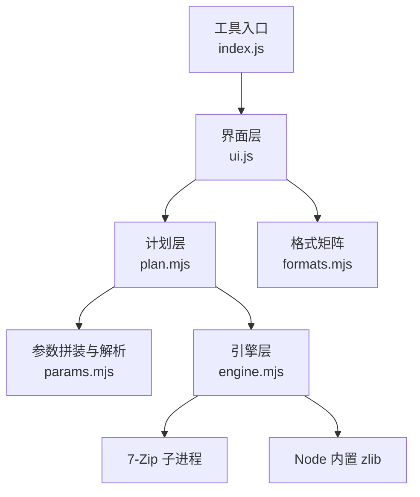
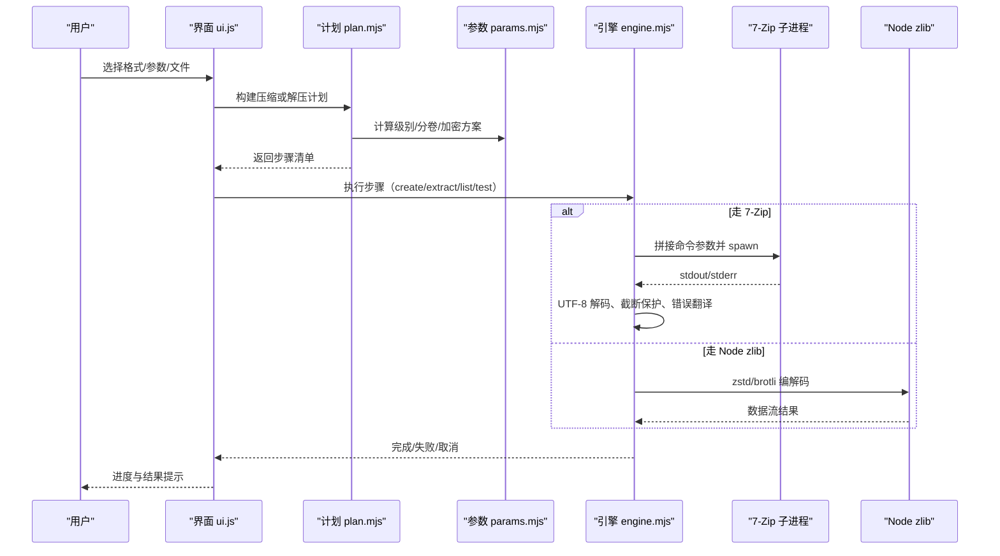
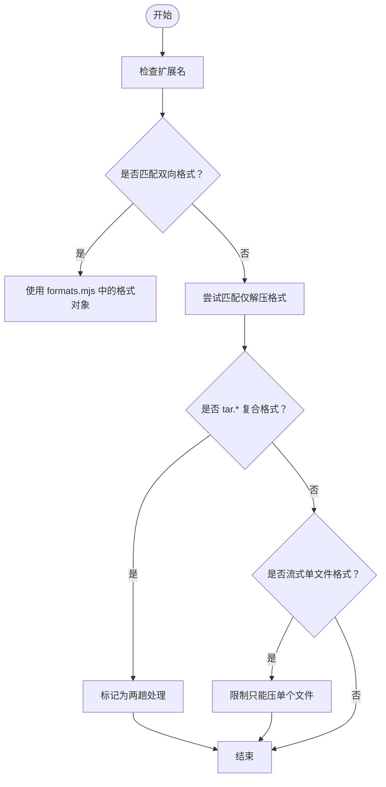
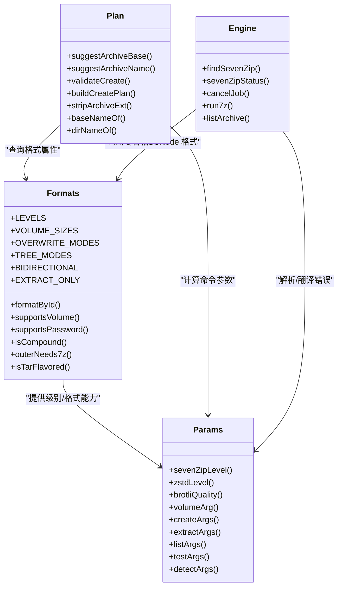
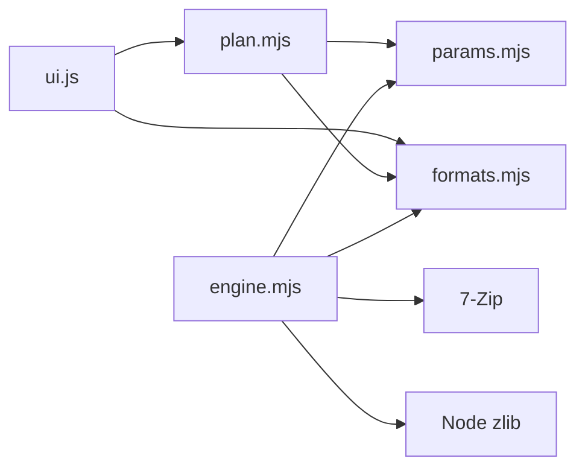

# 压缩解压工具

<cite>
**本文引用的文件**   
- [app/src/tools/archive/index.js](file://app/src/tools/archive/index.js)
- [app/src/tools/archive/ui.js](file://app/src/tools/archive/ui.js)
- [app/src/tools/archive/styles.css](file://app/src/tools/archive/styles.css)
- [app/src/tools/archive/core/engine.mjs](file://app/src/tools/archive/core/engine.mjs)
- [app/src/tools/archive/core/formats.mjs](file://app/src/tools/archive/core/formats.mjs)
- [app/src/tools/archive/core/params.mjs](file://app/src/tools/archive/core/params.mjs)
- [app/src/tools/archive/core/plan.mjs](file://app/src/tools/archive/core/plan.mjs)
- [spec/modules/archive.md](file://spec/modules/archive.md)
- [docs/压缩格式性能对比.md](file://docs/压缩格式性能对比.md)
</cite>

## 目录
1. [简介](#简介)
2. [项目结构](#项目结构)
3. [核心组件](#核心组件)
4. [架构总览](#架构总览)
5. [详细组件分析](#详细组件分析)
6. [依赖关系分析](#依赖关系分析)
7. [性能与内存管理](#性能与内存管理)
8. [常见使用场景](#常见使用场景)
9. [故障排除指南](#故障排除指南)
10. [结论](#结论)

## 简介
本技术文档面向“压缩与解压”工具，围绕其基于 7-Zip 的集成能力展开。该工具在 Node 主进程中调用 7-Zip 可执行文件，并结合 Node 内置 zlib，实现多格式压缩、解压、预览与安全校验；界面侧负责参数选择、作业计划编排与进度反馈。

关键能力包括：
- 支持双向（可压缩 + 可解压）与仅解压两类格式，覆盖 ZIP、7Z、TAR、GZIP、BZIP2、XZ、ZSTD、BROTLI 等常用归档与流式格式，并扩展大量仅解压容器。
- 通过扩展名和签名检测格式，处理复合格式（如 tar.gz / tar.xz / tar.zst / tar.br）。
- 提供分卷压缩、密码保护（7Z AES-256、ZIP AES-256 或 ZipCrypto）、覆盖策略、目录树保留/平铺等选项。
- 引擎层对子进程 stdout/stderr 进行 UTF-8 安全解码与容量限制，避免中文乱码与异常输出撑爆内存。
- 计划层将用户输入转换为可执行的步骤清单，统一命名规则与中间产物隔离。

## 项目结构
“压缩与解压”工具采用分层组织：
- 工具入口与 UI 层：`index.js`、`ui.js`、`styles.css`
- 核心逻辑层：`core/formats.mjs`、`core/params.mjs`、`core/plan.mjs`、`core/engine.mjs`

**图示来源**
- [app/src/tools/archive/index.js:1-16](file://app/src/tools/archive/index.js#L1-L16)
- [app/src/tools/archive/ui.js:1-200](file://app/src/tools/archive/ui.js#L1-L200)
- [app/src/tools/archive/core/formats.mjs:1-189](file://app/src/tools/archive/core/formats.mjs#L1-L189)
- [app/src/tools/archive/core/params.mjs:1-200](file://app/src/tools/archive/core/params.mjs#L1-L200)
- [app/src/tools/archive/core/plan.mjs:1-200](file://app/src/tools/archive/core/plan.mjs#L1-L200)
- [app/src/tools/archive/core/engine.mjs:1-200](file://app/src/tools/archive/core/engine.mjs#L1-L200)

**章节来源**
- [app/src/tools/archive/index.js:1-16](file://app/src/tools/archive/index.js#L1-L16)
- [app/src/tools/archive/ui.js:1-200](file://app/src/tools/archive/ui.js#L1-L200)

## 核心组件
- 格式矩阵（formats.mjs）：定义双向/仅解压格式、级别、分卷尺寸、覆盖策略、目录树模式，以及扩展名匹配、密码支持判断、复合格式与 Node 编解码能力识别。
- 参数与解析（params.mjs）：封装 7-Zip 命令参数生成、Node zstd/brotli 级别映射、分卷大小转换、列表/测试/检测参数、输出解析（条目、元信息）、错误翻译。
- 作业计划（plan.mjs）：将用户输入转换为步骤清单，处理默认文件名、流式格式限制、密码 ASCII 限制、分组写入、复合格式两步走。
- 引擎（engine.mjs）：查找 7-Zip、运行子进程、管道输出解码、取消作业、列出内容、测试完整性、解压与压缩调度、临时文件清理。

**章节来源**
- [app/src/tools/archive/core/formats.mjs:1-189](file://app/src/tools/archive/core/formats.mjs#L1-L189)
- [app/src/tools/archive/core/params.mjs:1-200](file://app/src/tools/archive/core/params.mjs#L1-L200)
- [app/src/tools/archive/core/plan.mjs:1-200](file://app/src/tools/archive/core/plan.mjs#L1-L200)
- [app/src/tools/archive/core/engine.mjs:1-200](file://app/src/tools/archive/core/engine.mjs#L1-L200)

## 架构总览
工具以“UI 交互 → 计划编排 → 参数拼装 → 引擎执行”为主线，结合 Node 与 7-Zip 两种执行路径：

**图示来源**
- [app/src/tools/archive/ui.js:1-200](file://app/src/tools/archive/ui.js#L1-L200)
- [app/src/tools/archive/core/plan.mjs:1-200](file://app/src/tools/archive/core/plan.mjs#L1-L200)
- [app/src/tools/archive/core/params.mjs:1-200](file://app/src/tools/archive/core/params.mjs#L1-L200)
- [app/src/tools/archive/core/engine.mjs:1-200](file://app/src/tools/archive/core/engine.mjs#L1-L200)

## 详细组件分析

### 文件格式检测算法
- 扩展名匹配：优先最长匹配（例如 .tar.gz 优于 .gz），用于双向格式与“仅解压”格式的界面过滤与默认推断。
- 签名自动识别：解压时按文件签名自动识别真实格式，不依赖后缀。
- 复合格式识别：tar.* 系列被识别为复合格式，需要两趟处理：先解外层得到 .tar，再解 tar。
- 流式格式约束：gzip/bzip2/xz/zst/br 是单文件流式格式，不支持文件夹与多文件直接压缩。

**图示来源**
- [app/src/tools/archive/core/formats.mjs:1-189](file://app/src/tools/archive/core/formats.mjs#L1-L189)
- [app/src/tools/archive/core/plan.mjs:1-200](file://app/src/tools/archive/core/plan.mjs#L1-L200)

**章节来源**
- [app/src/tools/archive/core/formats.mjs:1-189](file://app/src/tools/archive/core/formats.mjs#L1-L189)
- [app/src/tools/archive/core/plan.mjs:1-200](file://app/src/tools/archive/core/plan.mjs#L1-L200)

### 压缩参数配置
- 压缩级别：统一映射到 7-Zip -mx 与 Node zstd/brotli 级别，支持 store/fastest/fast/normal/small/extreme。
- 分卷大小：仅在 zip/7z/tar 可用；其他格式禁用并给出说明。
- 密码保护：
  - 7Z：AES-256，且启用文件名加密（-mhe=on）。
  - ZIP：AES-256 或传统 ZipCrypto；非 ASCII 密码需改用 7Z。
- TAR：只打包不压缩，级别无效。
- 复合格式：tar.gz/bzip2/xz/zst/br 需要先打 tar，再压外层；外层 gzip/bzip2/xz 走 7-Zip，zst/br 走 Node zlib。

**图示来源**
- [app/src/tools/archive/core/formats.mjs:1-189](file://app/src/tools/archive/core/formats.mjs#L1-L189)
- [app/src/tools/archive/core/params.mjs:1-200](file://app/src/tools/archive/core/params.mjs#L1-L200)
- [app/src/tools/archive/core/plan.mjs:1-200](file://app/src/tools/archive/core/plan.mjs#L1-L200)
- [app/src/tools/archive/core/engine.mjs:1-200](file://app/src/tools/archive/core/engine.mjs#L1-L200)

**章节来源**
- [app/src/tools/archive/core/params.mjs:1-200](file://app/src/tools/archive/core/params.mjs#L1-L200)
- [app/src/tools/archive/core/formats.mjs:1-189](file://app/src/tools/archive/core/formats.mjs#L1-L189)
- [app/src/tools/archive/core/plan.mjs:1-200](file://app/src/tools/archive/core/plan.mjs#L1-L200)

### 解压选项设置
- 覆盖策略：跳过已存在 / 覆盖已存在。
- 目录树：保留目录结构 / 全部平铺到同一目录。
- 密码：为空时使用空密码参数以避免交互式挂起，错误时会给出干净报错。
- UTF-8：强制 -sccUTF-8 保证中文条目名显示正确。

**章节来源**
- [app/src/tools/archive/core/params.mjs:1-200](file://app/src/tools/archive/core/params.mjs#L1-L200)
- [app/src/tools/archive/core/formats.mjs:1-189](file://app/src/tools/archive/core/formats.mjs#L1-L189)

### 分卷压缩实现细节
- 仅 zip/7z/tar 支持分卷；流式与复合格式不可用。
- 分卷大小从字节数转换为 7-Zip -v 参数（g/m/k 单位）。
- 解压时只需选择首卷（.001），工具会处理首卷名推导。

**章节来源**
- [app/src/tools/archive/core/formats.mjs:1-189](file://app/src/tools/archive/core/formats.mjs#L1-L189)
- [app/src/tools/archive/core/params.mjs:1-200](file://app/src/tools/archive/core/params.mjs#L1-L200)
- [app/src/tools/archive/ui.js:1-200](file://app/src/tools/archive/ui.js#L1-L200)

### 密码保护与安全性
- 7Z：AES-256 + 文件名加密，未提供密码不会传入 -p，避免意外加密。
- ZIP：AES-256 或 ZipCrypto；非 ASCII 密码会阻止并建议改用 7Z。
- 子进程 stdin 设为 ignore，防止 7-Zip 交互式索要密码导致进程挂起。

**章节来源**
- [app/src/tools/archive/core/plan.mjs:1-200](file://app/src/tools/archive/core/plan.mjs#L1-L200)
- [app/src/tools/archive/core/engine.mjs:1-200](file://app/src/tools/archive/core/engine.mjs#L1-L200)
- [app/src/tools/archive/core/params.mjs:1-200](file://app/src/tools/archive/core/params.mjs#L1-L200)

### 增量更新与批量处理
- 批量输入：按所在目录分组，每组一次 7-Zip 调用，条目名相对 cwd，避免路径混乱。
- 追加行为：7-Zip 的 a 命令天然追加；Node 流式格式不支持追加，已被 validateCreate 限制为一组。
- 复合格式：中间 .tar 放入 tempDir，避免污染输出目录。

**章节来源**
- [app/src/tools/archive/core/plan.mjs:1-200](file://app/src/tools/archive/core/plan.mjs#L1-L200)

### 压缩算法选择策略
- 双向格式中，7Z/ZIP/TAR 走 7-Zip；zst/br 走 Node zlib。
- 复合格式外层：gzip/bzip2/xz 走 7-Zip；zst/br 走 Node zlib。
- 级别映射：7-Zip -mx 与 Node zstd/brotli 级别一一对应，确保体验一致。

**章节来源**
- [app/src/tools/archive/core/formats.mjs:1-189](file://app/src/tools/archive/core/formats.mjs#L1-L189)
- [app/src/tools/archive/core/params.mjs:1-200](file://app/src/tools/archive/core/params.mjs#L1-L200)

## 依赖关系分析
- UI 依赖 plan/formats，plan 依赖 formats/params，engine 依赖 params/formats。
- 外部依赖：7-Zip 可执行文件（系统 PATH、常见安装目录或随包 addons/7zip/7z.exe），Node zlib（zstd/brotli）。

**图示来源**
- [app/src/tools/archive/ui.js:1-200](file://app/src/tools/archive/ui.js#L1-L200)
- [app/src/tools/archive/core/plan.mjs:1-200](file://app/src/tools/archive/core/plan.mjs#L1-L200)
- [app/src/tools/archive/core/formats.mjs:1-189](file://app/src/tools/archive/core/formats.mjs#L1-L189)
- [app/src/tools/archive/core/params.mjs:1-200](file://app/src/tools/archive/core/params.mjs#L1-L200)
- [app/src/tools/archive/core/engine.mjs:1-200](file://app/src/tools/archive/core/engine.mjs#L1-L200)

**章节来源**
- [app/src/tools/archive/core/engine.mjs:1-200](file://app/src/tools/archive/core/engine.mjs#L1-L200)

## 性能与内存管理
- 子进程 stdout/stderr 限制：普通模式只保留尾部约 200KB，完整模式（列目录/安全闸门）上限 64MB，超出置标志位拒绝处理，避免异常输出撑爆内存。
- UTF-8 解码：使用 StringDecoder 避免汉字多字节被切块造成 U+FFFD 乱码，确保“可疑路径”检测可靠。
- 超时与取消：默认超时 6 小时；cancelJob 会杀死进程树并标记 __canceled，上层区分取消与失败。
- 临时文件清理：密码错误时 7-Zip 可能留下半成品目录，失败时删除本次新建的输出目录。

**章节来源**
- [app/src/tools/archive/core/engine.mjs:1-200](file://app/src/tools/archive/core/engine.mjs#L1-L200)

## 常见使用场景

### 大文件处理
- 使用分卷压缩（zip/7z/tar）将大文件切块，便于传输与存储。
- 解压时仅需选择首卷（.001），工具会自动处理后续卷。
- 对超大压缩包预览时，工具会在超过安全上限时拒绝列出，防止潜在路径攻击。

**章节来源**
- [app/src/tools/archive/core/formats.mjs:1-189](file://app/src/tools/archive/core/formats.mjs#L1-L189)
- [app/src/tools/archive/core/params.mjs:1-200](file://app/src/tools/archive/core/params.mjs#L1-L200)
- [app/src/tools/archive/core/engine.mjs:1-200](file://app/src/tools/archive/core/engine.mjs#L1-L200)

### 批量压缩
- 多文件/文件夹按所在目录分组，每组一次 7-Zip 调用，减少进程开销。
- 流式格式（gzip/bzip2/xz/zst/br）只能处理单个文件，界面会明确提示并引导改用 TAR 组合或 ZIP/7Z。

**章节来源**
- [app/src/tools/archive/core/plan.mjs:1-200](file://app/src/tools/archive/core/plan.mjs#L1-L200)

### 自动化归档工作流
- 计划层返回步骤清单，供上层自动化流程串联执行。
- 复合格式两步走：先生成 .tar，再外层压缩；中间产物隔离于 tempDir。
- Node 编解码路径（zst/br）无需 7-Zip，适合无外部依赖环境。

**章节来源**
- [app/src/tools/archive/core/plan.mjs:1-200](file://app/src/tools/archive/core/plan.mjs#L1-L200)
- [app/src/tools/archive/core/formats.mjs:1-189](file://app/src/tools/archive/core/formats.mjs#L1-L189)

## 故障排除指南

### 损坏文件恢复
- 使用“测试压缩包完整性”功能（t 命令）快速定位损坏归档。
- 若列表输出不完整（超过安全上限），工具会拒绝处理以防止漏检可疑路径。

**章节来源**
- [app/src/tools/archive/core/params.mjs:1-200](file://app/src/tools/archive/core/params.mjs#L1-L200)
- [app/src/tools/archive/core/engine.mjs:1-200](file://app/src/tools/archive/core/engine.mjs#L1-L200)

### 密码错误
- 现象：7-Zip 留半成品目录，错误消息包含“Wrong password?”。
- 处理：失败时删除本次新建的输出目录，不留垃圾；同时确保传入空密码而非缺省 -p，避免交互式挂起。

**章节来源**
- [app/src/tools/archive/core/engine.mjs:1-200](file://app/src/tools/archive/core/engine.mjs#L1-L200)
- [app/src/tools/archive/core/params.mjs:1-200](file://app/src/tools/archive/core/params.mjs#L1-L200)

### 格式兼容性问题
- RAR/RAR5、ISO、CAB、WIM、MSI、DEB、RPM、CHM、DMG、XAR、UDF、VHD、VMDK、SquashFS 等为仅解压格式，不能创建。
- ZIP 非 ASCII 密码受 7-Zip 限制，建议使用 7Z 或改为纯 ASCII 密码。
- 复合格式（tar.gz/tar.bz2/tar.xz/tar.zst/tar.br）必须两趟处理，不能直接一步到位。

**章节来源**
- [app/src/tools/archive/core/formats.mjs:1-189](file://app/src/tools/archive/core/formats.mjs#L1-L189)
- [app/src/tools/archive/core/plan.mjs:1-200](file://app/src/tools/archive/core/plan.mjs#L1-L200)

## 结论
“压缩与解压”工具通过清晰的分层设计与严谨的参数/计划/引擎协作，实现了跨平台、多格式、高可靠的归档处理能力。其对 7-Zip 的安全加固（UTF-8、stdin 关闭、超时/取消、可疑路径防护）以及对 Node zlib 的补充（zstd/brotli），使工具在无外部依赖环境下也能完成部分任务。建议在自动化场景中优先使用计划层返回的步骤清单，结合分卷、密码与复合格式策略，构建稳健的归档流水线。