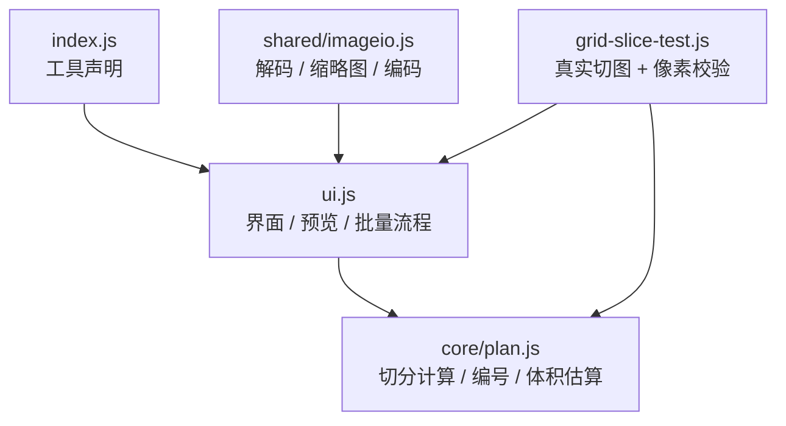
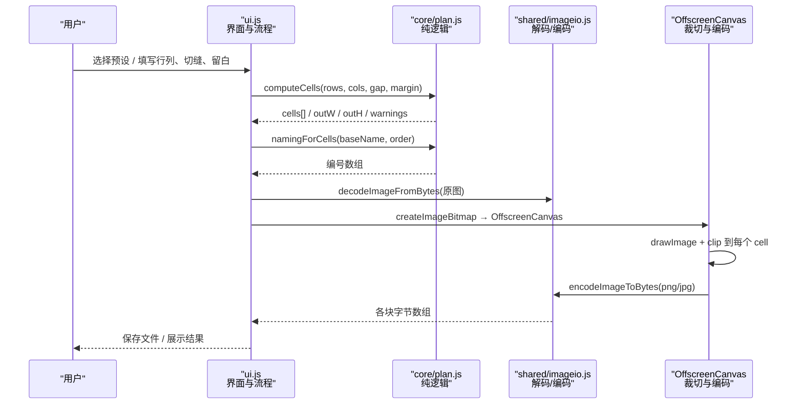
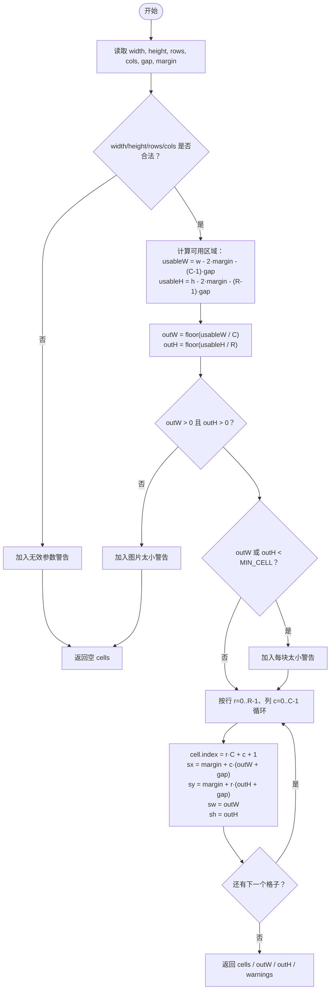
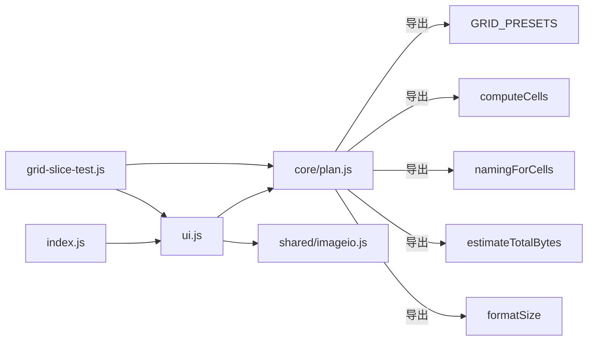

# 九宫格切图

<cite>
**本文引用的文件**   
- [app/src/tools/grid-slice/core/plan.js](file://app/src/tools/grid-slice/core/plan.js)
- [app/src/tools/grid-slice/ui.js](file://app/src/tools/grid-slice/ui.js)
- [app/src/tools/grid-slice/index.js](file://app/src/tools/grid-slice/index.js)
- [app/tests/grid-slice-test.js](file://app/tests/grid-slice-test.js)
</cite>

## 目录
1. [引言](#引言)
2. [项目结构](#项目结构)
3. [核心组件](#核心组件)
4. [架构总览](#架构总览)
5. [详细组件分析](#详细组件分析)
6. [依赖关系分析](#依赖关系分析)
7. [性能与内存](#性能与内存)
8. [故障排查](#故障排查)
9. [结论](#结论)

## 引言
本工具用于把一张图片切成 rows × cols 的网格小块，常见用途是生成朋友圈或小红书的九宫格配图。它把“纯计算逻辑”与“界面与编码流程”解耦：切分坐标、编号命名、体积估算等纯函数放在 `core/plan.js`，可在 Node 中单测；实际的图片解码、裁切与编码在 `ui.js` 中通过浏览器能力完成。

## 项目结构
九宫格切图工具位于 `app/src/tools/grid-slice/`，由三层组成：

- `index.js`：注册工具元信息（名称、分组、排序），挂载 `mount/unmount`。
- `ui.js`：渲染控件、读取参数、调用 `computeCells/namingForCells/estimateTotalBytes`、使用 `OffscreenCanvas` 执行裁切与编码，并提供对外导出的 `sliceImage` 供测试复用。
- `core/plan.js`：不依赖 DOM 的纯函数库，提供预设、边界保护、坐标矩阵计算、两位补零编号和体积估算。
- `tests/grid-slice-test.js`：构造四角颜色夹具，断言块数、尺寸、像素位置、四角方位与切缝颜色。

**图示来源**
- [app/src/tools/grid-slice/index.js:1-14](file://app/src/tools/grid-slice/index.js#L1-L14)
- [app/src/tools/grid-slice/ui.js:1-30](file://app/src/tools/grid-slice/ui.js#L1-L30)
- [app/src/tools/grid-slice/core/plan.js:1-25](file://app/src/tools/grid-slice/core/plan.js#L1-L25)
- [app/tests/grid-slice-test.js:1-40](file://app/tests/grid-slice-test.js#L1-L40)

**章节来源**
- [app/src/tools/grid-slice/index.js:1-14](file://app/src/tools/grid-slice/index.js#L1-L14)
- [app/src/tools/grid-slice/ui.js:1-30](file://app/src/tools/grid-slice/ui.js#L1-L30)
- [app/src/tools/grid-slice/core/plan.js:1-25](file://app/src/tools/grid-slice/core/plan.js#L1-L25)

## 核心组件
- **GRID_PRESETS**：预置行列组合，包括 `3×3`、`2×2`、`1×3`、`3×1` 以及 `custom` 自定义模式。
- **MIN_CELL=8**：每块最小边长保护。当 `outW` 或 `outH` 小于 8 时返回警告，提示用户换大图或减少行列/切缝。
- **MAX_LINES=20**：界面输入限制为 1～20，防止手滑输入超大行列导致内存爆炸。
- **computeCells**：计算 `rows × cols` 矩阵切分的坐标与尺寸。
- **namingForCells**：按行优先或列优先生成文件名序号，默认两位补零。
- **estimateTotalBytes/formatSize**：按 PNG/JPG/WebP 的经验字节/像素比估算总输出体积并格式化显示。

**章节来源**
- [app/src/tools/grid-slice/core/plan.js:1-25](file://app/src/tools/grid-slice/core/plan.js#L1-L25)
- [app/src/tools/grid-slice/core/plan.js:26-68](file://app/src/tools/grid-slice/core/plan.js#L26-L68)
- [app/src/tools/grid-slice/core/plan.js:69-114](file://app/src/tools/grid-slice/core/plan.js#L69-L114)
- [app/src/tools/grid-slice/core/plan.js:115-139](file://app/src/tools/grid-slice/core/plan.js#L115-L139)

## 架构总览
九宫格切图的执行路径如下：

**图示来源**
- [app/src/tools/grid-slice/ui.js:1-30](file://app/src/tools/grid-slice/ui.js#L1-L30)
- [app/src/tools/grid-slice/core/plan.js:26-68](file://app/src/tools/grid-slice/core/plan.js#L26-L68)

## 详细组件分析

### GRID_PRESETS 预设方案与数学含义
`GRID_PRESETS` 定义了常用网格形态：

| value | label | rows | cols | 几何含义 |
|---|---|---:|---:|---|
| `3x3` | 九宫格 3×3 | 3 | 3 | 横三竖三，最常见朋友圈布局 |
| `2x2` | 四宫格 2×2 | 2 | 2 | 两行两列 |
| `1x3` | 竖切三条 1×3 | 1 | 3 | 横向三等分，适合宽图横条拼接 |
| `3x1` | 横切三条 3×1 | 3 | 1 | 纵向三等分，适合高图竖条拼接 |
| `custom` | 自定义行列数… | 0 | 0 | 由界面输入决定，实际行列数受 `MAX_LINES` 约束 |

其中 `1×3` 与 `3×1` 不是“行数大于列数就是竖切”，而是严格遵循“rows × cols”的矩阵语义：`rows` 是垂直方向的分段数，`cols` 是水平方向的分段数。因此 `1×3` 表示 1 行 3 列（横向 3 块），`3×1` 表示 3 行 1 列（纵向 3 块）。

**章节来源**
- [app/src/tools/grid-slice/core/plan.js:10-20](file://app/src/tools/grid-slice/core/plan.js#L10-L20)

### MIN_CELL=8 最小边长保护机制
`MIN_CELL=8` 的作用是防止切出过小、在手机屏幕上模糊难辨的碎片。其判断发生在 `computeCells` 中：先根据图片宽高、外圈留白 `margin`、切缝 `gap`、行列数 `rows × cols` 算出每块的输出宽度 `outW` 与高度 `outH`；若任一方向小于 8，则返回包含警告的结果，但不会抛错。

这带来两层安全设计：
1. **业务层**：界面可根据 `warnings` 阻止执行，避免用户得到不可用的碎图。
2. **算法层**：即使传入异常参数，也不会产生负数尺寸或空切片崩溃。

**章节来源**
- [app/src/tools/grid-slice/core/plan.js:22-25](file://app/src/tools/grid-slice/core/plan.js#L22-L25)
- [app/src/tools/grid-slice/core/plan.js:40-68](file://app/src/tools/grid-slice/core/plan.js#L40-L68)

### MAX_LINES=20 最大行列数限制
`MAX_LINES=20` 是界面侧的安全上限。用户在自定义模式下输入的 `rows` 与 `cols` 会被钳制在 1～20。配合 `computeCells` 的整数校验，可以避免以下风险：
- 输入 `NaN`、`Infinity`、负数或非数字字符串被误用。
- 输入极大行列数导致 `cells` 数组过大、后续 `Out of memory`。
- 极小图被切成过多小块后出现大量低质量碎片。

该限制同时体现在控件 `min="1" max="20"` 与 `clampNum(value, 1, MAX_LINES, 3)` 两处。

**章节来源**
- [app/src/tools/grid-slice/core/plan.js:26-28](file://app/src/tools/grid-slice/core/plan.js#L26-L28)
- [app/src/tools/grid-slice/ui.js:108-125](file://app/src/tools/grid-slice/ui.js#L108-L125)

### 矩阵切分坐标计算算法
`computeCells` 的核心是“可用区域均分”。其步骤可概括为：

关键公式：
- 可用宽度：`usableW = width - 2 × margin - (cols - 1) × gap`
- 可用高度：`usableH = height - 2 × margin - (rows - 1) × gap`
- 每块尺寸：`outW = floor(usableW / cols)`，`outH = floor(usableH / rows)`
- 第 `(r, c)` 块左上坐标：`sx = margin + c × (outW + gap)`，`sy = margin + r × (outH + gap)`
- 每块尺寸固定为 `sw = outW`，`sh = outH`

注意：
- 所有除法向下取整，因此最右侧和最底部可能留下不足一块的余数像素，这些像素不参与任何切块。
- `gap` 是“块与块之间的切缝”，只在相邻块之间扣除；`margin` 是外圈留白，四周都扣。
- 坐标以原图左上角为原点，向右为 x，向下为 y。

**图示来源**
- [app/src/tools/grid-slice/core/plan.js:30-68](file://app/src/tools/grid-slice/core/plan.js#L30-L68)

**章节来源**
- [app/src/tools/grid-slice/core/plan.js:30-68](file://app/src/tools/grid-slice/core/plan.js#L30-L68)

### 编号命名规则：两位补零与自然扩展
`namingForCells` 为每个格子生成不含扩展名的文件名序号，并与 `cells` 顺序一一对应：

- **按行编号（默认）**：从左上到右下自然读数，符合朋友圈九宫格习惯。
- **按列编号**：先第 1 列从上到下，再第 2 列……

序号格式为 `${baseName}_${两位补零序号}`，例如 `照片_01`、`照片_02`、`照片_09`。当总数超过 99 时，JavaScript 的 `padStart(2, '0')` 不会截断，而是自然扩展为三位、四位等，保证字典序稳定。

复杂度：
- 时间复杂度：`O(rows × cols)`，仅一次线性遍历。
- 空间复杂度：`O(rows × cols)`，用于存储结果数组。

**章节来源**
- [app/src/tools/grid-slice/core/plan.js:74-102](file://app/src/tools/grid-slice/core/plan.js#L74-L102)

### 不同网格配置的切分示例
假设原图尺寸为 `W × H`，切缝 `gap`，外圈留白 `margin`，行列 `R × C`：

| 配置 | rows | cols | 适用场景 | 说明 |
|---|---:|---:|---|---|
| 九宫格 | 3 | 3 | 朋友圈/小红书九宫格 | 最常见，每块约 `(W - 2·margin - 2·gap)/3 × (H - 2·margin - 2·gap)/3` |
| 四宫格 | 2 | 2 | 对比图、前后效果 | 四个象限均匀分布 |
| 竖切三条 | 1 | 3 | 宽图横幅 | 只横向分三段，高度不变 |
| 横切三条 | 3 | 1 | 高图竖条 | 只纵向分三段，宽度不变 |
| 自定义 N×M | N ≤ 20 | M ≤ 20 | 特殊排版 | 受 `MAX_LINES` 与 `MIN_CELL` 双重保护 |

以 `300 × 300` 为例：
- `3×3`、`gap=0`、`margin=0`：`outW=100`，`outH=100`，共 9 块。
- `3×3`、`gap=10`、`margin=20`：`usableW=300-40-20=240`，`usableH=300-40-20=240`，`outW=floor(240/3)=80`，`outH=80`，共 9 块。
- `2×2`、`gap=0`、`margin=0`：`outW=150`，`outH=150`，共 4 块。
- `1×3`、`gap=0`、`margin=0`：`outW=100`，`outH=300`，共 3 块。
- `3×1`、`gap=0`、`margin=0`：`outW=300`，`outH=100`，共 3 块。

**章节来源**
- [app/src/tools/grid-slice/core/plan.js:30-68](file://app/src/tools/grid-slice/core/plan.js#L30-L68)
- [app/tests/grid-slice-test.js:150-200](file://app/tests/grid-slice-test.js#L150-L200)

### 体积估算方法
`estimateTotalBytes` 使用经验性的“字节/像素比”进行粗略估算：

| 格式 | BYTES_PER_PIXEL | 特点 |
|---|---:|---|
| png | 1.6 | 无损，体积通常较大 |
| jpg | 0.45 | 有损压缩，体积较小 |
| webp | 0.35 | 现代格式，通常更小 |

计算公式：
- `perFile ≈ outW × outH × BYTES_PER_PIXEL[format]`
- `total = perFile × count`

该估算用于界面提示“预计约 xx”，并非精确预测；实际体积还取决于图像内容、编码器实现、画质参数等。`formatSize` 将字节转换为 B / KB / MB / GB 可读字符串。

**章节来源**
- [app/src/tools/grid-slice/core/plan.js:104-139](file://app/src/tools/grid-slice/core/plan.js#L104-L139)

## 依赖关系分析

- `index.js` 只负责工具注册，耦合度最低。
- `ui.js` 是编排中心：读取界面参数、调用 `core/plan.js` 的纯函数、调用 `shared/imageio.js` 解码编码。
- `core/plan.js` 无外部运行时依赖，可独立单元测试。
- 测试脚本直接复用 `ui.js` 导出的 `sliceImage`，确保自动化测试与真实切图链路一致。

**图示来源**
- [app/src/tools/grid-slice/index.js:1-14](file://app/src/tools/grid-slice/index.js#L1-L14)
- [app/src/tools/grid-slice/ui.js:1-30](file://app/src/tools/grid-slice/ui.js#L1-L30)
- [app/src/tools/grid-slice/core/plan.js:1-25](file://app/src/tools/grid-slice/core/plan.js#L1-L25)
- [app/tests/grid-slice-test.js:1-40](file://app/tests/grid-slice-test.js#L1-L40)

**章节来源**
- [app/src/tools/grid-slice/index.js:1-14](file://app/src/tools/grid-slice/index.js#L1-L14)
- [app/src/tools/grid-slice/ui.js:1-30](file://app/src/tools/grid-slice/ui.js#L1-L30)
- [app/src/tools/grid-slice/core/plan.js:1-25](file://app/src/tools/grid-slice/core/plan.js#L1-L25)
- [app/tests/grid-slice-test.js:1-40](file://app/tests/grid-slice-test.js#L1-L40)

## 性能与内存

### OffscreenCanvas 裁切编码的优势
`ui.js` 中真正执行切图的路径会创建位图并通过 `OffscreenCanvas` 进行绘制与裁剪。相比传统 Canvas，其主要优势包括：
- **离屏渲染**：不在可见画布上绘制，减少重绘与合成开销。
- **并发友好**：理论上可在 Worker 中使用，便于未来扩展批处理。
- **与 ImageBitmap 配合**：减少解码阶段对主线程的影响，提升大图吞吐。

当前实现中，`sliceImage` 被导出给测试直接使用，从而保证自动化测试验证的是“同一套裁切/编码链路”，而不是另一套简化实现。

**章节来源**
- [app/src/tools/grid-slice/ui.js:1-30](file://app/src/tools/grid-slice/ui.js#L1-L30)

### 内存管理策略
1. **行列上限**：`MAX_LINES=20` 限制自定义行列，避免 `rows × cols` 过大导致 `cells` 数组膨胀。
2. **最小边长保护**：`MIN_CELL=8` 提醒用户避免切出过小碎片，降低无效产物数量。
3. **向下取整余数丢弃**：`floor(usableW/C)` 与 `floor(usableH/R)` 保证每块尺寸一致，避免边缘碎片增加编码与存储负担。
4. **预估体积**：`estimateTotalBytes` 让用户提前感知总产出大小，避免一次性生成过大的文件集合。
5. **测试夹具可控**：测试使用固定尺寸 `300×300` 的四角纯色图，避免随机大图造成测试不稳定。

**章节来源**
- [app/src/tools/grid-slice/core/plan.js:22-28](file://app/src/tools/grid-slice/core/plan.js#L22-L28)
- [app/src/tools/grid-slice/core/plan.js:30-68](file://app/src/tools/grid-slice/core/plan.js#L30-L68)
- [app/src/tools/grid-slice/core/plan.js:104-139](file://app/src/tools/grid-slice/core/plan.js#L104-L139)
- [app/tests/grid-slice-test.js:1-40](file://app/tests/grid-slice-test.js#L1-L40)

## 故障排查

| 现象 | 可能原因 | 建议处理 |
|---|---|---|
| 提示“图片尺寸无效，无法切分” | `width` 或 `height` 非正数 | 检查输入图片或解码结果 |
| 提示“行列数必须是 1 或更大的整数” | `rows` 或 `cols` 小于 1 | 调整预设或自定义行列 |
| 提示“图片太小放不下” | `gap` 或 `margin` 过大，或行列太多 | 减小切缝/留白，或减少行列 |
| 提示“每块只有 … 像素，太小了” | `outW` 或 `outH` 小于 `MIN_CELL=8` | 换更大图片，或减少行列/切缝 |
| 切出来的块内容与预期不一致 | 坐标计算偏移、切缝颜色覆盖、或测试环境差异 | 参考像素校验逻辑，确认 `sx/sy/sw/sh` |
| 编号顺序不符合预期 | 选择了“按列编号” | 切换回“按行编号”，或理解列优先编号规则 |
| 输出体积远大于预期 | JPG 画质过高、PNG 无损、或图像本身复杂 | 降低 JPG 画质，或改用 WebP |

**章节来源**
- [app/src/tools/grid-slice/core/plan.js:30-68](file://app/src/tools/grid-slice/core/plan.js#L30-L68)
- [app/src/tools/grid-slice/core/plan.js:104-139](file://app/src/tools/grid-slice/core/plan.js#L104-L139)
- [app/tests/grid-slice-test.js:100-200](file://app/tests/grid-slice-test.js#L100-L200)

## 结论
九宫格切图工具通过清晰的职责分层实现了“可测试的纯逻辑”与“可交互的界面流程”分离。`GRID_PRESETS` 提供常用网格语义，`computeCells` 以明确的数学公式计算 `rows × cols` 矩阵坐标，`MIN_CELL=8` 与 `MAX_LINES=20` 共同构成安全边界，两位补零的编号规则保证排序稳定并可自然扩展。配合 `estimateTotalBytes` 的体积估算与 `OffscreenCanvas` 的离屏裁切编码，工具在易用性、正确性与性能之间取得平衡。