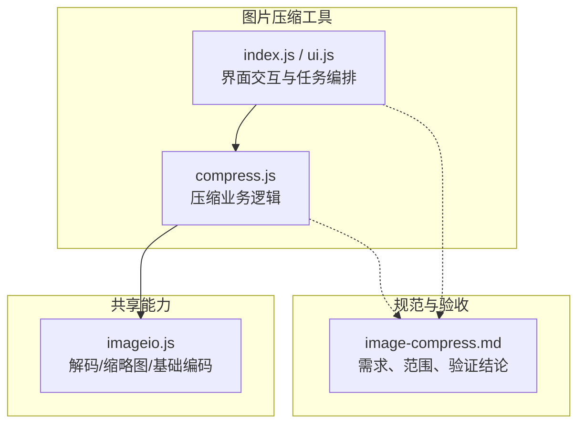
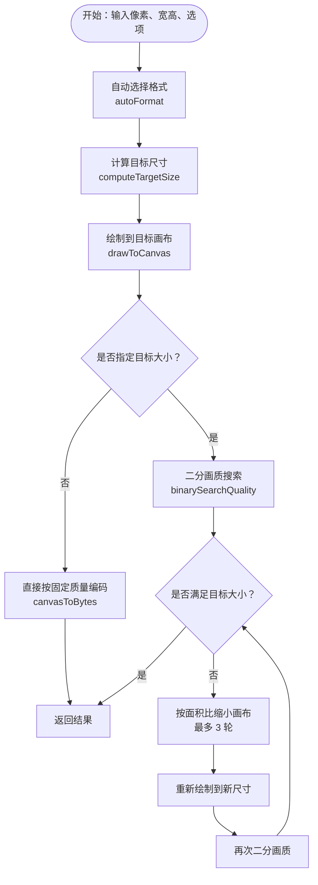
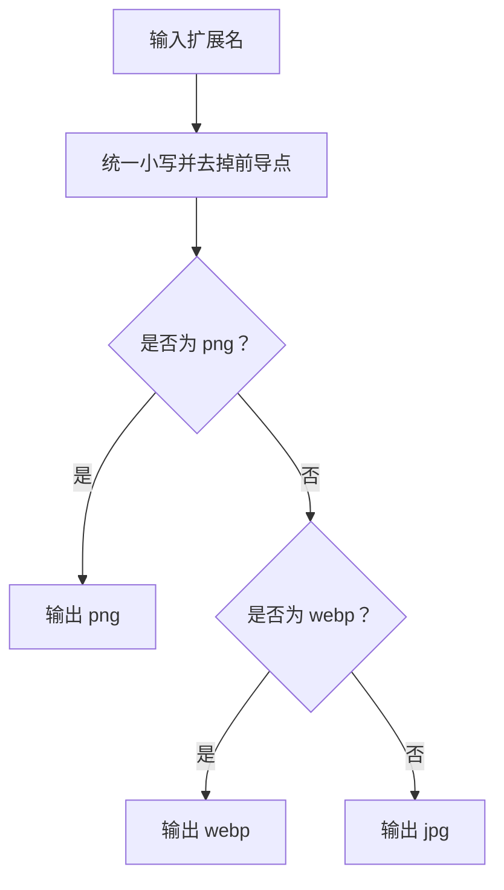
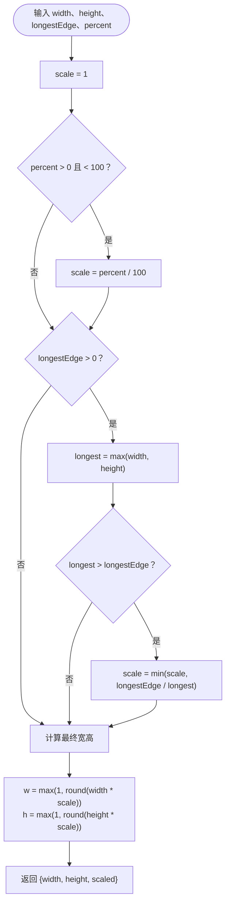
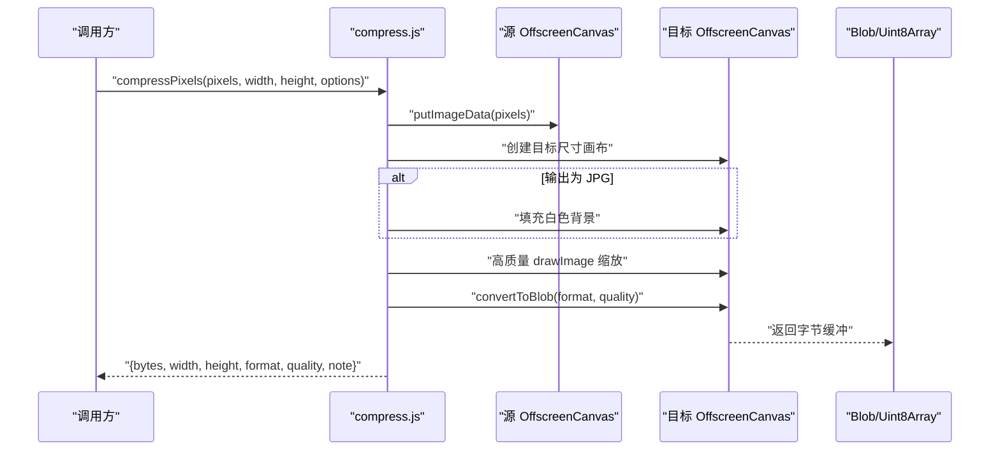
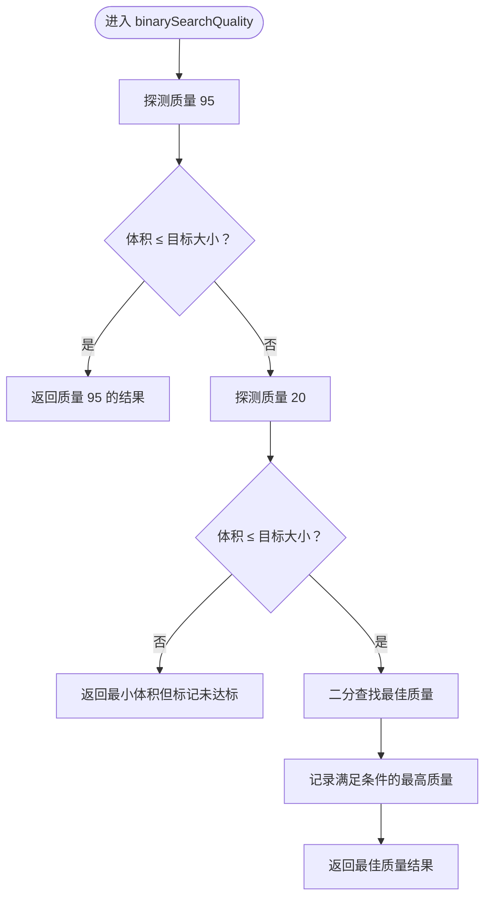
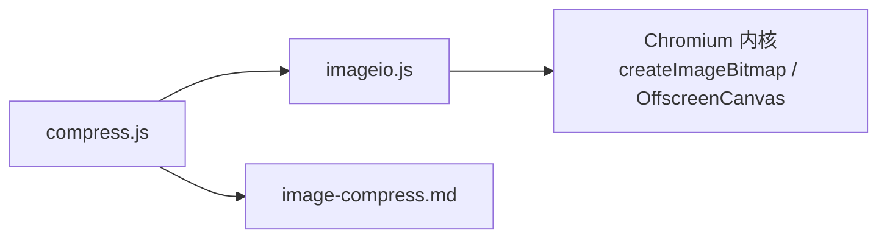

# 图片压缩优化

<cite>
**本文引用的文件**
- [compress.js](file://app/src/tools/compress/core/compress.js)
- [imageio.js](file://app/src/shared/imageio.js)
- [image-compress.md](file://spec/modules/image-compress.md)
</cite>

## 目录
1. [引言](#引言)
2. [项目结构](#项目结构)
3. [核心组件](#核心组件)
4. [架构总览](#架构总览)
5. [详细组件分析](#详细组件分析)
6. [依赖关系分析](#依赖关系分析)
7. [性能与体积特性](#性能与体积特性)
8. [浏览器兼容性与限制](#浏览器兼容性与限制)
9. [故障排查指南](#故障排查指南)
10. [结论](#结论)

## 引言
本文件面向「图片压缩」工具，系统说明其基于 OffscreenCanvas 的压缩实现原理，以及 PNG、JPG、WebP 三种输出格式的策略差异。文档重点解释以下能力：

- `autoFormat`：根据输入扩展名自动选择输出格式。
- `computeTargetSize`：按 `longestEdge`（最长边像素）和 `percent`（百分比）计算目标尺寸。
- `compressPixels`：以画质优先或指定目标大小为目标的单图压缩入口。
- 二分画质搜索：在质量区间内寻找不超目标大小的最高质量编码。
- 缩放策略：当仅靠质量调节仍超标时，按面积比例逐步缩小画布再试。

该实现完全使用 Chromium 内核提供的解码与编码能力，不引入第三方图像库；PNG 为无损、JPG/WebP 为有损，且 JPEG 会去除透明通道并以白色背景合成。

**章节来源**
- [compress.js:1-140](file://app/src/tools/compress/core/compress.js#L1-L140)
- [image-compress.md:1-37](file://spec/modules/image-compress.md#L1-L37)

## 项目结构
图片压缩功能位于工具目录中，核心逻辑集中在压缩模块的核心文件中，并复用共享的图片解码/编码能力。

**图表来源**
- [compress.js:1-140](file://app/src/tools/compress/core/compress.js#L1-L140)
- [imageio.js:1-141](file://app/src/shared/imageio.js#L1-L141)
- [image-compress.md:1-37](file://spec/modules/image-compress.md#L1-L37)

**章节来源**
- [compress.js:1-140](file://app/src/tools/compress/core/compress.js#L1-L140)
- [imageio.js:1-141](file://app/src/shared/imageio.js#L1-L141)
- [image-compress.md:1-37](file://spec/modules/image-compress.md#L1-L37)

## 核心组件
- **MIME 映射**：将内部格式标识 `png`、`jpg`、`webp` 映射到浏览器可编码的 MIME 类型。
- **autoFormat**：根据输入扩展名自动选择输出格式。
- **computeTargetSize**：纯函数，计算最终输出尺寸。
- **drawToCanvas**：把 RGBA 像素绘制到目标尺寸的 OffscreenCanvas，支持 JPG 白底铺色。
- **canvasToBytes**：调用 OffscreenCanvas 的 `convertToBlob` 进行编码。
- **binarySearchQuality**：在质量区间内进行二分查找，找到满足目标大小要求的最高质量。
- **compressPixels**：对外暴露的单图压缩入口，封装了尺寸计算、格式选择、质量控制与二次缩边。

这些组件共同构成“读取像素 → 缩放 → 编码 → 目标大小判定”的完整链路。

**章节来源**
- [compress.js:1-140](file://app/src/tools/compress/core/compress.js#L1-L140)

## 架构总览
下图展示了从输入像素到最终字节的主要处理流程，包括自动格式选择、目标尺寸计算、画布绘制、编码与目标大小自适应。

**图表来源**
- [compress.js:1-140](file://app/src/tools/compress/core/compress.js#L1-L140)

**章节来源**
- [compress.js:1-140](file://app/src/tools/compress/core/compress.js#L1-L140)

## 详细组件分析

### autoFormat：格式自动选择逻辑
`autoFormat` 接收扩展名，并遵循“保持原格式语义”的原则：

- 若输入扩展名为 `png`，则输出 `png`。
- 若输入扩展名为 `webp`，则输出 `webp`。
- 其他情况一律输出 `jpg`，因为 JPG 兼容性最广。

这个策略符合规范中对“自动输出格式”的定义：JPG→JPG、PNG→PNG、WebP→WebP，其它→JPG。由于 PNG 是无损格式，若原始 PNG 已经较大，继续用 PNG 重编码通常不会显著减小体积，因此界面侧通常会提示照片类图片更适合 JPG 或 WebP。

**图表来源**
- [compress.js:1-140](file://app/src/tools/compress/core/compress.js#L1-L140)
- [image-compress.md:1-37](file://spec/modules/image-compress.md#L1-L37)

**章节来源**
- [compress.js:1-140](file://app/src/tools/compress/core/compress.js#L1-L140)
- [image-compress.md:1-37](file://spec/modules/image-compress.md#L1-L37)

### computeTargetSize：尺寸计算算法
`computeTargetSize` 是一个纯函数，负责把原始宽高转换为最终输出宽高。它同时支持两个参数：

- `longestEdge`：最长边像素上限。
- `percent`：百分比缩放，取值大于 0 且小于 100 时生效。

核心规则如下：

1. 初始缩放比例为 1。
2. 如果 `percent` 在有效范围内，则把缩放比例设为 `percent / 100`。
3. 如果 `longestEdge` 大于 0，则取原始宽高中的最大值作为当前最长边；只有当原始最长边大于 `longestEdge` 时，才把缩放比例更新为 `longestEdge / 原始最长边`。
4. 若两者都给出，最终缩放比例取两者中的较小值，从而保证“更严格的那个约束优先”。
5. 最终宽高至少为 1，并按四舍五入取整。
6. 返回对象包含 `width`、`height` 和一个布尔标记，表示是否发生了实际缩放。

**图表来源**
- [compress.js:1-140](file://app/src/tools/compress/core/compress.js#L1-L140)

#### longestEdge 与 percent 的组合规则
| 场景 | 行为 |
|---|---|
| 只传 `percent` | 按百分比等比缩放。例如 50% 会把宽高都减半。 |
| 只传 `longestEdge` | 把最长边限制到指定像素，短边按比例缩放。 |
| 同时传两者 | 先按百分比缩放，再用最长边约束；若最长边约束更严格，则以最长边为准。 |
| 都不传 | 不缩放，直接使用原始尺寸。 |
| `percent` 超出有效范围 | 不参与缩放，退化为最长边约束或不缩放。 |

示例说明：

- 原始 3000×2000，设置 `longestEdge=1920`：最长边为 3000，超过 1920，因此缩放比例为 1920/3000=0.64，结果为 1920×1280。
- 原始 400×300，设置 `percent=50`：缩放比例为 0.5，结果为 200×150。
- 原始 3000×2000，同时设置 `percent=50` 与 `longestEdge=1920`：百分比缩放后最长边为 1500，未超过 1920，因此最终最长边为 1500，结果为 1500×1000。

这些计算结果与规范中的实测回填一致。

**章节来源**
- [compress.js:1-140](file://app/src/tools/compress/core/compress.js#L1-L140)
- [image-compress.md:1-37](file://spec/modules/image-compress.md#L1-L37)

### 画布绘制与编码流程
压缩流程中的关键步骤是先把 RGBA 像素写入源画布，再绘制到目标尺寸的目标画布。

- 源画布用于承载原始像素数据。
- 目标画布用于承载缩放后的像素数据。
- 当输出格式为 JPG 时，会先用白色背景填充目标画布，因为 JPG 不支持透明通道。
- 缩放时使用高质量重采样，避免缩略图出现明显锯齿。
- 编码通过 `OffscreenCanvas.convertToBlob` 完成，PNG 不传入 quality，JPG/WebP 传入归一化后的质量值。

**图表来源**
- [compress.js:1-140](file://app/src/tools/compress/core/compress.js#L1-L140)

**章节来源**
- [compress.js:1-140](file://app/src/tools/compress/core/compress.js#L1-L140)

### 二分画质搜索与目标大小自适应
当用户指定目标大小时，工具不是简单降低质量，而是采用二分搜索在质量区间内寻找最高质量且不超目标大小的编码结果。

- 质量探测区间为 20 到 95。
- 先探测质量 95：如果已满足目标大小，直接返回。
- 再探测质量 20：如果仍不满足，则返回之前记录的最小体积结果，并标记未能完全达标。
- 否则在区间内进行二分：每次取中间质量值探测，若满足则尝试更高，若不满足则降低上限。
- 若二分完成后仍未达标，最多进行 3 轮：每轮按面积比例的平方根缩小画布，再重新绘制并再次二分。

**图表来源**
- [compress.js:1-140](file://app/src/tools/compress/core/compress.js#L1-L140)

当二分质量仍无法满足目标大小时，`compressPixels` 会执行第二轮策略：

1. 按面积比例计算缩放因子：`√(目标大小 / 当前体积)`，并乘以一个小安全系数。
2. 计算新宽高，并限制最小尺寸为 64×64。
3. 如果新尺寸不比当前尺寸更小，则停止继续缩小。
4. 最多重复 3 轮，以避免无限缩小导致画面失去意义。
5. 每轮都会重新绘制画布并再次二分质量。

这种“先调质量、再调尺寸”的策略兼顾观感与体积目标，也符合通用图片压缩实践。

**章节来源**
- [compress.js:1-140](file://app/src/tools/compress/core/compress.js#L1-L140)

### PNG、JPG、WebP 的压缩策略与质量控制
| 格式 | 压缩性质 | 质量参数 | 透明通道 | 适用建议 |
|---|---|---|---|---|
| PNG | 无损 | 不传入 quality | 保留 | 图标、透明图形、需要精确像素的场景。若体积过大，应改用 JPG 或 WebP。 |
| JPG | 有损 | 1~100，默认 82 | 不支持；会用白色背景合成 | 照片类图片；对透明度敏感的内容不适合。 |
| WebP | 有损 | 1~100，默认 82 | 由浏览器编码器决定 | 现代浏览器常用，通常比同质量 JPG 更小。 |

实现细节要点：

- PNG 编码不传入 quality，因为它是无损格式。
- JPG/WebP 编码会把质量值限制在 1 到 100 之间，然后除以 100 转为 0 到 1 的浮点值。
- JPG 输出会移除透明信息，因此压缩入口会为 JPG 提供白色背景。
- 自动模式下，PNG 输入保持 PNG，WebP 输入保持 WebP，其它格式转为 JPG。

**章节来源**
- [compress.js:1-140](file://app/src/tools/compress/core/compress.js#L1-L140)
- [image-compress.md:1-37](file://spec/modules/image-compress.md#L1-L37)

## 依赖关系分析
压缩模块依赖共享图片能力，主要依赖关系如下：

- `compress.js` 负责业务逻辑：格式选择、尺寸计算、画布绘制、质量二分和目标大小自适应。
- `imageio.js` 提供共享能力：从字节解码像素、生成缩略图、基础编码等。
- 两者都依赖 Chromium 内核的图像处理 API，而不是第三方图像库。

**图表来源**
- [compress.js:1-140](file://app/src/tools/compress/core/compress.js#L1-L140)
- [imageio.js:1-141](file://app/src/shared/imageio.js#L1-L141)
- [image-compress.md:1-37](file://spec/modules/image-compress.md#L1-L37)

**章节来源**
- [compress.js:1-140](file://app/src/tools/compress/core/compress.js#L1-L140)
- [imageio.js:1-141](file://app/src/shared/imageio.js#L1-L141)
- [image-compress.md:1-37](file://spec/modules/image-compress.md#L1-L37)

## 性能与体积特性

### 不同质量设置的体积对比思路
由于 JPG/WebP 是有损压缩，质量越高通常体积越大，但具体数值受画面内容影响很大。实践中可按以下思路评估：

| 质量档位 | 典型特点 | 适用场景 |
|---|---|---|
| 20~40 | 体积较小，可能出现可见块状伪影 | 缩略图、低优先级预览 |
| 60~80 | 体积与观感平衡 | 网页图片、普通照片 |
| 82~95 | 观感较好，体积中等偏高 | 默认推荐质量 |
| 95~100 | 接近无损观感，体积较大 | 高质量展示图 |

对于 PNG，因为是无损格式，质量参数不参与编码，因此不能通过降低质量来缩小体积。若 PNG 体积过大，应考虑：

- 改为 JPG：适合没有透明需求的照片。
- 改为 WebP：现代浏览器下通常能获得更小体积。
- 缩小尺寸：通过 `longestEdge` 或 `percent` 减少像素总量。

### 无损与有损压缩的选择建议
- 选 PNG：需要透明背景、图标、矢量风格截图、需要像素级精确还原。
- 选 JPG：照片、渐变丰富、不需要透明的常规图片。
- 选 WebP：希望在不牺牲太多观感的前提下获得更小体积，且目标环境支持现代浏览器。
- 指定目标大小：当后端或传输层对文件大小有限制时，启用目标大小模式，让工具自动在质量和尺寸间折中。

### 性能优化技巧
- 尽量先缩小尺寸，再编码：像素总量越少，重采样和编码越快。
- 合理设置 `longestEdge`：屏幕显示通常不需要超长边，常见值为 1920 或更低。
- 批量处理时复用画布与上下文：避免频繁创建销毁大图缓冲。
- 避免超大图片：超过 4000 万像素的图片会被拒绝，防止内存爆炸。
- 优先使用 JPG/WebP 的有损压缩来换取体积下降；PNG 只用于必须无损或透明的场景。

[本节为通用性能指导，不直接分析具体代码行]

## 浏览器兼容性与限制

### 兼容性考虑
- 解码与编码依赖 Chromium 内核的 `createImageBitmap` 和 `OffscreenCanvas`。
- `OffscreenCanvas.convertToBlob` 支持 `image/png`、`image/jpeg`、`image/webp` 等类型。
- 不同浏览器的 WebP 编码能力存在差异，部分旧版本可能不支持 WebP 编码。
- HEIC/HEIF 等格式在渲染进程中无法直接解码，需走主进程引擎；压缩工具本身聚焦 PNG/JPG/WebP/BMP/GIF/ICO/AVIF 等内核可解码格式。

### 已知限制
- 重编码会剥离 EXIF、ICC 等元数据；这有利于隐私，但可能导致色彩轻微变化。
- 超过 4000 万像素的图片会明确拒绝，避免内存不足。
- JPEG 体积与画面内容强相关，目标大小模式允许一定误差，规范中提及约 ±15% 的容差。
- PNG 不提供压缩级别控制，因此“压不动”属于正常现象。

**章节来源**
- [imageio.js:1-141](file://app/src/shared/imageio.js#L1-L141)
- [image-compress.md:1-37](file://spec/modules/image-compress.md#L1-L37)

## 故障排查指南

| 现象 | 可能原因 | 处理建议 |
|---|---|---|
| PNG 体积几乎没有下降 | PNG 是无损格式，且内核不提供压缩级别 | 改用 JPG 或 WebP，或缩小尺寸 |
| JPG 图片出现黑色或透明变黑 | JPG 不支持透明，需要底色填充 | 确认使用白色背景合成；必要时在 UI 层提示 |
| 指定目标大小后仍偏大 | 画面内容难以压缩，或尺寸已接近下限 | 接受“已尽量压缩”提示，或进一步缩小 `longestEdge` |
| 图片被拒绝并提示过大 | 像素总量超过 4000 万上限 | 先缩小图片，或分批处理 |
| WebP 编码失败 | 浏览器不支持 WebP 编码 | 回退到 JPG；或在较新浏览器中重试 |
| 色彩与原始文件略有差异 | EXIF/ICC 被剥离，或有损编码损失 | 如需严格色彩管理，应使用无损格式或专业编辑工具 |

**章节来源**
- [imageio.js:1-141](file://app/src/shared/imageio.js#L1-L141)
- [image-compress.md:1-37](file://spec/modules/image-compress.md#L1-L37)

## 结论
该图片压缩工具以 `compress.js` 为核心，结合 `imageio.js` 提供的解码与编码能力，实现了基于 OffscreenCanvas 的高效压缩路径。其设计重点在于：

- 自动格式选择：保持 PNG/WebP 语义，其它转为通用性更强的 JPG。
- 灵活尺寸控制：`longestEdge` 与 `percent` 组合，取更严格的约束。
- 质量优先与目标大小双模式：先尝试固定质量，再使用二分质量搜索；仍超标时按面积比例缩小画布。
- 明确的限制说明：PNG 无损、JPG 去透明、超大图保护、元数据剥离。

在实际使用中，建议优先使用默认质量 82，并结合 `longestEdge` 控制输出尺寸；对体积敏感场景使用目标大小模式，并配合 JPG 或 WebP 获取更好压缩效果。

[本节为总结性内容，不直接分析具体代码行]