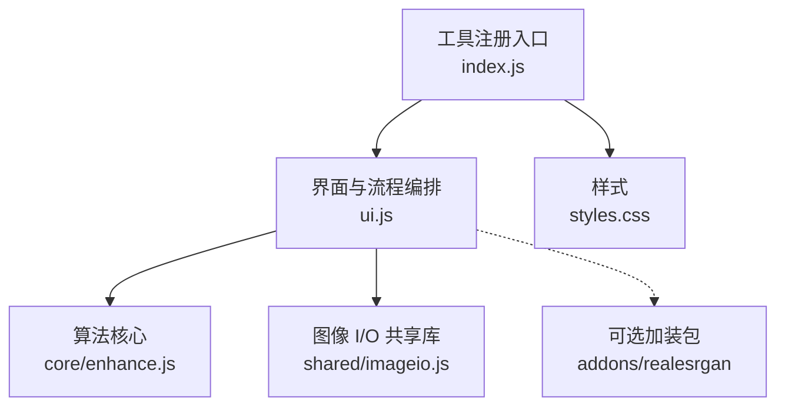
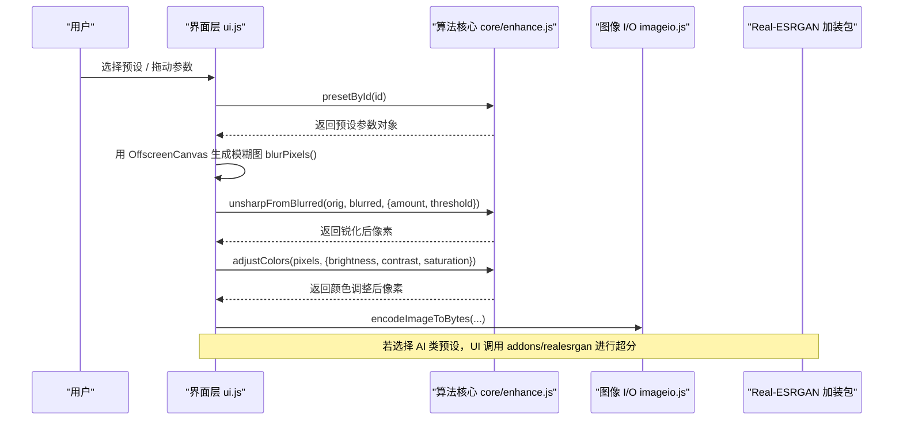
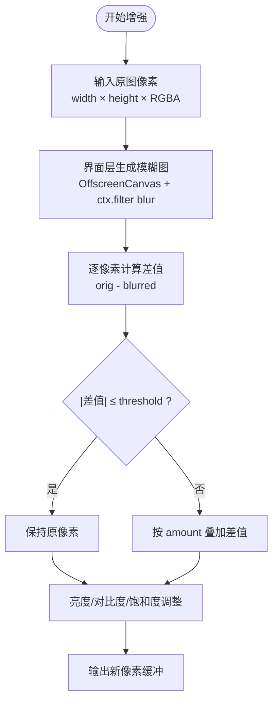
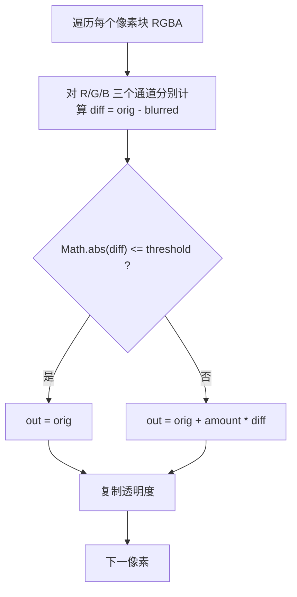
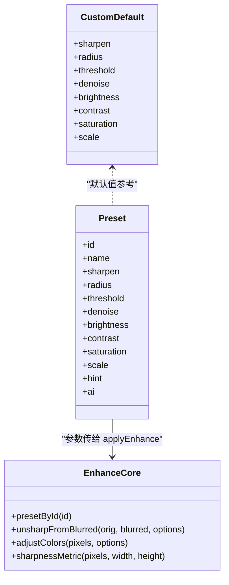
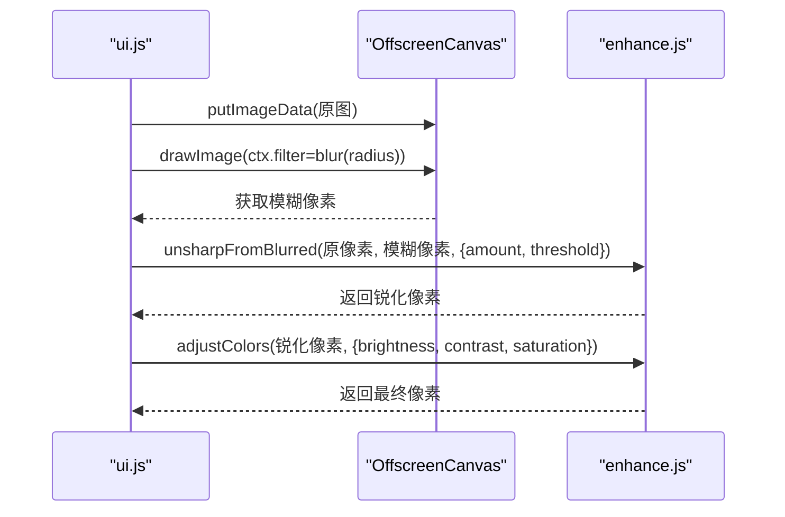
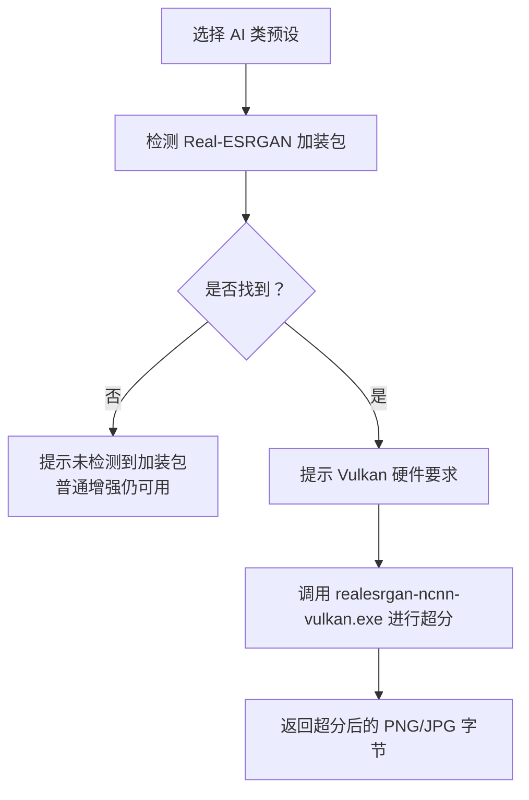
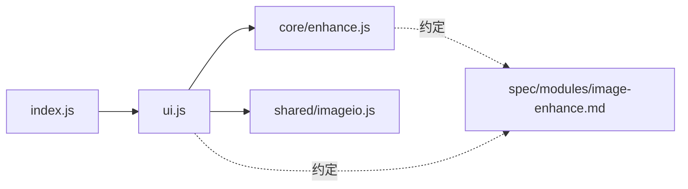

# 图片增强修复

<cite>
**本文引用的文件**   
- [spec/modules/image-enhance.md](file://spec/modules/image-enhance.md)
- [app/src/tools/enhance/core/enhance.js](file://app/src/tools/enhance/core/enhance.js)
- [app/src/tools/enhance/index.js](file://app/src/tools/enhance/index.js)
- [app/src/tools/enhance/ui.js](file://app/src/tools/enhance/ui.js)
- [app/src/tools/enhance/styles.css](file://app/src/tools/enhance/styles.css)
</cite>

## 目录
1. [引言](#引言)
2. [项目结构](#项目结构)
3. [核心组件](#核心组件)
4. [架构总览](#架构总览)
5. [详细组件分析](#详细组件分析)
6. [依赖关系分析](#依赖关系分析)
7. [性能与 GPU 加速](#性能与-gpu-加速)
8. [参数体系与调优指南](#参数体系与调优指南)
9. [故障排查](#故障排查)
10. [结论](#结论)

## 引言
本模块为“图片变清晰”工具，目标是对发虚、发灰、有噪点或需要放大的照片提供一键增强。它同时支持两条技术路线：
- 传统图像处理路线：USM 锐化 + 轻度降噪 + 亮度/对比度/饱和度调整 + 高质量重采样放大。
- AI 超分路线：通过可选加装包 Real-ESRGAN（ncnn+Vulkan）进行 2× 或 4× 超分辨率放大。

该文档聚焦以下重点：
- 分层处理架构与 blurFn 注入机制。
- 逐像素差分合成算法与色彩调整流程。
- CUSTOM_DEFAULT 预设参数体系与各参数作用范围。
- PRESETS 预设方案的科学依据与使用场景，尤其是“一键变清晰”。
- 不同增强效果的对比思路与参数调优方法。
- GPU 加速实现方式与性能优化策略。

## 项目结构
“图片变清晰”工具位于 `src/tools/enhance/`，采用“界面层 + 核心算法层”的清晰分层：
- `index.js`：工具注册入口，向应用外壳声明 id、名称、图标、分组与挂载函数。
- `ui.js`：界面与交互编排，负责渲染预设、滑杆、预览、拖拽、批量任务、AI 加装包检测与调用。
- `core/enhance.js`：纯函数式算法核心，定义 CUSTOM_DEFAULT、PRESETS，以及 USM 锐化、颜色调整、清晰度指标、混合与完整增强流程。
- `styles.css`：工具专属样式，复用壳层主题令牌。

**图表来源**
- [app/src/tools/enhance/index.js:1-14](file://app/src/tools/enhance/index.js#L1-L14)
- [app/src/tools/enhance/ui.js:1-200](file://app/src/tools/enhance/ui.js#L1-L200)
- [app/src/tools/enhance/core/enhance.js:1-200](file://app/src/tools/enhance/core/enhance.js#L1-L200)

**章节来源**
- [app/src/tools/enhance/index.js:1-14](file://app/src/tools/enhance/index.js#L1-L14)
- [spec/modules/image-enhance.md:1-56](file://spec/modules/image-enhance.md#L1-L56)

## 核心组件
- 工具注册器：声明 enhance 工具的元数据，并挂载 ui.js 提供的 mount/unmount。
- 算法核心：导出 CUSTOM_DEFAULT、PRESETS、presetById、unsharpFromBlurred、adjustColors、sharpnessMetric，以及完整增强流程。
- 界面层：实现 OffscreenCanvas 模糊与缩放、blurFn 注入、参数面板、预览切换、批量执行、命名规则与输出格式策略。
- 规格说明：明确目标、范围、预设表、非目标、AI 放大形态、硬件要求、技术选型依据与已知限制。

**章节来源**
- [app/src/tools/enhance/index.js:1-14](file://app/src/tools/enhance/index.js#L1-L14)
- [app/src/tools/enhance/core/enhance.js:1-236](file://app/src/tools/enhance/core/enhance.js#L1-L236)
- [app/src/tools/enhance/ui.js:1-681](file://app/src/tools/enhance/ui.js#L1-L681)
- [spec/modules/image-enhance.md:1-56](file://spec/modules/image-enhance.md#L1-L56)

## 架构总览
“图片变清晰”的分层架构将“可测试的纯函数算法”与“依赖 DOM/GPU 的界面逻辑”解耦：
- 界面层负责：选择预设、渲染参数、生成模糊图、高质量重采样、读取/编码图像、调度批处理、调用 AI 超分进程。
- 核心层负责：基于传入的模糊像素与原像素做逐像素差分与合成；对亮度、对比度、饱和度做线性变换；计算拉普拉斯方差作为清晰度指标。

**图表来源**
- [app/src/tools/enhance/ui.js:1-200](file://app/src/tools/enhance/ui.js#L1-L200)
- [app/src/tools/enhance/core/enhance.js:1-200](file://app/src/tools/enhance/core/enhance.js#L1-L200)

## 详细组件分析

### 算法核心：分层与 blurFn 注入机制
核心文件将“模糊图由谁生成”和“如何合成锐化结果”拆成两层：
- 模糊图生成：由界面层使用 OffscreenCanvas 与 `ctx.filter = blur(Npx)` 完成，从而获得 GPU 加速。
- 差分合成：核心函数只接收原像素与模糊像素，计算差值并按阈值过滤，避免在平坦区域放大噪声。

这种设计使核心函数不依赖 DOM，可在 Node 环境中单测；GPU 相关细节被隔离在界面层。

**图表来源**
- [app/src/tools/enhance/core/enhance.js:1-200](file://app/src/tools/enhance/core/enhance.js#L1-L200)
- [app/src/tools/enhance/ui.js:1-200](file://app/src/tools/enhance/ui.js#L1-L200)

**章节来源**
- [app/src/tools/enhance/core/enhance.js:1-200](file://app/src/tools/enhance/core/enhance.js#L1-L200)
- [app/src/tools/enhance/ui.js:1-200](file://app/src/tools/enhance/ui.js#L1-L200)

### 逐像素差分合成与 USM 锐化
USM 的基本思想是：在原图上叠加“强度 ×（原图 − 模糊图）”。代码实现中进一步引入 threshold：当某个通道的差值绝对值不超过阈值时，直接保留原通道值。这样可以抑制平坦区域的噪声被锐化放大。

关键点：
- 输入校验：原图与模糊图长度必须一致。
- 透明度通道：不参与锐化，保持不变。
- 数值安全：Uint8ClampedArray 自动裁剪到 0–255。

**图表来源**
- [app/src/tools/enhance/core/enhance.js:1-200](file://app/src/tools/enhance/core/enhance.js#L1-L200)

**章节来源**
- [app/src/tools/enhance/core/enhance.js:1-200](file://app/src/tools/enhance/core/enhance.js#L1-L200)

### 颜色调整：亮度、对比度、饱和度
颜色调整顺序为：
1. 先加亮度偏移。
2. 再用标准对比度系数拉伸。
3. 最后按亮度权重调整饱和度。

当三个参数都为 0 时，函数直接返回入参，避免不必要的内存拷贝。

复杂度方面，这是对像素数组的一次线性扫描，时间复杂度 O(n)，空间复杂度 O(n) 用于输出缓冲。

**章节来源**
- [app/src/tools/enhance/core/enhance.js:1-200](file://app/src/tools/enhance/core/enhance.js#L1-L200)

### 清晰度指标：拉普拉斯方差
sharpnessMetric 使用灰度拉普拉斯算子计算方差，用于自检与对比，不参与实际图像处理。它遍历图像内部像素，计算邻域梯度方差，值越大越锐，越小越糊。

注意：该指标仅用于评估，不是增强算法的一部分。

**章节来源**
- [app/src/tools/enhance/core/enhance.js:1-200](file://app/src/tools/enhance/core/enhance.js#L1-L200)

### 预设体系：CUSTOM_DEFAULT 与 PRESETS
CUSTOM_DEFAULT 定义了自定义模式下的初始参数，包括 sharpen、radius、threshold、denoise、brightness、contrast、saturation、scale。PRESETS 则提供一组预置组合，与规格说明中的参数表一一对应。

预设类别包括：
- 传统增强：一键变清晰、轻度锐化、强力锐化、照片降噪 + 轻锐化、清晰放大 2×。
- AI 超分：AI 放大 4×（照片）、AI 放大 2×（最快）、AI 放大 4×（动漫/插画）。
- 自定义：允许用户自由调节参数。

对于 AI 类预设，参数对象会包含 ai.scale 与 ai.model，并在界面层触发 Real-ESRGAN 调用流程。

**图表来源**
- [app/src/tools/enhance/core/enhance.js:1-200](file://app/src/tools/enhance/core/enhance.js#L1-L200)

**章节来源**
- [app/src/tools/enhance/core/enhance.js:1-200](file://app/src/tools/enhance/core/enhance.js#L1-L200)
- [spec/modules/image-enhance.md:1-56](file://spec/modules/image-enhance.md#L1-L56)

### 界面层：blurFn 注入、预览与批量
界面层承担以下职责：
- 使用 OffscreenCanvas 实现 blurPixels，把 GPU 加速的模糊能力以函数形式暴露给核心层。
- 使用高质量重采样 resizePixels 实现 2× 放大与预览缩小。
- 根据所选预设动态渲染参数区，并为自定义预设提供滑杆。
- 对 AI 类预设检测加装包状态并显示硬件要求提示。
- 控制预览切换“原图 / 处理后”，并对大图限制像素上限。
- 管理批量任务、进度、输出命名与格式策略。

**图表来源**
- [app/src/tools/enhance/ui.js:1-200](file://app/src/tools/enhance/ui.js#L1-L200)
- [app/src/tools/enhance/core/enhance.js:1-200](file://app/src/tools/enhance/core/enhance.js#L1-L200)

**章节来源**
- [app/src/tools/enhance/ui.js:1-681](file://app/src/tools/enhance/ui.js#L1-L681)

### AI 超分集成与硬件要求
AI 超分属于可选路径：
- 当用户选择 AI 类预设时，界面层检测 Real-ESRGAN 加装包是否可用。
- 若未检测到，界面给出明确文案提示，普通增强功能不受影响。
- 若检测到，界面显示模型数量与硬件要求：需要支持 Vulkan 的显卡，纯 CPU 不可用。
- 规格说明指出：AI 放大会把图片编码为 PNG 字节写入临时文件，调用 realesrgan-ncnn-vulkan.exe，再读回 PNG 字节并删除临时目录。

**图表来源**
- [spec/modules/image-enhance.md:1-56](file://spec/modules/image-enhance.md#L1-L56)
- [app/src/tools/enhance/ui.js:1-200](file://app/src/tools/enhance/ui.js#L1-L200)

**章节来源**
- [spec/modules/image-enhance.md:1-56](file://spec/modules/image-enhance.md#L1-L56)
- [app/src/tools/enhance/ui.js:1-200](file://app/src/tools/enhance/ui.js#L1-L200)

## 依赖关系分析
- index.js 依赖 ui.js 的 mount/unmount，并向外壳暴露工具元数据。
- ui.js 依赖 core/enhance.js 的参数与算法函数，以及 shared/imageio.js 的解码与编码能力。
- core/enhance.js 是纯函数集合，不依赖 DOM 或文件系统，便于单元测试。
- 规格说明 spec/modules/image-enhance.md 与实现保持约定契约：预设、参数、非目标、AI 放大行为与已知限制。

**图表来源**
- [app/src/tools/enhance/index.js:1-14](file://app/src/tools/enhance/index.js#L1-L14)
- [app/src/tools/enhance/ui.js:1-200](file://app/src/tools/enhance/ui.js#L1-L200)
- [app/src/tools/enhance/core/enhance.js:1-200](file://app/src/tools/enhance/core/enhance.js#L1-L200)
- [spec/modules/image-enhance.md:1-56](file://spec/modules/image-enhance.md#L1-L56)

**章节来源**
- [app/src/tools/enhance/index.js:1-14](file://app/src/tools/enhance/index.js#L1-L14)
- [app/src/tools/enhance/ui.js:1-200](file://app/src/tools/enhance/ui.js#L1-L200)
- [app/src/tools/enhance/core/enhance.js:1-200](file://app/src/tools/enhance/core/enhance.js#L1-L200)
- [spec/modules/image-enhance.md:1-56](file://spec/modules/image-enhance.md#L1-L56)

## 性能与 GPU 加速
### GPU 加速点
- 模糊内核：界面层使用 `ctx.filter = blur(Npx)`，由浏览器/引擎的图形栈提供 GPU 加速。
- 高质量重采样：resizePixels 使用 OffscreenCanvas 与 `imageSmoothingQuality = 'high'` 进行放大或预览缩小。
- 预览优化：预览最长边限制为 900，优先处理小图以保证调参即时响应。

### 内存与尺寸限制
- 放大后像素上限设置为约 4000 万像素，与共享解码上限保持一致，防止超大图导致内存溢出。
- 对 AI 超分，规格说明给出实测参考：96×64 到 2× 约 1.6 秒，640×420 到 4× 约 5.5 秒，1280×720 到 4× 约 10.4 秒。

### 性能优化建议
- 优先使用轻量预设进行预览，仅在确认效果后再批量处理大图。
- 对噪点多的照片优先选择“照片降噪 + 轻锐化”，避免强力锐化放大噪声。
- AI 超分适合追求更高细节的场景，但需考虑 GPU 与驱动支持；纯 CPU 环境无法使用。

**章节来源**
- [app/src/tools/enhance/ui.js:1-200](file://app/src/tools/enhance/ui.js#L1-L200)
- [spec/modules/image-enhance.md:1-56](file://spec/modules/image-enhance.md#L1-L56)

## 参数体系与调优指南

### CUSTOM_DEFAULT 参数说明
| 参数 | 含义 | 调整范围 | 作用机制与建议 |
|---|---|---|---|
| sharpen | USM 锐化强度 | 0–200% | 强度越高边缘越分明，但噪点也可能被放大；噪点多时降低强度或配合降噪。 |
| radius | 高斯模糊半径 | 0.5–5 px | 决定模糊程度，从而影响差分的空间尺度；过小锐化不明显，过大可能产生光晕。 |
| threshold | 锐化阈值 | 0–32 | 差值小于等于阈值的像素通道不动，用于抑制平坦区域噪点；提高可更保守地锐化。 |
| denoise | 降噪强度 | 0–100% | 通过轻度模糊与原图混合实现；适合夜拍或 ISO 较高的照片。 |
| brightness | 亮度 | −100–100 | 正值为提亮，负值为压暗；通常与对比度配合微调。 |
| contrast | 对比度 | −100–100 | 使用标准对比度系数拉伸；负值压平，正值增强层次。 |
| saturation | 饱和度 | −100–100 | 按亮度权重调整色彩强度；负值去色，正值更鲜艳。 |
| scale | 放大倍数 | 1 起 | 1 表示不变，2 表示清晰放大 2×；只放大不缩小。 |

### PRESETS 预设方案与使用场景
- 一键变清晰：锐化 80%，半径 1.2，阈值 2，对比度 +6%。适合发虚、发灰的日常照片快速改善。
- 轻度锐化：锐化 40%。适合希望边缘更分明但不想明显改变观感的场景。
- 强力锐化：锐化 140%。效果明显，但对噪点敏感；噪点多时不建议单独使用。
- 照片降噪 + 轻锐化：降噪 50%，锐化 60%。适合手机夜拍等高噪点照片。
- 清晰放大 2×：高质量重采样放大 2 倍 + 锐化 80%。适合需要更大尺寸但不启用 AI 的场景。
- AI 放大 4×（照片，推荐）：Real-ESRGAN realesrgan-x4plus，4 倍超分，需 Vulkan 显卡。
- AI 放大 2×（最快）：realesr-animevideov3，2 倍超分，速度较快，需 Vulkan 显卡。
- AI 放大 4×（动漫/插画）：realesrgan-x4plus-anime，适合动漫与插画，需 Vulkan 显卡。

### “一键变清晰”的参数组合原理
“一键变清晰”的核心思路是：
- 中等强度的 USM 锐化让边缘更分明。
- 小半径与低阈值保证只在真实边缘上叠加差异，避免放大噪声。
- 轻微提升对比度让画面更有层次，而不改变整体明暗。
- 不启用额外降噪或饱和度过调，保持自然观感。

该预设适合作为默认起点，用户可根据照片具体情况微调 sharpen、threshold 与 contrast。

### 调优实践建议
- 发虚但不太噪：提高 sharpen 到 60–100%，保持 threshold 较低以突出边缘。
- 噪点较多：先启用 denoise 30–60%，再使用 light 或 moderate sharpen。
- 对比度不足：适当提高 contrast 5–10%，避免过度导致高光/阴影丢失。
- 色彩偏淡：适度提高 saturation 10–30%，结合 contrast 使用。
- 需要更大尺寸：优先尝试 clear upscale 2×；若细节需求更高且 GPU 支持，再选择 AI 超分。

**章节来源**
- [app/src/tools/enhance/core/enhance.js:1-200](file://app/src/tools/enhance/core/enhance.js#L1-L200)
- [app/src/tools/enhance/ui.js:1-200](file://app/src/tools/enhance/ui.js#L1-L200)
- [spec/modules/image-enhance.md:1-56](file://spec/modules/image-enhance.md#L1-L56)

## 故障排查
- 锐化无效或过强：检查 radius 是否过小或过大；增大 radius 可获得更合理的差分尺度；降低 sharpen 或提高 threshold 以减少噪声放大。
- 锐化后噪点明显：提高 threshold，或切换到“照片降噪 + 轻锐化”预设。
- 画面发灰：适当提高 contrast；必要时微调 brightness。
- 色彩失真：降低 saturation，避免极端值；结合 contrast 观察色彩层次。
- 放大后模糊：确保使用“清晰放大 2×”或 AI 超分；普通放大不会恢复已丢失的细节。
- AI 超分不可用：检查是否安装 Real-ESRGAN 加装包，以及显卡是否支持 Vulkan；纯 CPU 环境不支持。
- 预览卡顿：预览使用缩小图；如仍慢，可降低参数幅度或关闭实时预览，改为批量处理。

**章节来源**
- [app/src/tools/enhance/core/enhance.js:1-200](file://app/src/tools/enhance/core/enhance.js#L1-L200)
- [app/src/tools/enhance/ui.js:1-200](file://app/src/tools/enhance/ui.js#L1-L200)
- [spec/modules/image-enhance.md:1-56](file://spec/modules/image-enhance.md#L1-L56)

## 结论
“图片变清晰”工具通过分层架构将 GPU 加速的模糊与缩放隔离在界面层，而核心层专注于可测试的逐像素差分合成与颜色调整。CUSTOM_DEFAULT 提供了直观的参数入口，PRESETS 则封装了经过验证的组合策略，尤其适合日常照片的快速增强。对于细节要求更高的场景，AI 超分提供另一条技术路线，但依赖 Vulkan 显卡与可选加装包。

在实际使用中，建议从“一键变清晰”出发，根据噪点、对比度与尺寸需求逐步调参；必要时再切换到 AI 超分以获得更好的细节表现。