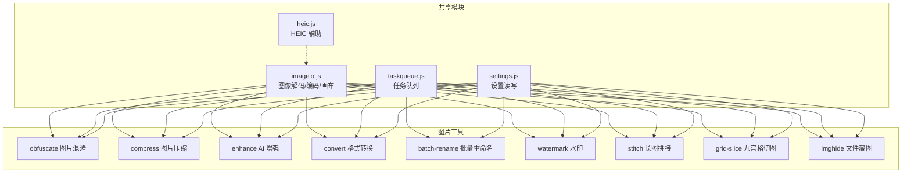
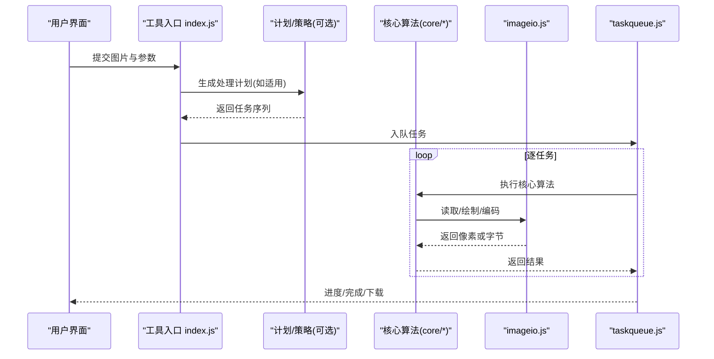
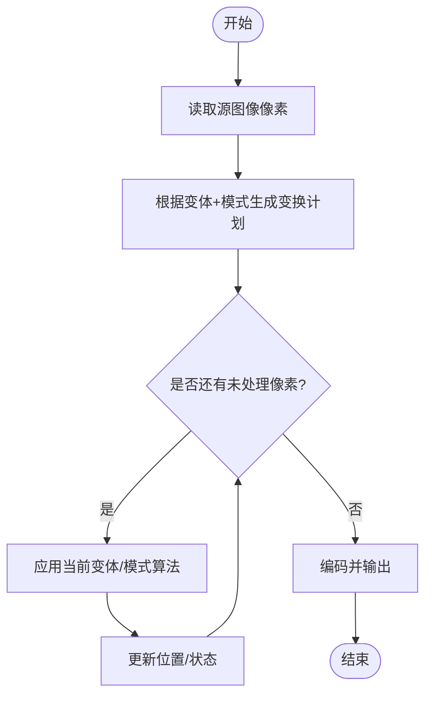
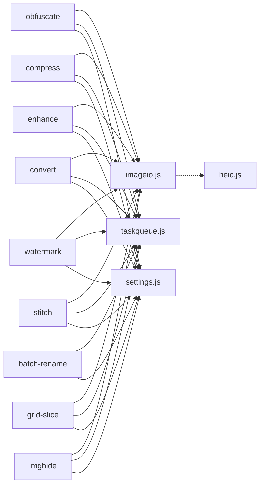

# 图片处理工具

<cite>
**本文引用的文件**   
- [imageio.js](file://app/app/src/shared/app/src/shared/imageio.js)
- [obfuscate/index.js](file://app/app/src/tools/obfuscate/index.js)
- [obfuscate engine.js](file://app/app/src/tools/obfuscate/core/engine.js)
- [obfuscate variants.js](file://app/app/src/tools/obfuscate/core/variants.js)
- [obfuscate modes.js](file://app/app/src/tools/obfuscate/core/modes.js)
- [obfuscate logistic.js](file://app/app/src/tools/obfuscate/core/logistic.js)
- [obfuscate scramble_logistic.js](file://app/app/src/tools/obfuscate/core/scramble_logistic.js)
- [obfuscate md5.js](file://app/app/src/tools/obfuscate/core/md5.js)
- [obfuscate scramble_md5.js](file://app/app/src/tools/obfuscate/core/scramble_md5.js)
- [obfuscate shuffle.js](file://app/app/src/tools/obfuscate/core/shuffle.js)
- [obfuscate tomato.js](file://app/app/src/tools/obfuscate/core/tomato.js)
- [obfuscate gilbert.js](file://app/app/src/tools/obfuscate/core/gilbert.js)
- [compress/index.js](file://app/app/src/tools/compress/index.js)
- [compress compress.js](file://app/app/src/tools/compress/core/compress.js)
- [enhance/index.js](file://app/app/src/tools/enhance/index.js)
- [enhance enhance.js](file://app/app/src/tools/enhance/core/enhance.js)
- [convert/index.js](file://app/app/src/tools/convert/index.js)
- [convert convert.js](file://app/app/src/tools/convert/core/convert.js)
- [convert encoders.js](file://app/app/src/tools/convert/core/encoders.js)
- [batch-rename/index.js](file://app/app/src/tools/batch-rename/index.js)
- [batch-rename plan.js](file://app/app/src/tools/batch-rename/core/plan.js)
- [watermark/index.js](file://app/app/src/tools/watermark/index.js)
- [watermark draw.js](file://app/app/src/tools/watermark/core/draw.js)
- [stitch/index.js](file://app/app/src/tools/stitch/index.js)
- [stitch plan.js](file://app/app/src/tools/stitch/core/plan.js)
- [grid-slice/index.js](file://app/app/src/tools/grid-slice/index.js)
- [grid-slice plan.js](file://app/app/src/tools/grid-slice/core/plan.js)
- [imghide/index.js](file://app/app/src/tools/imghide/index.js)
- [imghide engine.mjs](file://app/app/src/tools/imghide/core/engine.mjs)
- [imghide crypto.mjs](file://app/app/src/tools/imghide/core/crypto.mjs)
- [imghide format.mjs](file://app/app/src/tools/imghide/core/format.mjs)
- [heic.js](file://app/app/src/shared/app/src/shared/heic.js)
- [taskqueue.js](file://app/app/src/shared/app/src/shared/taskqueue.js)
- [settings.js](file://app/app/src/shared/app/src/shared/settings.js)
- [README.md](file://README.md)
</cite>

## 目录
1. [简介](#简介)
2. [项目结构](#项目结构)
3. [核心组件](#核心组件)
4. [架构总览](#架构总览)
5. [详细组件分析](#详细组件分析)
6. [依赖关系分析](#依赖关系分析)
7. [性能考虑](#性能考虑)
8. [故障排查指南](#故障排查指南)
9. [结论](#结论)
10. [附录：使用场景与自动化示例](#附录使用场景与自动化示例)

## 简介
本仓库提供一组浏览器端可运行的图片处理工具，覆盖图片混淆、压缩优化、AI 增强修复、格式转换、批量重命名、水印添加、长图拼接、九宫格切图和文件藏图九个能力。所有工具均围绕共享的图像输入输出模块 imageio.js 构建，配合任务队列 taskqueue.js 和设置存储 settings.js，形成统一的任务执行与配置管理体验。

这些工具的定位是“本地优先”的图片处理套件：默认在浏览器内完成解码、像素操作与编码，必要时通过 heic.js 等辅助模块处理 HEIC 等特殊格式；同时为批量任务和复杂流水线提供可扩展的计划与调度机制。

## 项目结构
图片相关工具遵循一致的三层组织方式：
- 入口 index.js：注册工具元数据、解析用户界面参数、编排任务流程、调用 core 层实现。
- core 子目录：纯算法与数据处理逻辑，尽量不依赖 UI 和 DOM。
- styles.css：工具专属样式。

图表来源
- [imageio.js](file://app/app/src/shared/app/src/shared/imageio.js)
- [taskqueue.js](file://app/app/src/shared/app/src/shared/taskqueue.js)
- [settings.js](file://app/app/src/shared/app/src/shared/settings.js)
- [heic.js](file://app/app/src/shared/app/src/shared/heic.js)
- [obfuscate/index.js](file://app/app/src/tools/obfuscate/index.js)
- [compress/index.js](file://app/app/src/tools/compress/index.js)
- [enhance/index.js](file://app/app/src/tools/enhance/index.js)
- [convert/index.js](file://app/app/src/tools/convert/index.js)
- [batch-rename/index.js](file://app/app/src/tools/batch-rename/index.js)
- [watermark/index.js](file://app/app/src/tools/watermark/index.js)
- [stitch/index.js](file://app/app/src/tools/stitch/index.js)
- [grid-slice/index.js](file://app/app/src/tools/grid-slice/index.js)
- [imghide/index.js](file://app/app/src/tools/imghide/index.js)

章节来源
- [README.md](file://README.md)

## 核心组件
- imageio.js：统一的图像 I/O 抽象，封装 Canvas/ImageBitmap 加载、像素访问、缩放、裁剪、旋转、格式编码等能力，是所有图片工具的基础。
- taskqueue.js：任务队列与并发控制，用于批量图片处理的排队、进度与取消。
- settings.js：持久化工具偏好、最近质量/格式/变体选择等设置。
- heic.js：HEIC 到常见格式的桥接，使 HEIC 能进入通用图像处理管线。

章节来源
- [imageio.js](file://app/app/src/shared/app/src/shared/imageio.js)
- [taskqueue.js](file://app/app/src/shared/app/src/shared/taskqueue.js)
- [settings.js](file://app/app/src/shared/app/src/shared/settings.js)
- [heic.js](file://app/app/src/shared/app/src/shared/heic.js)

## 架构总览
每个工具都采用“UI 参数 → 计划/策略 → 核心算法 → imageio 渲染/编码 → 结果输出”的固定流程。批量工具通常由 plan.js 或同类模块生成执行计划，再由任务队列串行/并行消费。

图表来源
- [obfuscate/index.js](file://app/app/src/tools/obfuscate/index.js)
- [compress/index.js](file://app/app/src/tools/compress/index.js)
- [enhance/index.js](file://app/app/src/tools/enhance/index.js)
- [convert/index.js](file://app/app/src/tools/convert/index.js)
- [batch-rename/index.js](file://app/app/src/tools/batch-rename/index.js)
- [watermark/index.js](file://app/app/src/tools/watermark/index.js)
- [stitch/index.js](file://app/app/src/tools/stitch/index.js)
- [grid-slice/index.js](file://app/app/src/tools/grid-slice/index.js)
- [imghide/index.js](file://app/app/src/tools/imghide/index.js)
- [imageio.js](file://app/app/src/shared/app/src/shared/imageio.js)
- [taskqueue.js](file://app/app/src/shared/app/src/shared/taskqueue.js)

## 详细组件分析

### 图片混淆 obfuscate
功能概述
- 对图片像素进行不可逆扰动，破坏视觉可读性，但保留尺寸与通道结构，适合隐私脱敏、测试数据构造、对抗样本生成等场景。
- 支持多种变体算法与模式组合，提供“强混淆/弱扰动/速度优先”等策略选项。

核心算法与技术实现
- 变体矩阵 variants.js：以配置表形式定义可用变体（名称、参数范围、复杂度标签），供 UI 与核心引擎选择。
- 模式 modes.js：定义混淆的执行模式，例如按块、按行、全局打乱、噪声叠加等。
- 引擎 engine.js：将“变体 + 模式 + 参数”组合成具体像素变换管线，协调各算法模块。
- 具体算法：
  - logistic.js：基于 Logistic 混沌映射的像素值非线性变换，具备参数敏感性与不可预测性。
  - scramble_logistic.js：先 Logistic 变换再分块打乱，提升抗局部重建能力。
  - md5.js / scramble_md5.js：以 MD5 派生的伪随机数作为置换种子，实现位置级打乱或像素值替换。
  - shuffle.js：通用洗牌算法，用于坐标或索引重排。
  - tomato.js：自定义像素扰动函数，用于特定风格化或强度调节。
  - gilbert.js：Gilbert 曲线扫描路径，用于沿空间填充曲线遍历像素，增强相邻像素间的关联性破坏。

典型参数与选项
- 变体选择：从 variants.js 中选取一种或多种变体组合。
- 模式选择：modes.js 中的执行模式，影响遍历顺序与作用域。
- 强度/迭代次数：控制扰动幅度与重复次数。
- 安全种子：MD5 系列变体使用的初始种子，决定可复现性。

图表来源
- [obfuscate engine.js](file://app/app/src/tools/obfuscate/core/engine.js)
- [obfuscate variants.js](file://app/app/src/tools/obfuscate/core/variants.js)
- [obfuscate modes.js](file://app/app/src/tools/obfuscate/core/modes.js)
- [obfuscate logistic.js](file://app/app/src/tools/obfuscate/core/logistic.js)
- [obfuscate scramble_logistic.js](file://app/app/src/tools/obfuscate/core/scramble_logistic.js)
- [obfuscate md5.js](file://app/app/src/tools/obfuscate/core/md5.js)
- [obfuscate scramble_md5.js](file://app/app/src/tools/obfuscate/core/scramble_md5.js)
- [obfuscate shuffle.js](file://app/app/src/tools/obfuscate/core/shuffle.js)
- [obfuscate tomato.js](file://app/app/src/tools/obfuscate/core/tomato.js)
- [obfuscate gilbert.js](file://app/app/src/tools/obfuscate/core/gilbert.js)

使用建议
- 需要强脱敏：选择 Logistic + MD5 类变体，提高迭代次数，开启多模式组合。
- 需要快速预览：降低强度、减少迭代，优先使用单变体线性模式。
- 需要可复现实验：固定 MD5 种子，记录变体与模式组合。

章节来源
- [obfuscate/index.js](file://app/app/src/tools/obfuscate/index.js)
- [obfuscate engine.js](file://app/app/src/tools/obfuscate/core/engine.js)
- [obfuscate variants.js](file://app/app/src/tools/obfuscate/core/variants.js)
- [obfuscate modes.js](file://app/app/src/tools/obfuscate/core/modes.js)
- [obfuscate logistic.js](file://app/app/src/tools/obfuscate/core/logistic.js)
- [obfuscate scramble_logistic.js](file://app/app/src/tools/obfuscate/core/scramble_logistic.js)
- [obfuscate md5.js](file://app/app/src/tools/obfuscate/core/md5.js)
- [obfuscate scramble_md5.js](file://app/app/src/tools/obfuscate/core/scramble_md5.js)
- [obfuscate shuffle.js](file://app/app/src/tools/obfuscate/core/shuffle.js)
- [obfuscate tomato.js](file://app/app/src/tools/obfuscate/core/tomato.js)
- [obfuscate gilbert.js](file://app/app/src/tools/obfuscate/core/gilbert.js)

### 图片压缩 compress
功能概述
- 对图片进行有损/无损压缩，平衡体积与画质，常用于网页资源优化、移动端传输加速与存储节省。

核心算法与技术实现
- 入口 index.js 负责解析质量、目标尺寸、目标格式等参数，调用 core/compress.js 执行实际压缩。
- core/compress.js 基于 imageio.js 的编码器，选择合适的量化/采样策略，输出不同体积的文件。

典型参数与选项
- 质量等级：控制有损压缩强度。
- 目标尺寸：按比例缩放或固定宽高。
- 目标格式：如 JPEG/WebP/AVIF 等（受浏览器与 imageio.js 支持情况影响）。
- 色彩空间与去 alpha：去除透明通道以进一步减小体积。

章节来源
- [compress/index.js](file://app/app/src/tools/compress/index.js)
- [compress compress.js](file://app/app/src/tools/compress/core/compress.js)
- [imageio.js](file://app/app/src/shared/app/src/shared/imageio.js)

### AI 增强 enhance
功能概述
- 对图片进行增强修复，包括去噪、锐化、细节恢复、HDR 风格化等，提升观感或满足下游识别需求。

核心算法与技术实现
- 入口 index.js 接收增强类型与强度，调用 core/enhance.js 执行像素级滤波与卷积操作。
- core/enhance.js 组合基础算子（均值、高斯、边缘检测、非锐化掩模等）构成增强管线。

典型参数与选项
- 增强类型：去噪、锐化、对比度增强、细节恢复等。
- 强度/半径/阈值：控制算子作用范围与强度。
- 目标尺寸：是否在增强前/后缩放。

章节来源
- [enhance/index.js](file://app/app/src/tools/enhance/index.js)
- [enhance enhance.js](file://app/app/src/tools/enhance/core/enhance.js)
- [imageio.js](file://app/app/src/shared/app/src/shared/imageio.js)

### 格式转换 convert
功能概述
- 在不同图片格式之间转换，如 PNG/JPEG/WebP/AVIF 等，兼顾兼容性、体积与透明度需求。

核心算法与技术实现
- 入口 index.js 解析源/目标格式与转码参数，调用 core/convert.js。
- core/convert.js 委托 core/encoders.js 选择合适的编码器与色深/采样策略。

典型参数与选项
- 目标格式：根据平台能力选择最佳编码。
- 质量与压缩级别：影响体积与画质。
- 元数据保留：EXIF/IPTC 等元数据的写入策略。
- 渐进式输出：对大图启用渐进加载。

章节来源
- [convert/index.js](file://app/app/src/tools/convert/index.js)
- [convert convert.js](file://app/app/src/tools/convert/core/convert.js)
- [convert encoders.js](file://app/app/src/tools/convert/core/encoders.js)
- [imageio.js](file://app/app/src/shared/app/src/shared/imageio.js)

### 批量重命名 batch-rename
功能概述
- 对一批图片进行规则化重命名，支持序号、时间戳、哈希、正则替换等策略，便于归档与自动化。

核心算法与技术实现
- 入口 index.js 收集文件列表与重命名模板，交由 core/plan.js 生成重命名计划。
- core/plan.js 计算目标文件名、冲突检测与去重策略，最终输出新路径列表。

典型参数与选项
- 命名模板：包含序号、日期、原文件名片段、哈希等占位符。
- 分隔符与前缀/后缀。
- 冲突处理：覆盖、追加后缀、自动编号等。

章节来源
- [batch-rename/index.js](file://app/app/src/tools/batch-rename/index.js)
- [batch-rename plan.js](file://app/app/src/tools/batch-rename/core/plan.js)

### 水印 watermark
功能概述
- 在图片上添加文字或图形水印，支持平铺、定位、透明度、字体大小等，用于版权保护与内容标识。

核心算法与技术实现
- 入口 index.js 解析水印文本、位置、样式与布局，调用 core/draw.js 进行绘制。
- core/draw.js 基于 imageio.js 的画布 API 进行矢量绘制与栅格合成。

典型参数与选项
- 水印类型：文字/图片。
- 位置与对齐：左上、居中、右下、自定义坐标。
- 透明度、字号、颜色、描边。
- 平铺间距与旋转角度。

章节来源
- [watermark/index.js](file://app/app/src/tools/watermark/index.js)
- [watermark draw.js](file://app/app/src/tools/watermark/core/draw.js)
- [imageio.js](file://app/app/src/shared/app/src/shared/imageio.js)

### 长图拼接 stitch
功能概述
- 将多张图片水平或垂直拼接成长图，适用于聊天记录截图、漫画、报表汇总等场景。

核心算法与技术实现
- 入口 index.js 接收图片序列与拼接方向，调用 core/plan.js 计算目标画布尺寸与每图落点。
- core/plan.js 输出绘制计划，再由 imageio.js 完成最终合成。

典型参数与选项
- 拼接方向：水平/垂直。
- 间距与对齐：边距、居中对齐、等宽/等高。
- 背景色与圆角（若支持）。

章节来源
- [stitch/index.js](file://app/app/src/tools/stitch/index.js)
- [stitch plan.js](file://app/app/src/tools/stitch/core/plan.js)
- [imageio.js](file://app/app/src/shared/app/src/shared/imageio.js)

### 九宫格切图 grid-slice
功能概述
- 将一张图片均匀切成 N×M 网格，或按固定单元格尺寸切分，适合社交分享、拼图、缩略图生成。

核心算法与技术实现
- 入口 index.js 接收行列数或单元格尺寸，调用 core/plan.js 计算切片区域。
- core/plan.js 输出每个切片的起始坐标与尺寸，再经 imageio.js 裁剪输出。

典型参数与选项
- 行列数：如 3×3 九宫格。
- 单元格尺寸：固定宽高或自适应。
- 留白/边框：切片之间的间隔。
- 输出命名：序号、原图名加后缀等。

章节来源
- [grid-slice/index.js](file://app/app/src/tools/grid-slice/index.js)
- [grid-slice plan.js](file://app/app/src/tools/grid-slice/core/plan.js)
- [imageio.js](file://app/app/src/shared/app/src/shared/imageio.js)

### 文件藏图 imghide
功能概述
- 将任意文件隐藏进图片中，支持加密与校验，适合小文件隐蔽传输与简单取证。

核心算法与技术实现
- 入口 index.js 接收载体图片、待隐藏文件与密码，调用 core/engine.mjs 编排流程。
- core/engine.mjs 协调 crypto.mjs 与 format.mjs：
  - crypto.mjs：对称加密/解密、密钥派生、完整性校验。
  - format.mjs：在图片数据流中嵌入/提取载荷，保证兼容主流格式与解码器。

典型参数与选项
- 加密强度：选择算法与密钥长度。
- 载荷压缩：是否先压缩待隐藏文件。
- 校验模式：错误检测与修复策略。
- 载体选择：选择合适尺寸与容量的图片以避免溢出。

章节来源
- [imghide/index.js](file://app/app/src/tools/imghide/index.js)
- [imghide engine.mjs](file://app/app/src/tools/imghide/core/engine.mjs)
- [imghide crypto.mjs](file://app/app/src/tools/imghide/core/crypto.mjs)
- [imghide format.mjs](file://app/app/src/tools/imghide/core/format.mjs)
- [imageio.js](file://app/app/src/shared/app/src/shared/imageio.js)

## 依赖关系分析
- 所有图片工具均依赖 imageio.js 进行像素读写与格式编码，确保行为一致。
- 批量类工具依赖 taskqueue.js 实现并发控制与进度上报。
- 配置与偏好依赖 settings.js 持久化，保障跨会话一致性。
- HEIC 特殊格式通过 heic.js 桥接，避免直接依赖外部解码库。

图表来源
- [obfuscate/index.js](file://app/app/src/tools/obfuscate/index.js)
- [compress/index.js](file://app/app/src/tools/compress/index.js)
- [enhance/index.js](file://app/app/src/tools/enhance/index.js)
- [convert/index.js](file://app/app/src/tools/convert/index.js)
- [batch-rename/index.js](file://app/app/src/tools/batch-rename/index.js)
- [watermark/index.js](file://app/app/src/tools/watermark/index.js)
- [stitch/index.js](file://app/app/src/tools/stitch/index.js)
- [grid-slice/index.js](file://app/app/src/tools/grid-slice/index.js)
- [imghide/index.js](file://app/app/src/tools/imghide/index.js)
- [imageio.js](file://app/app/src/shared/app/src/shared/imageio.js)
- [taskqueue.js](file://app/app/src/shared/app/src/shared/taskqueue.js)
- [settings.js](file://app/app/src/shared/app/src/shared/settings.js)
- [heic.js](file://app/app/src/shared/app/src/shared/heic.js)

章节来源
- [imageio.js](file://app/app/src/shared/app/src/shared/imageio.js)
- [taskqueue.js](file://app/app/src/shared/app/src/shared/taskqueue.js)
- [settings.js](file://app/app/src/shared/app/src/shared/settings.js)
- [heic.js](file://app/app/src/shared/app/src/shared/heic.js)

## 性能考虑
- 解码与像素操作成本：大分辨率图片会显著增加内存与 CPU 压力，建议在混淆/增强前先适度缩放。
- 编码器差异：WebP/AVIF 体积小但编码慢，JPEG 速度快但损失细节；可根据用途权衡。
- 批量任务：合理设置并发度，避免阻塞主线程；使用任务队列分批处理。
- HEIC 处理：先转换为通用格式再进行后续操作，避免多次编解码。
- 缓存与复用：对同一输入的参数组合可缓存中间结果，减少重复计算。
- 内存回收：及时释放临时画布与 ImageBitmap，避免峰值内存过高。

[本节为通用性能指导，不直接分析具体文件]

## 故障排查指南
常见问题与定位思路
- 无法打开 HEIC：确认 heic.js 已正确加载且浏览器支持相应解码路径。
- 导出失败或体积异常：检查目标格式与质量设置是否被限制；确认 imageio.js 的编码器可用性。
- 混淆效果不稳定：核对变体与模式的参数组合，尤其是随机种子是否固定。
- 水印错位或模糊：检查画布尺寸、DPR、坐标系与字体加载。
- 拼接错位：检查对齐方式、间距与图片原始比例。
- 九宫格切图尺寸不对：确认行列数与单元格尺寸是否整除原图尺寸。
- 藏图失败或损坏：检查载荷容量是否超过载体图片承载上限；确认加密与格式头写入顺序。

排查步骤建议
- 最小化复现：使用单张小图验证核心链路。
- 分阶段输出：在解码、像素处理、编码三个阶段分别输出中间产物，定位问题环节。
- 日志与断言：为关键变量（尺寸、质量、种子、路径）打印或断言。
- 回退策略：当某编码器失败时，自动降级到 JPEG/PNG。

[本节为通用故障排查指导，不直接分析具体文件]

## 结论
本图片处理工具组以 imageio.js 为核心，统一了图像 I/O 与渲染编码能力，并通过独立的 core 层实现多样化算法。obfuscate 提供丰富的像素级混淆变体，compress/convert 面向体积与兼容性优化，enhance 提升视觉与识别质量，batch-rename/watermark/stitch/grid-slice/imghide 则覆盖日常批量与创作工作流。借助 taskqueue.js 与 settings.js，工具具备良好的扩展性与可配置性，适合在浏览器环境中构建高效、可控的图片处理流水线。

[本节为总结性内容，不直接分析具体文件]

## 附录：使用场景与自动化示例

- 批量脱敏与压缩流水线
  1) 选择 obfuscate 的强混淆变体，固定种子以获得可复现结果。
  2) 将混淆后的图片送入 compress，选择 WebP 中等质量。
  3) 使用 batch-rename 按业务规则重命名并归档。
  4) 通过 taskqueue.js 并发执行，限制并发度以保证稳定性。

- 社交媒体发布准备
  1) 使用 grid-slice 将封面图切成九宫格，命名带序号。
  2) 对正文图添加水印，调整透明度与位置。
  3) 将长图文用 stitch 拼接后压缩至目标体积。

- 小文件隐蔽传输
  1) 使用 imghide 将 PDF/压缩包加密后嵌入 PNG。
  2) 对载体图做轻微 compress 以保持外观。
  3) 交付载体图与密码，接收方解密还原。

- 自动化工作流建议
  - 使用 settings.js 保存常用质量、格式、变体与水印模板。
  - 将 plan.js 的输出作为下游工具的输入，形成管道化批处理。
  - 对耗时操作（如 AVIF 编码、Logistic 混淆）设置超时与重试。
  - 结合任务队列监控进度，出现异常时自动降级或跳过。

[本节为概念性说明，不直接分析具体文件]