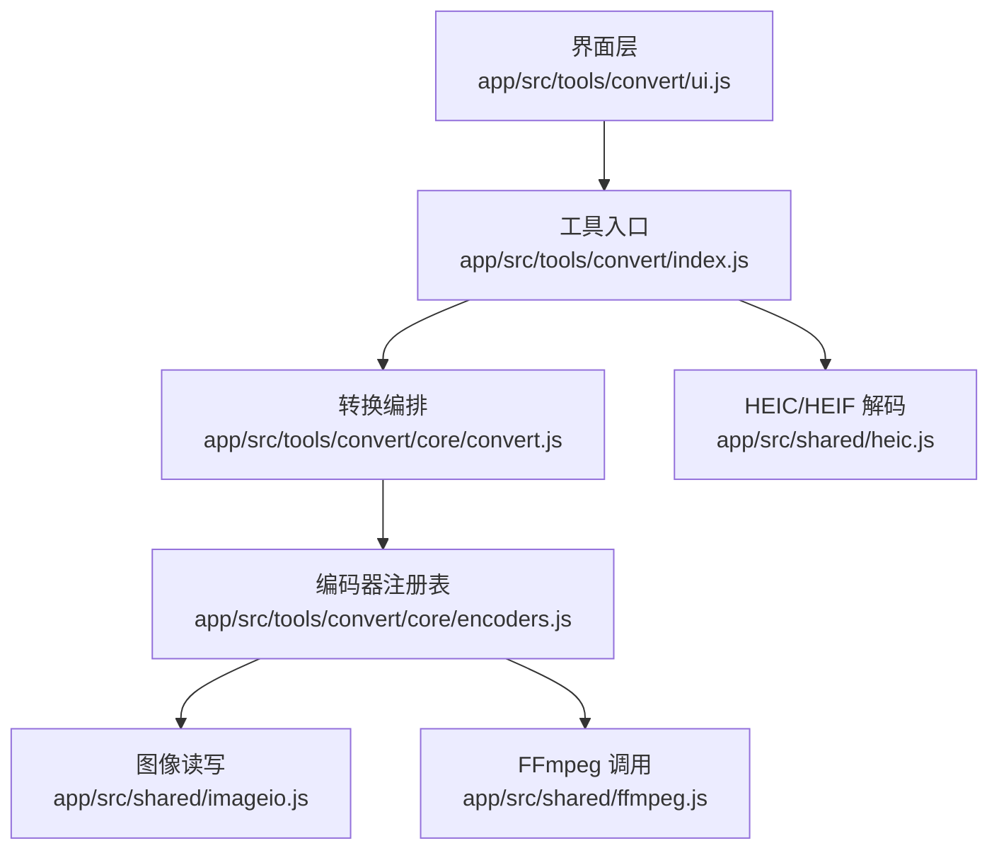
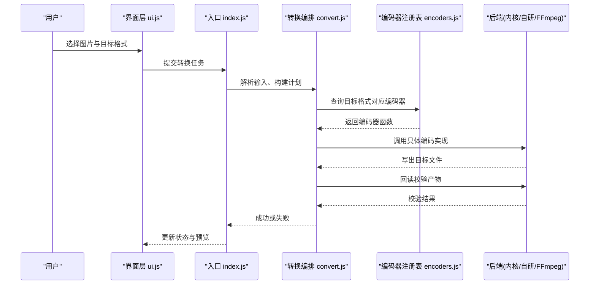
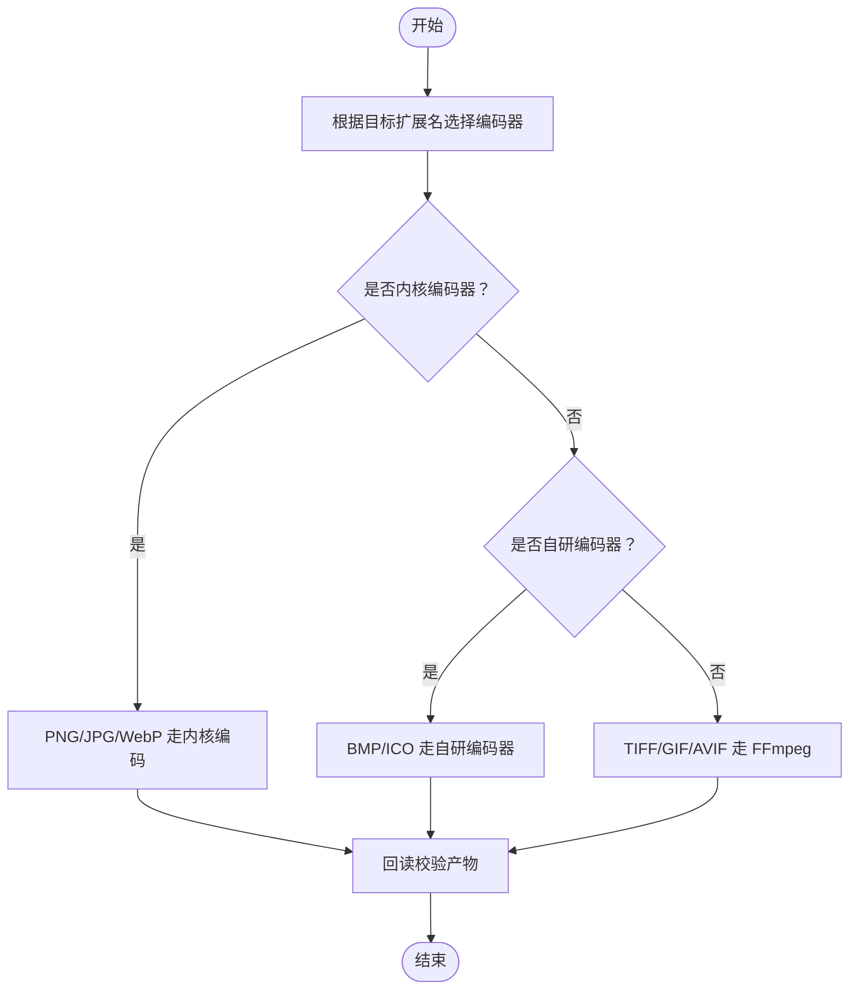
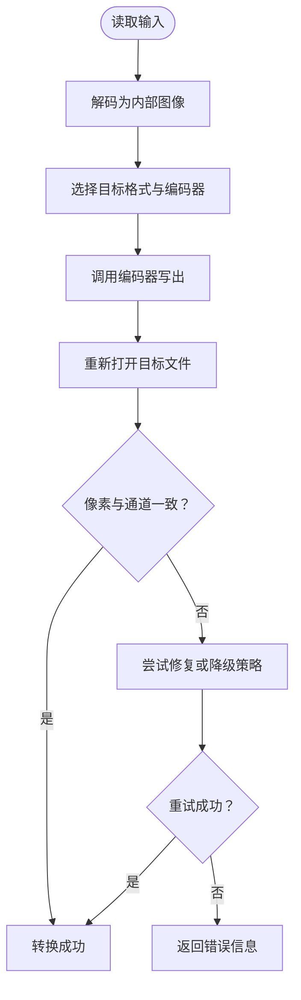
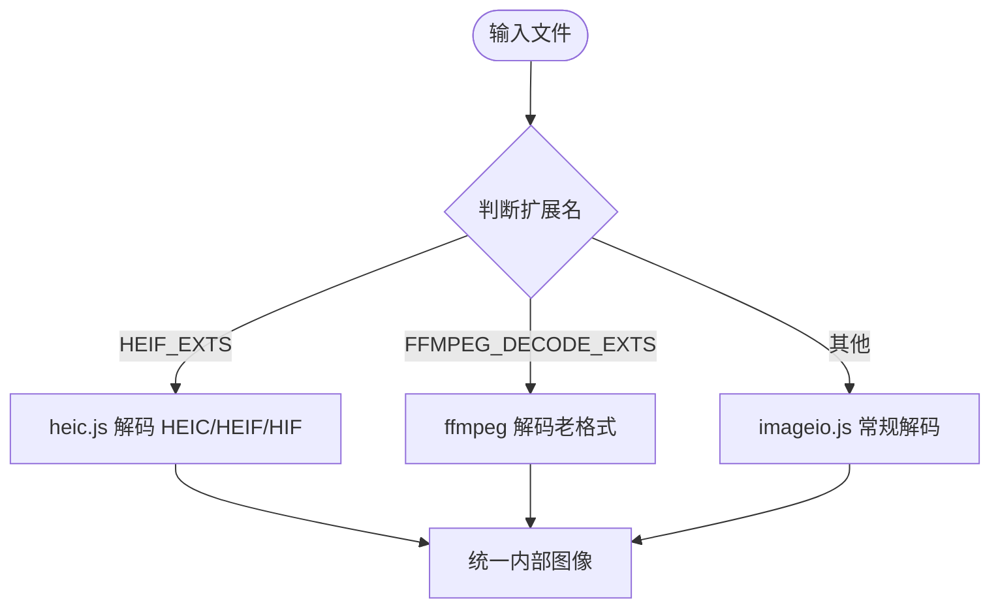
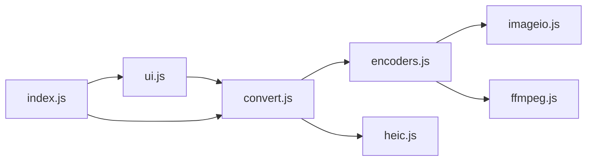

# 图片格式转换

<cite>
**本文引用的文件**   
- [README.md](file://README.md)
- [app/src/tools/convert/index.js](file://app/src/tools/convert/index.js)
- [app/src/tools/convert/ui.js](file://app/src/tools/convert/ui.js)
- [app/src/tools/convert/styles.css](file://app/src/tools/convert/styles.css)
- [app/src/tools/convert/core/encoders.js](file://app/src/tools/convert/core/encoders.js)
- [app/src/tools/convert/core/convert.js](file://app/src/tools/convert/core/convert.js)
- [app/src/shared/imageio.js](file://app/src/shared/imageio.js)
- [app/src/shared/heic.js](file://app/src/shared/heic.js)
- [app/src/shared/ffmpeg.js](file://app/src/shared/ffmpeg.js)
</cite>

## 目录
1. [引言](#引言)
2. [项目结构](#项目结构)
3. [核心组件](#核心组件)
4. [架构总览](#架构总览)
5. [详细组件分析](#详细组件分析)
6. [依赖关系分析](#依赖关系分析)
7. [性能与质量对比](#性能与质量对比)
8. [疑难解答](#疑难解答)
9. [结论](#结论)

## 引言
本文面向“图片格式转换”工具，聚焦多格式编码器架构、技术选型原因、输出格式特性对比、手机拍照与老旧格式解码策略、最佳实践与错误处理方案。目标是帮助使用者与维护者理解：为什么 PNG/JPG/WebP 使用内核编码、BMP/ICO 使用自研编码器、TIFF/GIF/AVIF 走 ffmpeg；以及如何在不同场景下选择目标格式并保证质量和兼容性。

## 项目结构
图片格式转换是工具箱中的一个独立工具，位于 `app/src/tools/convert`，包含入口、界面、样式和两个核心模块：编码器注册表与转换编排逻辑。共享能力（图像读写、HEIC 解码、ffmpeg 调用）位于 `app/src/shared`。

图示来源
- [app/src/tools/convert/index.js](file://app/src/tools/convert/index.js)
- [app/src/tools/convert/ui.js](file://app/src/tools/convert/ui.js)
- [app/src/tools/convert/core/convert.js](file://app/src/tools/convert/core/convert.js)
- [app/src/tools/convert/core/encoders.js](file://app/src/tools/convert/core/encoders.js)
- [app/src/shared/imageio.js](file://app/src/shared/imageio.js)
- [app/src/shared/ffmpeg.js](file://app/src/shared/ffmpeg.js)
- [app/src/shared/heic.js](file://app/src/shared/heic.js)

章节来源
- [README.md:1-120](file://README.md#L1-L120)

## 核心组件
- 工具入口 index.js：注册工具、挂载 UI、调度转换流程。
- 界面 ui.js：负责添加图片、选择目标格式、展示进度与结果。
- 转换编排 convert.js：解析输入、选择编码器、执行转码、回读校验。
- 编码器注册表 encoders.js：声明 TARGETS、映射扩展名到具体编码器实现。
- 图像 IO imageio.js：封装像素级读写，PNG/JPG/WebP 等内核路径走这里。
- HEIC 解码 heic.js：封装 libheif 或降级路径，处理手机拍照 HEIC/HEIF/HIF。
- FFmpeg 调用 ffmpeg.js：封装命令行调用，用于 TIFF/GIF/AVIF 等编解码。

章节来源
- [app/src/tools/convert/index.js](file://app/src/tools/convert/index.js)
- [app/src/tools/convert/ui.js](file://app/src/tools/convert/ui.js)
- [app/src/tools/convert/core/convert.js](file://app/src/tools/convert/core/convert.js)
- [app/src/tools/convert/core/encoders.js](file://app/src/tools/convert/core/encoders.js)
- [app/src/shared/imageio.js](file://app/src/shared/imageio.js)
- [app/src/shared/heic.js](file://app/src/shared/heic.js)
- [app/src/shared/ffmpeg.js](file://app/src/shared/ffmpeg.js)

## 架构总览
图片转换采用“编码器注册 + 多后端”的架构：同一份转换编排逻辑按目标格式分发到不同后端，兼顾性能、兼容性与可维护性。

图示来源
- [app/src/tools/convert/ui.js](file://app/src/tools/convert/ui.js)
- [app/src/tools/convert/index.js](file://app/src/tools/convert/index.js)
- [app/src/tools/convert/core/convert.js](file://app/src/tools/convert/core/convert.js)
- [app/src/tools/convert/core/encoders.js](file://app/src/tools/convert/core/encoders.js)
- [app/src/shared/imageio.js](file://app/src/shared/imageio.js)
- [app/src/shared/ffmpeg.js](file://app/src/shared/ffmpeg.js)

## 详细组件分析

### 编码器注册表与后端分类
编码器注册表集中管理所有支持的输出格式，并按后端分为三类：
- 内核编码器：PNG、JPG、WebP。直接通过图像库写入，速度快、体积小、透明通道保真。
- 自研编码器：BMP、ICO。针对桌面端图标和位图场景优化，不依赖外部进程。
- FFmpeg 后端：TIFF、GIF、AVIF。利用成熟编解码器，覆盖更广泛的格式生态。

图示来源
- [app/src/tools/convert/core/encoders.js](file://app/src/tools/convert/core/encoders.js)
- [app/src/shared/imageio.js](file://app/src/shared/imageio.js)
- [app/src/shared/ffmpeg.js](file://app/src/shared/ffmpeg.js)

章节来源
- [app/src/tools/convert/core/encoders.js](file://app/src/tools/convert/core/encoders.js)

### 转换编排与校验流程
转换编排负责：
- 解析输入图像（支持多种源格式）。
- 根据目标格式选择编码器。
- 执行编码并写出文件。
- 对产物进行回读校验，确保像素一致且无元数据损坏。

图示来源
- [app/src/tools/convert/core/convert.js](file://app/src/tools/convert/core/convert.js)
- [app/src/shared/imageio.js](file://app/src/shared/imageio.js)
- [app/src/shared/ffmpeg.js](file://app/src/shared/ffmpeg.js)

章节来源
- [app/src/tools/convert/core/convert.js](file://app/src/tools/convert/core/convert.js)

### 输入解码：手机拍照与老旧格式
- 手机拍照格式：HEIC/HEIF/HIF 由 heic.js 统一处理，优先使用内置 libheif 引擎，不可用时提供降级策略。
- 老旧输入格式：TIFF/PCX/TGA/PSD/DDS/JPEG2000 等由 ffmpeg 解码补齐，确保老资源也能进入统一转换管线。
- 特殊扩展名集合：
  - FFMPEG_DECODE_EXTS：列出需经 ffmpeg 解码的扩展名，用于统一解码路径。
  - HEIF_EXTS：列出手机拍照相关扩展名，交由 heic.js 专用处理。

图示来源
- [app/src/shared/heic.js](file://app/src/shared/heic.js)
- [app/src/shared/ffmpeg.js](file://app/src/shared/ffmpeg.js)
- [app/src/shared/imageio.js](file://app/src/shared/imageio.js)

章节来源
- [app/src/shared/heic.js](file://app/src/shared/heic.js)
- [app/src/shared/ffmpeg.js](file://app/src/shared/ffmpeg.js)
- [README.md:1-120](file://README.md#L1-L120)

### 目标格式特性与选择建议
TARGETS 定义工具支持的输出格式。从架构角度看：
- PNG：无损、透明通道好、体积较大，适合保留细节与透明度。
- JPG：有损压缩、体积小、广泛兼容，不适合透明通道。
- WebP：现代压缩、体积小、透明通道支持良好，兼容度逐步提升。
- BMP：无压缩或简单压缩，体积大，但兼容性极好。
- ICO：桌面图标专用，含多尺寸与调色板优化。
- TIFF：高保真、图层与多页，适合归档与专业工作流。
- GIF：动图、调色板受限、体积较大，透明通道有限。
- AVIF：新一代高压缩比、透明通道支持良好，兼容度持续提升。

选择建议（结合透明通道、压缩率与兼容性）：
- 需要透明且追求体积：优先 WebP，其次 PNG。
- 最大兼容：JPG（无透明）、PNG（透明但体积大）。
- 图标类：ICO。
- 高质量归档或印刷：TIFF。
- 动图：GIF（兼容性最好），若环境允许可用 WebP 动图替代。
- 极致压缩与现代浏览器：AVIF。

章节来源
- [app/src/tools/convert/core/encoders.js](file://app/src/tools/convert/core/encoders.js)
- [README.md:1-120](file://README.md#L1-L120)

## 依赖关系分析

图示来源
- [app/src/tools/convert/core/convert.js](file://app/src/tools/convert/core/convert.js)
- [app/src/tools/convert/core/encoders.js](file://app/src/tools/convert/core/encoders.js)
- [app/src/shared/imageio.js](file://app/src/shared/imageio.js)
- [app/src/shared/ffmpeg.js](file://app/src/shared/ffmpeg.js)
- [app/src/shared/heic.js](file://app/src/shared/heic.js)
- [app/src/tools/convert/ui.js](file://app/src/tools/convert/ui.js)
- [app/src/tools/convert/index.js](file://app/src/tools/convert/index.js)

章节来源
- [app/src/tools/convert/core/convert.js](file://app/src/tools/convert/core/convert.js)
- [app/src/tools/convert/core/encoders.js](file://app/src/tools/convert/core/encoders.js)
- [app/src/shared/imageio.js](file://app/src/shared/imageio.js)
- [app/src/shared/ffmpeg.js](file://app/src/shared/ffmpeg.js)
- [app/src/shared/heic.js](file://app/src/shared/heic.js)
- [app/src/tools/convert/ui.js](file://app/src/tools/convert/ui.js)
- [app/src/tools/convert/index.js](file://app/src/tools/convert/index.js)

## 性能与质量对比
- 内核编码器（PNG/JPG/WebP）：CPU 开销低、延迟小、透明通道保真，适合高频批量转换。
- 自研编码器（BMP/ICO）：避免外部进程启动开销，适合本地图标与位图生成。
- FFmpeg 后端（TIFF/GIF/AVIF）：功能全面但进程启动与编解码开销更大；适合一次性高质量或特殊格式任务。

实际对比维度建议：
- 体积：JPG < WebP ≈ AVIF < PNG < GIF < BMP；TIFF 视压缩设置而定。
- 透明通道：PNG/WebP/AVIF/ICO 支持良好；JPG 不支持；GIF 有限。
- 兼容性：JPG/PNG/BMP/ICO 最稳；WebP/AVIF 在较新平台表现更好。
- 速度：内核 > 自研 > FFmpeg。

章节来源
- [app/src/tools/convert/core/encoders.js](file://app/src/tools/convert/core/encoders.js)
- [app/src/shared/imageio.js](file://app/src/shared/imageio.js)
- [app/src/shared/ffmpeg.js](file://app/src/shared/ffmpeg.js)
- [README.md:1-120](file://README.md#L1-L120)

## 疑难解答
常见问题与解决方案：
- 目标格式不可用：检查 TARGETS 中是否包含该扩展名；确认后端（内核/自研/FFmpeg）已就绪。
- FFmpeg 相关失败：确认随包 ffmpeg 可用；对于 TIFF/GIF/AVIF，确保解码/编码链路完整。
- HEIC/HEIF 无法解码：确认 heic.js 可用；如 libheif 不可用，应启用降级路径。
- 透明通道丢失：避免使用 JPG；改用 PNG/WebP/AVIF；注意 GIF 的透明限制。
- 体积过大：在可接受画质前提下切换至 WebP/AVIF；对静态图优先考虑 WebP，动图考虑 GIF 或 WebP 动图。
- 兼容性问题：对外发布优先 JPG/PNG；移动端与网页新环境可选 WebP/AVIF；图标必须用 ICO。
- 校验失败：convert.js 的回读校验会捕获异常；必要时触发降级策略（例如将 AVIF 转为 WebP）。

章节来源
- [app/src/tools/convert/core/convert.js](file://app/src/tools/convert/core/convert.js)
- [app/src/shared/heic.js](file://app/src/shared/heic.js)
- [app/src/shared/ffmpeg.js](file://app/src/shared/ffmpeg.js)
- [app/src/tools/convert/core/encoders.js](file://app/src/tools/convert/core/encoders.js)

## 结论
图片格式转换工具通过“编码器注册表 + 多后端”架构，平衡了性能、兼容性与可扩展性。内核编码器保障速度与透明通道质量，自研编码器专注本地图标与位图，FFmpeg 后端覆盖更多格式生态。结合 FFMPEG_DECODE_EXTS 与 HEIF_EXTS 的解码分流，工具能稳定处理手机拍照与老旧格式。实践中应根据透明通道需求、体积与兼容性选择目标格式，并在关键路径上依赖回读校验与降级策略，确保可靠交付。