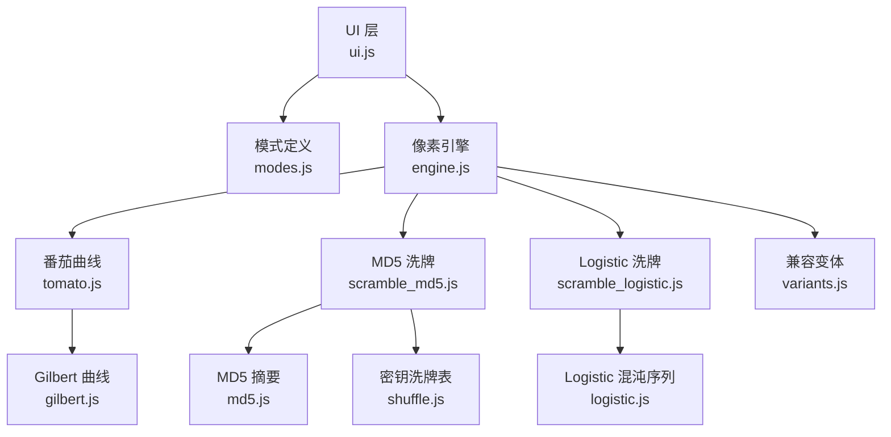
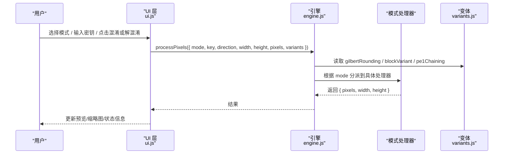
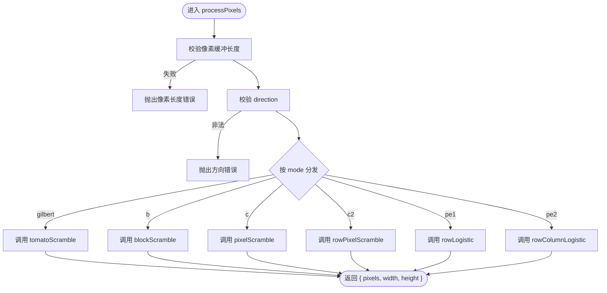
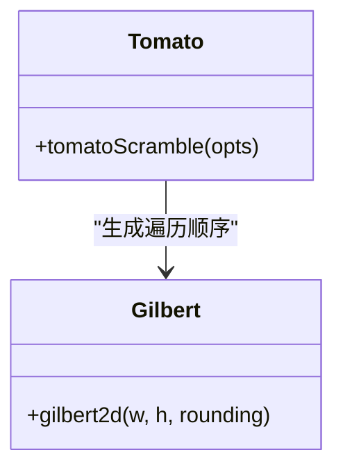
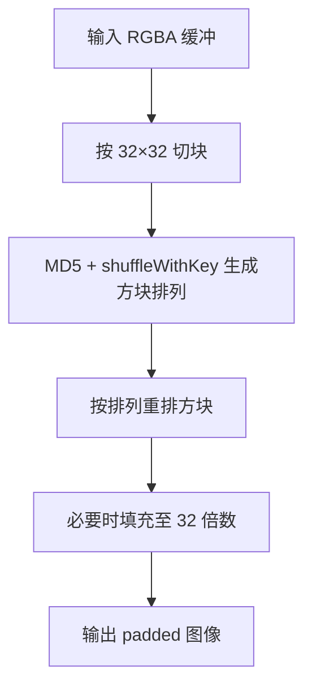
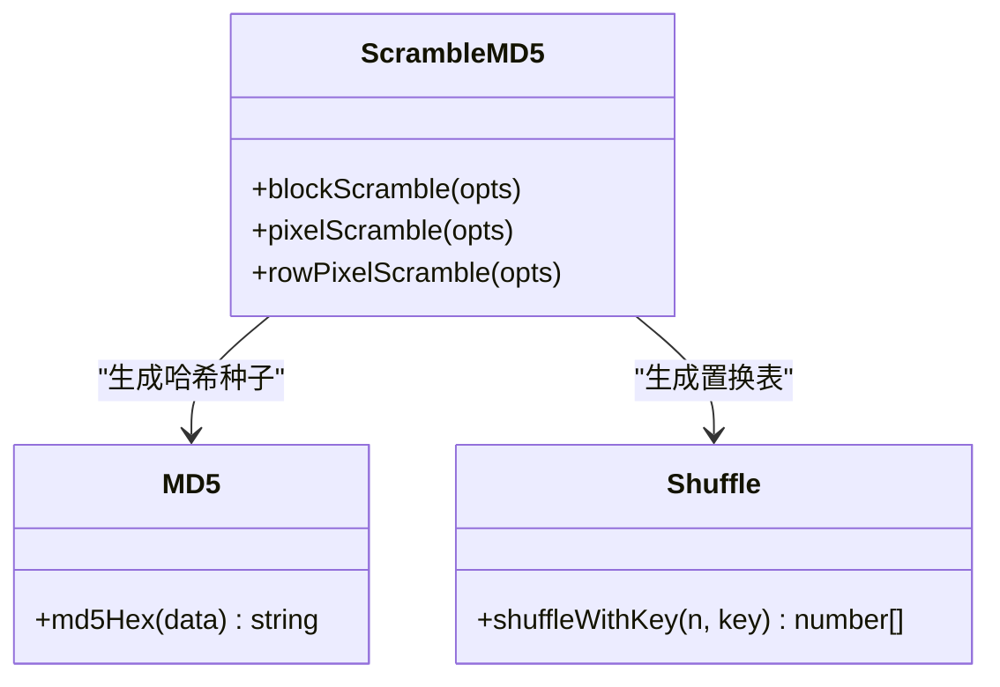
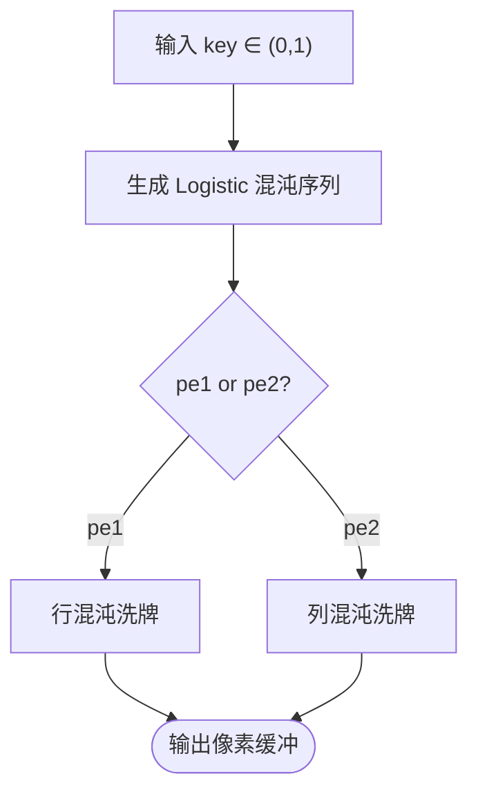
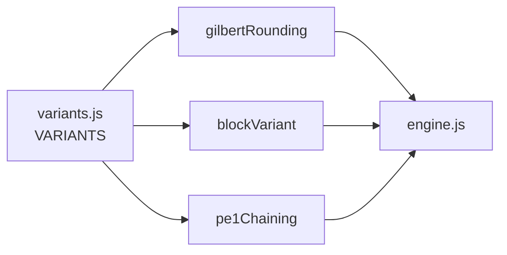
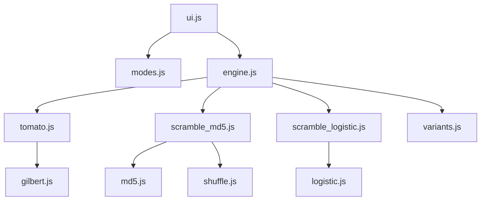

# 图片混淆（核心功能）

<cite>
**本文引用的文件**   
- [engine.js](file://app/src/tools/obfuscate/core/engine.js)
- [modes.js](file://app/src/tools/obfuscate/core/modes.js)
- [gilbert.js](file://app/src/tools/obfuscate/core/gilbert.js)
- [md5.js](file://app/src/tools/obfuscate/core/md5.js)
- [logistic.js](file://app/src/tools/obfuscate/core/logistic.js)
- [scramble_md5.js](file://app/src/tools/obfuscate/core/scramble_md5.js)
- [scramble_logistic.js](file://app/src/tools/obfuscate/core/scramble_logistic.js)
- [shuffle.js](file://app/src/tools/obfuscate/core/shuffle.js)
- [tomato.js](file://app/src/tools/obfuscate/core/tomato.js)
- [variants.js](file://app/src/tools/obfuscate/core/variants.js)
- [index.js](file://app/src/tools/obfuscate/index.js)
- [ui.js](file://app/src/tools/obfuscate/ui.js)
- [兼容性变体说明.md](file://docs/兼容性变体说明.md)
- [engine.test.mjs](file://app/tests/engine.test.mjs)
</cite>

## 目录
1. [引言](#引言)
2. [项目结构](#项目结构)
3. [核心组件](#核心组件)
4. [架构总览](#架构总览)
5. [详细组件分析](#详细组件分析)
6. [依赖关系分析](#依赖关系分析)
7. [性能与 BLOCK_SIZE=32](#性能与-block_size32)
8. [processPixels 参数手册](#processpixels-参数手册)
9. [使用示例与效果对比](#使用示例与效果对比)
10. [常见问题排查](#常见问题排查)
11. [结论](#结论)

## 引言
本工具实现“像素重排型”图片混淆：不改变像素值，只改变像素位置；支持正向混淆与反向解混淆。它提供多种混淆变体，包括基于 Gilbert 曲线的空间遍历、MD5 驱动的方块/像素洗牌、以及 Logistic 混沌序列的行/列混合。同时通过 `variants.js` 暴露少量“兼容性开关”，用于对齐 Android 手机版的算法细节。

## 项目结构
图片混淆作为独立工具被注册到应用工具箱中，界面逻辑与核心算法分离：
- 工具入口：`index.js` 声明工具元数据并挂载 UI。
- UI 层：`ui.js` 负责选图、预览、混淆/解混淆按钮、批量操作等交互。
- 核心引擎：`core/engine.js` 暴露统一处理函数和尺寸校验。
- 具体算法：`core/` 下按算法拆分模块（Gilbert、MD5、Logistic、洗牌、番茄曲线等）。
- 兼容层：`core/variants.js` 集中管理不同平台间细微差异的开关。

**图示来源**
- [index.js:1-14](file://app/src/tools/obfuscate/index.js#L1-L14)
- [ui.js:1-50](file://app/src/tools/obfuscate/ui.js#L1-L50)
- [engine.js:1-30](file://app/src/tools/obfuscate/core/engine.js#L1-L30)

**章节来源**
- [index.js:1-14](file://app/src/tools/obfuscate/index.js#L1-L14)
- [ui.js:1-50](file://app/src/tools/obfuscate/ui.js#L1-L50)

## 核心组件
- `processPixels`：统一入口，接收模式、密钥、方向、尺寸与像素缓冲，返回处理后图像。
- `outputSize`：计算输出尺寸，仅方块模式会填充到 32 的倍数。
- `validateKey`：校验密钥是否符合当前模式的取值规则。
- 各模式处理器：
  - `gilbert`：基于 Gilbert 曲线遍历像素。
  - `b`：MD5 方块混淆。
  - `c`：MD5 像素级洗牌。
  - `c2`：MD5 行内像素洗牌。
  - `pe1`：Logistic 混沌行混。
  - `pe2`：Logistic 混沌行列混。

**章节来源**
- [engine.js:1-102](file://app/src/tools/obfuscate/core/engine.js#L1-L102)

## 架构总览
整体流程是“UI 收集参数 → 调用引擎 → 选择具体算法 → 执行像素重排”。

**图示来源**
- [engine.js:15-60](file://app/src/tools/obfuscate/core/engine.js#L15-L60)
- [ui.js:1-40](file://app/src/tools/obfuscate/ui.js#L1-L40)

## 详细组件分析

### 像素引擎 `processPixels`
`processPixels` 是像素重排的统一调度器。它先做基础校验，再根据 `mode` 分派到具体算法，并透传 `variants` 以适配不同平台的细微差异。

- 输入：
  - `mode`：字符串模式标识。
  - `key`：模式相关密钥。
  - `direction`：`'encrypt'` 或 `'decrypt'`。
  - `width`、`height`：图像宽高。
  - `pixels`：RGBA 字节缓冲。
  - `variants`：兼容变体对象。
  - `blockSize`：方块边长，默认 `BLOCK_SIZE=32`。
- 输出：
  - `{ pixels, width, height }`。

**图示来源**
- [engine.js:15-60](file://app/src/tools/obfuscate/core/engine.js#L15-L60)

**章节来源**
- [engine.js:15-60](file://app/src/tools/obfuscate/core/engine.js#L15-L60)

### Gilbert 曲线与番茄混淆
- `gilbert` 模式由 `tomatoScramble` 驱动，内部使用 `gilbert2d` 生成二维 Gilbert 曲线访问顺序。
- 该模式不需要密钥，但受 `variants.gilbertRounding` 影响取整策略，从而决定在不同平台上是否得到相同像素顺序。
- 适用场景：对全局空间连续性敏感的场景，适合需要“整体打乱但仍保持局部连通性”的效果。

**图示来源**
- [tomato.js:1-20](file://app/src/tools/obfuscate/core/tomato.js#L1-L20)
- [gilbert.js:1-20](file://app/src/tools/obfuscate/core/gilbert.js#L1-L20)

**章节来源**
- [engine.js:25-35](file://app/src/tools/obfuscate/core/engine.js#L25-L35)
- [tomato.js:1-20](file://app/src/tools/obfuscate/core/tomato.js#L1-L20)
- [gilbert.js:1-20](file://app/src/tools/obfuscate/core/gilbert.js#L1-L20)

### MD5 方块混淆 `b`
- 使用 `blockScramble` 将图像划分为 `BLOCK_SIZE × BLOCK_SIZE` 的方块，用基于 MD5 的洗牌表交换方块位置。
- 方块边长固定为 32，非 32 倍数的图像会被填充到 32 的倍数，解密后原始区域还原，填充区应为透明黑。
- 适用场景：强调“块级不可见性”，适合希望破坏局部纹理块但保留块内结构的场景。

**图示来源**
- [scramble_md5.js:1-30](file://app/src/tools/obfuscate/core/scramble_md5.js#L1-L30)
- [engine.js:8-12](file://app/src/tools/obfuscate/core/engine.js#L8-L12)
- [engine.js:35-45](file://app/src/tools/obfuscate/core/engine.js#L35-L45)

**章节来源**
- [scramble_md5.js:1-30](file://app/src/tools/obfuscate/core/scramble_md5.js#L1-L30)
- [engine.js:8-12](file://app/src/tools/obfuscate/core/engine.js#L8-L12)
- [engine.js:35-45](file://app/src/tools/obfuscate/core/engine.js#L35-L45)

### MD5 像素洗牌 `c` 与行洗牌 `c2`
- `pixelScramble`：对整个像素序列做置换。
- `rowPixelScramble`：对每一行像素分别做置换。
- 两者都依赖 `md5Hex` 和 `shuffleWithKey` 生成确定性洗牌表。
- 适用场景：
  - `c`：强扩散式像素重排。
  - `c2`：在每行内随机化，保留行间宏观结构。

**图示来源**
- [scramble_md5.js:1-20](file://app/src/tools/obfuscate/core/scramble_md5.js#L1-L20)
- [md5.js:1-20](file://app/src/tools/obfuscate/core/md5.js#L1-L20)
- [shuffle.js:1-20](file://app/src/tools/obfuscate/core/shuffle.js#L1-L20)

**章节来源**
- [scramble_md5.js:1-20](file://app/src/tools/obfuscate/core/scramble_md5.js#L1-L20)
- [md5.js:1-20](file://app/src/tools/obfuscate/core/md5.js#L1-L20)
- [shuffle.js:1-20](file://app/src/tools/obfuscate/core/shuffle.js#L1-L20)

### Logistic 混沌序列 `pe1` 与 `pe2`
- `pe1`：按行使用 Logistic 混沌序列进行像素重排，可通过 `variants.pe1Chaining` 控制是否跨行衔接序列初值。
- `pe2`：先按行混沌，再按列混沌，形成更强的空间扰动。
- 密钥要求为 0~1 之间的小数，作为 Logistic 映射的参数。
- 适用场景：需要混沌特性带来的近似均匀分布与敏感依赖初始值的场景。

**图示来源**
- [scramble_logistic.js:1-25](file://app/src/tools/obfuscate/core/scramble_logistic.js#L1-L25)
- [logistic.js:1-20](file://app/src/tools/obfuscate/core/logistic.js#L1-L20)
- [engine.js:45-55](file://app/src/tools/obfuscate/core/engine.js#L45-L55)

**章节来源**
- [scramble_logistic.js:1-25](file://app/src/tools/obfuscate/core/scramble_logistic.js#L1-L25)
- [logistic.js:1-20](file://app/src/tools/obfuscate/core/logistic.js#L1-L20)
- [engine.js:45-55](file://app/src/tools/obfuscate/core/engine.js#L45-L55)

### 兼容性变体系统 `variants.js`
`variants.js` 集中维护三个关键开关：
- `gilbertRounding`：影响 Gilbert 曲线取整方式。
- `blockVariant`：影响方块混淆的映射写法。
- `pe1Chaining`：影响 Logistic 行混沌的序列衔接方式。

这些开关不改变工具自身往返正确性，但决定能否与 Android 手机版生成的图像互相解密。文档建议拿到真机样本后通过验证脚本锁定最佳组合。

**图示来源**
- [variants.js:1-20](file://app/src/tools/obfuscate/core/variants.js#L1-L20)
- [engine.js:20-60](file://app/src/tools/obfuscate/core/engine.js#L20-L60)
- [兼容性变体说明.md:1-40](file://docs/兼容性变体说明.md#L1-L40)

**章节来源**
- [variants.js:1-20](file://app/src/tools/obfuscate/core/variants.js#L1-L20)
- [兼容性变体说明.md:1-40](file://docs/兼容性变体说明.md#L1-L40)

## 依赖关系分析
- UI 依赖 `modes.js` 获取模式列表与密钥类型，依赖 `engine.js` 执行像素处理。
- `engine.js` 依赖所有模式处理器与 `variants.js`。
- MD5 相关处理器依赖 `md5.js` 与 `shuffle.js`。
- Logistic 相关处理器依赖 `logistic.js`。
- Gilbert 相关处理器依赖 `gilbert.js`。

**图示来源**
- [ui.js:1-20](file://app/src/tools/obfuscate/ui.js#L1-L20)
- [engine.js:1-20](file://app/src/tools/obfuscate/core/engine.js#L1-L20)

**章节来源**
- [ui.js:1-20](file://app/src/tools/obfuscate/ui.js#L1-L20)
- [engine.js:1-20](file://app/src/tools/obfuscate/core/engine.js#L1-L20)

## 性能与 BLOCK_SIZE=32
- `BLOCK_SIZE=32` 与 Android 手机版保持一致，确保方块模式在不同平台产生相同填充行为与方块排列。
- 方块模式输出尺寸为 32 的倍数，可能大于原图；测试用例覆盖从 1×1 到多组常见尺寸的往返一致性。
- 非方块模式不会改变输出尺寸。
- 性能考量：
  - 像素级洗牌时间复杂度约 O(N)，N 为像素总数。
  - 方块洗牌额外涉及切块与方块重排，但在现代 CPU 上仍接近线性。
  - Logistic 混沌序列生成与洗牌同样为线性开销。
  - Gilbert 曲线生成需访问每个像素一次，亦为线性。

**章节来源**
- [engine.js:8-12](file://app/src/tools/obfuscate/core/engine.js#L8-L12)
- [engine.js:60-85](file://app/src/tools/obfuscate/core/engine.js#L60-L85)
- [engine.test.mjs:120-180](file://app/tests/engine.test.mjs#L120-L180)

## processPixels 参数手册
- `mode`：必需字符串，取值范围：
  - `gilbert`：Gilbert 曲线遍历。
  - `b`：MD5 方块混淆。
  - `c`：MD5 像素级洗牌。
  - `c2`：MD5 行内像素洗牌。
  - `pe1`：Logistic 混沌行混。
  - `pe2`：Logistic 混沌行列混。
- `key`：可选或必需取决于模式：
  - `gilbert`：不需要密钥。
  - `b`、`c`、`c2`：字符串密钥。
  - `pe1`、`pe2`：0~1 之间的小数。
- `direction`：必需，取值 `'encrypt'` 或 `'decrypt'`。
- `width`、`height`：必需正整数，表示图像宽高。
- `pixels`：必需 `Uint8ClampedArray`，长度为 `width * height * 4`。
- `variants`：可选对象，来自 `variants.js`，包含：
  - `gilbertRounding`：影响 Gilbert 取整。
  - `blockVariant`：影响方块映射。
  - `pe1Chaining`：影响 Logistic 行序列衔接。
- `blockSize`：可选数字，默认 `BLOCK_SIZE=32`，仅方块模式有意义。

返回值：
- `{ pixels, width, height }`。

**章节来源**
- [engine.js:15-60](file://app/src/tools/obfuscate/core/engine.js#L15-L60)
- [engine.js:85-102](file://app/src/tools/obfuscate/core/engine.js#L85-L102)

## 使用示例与效果对比
以下为概念性示例，展示如何调用 `processPixels` 进行混淆与解混淆，并比较不同密钥与模式的效果。实际代码路径请参考对应源文件。

- 基本混淆流程：
  - 构造 RGBA 缓冲。
  - 选择模式与密钥。
  - 调用 `processPixels({ mode, key, direction: 'encrypt', width, height, pixels })`。
  - 使用返回的 `pixels`、`width`、`height` 渲染新图像。
- 基本解混淆流程：
  - 用加密后的 `width`、`height`、`pixels`。
  - 调用 `processPixels({ mode, key, direction: 'decrypt', width, height, pixels })`。
  - 若模式为 `b`，注意解密输出可能为填充尺寸，应只比对原始区域。

- 模式对比建议：
  - `gilbert`：观察全局空间连贯性的破坏程度。
  - `b`：观察方块边界与块内结构。
  - `c`：观察像素级随机化强度。
  - `c2`：观察行内随机化与行间宏观结构。
  - `pe1`：观察混沌行混效果。
  - `pe2`：观察行列双重混沌效果。

- 密钥对比建议：
  - 同一模式下更换字符串密钥，观察 `b`、`c`、`c2` 的结果差异。
  - 同一模式下更换 0~1 小数密钥，观察 `pe1`、`pe2` 的结果差异。

参考实现与测试路径：
- [engine.js:15-60](file://app/src/tools/obfuscate/core/engine.js#L15-L60)
- [engine.test.mjs:120-200](file://app/tests/engine.test.mjs#L120-L200)

**章节来源**
- [engine.js:15-60](file://app/src/tools/obfuscate/core/engine.js#L15-L60)
- [engine.test.mjs:120-200](file://app/tests/engine.test.mjs#L120-L200)

## 常见问题排查
- 像素缓冲长度错误：
  - 现象：抛出“像素缓冲长度与尺寸不匹配”。
  - 排查：确认 `pixels.length === width * height * 4`。
- 方向错误：
  - 现象：抛出“未知方向”。
  - 排查：确认 `direction` 为 `'encrypt'` 或 `'decrypt'`。
- 模式错误：
  - 现象：抛出“未知模式”。
  - 排查：确认 `mode` 属于允许集合。
- 密钥格式错误：
  - `b`、`c`、`c2`：必须为字符串。
  - `pe1`、`pe2`：必须为 0~1 之间的小数。
  - 可使用 `validateKey` 提前校验。
- 方块模式尺寸变化：
  - 现象：加密输出尺寸大于原图。
  - 原因：方块模式会填充到 32 的倍数。
  - 处理：解密时按填充尺寸解码，比对原始区域。
- 与 Android 手机版结果不一致：
  - 检查 `variants.js` 中的 `gilbertRounding`、`blockVariant`、`pe1Chaining`。
  - 按照《兼容性变体说明》流程用真机样本验证并锁定。

**章节来源**
- [engine.js:20-35](file://app/src/tools/obfuscate/core/engine.js#L20-L35)
- [engine.js:85-102](file://app/src/tools/obfuscate/core/engine.js#L85-L102)
- [兼容性变体说明.md:1-40](file://docs/兼容性变体说明.md#L1-L40)

## 结论
图片混淆工具通过 `processPixels` 统一入口组织多种像素重排算法，既满足前端可视化交互需求，又通过 `variants.js` 对齐 Android 手机版的算法细节。核心设计要点包括：
- 纯像素重排，不改变像素值。
- 多种混淆变体覆盖不同安全与视觉效果需求。
- `BLOCK_SIZE=32` 保证方块模式与手机版一致。
- 通过测试覆盖往返一致性、尺寸填充规则与密钥校验。
- 使用兼容变体机制降低跨平台差异风险，便于未来锁定真实设备行为。