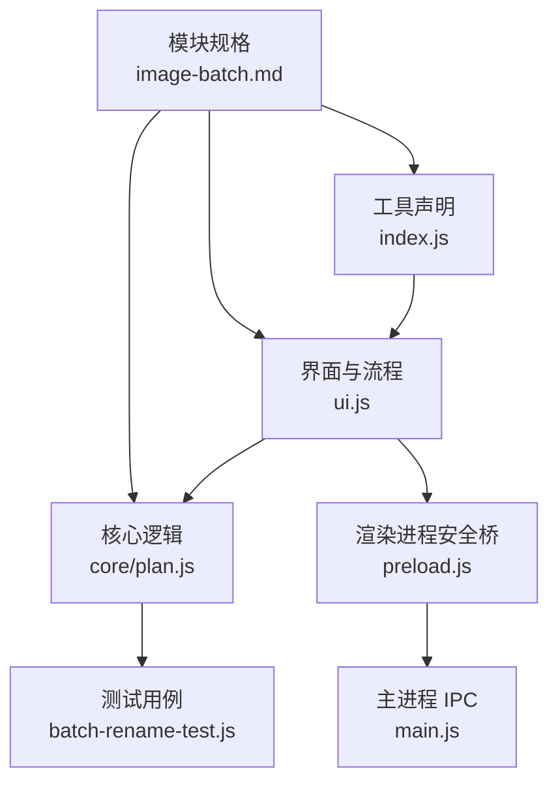
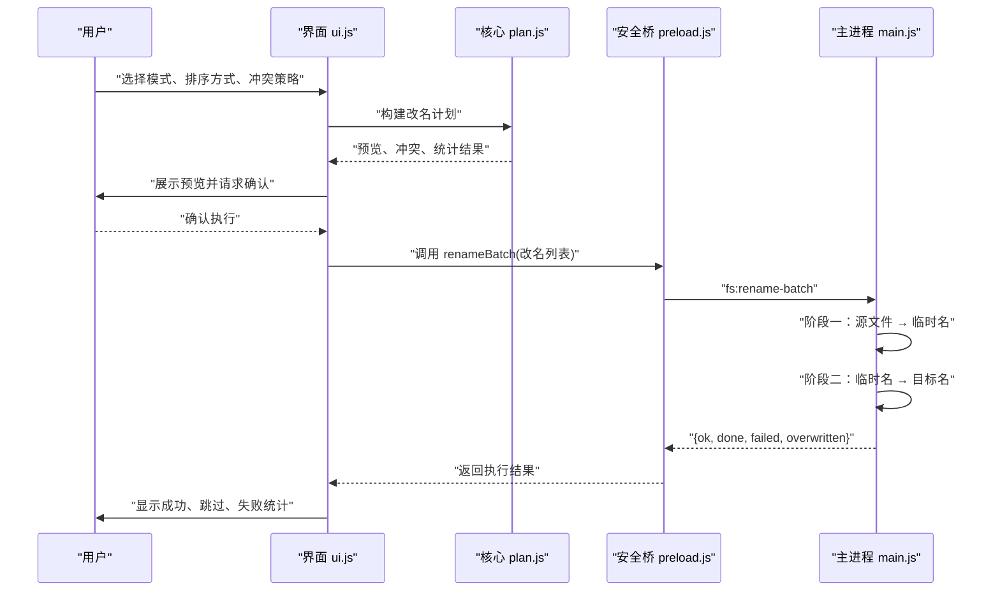
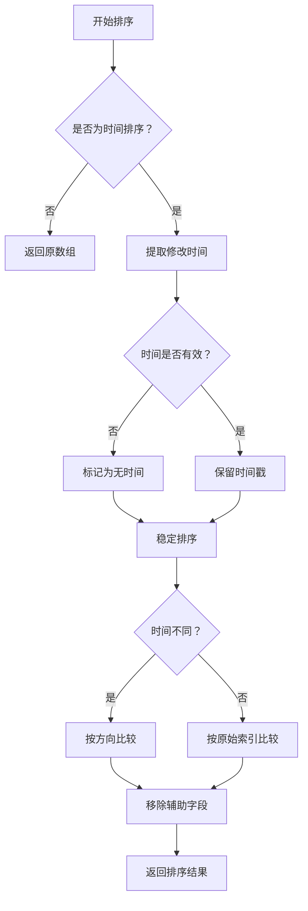
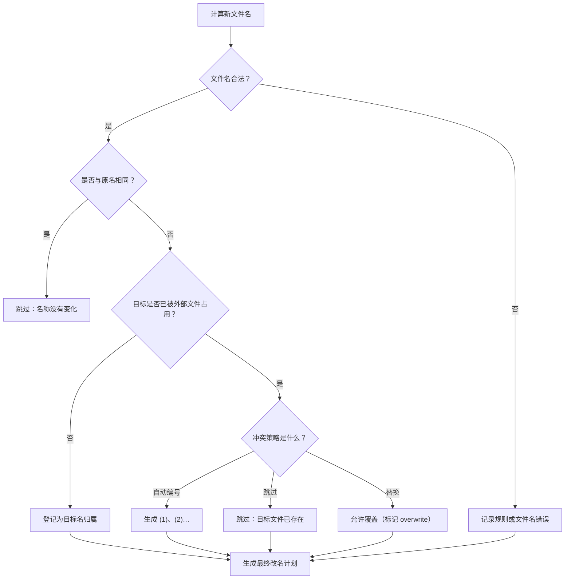
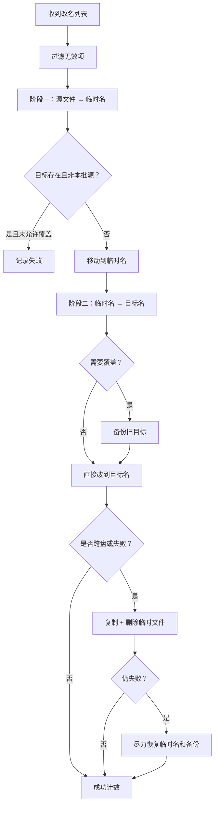
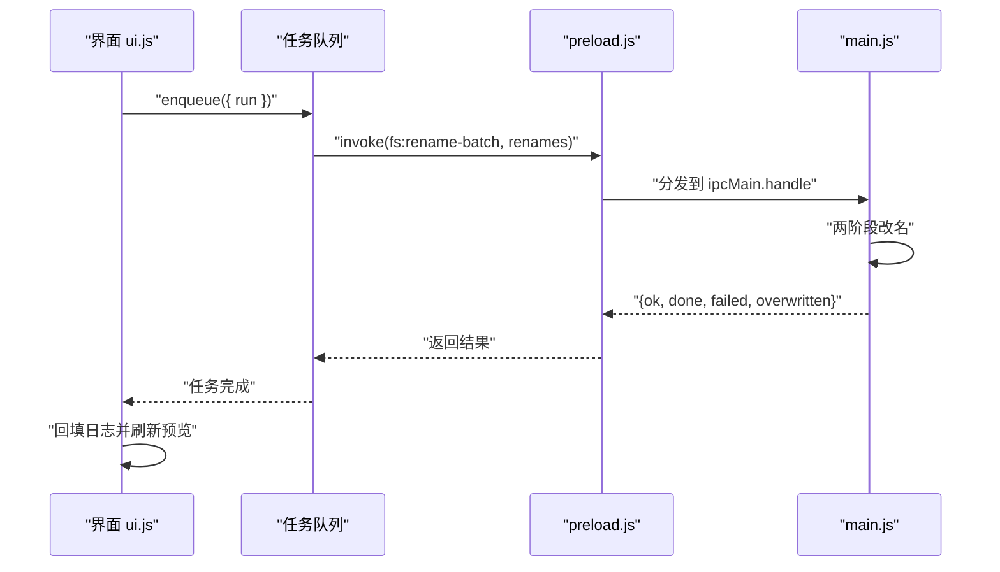

# 批量重命名

<cite>
**本文引用的文件**   
- [批量重命名工具声明](file://app/src/tools/batch-rename/index.js)
- [批量重命名界面与流程](file://app/src/tools/batch-rename/ui.js)
- [批量重命名核心逻辑](file://app/src/tools/batch-rename/core/plan.js)
- [批量重命名测试用例](file://app/tests/batch-rename-test.js)
- [主进程 IPC 入口](file://app/main.js)
- [渲染进程安全桥](file://app/preload.js)
- [图片批量模块规格说明](file://spec/modules/image-batch.md)
</cite>

## 目录

1. [简介](#简介)
2. [项目结构](#项目结构)
3. [核心组件](#核心组件)
4. [架构总览](#架构总览)
5. [四种重命名模式详解](#四种重命名模式详解)
6. [排序方式与序号分配](#排序方式与序号分配)
7. [冲突处理机制](#冲突处理机制)
8. [文件名合法性校验](#文件名合法性校验)
9. [复杂重命名场景示例](#复杂重命名场景示例)
10. [两阶段改名与安全机制](#两阶段改名与安全机制)
11. [主进程 fs:rename-batch 接口调用方式](#主进程-fsrename-batch-接口调用方式)
12. [性能考虑](#性能考虑)
13. [故障排查指南](#故障排查指南)
14. [结论](#结论)

## 简介

批量重命名是工具箱中「图片批量四件套」之一，负责在用户选择一批文件或文件夹后，按规则重新生成文件名。它直接修改用户的原文件名，不产生副本、不进入回收站，因此界面强调执行前预览和二次确认。

该工具由三个层次组成：

| 层次 | 主要职责 | 关键文件 |
|---|---|---|
| 工具声明层 | 注册工具标识、名称、分组、图标、挂载函数 | [批量重命名工具声明](file://app/src/tools/batch-rename/index.js) |
| 界面与流程层 | 读取用户规则、展示预览、弹出确认框、发起任务队列和日志导出 | [批量重命名界面与流程](file://app/src/tools/batch-rename/ui.js) |
| 纯逻辑层 | 计算新文件名、排序、合法性校验、冲突处理、生成改名计划 | [批量重命名核心逻辑](file://app/src/tools/batch-rename/core/plan.js) |
| 主进程安全层 | 通过两阶段改名完成落盘操作，保证链式改名、互换名和覆盖覆盖的安全 | [主进程 IPC 入口](file://app/main.js) |

## 项目结构

批量重命名工具位于 `src/tools/batch-rename/` 下，采用「界面 + 纯逻辑核心」的分层组织方式：



**图示来源**
- [批量重命名工具声明](file://app/src/tools/batch-rename/index.js)
- [批量重命名界面与流程](file://app/src/tools/batch-rename/ui.js)
- [批量重命名核心逻辑](file://app/src/tools/batch-rename/core/plan.js)
- [主进程 IPC 入口](file://app/main.js)
- [渲染进程安全桥](file://app/preload.js)
- [图片批量模块规格说明](file://spec/modules/image-batch.md)

工具声明文件暴露 `batch-rename` 作为工具标识，归类到图片组，并在左侧导航中占有固定顺序；界面文件承担用户交互、预览渲染和执行编排；核心逻辑文件完全独立于 DOM，可在 Node 环境中被测试直接导入验证。

**章节来源**
- [批量重命名工具声明](file://app/src/tools/batch-rename/index.js)
- [图片批量模块规格说明](file://spec/modules/image-batch.md)

## 核心组件

### 工具声明

工具声明文件非常轻量，只定义：

- 工具标识：`batch-rename`
- 显示名称：批量重命名
- 图标：🏷️
- 分组：图片
- 排序号：42
- 样式依赖
- 挂载与卸载回调

这种设计让新增工具时只需要实现挂载函数，而不必重复维护全局注册表。

**章节来源**
- [批量重命名工具声明](file://app/src/tools/batch-rename/index.js)

### 界面与流程

界面文件承担以下职责：

1. 渲染四种模式的参数区。
2. 监听模式、排序方式和冲突策略变化。
3. 添加文件与拖拽导入。
4. 查询目标目录下已存在文件。
5. 调用核心逻辑生成预览。
6. 显示原名、修改时间、新文件名和状态标签。
7. 弹出确认对话框。
8. 把改名计划交给任务队列。
9. 回填成功、跳过、失败统计。
10. 导出 UTF-8 BOM CSV 日志。

界面明确区分「预览阶段」和「执行阶段」：预览时不会改磁盘，只有用户点击确认后才会进入主进程的两阶段改名流程。

**章节来源**
- [批量重命名界面与流程](file://app/src/tools/batch-rename/ui.js)

### 核心逻辑

核心逻辑是本次文档的重点，它不依赖浏览器或 Electron，可被 Node 环境直接单测。其关键导出包括：

| 导出项 | 作用 |
|---|---|
| `RENAME_MODES` | 四种重命名模式的下拉选项 |
| `SORT_MODES` | 三种排序方式的下拉选项 |
| `CONFLICT_MODES` | 三种冲突策略的下拉选项 |
| `formatDate` | 日期模板格式化 |
| `sortItems` | 稳定排序 |
| `applyRule` | 按规则生成新文件名 |
| `validateFileName` | Windows 文件名合法性校验 |
| `buildRenamePlan` | 生成完整改名计划 |
| `uniqueNameFor` | 自动编号生成候选名 |
| `isSortMode` | 排序模式值校验 |

**章节来源**
- [批量重命名核心逻辑](file://app/src/tools/batch-rename/core/plan.js)

## 架构总览

批量重命名的数据流从用户输入开始，经过界面、核心逻辑、IPC 通道，最终落到主进程的磁盘操作：



**图示来源**
- [批量重命名界面与流程](file://app/src/tools/batch-rename/ui.js)
- [批量重命名核心逻辑](file://app/src/tools/batch-rename/core/plan.js)
- [渲染进程安全桥](file://app/preload.js)
- [主进程 IPC 入口](file://app/main.js)

界面只负责拼装规则和渲染；真正改名的风险操作放在主进程，并通过两阶段策略降低数据损坏概率。

**章节来源**
- [批量重命名界面与流程](file://app/src/tools/batch-rename/ui.js)
- [主进程 IPC 入口](file://app/main.js)

## 四种重命名模式详解

### 模式一：序号

序号模式适合给无序文件建立统一编号，例如照片、截图、扫描页。

| 配置项 | 含义 |
|---|---|
| 起始序号 | 第一个文件的数字起点 |
| 位数 | 数字补齐位数，限制为 1 到 10 |
| 前缀 | 可选的前缀文字 |
| 保留原文件名 | 在原名后面追加前缀和序号，而不是替换原名 |

序号的计算方式是：`start + index`，其中 `index` 从 0 开始，并按当前排序后的列表顺序递增。若启用「保留原文件名」，则输出形如「原名 + 前缀 + 序号 + 扩展名」；否则输出「前缀 + 序号 + 扩展名」。

适用场景：

- 给相册照片按拍摄顺序编号。
- 给扫描件按页码编号。
- 给下载到的零散文件统一归一化。

边界行为：

- 位数不足时左补零。
- 起始序号不是有效整数时回退到默认值。
- 位数不在 1 到 10 范围内会被裁剪到合法范围。

**章节来源**
- [批量重命名核心逻辑](file://app/src/tools/batch-rename/core/plan.js)
- [批量重命名界面与流程](file://app/src/tools/batch-rename/ui.js)

### 模式二：查找替换

查找替换模式适合批量修正文件名中的错误字符、旧前缀、平台标记等。

| 配置项 | 含义 |
|---|---|
| 查找内容 | 要匹配的子串 |
| 替换为 | 替换后的内容 |
| 正则表达式 | 是否把查找内容当作基础正则表达式 |

当未填写查找内容时，规则直接返回原名加扩展名，相当于不做替换。

正则模式下，非法正则表达式会在核心逻辑中抛出错误，随后 `buildRenamePlan` 捕获该错误，将该条目标记为规则无效，不会执行改名。

适用场景：

- 去掉文件名中的多余前缀。
- 把英文命名改为中文命名。
- 清理网络下载产生的特殊字符。
- 使用基础正则批量替换数字、字母片段。

注意事项：

- 正则仅支持基础写法。
- 正则本身不是业务错误，而是规则错误，对应行会显示错误原因。
- 替换发生在基础名上，扩展名单独拼接，避免误伤扩展名。

**章节来源**
- [批量重命名核心逻辑](file://app/src/tools/batch-rename/core/plan.js)
- [批量重命名测试用例](file://app/tests/batch-rename-test.js)

### 模式三：加前后缀

前后缀模式最简单：在基础名前加前缀、在扩展名前加后缀。

| 配置项 | 含义 |
|---|---|
| 前缀 | 加在原名前面 |
| 后缀 | 加在扩展名前面 |

适用场景：

- 给待审核文件加「待审_」前缀。
- 给已归档文件加 `_归档` 后缀。
- 给草稿文件加 `draft_` 前缀。
- 给需要二次处理的文件加标注后缀。

该模式不改变扩展名位置，也不会插入序号。

**章节来源**
- [批量重命名核心逻辑](file://app/src/tools/batch-rename/core/plan.js)
- [批量重命名测试用例](file://app/tests/batch-rename-test.js)

### 模式四：按日期

按日期模式以文件的修改时间为依据，用模板生成新文件名。

支持的占位符：

| 占位符 | 含义 |
|---|---|
| YYYY | 四位年份 |
| MM | 两位月份 |
| DD | 两位日期 |
| HH | 两位小时 |
| mm | 两位分钟 |
| ss | 两位秒数 |

如果文件没有有效的修改时间，系统会使用当前时间。如果日期模板无法解析，模板会原样返回，避免产出难以理解的非法名字。

适用场景：

- 按天归档图片。
- 按日期命名监控截图。
- 把文件按采集时间整理。
- 结合「修改时间：旧→新」排序，使最早的文件获得最小序号。

**章节来源**
- [批量重命名核心逻辑](file://app/src/tools/batch-rename/core/plan.js)
- [批量重命名测试用例](file://app/tests/batch-rename-test.js)

## 排序方式与序号分配

### 排序选项

| 排序方式 | 含义 | 对序号的影响 |
|---|---|---|
| 按添加顺序 | 保持用户添加时的顺序 | 序号按添加顺序分配 |
| 修改时间：旧→新 | 按 mtimeMs 从小到大排序 | 最早的文件先编号 |
| 修改时间：新→旧 | 按 mtimeMs 从大到小排序 | 最新的文件先编号 |

排序不仅影响列表显示，也直接影响序号规则下的编号顺序。界面会在每次排序方式变化时重新渲染预览。

### 修改时间排序规则

核心逻辑的 `sortItems` 是稳定排序，规则如下：

1. 取每个条目的 `mtimeMs`。
2. 非正数或无效的修改时间视为「无时间」。
3. 「无时间」的文件一律排在最后。
4. 同一时间的文件保持原始相对顺序。
5. 升序时旧在前，降序时新在前。
6. 传入 `none` 时直接返回原数组，不复制也不打乱。

这意味着：

- 同秒创建的两个文件不会因为排序被打乱。
- 文件系统无法提供修改时间的文件不会被意外插到中间。
- 序号与「按添加顺序」一致时，最直观；按修改时间排序时，序号反映时间先后。



**图示来源**
- [批量重命名核心逻辑](file://app/src/tools/batch-rename/core/plan.js)

**章节来源**
- [批量重命名核心逻辑](file://app/src/tools/batch-rename/core/plan.js)
- [批量重命名测试用例](file://app/tests/batch-rename-test.js)

## 冲突处理机制

冲突处理发生在两个层面：

1. **核心逻辑层**：判断哪些预览项会改名、哪些跳过、哪些自动编号、哪些因规则或文件名非法而报错。
2. **主进程层**：实际执行改名，并对跨盘、覆盖、备份、还原做兜底。

### 三种冲突策略

| 策略 | 默认行为 | 目标已存在时的处理 | 典型用途 |
|---|---|---|---|
| 跳过不改 | 默认 | 不改动目标，源文件保持原名 | 安全优先，不想覆盖任何现有文件 |
| 替换已存在文件 | 需主动选择 | 删除旧目标并写入新文件 | 明确知道旧文件可以丢弃 |
| 自动编号 | 用户主动选择 | 在目标名后加 `(1)`、`(2)`… | 想保留已有文件，同时继续改名 |

### 批内冲突

如果本批中有两个文件算出相同的目标名：

- 跳过模式和替换模式下，两个文件都会被拒绝。替换模式尤其危险，因为互相覆盖可能破坏数据。
- 自动编号模式下，第一个文件保留目标名，其余文件自动编号。

### 目标已被外部文件占用

如果规则算出的目标名已经存在于目标目录，且该目标不是本批的源文件：

- 跳过模式：该条记为跳过。
- 替换模式：该条允许执行，主进程会在阶段二进行备份后覆盖。
- 自动编号模式：为该条生成带编号的新目标名。



**图示来源**
- [批量重命名核心逻辑](file://app/src/tools/batch-rename/core/plan.js)

**章节来源**
- [批量重命名核心逻辑](file://app/src/tools/batch-rename/core/plan.js)
- [批量重命名测试用例](file://app/tests/batch-rename-test.js)

## 文件名合法性校验

核心逻辑对生成的目标文件名执行 Windows 规则校验，防止改名失败或触发系统保护。

### 校验规则

| 检查项 | 行为 |
|---|---|
| 空文件名 | 拒绝 |
| 包含 Windows 非法字符 | 拒绝，并列出非法字符 |
| 包含控制字符 | 拒绝 |
| 长度超过 255 | 拒绝 |
| 以点或空格结尾 | 拒绝 |
| 基础名为 Windows 保留名 | 拒绝 |

Windows 保留名包括 `CON`、`PRN`、`AUX`、`NUL`、`COM1` 到 `COM9`、`LPT1` 到 `LPT9`，且不区分大小写。带扩展名时按去扩展名的基础名判断，所以 `COM1.txt` 也会被视为保留名。

### 为什么要在核心逻辑中校验

核心逻辑的校验是「预防性」的：它在 IPC 之前就把明显非法的名字筛掉，减少主进程出错概率。但主进程 IPC 层仍有兜底逻辑，因为界面可能绕过预览直接调用 IPC，或者规则在不同版本间发生变化。

**章节来源**
- [批量重命名核心逻辑](file://app/src/tools/batch-rename/core/plan.js)
- [批量重命名测试用例](file://app/tests/batch-rename-test.js)

## 复杂重命名场景示例

### 示例一：按修改时间排序后加序号

**场景**：一个文件夹里有多个日期的截图，希望最早的照片变成 `001.png`，最新照片变成最大序号。

**步骤**：

1. 添加文件或整个文件夹。
2. 排序方式选择「修改时间：旧→新」。
3. 重命名模式选择「序号」。
4. 设置起始序号、位数和前缀。
5. 查看预览列表，确认最早的文件得到最小序号。
6. 点击「开始重命名」并确认。

**关键点**：

- 序号顺序由排序决定。
- 修改时间为 0 或无法读取的文件会排在列表末尾。
- 预览中会显示每条记录的修改时间和体积。

### 示例二：批量修正下载文件命名

**场景**：网页下载的文件带有网站前缀，需要去掉前缀并统一格式。

**步骤**：

1. 选择「查找替换」。
2. 查找内容填写网站前缀或多余字符。
3. 替换为空或期望的通用前缀。
4. 如需正则替换数字段，开启正则表达式。
5. 冲突策略选择「跳过不改」，避免覆盖他人文件。
6. 确认预览无误后执行。

**关键点**：

- 非法正则会导致对应行显示规则错误。
- 扩展名不会参与字符串替换。
- 若替换后文件名不变，该条会被跳过。

### 示例三：归档文件加前后缀

**场景**：每月归档一次，希望在文件名中加入 `归档` 和日期信息。

**步骤**：

1. 先用「按日期」模式生成日期前缀或后缀。
2. 再用「加前后缀」模式补充归档标记。
3. 或者直接用一个「按日期」模板包含年月日时分秒。

**关键点**：

- 前后缀模式简单可靠，适合固定标记。
- 按日期模式适合动态时间命名。
- 两种模式可组合多次运行，但要注意第二次运行时源文件已经改变。

### 示例四：链式改名与互换名

**场景**：把 `A.png` 改成 `B.png`，再把 `B.png` 改成 `C.png`；或者交换两个文件名。

**处理**：

- 核心逻辑会把这类情况视为「正常改名」，前提是目标名不与其它冲突。
- 主进程通过两阶段改名保证链式和互换不会互相踩。
- 测试用例验证了 `1→2`、`2→3` 的结果正确，且旧文件消失、新文件内容正确。

**关键点**：

- 不要手动分批执行可能相互影响的改名。
- 尽量在一次批量操作中完成关联改名。
- 主进程会先把所有源文件移到临时名，再统一改到目标名。

**章节来源**
- [批量重命名测试用例](file://app/tests/batch-rename-test.js)
- [图片批量模块规格说明](file://spec/modules/image-batch.md)

## 两阶段改名与安全机制

主进程的 `fs:rename-batch` 实现了两阶段改名，目标是解决三类问题：

1. 链式改名：`001→002`、`002→003`。
2. 互换名：`A↔B`。
3. 覆盖已有文件：目标文件不是本批源文件，但用户明确要求替换。

### 阶段一：源文件 → 临时名

对每个改名项：

1. 检查源路径是否存在且是文件。
2. 如果目标不是源文件，且目标已存在，且不在本批源文件集合中，且没有 `overwrite` 标记，则拒绝并记录失败。
3. 将源文件移动到同目录的临时名，形式类似 `.tomato-rename-时间戳-序号`。
4. 把成功移动的项加入第二阶段队列。

这一步确保后续改名不会读到已经被移动或删除的源文件。

### 阶段二：临时名 → 目标名

对每个阶段一成功的项：

1. 如果标记了 `overwrite`，且目标仍存在，则先把目标移动到备份临时名。
2. 把临时名改名为最终目标名。
3. 如果创建了备份，删除备份并累计 `overwritten` 计数。
4. 累计成功数量。

### 跨盘回退与恢复

如果普通 `rename` 失败（例如跨盘导致的 `EXDEV`），代码会尝试：

1. 复制临时文件到目标。
2. 删除临时文件。
3. 删除备份。
4. 仍失败时，记录失败。
5. 尽力把临时文件恢复成原文件名。
6. 尽力把备份恢复成目标路径。

这保证了即使失败，用户文件也不太可能「凭空消失」。



**图示来源**
- [主进程 IPC 入口](file://app/main.js)

**章节来源**
- [主进程 IPC 入口](file://app/main.js)

## 主进程 fs:rename-batch 接口调用方式

### 渲染进程入口

渲染进程不能直接访问 Node 文件系统，必须通过 `preload.js` 暴露的白名单接口。批量重命名使用：

```javascript
window.desktop.renameBatch(renames)
```

该调用通过 `ipcRenderer.invoke('fs:rename-batch', renames)` 转发到主进程。

### 调用方

批量重命名界面的执行流程是：

1. 用户点击「开始重命名」。
2. 界面再次渲染预览，确保所见即所得。
3. 弹出确认对话框。
4. 用户确认后，把 `plan.renames` 传给 `ctx.renameBatch`。
5. 该调用包装在任务队列中，即使切走工具页也能跑完。
6. 主进程返回 `{ok, done, failed, overwritten}`。
7. 界面根据失败列表回填日志，并刷新预览。

### 入参结构

`renames` 是一个数组，每项至少包含：

| 字段 | 类型 | 含义 |
|---|---|---|
| `from` | 字符串 | 源文件绝对路径 |
| `to` | 字符串 | 目标文件绝对路径 |
| `overwrite` | 布尔值，可选 | 是否允许覆盖目标文件 |

`from` 和 `to` 必须同时存在，且指向真实文件；否则会进入失败分支。

### 返回值结构

| 字段 | 含义 |
|---|---|
| `ok` | 所有项都成功时为真 |
| `done` | 成功改名的数量 |
| `failed` | 失败项列表，每项含 `from`、`to`、`message` |
| `overwritten` | 成功覆盖旧文件的数量 |

界面会把失败原因合并后显示在状态栏和日志中。



**图示来源**
- [批量重命名界面与流程](file://app/src/tools/batch-rename/ui.js)
- [渲染进程安全桥](file://app/preload.js)
- [主进程 IPC 入口](file://app/main.js)

**章节来源**
- [渲染进程安全桥](file://app/preload.js)
- [批量重命名界面与流程](file://app/src/tools/batch-rename/ui.js)
- [主进程 IPC 入口](file://app/main.js)

## 性能考虑

### 预览阶段

预览阶段的核心成本来自：

- 遍历文件列表。
- 对每个文件应用规则。
- 检查目标目录中已存在文件。
- 构建预览 DOM。

对于大量文件，界面会逐步渲染列表，但预览逻辑本身是纯 JavaScript，不涉及媒体解码。

### 添加文件阶段

添加文件时会逐个调用 `pathInfo`，如果是文件夹还会递归列出全部文件。该过程是异步的，并且会对每个子文件分别 try/catch，避免单个坏路径中断整个导入。

### 批量改名阶段

真正的磁盘 I/O 集中在主进程：

- 第一阶段对所有源文件执行重命名。
- 第二阶段对所有临时文件执行重命名。
- 覆盖模式下额外增加备份和删除备份的步骤。
- 跨盘回退会增加复制和删除开销。

### 优化建议

| 场景 | 建议 |
|---|---|
| 大文件夹批量重命名 | 先在预览阶段筛选必要文件，减少待改名数量 |
| 频繁切换规则 | 利用预览实时反馈，避免反复执行 |
| 需要精确时间顺序 | 确认文件系统能正确提供修改时间 |
| 跨盘改名 | 注意复制比原地改名慢，失败恢复也有额外开销 |
| 大量自动编号 | 自动编号会不断尝试候选名，但仍远小于逐文件 IO |
| 日志导出 | 只在需要时导出，CSV 会包含完整路径和明细 |

[本节为通用性能指导，不直接分析具体代码行]

## 故障排查指南

### 常见问题与原因

| 现象 | 可能原因 | 处理方法 |
|---|---|---|
| 按钮不可点击 | 没有可改名的文件 | 调整规则、更换冲突策略或添加更多文件 |
| 某行显示「跳过」 | 目标已存在、文件名非法、或与原名相同 | 查看行上的原因说明 |
| 某行显示红色错误 | 规则本身有问题，例如非法正则 | 关闭正则或修正正则表达式 |
| 改名后文件内容不对 | 链式或互换操作拆分执行导致中间态 | 在同一批中完成关联改名 |
| 提示目标文件已存在 | 默认跳过策略生效 | 确认是否需要「替换已存在文件」或「自动编号」 |
| 覆盖后旧文件丢失 | 选择了「替换已存在文件」 | 使用前备份重要文件 |
| 改名部分成功 | 某些项失败，但其他项已完成 | 查看失败原因，必要时重试或修复权限 |
| 出现 `.tomato-rename-*` 残留 | 程序异常中断或跨盘回退未完成 | 通常测试会比对快照，正常结束不应残留 |

### 日志导出

执行成功后，界面会启用「导出日志」按钮。导出的 CSV 包含：

- 序号
- 原文件名
- 原路径
- 修改时间
- 新文件名
- 结果
- 说明

文件名形如 `重命名日志-时间戳.csv`，编码为 UTF-8 BOM，以便 Excel 正确识别中文。

### 测试覆盖要点

测试用例覆盖了：

- 四种规则的纯逻辑断言。
- 文件名合法性校验。
- 批内重名、外部冲突、链式改名、互换名。
- 排序稳定性。
- 自动编号候选名生成。
- 真实 IPC 改名。
- 覆盖模式备份与删除。
- 临时文件和备份文件不留残。

这些断言保证了核心逻辑和主进程行为的一致性。

**章节来源**
- [批量重命名界面与流程](file://app/src/tools/batch-rename/ui.js)
- [批量重命名测试用例](file://app/tests/batch-rename-test.js)
- [图片批量模块规格说明](file://spec/modules/image-batch.md)

## 结论

批量重命名工具通过「界面 + 核心逻辑 + 主进程 IPC」三层结构，把高风险的磁盘改名操作与低风险的规则计算分离开。四种重命名模式覆盖了日常文件整理的常见需求；排序方式决定序号分配顺序；冲突处理提供跳过、替换和自动编号三种策略，兼顾安全性和灵活性。

两阶段改名是该工具最重要的安全机制：它让链式改名和互换名成为一次原子操作，同时在覆盖模式下引入备份，在跨盘失败时尝试回退恢复。配合预览、确认弹窗、状态统计和 CSV 日志，用户可以在执行前看到即将发生的变化，在执行后知道哪些成功、哪些跳过、哪些失败。

使用时应遵循以下原则：

1. 先看预览，再点确认。
2. 不确定时优先选「跳过不改」。
3. 明确可以丢弃旧文件时再选「替换已存在文件」。
4. 需要保留已有目标文件时选「自动编号」。
5. 关联改名尽量放在同一批中执行。
6. 重要文件先备份，因为改名不可撤销。

[本节为总结性内容，不直接分析具体文件]