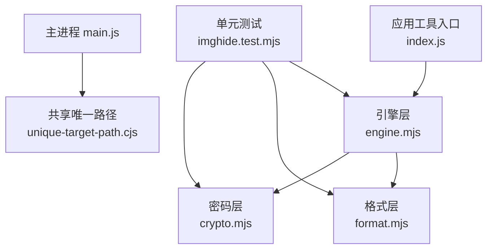
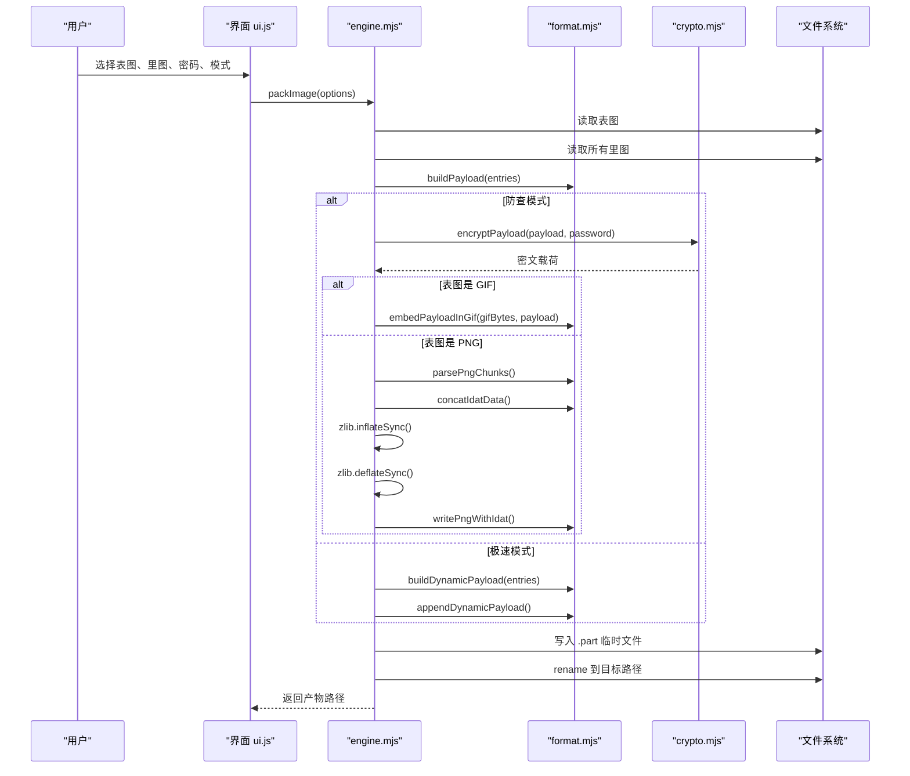
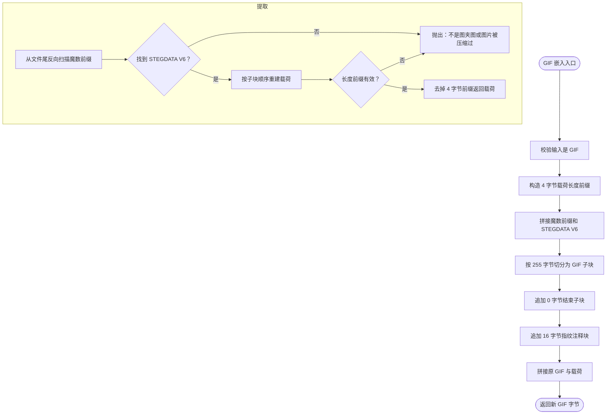
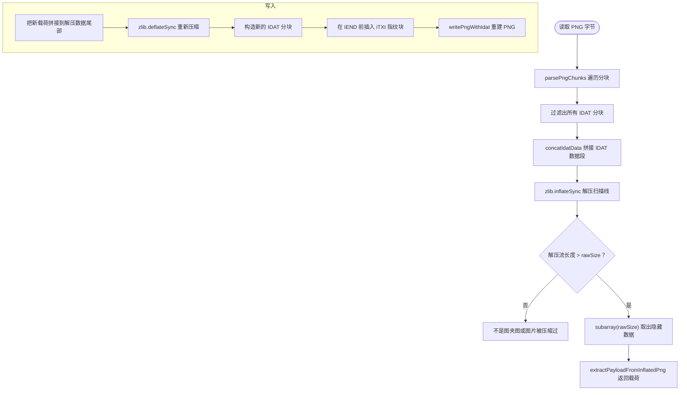
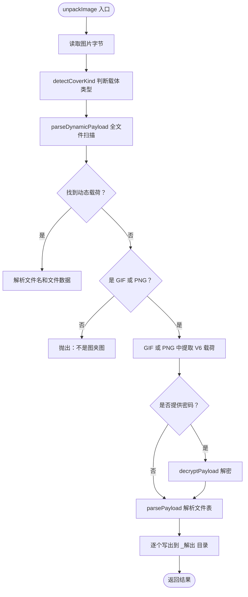
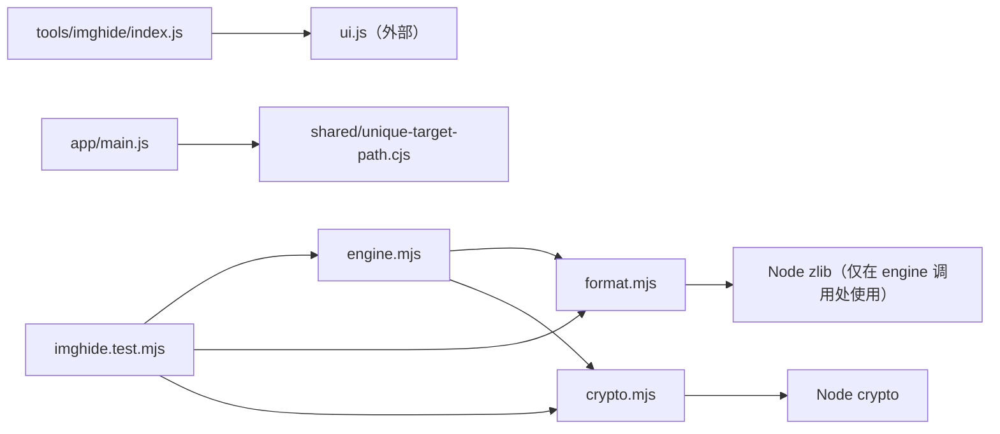
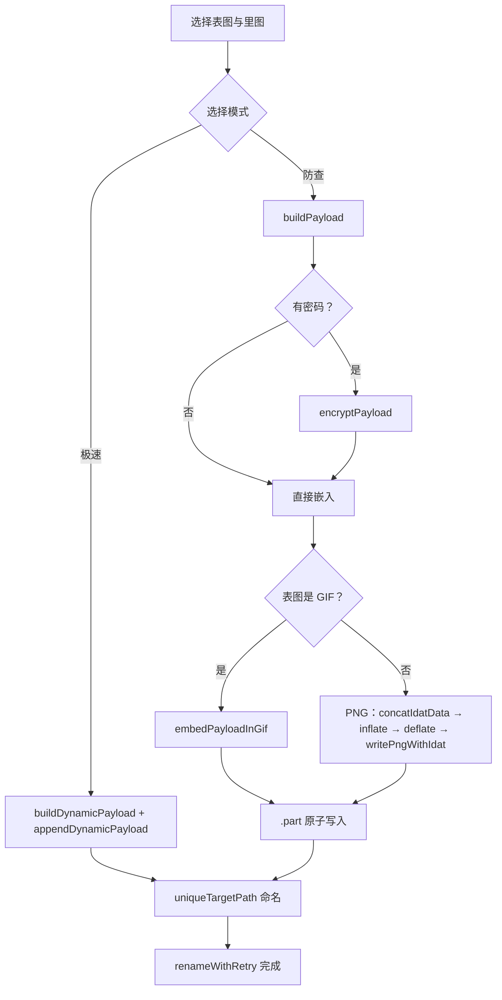
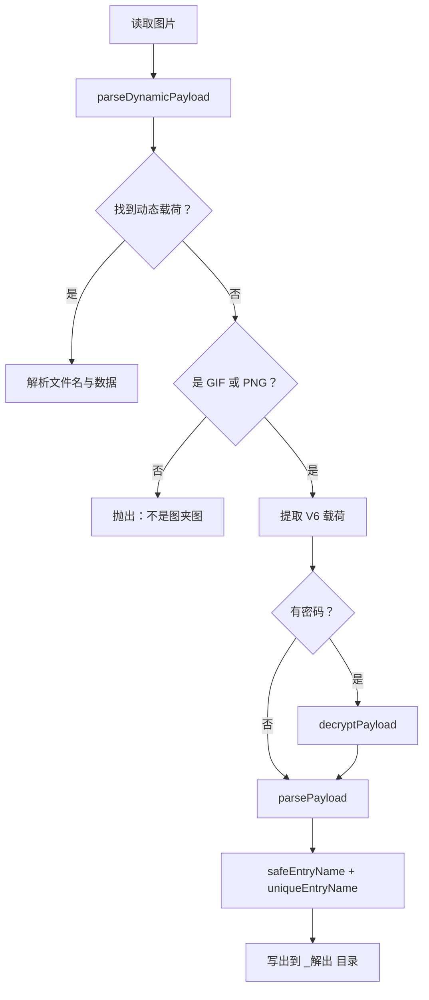

# 文件藏图

<cite>
**本文引用的文件**   
- [engine.mjs](file://app/src/tools/imghide/core/engine.mjs)
- [format.mjs](file://app/src/tools/imghide/core/format.mjs)
- [crypto.mjs](file://app/src/tools/imghide/core/crypto.mjs)
- [index.js](file://app/src/tools/imghide/index.js)
- [imghide.test.mjs](file://app/tests/imghide.test.mjs)
- [unique-target-path.cjs](file://app/src/shared/unique-target-path.cjs)
- [main.js](file://app/main.js)
</cite>

## 目录

1. [简介](#简介)
2. [项目结构](#项目结构)
3. [核心组件](#核心组件)
4. [架构总览](#架构总览)
5. [详细组件分析](#详细组件分析)
6. [依赖关系分析](#依赖关系分析)
7. [性能考虑](#性能考虑)
8. [故障排查指南](#故障排查指南)
9. [结论](#结论)
10. [附录：藏图与取图完整流程](#附录藏图与取图完整流程)

## 简介

「文件藏图」是一个把任意文件隐藏进图片、再从图片中还原文件的工具。它对外提供两种互操作模式：

- **极速格式（动态混淆）**：把明文分隔符载荷直接追加在图片尾部，表图原字节零改动，可支持 JPG、WebP、GIF、PNG 等任意图片；不需要密码，但容易被识别为“被修改过的图片”。
- **防查格式（图夹 PRO，V6 容器）**：将文件表写入 PNG 的 IDAT 解压流或 GIF 的应用扩展块，并在 PNG 末尾插入指纹 iTXt 块；可选 PBKDF2 + AES-256-GCM 密码保护，与官方「图夹」网站和客户端逐字节互通。

该工具的 Node 侧实现采用三层架构：

| 层 | 文件 | 职责 |
|---|---|---|
| 引擎层 | `core/engine.mjs` | 文件系统读写、临时文件 `.part` 原子落盘、Windows 抖动重试、输出路径重名避让、进度回调、调用格式与加密层 |
| 格式层 | `core/format.mjs` | PNG/GIF/V6 容器、IDAT 扫描线处理、动态载荷、文件名净化、CRC32、体积提示 |
| 密码层 | `core/crypto.mjs` | PBKDF2-SHA256 派生密钥 + AES-256-GCM 加解密，盐固定为 `xcn2025` |

## 项目结构

「文件藏图」作为应用内一个独立工具注册，入口是 `app/src/tools/imghide/index.js`，它只负责挂载 UI、样式和工具元信息；真正逻辑集中在 `core/` 三个模块中。测试位于 `app/tests/imghide.test.mjs`，覆盖载荷往返、GIF/PNG 载体、CRC32、密码、条目净化、输出命名和载体识别。

**图表来源**
- [index.js:1-16](file://app/src/tools/imghide/index.js#L1-L16)
- [engine.mjs:1-25](file://app/src/tools/imghide/core/engine.mjs#L1-L25)
- [format.mjs:1-12](file://app/src/tools/imghide/core/format.mjs#L1-L12)
- [crypto.mjs:1-12](file://app/src/tools/imghide/core/crypto.mjs#L1-L12)
- [imghide.test.mjs:1-20](file://app/tests/imghide.test.mjs#L1-L20)

**章节来源**
- [index.js:1-16](file://app/src/tools/imghide/index.js#L1-L16)
- [engine.mjs:1-25](file://app/src/tools/imghide/core/engine.mjs#L1-L25)
- [format.mjs:1-12](file://app/src/tools/imghide/core/format.mjs#L1-L12)
- [crypto.mjs:1-12](file://app/src/tools/imghide/core/crypto.mjs#L1-L12)
- [imghide.test.mjs:1-20](file://app/tests/imghide.test.mjs#L1-L20)

## 核心组件

### 引擎层 `engine.mjs`

引擎层是用户可见操作的调度者，不直接解析 PNG/GIF 二进制，也不实现密码算法。它主要负责：

1. 读取表图和里图文件。
2. 根据模式选择极速格式或防查格式。
3. 调用 `format.mjs` 构建载荷并嵌入载体。
4. 调用 `crypto.mjs` 对 V6 载荷做可选加密。
5. 通过 `.part` 临时文件 + 改名实现原子落盘。
6. 使用 `uniqueTargetPath` / `uniqueTargetDir` 避免覆盖已有产物。
7. 封装 `packImage`（藏图）和 `unpackImage`（取图）两个对外异步函数。

关键特性：

- **`.part` 半成品清理**：写失败时删除 `.part` 文件，防止大文件藏图留下几百 MB 垃圾。
- **Windows 抖动重试**：rename 到已存在目标可能偶发 `EPERM`，最多重试 5 次，每次间隔 80ms，最终失败时删除源临时文件。
- **渐进式进度**：通过 `onProgress` 回调报告百分比和中文文本，如“读取”“拼装数据”“加密”“写入 GIF”“写入 PNG”“写文件”“完成”。
- **产物命名约定**：默认产物名为 `<表图基名>_图夹.png|gif`；若传入 `baseName`，则确保以 `_图夹` 结尾。

**章节来源**
- [engine.mjs:1-25](file://app/src/tools/imghide/core/engine.mjs#L1-L25)
- [engine.mjs:22-43](file://app/src/tools/imghide/core/engine.mjs#L22-L43)
- [engine.mjs:45-66](file://app/src/tools/imghide/core/engine.mjs#L45-L66)
- [engine.mjs:109-200](file://app/src/tools/imghide/core/engine.mjs#L109-L200)
- [engine.mjs:201-268](file://app/src/tools/imghide/core/engine.mjs#L201-L268)

### 格式层 `format.mjs`

格式层是纯逻辑模块，注释明确说明它不依赖 DOM 和 Node 专属 API，渲染进程、主进程和测试均可共用。它实现了「图夹 V6」与「动态混淆」两套格式。

#### V6 容器载荷结构

V6 载荷是定长头部加变长条目的线性结构：

| 字段 | 长度 | 含义 |
|---|---:|---|
| 文件数 | 4 字节 | 大端无符号整数 |
| 每个条目 | 可变 | 名字长度 + UTF-8 名字 + 文件大小 + 原始字节 |
| 名字长度 | 4 字节 | 大端无符号整数 |
| 文件大小 | 8 字节 | 大端无符号 BigInt |
| 文件内容 | 变长 | 原始字节，不压缩 |

防御性约束包括：

- 最大文件数 `MAX_FILE_COUNT = 10000`。
- 最大条目名长度 `MAX_NAME_LENGTH = 4096`。
- 未命名条目兜底名为 `UNNAMED = '未命名文件'`。
- 截断、异常计数、非法偏移都会抛出可读错误。

#### GIF 载体

GIF 载体的策略是**原字节零改动**：

1. 校验输入是合法 GIF。
2. 在载荷前添加 4 字节长度前缀。
3. 拼接魔数前缀 `21 FF 0B`、魔数 `STEGDATA V6`。
4. 按 255 字节上限切分 GIF 子块。
5. 追加 0 字节结束子块。
6. 追加 16 字节指纹注释块。

提取时从文件尾反向扫描魔数前缀，最多容忍 20 个候选块，再按子块顺序重建载荷。

#### PNG 载体

PNG 载体的核心是 **IDAT 数据块处理**：

1. 解析 PNG 分块，定位 IHDR、IDAT、IEND。
2. 把所有 IDAT 的数据段拼接成原始 zlib 流。
3. 解压后得到扫描线数据，其长度为 `height × (1 + width × bytesPerPixel)`。
4. 隐藏数据就是扫描线之后的剩余部分。
5. 写入时，把新载荷拼接到解压后的扫描线尾部，重新 deflate 为一个 IDAT，并在 IEND 前插入 iTXt(Software) 指纹块。

兼容限制由 `pngCompatError` 表达：只有 8 位深、非隔行扫描、且色彩类型为灰度、RGB、索引色、RGBA 或 LA 的 PNG 才能直接做 IDAT 手术。

#### 动态载荷（极速格式）

动态载荷不是传统容器，而是用随机分隔符把多个文件标记成一段明文序列，然后直接追加到图片尾部。

格式要点：

- 前缀：`DYNAMIC_V2_` + 随机分隔符。
- 分隔符必须以 `|||` 结尾，且整体长度大于 3。
- 每条记录形如：分隔符 + `filename` + 分隔符 + base64(UTF-8 文件名) + 分隔符 + `file` + 分隔符 + 原始文件字节。
- 最后一个文件的字节一直延伸到图片末尾。
- 老版固定分隔符 `|||ENCRYPT_DELIMITER|||` / `|||FILENAME_DELIMITER|||` / `|||FILE_DELIMITER|||` 也兼容。

解析器会先找 `DYNAMIC_V2_`，找不到再回退到老版固定分隔符；如果整张图片都不匹配，就返回 null，让上层继续走 V6 容器路径。

#### 文件名净化与去重

文件名在进入文件系统前经过两层保护：

1. `safeEntryName`：
   - 把反斜杠统一为正斜杠。
   - 取最后一级 basename。
   - 替换系统非法字符为下划线。
   - 去掉末尾点与空格，避免 Windows 剥名行为。
   - 空名、`.`、`..` 都转为 `UNNAMED`。
   - Windows 保留设备名 `con`、`prn`、`aux`、`nul`、`com[1-9]`、`lpt[1-9]` 加下划线前缀。

2. `uniqueEntryName`：
   - 使用已写入名称集合判重。
   - Windows 和 macOS 上按大小写不敏感比较。
   - 重名时生成 `原名(2).后缀`、`原名(3).后缀`……最多到 10000。
   - 超过阈值时使用 `原名(Date.now()).后缀` 兜底。

**章节来源**
- [format.mjs:1-12](file://app/src/tools/imghide/core/format.mjs#L1-L12)
- [format.mjs:14-41](file://app/src/tools/imghide/core/format.mjs#L14-L41)
- [format.mjs:43-99](file://app/src/tools/imghide/core/format.mjs#L43-L99)
- [format.mjs:101-164](file://app/src/tools/imghide/core/format.mjs#L101-L164)
- [format.mjs:201-286](file://app/src/tools/imghide/core/format.mjs#L201-L286)
- [format.mjs:288-449](file://app/src/tools/imghide/core/format.mjs#L288-L449)
- [format.mjs:451-628](file://app/src/tools/imghide/core/format.mjs#L451-L628)

### 密码层 `crypto.mjs`

密码层实现「图夹 PRO」的对称加密，参数与官方完全一致：

| 参数 | 值 |
|---|---|
| 密钥派生算法 | PBKDF2-SHA256 |
| 密码编码 | UTF-8 |
| 盐 | `xcn2025` |
| 迭代次数 | 100,000 |
| 密钥长度 | 32 字节（256 位） |
| 加密算法 | AES-256-GCM |
| IV 长度 | 12 字节随机数 |
| 认证标签长度 | 16 字节 |
| 密文布局 | IV ‖ 密文 ‖ tag |

`encryptPayload` 生成随机 IV，拼接 IV 和 tag 后返回；`decryptPayload` 先检查最小长度，再设置认证标签并尝试解密；任何解密失败或数据损坏都抛出“密码错误”，不会泄露内部差异。

安全注意事项：

- 盐是公开常量，不提供抗彩虹表能力；安全性主要靠 10 万次 PBKDF2 迭代和 GCM 认证。
- 相同密码不会产生相同 IV，因此同一载荷多次加密结果不同。
- 解密失败必须统一报“密码错误”，不能区分“密码错误”和“数据损坏”，否则可能泄露密文是否有效的侧信道。

**章节来源**
- [crypto.mjs:1-12](file://app/src/tools/imghide/core/crypto.mjs#L1-L12)
- [crypto.mjs:14-25](file://app/src/tools/imghide/core/crypto.mjs#L14-L25)
- [crypto.mjs:27-54](file://app/src/tools/imghide/core/crypto.mjs#L27-L54)

## 架构总览

**图表来源**
- [engine.mjs:109-200](file://app/src/tools/imghide/core/engine.mjs#L109-L200)
- [format.mjs:101-164](file://app/src/tools/imghide/core/format.mjs#L101-L164)
- [format.mjs:288-449](file://app/src/tools/imghide/core/format.mjs#L288-L449)
- [crypto.mjs:27-54](file://app/src/tools/imghide/core/crypto.mjs#L27-L54)

## 详细组件分析

### PNG 与 GIF 载体的嵌入与提取算法

#### GIF 嵌入与提取

**图表来源**
- [format.mjs:166-200](file://app/src/tools/imghide/core/format.mjs#L166-L200)
- [format.mjs:201-286](file://app/src/tools/imghide/core/format.mjs#L201-L286)

#### PNG 的 IDAT 数据处理

PNG 载体不直接把载荷塞进某个普通数据块，而是改写压缩后的图像数据：

**图表来源**
- [format.mjs:288-449](file://app/src/tools/imghide/core/format.mjs#L288-L449)
- [engine.mjs:140-171](file://app/src/tools/imghide/core/engine.mjs#L140-L171)

#### 动态载荷与 V6 容器的联合解析

取图时，`unpackImage` 优先尝试动态载荷，再回退到 V6 容器：

**图表来源**
- [engine.mjs:201-268](file://app/src/tools/imghide/core/engine.mjs#L201-L268)
- [format.mjs:451-628](file://app/src/tools/imghide/core/format.mjs#L451-L628)

### `uniqueTargetPath` 的重名避让机制

`engine.mjs` 中的 `uniqueTargetPath` 用于藏图产物命名，而 `app/src/shared/unique-target-path.cjs` 是应用其他工具共用的同名函数。两者实现思路一致：

1. 首先生成基础路径 `baseName.ext`。
2. 如果不存在，直接返回。
3. 否则循环尝试 `baseName(2).ext`、`baseName(3).ext`……直到 10000。
4. 超过阈值后回退到带时间戳的名称 `baseName(Date.now()).ext`。

`uniqueTargetDir` 对目录做同样逻辑，用于解包时的 `<图片名>_解出` 目录。

| 场景 | 行为 |
|---|---|
| 目标不存在 | 直接使用基础名 |
| 目标存在 | 依次尝试 `(2)`、`(3)` … `(10000)` |
| 仍冲突 | 使用当前毫秒时间戳兜底 |
| 解包目录 | 默认 `<图片名>_解出`，同目录冲突时加序号 |

**章节来源**
- [engine.mjs:22-43](file://app/src/tools/imghide/core/engine.mjs#L22-L43)
- [engine.mjs:68-77](file://app/src/tools/imghide/core/engine.mjs#L68-L77)
- [unique-target-path.cjs:27-43](file://app/src/shared/unique-target-path.cjs#L27-L43)
- [main.js:703-708](file://app/main.js#L703-L708)
- [imghide.test.mjs:455-459](file://app/tests/imghide.test.mjs#L455-L459)

### `.part` 临时文件的原子写入策略

藏图写入流程是：

1. 计算目标路径 `target`。
2. 创建同目录下的 `tmp = target + '.part'`。
3. 调用 `fsp.writeFile(tmp, outBytes)`。
4. 如果写失败，捕获错误并删除 `.part`，然后重新抛出。
5. 成功写完后调用 `renameWithRetry(tmp, target)`。

这样做的好处是：

- 如果程序中途崩溃，只会留下 `.part` 临时文件。
- 正常路径下，外部进程要么看到旧文件，要么看到已完成的新文件，不会读到半写文件。
- 写失败时主动清理，避免在大文件场景留下数百 MB 垃圾。

**章节来源**
- [engine.mjs:172-200](file://app/src/tools/imghide/core/engine.mjs#L172-L200)

### Windows 抖动问题与 EPERM 处理

`renameWithRetry` 专门应对 Windows 上的文件系统抖动：

- 杀毒软件、索引服务或上一个进程刚释放句柄时，rename 到已存在目标可能抛出 `EPERM`。
- 最多重试 5 次。
- 第一次之后，每次重试前先强制删除目标文件。
- 每次失败后等待 80ms。
- 最后一次失败时删除源临时文件并抛出错误。

这比简单抛错更健壮，也与回归测试中“自动回归撞到一次 EPERM”的实际经验对应。

**章节来源**
- [engine.mjs:45-66](file://app/src/tools/imghide/core/engine.mjs#L45-L66)

### 文件名净化与跨平台重名处理

`safeEntryName` 和 `uniqueEntryName` 共同解决三类安全问题：

| 风险 | 处理方式 |
|---|---|
| 路径穿越 | 只取 basename，忽略父目录路径 |
| 系统非法字符 | 替换 `\u0000-\u001f`、`<>:"|?*` 为下划线 |
| Windows 保留设备名 | `con`、`prn`、`aux`、`nul`、`com[1-9]`、`lpt[1-9]` 加下划线前缀 |
| Windows/macOS 大小写不敏感 | 去重时使用小写键 |
| 同名文件静默覆盖 | 生成 `原名(2).后缀` 序列 |

注意：去重只在解包落盘时生效；打包阶段不改容器内文件名，以保证与官方实现一致。

**章节来源**
- [format.mjs:400-449](file://app/src/tools/imghide/core/format.mjs#L400-L449)
- [imghide.test.mjs:1-20](file://app/tests/imghide.test.mjs#L1-L20)

## 依赖关系分析

**图表来源**
- [index.js:1-16](file://app/src/tools/imghide/index.js#L1-L16)
- [engine.mjs:1-25](file://app/src/tools/imghide/core/engine.mjs#L1-L25)
- [format.mjs:1-12](file://app/src/tools/imghide/core/format.mjs#L1-L12)
- [crypto.mjs:1-12](file://app/src/tools/imghide/core/crypto.mjs#L1-L12)
- [main.js:703-708](file://app/main.js#L703-L708)

耦合特点：

- `engine.mjs` 是编排中心，同时依赖 `format.mjs` 和 `crypto.mjs`。
- `format.mjs` 是纯逻辑模块，不直接依赖 Node 文件系统，便于测试和渲染进程复用。
- `crypto.mjs` 依赖 Node 的 `crypto` 模块。
- PNG 的 zlib inflate/deflate 发生在 `engine.mjs` 中，而不是 `format.mjs` 中，符合“纯逻辑放 format、文件系统与 zlib 放 engine”的设计。
- 应用主进程还有一份独立的 `unique-target-path.cjs`，供其他工具复用。

**章节来源**
- [engine.mjs:1-25](file://app/src/tools/imghide/core/engine.mjs#L1-L25)
- [format.mjs:1-12](file://app/src/tools/imghide/core/format.mjs#L1-L12)
- [crypto.mjs:1-12](file://app/src/tools/imghide/core/crypto.mjs#L1-L12)
- [main.js:703-708](file://app/main.js#L703-L708)

## 性能考虑

| 维度 | 设计取舍 |
|---|---|
| 内存占用 | V6 格式的 PNG 需要解压整个 IDAT 流，因此大图片会消耗较多内存；极速格式只需追加尾部，不需要解压。 |
| CPU 开销 | PBKDF2 使用 10 万次迭代，加解密有明显成本；GIF 和极速模式没有 PBKDF2。 |
| 大图警告 | `sizeWarning` 针对网页版/手机端给出体积提示，避免浏览器页面无法承载超大图夹。 |
| CRC32 | 自定义查表实现与 Node `zlib.crc32` 对齐，避免额外复制大缓冲。 |
| 动态分隔符 | 朴素字符串搜索足够快，因为分隔符很短，且只在整图中查找一次。 |
| 单 IDAT | PNG 写入时合并所有 IDAT 为新 IDAT，减少分块复杂度，但会重新压缩整张图。 |

推荐实践：

- 需要跨平台分享、兼容性优先时，使用极速格式。
- 需要对抗简单检测、要求与官方图夹 PRO 互通时，使用防查格式。
- 超大文件优先选极速格式，避免网页端解压整张图导致内存不足。
- 通过 `sizeWarning` 提示用户分批处理或使用网盘。

**章节来源**
- [format.mjs:600-628](file://app/src/tools/imghide/core/format.mjs#L600-L628)
- [crypto.mjs:14-25](file://app/src/tools/imghide/core/crypto.mjs#L14-L25)
- [engine.mjs:140-171](file://app/src/tools/imghide/core/engine.mjs#L140-L171)

## 故障排查指南

### 解包时报“不是图夹图”

可能原因：

1. 图片不是 GIF 或 PNG，也不是极速格式的尾部追加图。
2. GIF 中没有找到 `STEGDATA V6` 魔数。
3. PNG 缺少 IHDR、IDAT 或 IEND。
4. 图片被再次压缩，导致 IDAT 数据变化。
5. 文件被截断，载荷不完整。

处理建议：

- 确认来源是「文件藏图」或官方「图夹」。
- 如果是 PNG，检查是否被图片编辑器重新编码。
- 如果是 GIF，检查是否被压缩工具二次压缩。
- 如果是极速格式，确保没有被聊天工具裁剪尾部。

**章节来源**
- [engine.mjs:220-244](file://app/src/tools/imghide/core/engine.mjs#L220-L244)
- [format.mjs:201-286](file://app/src/tools/imghide/core/format.mjs#L201-L286)
- [format.mjs:288-356](file://app/src/tools/imghide/core/format.mjs#L288-L356)

### 解包时报“图夹数据不完整”

可能原因：

- 载荷被截断。
- 文件名长度或文件大小字段异常。
- 偏移越界。
- 文件数量超过 10000。

处理建议：

- 重新获取原始图夹图。
- 不要通过聊天窗口预览后再保存，某些预览会改变文件尾部。
- 使用官方客户端或本工具重新生成。

**章节来源**
- [format.mjs:101-164](file://app/src/tools/imghide/core/format.mjs#L101-L164)

### 解密时报“密码错误”

可能原因：

- 密码不正确。
- 载荷被篡改。
- 使用了极速格式却误填了密码。
- 图片被压缩导致 V6 载荷损坏。

处理建议：

- 确认来源是否为 V6 容器。
- 如果是极速格式，不要填写密码。
- 如果怀疑数据损坏，重新从源头获取图片。
- 不要把“密码错误”和“数据损坏”区分展示，避免侧信道泄露。

**章节来源**
- [crypto.mjs:27-54](file://app/src/tools/imghide/core/crypto.mjs#L27-L54)
- [engine.mjs:230-244](file://app/src/tools/imghide/core/engine.mjs#L230-L244)

### 落盘时报权限错误或磁盘已满

可能原因：

- 磁盘空间不足。
- 杀毒软件锁定目标文件。
- 目标路径被占用。
- Windows 上 rename 触发 EPERM。

处理建议：

- 检查磁盘空间和目标目录权限。
- 关闭或放行杀毒软件对目标目录的检测。
- 等待几秒后重试。
- 如果已经产生 `.part` 文件，可安全删除。

**章节来源**
- [engine.mjs:45-66](file://app/src/tools/imghide/core/engine.mjs#L45-L66)
- [engine.mjs:172-200](file://app/src/tools/imghide/core/engine.mjs#L172-L200)

### 解包后文件名异常或被覆盖

可能原因：

- 容器内包含路径穿越文件名。
- 容器内有同名文件。
- Windows/macOS 文件系统大小写不敏感。
- 文件名是 Windows 保留设备名。

处理建议：

- 工具已经自动净化文件名并去重。
- 检查 `_解出` 目录中是否出现 `_(原名)` 形式。
- 如果担心覆盖，手动移动或重命名已有文件后再解包。

**章节来源**
- [format.mjs:400-449](file://app/src/tools/imghide/core/format.mjs#L400-L449)

## 结论

「文件藏图」通过清晰的三层架构把文件系统、文件格式和密码学解耦：

- `engine.mjs` 专注 IO、原子写入、Windows 抖动、路径命名和业务编排。
- `format.mjs` 专注 PNG/GIF/V6 容器、IDAT 数据块、动态载荷、CRC32 和文件名安全。
- `crypto.mjs` 专注 PBKDF2 + AES-256-GCM，保持与官方图夹 PRO 的逐字节互通。

两种载体模式各有侧重：极速格式兼容性强、写入快、适合大文件；防查格式更安全、更难被简单检测，适合与官方图夹生态互通。配合 `.part` 原子写入、Windows 抖动重试、文件名净化和重名避让，工具在真实桌面环境中具备较好的健壮性。

## 附录：藏图与取图完整流程

### 藏图流程

1. 用户选择表图和要隐藏的里图。
2. 选择模式：
   - 极速：调用 `buildDynamicPayload` + `appendDynamicPayload`，直接追加到图片尾部。
   - 防查：调用 `buildPayload`，可选 `encryptPayload`，再按 GIF 或 PNG 分别嵌入。
3. 产物命名为 `<表图基名>_图夹.png|gif`，使用 `uniqueTargetPath` 避让重名。
4. 先写入 `<目标>.part`，成功后 `renameWithRetry` 移动到正式路径。
5. 返回产物路径、文件大小、耗时、载体类型和文件数量。

**图表来源**
- [engine.mjs:109-200](file://app/src/tools/imghide/core/engine.mjs#L109-L200)
- [format.mjs:101-164](file://app/src/tools/imghide/core/format.mjs#L101-L164)
- [format.mjs:288-449](file://app/src/tools/imghide/core/format.mjs#L288-L449)
- [format.mjs:451-628](file://app/src/tools/imghide/core/format.mjs#L451-L628)
- [crypto.mjs:27-54](file://app/src/tools/imghide/core/crypto.mjs#L27-L54)

### 取图流程

1. 读取图片字节。
2. 先尝试解析动态载荷；如果成功，直接得到文件名和数据，无需密码。
3. 否则判断是否为 GIF 或 PNG；如果不是，抛出“不是图夹图”。
4. GIF 走 `extractPayloadFromGif`，PNG 走 `parsePngChunks` + `concatIdatData` + `extractPayloadFromInflatedPng`。
5. 如果提供了密码，调用 `decryptPayload`。
6. 调用 `parsePayload` 解析文件表。
7. 对每个条目执行 `safeEntryName` + `uniqueEntryName`，写入 `<图片名>_解出` 目录。
8. 返回目录、文件列表、耗时和是否加密。

**图表来源**
- [engine.mjs:201-268](file://app/src/tools/imghide/core/engine.mjs#L201-L268)
- [format.mjs:451-628](file://app/src/tools/imghide/core/format.mjs#L451-L628)
- [crypto.mjs:27-54](file://app/src/tools/imghide/core/crypto.mjs#L27-L54)

### 数据安全考虑

| 安全措施 | 作用 |
|---|---|
| 动态载荷分隔符随机化 | 降低静态特征被批量识别的概率 |
| V6 容器魔数和指纹 | 便于官方工具识别，同时作为完整性标志 |
| PBKDF2 + AES-256-GCM | 提供强口令保护和数据完整性校验 |
| 文件名净化 | 防止路径穿越和设备名攻击 |
| 大小写敏感去重 | 防止 Windows/macOS 上同名文件静默覆盖 |
| `.part` 原子写入 | 防止半写文件被外部进程读取 |
| Windows 抖动重试 | 提高实际部署中的稳定性 |

最佳实践：

- 高机密文件建议使用防查格式并设置强密码。
- 大文件或需要快速分享时优先使用极速格式。
- 不要在聊天记录预览后再发送，以免尾部数据被裁剪。
- 不要把图夹图交给不可信的图片压缩服务，尤其是 V6 格式的 PNG。
- 定期备份原始表图和图夹图，避免单一载体丢失导致数据不可恢复。