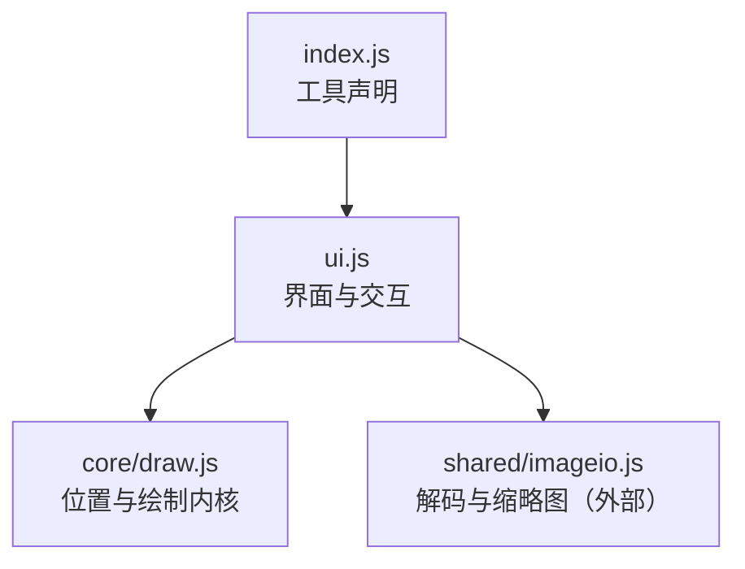
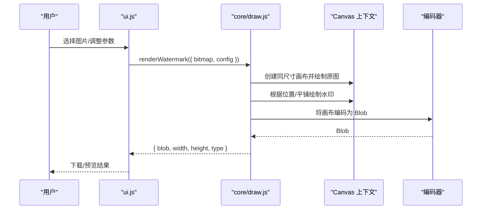
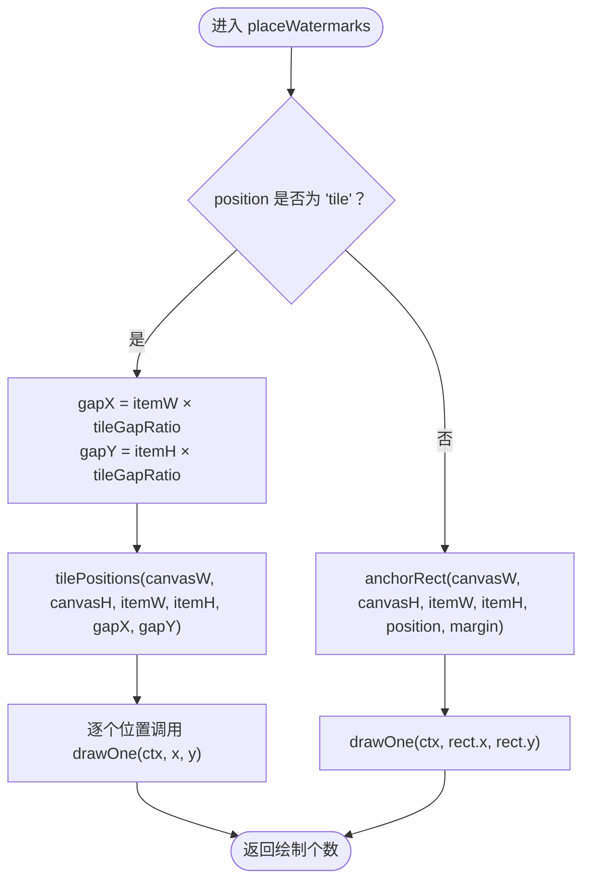
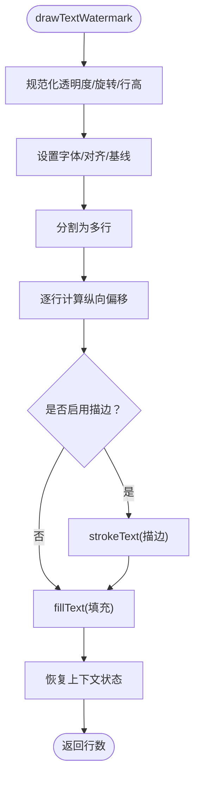
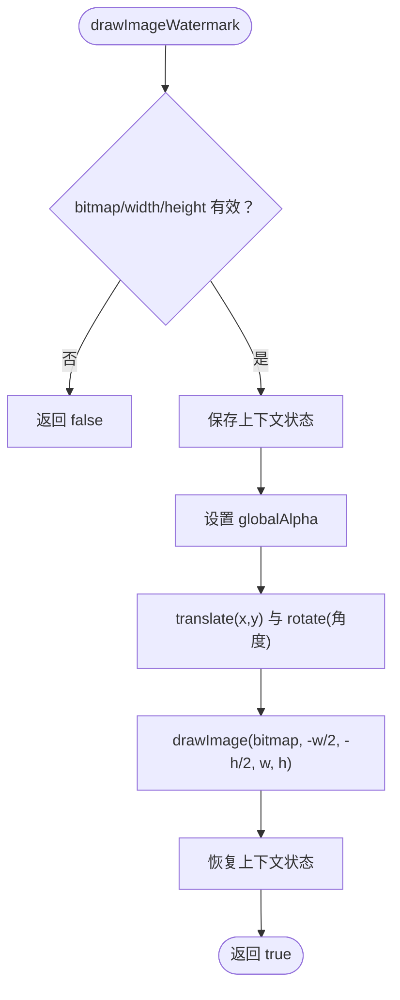
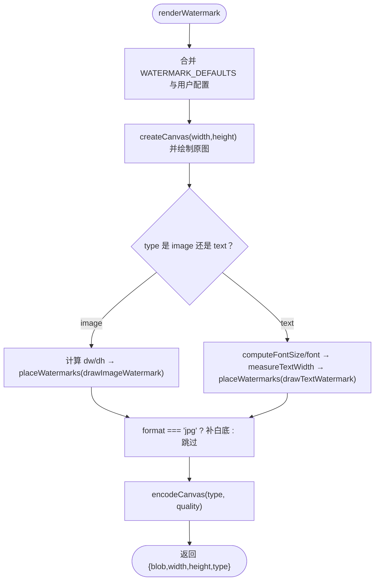
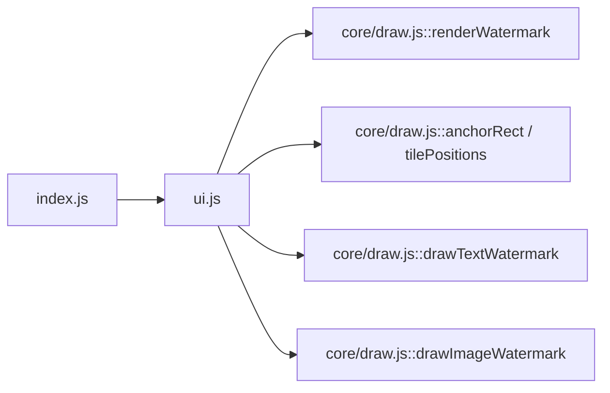

# 水印添加

<cite>
**本文引用的文件**   
- [app/src/tools/watermark/core/draw.js](file://app/src/tools/watermark/core/draw.js)
- [app/src/tools/watermark/index.js](file://app/src/tools/watermark/index.js)
- [app/src/tools/watermark/ui.js](file://app/src/tools/watermark/ui.js)
</cite>

## 目录
1. [简介](#简介)
2. [项目结构](#项目结构)
3. [核心组件](#核心组件)
4. [架构总览](#架构总览)
5. [详细组件分析](#详细组件分析)
6. [依赖关系分析](#依赖关系分析)
7. [性能与兼容性](#性能与兼容性)
8. [常见问题排查](#常见问题排查)
9. [结论](#结论)
10. [附录：参数体系与示例](#附录参数体系与示例)

## 简介
本工具为图片添加水印，支持两种水印类型：
- 文字水印：可配置字体、颜色、描边、透明度、旋转角度和字号。
- 图片水印：适合印章或 Logo，支持透明背景 PNG，可控制尺寸百分比、透明度与旋转。

布局系统提供九宫格固定位置和平铺模式。所有位置计算均为纯函数，便于单元测试；像素绘制基于 Canvas API，不引入第三方图像库。

## 项目结构
水印工具位于 `app/src/tools/watermark` 下，采用“界面与内核分离”的组织方式：

**图表来源**
- [app/src/tools/watermark/index.js:1-13](file://app/src/tools/watermark/index.js#L1-L13)
- [app/src/tools/watermark/ui.js:1-20](file://app/src/tools/watermark/ui.js#L1-L20)
- [app/src/tools/watermark/core/draw.js:1-15](file://app/src/tools/watermark/core/draw.js#L1-L15)

**章节来源**
- [app/src/tools/watermark/index.js:1-13](file://app/src/tools/watermark/index.js#L1-L13)
- [app/src/tools/watermark/ui.js:1-20](file://app/src/tools/watermark/ui.js#L1-L20)
- [app/src/tools/watermark/core/draw.js:1-15](file://app/src/tools/watermark/core/draw.js#L1-L15)

## 核心组件
- 位置与绘制内核：负责九宫格定位、平铺坐标、文字/图片绘制、画布创建与编码。
- 工具入口：向应用注册工具元信息并挂载界面。
- 用户界面：参数面板、实时预览、批量任务与输出。

**章节来源**
- [app/src/tools/watermark/core/draw.js:1-337](file://app/src/tools/watermark/core/draw.js#L1-L337)
- [app/src/tools/watermark/index.js:1-13](file://app/src/tools/watermark/index.js#L1-L13)
- [app/src/tools/watermark/ui.js:1-685](file://app/src/tools/watermark/ui.js#L1-L685)

## 架构总览
整体调用链从界面触发渲染，最终落到 Canvas 像素绘制。

**图表来源**
- [app/src/tools/watermark/ui.js:120-180](file://app/src/tools/watermark/ui.js#L120-L180)
- [app/src/tools/watermark/core/draw.js:250-337](file://app/src/tools/watermark/core/draw.js#L250-L337)

## 详细组件分析

### 九宫格位置系统与平铺算法
- 九宫格位置常量定义了九个固定位置以及一个“平铺”值，供界面按钮与坐标计算共用。
- 非平铺时，通过 `anchorRect` 计算水印外接矩形左上角坐标；未知位置会回退到居中，避免越界。
- 平铺模式通过 `tilePositions` 按行、列步进填充整张画布，步进值为“水印尺寸 + 间距”。
- 平铺数量上限为 4000，防止极小间距导致无限绘制。

**图表来源**
- [app/src/tools/watermark/core/draw.js:220-248](file://app/src/tools/watermark/core/draw.js#L220-L248)
- [app/src/tools/watermark/core/draw.js:200-219](file://app/src/tools/watermark/core/draw.js#L200-L219)
- [app/src/tools/watermark/core/draw.js:35-75](file://app/src/tools/watermark/core/draw.js#L35-L75)

**章节来源**
- [app/src/tools/watermark/core/draw.js:35-75](file://app/src/tools/watermark/core/draw.js#L35-L75)
- [app/src/tools/watermark/core/draw.js:200-248](file://app/src/tools/watermark/core/draw.js#L200-L248)

### 文字水印绘制技术
- 字体族统一为界面显示一致的字体栈，确保测量宽度与实际绘制一致。
- 字号由图宽百分比换算，保证不同尺寸图片观感一致。
- 文本先做换行符归一与制表符展开，再按行绘制。
- 每行文字以中心点为基准，支持多行自动计算行高；可选描边，描边色按填充色的明度自动取对比色。
- 透明度使用 `globalAlpha`，旋转使用 `rotate`，均以水印自身中心为变换原点。

**图表来源**
- [app/src/tools/watermark/core/draw.js:130-200](file://app/src/tools/watermark/core/draw.js#L130-L200)
- [app/src/tools/watermark/core/draw.js:90-129](file://app/src/tools/watermark/core/draw.js#L90-L129)

**章节来源**
- [app/src/tools/watermark/core/draw.js:90-200](file://app/src/tools/watermark/core/draw.js#L90-L200)

### 图片水印绘制技术
- 输入需包含位图对象及宽高；若缺失则直接返回失败。
- 以水印中心为原点进行平移与旋转，开启高质量平滑缩放。
- 在平铺模式下，每个位置均调用该绘制回调，实现印章/Logo 的均匀铺满。

**图表来源**
- [app/src/tools/watermark/core/draw.js:201-219](file://app/src/tools/watermark/core/draw.js#L201-L219)

**章节来源**
- [app/src/tools/watermark/core/draw.js:201-219](file://app/src/tools/watermark/core/draw.js#L201-L219)

### 主渲染流程 renderWatermark
- 合并默认参数与传入配置。
- 创建与原图同尺寸的画布，先绘制原图。
- 根据水印类型分别计算尺寸、测量宽度（文字）、构建 font 字符串，然后交由 `placeWatermarks` 调度。
- 文字水印：计算字号、行高、描边宽度，按位置或平铺绘制。
- 图片水印：按图宽百分比计算目标宽度，保持原始宽高比计算高度，再绘制。
- JPG 输出前补白底，避免透明区域被黑色合成。
- 最终将画布编码为 Blob 返回。

**图表来源**
- [app/src/tools/watermark/core/draw.js:250-337](file://app/src/tools/watermark/core/draw.js#L250-L337)

**章节来源**
- [app/src/tools/watermark/core/draw.js:250-337](file://app/src/tools/watermark/core/draw.js#L250-L337)

## 依赖关系分析
- ui.js 负责读取用户输入、构造配置，并调用 core/draw.js 的 `renderWatermark`。
- core/draw.js 暴露位置计算、绘制函数与渲染入口，内部依赖 Canvas API 与 `OffscreenCanvas`。
- index.js 仅注册工具元数据与样式，不参与核心逻辑。

**图表来源**
- [app/src/tools/watermark/ui.js:1-20](file://app/src/tools/watermark/ui.js#L1-L20)
- [app/src/tools/watermark/core/draw.js:250-337](file://app/src/tools/watermark/core/draw.js#L250-L337)
- [app/src/tools/watermark/index.js:1-13](file://app/src/tools/watermark/index.js#L1-L13)

**章节来源**
- [app/src/tools/watermark/ui.js:1-20](file://app/src/tools/watermark/ui.js#L1-L20)
- [app/src/tools/watermark/core/draw.js:250-337](file://app/src/tools/watermark/core/draw.js#L250-L337)
- [app/src/tools/watermark/index.js:1-13](file://app/src/tools/watermark/index.js#L1-L13)

## 性能与兼容性
- 画布创建优先使用 `OffscreenCanvas`，浏览器不支持时回退到普通 `<canvas>`。
- 编码阶段优先使用 `convertToBlob`，否则使用 `toBlob` 异步回调。
- 平铺绘制有最大条目限制，避免极端参数导致卡顿。
- 图片水印使用高质量平滑缩放，减少锯齿。
- 预览路径对大图进行等比缩小，降低实时预览开销。
- 文字测量与绘制使用同一字体栈与标准化文本，避免不一致导致的错位。

**章节来源**
- [app/src/tools/watermark/core/draw.js:230-249](file://app/src/tools/watermark/core/draw.js#L230-L249)
- [app/src/tools/watermark/core/draw.js:201-219](file://app/src/tools/watermark/core/draw.js#L201-L219)
- [app/src/tools/watermark/core/draw.js:20-24](file://app/src/tools/watermark/core/draw.js#L20-L24)
- [app/src/tools/watermark/ui.js:180-240](file://app/src/tools/watermark/ui.js#L180-L240)

## 常见问题排查
- 未输入文字内容：文字水印会抛错提示“请输入水印文字”。
- 未选择图片水印源：图片水印会抛错提示“请先选择印章图片”。
- 原图无效：缺少宽高会抛错“缺少有效的原图”。
- 编码失败：画布编码为空时会抛错“水印结果编码失败”。
- 平铺过多：超过 4000 个水印条目会被截断，避免页面卡死。

**章节来源**
- [app/src/tools/watermark/core/draw.js:250-337](file://app/src/tools/watermark/core/draw.js#L250-L337)
- [app/src/tools/watermark/core/draw.js:20-24](file://app/src/tools/watermark/core/draw.js#L20-L24)

## 结论
水印工具通过纯函数位置计算与 Canvas 像素绘制实现高性能、可测试的水印生成。九宫格与平铺模式覆盖常见布局需求，文字与图片双重类型满足说明性标注与品牌标识场景。参数体系围绕视觉直观性与跨尺寸一致性设计，并提供兼容层保障在不同浏览器环境中的可用性。

## 附录：参数体系与示例

### WATERMARK_POSITIONS 定义
- 九宫格值：左上、上中、右上、左中、居中、右中、左下、下中、右下。
- 特殊值：平铺。
- 作用：界面按钮与坐标计算共用同一份定义，保证交互与渲染一致性。

**章节来源**
- [app/src/tools/watermark/core/draw.js:15-24](file://app/src/tools/watermark/core/draw.js#L15-L24)

### 坐标计算逻辑
- 九宫格：根据位置后缀判断左右，前缀判断上下，中间情况取居中；再乘以边距得到左上角坐标。
- 平铺：按水印尺寸与间距步进，逐格填充直至画布边界或达到上限。
- 未知位置：回退到居中，确保不会画出画布外。

**章节来源**
- [app/src/tools/watermark/core/draw.js:35-75](file://app/src/tools/watermark/core/draw.js#L35-L75)
- [app/src/tools/watermark/core/draw.js:200-219](file://app/src/tools/watermark/core/draw.js#L200-L219)

### WATERMARK_DEFAULTS 参数体系
- type：水印类型，文字或图片。
- text：文字内容，支持换行。
- position：九宫格值或平铺。
- sizePercent：文字水印为字号占图宽百分比；图片水印为印章宽占图宽百分比。
- opacity：透明度，界面传 0~100，绘制时归一化为 0~1。
- rotation：旋转角度，单位度，绕水印自身中心。
- color：文字填充色，十六进制。
- stroke：是否启用描边（仅文字）。
- strokeColor：描边颜色，默认按填充色明度自动取对比色。
- strokeWidthPercent：描边宽度占字号百分比。
- marginPercent：九宫格边距占画布短边百分比。
- tileGapRatio：平铺间距占单个水印尺寸的比例。
- format：输出格式 png 或 jpg。
- quality：JPG 质量 1~100。

**章节来源**
- [app/src/tools/watermark/core/draw.js:25-40](file://app/src/tools/watermark/core/draw.js#L25-L40)
- [app/src/tools/watermark/ui.js:80-120](file://app/src/tools/watermark/ui.js#L80-L120)

### 不同类型水印的生成示例与自定义样式
- 文字水印示例：
  - 设置 type 为文字，填写 text，选择 position 为右下角，sizePercent 设为 6，opacity 设为 80，rotation 设为 0，color 设为白色，stroke 打开，strokeColor 自动取黑色，strokeWidthPercent 设为 6，marginPercent 设为 4。
- 图片水印示例：
  - 设置 type 为图片，上传 stamp 位图，position 设为平铺，sizePercent 设为 10，opacity 设为 80，rotation 设为 0，tileGapRatio 设为 0.6。
- 九宫格示例：
  - 将 position 设置为 top-left、center、bottom-right 等，配合 marginPercent 调整留白。
- 平铺示例：
  - 将 position 设为 tile，调整 tileGapRatio 控制水印之间的间隔密度。

**章节来源**
- [app/src/tools/watermark/core/draw.js:250-337](file://app/src/tools/watermark/core/draw.js#L250-L337)
- [app/src/tools/watermark/ui.js:1-120](file://app/src/tools/watermark/ui.js#L1-L120)