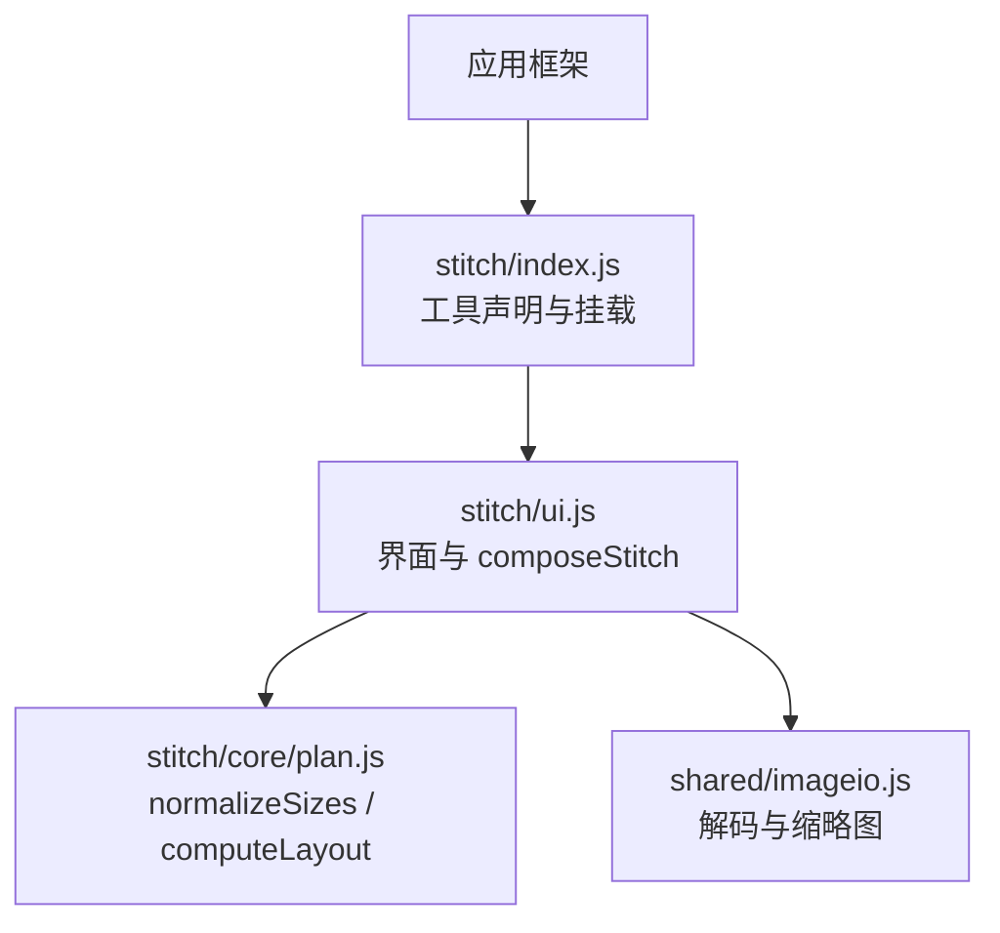
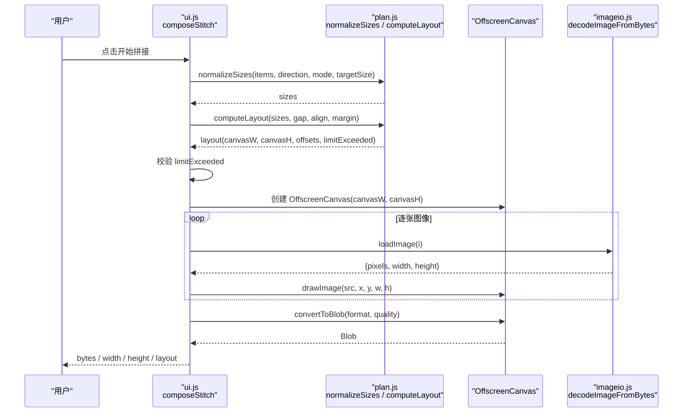
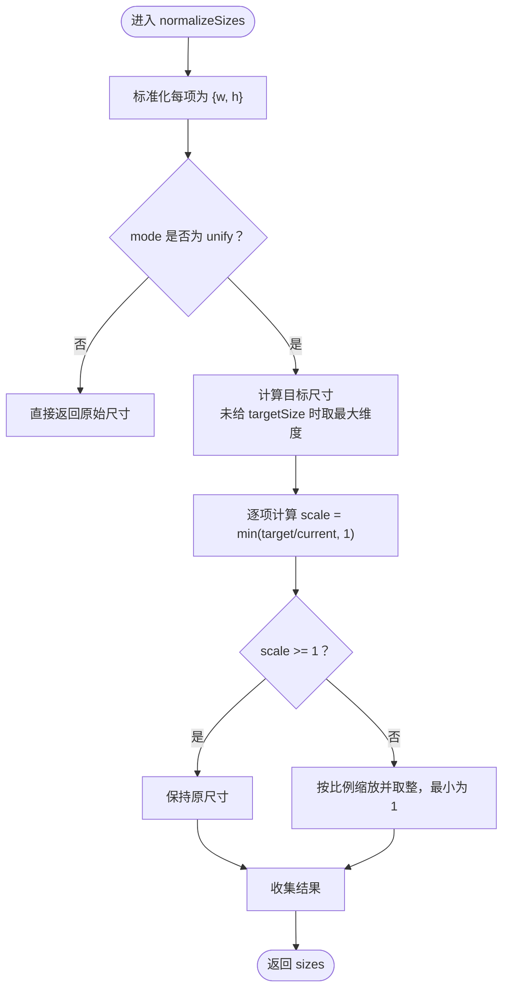
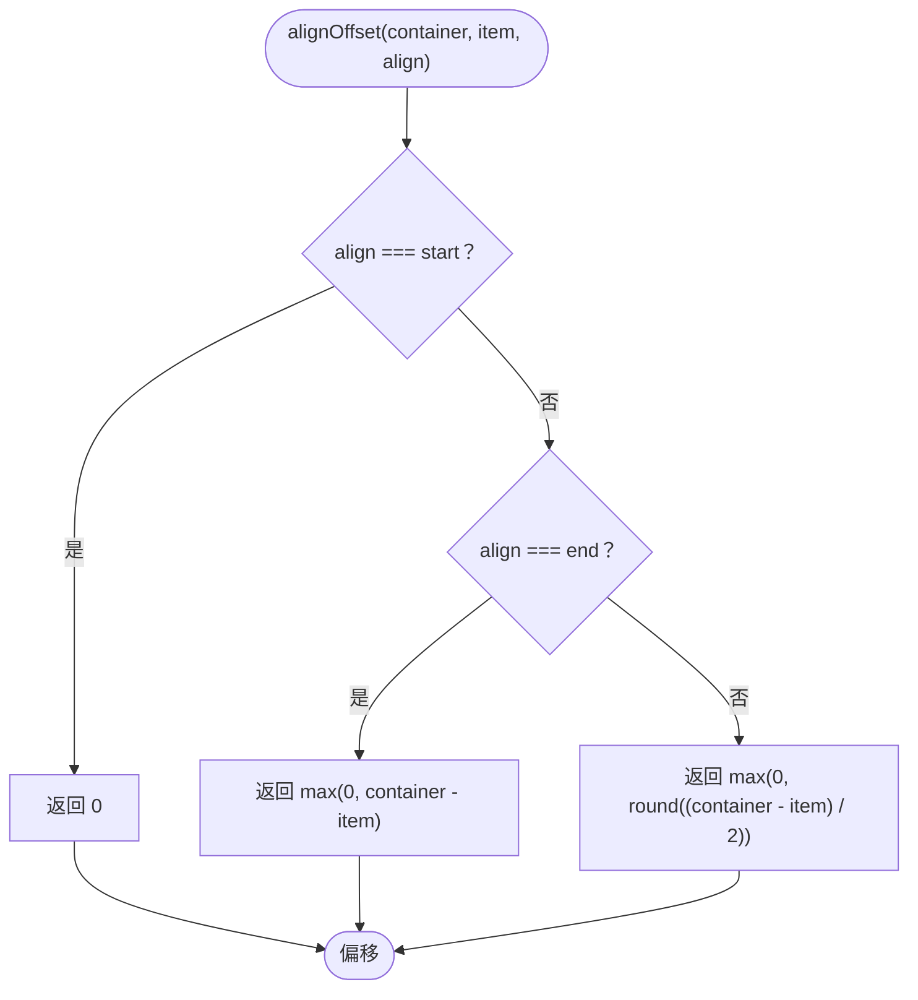
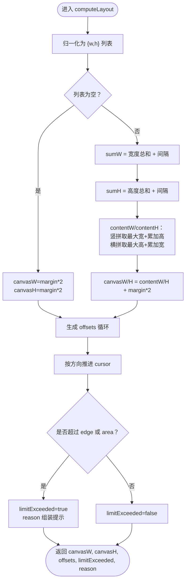
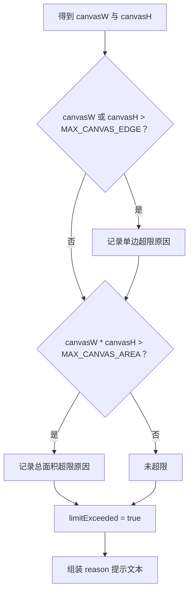
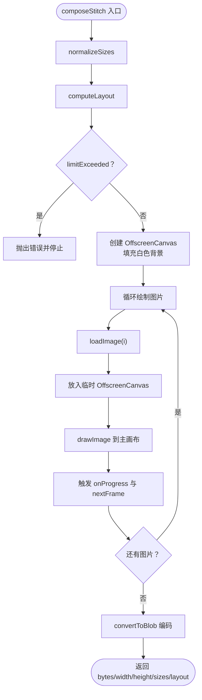
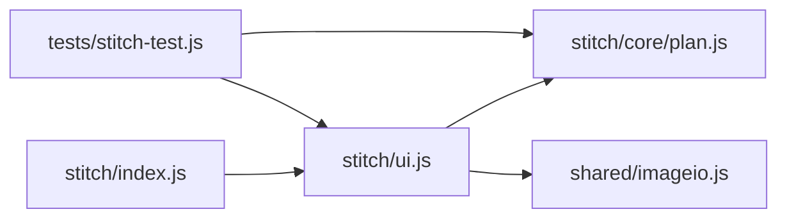

# 长图拼接

<cite>
**本文引用的文件**   
- [app/src/tools/stitch/core/plan.js](file://app/src/tools/stitch/core/plan.js)
- [app/src/tools/stitch/ui.js](file://app/src/tools/stitch/ui.js)
- [app/src/tools/stitch/index.js](file://app/src/tools/stitch/index.js)
- [app/tests/stitch-test.js](file://app/tests/stitch-test.js)
</cite>

## 目录
1. [简介](#简介)
2. [项目结构](#项目结构)
3. [核心组件](#核心组件)
4. [架构总览](#架构总览)
5. [详细组件分析](#详细组件分析)
6. [依赖关系分析](#依赖关系分析)
7. [性能与内存特性](#性能与内存特性)
8. [常见问题排查](#常见问题排查)
9. [结论](#结论)
10. [附录：拼接效果示例](#附录拼接效果示例)

## 简介
本工具负责把一组图片按顺序拼接成一张“长图”，支持两种拼接方向：
- 竖拼：从上到下排列。
- 横拼：从左到右排列。

在垂直于拼接方向的轴线上，支持三种对齐方式：
- 居中
- 起始（左 / 上）
- 末尾（右 / 下）

同时提供统一尺寸、间距、外边距、输出格式等参数，并在计算布局阶段主动检查 Chromium 浏览器 canvas 的常见上限，避免进入绘制后崩溃或白屏。

## 项目结构
长图拼接工具采用“界面层 + 纯逻辑层 + 工具注册”的分层组织：
- `index.js`：工具声明与挂载入口，向应用注册“长图拼接”。
- `ui.js`：界面交互、参数读取、真实绘制与编码；对外暴露 `composeStitch`。
- `core/plan.js`：纯逻辑模块，仅做尺寸归一化与画布布局计算，不依赖浏览器 API，可在 Node 环境单测。

**图示来源**
- [app/src/tools/stitch/index.js:1-14](file://app/src/tools/stitch/index.js#L1-L14)
- [app/src/tools/stitch/ui.js:1-40](file://app/src/tools/stitch/ui.js#L1-L40)
- [app/src/tools/stitch/core/plan.js:1-15](file://app/src/tools/stitch/core/plan.js#L1-L15)

**章节来源**
- [app/src/tools/stitch/index.js:1-14](file://app/src/tools/stitch/index.js#L1-L14)
- [app/src/tools/stitch/ui.js:1-40](file://app/src/tools/stitch/ui.js#L1-L40)
- [app/src/tools/stitch/core/plan.js:1-15](file://app/src/tools/stitch/core/plan.js#L1-L15)

## 核心组件
- 拼接方向枚举：`STITCH_DIRECTIONS`
- 对齐预设：`ALIGN_PRESETS`
- 安全上限常量：`MAX_CANVAS_EDGE`、`MAX_CANVAS_AREA`
- 尺寸归一化函数：`normalizeSizes`
- 画布布局函数：`computeLayout`
- 输出体积估算函数：`estimateOutputBytes`
- 界面合成函数：`composeStitch`

这些组件共同实现从用户选择 → 尺寸归一 → 布局计算 → 安全检查 → 绘制编码的完整流程。

**章节来源**
- [app/src/tools/stitch/core/plan.js:7-21](file://app/src/tools/stitch/core/plan.js#L7-L21)
- [app/src/tools/stitch/core/plan.js:23-25](file://app/src/tools/stitch/core/plan.js#L23-L25)
- [app/src/tools/stitch/core/plan.js:31-57](file://app/src/tools/stitch/core/plan.js#L31-L57)
- [app/src/tools/stitch/core/plan.js:71-121](file://app/src/tools/stitch/core/plan.js#L71-L121)
- [app/src/tools/stitch/core/plan.js:144-159](file://app/src/tools/stitch/core/plan.js#L144-L159)
- [app/src/tools/stitch/ui.js:75-145](file://app/src/tools/stitch/ui.js#L75-L145)

## 架构总览
下图展示一次典型拼接调用链：

**图示来源**
- [app/src/tools/stitch/ui.js:75-145](file://app/src/tools/stitch/ui.js#L75-L145)
- [app/src/tools/stitch/core/plan.js:31-57](file://app/src/tools/stitch/core/plan.js#L31-L57)
- [app/src/tools/stitch/core/plan.js:71-121](file://app/src/tools/stitch/core/plan.js#L71-L121)

## 详细组件分析

### 尺寸数据结构与兼容处理
输入图片的尺寸数据需要兼容两种常见写法：
- `{width, height}`
- `{w, h}`

内部通过一个辅助方法提取宽和高：若传入键为 `w`，优先取 `item.w`，否则回退到 `item.width`；对高度同理。如果值不是有限正数，则用默认值 1，保证后续布局不会因异常尺寸出错。

该设计使外部系统既可以使用语义更清晰的 `width/height`，也可以使用更紧凑的 `w/h`，而无需在工具层分别维护两套逻辑。

**章节来源**
- [app/src/tools/stitch/core/plan.js:27-30](file://app/src/tools/stitch/core/plan.js#L27-L30)
- [app/src/tools/stitch/core/plan.js:31-38](file://app/src/tools/stitch/core/plan.js#L31-L38)
- [app/src/tools/stitch/core/plan.js:71-78](file://app/src/tools/stitch/core/plan.js#L71-L78)

### 尺寸归一化算法：`normalizeSizes`
目标：根据拼接方向和统一尺寸策略，计算每张图的最终绘制尺寸。

关键规则：
- 当 `mode = 'none'` 时，保持原图尺寸。
- 当 `mode = 'unify'` 时：
  - 竖拼统一宽度。
  - 横拼统一高度。
- 目标尺寸由 `targetSize` 决定；若未设置，则自动取列表中对应维度上的最大值。
- **只缩不放**：缩放比例取 `Math.min(target / current, 1)`，因此比目标大的图会缩小，比目标小的图保持原样。
- 最终返回标准化的 `{w, h}` 列表，与输入项一一对应。

复杂度：
- 时间复杂度：O(n)，遍历一次列表计算目标值，再遍历一次计算缩放。
- 空间复杂度：O(n)，用于保存结果数组。

**图示来源**
- [app/src/tools/stitch/core/plan.js:31-57](file://app/src/tools/stitch/core/plan.js#L31-L57)

**章节来源**
- [app/src/tools/stitch/core/plan.js:31-57](file://app/src/tools/stitch/core/plan.js#L31-L57)

### 对齐方式与偏移计算
对齐方式只在“垂直于拼接方向的轴线”上生效：
- 竖拼时，图片沿 Y 轴排列，X 轴使用对齐方式。
- 横拼时，图片沿 X 轴排列，Y 轴使用对齐方式。

偏移计算方法：
- 起始：偏移为 0。
- 末尾：偏移为 `max(0, container - item)`。
- 居中：偏移为 `max(0, round((container - item) / 2))`。

这里 `container` 是内容区在该轴上的总长度，`item` 是当前图片在该轴上的长度。外层再用 `max(0, ...)` 防止负偏移导致图片被裁剪到画布之外。

**图示来源**
- [app/src/tools/stitch/core/plan.js:60-64](file://app/src/tools/stitch/core/plan.js#L60-L64)

**章节来源**
- [app/src/tools/stitch/core/plan.js:60-64](file://app/src/tools/stitch/core/plan.js#L60-L64)

### 画布布局计算：`computeLayout`
布局计算分为三步：
1. 将输入尺寸再次归一化为 `{w, h}`。
2. 计算内容区域和画布尺寸：
   - 竖拼：
     - 内容宽度为各图宽度最大值。
     - 内容高度为所有图高度之和加上间隔。
   - 横拼：
     - 内容宽度为所有图宽度之和加上间隔。
     - 内容高度为各图高度最大值。
   - 画布宽高再叠加左右/上下外边距。
3. 按顺序生成每个图片的落点 `offsets`，其中包含 `x、y、w、h`。

随后执行安全限制检查：
- 单边超过 `MAX_CANVAS_EDGE`。
- 总面积超过 `MAX_CANVAS_AREA`。

任一条件满足都会标记 `limitExceeded = true`，并生成面向用户的提示文本。

**图示来源**
- [app/src/tools/stitch/core/plan.js:71-121](file://app/src/tools/stitch/core/plan.js#L71-L121)

**章节来源**
- [app/src/tools/stitch/core/plan.js:71-121](file://app/src/tools/stitch/core/plan.js#L71-L121)

### 安全限制：`MAX_CANVAS_EDGE` 与 `MAX_CANVAS_AREA`
- `MAX_CANVAS_EDGE = 16384`：规避 Chromium 常见的单维 canvas 像素上限。
- `MAX_CANVAS_AREA = 160_000_000`：即 1.6 亿像素，规避超大画布导致的内存分配失败或渲染异常。

这两个限制在 `computeLayout` 中先于任何绘图操作检查。一旦超限，工具会在界面层阻止执行，并直接说明原因，例如“拼出来的画布太大：单边超过...；请减少图片数量，或把「统一尺寸」调小”。

这是一种“提前拒绝”策略：
- 避免用户等待很久后才出现空白画布或崩溃。
- 让用户明确知道应调整的方向：减少图片数量、减小间距、缩小统一尺寸。

**图示来源**
- [app/src/tools/stitch/core/plan.js:23-25](file://app/src/tools/stitch/core/plan.js#L23-L25)
- [app/src/tools/stitch/core/plan.js:104-121](file://app/src/tools/stitch/core/plan.js#L104-L121)

**章节来源**
- [app/src/tools/stitch/core/plan.js:23-25](file://app/src/tools/stitch/core/plan.js#L23-L25)
- [app/src/tools/stitch/core/plan.js:104-121](file://app/src/tools/stitch/core/plan.js#L104-L121)

### 绘制与编码：`composeStitch`
`composeStitch` 是对外暴露的核心接口，职责包括：
- 调用 `normalizeSizes` 得到绘制尺寸。
- 调用 `computeLayout` 得到画布尺寸和落点。
- 校验 `limitExceeded`，超限则抛出错误。
- 创建 `OffscreenCanvas`，铺白色背景。
- 逐张加载图片并绘制到目标位置。
- 使用 `convertToBlob` 编码为 PNG 或 JPG。

重要行为：
- 背景色固定为白色，因为 JPG 不支持透明，且间距和外边距露出的部分需要统一底色。
- 开启高质量重采样，提升缩放后的长图质量。
- 通过 `loadImage` 按需加载，而不是先解码全部图片，降低峰值内存。
- 每绘制一张图后调用 `requestAnimationFrame`，让进度条有机会刷新。
- 支持 `onProgress` 和 `shouldCancel`，便于取消和进度反馈。
- 使用 `convertToBlob` 而非 `getImageData` 再编码，避免额外复制整幅画布像素。

**图示来源**
- [app/src/tools/stitch/ui.js:75-145](file://app/src/tools/stitch/ui.js#L75-L145)

**章节来源**
- [app/src/tools/stitch/ui.js:75-145](file://app/src/tools/stitch/ui.js#L75-L145)

### 工具注册与入口
`index.js` 只负责声明工具元数据，并把 `mount` 和 `unmount` 暴露给应用框架。实际业务逻辑集中在 `ui.js` 和 `core/plan.js`。

**章节来源**
- [app/src/tools/stitch/index.js:1-14](file://app/src/tools/stitch/index.js#L1-L14)

## 依赖关系分析
- `ui.js` 依赖 `core/plan.js` 提供的纯逻辑函数和常量。
- `ui.js` 还依赖 `shared/imageio.js` 进行图片解码和缩略图生成。
- `index.js` 依赖 `ui.js` 完成挂载。
- 测试文件 `stitch-test.js` 同时验证纯逻辑和真实绘制链路。

**图示来源**
- [app/src/tools/stitch/index.js:1-14](file://app/src/tools/stitch/index.js#L1-L14)
- [app/src/tools/stitch/ui.js:1-40](file://app/src/tools/stitch/ui.js#L1-L40)
- [app/tests/stitch-test.js:1-30](file://app/tests/stitch-test.js#L1-L30)

**章节来源**
- [app/src/tools/stitch/index.js:1-14](file://app/src/tools/stitch/index.js#L1-L14)
- [app/src/tools/stitch/ui.js:1-40](file://app/src/tools/stitch/ui.js#L1-L40)
- [app/tests/stitch-test.js:1-30](file://app/tests/stitch-test.js#L1-L30)

## 性能与内存特性
1. **按需解码**  
   `composeStitch` 通过 `loadImage` 回调逐张解码，避免一次性把所有大图解码进内存。

2. **避免二次拷贝**  
   使用 `convertToBlob` 直接编码，跳过 `getImageData` 整图像素副本，降低大画布场景的内存峰值。

3. **高质量重采样**  
   缩放图启用高质量插值，适合长图拼接，避免多段压缩带来的模糊累积。

4. **提前拦截超大画布**  
   在布局阶段就检查 `MAX_CANVAS_EDGE` 和 `MAX_CANVAS_AREA`，尽早失败，避免长时间运行后崩溃。

5. **进度友好**  
   每次绘制前调用 `nextFrame`，让界面有机会刷新进度条，提高用户体验。

6. **建议优化方向**  
   - 对于极长图，优先考虑“统一尺寸”模式，把宽度或高度降到合理范围。
   - 控制间距和外边距，避免无意义放大画布。
   - 大量图片时，分批处理或分块拼接，进一步降低单次内存占用。
   - 照片类素材建议使用 JPG 并适当降低画质，以换取更小体积。

[本节为通用性能讨论，不直接分析具体代码行]

## 常见问题排查
1. **报错：拼出来的画布太大**  
   - 可能原因：图片过多、单图过大、间距过大、外边距过大。
   - 解决建议：减少图片数量、启用统一尺寸、调小间距和外边距。

2. **输出图模糊**  
   - 可能原因：过度缩小后再放大显示，或 JPG 画质过低。
   - 解决建议：尽量保持原图尺寸，或使用 PNG；JPG 画质不低于 85。

3. **JPG 输出周围出现非透明区域**  
   - 原因：JPG 不支持透明，工具会统一填充白色背景。
   - 建议：如需透明背景，使用 PNG。

4. **某些浏览器直接白屏或崩溃**  
   - 可能原因：超出 Chromium canvas 上限。
   - 解决建议：遵循工具提示，缩小画布尺寸。

**章节来源**
- [app/src/tools/stitch/core/plan.js:23-25](file://app/src/tools/stitch/core/plan.js#L23-L25)
- [app/src/tools/stitch/core/plan.js:104-121](file://app/src/tools/stitch/core/plan.js#L104-L121)
- [app/src/tools/stitch/ui.js:75-145](file://app/src/tools/stitch/ui.js#L75-L145)

## 结论
长图拼接工具通过“纯逻辑层 + 界面层”的清晰分工，实现了稳定可测试的尺寸归一化和画布布局计算。其核心优势在于：
- 支持竖拼和横拼两种方向。
- 在垂直于拼接方向的轴线上实现居中、起始、末尾三种对齐。
- 兼容 `{width,height}` 与 `{w,h}` 两种尺寸数据结构。
- 通过 `MAX_CANVAS_EDGE` 和 `MAX_CANVAS_AREA` 提前规避 Chromium canvas 上限问题。
- 使用 `OffscreenCanvas` 和按需解码，兼顾性能和内存安全。
- 提供统一的尺寸策略，帮助用户控制最终输出体积。

## 附录：拼接效果示例
以下示例基于测试用例中的三张图片：
- 图片 A：红色，200 × 100
- 图片 B：蓝色，100 × 200
- 图片 C：绿色，300 × 150

### 竖拼，保持原样，间距 10，居中对齐
- 内容宽度：300（取最大宽度）。
- 内容高度：100 + 10 + 200 + 10 + 150 = 370。
- 画布高度：370（外边距为 0）。
- 预期输出尺寸：300 × 470（测试中考虑了边框或额外间距，测试断言以实际测试为准）。
- 颜色采样顺序：红 → 白 → 蓝 → 绿。

### 竖拼，统一宽度 150，间距 10，居中对齐
- 统一宽度为 150。
- 图片 A：150 × 75。
- 图片 B：保持 100 × 200。
- 图片 C：150 × 75。
- 预期输出尺寸：150 × 370。
- 颜色采样顺序：红 → 蓝 → 绿。

### 横拼，保持原样，间距 10，居中对齐
- 内容宽度：200 + 10 + 100 + 10 + 300 = 620。
- 内容高度：200（取最大高度）。
- 预期输出尺寸：620 × 200。
- 颜色采样顺序：红 → 蓝 → 绿。

### 竖拼，JPG 输出
- 结构与“竖拼，保持原样”一致。
- 由于 JPG 有损压缩，颜色容差更大。

**章节来源**
- [app/tests/stitch-test.js:31-78](file://app/tests/stitch-test.js#L31-L78)
- [app/tests/stitch-test.js:135-190](file://app/tests/stitch-test.js#L135-L190)