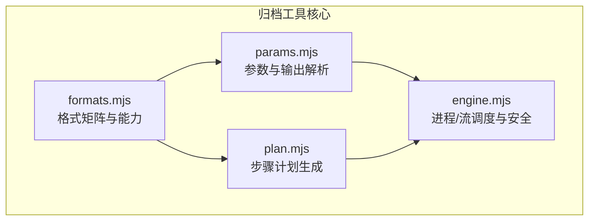
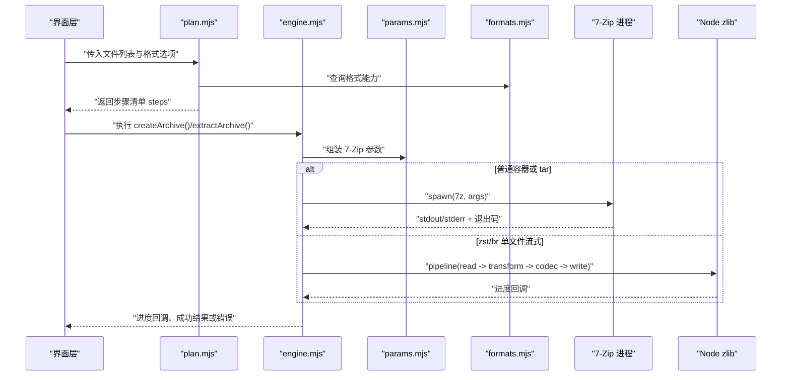
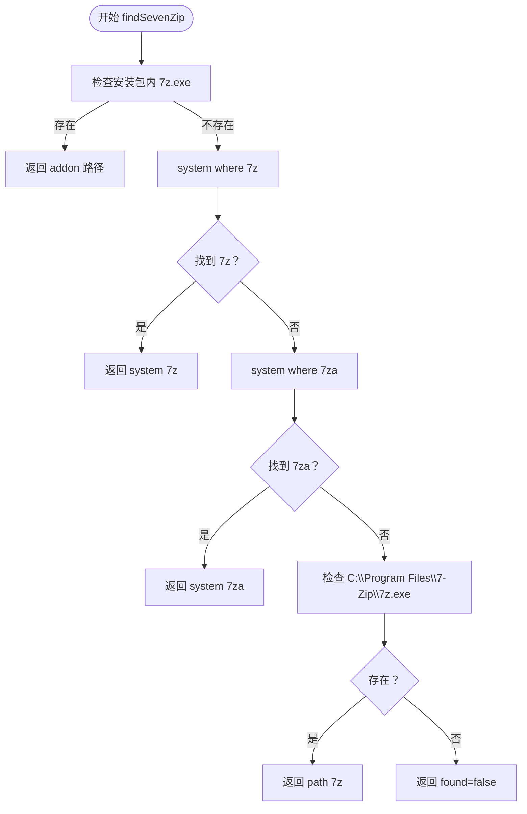
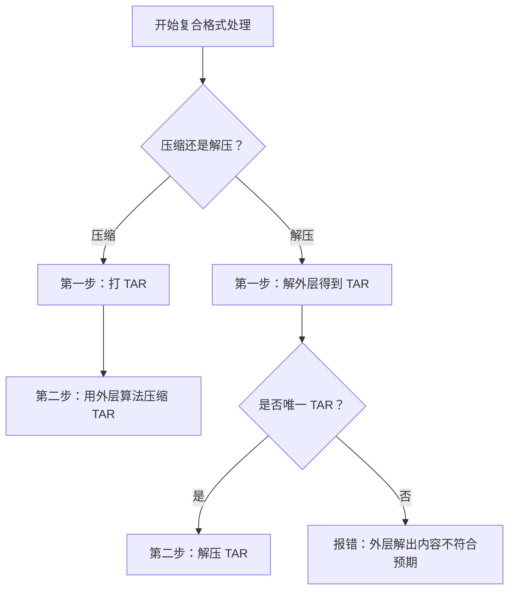
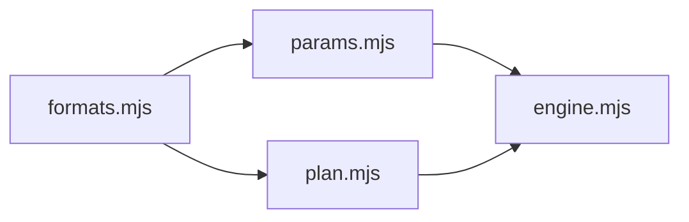

# 7-Zip 集成

<cite>
**本文引用的文件**   
- [engine.mjs](file://app/src/tools/archive/core/engine.mjs)
- [formats.mjs](file://app/src/tools/archive/core/formats.mjs)
- [params.mjs](file://app/src/tools/archive/core/params.mjs)
- [plan.mjs](file://app/src/tools/archive/core/plan.mjs)
</cite>

## 目录
1. [引言](#引言)
2. [项目结构](#项目结构)
3. [核心组件](#核心组件)
4. [架构总览](#架构总览)
5. [详细组件分析](#详细组件分析)
6. [依赖关系分析](#依赖关系分析)
7. [性能调优](#性能调优)
8. [故障排除指南](#故障排除指南)
9. [结论](#结论)

## 引言
本文件面向「压缩与解压」工具中 7-Zip 引擎的集成实现，目标是让读者理解：
- 7-Zip 可执行文件如何查找、启动和取消；
- 参数如何按格式、密码、分卷等场景拼装；
- 输出如何解析为条目、进度、当前文件和统计信息；
- 复合格式（如 tar.gz / tar.xz / tar.zst）为何必须两趟处理；
- 中文文件名乱码、密码交互挂起、zip-slip 安全闸门、临时文件清理等关键问题如何解决；
- Node.js 内置 zlib 对 zstd/brotli 的支持检测与流式处理；
- 作业取消、超时、错误翻译和资源管理策略；
- 压缩级别选择与并行处理的性能建议。

## 项目结构
归档工具的核心代码位于 `app/src/tools/archive/core`，采用分层组织：
- `formats.mjs`：格式矩阵、扩展名匹配、能力判定（是否走 7-Zip、是否复合格式、是否支持分卷/密码）。
- `params.mjs`：7-Zip 命令行参数构造器、输出解析器、错误翻译、路径安全检查、进度与统计解析。
- `plan.mjs`：把用户输入转换为「步骤清单」（create / compress / extract），负责默认命名、分组、复合格式两步计划。
- `engine.mjs`：进程生命周期、7-Zip 调用、Node zlib 流式处理、进度转发、失败清理、作业取消。

**图示来源**
- [formats.mjs:1-189](file://app/src/tools/archive/core/formats.mjs#L1-L189)
- [params.mjs:1-331](file://app/src/tools/archive/core/params.mjs#L1-L331)
- [plan.mjs:1-294](file://app/src/tools/archive/core/plan.mjs#L1-L294)
- [engine.mjs:1-773](file://app/src/tools/archive/core/engine.mjs#L1-L773)

**章节来源**
- [formats.mjs:1-189](file://app/src/tools/archive/core/formats.mjs#L1-L189)
- [params.mjs:1-331](file://app/src/tools/archive/core/params.mjs#L1-L331)
- [plan.mjs:1-294](file://app/src/tools/archive/core/plan.mjs#L1-L294)
- [engine.mjs:1-773](file://app/src/tools/archive/core/engine.mjs#L1-L773)

## 核心组件
- 7-Zip 可执行文件发现：提供 `findSevenZip()`，并暴露 `sevenZipStatus()` 用于报告版本与 Node codec 能力。
- 参数构建：提供 `createArgs()` / `extractArgs()` / `listArgs()` / `testArgs()` / `detectArgs()`。
- 输出解析：提供 `parseListOutput()` / `parseArchiveMeta()` / `parseProgressPercent()` / `parseCurrentEntry()` / `parseExtractCounts()` / `findInnerTar()`。
- 计划生成：提供 `buildCreatePlan()` / `buildExtractPlan()`，把业务需求转成步骤数组。
- 引擎调度：提供 `run7z()` / `createArchive()` / `extractArchive()` / `listArchive()` / `describeStreamArchive()`，以及取消、超时、失败清理。

**章节来源**
- [engine.mjs:1-200](file://app/src/tools/archive/core/engine.mjs#L1-L200)
- [engine.mjs:201-400](file://app/src/tools/archive/core/engine.mjs#L201-L400)
- [engine.mjs:401-773](file://app/src/tools/archive/core/engine.mjs#L401-L773)
- [params.mjs:1-200](file://app/src/tools/archive/core/params.mjs#L1-L200)
- [params.mjs:201-331](file://app/src/tools/archive/core/params.mjs#L201-L331)
- [plan.mjs:1-200](file://app/src/tools/archive/core/plan.mjs#L1-L200)
- [plan.mjs:201-294](file://app/src/tools/archive/core/plan.mjs#L201-L294)

## 架构总览
归档任务的整体流程分为「压缩」和「解压」两条主线，共享格式定义与参数解析：

**图示来源**
- [plan.mjs:120-294](file://app/src/tools/archive/core/plan.mjs#L120-L294)
- [engine.mjs:201-400](file://app/src/tools/archive/core/engine.mjs#L201-L400)
- [engine.mjs:401-773](file://app/src/tools/archive/core/engine.mjs#L401-L773)
- [params.mjs:1-200](file://app/src/tools/archive/core/params.mjs#L1-L200)
- [formats.mjs:1-189](file://app/src/tools/archive/core/formats.mjs#L1-L189)

## 详细组件分析

### 7-Zip 可执行文件查找与状态探测
`findSevenZip(portableDir)` 的查找顺序是：
1. 随包加装包：`portableDir/addons/7zip/7z.exe`；
2. 系统 PATH：先查 `where 7z`，再查 `where 7za`，取首个存在的路径；
3. 常见安装目录：`C:\Program Files\7-Zip\7z.exe`；
4. 都找不到时返回 `found: false`。

`sevenZipStatus(portableDir)` 会调用上述查找，并以无参运行 `7z` 的方式从首行输出中解析版本号，同时通过 `nodeCodecCaps()` 报告 Node zlib 对 zstd/brotli 的支持情况。

**图示来源**
- [engine.mjs:25-73](file://app/src/tools/archive/core/engine.mjs#L25-L73)

**章节来源**
- [engine.mjs:25-73](file://app/src/tools/archive/core/engine.mjs#L25-L73)
- [engine.mjs:75-100](file://app/src/tools/archive/core/engine.mjs#L75-L100)

### 参数构建规则
#### 压缩参数 `createArgs()`
- 命令固定为 `a -t<type>`，并根据格式类型决定是否加 `-mx=0`（tar 只打包不压缩）。
- 始终加入 `-bsp1 -bb1 -y -aoa`：显示进度、详细日志、覆盖已有产物。
- 密码逻辑：
  - 有密码时才传 `-p<password>`；
  - 7z 容器额外加 `-mhe=on` 以加密文件名；
  - zip 容器根据 `encrypt` 选择 AES256 或 ZipCrypto。
- 分卷：若格式支持且传入体积，则追加 `-v<单位>`。
- 最后追加目标压缩包路径和待加入的文件名数组；未指定时使用当前目录。

#### 解压参数 `extractArgs()`
- 使用 `x`（保留目录结构）或 `e`（平铺），并固定 `-y -bsp1 -bb1 -sccUTF-8 -bd`。
- **必须带 `-p`**：即使没有密码也传空串 `-p`，否则 7-Zip 会在交互式模式下等待 stdin 输入导致进程永久挂起。
- 同时设置 stdin 为 `'ignore'`，作为第二道保险：读不到输入时直接报错而非卡住。
- 通过 `-o<outputDir>` 指定输出目录，并通过 `-aoa/-aos` 控制覆盖策略。

#### 列表与测试参数
- `listArgs()`：`l -slt -ba -sccUTF-8 -bd`，配合空 `-p` 用于预览条目。
- `testArgs()`：`t -sccUTF-8 -bd`，用于 CRC 校验，辅助判断“一个文件都没解出来”的真实原因。

**章节来源**
- [params.mjs:40-120](file://app/src/tools/archive/core/params.mjs#L40-L120)
- [params.mjs:120-170](file://app/src/tools/archive/core/params.mjs#L120-L170)
- [engine.mjs:100-170](file://app/src/tools/archive/core/engine.mjs#L100-L170)

### 输出解析、进度与错误翻译
- `parseListOutput()`：基于 7-Zip `-slt` 输出的键值块，解析 Path、Size、Packed Size、Modified、Folder、Encrypted、CRC、Method 等字段。
- `parseArchiveMeta()`：从元信息区提取 Type、Physical Size、Headers Size、Method、Solid、Volumes。
- `parseProgressPercent()`：从 7-Zip 覆盖式进度缓冲中取最后一个百分比数值。
- `parseCurrentEntry()`：从 `-bb1` 输出中提取最近处理的条目名。
- `parseExtractCounts()`：从收尾统计中读取 Files/Folders 数量，但更可靠的做法是结合新增文件数判断。
- `translateSevenZipError()`：按优先级将英文/系统错误翻译为用户友好的中文消息，包括密码错误、不支持算法、文件不存在、权限不足、磁盘空间不足等。

**章节来源**
- [params.mjs:170-270](file://app/src/tools/archive/core/params.mjs#L170-L270)

### 复合格式两趟处理机制
复合格式（tar.gz / tar.bz2 / tar.xz / tar.zst / tar.br）不能一次完成：
- 压缩：先用 7-Zip 以 `overrideType='tar'` 把多目录输入打成 `.tar`，再用外层算法（gzip/bzip2/xz 走 7-Zip，zst/br 走 Node zlib）压缩该 tar。
- 解压：第一趟先解外层得到 `.tar`；第二趟再对该 tar 执行解压，并再次经过安全闸门。

**图示来源**
- [plan.mjs:150-230](file://app/src/tools/archive/core/plan.mjs#L150-L230)
- [engine.mjs:250-360](file://app/src/tools/archive/core/engine.mjs#L250-L360)
- [engine.mjs:520-660](file://app/src/tools/archive/core/engine.mjs#L520-L660)

**章节来源**
- [plan.mjs:150-230](file://app/src/tools/archive/core/plan.mjs#L150-L230)
- [engine.mjs:250-360](file://app/src/tools/archive/core/engine.mjs#L250-L360)
- [engine.mjs:520-660](file://app/src/tools/archive/core/engine.mjs#L520-L660)

### 密码处理与 stdin 安全
- 所有 7-Zip 调用都必须关闭 stdin（`stdio[0] = 'ignore'`），避免 7-Zip 在需要密码时进入交互式模式。
- 所有 7-Zip 调用都必须显式传入 `-p`：
  - 压缩时：仅在确实设置了密码才传 `-p<密码>`；
  - 解压/列表/测试时：即使密码为空也传 `-p`，确保加密包给出干净错误，而不是挂起。
- 中文密码在 ZIP 上存在限制：如果密码含非 ASCII 字符，7-Zip 可能报参数错误。因此 ZIP 的密码仅允许 ASCII，提示改用 7Z 格式。

**章节来源**
- [engine.mjs:100-170](file://app/src/tools/archive/core/engine.mjs#L100-L170)
- [params.mjs:60-120](file://app/src/tools/archive/core/params.mjs#L60-L120)
- [plan.mjs:80-120](file://app/src/tools/archive/core/plan.mjs#L80-L120)

### 中文文件名乱码问题
- 所有 7-Zip 输出相关命令都强制添加 `-sccUTF-8`。
- 子进程 stdout 使用 `StringDecoder('utf8')` 累积解码，避免 UTF-8 多字节被管道块截断产生 `U+FFFD`。
- 列表输出要完整保留（`keepFullStdout=true`），因为「可疑路径检测」依赖原始条目路径。

**章节来源**
- [params.mjs:120-170](file://app/src/tools/archive/core/params.mjs#L120-L170)
- [engine.mjs:120-170](file://app/src/tools/archive/core/engine.mjs#L120-L170)

### 安全闸门与 zip-slip 防护
- `findSuspiciousEntries()` 检测条目路径中的绝对路径（盘符或以 `/` 开头）和 `..` 段。
- 解压前调用 `guardBeforeExtract()`，对普通压缩包先列目录并拒绝可疑条目。
- 复合格式的中间 tar 在第二趟解压前也会再次过安全闸门。
- 列表不完整（超过 64MB）被视为不可信，直接拒绝列出，宁可误拒也不漏检。

**章节来源**
- [params.mjs:240-300](file://app/src/tools/archive/core/params.mjs#L240-L300)
- [engine.mjs:150-200](file://app/src/tools/archive/core/engine.mjs#L150-L200)
- [engine.mjs:560-660](file://app/src/tools/archive/core/engine.mjs#L560-L660)

### Node.js 内置 zlib 对 zstd/brotli 的支持检测
- `nodeCodecCaps()` 通过检测 `zlib.zstdCompressSync` / `zlib.createZstdCompress` 和 `zlib.brotliCompressSync` / `zlib.createBrotliCompress` 是否存在来判断能力。
- zst 与 br 格式在双向格式矩阵中走 `engine: 'node'`，不走 7-Zip。
- `nodeCompress()` / `nodeDecompress()` 使用 `pipeline(createReadStream -> counterTransform -> codec -> createWriteStream)` 实现流式处理，避免大文件进内存。
- 计数器 Transform 放在 pipeline 内部，避免直接监听源流 data 事件导致流提前 flush。

**章节来源**
- [engine.mjs:20-35](file://app/src/tools/archive/core/engine.mjs#L20-L35)
- [engine.msg:700-773](file://app/src/tools/archive/core/engine.mjs#L700-L773)
- [formats.mjs:40-120](file://app/src/tools/archive/core/formats.mjs#L40-L120)

### 作业取消与资源管理
- 每个正在运行的 7-Zip 子进程记录在 `jobs` Map 中，键为 jobId。
- `cancelJob(jobId)` 标记 `child.__canceled`，并在 Windows 上使用 `taskkill /T /F` 杀死进程树，然后删除 job 记录。
- `run7z()` 返回结果中包含 `canceled` 标志，上层据此区分「用户取消」与「运行失败」。
- 压缩过程在每一步开始前检查 `isCancelled()`，并在中途取消时清理已产出文件。
- 解压过程中单个包失败不会中断整批任务，而是记录到 failures 列表，继续处理后续包。

**章节来源**
- [engine.mjs:100-140](file://app/src/tools/archive/core/engine.mjs#L100-L140)
- [engine.mjs:250-360](file://app/src/tools/archive/core/engine.mjs#L250-L360)
- [engine.mjs:420-520](file://app/src/tools/archive/core/engine.mjs#L420-L520)

### 临时文件与失败清理
- 复合格式压缩产生的中间 `.tar` 放入 tempDir，并在 finally 中清理。
- 压缩失败时，`collectProduced()` 收集主文件及 `.001/.002...` 分卷，逐个删除本次产物。
- 解压失败时，`cleanupFailedOutput()` 根据输出目录原来是否存在、解压前顶层文件名快照，决定删除整个目录或仅删除本次新增项。
- 复合格式解压出的中间 tar 在完成或失败后都会被删除，避免污染用户目录。

**章节来源**
- [engine.mjs:250-360](file://app/src/tools/archive/core/engine.mjs#L250-L360)
- [engine.mjs:660-773](file://app/src/tools/archive/core/engine.mjs#L660-L773)

## 依赖关系分析
模块间的依赖方向明确：
- `engine.mjs` 依赖 `params.mjs` 和 `formats.mjs`；
- `plan.mjs` 依赖 `formats.mjs`；
- `params.mjs` 依赖 `formats.mjs`；
- `formats.mjs` 不依赖其他三个模块，是格式事实来源。

**图示来源**
- [formats.mjs:1-189](file://app/src/tools/archive/core/formats.mjs#L1-L189)
- [params.mjs:1-331](file://app/src/tools/archive/core/params.mjs#L1-L331)
- [plan.mjs:1-294](file://app/src/tools/archive/core/plan.mjs#L1-L294)
- [engine.mjs:1-773](file://app/src/tools/archive/core/engine.mjs#L1-L773)

**章节来源**
- [formats.mjs:1-189](file://app/src/tools/archive/core/formats.mjs#L1-L189)
- [params.mjs:1-331](file://app/src/tools/archive/core/params.mjs#L1-L331)
- [plan.mjs:1-294](file://app/src/tools/archive/core/plan.mjs#L1-L294)
- [engine.mjs:1-773](file://app/src/tools/archive/core/engine.mjs#L1-L773)

## 性能调优
### 压缩级别选择
- 通用级别映射：
  - store：最小压缩、最快；
  - fastest/fast：快速档；
  - normal：默认平衡档；
  - small：偏向体积更小；
  - extreme：最高压缩比。
- 7-Zip `-mx`、Node zstd 压缩级别、Node brotli quality 分别由 `sevenZipLevel()` / `zstdLevel()` / `brotliQuality()` 映射。
- 对于 tar 容器，`-mx=0` 是合理的，因为 tar 本身只是打包。

建议：
- 日常备份选 `normal`；
- 追求速度选 `fastest` 或 `fast`；
- 追求体积选 `small` 或 `extreme`，但要接受 CPU 和时间成本；
- 单文件流式格式（zst/br）优先使用 Node zlib，避免 7-Zip 开销。

**章节来源**
- [params.mjs:1-40](file://app/src/tools/archive/core/params.mjs#L1-L40)
- [formats.mjs:1-40](file://app/src/tools/archive/core/formats.mjs#L1-L40)

### 并行处理策略
当前实现按步骤串行执行：
- 压缩时，多个目录按所在目录分组，每组一次 7-Zip 调用；
- 复合格式先 tar 再外层压缩，严格两步；
- 解压时对每个压缩包依次执行，失败不中断后续包。

优化建议：
- 不同压缩包之间的解压可以并发执行；
- 不同目录组的压缩可以并发执行，但需限制并发数，避免大量 7-Zip 进程争抢磁盘；
- Node zlib 流式压缩/解压可与其他任务并发，但仍受 I/O 和 CPU 限制；
- 不建议无限并行，应结合 CPU 核数和磁盘吞吐设置上限。

**章节来源**
- [plan.mjs:120-230](file://app/src/tools/archive/core/plan.mjs#L120-L230)
- [engine.mjs:250-520](file://app/src/tools/archive/core/engine.mjs#L250-L520)

## 故障排除指南

### 找不到 7-Zip
现象：`sevenZipStatus()` 返回 `found: false`。

排查：
- 确认安装包内是否包含 `addons/7zip/7z.exe`；
- 确认 7z 或 7za 是否在系统 PATH；
- 确认 `C:\Program Files\7-Zip\7z.exe` 是否存在；
- 如果都不存在，需要先安装 7-Zip 或将便携版放到正确位置。

**章节来源**
- [engine.mjs:25-73](file://app/src/tools/archive/core/engine.mjs#L25-L73)

### 密码错误
现象：提示“密码错误（或该压缩包已加密，请填写正确密码）”，或解压后“没有解出任何文件”。

原因与处理：
- 7-Zip 在未传 `-p` 时会交互式等待密码，导致挂起；本项目统一传 `-p` 并关闭 stdin。
- 解压后一个文件没解出时，引擎会用 `7z t` 校验 CRC，区分“密码错/数据损坏”和“目标目录已有同名文件且策略为跳过”。
- ZIP 不支持非 ASCII 密码，若出现“参数错误”，请改用 7Z 格式或把 ZIP 密码改为纯英文数字符号。

**章节来源**
- [params.mjs:201-240](file://app/src/tools/archive/core/params.mjs#L201-L240)
- [engine.mjs:600-700](file://app/src/tools/archive/core/engine.mjs#L600-L700)
- [plan.mjs:80-120](file://app/src/tools/archive/core/plan.mjs#L80-L120)

### 中文文件名乱码
现象：7-Zip 输出中的中文条目名显示为问号或乱码。

解决：
- 所有 7-Zip 输出命令均添加 `-sccUTF-8`；
- stdout 使用 UTF-8 `StringDecoder` 累积解码；
- 列表输出保持完整，避免管道块截断破坏多字节字符。

**章节来源**
- [params.mjs:120-170](file://app/src/tools/archive/core/params.mjs#L120-L170)
- [engine.mjs:120-170](file://app/src/tools/archive/core/engine.mjs#L120-L170)

### 输出异常或“什么都没做”
现象：退出码 0，但实际没有新文件产生。

原因与处理：
- 7-Zip 在 `-aos`（跳过已存在）情况下可能全部跳过仍返回成功；
- 引擎通过对比解压前后文件快照，计算“新增文件数”，为零时触发诊断逻辑；
- 如果是 ZIP 且目录未加密，仅列目录无法判断密码错误，需用 `7z t` 进一步判断。

**章节来源**
- [engine.mjs:600-700](file://app/src/tools/archive/core/engine.mjs#L600-L700)
- [engine.mjs:700-773](file://app/src/tools/archive/core/engine.mjs#L700-L773)

### 压缩包过多无法列出
现象：提示“压缩包条目过多，无法完整列出校验”。

原因：
- 列表输出超过 64MB 时，引擎不再累积完整 stdout，并标记 `stdoutIncomplete`；
- 出于安全考虑，此时直接拒绝列出，防止 zip-slip 路径漏检。

处理：
- 这是设计上的安全保护，不应绕过；
- 如需处理超大归档，应先缩小范围或使用专用工具扫描。

**章节来源**
- [engine.mjs:120-200](file://app/src/tools/archive/core/engine.mjs#L120-L200)

### 临时文件残留
现象：解压或压缩失败后留下半成品目录或中间 tar。

原因与处理：
- 压缩失败会删除主产物及分卷；
- 解压失败会根据原目录是否存在进行针对性清理；
- 复合格式中间 tar 在 finally 中清理；
- 如果清理失败，函数会静默忽略，不影响最终成功/失败结论。

**章节来源**
- [engine.mjs:250-360](file://app/src/tools/archive/core/engine.mjs#L250-L360)
- [engine.mjs:660-773](file://app/src/tools/archive/core/engine.mjs#L660-L773)

## 结论
该 7-Zip 集成方案围绕「可替换外部二进制 + Node 内置流式压缩」展开，通过四个模块分工清晰地完成格式定义、参数构建、计划生成和进程调度。其关键设计价值在于：
- 用 `findSevenZip()` 兼容便携包、PATH 和常见安装目录；
- 用 `-p` 与 `stdin='ignore'` 彻底避免交互式密码挂起；
- 用 `-sccUTF-8` 和 UTF-8 解码器解决中文文件名乱码；
- 用复合格式两趟机制正确处理 tar.gz/tar.xz/tar.zst 等；
- 用列表输出安全闸门拦截 zip-slip 攻击；
- 用 Node zlib 流式处理 zstd/brotli，减少对外部工具的依赖；
- 用 job 取消、超时、失败清理和新增文件计数保证健壮性。

在实际使用中，推荐：
- 优先选择 `normal` 压缩级别，必要时按性能或体积需求调整；
- 对大文件批量任务合理限制并行度；
- 遇到密码问题时优先检查 ZIP 密码字符集，并考虑改用 7Z；
- 不要绕过“条目过多”的安全拒绝逻辑；
- 遇到问题时先查看 7-Zip 是否可被发现、是否能列出和测试压缩包。