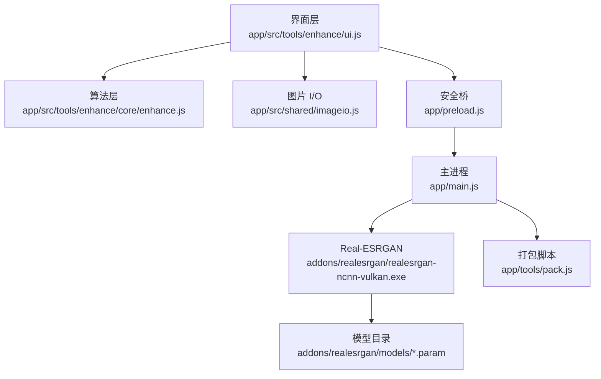
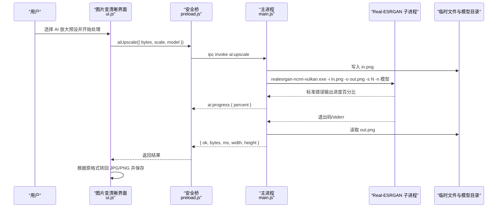
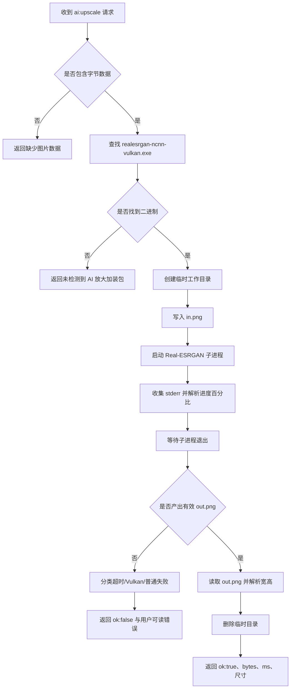
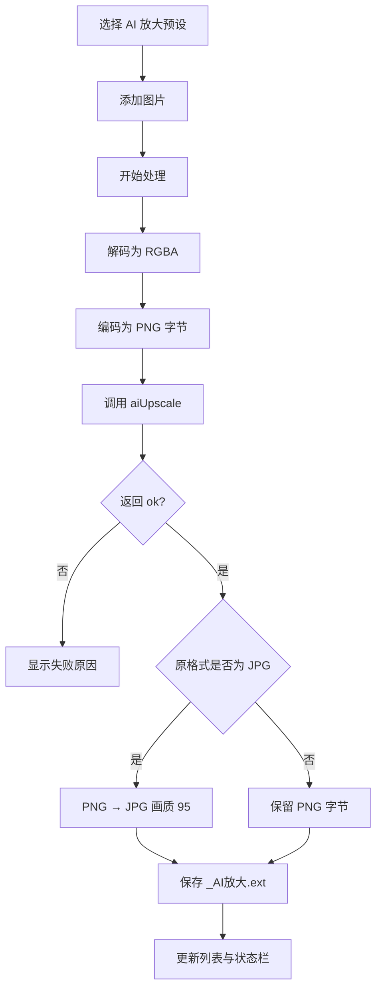
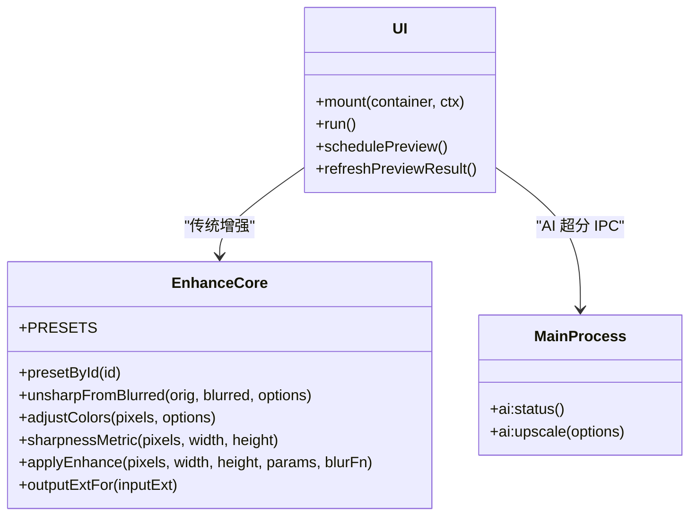
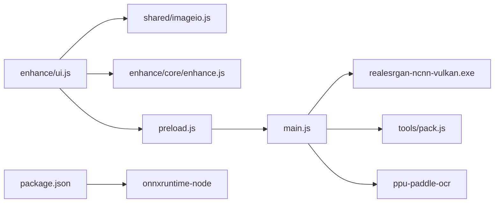

# AI 超分引擎

<cite>
**本文引用的文件**   
- [README.md](file://README.md)
- [AGENTS.md](file://AGENTS.md)
- [spec/modules/image-enhance.md](file://spec/modules/image-enhance.md)
- [app/src/tools/enhance/core/enhance.js](file://app/src/tools/enhance/core/enhance.js)
- [app/src/tools/enhance/index.js](file://app/src/tools/enhance/index.js)
- [app/src/tools/enhance/ui.js](file://app/src/tools/enhance/ui.js)
- [app/src/shared/imageio.js](file://app/src/shared/imageio.js)
- [app/package.json](file://app/package.json)
- [app/main.js](file://app/main.js)
- [app/preload.js](file://app/preload.js)
- [app/tools/pack.js](file://app/tools/pack.js)
- [docs/使用说明.txt](file://docs/使用说明.txt)
- [docs/加装包说明.txt](file://docs/加装包说明.txt)
- [app/tests/media-ui-test.js](file://app/tests/media-ui-test.js)
- [app/tests/ocr-poc.js](file://app/tests/ocr-poc.js)
</cite>

## 目录
1. [引言](#引言)
2. [项目结构](#项目结构)
3. [核心组件](#核心组件)
4. [架构总览](#架构总览)
5. [详细组件分析](#详细组件分析)
6. [依赖关系分析](#依赖关系分析)
7. [性能与优化](#性能与优化)
8. [部署指南](#部署指南)
9. [故障排除](#故障排除)
10. [结论](#结论)

## 引言
本技术文档聚焦“图片变清晰”工具中的 **AI 超分辨率（AI 放大）**能力。该能力通过调用随包附带的 Real-ESRGAN ncnn+Vulkan 便携版，把低分辨率输入图按模型重新绘制为更高分辨率输出。它不是 ONNX Runtime Web 的推理管线；ONNX Runtime 在本仓库中用于 OCR 文字识别，而 AI 超分走的是外部可执行程序路径。

需要特别区分：
- **AI 超分（Real-ESRGAN）**：由 `addons/realesrgan/realesrgan-ncnn-vulkan.exe` 执行，基于 Vulkan 显卡加速，模型以 `.param` 形式存放于 `addons/realesrgan/models/`。
- **OCR（PP-OCRv5 + onnxruntime-node）**：由主进程加载 `ppu-paddle-ocr`，依赖 `onnxruntime-node` 运行 ONNX 模型，属于另一个模块，但仓库中确实存在 ONNX Runtime 集成证据。

本文会同时说明这两条路径，并明确它们在当前工程中的边界、数据流和错误处理。

**章节来源**
- [spec/modules/image-enhance.md:1-56](file://spec/modules/image-enhance.md#L1-L56)
- [app/package.json:1-28](file://app/package.json#L1-L28)
- [app/main.js:850-903](file://app/main.js#L850-L903)
- [app/main.js:2203-2310](file://app/main.js#L2203-L2310)

## 项目结构
AI 超分相关代码分布在三层：
- 规格定义：`spec/modules/image-enhance.md`
- 界面与流程编排：`app/src/tools/enhance/ui.js`
- 纯算法预设与图像处理逻辑：`app/src/tools/enhance/core/enhance.js`
- 工具注册入口：`app/src/tools/enhance/index.js`
- 图片解码/编码共享库：`app/src/shared/imageio.js`
- 主进程 IPC 桥与 Real-ESRGAN 子进程调度：`app/main.js`
- 渲染进程安全桥：`app/preload.js`
- 打包裁剪与模型复制：`app/tools/pack.js`
- 用户文档与安装说明：`docs/使用说明.txt`、`docs/加装包说明.txt`

**图示来源**
- [app/src/tools/enhance/ui.js:1-200](file://app/src/tools/enhance/ui.js#L1-L200)
- [app/src/tools/enhance/core/enhance.js:1-76](file://app/src/tools/enhance/core/enhance.js#L1-L76)
- [app/src/shared/imageio.js:1-141](file://app/src/shared/imageio.js#L1-L141)
- [app/main.js:2203-2310](file://app/main.js#L2203-L2310)
- [app/preload.js:118-125](file://app/preload.js#L118-L125)
- [app/tools/pack.js:322-331](file://app/tools/pack.js#L322-L331)

**章节来源**
- [spec/modules/image-enhance.md:1-56](file://spec/modules/image-enhance.md#L1-L56)
- [app/src/tools/enhance/index.js:1-14](file://app/src/tools/enhance/index.js#L1-L14)
- [AGENTS.md:1-98](file://AGENTS.md#L1-L98)

## 核心组件
### 1. 预设与参数模型
增强预设集中在 `core/enhance.js` 的 `PRESETS` 数组中，其中三类 AI 放大预设通过 `ai` 字段声明放大倍数和模型名：
- `ai-4x`：照片 4×，模型 `realesrgan-x4plus`
- `ai-2x`：最快 2×，模型 `realesr-animevideov3`
- `ai-anime`：动漫/插画 4×，模型 `realesrgan-x4plus-anime`

非 AI 预设使用 USM 锐化、降噪、亮度/对比度/饱和度调整以及高质量重采样放大 2×。

**章节来源**
- [app/src/tools/enhance/core/enhance.js:1-76](file://app/src/tools/enhance/core/enhance.js#L1-L76)
- [spec/modules/image-enhance.md:10-36](file://spec/modules/image-enhance.md#L10-L36)

### 2. 图片 I/O 与像素上限
`shared/imageio.js` 提供：
- `decodeImageFromBytes`：字节 → RGBA 像素缓冲
- `encodeImageToBytes`：RGBA 像素缓冲 → PNG/JPG 字节
- `drawPixelsToCanvas`：预览绘制
- `makeThumbnailFromBytes`：避免整图摊开两次的缩略图生成

该模块定义了 `MAX_PIXELS = 40_000_000`，超过时抛出内存保护错误，而不是崩溃。UI 层也复用相同上限控制放大后的像素总量。

**章节来源**
- [app/src/shared/imageio.js:1-141](file://app/src/shared/imageio.js#L1-L141)
- [app/src/tools/enhance/ui.js:1-20](file://app/src/tools/enhance/ui.js#L1-L20)

### 3. 工具入口与注册
`enhance/index.js` 导出工具元信息：
- `id: 'enhance'`
- `name: '图片变清晰'`
- `group: 'image'`
- `order: 35`
- `mount` / `unmount`

它不直接实现算法或模型加载，而是挂载 UI 生命周期。

**章节来源**
- [app/src/tools/enhance/index.js:1-14](file://app/src/tools/enhance/index.js#L1-L14)

## 架构总览
AI 超分的完整调用链是“界面 → 安全桥 → 主进程 → Real-ESRGAN 子进程”。

**图示来源**
- [app/src/tools/enhance/ui.js:465-516](file://app/src/tools/enhance/ui.js#L465-L516)
- [app/preload.js:118-125](file://app/preload.js#L118-L125)
- [app/main.js:2236-2310](file://app/main.js#L2236-L2310)

## 详细组件分析

### A. Real-ESRGAN 超分主进程接口
主进程在 `main.js` 中实现两个关键 IPC：
- `ai:status`：探测 `addons/realesrgan/realesrgan-ncnn-vulkan.exe` 是否存在，并扫描 `models/` 下所有 `.param` 文件名。
- `ai:upscale`：接收渲染进程的 `{ bytes, scale, model }`，写临时目录中的 `in.png`，启动 `realesrgan-ncnn-vulkan.exe`，解析 `out.png`，清理临时目录。

关键行为：
- 默认 scale 为 4，model 默认 `realesrgan-x4plus`。
- 支持额外 `-t tile` 参数，但当前 UI 未传入。
- 超时阈值 30 分钟；超时后终止子进程树。
- stderr 被截断保留最近约 100KB，失败消息截取最后两行。
- 通过正则匹配 Vulkan 初始化错误，给出“本机显卡不支持 Vulkan（或驱动过旧）”的用户提示。

**图示来源**
- [app/main.js:2236-2310](file://app/main.js#L2236-L2310)

**章节来源**
- [app/main.js:2203-2310](file://app/main.js#L2203-L2310)

### B. 界面层 AI 分支与结果后处理
`ui.js` 在批量处理时判断 `params.ai`，走 AI 分支：
1. 将输入字节解码为 RGBA。
2. 编码为 PNG 字节，因为 Real-ESRGAN 命令行接受 jpg/png/webp，实现统一用 PNG 作为中间格式。
3. 调用 `ctx.aiUpscale`，得到 `{ ok, bytes, ms, width, height }`。
4. 如果原图扩展名为 `.jpg` 或 `.jpeg`，再把 AI 产出的 PNG 解码再编码为 JPG，画质 95，保持“JPG 进 JPG 出”语义。
5. 命名规则为 `<原名>_AI放大.ext`，保存到原图同级目录或用户指定输出目录。
6. 列表项显示最终宽高、原始大小、输出大小、耗时。

预览阶段跳过 AI 处理，因为每张图都要跑一次模型，预览会明显卡顿。

**图示来源**
- [app/src/tools/enhance/ui.js:450-570](file://app/src/tools/enhance/ui.js#L450-L570)
- [app/src/tools/enhance/ui.js:201-300](file://app/src/tools/enhance/ui.js#L201-L300)

**章节来源**
- [app/src/tools/enhance/ui.js:150-200](file://app/src/tools/enhance/ui.js#L150-L200)
- [app/src/tools/enhance/ui.js:450-681](file://app/src/tools/enhance/ui.js#L450-L681)

### C. 通用增强算法与 AI 超分的边界
`core/enhance.js` 中的 `applyEnhance` 负责：
- 降噪：轻量模糊与原图混合
- USM 锐化：差分 + 阈值抑制噪点
- 颜色调整：亮度、对比度、饱和度

当预设携带 `ai` 字段时，这些传统增强步骤不会执行；AI 放大走独立 IPC 分支。两者共用输入像素表示，但输出路径不同：
- 传统增强：`_清晰.ext`
- AI 放大：`_AI放大.ext`

**图示来源**
- [app/src/tools/enhance/core/enhance.js:1-236](file://app/src/tools/enhance/core/enhance.js#L1-L236)
- [app/src/tools/enhance/ui.js:450-681](file://app/src/tools/enhance/ui.js#L450-L681)
- [app/main.js:2203-2310](file://app/main.js#L2203-L2310)

**章节来源**
- [app/src/tools/enhance/core/enhance.js:201-236](file://app/src/tools/enhance/core/enhance.js#L201-L236)

### D. 与 ONNX Runtime 的关系
仓库中确实存在 ONNX Runtime 集成，但它服务于 OCR，而不是 AI 超分：
- `package.json` 依赖 `onnxruntime-node ^1.30.0`
- `main.js` 动态导入 `ppu-paddle-ocr`，从 `addons/ocr/` 加载 `det.onnx`、`rec.onnx`、字典文件
- `pack.js` 对 `onnxruntime-node` 做平台裁剪，只保留 Windows x64 原生二进制，并移除 DirectML 三件套

因此，如果把“AI 超分辨率引擎集成”理解为整个仓库中 ONNX Runtime 的使用方式，则应将其视为 OCR 模块的推理基础设施，而不是 enhance 工具的超分实现。

**章节来源**
- [app/package.json:1-28](file://app/package.json#L1-L28)
- [app/main.js:850-903](file://app/main.js#L850-L903)
- [app/tools/pack.js:202-249](file://app/tools/pack.js#L202-L249)
- [app/tools/pack.js:534-542](file://app/tools/pack.js#L534-L542)
- [app/tests/ocr-poc.js:1-10](file://app/tests/ocr-poc.js#L1-L10)

## 依赖关系分析

**图示来源**
- [app/src/tools/enhance/ui.js:1-20](file://app/src/tools/enhance/ui.js#L1-L20)
- [app/package.json:1-28](file://app/package.json#L1-L28)
- [app/main.js:850-903](file://app/main.js#L850-L903)
- [app/main.js:2203-2310](file://app/main.js#L2203-L2310)
- [app/tools/pack.js:322-331](file://app/tools/pack.js#L322-L331)

### 耦合与内聚
- 界面层与算法层通过参数对象和函数注入解耦，便于单测。
- AI 超分通过 IPC 与主进程解耦，渲染进程不直接调用外部程序。
- Real-ESRGAN 是外部进程，耦合点在命令行参数和 stderr 文本解析。
- ONNX Runtime 仅出现在 OCR 相关路径，与 enhance 工具无直接 import 关系。

### 潜在循环依赖
- enhance 工具内部没有循环 import。
- 主进程通过 IPC 暴露能力，界面侧通过 preload 调用，不存在双向 JS 模块循环。
- 打包脚本是构建期工具，不参与运行时依赖。

**章节来源**
- [app/src/tools/enhance/index.js:1-14](file://app/src/tools/enhance/index.js#L1-L14)
- [app/preload.js:118-125](file://app/preload.js#L118-L125)

## 性能与优化

### 批处理
- 每个图片是一个任务，进入 `tasks.enqueue` 队列，lane 为 `io`。
- 测试与注释表明图片类任务并发数为 2。
- 任务可在工具页切换后继续执行，符合工具箱 LRU 保活机制。

**章节来源**
- [app/src/tools/enhance/ui.js:450-465](file://app/src/tools/enhance/ui.js#L450-L465)
- [AGENTS.md:1-98](file://AGENTS.md#L1-L98)

### 内存管理
- 输入图片最大像素上限为 4000 万，防止一次性分配过大 RGBA 缓冲。
- AI 放大过程中，UI 层先解码再编码为 PNG，产生额外内存峰值；随后 AI 输出再解码一次（仅在 JPG 回退场景）。
- 主进程为每次 AI 推理创建临时目录，完成后递归删除。
- 非 AI 分支在处理完图片后会清空缓存字节，减少内存占用。

**章节来源**
- [app/src/shared/imageio.js:1-40](file://app/src/shared/imageio.js#L1-L40)
- [app/src/tools/enhance/ui.js:516-681](file://app/src/tools/enhance/ui.js#L516-L681)
- [app/main.js:2246-2310](file://app/main.js#L2246-L2310)

### GPU 加速选项
- Real-ESRGAN 使用 ncnn+Vulkan，需要支持 Vulkan 的显卡。
- 纯 CPU 不可用；若 Vulkan 初始化失败，主进程会识别错误并返回用户友好文案。
- 当前 UI 不暴露 tile 参数，无法通过切块降低显存峰值。

**章节来源**
- [docs/加装包说明.txt:1-75](file://docs/加装包说明.txt#L1-L75)
- [app/main.js:2276-2284](file://app/main.js#L2276-L2284)
- [app/src/tools/enhance/ui.js:158-168](file://app/src/tools/enhance/ui.js#L158-L168)

### 推理性能基准
仓库中记录了两类基准：
- 用户文档说明：720p 图放大 4 倍约 10 秒，核显更慢。
- 规格实测：NVIDIA 显卡上 640×420 放大 4× 约 5.5 秒，1280×720 放大 4× 约 10.4 秒。

这些数字反映的是 ncnn+Vulkan 外置引擎的性能，不是 ONNX Runtime Web 的推理时间。

**章节来源**
- [docs/使用说明.txt:120-170](file://docs/使用说明.txt#L120-L170)
- [spec/modules/image-enhance.md:36-56](file://spec/modules/image-enhance.md#L36-L56)

### 优化建议
1. **Tile 切块推理**：主进程已支持 `-t` 参数，可扩展 UI 为超大图自动启用 tile，降低显存压力。
2. **模型预热**：首次推理前在主进程侧预实例化或执行一次空推理，减少首张图延迟（当前实现每次 spawn 子进程）。
3. **临时文件复用**：对同一会话的多个图片可复用临时目录，减少磁盘操作。
4. **JPG 回退路径优化**：JPG 输入时二次编解码成本较高，可考虑让 Real-ESRGAN 直接输出 JPG，或在内存中转换。
5. **ONNX Runtime 侧**：如未来引入基于 ONNX 的超分模型，应在主进程使用 `onnxruntime-node`，避免 WASM 和 CSP 限制，参考 OCR 的设计。

[本节为通用优化讨论，不直接分析具体代码片段]

## 部署指南

### 依赖库安装
开发环境需要 Node 便携版和 Electron：
- 使用仓库内 `.tools/node/node.exe`
- 设置 Electron 镜像后 `npm install`
- 启动命令为 `npm start`

**章节来源**
- [AGENTS.md:1-98](file://AGENTS.md#L1-L98)
- [README.md:1-120](file://README.md#L1-L120)

### 模型与加装包准备
AI 超分不需要手动下载 ONNX 模型；它使用 Real-ESRGAN 便携版：
- 位置：`addons/realesrgan/realesrgan-ncnn-vulkan.exe`
- 模型目录：`addons/realesrgan/models/`
- 模型文件后缀：`.param`
- 打包脚本会在存在该目录时复制到产物

**章节来源**
- [docs/加装包说明.txt:1-75](file://docs/加装包说明.txt#L1-L75)
- [app/tools/pack.js:322-331](file://app/tools/pack.js#L322-L331)
- [app/main.js:2203-2220](file://app/main.js#L2203-L2220)

### 构建产物
打包脚本会：
- 复制 Real-ESRGAN 加装包
- 精简 `onnxruntime-node` 到 win32/x64
- 删除 DirectML 相关 DLL，因为 OCR 使用 CPU EP
- 清理 sourcemap 和多语言资源

**章节来源**
- [app/tools/pack.js:202-249](file://app/tools/pack.js#L202-L249)
- [app/tools/pack.js:534-542](file://app/tools/pack.js#L534-L542)

## 故障排除

### 模型加载失败
对于 Real-ESRGAN，“模型加载失败”通常表现为未检测到二进制或模型目录：
- 检查 `addons/realesrgan/realesrgan-ncnn-vulkan.exe` 是否存在
- 检查 `addons/realesrgan/models/` 下是否有 `.param` 文件
- 如果缺失，把安装包解压到软件目录后重启工具

对于 OCR 的 ONNX 模型，则需确认 `addons/ocr/` 下有 `det.onnx`、`rec.onnx`、字典文件。

**章节来源**
- [app/main.js:2208-2220](file://app/main.js#L2208-L2220)
- [app/main.js:854-903](file://app/main.js#L854-L903)

### 推理超时
Real-ESRGAN 子进程有 30 分钟超时保护：
- 大图、弱显卡、驱动异常都可能导致长时间无响应
- 超时后主进程会终止子进程树，并返回“处理超时（超过 30 分钟）”
- 排查方向：降低分辨率、关闭其他 GPU 应用、更新显卡驱动

**章节来源**
- [app/main.js:2246-2284](file://app/main.js#L2246-L2284)

### 内存溢出
触发条件：
- 输入图片像素超过 4000 万
- AI 放大后输出尺寸过大，导致后续解码/编码阶段内存峰值升高
- 批量处理多张大图时累积内存

缓解措施：
- 避免一次性添加过多超大图
- 优先使用 JPG 输出时注意二次编解码开销
- 对超大图考虑先缩小再超分，或等待未来 tile 支持
- 关注 `shared/imageio.js` 的 MAX_PIXELS 保护逻辑

**章节来源**
- [app/src/shared/imageio.js:1-40](file://app/src/shared/imageio.js#L1-L40)
- [app/src/tools/enhance/ui.js:465-570](file://app/src/tools/enhance/ui.js#L465-L570)

### Vulkan 不可用
典型症状：
- 界面提示“未检测到 AI 放大加装包”或“本机显卡不支持 Vulkan（或驱动过旧），AI 放大用不了”
- 主进程检测到 stderr 中包含 Vulkan 初始化相关错误
- 普通锐化、清晰放大 2× 仍可正常使用

处理方法：
- 更新显卡驱动
- 确认显卡支持 Vulkan
- 使用非 AI 预设作为降级方案

**章节来源**
- [app/main.js:2276-2284](file://app/main.js#L2276-L2284)
- [app/src/tools/enhance/ui.js:158-168](file://app/src/tools/enhance/ui.js#L158-L168)
- [docs/使用说明.txt:120-170](file://docs/使用说明.txt#L120-L170)

### 与图像处理模块的集成问题
常见问题：
- HEIC/HEIF 输入在增强工具中被拒绝，因为 Chromium 内核无法直接解码
- 非 PNG/JPG/WebP/BMP/GIF/ICO/AVIF/SVG 的图片会被忽略
- 输出扩展名遵循“JPG→JPG，其余→PNG”的规则，AI 放大额外支持 `_AI放大` 命名

**章节来源**
- [app/src/tools/enhance/ui.js:570-681](file://app/src/tools/enhance/ui.js#L570-L681)
- [app/src/tools/enhance/core/enhance.js:220-236](file://app/src/tools/enhance/core/enhance.js#L220-L236)

## 结论
本项目中的“AI 超分辨率”能力并非通过 ONNX Runtime Web 实现，而是通过调用随包的 Real-ESRGAN ncnn+Vulkan 便携版完成。其设计优点是：
- 与界面层完全解耦，通过 IPC 暴露稳定接口
- 硬件要求明确，用户可通过界面提示了解 Vulkan 需求
- 错误分类清晰，能区分未检测加装包、Vulkan 不可用、超时和普通失败
- 与通用图像增强算法分离，避免误把传统锐化当作 AI 超分

仓库中也确实存在 ONNX Runtime 集成，但它是 OCR 模块的基础设施，使用 `ppu-paddle-ocr` 和 `onnxruntime-node` 在主进程加载 ONNX 模型。若未来引入基于 ONNX 的超分模型，应沿用现有主进程加载模式，避免渲染进程 CSP 限制和 WASM 复杂度。

整体而言，当前 AI 超分引擎的实现更注重可部署性、可解释的错误信息和与 Electron 工具箱架构的一致性，而非自定义推理图优化。

[本节为总结，不直接分析具体代码片段]