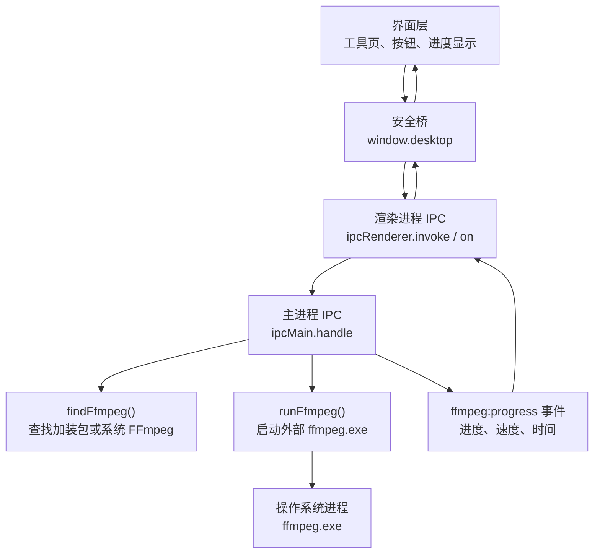
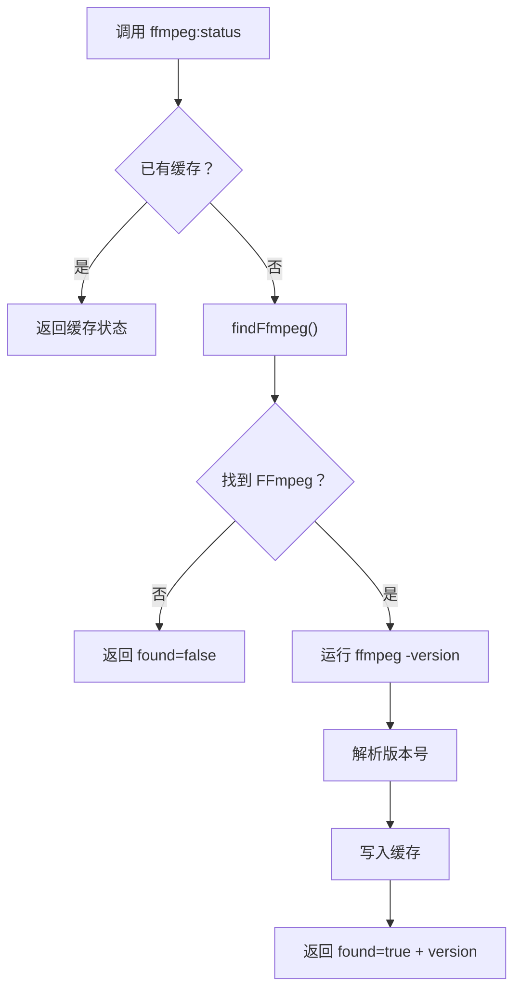
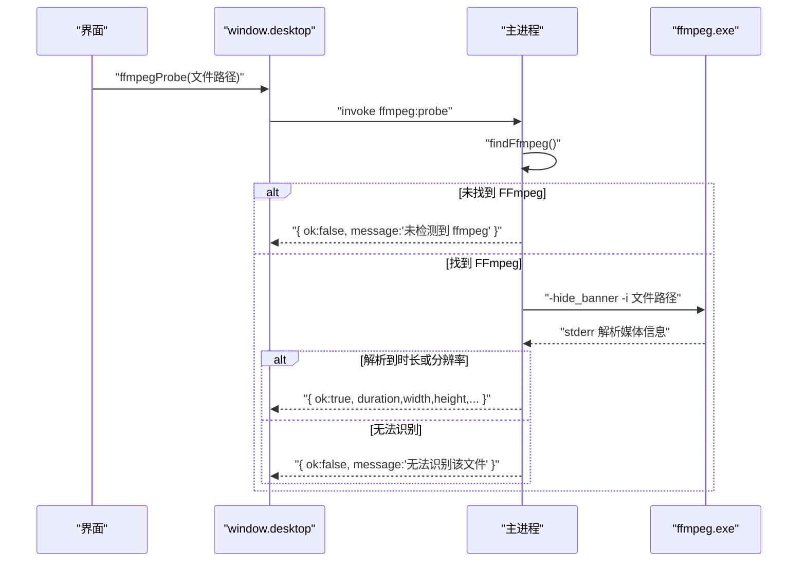
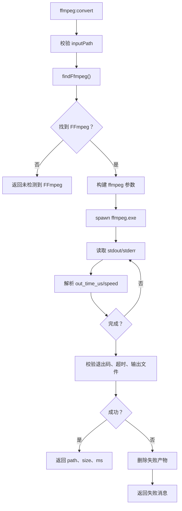
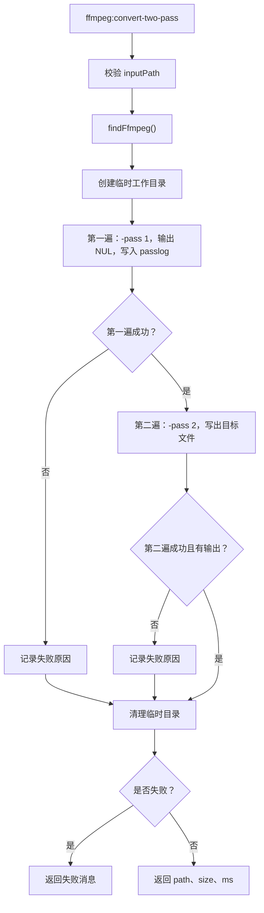
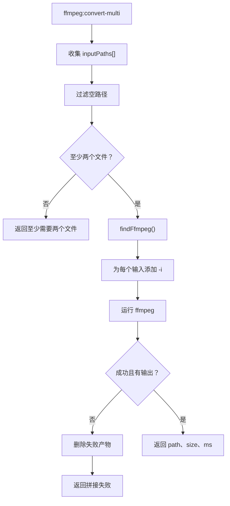
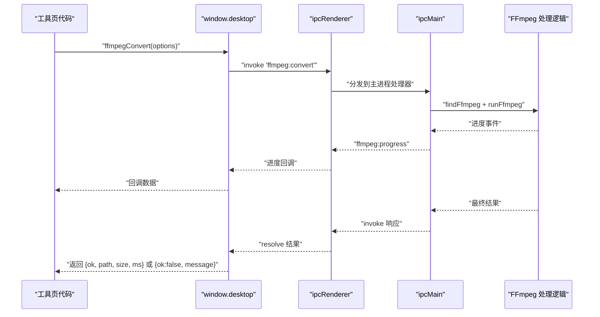
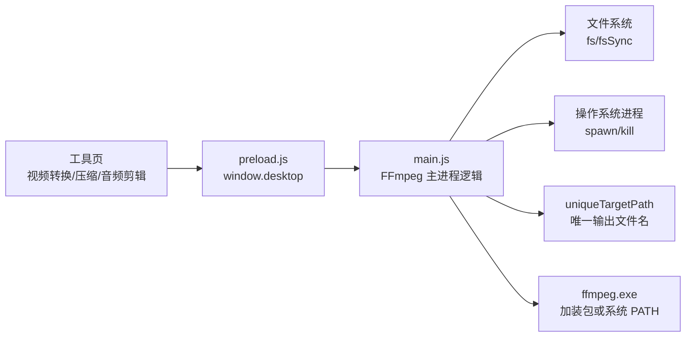

# FFmpeg 集成

<cite>
**本文引用的文件**   
- [app/main.js](file://app/main.js)
- [app/preload.js](file://app/preload.js)
- [README.md](file://README.md)
- [AGENTS.md](file://AGENTS.md)
</cite>

## 目录
1. [引言](#引言)
2. [项目结构中的 FFmpeg 位置](#项目结构中的-ffmpeg-位置)
3. [核心组件](#核心组件)
4. [架构总览](#架构总览)
5. [详细组件分析](#详细组件分析)
6. [依赖关系分析](#依赖关系分析)
7. [性能与内存管理](#性能与内存管理)
8. [故障排除指南](#故障排除指南)
9. [结论](#结论)

## 引言
本文件面向“番茄图片混淆桌面版”中 FFmpeg 引擎的集成实现，重点说明：
- FFmpeg 加装包与系统安装的查找逻辑；
- 进程发现、状态检测、媒体探测与多媒体处理封装；
- 单遍编码、两遍编码和多输入音频拼接的实现原理；
- 渲染进程通过 `window.desktop` 调用主进程 FFmpeg 操作的 IPC 机制；
- 超时控制、取消机制、错误处理和清理策略；
- 性能优化建议与常见问题排查。

该项目是 Electron 应用：界面运行在渲染进程，FFmpeg 作为外部子进程在主进程中启动和调度，避免把大体积媒体数据搬进浏览器内存或跨 IPC 传输。

**章节来源**
- [README.md:1-120](file://README.md#L1-L120)
- [AGENTS.md:14-22](file://AGENTS.md#L14-L22)

## 项目结构中的 FFmpeg 位置
FFmpeg 不是 Node 模块，而是随包分发的可执行程序。仓库约定如下：

| 位置 | 含义 | 行为 |
|---|---|---|
| `addons/ffmpeg/ffmpeg.exe` | 随包 FFmpeg 加装包 | 优先使用，保证离线可用 |
| 系统 PATH 中的 `ffmpeg` | 本机已安装 FFmpeg | 开发机常见，作为兜底 |
| 两者都不存在 | 视为未安装 | 视频类工具提示放置说明 |

仓库文档明确说明：
- `src/shared/` 提供跨工具复用能力，包括 ffmpeg 封装；
- `addons/` 存放随包加装包，其中包含 ffmpeg；
- README 说明 FFmpeg 等加装包随主包附带，解压后开箱即用。

这意味着：
- 正常用户只需解压安装包，无需另行安装 FFmpeg；
- 开发者若本机安装了 FFmpeg，也可被自动发现；
- 如果缺失，界面会引导用户把加装包放到 `addons/ffmpeg` 目录。

**章节来源**
- [AGENTS.md:14-22](file://AGENTS.md#L14-L22)
- [README.md:1-120](file://README.md#L1-L120)

## 核心组件
主进程负责所有 FFmpeg 相关操作，渲染进程只暴露一个安全的 `desktop` 接口。核心能力包括：

| 能力 | 主进程通道 | 渲染进程 API | 用途 |
|---|---|---|---|
| 发现并检查 FFmpeg | `ffmpeg:status` | `window.desktop.ffmpegStatus()` | 判断是否找到 FFmpeg、版本号 |
| 探测媒体信息 | `ffmpeg:probe` | `window.desktop.ffmpegProbe(filePath)` | 获取时长、分辨率、帧率、是否有音轨、格式等 |
| 单遍转码 | `ffmpeg:convert` | `window.desktop.ffmpegConvert(options)` | 文件到文件的直接转码 |
| 两遍转码 | `ffmpeg:convert-two-pass` | `window.desktop.ffmpegConvertTwoPass(options)` | 目标体积模式下的两次编码 |
| 多输入拼接 | `ffmpeg:convert-multi` | `window.desktop.ffmpegConvertMulti(options)` | 多个音频片段拼接 |
| 字节转字节转换 | `ffmpeg:transform` | `window.desktop.ffmpegTransform(options)` | 内存中的图片数据走 FFmpeg 处理 |
| 按路径转字节 | `ffmpeg:transform-file` | `window.desktop.ffmpegTransformFile(options)` | 大文件波形降采样，不读入主进程内存 |
| 进度回调 | `ffmpeg:progress`（事件） | `window.desktop.ffmpegOnProgress(callback)` | 实时进度、速度、时间戳 |
| 取消任务 | `ffmpeg:cancel` | `window.desktop.ffmpegCancel(jobId)` | 终止正在运行的 FFmpeg 进程树 |

需要特别说明：**`ffmpegStatus()`、`probeMedia()`、`convertMedia()`、`convertMediaTwoPass()`、`convertMediaMulti()` 并不是渲染进程上直接定义的函数名**。它们是对 `window.desktop` 暴露的 FFmpeg 能力的语义化描述；实际对应的主进程 IPC 通道为 `ffmpeg:status`、`ffmpeg:probe`、`ffmpeg:convert`、`ffmpeg:convert-two-pass`、`ffmpeg:convert-multi`。

**章节来源**
- [app/preload.js:1-193](file://app/preload.js#L1-L193)

## 架构总览
下图展示渲染进程如何通过安全桥调用主进程的 FFmpeg 功能：

**图表来源**
- [app/preload.js:1-193](file://app/preload.js#L1-L193)
- [app/main.js:1560-1780](file://app/main.js#L1560-L1780)

**章节来源**
- [app/preload.js:1-193](file://app/preload.js#L1-L193)
- [app/main.js:1560-1780](file://app/main.js#L1560-L1780)

## 详细组件分析

### FFmpeg 查找与状态检测
#### 查找逻辑
主进程先尝试从软件目录的 `addons/ffmpeg/ffmpeg.exe` 加载；如果不存在，则调用系统命令 `where ffmpeg` 查找 PATH 中的版本。返回值包含：
- `found`：是否找到；
- `path`：可执行文件路径；
- `where`：来源，`addon` 表示加装包，`system` 表示系统 PATH。

#### 状态检测
`ffmpegStatus()` 对应主进程通道 `ffmpeg:status`。流程如下：
1. 如果已有缓存结果，直接返回；
2. 调用 `findFfmpeg()`；
3. 如果没找到，返回 `{ found: false, where: null, version: null }`；
4. 如果找到，启动 `ffmpeg -version`；
5. 从输出中解析 `ffmpeg version X.Y.Z`；
6. 缓存并返回 `{ found: true, where, version }`。

该设计避免了每次调用都重启 FFmpeg，同时允许主进程首次探测时统一发现资源。

**图表来源**
- [app/main.js:1560-1598](file://app/main.js#L1560-L1598)

**章节来源**
- [app/main.js:1560-1598](file://app/main.js#L1560-L1598)

### 媒体探测：ffmpegProbe
`ffmpegProbe(filePath)` 对应主进程通道 `ffmpeg:probe`。它并不依赖 `ffprobe`，因为静态包可能只带 `ffmpeg`；它通过运行 `ffmpeg -i filePath`，从标准错误输出中解析媒体信息。

解析字段包括：
- `durationSec`：时长秒数；
- `width`、`height`：视频分辨率；
- `fps`：帧率；
- `hasAudio`：是否含音轨；
- `videoCodec`：视频编码；
- `format`：容器格式；
- `audioCodec`、`sampleRate`、`channelLayout`：音频编码、采样率、声道布局。

成功条件是解析出时长大于零或分辨率大于零；否则返回失败消息，说明文件可能不是媒体文件或格式不受支持。

**图表来源**
- [app/main.js:1599-1646](file://app/main.js#L1599-L1646)
- [app/preload.js:1-193](file://app/preload.js#L1-L193)

**章节来源**
- [app/main.js:1599-1646](file://app/main.js#L1599-L1646)

### 单遍转码：ffmpegConvert
`ffmpegConvert(options)` 对应主进程通道 `ffmpeg:convert`。这是最基础的“文件到文件”转码入口，适用于大多数视频格式转换、动图与视频互转等场景。

关键参数：
- `inputPath`：输入文件路径；
- `outputDir`：输出目录，默认与输入同目录；
- `baseName`：输出文件名前缀；
- `ext`：输出扩展名，默认 `.mp4`；
- `args[]`：传给 FFmpeg 的参数数组；
- `inputArgs[]`：输入侧参数；
- `durationMs`：用于计算百分比进度；
- `timeoutMs`：可选超时；
- `jobId`：可选任务标识，用于取消和进度关联。

内部实现要点：
- 使用 `uniqueTargetPath` 生成唯一输出路径，避免覆盖；
- 构造参数时加入 `-progress pipe:1`，以便解析 `out_time_us` 和 `speed`；
- 超时默认上限约六小时，下限至少二十分钟，或输入时长的十倍；
- 完成后校验输出文件是否存在且大小大于零；
- 失败时删除临时产物，并拼接 stderr 尾部作为错误摘要。

**图表来源**
- [app/main.js:1647-1780](file://app/main.js#L1647-L1780)

**章节来源**
- [app/main.js:1647-1780](file://app/main.js#L1647-L1780)

### 两遍转码：ffmpegConvertTwoPass
`ffmpegConvertTwoPass(options)` 对应主进程通道 `ffmpeg:convert-two-pass`，主要用于“视频压缩”的目标体积模式。

两遍编码的区别：
- 第一遍：分析视频内容，写入 passlog，不产生最终输出；
- 第二遍：根据第一遍统计信息生成最终文件。

优势：
- 对目标体积的控制更准确；
- 适合固定比特率或质量档的压缩需求。

参数：
- 继承单遍转码的 `inputPath`、`outputDir`、`baseName`、`ext`、`durationMs`、`timeoutMs`、`jobId`；
- 新增 `pass1Args[]`：第一遍参数；
- 新增 `pass2Args[]`：第二遍参数；
- 新增 `inputArgs[]`：输入侧公共参数。

实现要点：
- 临时工作目录放在系统临时目录，前缀为 `tomato-2pass-...`；
- passlog 文件位于临时目录；
- 第一遍进度映射到 0%~50%，第二遍映射到 50%~100%；
- 无论成功还是失败，最终都会清理临时目录；
- 第一遍失败直接报错；第二遍失败也清理目标文件。

**图表来源**
- [app/main.js:1780-1860](file://app/main.js#L1780-L1860)

**章节来源**
- [app/main.js:1780-1860](file://app/main.js#L1780-L1860)

### 多输入音频拼接：ffmpegConvertMulti
`ffmpegConvertMulti(options)` 对应主进程通道 `ffmpeg:convert-multi`，用于“音频剪辑”工具中的多段音频拼接。

核心约束：
- 至少需要两个输入文件；
- 每个输入以 `-i` 传入；
- `args[]` 中应包含 `filter_complex` 和 `-map`；
- 输出默认扩展名为 `.mp3`，基础名称默认为“拼接结果”。

实现流程：
1. 过滤空输入路径；
2. 校验输入数量不少于二；
3. 查找 FFmpeg；
4. 为每个输入追加 `-i`；
5. 拼接公共参数、用户参数和目标路径；
6. 执行并解析进度；
7. 成功后返回产物路径、大小和耗时。

**图表来源**
- [app/main.js:1860-1940](file://app/main.js#L1860-L1940)

**章节来源**
- [app/main.js:1860-1940](file://app/main.js#L1860-L1940)

### 内存友好的图片与波形转换
除了文件到文件转码，项目还提供了两条面向内存数据的通道：

| 通道 | 适用场景 | 特点 |
|---|---|---|
| `ffmpeg:transform` | 图片字节 → 字节 | 源数据来自界面进程，写临时文件后交给 FFmpeg |
| `ffmpeg:transform-file` | 本地文件 → 字节 | 源文件路径直接交给 FFmpeg，避免 GB 级文件进入主进程内存 |

`ffmpeg:transform-file` 的设计动机是：音频剪辑的波形降采样只需要几 MB 的结果，但源可能是 GB 级视频；如果把整个源文件读入主进程 Buffer，再通过 IPC 传回界面，会造成多次复制和内存膨胀。因此该通道让 FFmpeg 直接按路径读取源文件。

**章节来源**
- [app/main.js:1940-2040](file://app/main.js#L1940-L2040)

### IPC 通信机制
渲染进程不能直接访问 Node、Electron 主进程能力，必须通过 `preload.js` 暴露的安全桥。FFmpeg 相关能力集中在 `window.desktop` 中：

- `ffmpegStatus()`：调用 `ipcRenderer.invoke('ffmpeg:status')`；
- `ffmpegProbe(filePath)`：调用 `ipcRenderer.invoke('ffmpeg:probe', filePath)`；
- `ffmpegConvert(options)`：调用 `ipcRenderer.invoke('ffmpeg:convert', options)`；
- `ffmpegConvertTwoPass(options)`：调用 `ipcRenderer.invoke('ffmpeg:convert-two-pass', options)`；
- `ffmpegConvertMulti(options)`：调用 `ipcRenderer.invoke('ffmpeg:convert-multi', options)`；
- `ffmpegTransform(options)`：调用 `ipcRenderer.invoke('ffmpeg:transform', options)`；
- `ffmpegTransformFile(options)`：调用 `ipcRenderer.invoke('ffmpeg:transform-file', options)`；
- `ffmpegCancel(jobId)`：调用 `ipcRenderer.invoke('ffmpeg:cancel', jobId)`；
- `ffmpegOnProgress(callback)`：订阅 `ffmpeg:progress` 事件，返回取消订阅函数。

这种设计的优点是：
- 渲染进程只能调用白名单方法；
- 所有文件操作、子进程启动、系统调用都在主进程；
- 进度通过事件通道异步推送；
- 大文件不走 IPC，只传递元数据和路径。

**图表来源**
- [app/preload.js:1-193](file://app/preload.js#L1-L193)
- [app/main.js:1560-1780](file://app/main.js#L1560-L1780)

**章节来源**
- [app/preload.js:1-193](file://app/preload.js#L1-L193)
- [app/main.js:1560-1780](file://app/main.js#L1560-L1780)

## 依赖关系分析
FFmpeg 集成的主要依赖关系如下：

**图表来源**
- [app/preload.js:1-193](file://app/preload.js#L1-L193)
- [app/main.js:1560-2040](file://app/main.js#L1560-L2040)

耦合性分析：
- 工具页不直接调用 FFmpeg，耦合度低；
- `preload.js` 只负责暴露接口，不含业务逻辑；
- `main.js` 集中承载 FFmpeg 状态、查找、进程生命周期和错误处理；
- 输出文件名分配通过共享的原子路径逻辑，避免重复覆盖。

**章节来源**
- [app/preload.js:1-193](file://app/preload.js#L1-L193)
- [app/main.js:1560-2040](file://app/main.js#L1560-L2040)

## 性能与内存管理
### 内存管理
- 文件到文件转码不会把整个媒体文件读进 Node 或浏览器内存；
- `ffmpeg:transform-file` 专门用于大文件波形降采样，避免 GB 级源文件进入主进程 Buffer；
- FFmpeg 的 stderr 保留最近 10 万字符，防止异常日志撑爆内存；
- 临时目录使用后主动删除，包括两遍编码的工作目录。

### 并行处理
- 每个 FFmpeg 任务通过 `jobId` 记录到 `ffmpegJobs` Map；
- 取消操作通过 `killConvertTree` 终止整棵进程树；
- 当前实现没有显式全局并发限制，因此高并发转码仍受系统 CPU、磁盘 IO 和 FFmpeg 实例数影响。

### 超时控制
- 单遍转码超时默认上限约六小时，下限至少二十分钟，或输入时长十倍；
- 两遍转码每遍都有独立超时；
- 图片字节转换和按路径转换固定超时三分钟；
- 超时时会标记 `timedOut`，并终止进程树。

### 进度与用户体验
- 通过 `-progress pipe:1` 解析 `out_time_us`；
- 结合 `durationMs` 计算百分比；
- 同时解析 `speed` 字段反馈处理速度；
- 进度事件由主进程推送到渲染进程，界面可实时更新进度条。

**章节来源**
- [app/main.js:1647-2040](file://app/main.js#L1647-L2040)

## 故障排除指南

### FFmpeg 启动失败
症状：
- 工具提示“未检测到 FFmpeg”；
- 转换直接失败；
- 状态检测返回 `found: false`。

可能原因：
- `addons/ffmpeg/ffmpeg.exe` 不存在；
- 系统 PATH 中没有 `ffmpeg`；
- FFmpeg 文件损坏或被杀毒软件隔离；
- 权限不足导致无法执行。

解决步骤：
1. 确认安装包完整，`addons/ffmpeg/ffmpeg.exe` 存在；
2. 如果是开发环境，确认本机 PATH 中能找到 `ffmpeg`；
3. 检查 FFmpeg 是否能手动运行；
4. 查看 FFmpeg 标准错误尾部，定位具体失败原因；
5. 重新解压安装包或修复系统 PATH。

**章节来源**
- [app/main.js:1560-1598](file://app/main.js#L1560-L1598)
- [app/main.js:1647-1780](file://app/main.js#L1647-L1780)

### 格式不支持
症状：
- `ffmpegProbe` 返回“无法识别该文件”；
- 转换失败，stderr 提示编码器或解码器不可用。

可能原因：
- 输入不是有效媒体文件；
- 文件格式不在 FFmpeg 支持范围内；
- 加装包中缺少对应编解码器；
- 文件损坏。

解决步骤：
1. 先用其他播放器验证文件是否可读；
2. 检查 FFmpeg 版本和编译支持的编解码器；
3. 对于老格式，确认使用的是随包 FFmpeg；
4. 更换为常见容器格式再试；
5. 查看 stderr 尾部错误信息。

**章节来源**
- [app/main.js:1599-1646](file://app/main.js#L1599-L1646)

### 执行超时
症状：
- 转换长时间无响应；
- 返回“处理超时”；
- 进度卡住或速度为零。

可能原因：
- 输入文件过大；
- 编码参数过于复杂；
- 磁盘 IO 慢；
- CPU 负载高；
- 两遍编码的第一遍或第二遍耗时过长。

解决步骤：
1. 适当增大 `timeoutMs`；
2. 降低视频分辨率、码率或编码复杂度；
3. 关闭后台占用磁盘的程序；
4. 避免同时运行大量转码任务；
5. 对两遍编码检查 `pass1Args` 和 `pass2Args` 是否合理。

**章节来源**
- [app/main.js:1647-1860](file://app/main.js#L1647-L1860)

### 任务无法取消
症状：
- 点击取消后 FFmpeg 仍在运行；
- 任务列表仍存在；
- 资源未释放。

可能原因：
- 传入的 `jobId` 不正确；
- 任务已结束或已不存在；
- 进程树未能被完全终止。

解决步骤：
1. 确保取消时传入正确的 `jobId`；
2. 检查是否已收到完成或失败回调；
3. 查看 `ffmpegJobs` 中是否仍有该任务；
4. 必要时手动结束 FFmpeg 进程；
5. 检查系统进程管理器中是否残留 ffmpeg 进程。

**章节来源**
- [app/main.js:1646-1660](file://app/main.js#L1646-L1660)
- [app/main.js:1647-1780](file://app/main.js#L1647-L1780)

### 输出文件未生成
症状：
- 转换失败；
- 目标文件不存在；
- 文件大小为零。

可能原因：
- FFmpeg 退出码非零；
- 处理超时；
- 输出目录不可写；
- 编码参数错误；
- 磁盘空间不足。

解决步骤：
1. 检查输出目录权限；
2. 检查磁盘剩余空间；
3. 查看 stderr 尾部错误；
4. 简化 `args[]` 测试最小参数；
5. 确认 `ext` 和编码器匹配。

**章节来源**
- [app/main.js:1647-1780](file://app/main.js#L1647-L1780)
- [app/main.js:1860-1940](file://app/main.js#L1860-L1940)

## 结论
本项目将 FFmpeg 作为外部子进程集成到 Electron 主进程中，通过 `window.desktop` 向渲染进程暴露有限、安全的能力。核心设计原则是：
- 大文件不进内存；
- 主进程持有 FFmpeg 生命周期；
- 进度通过事件异步推送；
- 临时文件和失败产物及时清理；
- 通过加装包优先、系统 PATH 兜底的方式提升可用性。

推荐实践：
- 工具页始终通过 `window.desktop` 调用 FFmpeg；
- 设置合理的 `durationMs` 以获得准确进度；
- 为大任务设置 `jobId`，并在卸载时取消；
- 对两遍编码仔细调优 `pass1Args` 和 `pass2Args`；
- 对超大文件使用 `ffmpegTransformFile` 而非 `ffmpegTransform`；
- 遇到失败时优先查看 stderr 尾部信息和 FFmpeg 版本。