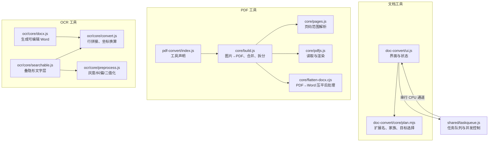
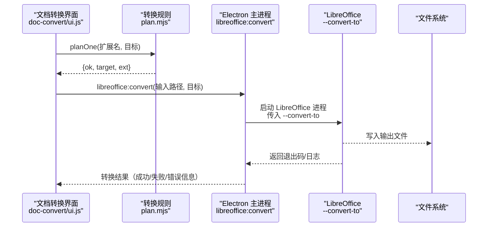
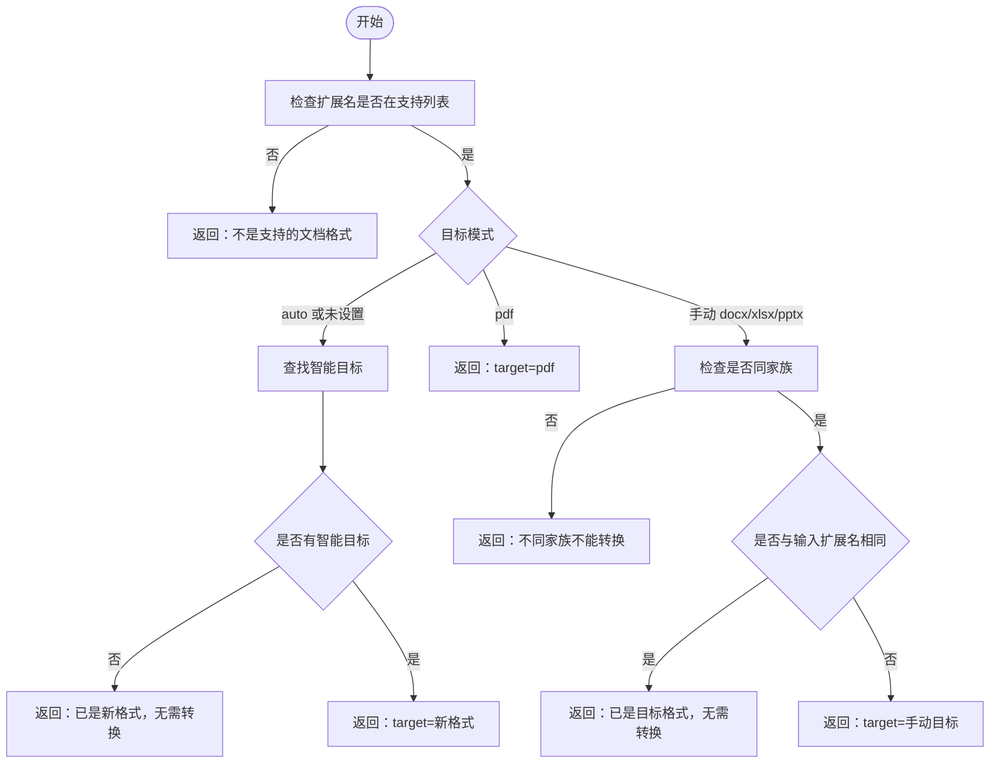
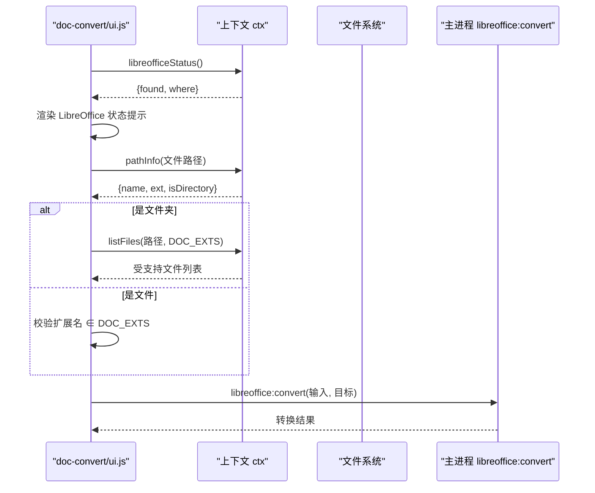
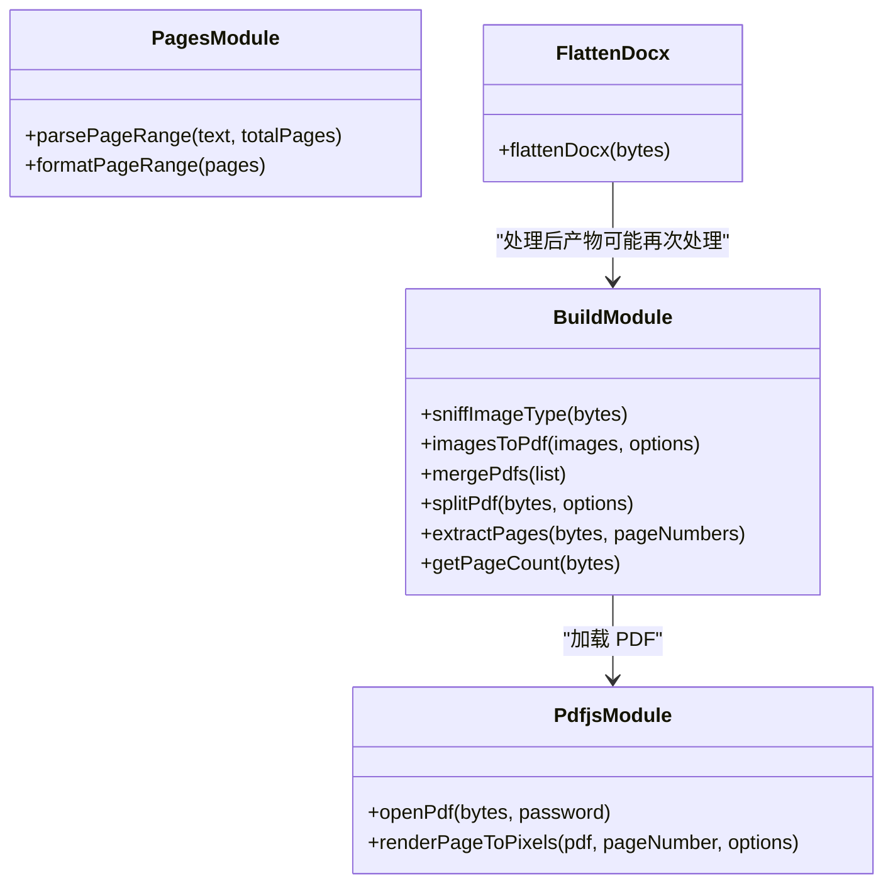
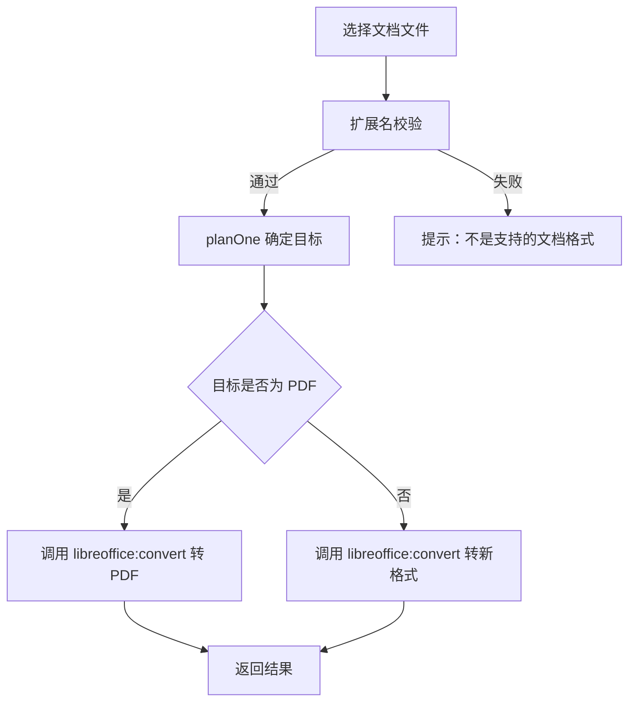
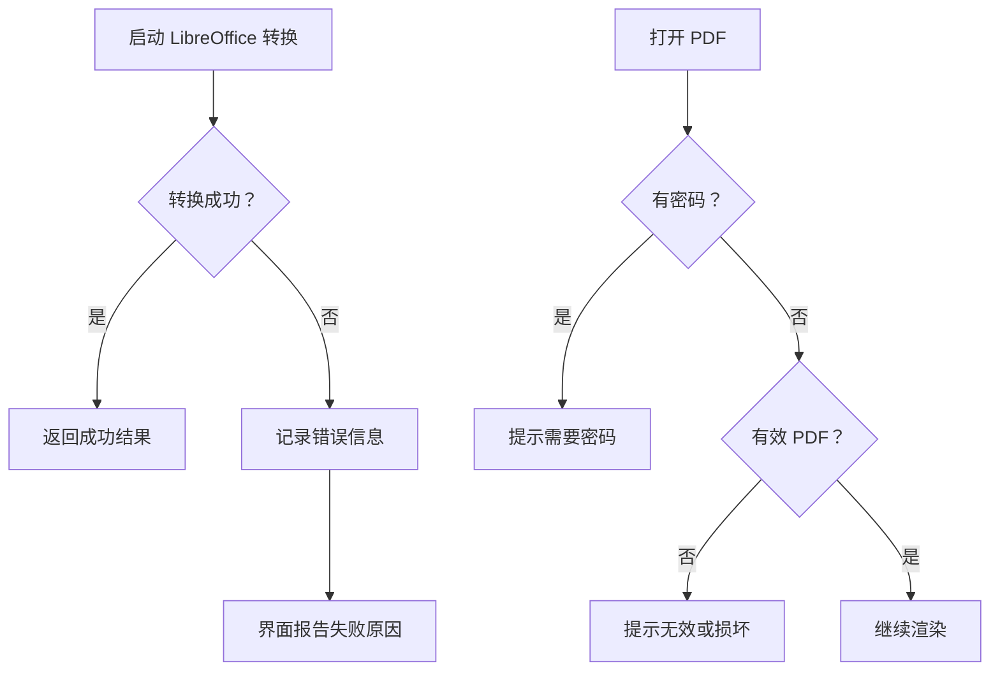
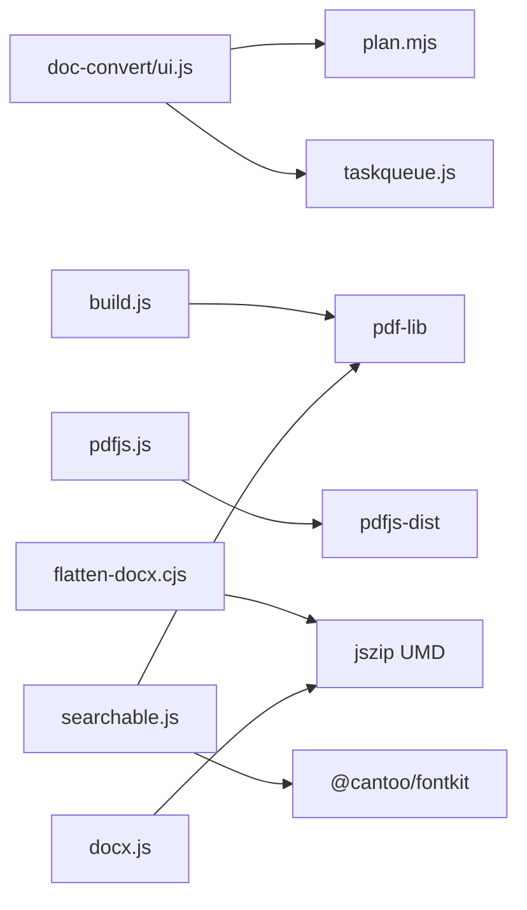

# LibreOffice 集成

<cite>
**本文引用的文件**   
- [README.md](file://README.md)
- [plan.mjs](file://app/src/tools/doc-convert/core/plan.mjs)
- [doc-convert/index.js](file://app/src/tools/doc-convert/index.js)
- [doc-convert/ui.js](file://app/src/tools/doc-convert/ui.js)
- [pdf-convert/index.js](file://app/src/tools/pdf-convert/index.js)
- [build.js](file://app/src/tools/pdf-convert/core/build.js)
- [pages.js](file://app/src/tools/pdf-convert/core/pages.js)
- [pdfjs.js](file://app/src/tools/pdf-convert/core/pdfjs.js)
- [flatten-docx.cjs](file://app/src/tools/pdf-convert/core/flatten-docx.cjs)
- [ocr/convert.js](file://app/src/tools/ocr/core/convert.js)
- [ocr/docx.js](file://app/src/tools/ocr/core/docx.js)
- [ocr/preprocess.js](file://app/src/tools/ocr/core/preprocess.js)
- [ocr/searchable.js](file://app/src/tools/ocr/core/searchable.js)
- [taskqueue.js](file://app/src/shared/taskqueue.js)
</cite>

## 目录
1. [简介](#简介)
2. [项目结构](#项目结构)
3. [核心组件](#核心组件)
4. [架构总览](#架构总览)
5. [详细组件分析](#详细组件分析)
6. [依赖关系分析](#依赖关系分析)
7. [性能与并发策略](#性能与并发策略)
8. [部署与环境配置](#部署与环境配置)
9. [故障排除指南](#故障排除指南)
10. [结论](#结论)

## 简介
本文面向「文档格式转换」与「PDF 转格式」「文字识别」三个工具中涉及 LibreOffice 集成的技术细节，重点说明：
- LibreOffice 进程调用方式、参数传递和结果处理。
- Word / Excel / PowerPoint（含 .pps 与 RTF）到 PDF 的转换流程。
- 文件格式检测、智能目标选择与转换参数动态构建。
- 进程管理与降级机制：LibreOffice 不可用时的行为。
- 内存与大文件处理策略。
- 并发限制与缓存建议。
- 部署安装要求与常见故障排查。

本仓库采用“界面层 + 纯逻辑层 + 主进程外部引擎”的分层设计。文档格式转换的核心规则在纯逻辑模块中定义，界面只负责交互；实际调用由 Electron 主进程提供的 `libreoffice:convert` IPC 通道执行，使用随包 LibreOffice 的 `--convert-to` 能力完成真实转换。

**章节来源**
- [README.md:1-40](file://README.md#L1-L40)

## 项目结构
与 LibreOffice 集成直接相关的代码分布在以下路径：
- 文档格式转换工具：`app/src/tools/doc-convert/`
- PDF 转格式工具：`app/src/tools/pdf-convert/`
- 文字识别工具：`app/src/tools/ocr/`
- 跨工具任务队列：`app/src/shared/taskqueue.js`

**图示来源**
- [doc-convert/ui.js:1-40](file://app/src/tools/doc-convert/ui.js#L1-L40)
- [plan.mjs:1-40](file://app/src/tools/doc-convert/core/plan.mjs#L1-L40)
- [pdf-convert/index.js:1-14](file://app/src/tools/pdf-convert/index.js#L1-L14)
- [build.js:1-20](file://app/src/tools/pdf-convert/core/build.js#L1-L20)
- [pages.js:1-15](file://app/src/tools/pdf-convert/core/pages.js#L1-L15)
- [pdfjs.js:1-20](file://app/src/tools/pdf-convert/core/pdfjs.js#L1-L20)
- [flatten-docx.cjs:1-20](file://app/src/tools/pdf-convert/core/flatten-docx.cjs#L1-L20)
- [ocr/convert.js:1-20](file://app/src/tools/ocr/core/convert.js#L1-L20)
- [ocr/docx.js:1-20](file://app/src/tools/ocr/core/docx.js#L1-L20)
- [ocr/preprocess.js:1-20](file://app/src/tools/ocr/core/preprocess.js#L1-L20)
- [ocr/searchable.js:1-20](file://app/src/tools/ocr/core/searchable.js#L1-L20)
- [taskqueue.js:1-30](file://app/src/shared/taskqueue.js#L1-L30)

**章节来源**
- [doc-convert/index.js:1-14](file://app/src/tools/doc-convert/index.js#L1-L14)
- [pdf-convert/index.js:1-14](file://app/src/tools/pdf-convert/index.js#L1-L14)

## 核心组件
- **文档格式转换规则模块**：维护支持的输入扩展名、家族分类、智能目标映射与显示文案。
- **文档格式转换界面模块**：负责文件添加、扩展名校验、LibreOffice 可用性检测、计划生成、批量执行与结果展示。
- **PDF 构建与页面模块**：负责图片合成 PDF、合并、拆分、提取页，以及 PDF 读取与页面像素渲染。
- **PDF→Word 压平模块**：处理 LibreOffice 生成的大量浮动文本框，还原为普通段落和内嵌图片，避免 Word 打开卡顿。
- **OCR 逻辑模块**：将识别结果转为纯文本、行数据、片段数据，计算 PDF 文字坐标，并生成可搜索 PDF 或可编辑 Word。
- **任务队列模块**：提供跨工具的任务入队、进度上报、取消、历史记录与通道并发控制。

**章节来源**
- [plan.mjs:1-97](file://app/src/tools/doc-convert/core/plan.mjs#L1-L97)
- [doc-convert/ui.js:1-200](file://app/src/tools/doc-convert/ui.js#L1-L200)
- [build.js:1-126](file://app/src/tools/pdf-convert/core/build.js#L1-L126)
- [pages.js:1-49](file://app/src/tools/pdf-convert/core/pages.js#L1-L49)
- [pdfjs.js:1-75](file://app/src/tools/pdf-convert/core/pdfjs.js#L1-L75)
- [flatten-docx.cjs:1-200](file://app/src/tools/pdf-convert/core/flatten-docx.cjs#L1-L200)
- [ocr/convert.js:1-151](file://app/src/tools/ocr/core/convert.js#L1-L151)
- [ocr/docx.js:1-90](file://app/src/tools/ocr/core/docx.js#L1-L90)
- [ocr/preprocess.js:1-200](file://app/src/tools/ocr/core/preprocess.js#L1-L200)
- [ocr/searchable.js:1-174](file://app/src/tools/ocr/core/searchable.js#L1-L174)
- [taskqueue.js:1-200](file://app/src/shared/taskqueue.js#L1-L200)

## 架构总览
LibreOffice 在本项目中以“外部进程 + IPC 调用”的方式被集成：
- 界面层不直接启动 LibreOffice，而是通过 Electron 主进程暴露的 `libreofficeStatus` 和 `libreoffice:convert` 接口。
- 文档格式转换的“能转什么、转成什么”完全由 `plan.mjs` 决定，保证界面不会呈现非法组合。
- 实际转换走主进程的 `libreoffice:convert`，该实现复用随包 LibreOffice 的 `--convert-to`。
- 对于 PDF→Word 的场景，额外引入 `flatten-docx.cjs` 对 LibreOffice 产出的大量浮动对象做后处理。

**图示来源**
- [doc-convert/ui.js:1-40](file://app/src/tools/doc-convert/ui.js#L1-L40)
- [plan.mjs:40-97](file://app/src/tools/doc-convert/core/plan.mjs#L40-L97)

**章节来源**
- [doc-convert/ui.js:1-40](file://app/src/tools/doc-convert/ui.js#L1-L40)
- [plan.mjs:1-40](file://app/src/tools/doc-convert/core/plan.mjs#L1-L40)

## 详细组件分析

### 文档格式转换规则：支持格式、家族与智能目标
`plan.mjs` 是文档转换的“规则中心”，职责包括：
- 定义支持的输入扩展名：`.doc`、`.docx`、`.xls`、`.xlsx`、`.ppt`、`.pptx`、`.pps`、`.rtf`。
- 按家族分类：文字（Word）、表格（Excel）、演示（PPT）。
- 定义智能目标：老格式自动升级到对应新格式。
- 提供 `planOne(ext, params)` 函数，用于判断单个文件是否可转、目标是什么。

关键行为：
- 若扩展名不在支持列表，返回“不是支持的文档格式”。
- 智能模式下，已是新格式的文件返回“无需转换”，提示用户如需 PDF 应显式选择 PDF。
- 手动指定目标时，必须同家族且不能与输入扩展名相同。
- 所有规则都是纯函数，便于单测和界面复用。

**图示来源**
- [plan.mjs:40-97](file://app/src/tools/doc-convert/core/plan.mjs#L40-L97)

**章节来源**
- [plan.mjs:1-97](file://app/src/tools/doc-convert/core/plan.mjs#L1-L97)

### 文档转换界面：LibreOffice 检测、文件校验与执行编排
`doc-convert/ui.js` 承担界面与流程编排职责：
- 初始化下拉选项，绑定 `TARGETS`。
- 调用 `ctx.libreofficeStatus()` 检测 LibreOffice 是否存在，并在界面显示“已检测到 LibreOffice”“未检测到 LibreOffice”等状态。
- 文件添加时对扩展名进行白名单校验，拒绝非支持的文档格式。
- 支持拖拽文件夹，递归列出受支持的文档文件。
- 将每个文件的元信息、智能目标提示渲染到列表。
- 实际转换通过主进程 `libreoffice:convert` 执行，并使用 CPU 通道串行运行，避免 LibreOffice 共用 profile 锁冲突。

LibreOffice 状态处理：
- 若 `libreofficeStatus` 抛出异常，界面降级为“未检测到 LibreOffice”。
- 若检测到加装包或系统安装，分别显示对应来源。
- 未检测到时，界面给出引导：解压加装包到 `addons/libreoffice` 并重开工具。

**图示来源**
- [doc-convert/ui.js:1-200](file://app/src/tools/doc-convert/ui.js#L1-L200)

**章节来源**
- [doc-convert/ui.js:1-200](file://app/src/tools/doc-convert/ui.js#L1-L200)

### PDF 构建、读取与页面操作
PDF 相关能力主要由 `pdf-convert` 工具提供，虽然其主目标是 PDF 转格式，但其中的构建与页面模块与 LibreOffice 集成存在间接协作关系：
- `build.js` 使用 pdf-lib 将图片合成 PDF、合并 PDF、拆分 PDF、提取指定页。
- `pages.js` 提供页码范围解析与格式化。
- `pdfjs.js` 使用 pdfjs-dist 打开 PDF、渲染页面像素，并处理密码保护、无效 PDF 等错误。
- `flatten-docx.cjs` 处理 LibreOffice 从 PDF 导出 Word 后的浮动文本框问题，避免 Word 打开卡死。

**图示来源**
- [build.js:1-126](file://app/src/tools/pdf-convert/core/build.js#L1-L126)
- [pages.js:1-49](file://app/src/tools/pdf-convert/core/pages.js#L1-L49)
- [pdfjs.js:1-75](file://app/src/tools/pdf-convert/core/pdfjs.js#L1-L75)
- [flatten-docx.cjs:1-200](file://app/src/tools/pdf-convert/core/flatten-docx.cjs#L1-L200)

**章节来源**
- [build.js:1-126](file://app/src/tools/pdf-convert/core/build.js#L1-L126)
- [pages.js:1-49](file://app/src/tools/pdf-convert/core/pages.js#L1-L49)
- [pdfjs.js:1-75](file://app/src/tools/pdf-convert/core/pdfjs.js#L1-L75)
- [flatten-docx.cjs:1-200](file://app/src/tools/pdf-convert/core/flatten-docx.cjs#L1-L200)

### LibreOffice 到 PDF 的转换流程
结合 README 与文档转换规则模块，LibreOffice 到 PDF 的转换流程如下：
1. 用户选择 Word / Excel / PowerPoint 或 RTF 文件。
2. 界面根据扩展名和白名单校验文件类型。
3. 规则模块判断是否需要转换，或直接选择 PDF 作为目标。
4. 界面调用主进程 `libreoffice:convert`，传入输入路径和目标。
5. LibreOffice 执行 `--convert-to pdf`，输出 PDF。
6. 界面展示成功或失败结果，并允许用户继续添加文件或清空。

**图示来源**
- [doc-convert/ui.js:1-200](file://app/src/tools/doc-convert/ui.js#L1-L200)
- [plan.mjs:40-97](file://app/src/tools/doc-convert/core/plan.mjs#L40-L97)

**章节来源**
- [README.md:1-40](file://README.md#L1-L40)
- [doc-convert/ui.js:1-200](file://app/src/tools/doc-convert/ui.js#L1-L200)
- [plan.mjs:40-97](file://app/src/tools/doc-convert/core/plan.mjs#L40-L97)

### 进程管理策略：串行执行与资源清理
文档转换工具明确说明：
- 队列走 CPU 通道，并发为 1。
- 原因是 LibreOffice 转换共用同一 profile，并发会撞 profile 锁。
- 任务队列默认 `cpu=1`，未知通道也归为 cpu，保守串行。

这意味着：
- 不建议为文档转换开启高并发。
- 大文件转换会占用较长时间，应通过任务队列的进度与取消能力提升体验。
- 工具 unmount 时不应取消队列中的任务，任务归属队列而非工具页。

**章节来源**
- [doc-convert/ui.js:1-40](file://app/src/tools/doc-convert/ui.js#L1-L40)
- [taskqueue.js:1-30](file://app/src/shared/taskqueue.js#L1-L30)

### 错误处理与降级机制
- LibreOffice 检测失败时，界面显示警告，并引导用户解压加装包。
- LibreOffice 检测 API 抛错时，界面降级为“未检测到 LibreOffice”。
- PDF 打开失败时，pdfjs 模块区分密码保护、无效 PDF 和其他错误，返回友好中文消息。
- PDF 构建模块对加密 PDF 直接拒绝处理。
- OCR 模块将底层英文报错翻译为用户友好的中文消息，例如不支持的图片类型、内存不足、找不到文件、字体缺失等。

**图示来源**
- [doc-convert/ui.js:1-200](file://app/src/tools/doc-convert/ui.js#L1-L200)
- [pdfjs.js:40-75](file://app/src/tools/pdf-convert/core/pdfjs.js#L40-L75)
- [build.js:60-126](file://app/src/tools/pdf-convert/core/build.js#L60-L126)
- [ocr/convert.js:120-151](file://app/src/tools/ocr/core/convert.js#L120-L151)

**章节来源**
- [doc-convert/ui.js:1-200](file://app/src/tools/doc-convert/ui.js#L1-L200)
- [pdfjs.js:40-75](file://app/src/tools/pdf-convert/core/pdfjs.js#L40-L75)
- [build.js:60-126](file://app/src/tools/pdf-convert/core/build.js#L60-L126)
- [ocr/convert.js:120-151](file://app/src/tools/ocr/core/convert.js#L120-L151)

### 内存管理与大文件处理
- LibreOffice 转换属于外部进程，内存压力主要由 LibreOffice 自身承担；界面侧主要关注任务进度与取消。
- PDF 构建与渲染模块在处理大 PDF 时应注意：
  - 渲染页面时使用 `page.cleanup()` 释放页面资源。
  - pdfjs 打开 PDF 时会转移底层 ArrayBuffer，代码中先复制一份，避免原字节失效。
- OCR 预处理模块对像素数组进行原地或新建缓冲操作，适合 node 单测与界面进程复用。
- flatten-docx.cjs 处理大型 docx XML 字符串时放在主进程 CommonJS 模块中，避免卡住界面进程。

**章节来源**
- [pdfjs.js:40-75](file://app/src/tools/pdf-convert/core/pdfjs.js#L40-L75)
- [flatten-docx.cjs:1-200](file://app/src/tools/pdf-convert/core/flatten-docx.cjs#L1-L200)
- [ocr/preprocess.js:1-200](file://app/src/tools/ocr/core/preprocess.js#L1-L200)

### 并发转换限制与缓存机制
- 文档转换推荐串行执行，避免 LibreOffice profile 锁冲突。
- 任务队列提供 `cpu` 与 `io` 两个通道，默认 `cpu=1`、`io=2`。
- 对于 LibreOffice 转换，建议始终使用 `cpu` 通道。
- 缓存方面，当前代码未实现 LibreOffice 转换结果的缓存；可在上层对相同输入+目标的哈希结果做短期缓存，但需考虑 LibreOffice 版本、路径差异和临时文件清理。

**章节来源**
- [doc-convert/ui.js:1-40](file://app/src/tools/doc-convert/ui.js#L1-L40)
- [taskqueue.js:1-30](file://app/src/shared/taskqueue.js#L1-L30)

## 依赖关系分析
LibreOffice 集成涉及的依赖关系可概括为：
- 界面依赖规则模块与上下文 API。
- 规则模块独立于界面，仅维护扩展名、家族、目标映射。
- PDF 模块依赖 pdf-lib、pdfjs-dist、jszip 等第三方库。
- OCR 模块依赖 pdf-lib 分支、fontkit、jszip。
- 任务队列是通用基础设施，被多个工具复用。

**图示来源**
- [doc-convert/ui.js:1-40](file://app/src/tools/doc-convert/ui.js#L1-L40)
- [plan.mjs:1-40](file://app/src/tools/doc-convert/core/plan.mjs#L1-L40)
- [build.js:1-20](file://app/src/tools/pdf-convert/core/build.js#L1-L20)
- [pdfjs.js:1-20](file://app/src/tools/pdf-convert/core/pdfjs.js#L1-L20)
- [flatten-docx.cjs:1-20](file://app/src/tools/pdf-convert/core/flatten-docx.cjs#L1-L20)
- [ocr/searchable.js:1-20](file://app/src/tools/ocr/core/searchable.js#L1-L20)
- [ocr/docx.js:1-20](file://app/src/tools/ocr/core/docx.js#L1-L20)

**章节来源**
- [doc-convert/ui.js:1-40](file://app/src/tools/doc-convert/ui.js#L1-L40)
- [plan.mjs:1-40](file://app/src/tools/doc-convert/core/plan.mjs#L1-L40)
- [build.js:1-20](file://app/src/tools/pdf-convert/core/build.js#L1-L20)
- [pdfjs.js:1-20](file://app/src/tools/pdf-convert/core/pdfjs.js#L1-L20)
- [flatten-docx.cjs:1-20](file://app/src/tools/pdf-convert/core/flatten-docx.cjs#L1-L20)
- [ocr/searchable.js:1-20](file://app/src/tools/ocr/core/searchable.js#L1-L20)
- [ocr/docx.js:1-20](file://app/src/tools/ocr/core/docx.js#L1-L20)

## 性能与并发策略
- **串行优先**：LibreOffice 转换使用 CPU 通道，并发设为 1，避免 profile 锁冲突。
- **分通道调度**：CPU 密集型任务走 `cpu`，IO/CPU 混合任务可考虑 `io`，但文档转换仍建议使用 `cpu`。
- **避免重复渲染**：pdfjs 渲染页面后立即 `cleanup()`，减少内存占用。
- **大文件 XML 处理放主进程**：flatten-docx.cjs 在主进程处理大型 docx XML，避免阻塞界面线程。
- **OCR 预处理纯像素算法**：可被 Node 单测，也适合界面进程对整页位图处理。

[本节为通用性能建议，不直接分析具体文件]

## 部署与环境配置
根据 README 和项目说明：
- 软件为免安装绿色版，随包附带 LibreOffice、ffmpeg、Real-ESRGAN、FunASR、OCR、7-Zip、HiBit、yt-dlp。
- 解压后即可使用全部功能，无需额外安装。
- 若未检测到 LibreOffice，界面提示将加装包解压到 `addons/libreoffice` 后重开工具。
- 开发调试使用仓库内便携版 Node，并通过 npm 安装依赖后启动。

**章节来源**
- [README.md:1-40](file://README.md#L1-L40)
- [doc-convert/ui.js:1-120](file://app/src/tools/doc-convert/ui.js#L1-L120)

## 故障排除指南

### LibreOffice 启动失败或未检测到
- 现象：界面显示“未检测到 LibreOffice”。
- 可能原因：
  - 未解压加装包。
  - 加装包路径不正确。
  - 安装包损坏或缺失。
- 解决方案：
  - 确认已将 LibreOffice 加装包解压到 `addons/libreoffice`。
  - 重启应用重新检测。
  - 若主进程检测 API 抛错，界面会降级为“未检测到 LibreOffice”，此时仍可检查加装包完整性。

**章节来源**
- [doc-convert/ui.js:1-120](file://app/src/tools/doc-convert/ui.js#L1-L120)

### 文档格式不支持
- 现象：添加文件时报“不是支持的文档格式”。
- 可能原因：
  - 扩展名不在 `DOC_EXTS` 列表中。
  - 文件名大小写不一致导致扩展名校验失败。
- 解决方案：
  - 转换为 `.doc`、`.docx`、`.xls`、`.xlsx`、`.ppt`、`.pptx`、`.pps`、`.rtf` 之一。
  - 若需 PDF，请在目标中选择“PDF 文档”。

**章节来源**
- [plan.mjs:1-40](file://app/src/tools/doc-convert/core/plan.mjs#L1-L40)
- [doc-convert/ui.js:120-200](file://app/src/tools/doc-convert/ui.js#L120-L200)

### 已经是新格式却提示无需转换
- 现象：选择 `.docx`、`.xlsx`、`.pptx` 时提示“已是新格式，无需转换”。
- 原因：智能模式只对老格式升级；新格式要转 PDF 需显式选择 PDF。
- 解决方案：
  - 在目标下拉中选择“PDF 文档”。
  - 或手动选择其他目标（需满足同家族规则）。

**章节来源**
- [plan.mjs:40-97](file://app/src/tools/doc-convert/core/plan.mjs#L40-L97)

### 不同家族之间无法转换
- 现象：尝试将 Word 转成 Excel，或 Excel 转成 PPT。
- 原因：规则模块要求手动目标必须与输入扩展名同家族。
- 解决方案：
  - 先转成中间格式，再转目标格式。
  - 或直接转 PDF。

**章节来源**
- [plan.mjs:60-97](file://app/src/tools/doc-convert/core/plan.mjs#L60-L97)

### PDF 打不开或渲染失败
- 现象：打开 PDF 时报密码错误或无效 PDF。
- 可能原因：
  - PDF 设置了打开密码。
  - 文件损坏或非标准 PDF。
- 解决方案：
  - 输入正确密码。
  - 使用其他工具修复 PDF。
  - 避免对加密 PDF 直接做结构修改。

**章节来源**
- [pdfjs.js:40-75](file://app/src/tools/pdf-convert/core/pdfjs.js#L40-L75)
- [build.js:60-126](file://app/src/tools/pdf-convert/core/build.js#L60-L126)

### LibreOffice 转出的 Word 打开卡顿
- 现象：从 PDF 转 Word 后，Word 打开很慢。
- 原因：LibreOffice 将每段文字做成绝对定位浮动文本框，产生大量浮动对象。
- 解决方案：
  - 使用 `flatten-docx.cjs` 进行压平后处理，将浮动对象还原为普通段落和图片内嵌。

**章节来源**
- [flatten-docx.cjs:1-200](file://app/src/tools/pdf-convert/core/flatten-docx.cjs#L1-L200)

### OCR 识别失败或内存不足
- 现象：OCR 报“图片太大导致内存不足”“字体加载失败”“找不到文件”。
- 解决方案：
  - 降低扫描分辨率或使用更小的图片。
  - 确认 `addons/ocr/fonts/NotoSansSC-VF.ttf` 存在。
  - 确认输入文件未被移动或删除。
  - 使用预处理模块进行灰度化、去灰底、纠偏等操作提升识别率。

**章节来源**
- [ocr/convert.js:120-151](file://app/src/tools/ocr/core/convert.js#L120-L151)
- [ocr/preprocess.js:1-200](file://app/src/tools/ocr/core/preprocess.js#L1-L200)

## 结论
本项目对 LibreOffice 的集成遵循“规则与界面分离、外部进程调用、串行安全执行”的设计原则：
- 文档格式转换的规则集中在纯逻辑模块，保证可扩展、可测试。
- 实际转换通过主进程 IPC 调用 LibreOffice，避免界面进程直接管理外部进程。
- 并发控制在任务队列层统一收敛，LibreOffice 转换默认串行，防止 profile 锁冲突。
- PDF 与 OCR 模块提供了完整的构建、渲染、后处理和错误处理链，配合 LibreOffice 形成端到端文档处理能力。
- 部署层面，LibreOffice 作为随包加装包提供，开箱即用；故障排查路径清晰，覆盖检测失败、格式不支持、转换失败和内存问题。

未来可考虑的优化方向包括：
- 在安全前提下增加转换结果缓存。
- 对超大 PDF 增加分页流式处理。
- 提供更细粒度的 LibreOffice 超时控制。
- 增加转换质量回读校验的可配置开关。

[本节为总结性内容，不直接分析具体文件]