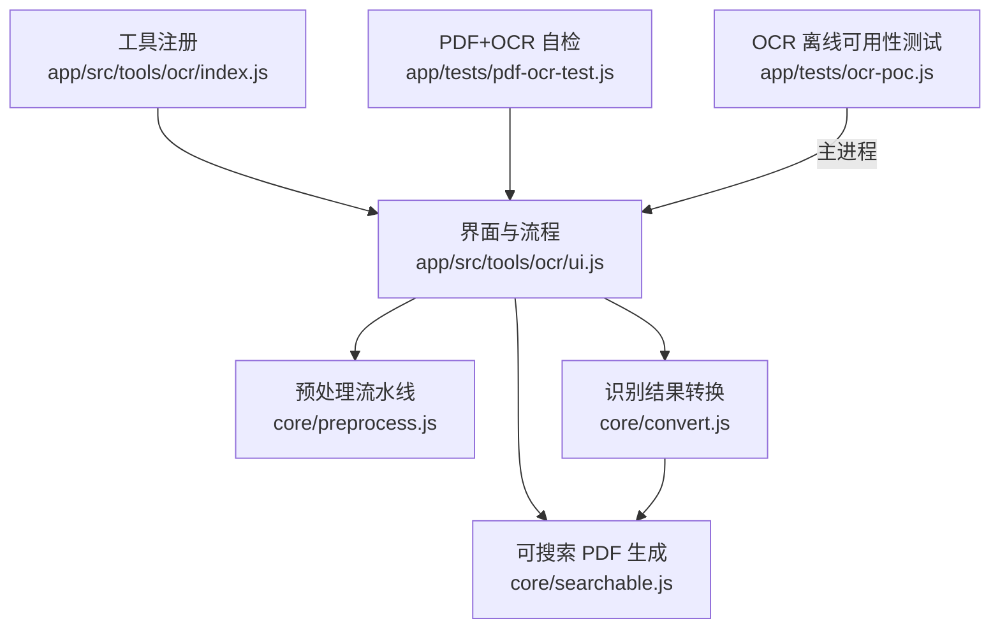
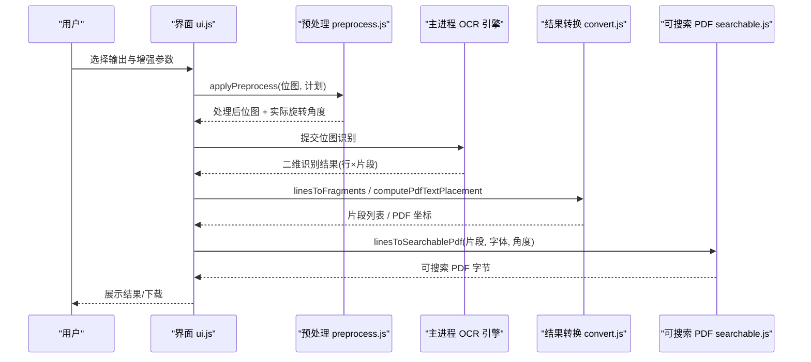
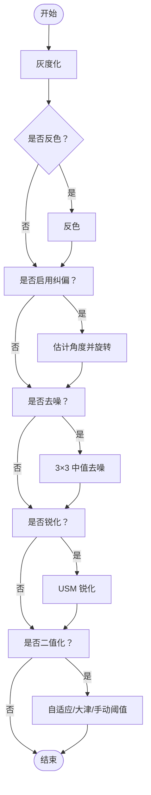
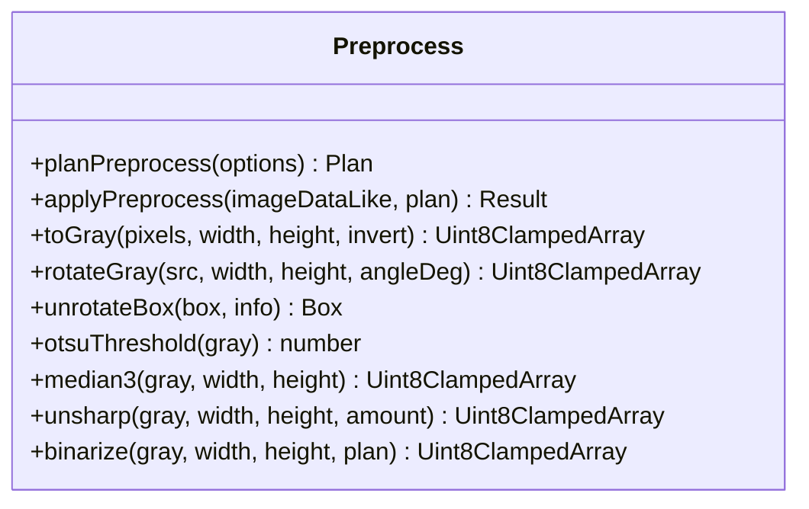
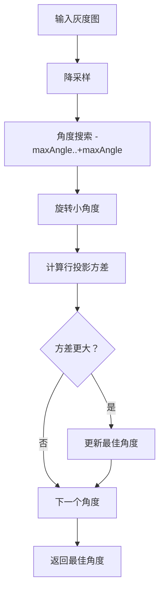
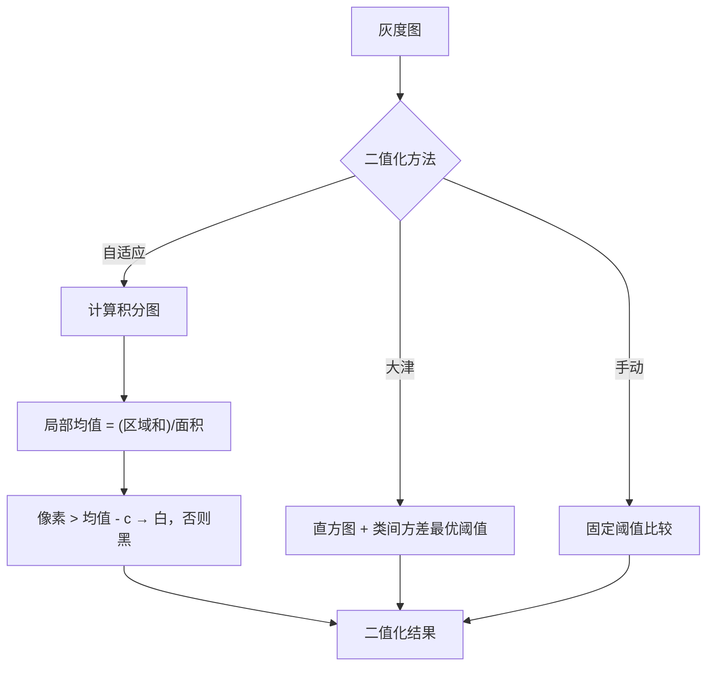
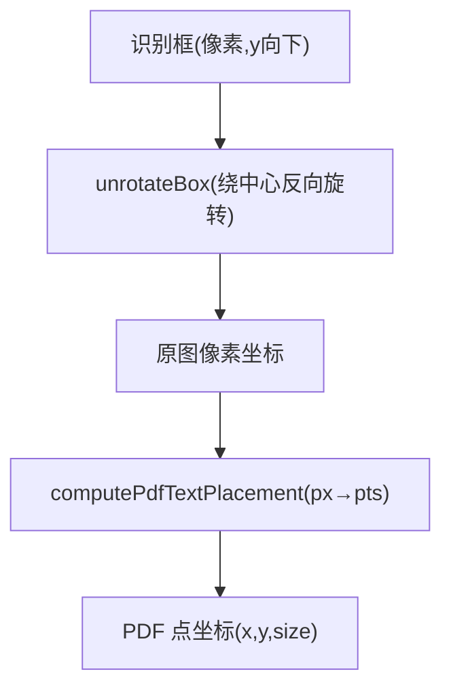
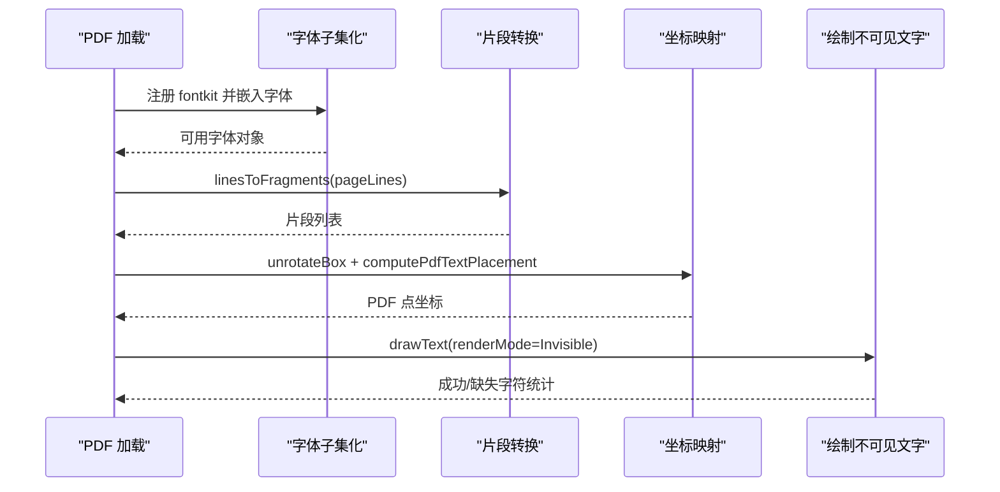
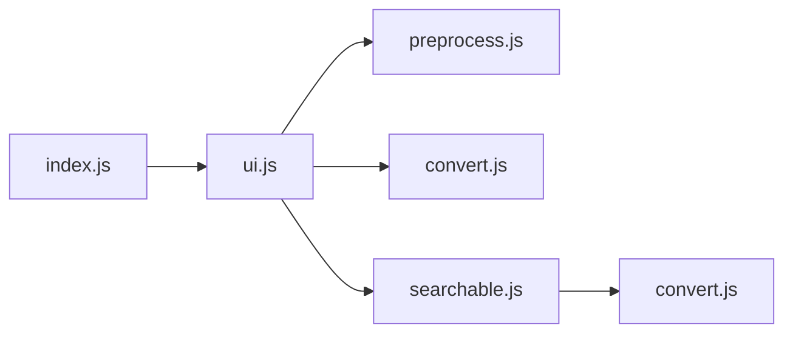

# OCR 引擎集成

<cite>
**本文引用的文件**   
- [app/src/tools/ocr/core/preprocess.js](file://app/src/tools/ocr/core/preprocess.js)
- [app/src/tools/ocr/core/convert.js](file://app/src/tools/ocr/core/convert.js)
- [app/src/tools/ocr/core/searchable.js](file://app/src/tools/ocr/core/searchable.js)
- [app/src/tools/ocr/index.js](file://app/src/tools/ocr/index.js)
- [app/src/tools/ocr/ui.js](file://app/src/tools/ocr/ui.js)
- [app/tests/pdf-ocr-test.js](file://app/tests/pdf-ocr-test.js)
- [app/tests/ocr-poc.js](file://app/tests/ocr-poc.js)
</cite>

## 目录
1. [引言](#引言)
2. [项目结构](#项目结构)
3. [核心组件](#核心组件)
4. [架构总览](#架构总览)
5. [详细组件分析](#详细组件分析)
6. [依赖关系分析](#依赖关系分析)
7. [性能考量](#性能考量)
8. [故障排除指南](#故障排除指南)
9. [结论](#结论)
10. [附录：调参指南](#附录调参指南)

## 引言
本文面向“扫描版图片与 PDF 文字识别”的集成文档，聚焦以下目标：
- 解释 OCR 预处理流水线的处理顺序、默认参数及设计取舍。
- 说明纯像素算法如何在 Node.js 与浏览器环境复用同一套逻辑。
- 讲解投影方差纠偏、自适应阈值二值化等关键算法。
- 说明坐标变换机制，使旋转后的识别框能映射回原图坐标。
- 描述 PDF 可搜索层生成流程：文本定位、透明覆盖层创建、字体子集化与缺失字符处理。
- 给出性能优化策略、调参建议与常见问题排查方法。

本仓库中的 OCR 能力由工具声明、界面编排、纯逻辑层（预处理、结果转换、PDF 可搜索层）以及测试脚本组成；真正的 OCR 模型推理在主进程完成，这里重点梳理前端侧与主进程之间的数据契约、预处理与输出管线。

**章节来源**
- [app/src/tools/ocr/index.js:1-14](file://app/src/tools/ocr/index.js#L1-L14)
- [app/src/tools/ocr/ui.js:1-30](file://app/src/tools/ocr/ui.js#L1-L30)
- [app/tests/ocr-poc.js:1-30](file://app/tests/ocr-poc.js#L1-L30)

## 项目结构
OCR 相关代码位于 `app/src/tools/ocr` 目录，采用“界面 + 纯逻辑层”的分层组织：
- `index.js`：工具注册入口，向应用暴露“文字识别”工具元数据与挂载函数。
- `ui.js`：界面与任务编排，负责用户交互、状态管理、调用主进程 OCR、串联预处理与导出。
- `core/preprocess.js`：纯像素预处理流水线（灰度、反色、纠偏、去噪、锐化、二值化）。
- `core/convert.js`：识别结果到文本、行级矩形、片段级数据的转换，以及像素坐标到 PDF 点坐标换算。
- `core/searchable.js`：在 PDF 上叠加隐形文字层，生成可搜索 PDF。
- 测试脚本：`pdf-ocr-test.js` 汇总 OCR 自检；`ocr-poc.js` 验证离线 OCR 可用性、召回与耗时。

**图表来源**
- [app/src/tools/ocr/index.js:1-14](file://app/src/tools/ocr/index.js#L1-L14)
- [app/src/tools/ocr/ui.js:1-30](file://app/src/tools/ocr/ui.js#L1-L30)
- [app/src/tools/ocr/core/preprocess.js:1-25](file://app/src/tools/ocr/core/preprocess.js#L1-L25)
- [app/src/tools/ocr/core/convert.js:1-12](file://app/src/tools/ocr/core/convert.js#L1-L12)
- [app/src/tools/ocr/core/searchable.js:1-12](file://app/src/tools/ocr/core/searchable.js#L1-L12)
- [app/tests/pdf-ocr-test.js:1-20](file://app/tests/pdf-ocr-test.js#L1-L20)
- [app/tests/ocr-poc.js:1-30](file://app/tests/ocr-poc.js#L1-L30)

**章节来源**
- [app/src/tools/ocr/index.js:1-14](file://app/src/tools/ocr/index.js#L1-L14)
- [app/src/tools/ocr/ui.js:1-30](file://app/src/tools/ocr/ui.js#L1-L30)

## 核心组件
- 预处理流水线：以纯像素数组为输入输出，避免 DOM/Canvas 耦合，便于单元测试和跨环境复用。
- 结果转换：将二维识别结果（行×片段）转换为纯文本、行级矩形、片段级数据，并实现像素坐标到 PDF 点坐标的换算。
- 可搜索 PDF：使用 pdf-lib 在原页面上绘制不可见文字层，支持字体子集化与缺失字符统计。
- 工具注册与界面：对外暴露“文字识别”工具，内部编排渲染倍率、批量处理、压缩与输出模式。

**章节来源**
- [app/src/tools/ocr/core/preprocess.js:1-25](file://app/src/tools/ocr/core/preprocess.js#L1-L25)
- [app/src/tools/ocr/core/convert.js:1-12](file://app/src/tools/ocr/core/convert.js#L1-L12)
- [app/src/tools/ocr/core/searchable.js:1-12](file://app/src/tools/ocr/core/searchable.js#L1-L12)
- [app/src/tools/ocr/index.js:1-14](file://app/src/tools/ocr/index.js#L1-L14)

## 架构总览
OCR 整体工作流如下：
1. 用户在界面选择输出类型（可搜索 PDF、纯文本、Word、两者），并配置扫描件增强选项。
2. 对图片/PDF 页面进行渲染，得到位图；必要时先做 PDF 瘦身或转黑白以降低内存。
3. 预处理流水线对位图执行灰度化、可选反色、纠偏、可选去噪、可选锐化、二值化。
4. 主进程运行 OCR 引擎，返回二维识别结果（行×片段），每个片段包含文本、置信度与像素框。
5. 结果转换模块将片段拼接成文本，或将片段转为 PDF 可见位置（y 向上点坐标）。
6. 若输出可搜索 PDF，则在每页绘制不可见文字层；缺失字符会记录样本供提示。
7. 最终输出文本、Word 或可搜索 PDF，并在界面中提供预览与复制功能。

**图表来源**
- [app/src/tools/ocr/ui.js:1-30](file://app/src/tools/ocr/ui.js#L1-L30)
- [app/src/tools/ocr/core/preprocess.js:360-396](file://app/src/tools/ocr/core/preprocess.js#L360-L396)
- [app/src/tools/ocr/core/convert.js:110-151](file://app/src/tools/ocr/core/convert.js#L110-L151)
- [app/src/tools/ocr/core/searchable.js:80-174](file://app/src/tools/ocr/core/searchable.js#L80-L174)

## 详细组件分析

### 预处理流水线设计与默认参数
预处理固定顺序为：
1. 灰度化
2. 反色（可选）
3. 纠偏（投影方差搜索微角度）
4. 中值去噪（可选，默认关闭）
5. USM 锐化（可选）
6. 二值化/去灰底（自适应阈值、大津法或手动阈值）

`PREPROCESS_DEFAULTS` 定义了界面对应勾选项的默认行为：
- 灰度化：默认开启。
- 反色：默认关闭，用于深底浅字扫描件。
- 纠偏：默认关闭；可设置最大搜索角度与最小触发角度。
- 中值去噪：默认关闭，因为实测可能降低字符召回。
- 锐化：默认关闭；可调强度。
- 二值化：默认开启；默认使用自适应阈值。
- 自适应阈值窗口与偏移：默认窗口为奇数，偏移控制背景判定。
- 大津法或手动阈值：可通过 method 切换。

这些默认值来源于实际夹具测试结果，强调“保留字符召回”，而非盲目追求图像干净。

**图表来源**
- [app/src/tools/ocr/core/preprocess.js:1-25](file://app/src/tools/ocr/core/preprocess.js#L1-L25)
- [app/src/tools/ocr/core/preprocess.js:360-396](file://app/src/tools/ocr/core/preprocess.js#L360-L396)

**章节来源**
- [app/src/tools/ocr/core/preprocess.js:1-25](file://app/src/tools/ocr/core/preprocess.js#L1-L25)
- [app/src/tools/ocr/core/preprocess.js:360-396](file://app/src/tools/ocr/core/preprocess.js#L360-L396)

### 纯像素算法与跨环境复用
预处理模块以 Uint8ClampedArray 单通道灰度图为输入输出，不访问 DOM、Canvas 或 Electron API。这样带来两个好处：
- Node.js 单元测试可直接传入像素缓冲，无需图形环境。
- 浏览器渲染进程中，可直接对已渲染整页位图的像素数据进行原地处理。

关键接口包括：
- `planPreprocess`：根据用户选项生成标准化处理计划，并构建步骤说明字符串。
- `applyPreprocess`：按计划就地改写像素数据，返回处理信息与旋转角度。
- `toGray`、`rotateGray`、`unrotateBox`、`otsuThreshold`、`median3`、`unsharp`、`binarize`：基础算子。

这些函数仅依赖数值计算与数组操作，因此可在 Node.js 与浏览器中复用相同逻辑。

**图表来源**
- [app/src/tools/ocr/core/preprocess.js:25-396](file://app/src/tools/ocr/core/preprocess.js#L25-L396)

**章节来源**
- [app/src/tools/ocr/core/preprocess.js:25-396](file://app/src/tools/ocr/core/preprocess.js#L25-L396)

### 投影方差纠偏算法
纠偏的核心思路是寻找一个微小旋转角度，使得文字行的“墨迹分布”最稳定。具体实现：
- 降采样：为避免全尺寸旋转开销，先将灰度图按长边限制降采样，使用盒平均采样。
- 行投影方差：对每一行计算灰度和（取“墨的多少”），再计算所有行的方差；水平文字行会使方差增大。
- 角度搜索：在 ±maxAngle 范围内按步长尝试旋转，选择方差最大的角度作为最佳纠偏角。
- 旋转与裁回：`rotateGray` 绕图像中心反向映射采样，保持输出与原图同尺寸，便于后续识别框映射。

**图表来源**
- [app/src/tools/ocr/core/preprocess.js:270-359](file://app/src/tools/ocr/core/preprocess.js#L270-L359)

**章节来源**
- [app/src/tools/ocr/core/preprocess.js:270-359](file://app/src/tools/ocr/core/preprocess.js#L270-L359)

### 自适应阈值与二值化
二值化有三种方式：
- 自适应阈值：基于积分图快速计算局部均值，像素大于“局部均值 - c”判为背景（白色），否则前景（黑色）。适合不均匀灰底。
- 大津法：全局双峰直方图最优阈值，适用于对比度较好的图像。
- 手动阈值：用户指定 0~255 阈值。

自适应阈值通过积分图加速局部求和，复杂度接近 O(w×h)，比逐像素滑动窗口更高效。

**图表来源**
- [app/src/tools/ocr/core/preprocess.js:220-269](file://app/src/tools/ocr/core/preprocess.js#L220-L269)

**章节来源**
- [app/src/tools/ocr/core/preprocess.js:220-269](file://app/src/tools/ocr/core/preprocess.js#L220-L269)

### 坐标变换机制
OCR 返回的框是“渲染位图的像素坐标”，原点左上、y 向下；而 PDF 坐标系是点坐标，y 向上。因此需要两步换算：
1. 纠偏后识别框映射回原图坐标：`unrotateBox` 将四个角绕中心反向旋转，再取外接矩形。
2. 像素坐标到 PDF 点坐标：`computePdfTextPlacement` 根据页面高度与渲染高度计算 pxPerPt，再换算 x、y、size。

**图表来源**
- [app/src/tools/ocr/core/preprocess.js:140-169](file://app/src/tools/ocr/core/preprocess.js#L140-L169)
- [app/src/tools/ocr/core/convert.js:110-151](file://app/src/tools/ocr/core/convert.js#L110-L151)

**章节来源**
- [app/src/tools/ocr/core/preprocess.js:140-169](file://app/src/tools/ocr/core/preprocess.js#L140-L169)
- [app/src/tools/ocr/core/convert.js:110-151](file://app/src/tools/ocr/core/convert.js#L110-L151)

### PDF 可搜索层生成过程
可搜索 PDF 的生成流程：
1. 加载原 PDF，检查页面旋转角度；若页面本身旋转，则跳过该页并记录。
2. 加载中文字体并启用子集化，减少体积。
3. 将每页 OCR 结果转为片段列表，过滤低置信度片段。
4. 对每个片段，若开启纠偏，先用 `unrotateBox` 将框从旋转后的渲染图坐标映射回原图坐标。
5. 使用 `computePdfTextPlacement` 把像素框换算为 PDF 点坐标。
6. 用 TextRenderingMode.Invisible 绘制不可见文字层；字体不含字符时逐个字符确认并统计缺失样本。
7. 保存 PDF，返回绘制统计与缺失字符信息。

**图表来源**
- [app/src/tools/ocr/core/searchable.js:80-174](file://app/src/tools/ocr/core/searchable.js#L80-L174)
- [app/src/tools/ocr/core/convert.js:90-151](file://app/src/tools/ocr/core/convert.js#L90-L151)

**章节来源**
- [app/src/tools/ocr/core/searchable.js:80-174](file://app/src/tools/ocr/core/searchable.js#L80-L174)
- [app/src/tools/ocr/core/convert.js:90-151](file://app/src/tools/ocr/core/convert.js#L90-L151)

## 依赖关系分析
OCR 工具的内部依赖如下：
- `index.js` 只负责工具注册与样式挂载，依赖 `ui.js`。
- `ui.js` 编排流程，依赖 `preprocess.js`、`convert.js`、`searchable.js`、`docx.js` 以及共享的 `pdfops.js`、`imageio.js`。
- `preprocess.js` 无外部库依赖，纯数值计算。
- `convert.js` 无外部库依赖，纯数据转换。
- `searchable.js` 依赖 pdf-lib 与 fontkit，并在浏览器端通过 UMD 产物加载 fontkit。

**图表来源**
- [app/src/tools/ocr/index.js:1-14](file://app/src/tools/ocr/index.js#L1-L14)
- [app/src/tools/ocr/ui.js:1-30](file://app/src/tools/ocr/ui.js#L1-L30)
- [app/src/tools/ocr/core/searchable.js:1-12](file://app/src/tools/ocr/core/searchable.js#L1-L12)

**章节来源**
- [app/src/tools/ocr/index.js:1-14](file://app/src/tools/ocr/index.js#L1-L14)
- [app/src/tools/ocr/ui.js:1-30](file://app/src/tools/ocr/ui.js#L1-L30)
- [app/src/tools/ocr/core/searchable.js:1-12](file://app/src/tools/ocr/core/searchable.js#L1-L12)

## 性能考量
- 纯像素算法避免 DOM/Canvas 绑定，便于在 Node.js 与浏览器中复用，且易于批量化处理。
- 纠偏前进行降采样，限制长边长度，显著降低旋转与方差计算的开销。
- 自适应阈值使用积分图加速局部求和，避免重复扫描邻域。
- 界面层维护 PDFJS 文档引用，并提供销毁方法，防止长期占用内存。
- 输出时可启用“扫描件瘦身”，先压缩再识别，减小可搜索 PDF 体积。
- 字体子集化仅嵌入用到的字符，减少 PDF 大小。
- 批量处理：PDF 多页识别时，逐页渲染与叠层，避免一次性加载全部页面。

[本节为通用性能指导，未直接分析具体代码行]

## 故障排除指南
常见症状与对应原因：
- 识别精度低：
  - 灰底严重：开启二值化，优先使用自适应阈值；调整窗口大小与偏移 c。
  - 噪声密集：谨慎开启中值去噪；实测显示去噪可能拉低字符召回。
  - 倾斜明显：开启纠偏，适当扩大 maxAngle，并确保 minAngle 不会误触发。
  - 分辨率过低：提高渲染倍率（PDF_SCALE 默认约 2×），但会增加耗时与内存。
- 处理速度慢：
  - 纠偏角度搜索范围过大：减小 maxAngle 或增大 step。
  - 自适应阈值窗口过大：减小 window，平衡局部平滑与细节保留。
  - 图片尺寸过大：先瘦身或转黑白，降低内存压力。
- 坐标偏移：
  - 忘记将纠偏后的框映射回原图坐标：确保在生成可搜索 PDF 前调用 `unrotateBox`。
  - PDF 页面本身旋转：当前实现会跳过旋转页并记录；需先校正页面方向。
  - 渲染倍率不一致：确保 computePdfTextPlacement 传入正确的 renderScale 与 renderedHeightPx。
- 字体问题：
  - 中文字体缺失：界面会提示缺少 NotoSansSC-VF.ttf；此时只能导出纯文本。
  - 生僻字缺失：系统会统计 missingChars 与 missingSamples，界面可提示用户。
- 内存不足：
  - 图片太大：提示“图片太大导致内存不足”，建议降低分辨率或拆分页面。

**章节来源**
- [app/src/tools/ocr/core/preprocess.js:1-25](file://app/src/tools/ocr/core/preprocess.js#L1-L25)
- [app/src/tools/ocr/core/convert.js:70-151](file://app/src/tools/ocr/core/convert.js#L70-L151)
- [app/src/tools/ocr/core/searchable.js:80-174](file://app/src/tools/ocr/core/searchable.js#L80-L174)
- [app/src/tools/ocr/ui.js:1-200](file://app/src/tools/ocr/ui.js#L1-L200)

## 结论
该 OCR 集成方案将“纯像素预处理”“识别结果转换”“PDF 可搜索层生成”解耦，既保证算法可测试性与跨环境复用，又通过界面层灵活编排渲染倍率、压缩与输出模式。纠偏与坐标变换机制确保旋转后的识别框能正确映射回原图与 PDF 坐标系；自适应阈值与投影方差纠偏在真实扫描件场景中具有较强鲁棒性。对于生产环境，建议结合扫描质量逐步调参，并关注字体覆盖与内存占用。

[本节为总结性内容，未直接分析具体代码行]

## 附录：调参指南
针对不同扫描质量的建议：
- 干净白底、无明显倾斜：
  - 仅开启二值化；灰度化默认开启即可。
  - 纠偏关闭；锐化视清晰度需求开启。
- 灰底、光照不均：
  - 开启二值化，使用自适应阈值；适当增大 window，减小 c 以更好区分背景。
  - 纠偏按需开启；锐化可轻微提升笔画边缘。
- 带椒盐噪声的传真件：
  - 谨慎开启中值去噪；若字符细碎，优先依靠自适应阈值与锐化。
- 轻微倾斜扫描件：
  - 开启纠偏；maxAngle 设为 3~5 度；minAngle 避免过小导致误转。
- 高分辨率大图：
  - 先启用“扫描件瘦身”；必要时降低 PDF_SCALE。
  - 避免同时开启多个重型预处理（去噪、锐化、纠偏、二值化）全部拉满。

**章节来源**
- [app/src/tools/ocr/core/preprocess.js:1-25](file://app/src/tools/ocr/core/preprocess.js#L1-L25)
- [app/src/tools/ocr/ui.js:1-200](file://app/src/tools/ocr/ui.js#L1-L200)