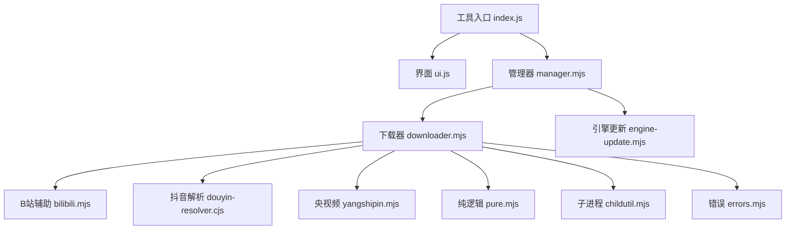
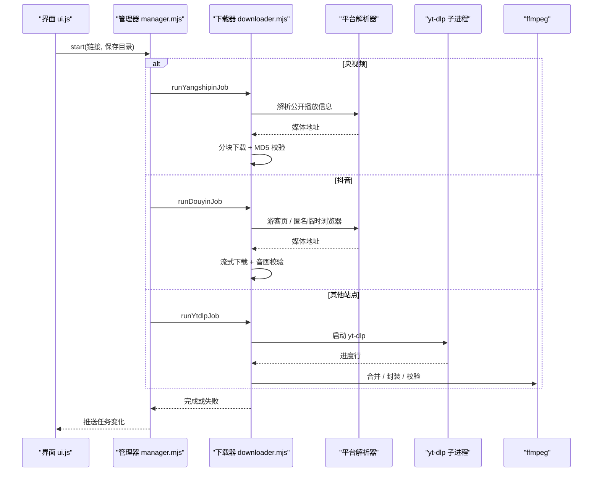
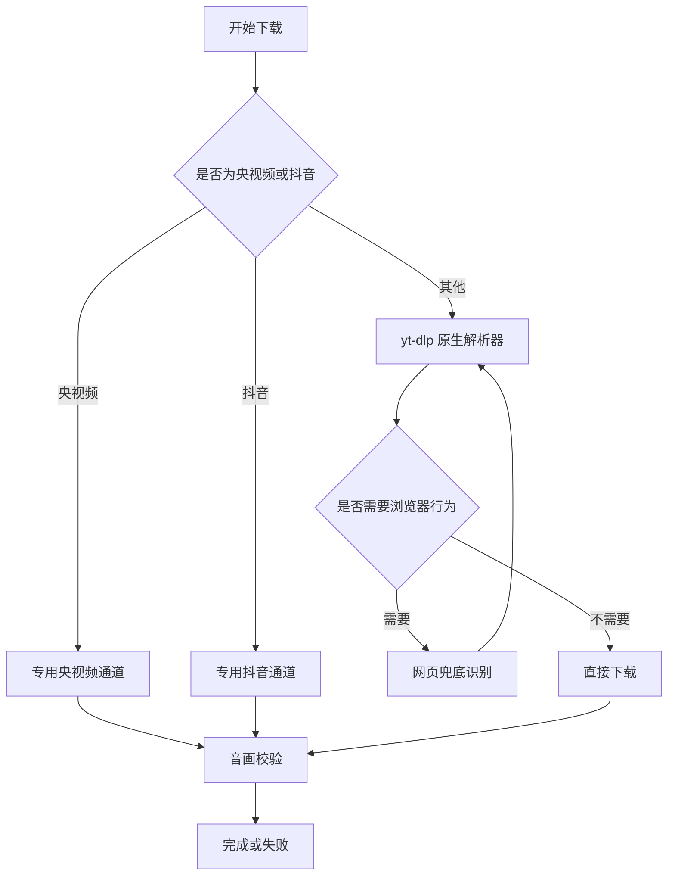
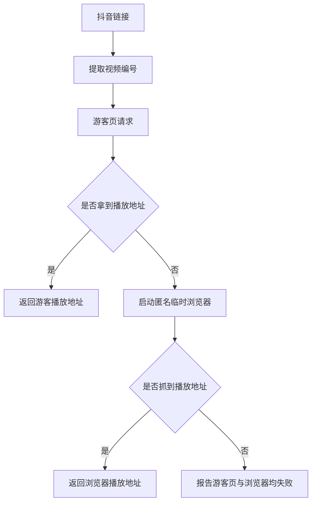
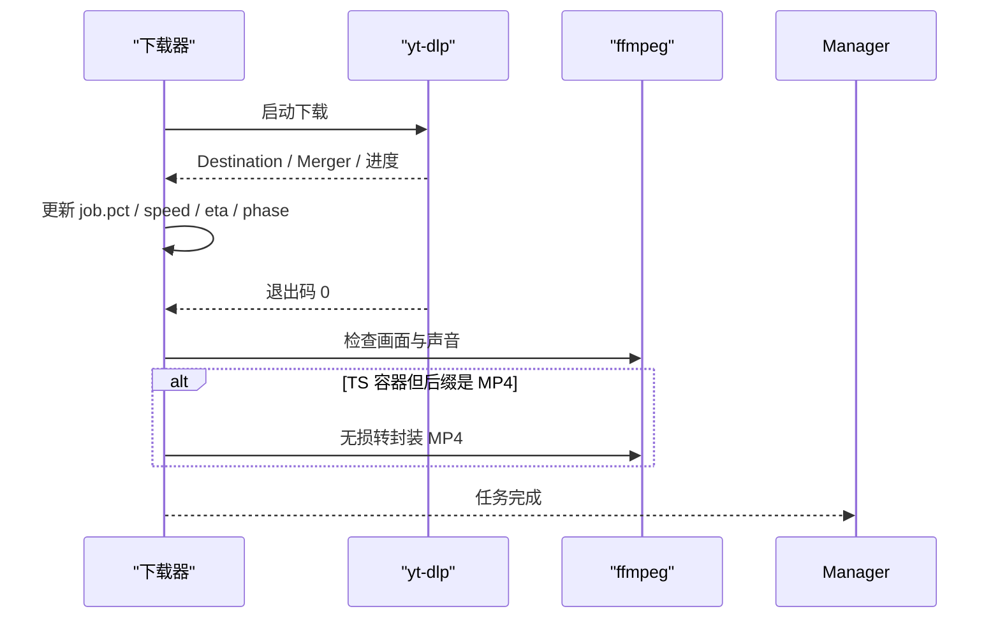
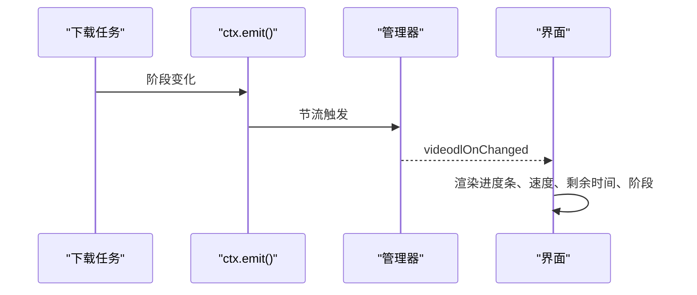
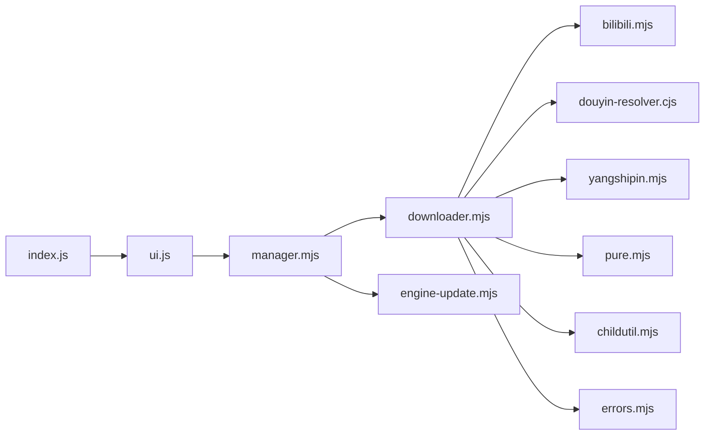

# yt-dlp 集成

<cite>
**本文引用的文件**   
- [index.js](file://app/src/tools/videodl/index.js)
- [ui.js](file://app/src/tools/videodl/ui.js)
- [downloader.mjs](file://app/src/tools/videodl/core/downloader.mjs)
- [manager.mjs](file://app/src/tools/videodl/core/manager.mjs)
- [bilibili.mjs](file://app/src/tools/videodl/core/bilibili.mjs)
- [douyin-resolver.cjs](file://app/src/tools/videodl/core/douyin-resolver.cjs)
- [yangshipin.mjs](file://app/src/tools/videodl/core/yangshipin.mjs)
- [engine-update.mjs](file://app/src/tools/videodl/core/engine-update.mjs)
- [errors.mjs](file://app/src/tools/videodl/core/errors.mjs)
- [pure.mjs](file://app/src/tools/videodl/core/pure.mjs)
- [childutil.mjs](file://app/src/tools/videodl/core/childutil.mjs)
- [README.md](file://README.md)
</cite>

## 目录
1. [简介](#简介)
2. [项目结构](#项目结构)
3. [核心组件](#核心组件)
4. [架构总览](#架构总览)
5. [详细组件分析](#详细组件分析)
6. [依赖关系分析](#依赖关系分析)
7. [性能与并发控制](#性能与并发控制)
8. [错误分类与处理](#错误分类与处理)
9. [代理、Cookie 与用户代理](#代理cookie-与用户代理)
10. [故障排除指南](#故障排除指南)
11. [结论](#结论)

## 简介
本仓库的「视频下载」工具是一个基于 yt-dlp 的视频下载引擎集成。它把外部解析器、网页兜底识别和音画校验整合成一条稳定可取消、可重试、可落盘的历史记录流程，同时提供自更新 yt-dlp 引擎的能力。除「视频下载」外，其余工具保持离线可用；该工具是唯一需要联网的功能模块。

## 项目结构
视频下载功能集中在 `app/src/tools/videodl` 下，分为工具声明、界面、主进程管理器和三类解析实现：

**图表来源**
- [index.js:1-16](file://app/src/tools/videodl/index.js#L1-L16)
- [ui.js:1-350](file://app/src/tools/videodl/ui.js#L1-L350)
- [manager.mjs:1-385](file://app/src/tools/videodl/core/manager.mjs#L1-L385)
- [downloader.mjs:1-584](file://app/src/tools/videodl/core/downloader.mjs#L1-L584)
- [bilibili.mjs:1-37](file://app/src/tools/videodl/core/bilibili.mjs#L1-L37)
- [douyin-resolver.cjs:1-286](file://app/src/tools/videodl/core/douyin-resolver.cjs#L1-L286)
- [yangshipin.mjs:1-213](file://app/src/tools/videodl/core/yangshipin.mjs#L1-L213)
- [pure.mjs:1-132](file://app/src/tools/videodl/core/pure.mjs#L1-L132)
- [childutil.mjs:1-67](file://app/src/tools/videodl/core/childutil.mjs#L1-L67)
- [engine-update.mjs:1-137](file://app/src/tools/videodl/core/engine-update.mjs#L1-L137)

**章节来源**
- [index.js:1-16](file://app/src/tools/videodl/index.js#L1-L16)
- [README.md:1-120](file://README.md#L1-L120)

## 核心组件
- **工具入口**：注册工具标识、名称、分组、排序和挂载方法，并把视频下载定位为唯一联网工具。
- **界面层**：负责粘贴链接、选择保存目录、显示任务列表、引擎状态、检查更新和更新引擎；所有下载状态由主进程通过 IPC 推送。
- **管理器**：主进程门面，负责任务编排、历史记录持久化、yt-dlp 引擎解析与自更新、代理探测、取消、重试和历史清理。
- **下载器**：实现三条下载通道和网页兜底识别，统一进行进度解析、取消检测、音画校验和最终整理。
- **平台解析器**：Bilibili、抖音、央视频各自封装 URL 判断、参数构造、请求安全校验和播放地址获取。
- **通用工具**：纯函数处理 URL 提取、文件名净化、速度/剩余时间格式化、yt-dlp 输出行解析等。
- **子进程工具**：封装 Node 解析器 fork、进程树终止、IPC 取消和 JSON 结果读取。
- **引擎更新**：从 GitHub nightly 查最新版、通过 curl 或 fetch 下载、SHA-256 校验并安装到用户数据目录。

**章节来源**
- [index.js:1-16](file://app/src/tools/videodl/index.js#L1-L16)
- [ui.js:1-350](file://app/src/tools/videodl/ui.js#L1-L350)
- [manager.mjs:1-385](file://app/src/tools/videodl/core/manager.mjs#L1-L385)
- [downloader.mjs:1-584](file://app/src/tools/videodl/core/downloader.mjs#L1-L584)
- [pure.mjs:1-132](file://app/src/tools/videodl/core/pure.mjs#L1-L132)
- [childutil.mjs:1-67](file://app/src/tools/videodl/core/childutil.mjs#L1-L67)
- [engine-update.mjs:1-137](file://app/src/tools/videodl/core/engine-update.mjs#L1-L137)

## 架构总览
视频下载的整体流程是：用户在界面输入链接 → 界面把任务交给主进程 → 管理器按平台分流 → 专用通道处理抖音或央视频 → 其他站点走 yt-dlp 原生解析器 → 必要时进入网页兜底 → 完成后进行音画校验和 MP4 整理 → 历史落盘并通知界面。

**图表来源**
- [ui.js:250-350](file://app/src/tools/videodl/ui.js#L250-L350)
- [manager.mjs:250-385](file://app/src/tools/videodl/core/manager.mjs#L250-L385)
- [downloader.mjs:201-584](file://app/src/tools/videodl/core/downloader.mjs#L201-L584)
- [yangshipin.mjs:1-213](file://app/src/tools/videodl/core/yangshipin.mjs#L1-L213)
- [douyin-resolver.cjs:1-286](file://app/src/tools/videodl/core/douyin-resolver.cjs#L1-L286)

## 详细组件分析

### 下载通道设计
系统采用「专用通道优先、通用解析器兜底、网页识别再兜底、音画校验收尾」的设计：

1. **专用通道**：央视频和抖音有独立解析逻辑，能绕过通用解析器的限制，提供更强的成功率、更可控的错误信息和更强的完整性校验。
2. **原生解析器通道**：Bilibili、YouTube、小红书和其他 yt-dlp 支持的站点都走 yt-dlp，并通过插件、Cookie、代理和用户代理增强兼容性。
3. **网页兜底通道**：当 yt-dlp 判定需要浏览器行为时，使用隔离的临时浏览器解析页面，提取真实媒体地址后再回落到 yt-dlp 下载。
4. **音画校验通道**：无论哪种通道，最终都会用 ffmpeg 检查是否同时包含画面和声音，并对异常 TS 容器做无损转封装。

**图表来源**
- [manager.mjs:300-385](file://app/src/tools/videodl/core/manager.mjs#L300-L385)
- [downloader.mjs:201-584](file://app/src/tools/videodl/core/downloader.mjs#L201-L584)

**章节来源**
- [downloader.mjs:1-200](file://app/src/tools/videodl/core/downloader.mjs#L1-L200)
- [downloader.mjs:201-584](file://app/src/tools/videodl/core/downloader.mjs#L201-L584)
- [manager.mjs:250-385](file://app/src/tools/videodl/core/manager.mjs#L250-L385)

### 下载器上下文注入机制
下载器本身不硬编码外部依赖路径，而是通过管理器注入一个 ctx 对象：

- `ffmpegPath`：ffmpeg 加装包路径，用于合并音视频、封装检查和 MP4 整理。
- `pluginsDir`：yt-dlp 插件目录，例如 Bilibili 插件。
- `resolverDouyin`：抖音匿名临时会话解析脚本路径。
- `resolverBrowser`：网页兜底解析脚本路径。
- `proxy()`：当前代理地址，供 yt-dlp 和平台解析器使用。
- `engine()`：解析出的 yt-dlp 可执行文件及版本、来源、指纹。
- `jsRuntime()`：可选 Node 运行时路径，用于 YouTube 挑战求解。
- `emit()`：节流后的状态推送回调。
- `browserQueue`：网页解析队列，保证最多同时 1 个解析、最多 3 个等待。
- `tempDirName`：每个任务的临时目录前缀。
- `xhsCookieBrowsers`：本地浏览器 Cookie 源列表。

这种注入方式让同一份下载逻辑既能复用随包 yt-dlp，也能切换到已安装的更新版 yt-dlp，还能在不改动下载器的情况下更换插件、解析器和外部工具路径。

**章节来源**
- [manager.mjs:220-300](file://app/src/tools/videodl/core/manager.mjs#L220-L300)
- [downloader.mjs:1-120](file://app/src/tools/videodl/core/downloader.mjs#L1-L120)

### Bilibili 解析器
Bilibili 解析器承担三个职责：

1. **URL 判断**：匹配 `bilibili.com`、`.bilibili.com` 和 `b23.tv`。
2. **参数构造**：添加 B 站 Referer、关闭默认插件目录并挂载工具自带插件、开启格式检查、设置 Socket 超时和重试次数。
3. **连接错误识别**：区分 B 站节点连接失败和普通接口连接失败，给出不同中文提示。

关键设计点：
- 第一次尝试带代理，后续备用尝试使用空代理直连，避免代理端口不可用导致整场超时。
- 插件目录通过 `pluginDirFor(toolRoot)` 动态计算，不再假设上游 leetools 的固定目录结构。
- 连接失败模式包含超时、TLS、SSL、EOF、Windows 10054、重置连接以及常见 403/412/429/5xx。

**章节来源**
- [bilibili.mjs:1-37](file://app/src/tools/videodl/core/bilibili.mjs#L1-L37)

### 抖音解析器
抖音解析器有两套方案：

#### 游客通道
- 先尝试向字节官方接口申请匿名 `ttwid` Cookie。
- 访问抖音分享页，解析 SSR 中的 `_ROUTER_DATA`。
- 若页面返回 Cookie，则带上 Cookie 再次请求。
- 递归查找匹配 `aweme_id` 且包含 `video.play_addr` 的条目。
- 返回安全的 aweme 播放地址，并附带移动端 User-Agent 和 referer。

#### 匿名临时浏览器兜底
- 在找不到游客页面视频数据时，启动无头 Chrome/Edge 临时会话。
- 通过 DevTools WebSocket 监听网络响应，过滤抖音相关 JSON。
- 找到匹配视频编号后选择兼容码率（优先普通 mp4，排除 h265 和 bytevc1）。
- 解析完成后销毁浏览器、删除临时 profile 目录。

**图表来源**
- [downloader.mjs:120-200](file://app/src/tools/videodl/core/downloader.mjs#L120-L200)
- [douyin-resolver.cjs:1-286](file://app/src/tools/videodl/core/douyin-resolver.cjs#L1-L286)

**章节来源**
- [downloader.mjs:120-200](file://app/src/tools/videodl/core/downloader.mjs#L120-L200)
- [douyin-resolver.cjs:1-286](file://app/src/tools/videodl/core/douyin-resolver.cjs#L1-L286)

### 央视频解析器
央视频使用公开播放器协议，不下载远程 JS、不读取账号：

- 校验分享链接必须来自官方域名，且只支持点播类型。
- 从页面中抽取视频元数据。
- 用 Node 内置 crypto 计算 cKey。
- 调用公开播放接口，验证 DRM、试看、文件大小、MD5、时长和文件名。
- 下载时对内容类型、大小上限、空闲超时和 MD5 哈希进行保护。
- 提供 `verifyFile` 用于断点续传或重复下载场景的快速命中。

**章节来源**
- [yangshipin.mjs:1-213](file://app/src/tools/videodl/core/yangshipin.mjs#L1-L213)

### 网页兜底识别
当 yt-dlp 无法直接解析目标链接时，下载器会判断是否适合使用临时浏览器兜底：

- 最多允许 3 个任务等待网页识别。
- 通过 `runChildJson` 启动 `browser-resolver.cjs`。
- 解析器返回 mediaUrl、referer、userAgent 和 title。
- 下载器对返回值做白名单和安全长度校验。
- 再用这些参数重新调用 yt-dlp 实际下载。

**章节来源**
- [downloader.mjs:500-584](file://app/src/tools/videodl/core/downloader.mjs#L500-L584)
- [childutil.mjs:1-67](file://app/src/tools/videodl/core/childutil.mjs#L1-L67)

### yt-dlp 通用通道
通用通道的核心职责是把 yt-dlp 的输出变成内部 job 状态：

- 构建基础参数：UTF-8、换行输出、禁止播放列表、禁止覆盖、片段重试、并发片段数。
- 自动选择音频视频分离下载并合并为 MP4，前提是检测到 ffmpeg。
- 非 B 站站点注入代理。
- B 站注入插件目录、Referer、空代理备用尝试。
- 小红书首次失败时可尝试读取本地浏览器 Cookie。
- 解析 yt-dlp 输出的 `__FINAL_FILE__`、Destination、Merger、下载百分比、速度和 ETA。
- 下载成功后调用 `finishVideoJob` 进行音画校验和 TS→MP4 转封装。

**图表来源**
- [downloader.mjs:520-584](file://app/src/tools/videodl/core/downloader.mjs#L520-L584)
- [pure.mjs:80-132](file://app/src/tools/videodl/core/pure.mjs#L80-L132)

**章节来源**
- [downloader.mjs:520-584](file://app/src/tools/videodl/core/downloader.mjs#L520-L584)
- [pure.mjs:80-132](file://app/src/tools/videodl/core/pure.mjs#L80-L132)

### 进程树管理与优雅终止
系统管理两类子进程：

1. **yt-dlp 下载子进程**：通过 `spawn` 启动，错误输出和标准输出分别收集尾部日志；用户取消时调用 `killProcessTree`。
2. **解析器子进程**：通过 `forkNode` 以 Electron Node 模式运行，支持 IPC 发送 `cancel`；若无 IPC 则回退为强制杀进程树。

优雅终止策略：
- 先尝试通过 IPC 取消解析器。
- 如果解析器未连接，直接杀进程树。
- 15 秒后仍未退出则强制杀死。
- Windows 上使用 `taskkill /T /F` 确保杀死子进程树。
- 下载器同时维护 `_killResolver`、`_killDownload` 和 `_aborter`，分别对应解析器、yt-dlp 和网络流中断。

**章节来源**
- [childutil.mjs:1-67](file://app/src/tools/videodl/core/childutil.mjs#L1-L67)
- [downloader.mjs:1-120](file://app/src/tools/videodl/core/downloader.mjs#L1-L120)
- [manager.mjs:330-385](file://app/src/tools/videodl/core/manager.mjs#L330-L385)

### 进度推送系统
进度推送由 `ctx.emit()` 驱动，管理器侧做了节流：

- 正常状态变更每 400ms 批量推送一次，避免频繁重绘。
- 终态（完成、失败、取消）立即推送。
- 界面订阅 `videodlOnChanged` 刷新任务列表。
- 引擎更新进度通过 `videodlOnEngineProgress` 单独推送。
- 界面侧 `waitForTerminal` 会持续监听任务变化，直到任务到达终态。

**图表来源**
- [manager.mjs:20-80](file://app/src/tools/videodl/core/manager.mjs#L20-L80)
- [ui.js:200-350](file://app/src/tools/videodl/ui.js#L200-L350)

**章节来源**
- [manager.mjs:10-120](file://app/src/tools/videodl/core/manager.mjs#L10-L120)
- [ui.js:200-350](file://app/src/tools/videodl/ui.js#L200-L350)

### 引擎自更新机制
yt-dlp 引擎更新遵循以下约束：

- 随包版本位于 `addons/ytdlp/yt-dlp.exe`，作为兜底。
- 更新版写入用户数据目录 `userdata/videodl-engine`，不修改软件本体。
- 最新版本从 GitHub nightly releases 查询，要求 tag、下载链接和 sha256 摘要齐全。
- 下载优先使用 Windows 自带 `curl.exe`，以便走代理；没有时才退回 Node fetch。
- 校验失败时丢弃部分文件，不替换现有引擎。
- 安装时生成 `manifest.json`，并使用原子写防止半写状态。
- 读取已安装引擎时会重新校验文件 sha256，不信任 manifest。

**章节来源**
- [engine-update.mjs:1-137](file://app/src/tools/videodl/core/engine-update.mjs#L1-L137)
- [manager.mjs:120-220](file://app/src/tools/videodl/core/manager.mjs#L120-L220)

## 依赖关系分析

**图表来源**
- [index.js:1-16](file://app/src/tools/videodl/index.js#L1-L16)
- [ui.js:1-350](file://app/src/tools/videodl/ui.js#L1-L350)
- [manager.mjs:1-385](file://app/src/tools/videodl/core/manager.mjs#L1-L385)
- [downloader.mjs:1-584](file://app/src/tools/videodl/core/downloader.mjs#L1-L584)

**章节来源**
- [downloader.mjs:1-120](file://app/src/tools/videodl/core/downloader.mjs#L1-L120)
- [manager.mjs:1-120](file://app/src/tools/videodl/core/manager.mjs#L1-L120)

## 性能与并发控制
- **最大并发下载数**：管理器限制同时最多 3 个视频下载任务。
- **网页解析并发**：网页兜底解析最多 1 个正在执行，最多 3 个排队等待。
- **yt-dlp 片段并发**：默认 `--concurrent-fragments=8`，适合 HLS/M3U8 等分段视频。
- **进度节流**：状态推送节流 400ms，降低 UI 重绘压力。
- **带宽与超时**：yt-dlp 使用 Socket 超时、多次重试和片段重试；抖音和央视频通道对空闲超时、内容长度和内容类型做了保护。
- **磁盘 IO**：临时文件放在任务目录下，完成或失败后清理；央视频使用硬链接发布产物，避免重复复制大文件。
- **ffmpeg 缺失降级**：没有 ffmpeg 时仍可下载单轨道文件，但无法合并音视频，也无法做音画校验。

建议：
- 在带宽受限环境中减少并发任务数量。
- 对于 M3U8/HLS 资源，优先确保 yt-dlp 版本足够新，以获得更好的片段解析能力。
- 如果 YouTube 遇到挑战问题，确保安装了随包的 Node 运行时，使 yt-dlp 能求解 JavaScript 挑战。
- 不要手动移动 `addons/ytdlp` 下的 yt-dlp，否则管理器会标记为未校验并给出警告。

[本节为通用性能建议，不直接分析具体代码行]

## 错误分类与处理
错误处理分为三层：

1. **站点语义错误**：`errors.mjs` 把 DRM、地区限制、登录限制、403、404、429、超时和连接失败映射为用户可读中文。
2. **平台级错误**：抖音和央视频通道根据 HTTP 状态码、内容类型、文件大小、MD5 和解析结构抛出明确错误。
3. **下载器级错误**：yt-dlp 非零退出时截取最后一段错误文本，并结合 URL 特征判断是否触发网页兜底、小红书登录失败或 B 站节点问题。

典型场景：
- **网络错误**：超时、TLS/SSL、握手失败、连接重置、HTTP 403/429/5xx。
- **格式不支持**：DRM、加密内容、试看、受保护内容、暂不支持的播放格式。
- **用户取消**：任何阶段都会检查 `job.cancelRequested`，并最终把状态设为「已取消」。
- **网页识别失败**：返回无效媒体地址、用户代理非法、浏览器启动超时、匿名会话未找到播放地址。
- **音画校验失败**：最终文件缺少画面或声音，或 TS 转封装失败。

**章节来源**
- [errors.mjs:1-25](file://app/src/tools/videodl/core/errors.mjs#L1-L25)
- [downloader.mjs:201-545](file://app/src/tools/videodl/core/downloader.mjs#L201-L545)
- [manager.mjs:330-385](file://app/src/tools/videodl/core/manager.mjs#L330-L385)

## 代理、Cookie 与用户代理

### 代理配置
- 优先级：环境变量 `HTTPS_PROXY` / `HTTP_PROXY` > 管理器主动探测的本地代理。
- 本地代理探测候选包括 Clash Verge、Clash 常用端口以及常见 socks5 端口，每个端口探测超时约 500ms。
- 抖音和央视频专用通道不会把代理传给临时浏览器，以避免 Clash 内核未运行时产生长时间空转。
- GitHub 更新检查在直连失败时自动回退到 curl 走代理。

### Cookie 管理
- 小红书首次失败时，可尝试读取本地浏览器 Cookie。
- 管理器枚举 Chrome、Edge、Brave、Vivaldi、Chromium、Opera、Firefox 的本地资料目录。
- 若检测到 cookie 数据库被锁定或解密失败，会报告具体的 Cookie 加载错误。

### 用户代理设置
- 抖音游客通道使用移动端 UA。
- 抖音匿名临时浏览器使用桌面端 UA。
- 央视频使用固定的桌面端 UA。
- 网页兜底返回的 userAgent 会被截断到 300 字符，并拒绝包含换行符的值。

**章节来源**
- [manager.mjs:20-120](file://app/src/tools/videodl/core/manager.mjs#L20-L120)
- [downloader.mjs:120-200](file://app/src/tools/videodl/core/downloader.mjs#L120-L200)
- [yangshipin.mjs:1-100](file://app/src/tools/videodl/core/yangshipin.mjs#L1-L100)

## 故障排除指南

### yt-dlp 未就绪
**现象**：界面提示未检测到下载引擎。  
**原因**：`addons/ytdlp/yt-dlp.exe` 不存在或被误删。  
**处理**：
1. 重新解压软件或放回 addons/ytdlp。
2. 点击「检查更新」恢复随包版本。
3. 如需升级，点击「更新引擎」下载安装版 yt-dlp。

**章节来源**
- [ui.js:120-200](file://app/src/tools/videodl/ui.js#L120-L200)
- [manager.mjs:120-200](file://app/src/tools/videodl/core/manager.mjs#L120-L200)
- [downloader.mjs:520-584](file://app/src/tools/videodl/core/downloader.mjs#L520-L584)

### 插件加载失败
**现象**：B 站下载失败、备用地址切换失败。  
**原因**：yt-dlp 插件目录未正确挂载。  
**处理**：
1. 确认工具根目录下的 plugins 目录存在。
2. 确认 B 站插件随包分发。
3. 重启应用，让管理器重新解析插件目录。

**章节来源**
- [bilibili.mjs:1-37](file://app/src/tools/videodl/core/bilibili.mjs#L1-L37)
- [manager.mjs:220-300](file://app/src/tools/videodl/core/manager.mjs#L220-L300)

### 网络连接问题
**现象**：连接网站失败、GitHub 更新检查失败、YouTube 区域限制。  
**处理**：
1. 确认代理已启动并能连通本地代理端口。
2. 国内下载 YouTube 通常需要先启动 Clash 等代理。
3. 地区限制类错误需确认当前网络能在网站上播放完整视频。
4. GitHub 更新失败时，工具会自动尝试 curl 走代理；仍失败需检查防火墙或代理配置。

**章节来源**
- [manager.mjs:80-120](file://app/src/tools/videodl/core/manager.mjs#L80-L120)
- [engine-update.mjs:60-137](file://app/src/tools/videodl/core/engine-update.mjs#L60-L137)
- [errors.mjs:1-25](file://app/src/tools/videodl/core/errors.mjs#L1-L25)

### 抖音下载失败
**现象**：游客页无视频数据、浏览器启动失败、匿名会话超时。  
**处理**：
1. 确保系统已安装 Chrome 或 Edge。
2. 确保本机代理可用，但不要给临时浏览器传入代理。
3. 查看浏览器 stderr 输出，定位启动失败或退出码。
4. 如果游客页和匿名会话都失败，说明该平台可能限制了未登录访问。

**章节来源**
- [downloader.mjs:120-200](file://app/src/tools/videodl/core/downloader.mjs#L120-L200)
- [douyin-resolver.cjs:1-286](file://app/src/tools/videodl/core/douyin-resolver.cjs#L1-L286)

### 音画校验失败
**现象**：下载成功但提示缺少画面或声音。  
**原因**：ffmpeg 未安装、最终文件损坏、HLS 片段不完整。  
**处理**：
1. 安装 ffmpeg 加装包到 `addons/ffmpeg`。
2. 删除临时文件和失败任务后重试。
3. 如果是 HLS 链接，检查网络稳定性。

**章节来源**
- [downloader.mjs:1-120](file://app/src/tools/videodl/core/downloader.mjs#L1-L120)
- [ui.js:120-200](file://app/src/tools/videodl/ui.js#L120-L200)

## 结论
yt-dlp 集成通过「专用通道 + 原生解析器 + 网页兜底 + 音画校验」四层设计，既保留了 yt-dlp 的广泛站点支持，又针对抖音、央视频、B 站等平台做了强化的兼容性和错误处理。管理器侧的任务编排、上下文注入、代理探测、历史记录和引擎自更新，使下载体验更接近现代桌面应用：可观察、可取消、可重试、可审计。

对于扩展者而言，新增平台时应优先考虑专用通道；只有当平台行为高度依赖浏览器或难以静态解析时，才使用网页兜底。对外部依赖一律通过 ctx 注入，避免硬编码路径，从而保持随包版本、更新版和本地环境的兼容性。