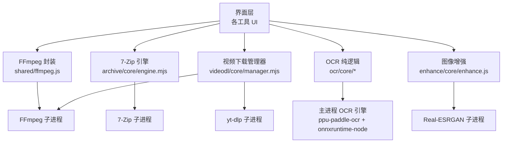
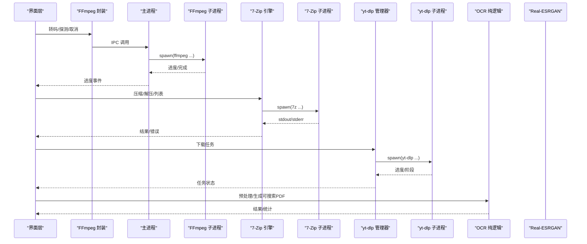
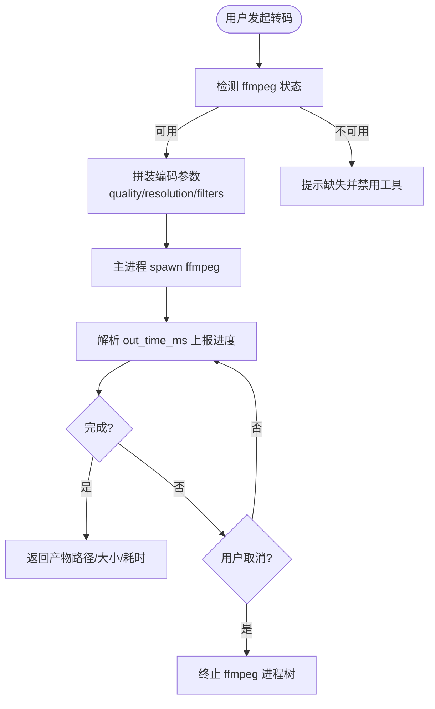
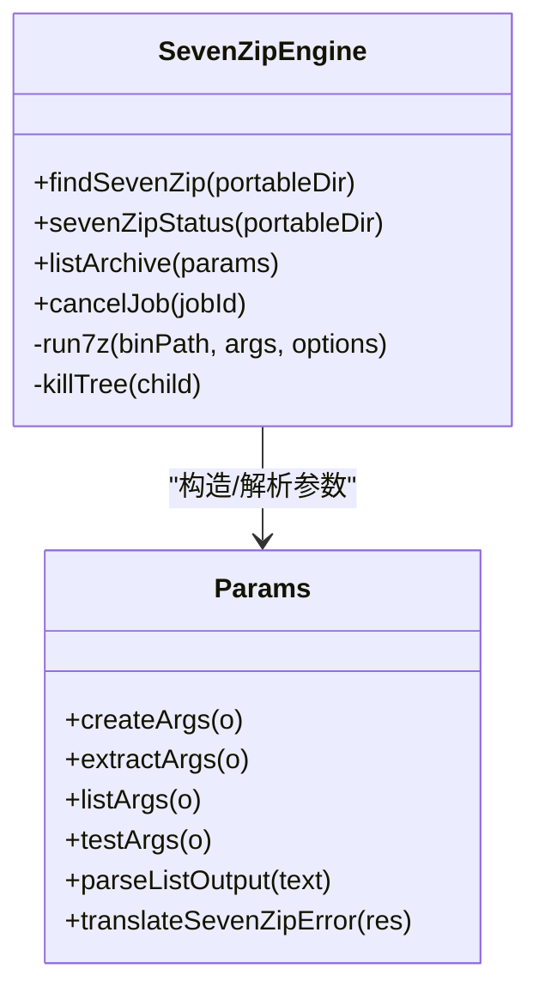
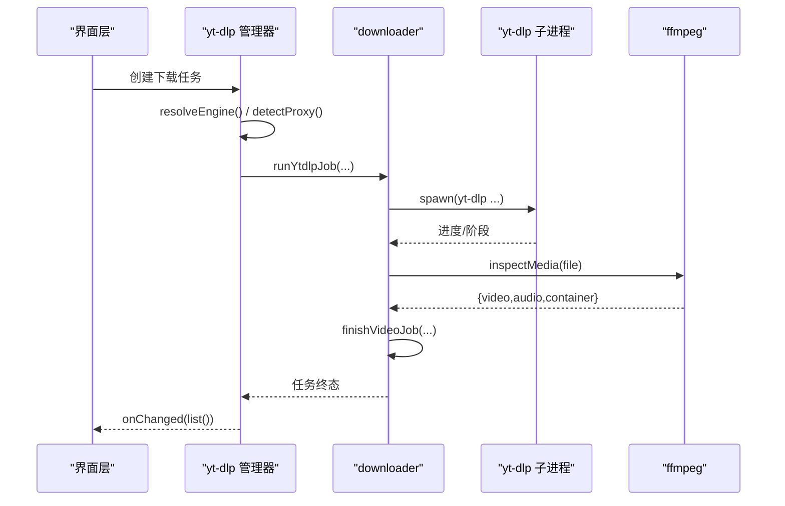
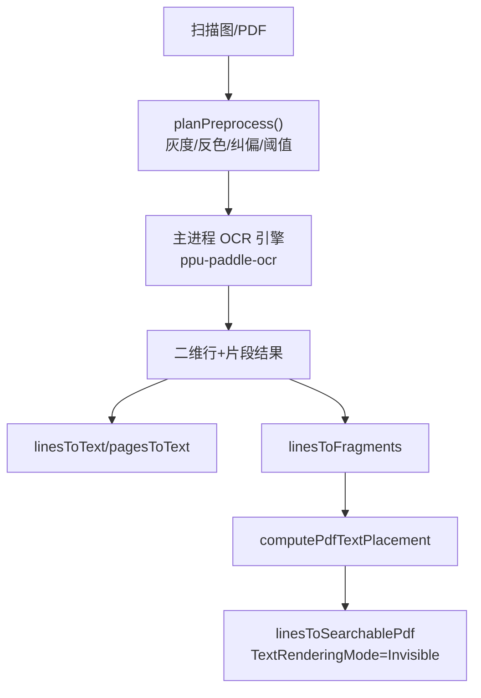
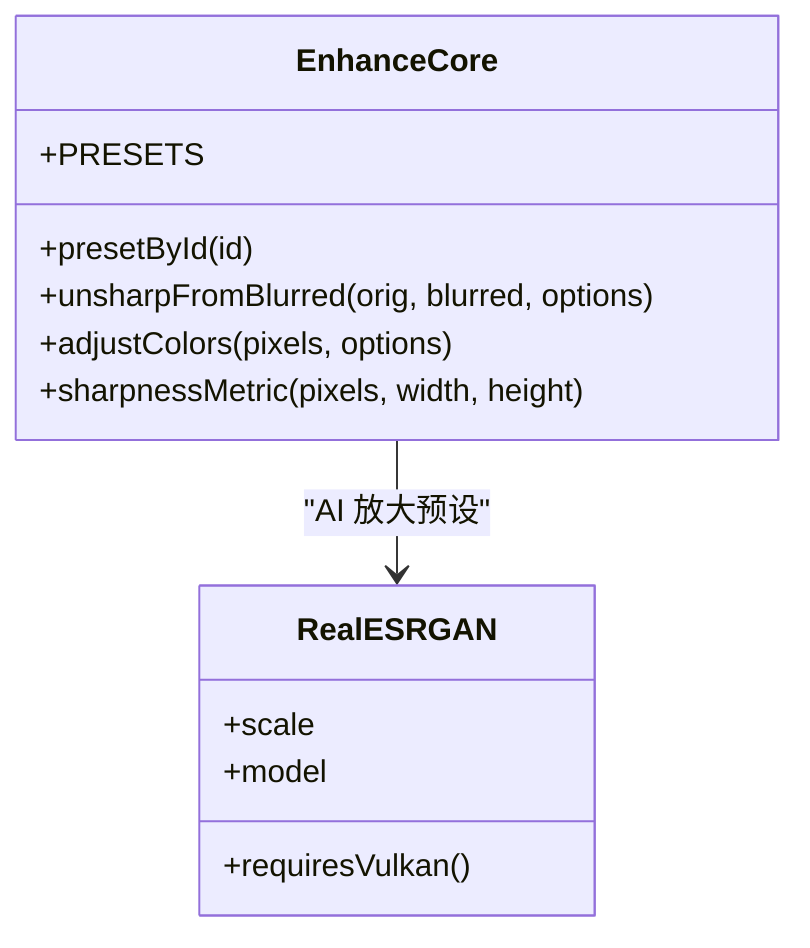
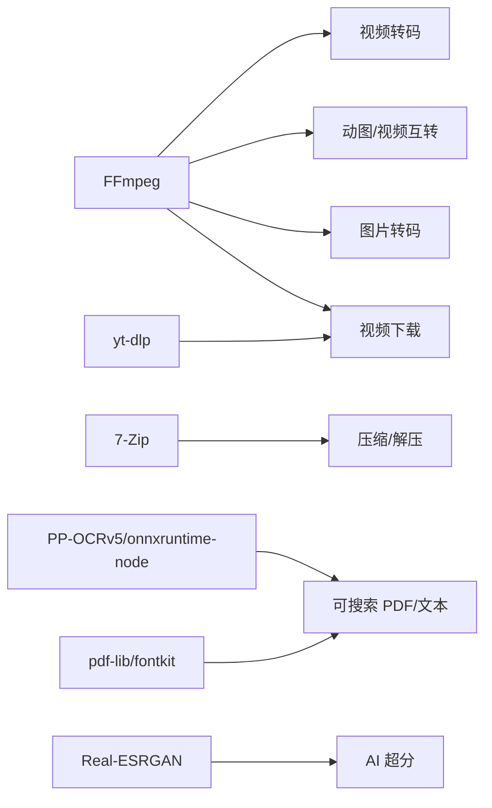
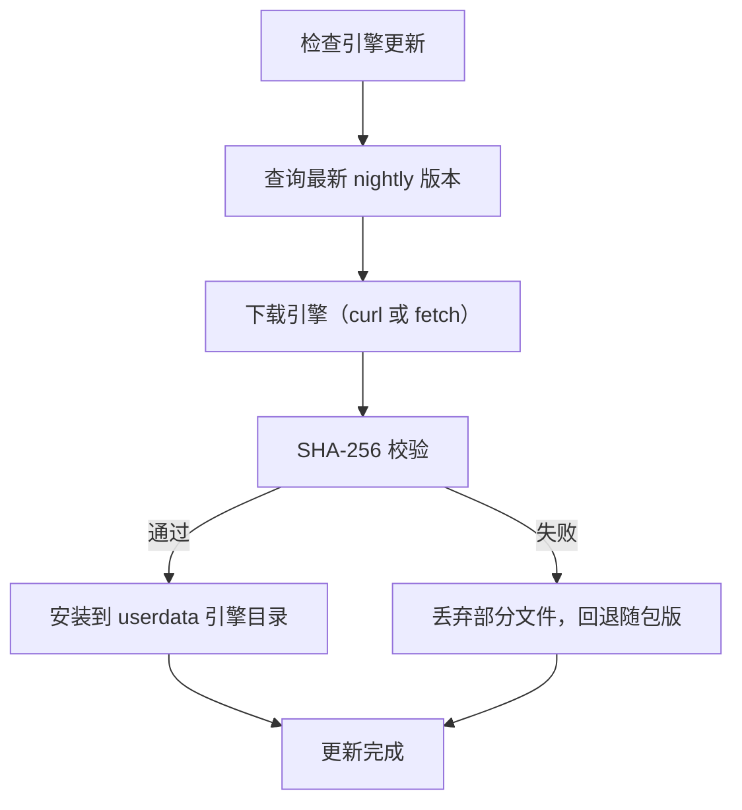

# 外部引擎集成

<cite>
**本文引用的文件**   
- [app/src/shared/ffmpeg.js](file://app/src/shared/ffmpeg.js)
- [spec/modules/video-convert.md](file://spec/modules/video-convert.md)
- [app/src/tools/archive/core/engine.mjs](file://app/src/tools/archive/core/engine.mjs)
- [app/src/tools/archive/core/params.mjs](file://app/src/tools/archive/core/params.mjs)
- [app/src/tools/videodl/core/downloader.mjs](file://app/src/tools/videodl/core/downloader.mjs)
- [app/src/tools/videodl/core/manager.mjs](file://app/src/tools/videodl/core/manager.mjs)
- [app/src/tools/videodl/core/engine-update.mjs](file://app/src/tools/videodl/core/engine-update.mjs)
- [spec/modules/ocr.md](file://spec/modules/ocr.md)
- [app/src/tools/ocr/core/preprocess.js](file://app/src/tools/ocr/core/preprocess.js)
- [app/src/tools/ocr/core/searchable.js](file://app/src/tools/ocr/core/searchable.js)
- [app/src/tools/ocr/core/convert.js](file://app/src/tools/ocr/core/convert.js)
- [app/src/tools/enhance/core/enhance.js](file://app/src/tools/enhance/core/enhance.js)
- [app/src/tools/convert/core/encoders.js](file://app/src/tools/convert/core/encoders.js)
- [app/src/shared/asr.js](file://app/src/shared/asr.js)
</cite>

## 目录
1. [引言](#引言)
2. [项目结构](#项目结构)
3. [核心组件](#核心组件)
4. [架构总览](#架构总览)
5. [详细组件分析](#详细组件分析)
6. [依赖关系分析](#依赖关系分析)
7. [性能与并发](#性能与并发)
8. [版本兼容与更新策略](#版本兼容与更新策略)
9. [故障排除](#故障排除)
10. [安全与沙箱隔离](#安全与沙箱隔离)
11. [结论](#结论)

## 引言
本文面向“外部引擎集成”，聚焦项目中第三方工具与引擎的接入方式、调用接口、进程管理、错误处理、版本兼容与更新、性能调优、故障排除及安全隔离。涉及的引擎包括：FFmpeg、7-Zip、yt-dlp、OCR 引擎（PP-OCRv5 + onnxruntime-node）、AI 超分引擎（Real-ESRGAN），以及文档转换相关能力（LibreOffice 在路径中作为系统依赖出现，但本文仅基于仓库内可验证实现说明）。

## 项目结构
本项目的引擎集成主要分布在以下位置：
- FFmpeg 封装与参数拼装：`app/src/shared/ffmpeg.js`；视频转码规格见 `spec/modules/video-convert.md`。
- 7-Zip 压缩/解压引擎：`app/src/tools/archive/core/engine.mjs` 与 `app/src/tools/archive/core/params.mjs`。
- yt-dlp 视频下载引擎：`app/src/tools/videodl/core/downloader.mjs`、`manager.mjs`、`engine-update.mjs`。
- OCR 文字识别逻辑与可搜索 PDF：`app/src/tools/ocr/core/preprocess.js`、`searchable.js`、`convert.js`；模块规范见 `spec/modules/ocr.md`。
- AI 超分增强入口：`app/src/tools/enhance/core/enhance.js`。
- 图片自研编码器（BMP/ICO）：`app/src/tools/convert/core/encoders.js`。
- 语音识别共用接口（ASR）：`app/src/shared/asr.js`。

**图表来源**
- [app/src/shared/ffmpeg.js:1-60](file://app/src/shared/ffmpeg.js#L1-L60)
- [app/src/tools/archive/core/engine.mjs:1-60](file://app/src/tools/archive/core/engine.mjs#L1-L60)
- [app/src/tools/videodl/core/downloader.mjs:1-40](file://app/src/tools/videodl/core/downloader.mjs#L1-L40)
- [spec/modules/ocr.md:10-30](file://spec/modules/ocr.md#L10-L30)
- [app/src/tools/enhance/core/enhance.js:1-40](file://app/src/tools/enhance/core/enhance.js#L1-L40)

**章节来源**
- [app/src/shared/ffmpeg.js:1-60](file://app/src/shared/ffmpeg.js#L1-L60)
- [spec/modules/video-convert.md:1-45](file://spec/modules/video-convert.md#L1-L45)

## 核心组件
- FFmpeg 封装：提供媒体探测、单/多输入转码、两遍编码、字节变换、进度订阅与任务取消等统一接口，参数拼装集中在该文件，保证不同工具输出一致。
- 7-Zip 引擎：负责查找 7-Zip、构造命令、执行并解析输出、翻译错误、清理临时目录、支持密码与复合格式。
- yt-dlp 管理器：编排下载任务、历史落盘、代理探测、引擎自更新、并行度控制与取消。
- OCR 纯逻辑：预处理像素算法、隐形文字层生成、坐标换算、友好错误提示。
- AI 超分增强：定义预设（含 AI 放大模型），通过 Real-ESRGAN 进行 GPU 加速放大。
- ASR 共享接口：将语音识别任务委托给主进程 IPC。

**章节来源**
- [app/src/shared/ffmpeg.js:1-60](file://app/src/shared/ffmpeg.js#L1-L60)
- [app/src/tools/archive/core/engine.mjs:1-60](file://app/src/tools/archive/core/engine.mjs#L1-L60)
- [app/src/tools/videodl/core/manager.mjs:1-40](file://app/src/tools/videodl/core/manager.mjs#L1-L40)
- [app/src/tools/ocr/core/preprocess.js:1-40](file://app/src/tools/ocr/core/preprocess.js#L1-L40)
- [app/src/tools/enhance/core/enhance.js:1-40](file://app/src/tools/enhance/core/enhance.js#L1-L40)
- [app/src/shared/asr.js:1-37](file://app/src/shared/asr.js#L1-L37)

## 架构总览
下图展示外部引擎在主进程中的总体调度关系：界面层通过共享封装或工具门面发起请求，主进程根据目标选择对应引擎，并以子进程形式执行；同时暴露状态、进度和取消通道。

**图表来源**
- [app/src/shared/ffmpeg.js:1-60](file://app/src/shared/ffmpeg.js#L1-L60)
- [app/src/tools/archive/core/engine.mjs:60-160](file://app/src/tools/archive/core/engine.mjs#L60-L160)
- [app/src/tools/videodl/core/downloader.mjs:1-60](file://app/src/tools/videodl/core/downloader.mjs#L1-L60)
- [spec/modules/ocr.md:10-30](file://spec/modules/ocr.md#L10-L30)

## 详细组件分析

### FFmpeg 集成
- 安装要求：使用随包 FFmpeg 6.1.1（gyan.dev release-essentials 静态构建），默认位于 `addons/ffmpeg/ffmpeg.exe`；未检测到时工具禁用并提示放置路径。
- 配置方法：通过 `ffmpegStatus()` 探测是否可用；转码参数由 `videoEncodeArgs`、`videoToGifArgs`、`videoToWebpArgs` 等函数统一拼装，质量档位为 high/standard/small，分辨率档位从保持原样到 360p。
- 调用接口：
  - `probeMedia(filePath)`：返回时长、宽高、帧率、是否有音频、编解码器与容器信息。
  - `convertMedia(options)` / `convertMediaTwoPass(options)` / `convertMediaMulti(options)`：单/两遍/多输入转码。
  - `transformImageBytes(bytes, ext, args)` / `transformFileToBytes(inputPath, ext, args)`：字节级或文件级转码，避免界面进程内存放大。
  - `cancelMediaJob(jobId)` / `onMediaProgress(callback)`：取消与进度订阅。
- 进程管理：实际子进程在主进程通过 IPC 触发；取消采用任务树终止方案，与 7-Zip 一致。
- 错误处理：失败消息经上层统一包装；两遍编码用于目标体积更接近场景。
- 性能特性：默认 CPU 编码（libx264/libvpx-vp9 等），不强制硬件加速以保证跨平台可用性；输出带 `faststart` 便于边下边播。

**图表来源**
- [app/src/shared/ffmpeg.js:1-60](file://app/src/shared/ffmpeg.js#L1-L60)
- [spec/modules/video-convert.md:20-45](file://spec/modules/video-convert.md#L20-L45)

**章节来源**
- [app/src/shared/ffmpeg.js:1-200](file://app/src/shared/ffmpeg.js#L1-L200)
- [spec/modules/video-convert.md:1-45](file://spec/modules/video-convert.md#L1-L45)

### 7-Zip 集成
- 安装要求：优先从随包加装包 `addons/7zip/7z.exe` 查找，其次 PATH 中的 `7z`/`7za`，最后常见安装目录；Node 内置 zlib 用于 zstd/brotli 能力判断。
- 配置方法：`findSevenZip(portableDir)` 返回 found/path/where；`sevenZipStatus` 解析无参输出版本；`nodeCodecCaps` 暴露 Node 能力。
- 调用接口：
  - 列表：`listArchive({ archivePath, password, binPath })`，完整 stdout 供安全闸门校验。
  - 解压：`extractArgs` 固定 `-p`（空串也传），避免交互式等待；中文条目名需 `-sccUTF-8`。
  - 压缩：`createArgs` 映射级别、分卷、加密（zip AES-256 或 ZipCrypto）、tar 流式。
  - 测试完整性：`testArgs`。
  - 取消：`cancelJob(jobId)` 标记 `__canceled` 并杀进程树。
- 错误处理：`translateSevenZipError` 翻译 7-Zip 错误；密码错误时删除半成品目录；stdout 超长截断并置 `stdoutIncomplete`，列表不完整直接拒绝。
- 安全机制：列出归档前先查可疑路径（zip-slip 防护），对异常输出有上限保护。

**图表来源**
- [app/src/tools/archive/core/engine.mjs:1-120](file://app/src/tools/archive/core/engine.mjs#L1-L120)
- [app/src/tools/archive/core/params.mjs:1-120](file://app/src/tools/archive/core/params.mjs#L1-L120)

**章节来源**
- [app/src/tools/archive/core/engine.mjs:1-200](file://app/src/tools/archive/core/engine.mjs#L1-L200)
- [app/src/tools/archive/core/params.mjs:1-200](file://app/src/tools/archive/core/params.mjs#L1-L200)

### yt-dlp 视频下载集成
- 安装要求：随包兜底 `addons/ytdlp/yt-dlp.exe`；也可自动更新到用户数据目录；可选 Node 运行时 `addons/ytdlp/node/node.exe` 以启用 YouTube JS 挑战求解；需要 ffmpeg 合并/校验音画。
- 配置方法：`manager.mjs` 通过 `resolveEngine()` 优先已更新引擎，再回退随包版，并对随包版做 SHA-256 比对；代理探测按候选端口尝试连接。
- 调用接口：
  - `inspectMedia(ctx, file)`：用 ffmpeg 探测音视频轨道与容器类型。
  - `finishVideoJob(ctx, job)`：最终校验，必要时无损重封装 TS→MP4。
  - `runYtdlpJob` / `runDouyinJob` / `runYangshipinJob`：三条下载通道，支持抖音匿名会话与 B 站等平台。
  - 取消：每个阶段检查 `job.cancelRequested`，并通过 childutil 终止子进程树。
- 错误处理：`describeDownloadError` 统一描述错误；HLS 成品可能后缀与容器不一致，会无损换封装并再次校验。
- 并行与资源：管理器限制最大并发 `MAX_CONCURRENT = 3`，维护任务队列与历史持久化。

**图表来源**
- [app/src/tools/videodl/core/manager.mjs:1-120](file://app/src/tools/videodl/core/manager.mjs#L1-L120)
- [app/src/tools/videodl/core/downloader.mjs:1-120](file://app/src/tools/videodl/core/downloader.mjs#L1-L120)

**章节来源**
- [app/src/tools/videodl/core/downloader.mjs:1-200](file://app/src/tools/videodl/core/downloader.mjs#L1-L200)
- [app/src/tools/videodl/core/manager.mjs:1-200](file://app/src/tools/videodl/core/manager.mjs#L1-L200)

### OCR 引擎集成（PP-OCRv5 + onnxruntime-node）
- 安装要求：主进程运行 `ppu-paddle-ocr` + `onnxruntime-node`；模型与字典位于 `addons/ocr/`（det/rec/dict）；字体 `NotoSansSC-VF.ttf` 用于 pdf-lib 子集化。
- 配置方法：IPC 接口 `ocr:recognize` / `ocr:status` / `ocr:cancel` / `ocr:font`；浏览器端通过 UMD 加载 `@cantoo/fontkit`。
- 调用接口（纯逻辑层）：
  - 预处理计划：`planPreprocess` 生成步骤（灰度、反色、纠偏、去噪、锐化、黑白化），默认关闭中值去噪以避免召回下降。
  - 可搜索 PDF：`linesToSearchablePdf` 叠加隐形文字层（`TextRenderingMode.Invisible`），统计绘制片段数、嵌入字符数、缺失字符及样本。
  - 结果处理：`normalizeLines`、`linesToText`、`pagesToText`、`linesToFragments`、`computePdfTextPlacement`。
  - 友好错误：`friendlyOcrMessage` 把底层英文错误转为中文提示。
- 错误处理：不支持的图片类型、内存不足、缺少字体、ENOTFOUND 等均有明确文案；旋转页不会叠加文字层并如实上报。
- 性能特性：纯像素算法与纯函数设计，可在 node 单测；坐标换算考虑渲染倍率与页高修正。

**图表来源**
- [app/src/tools/ocr/core/preprocess.js:1-80](file://app/src/tools/ocr/core/preprocess.js#L1-L80)
- [app/src/tools/ocr/core/searchable.js:1-80](file://app/src/tools/ocr/core/searchable.js#L1-L80)
- [app/src/tools/ocr/core/convert.js:1-80](file://app/src/tools/ocr/core/convert.js#L1-L80)
- [spec/modules/ocr.md:10-40](file://spec/modules/ocr.md#L10-L40)

**章节来源**
- [spec/modules/ocr.md:1-69](file://spec/modules/ocr.md#L1-L69)
- [app/src/tools/ocr/core/preprocess.js:1-200](file://app/src/tools/ocr/core/preprocess.js#L1-L200)
- [app/src/tools/ocr/core/searchable.js:1-174](file://app/src/tools/ocr/core/searchable.js#L1-L174)
- [app/src/tools/ocr/core/convert.js:1-151](file://app/src/tools/ocr/core/convert.js#L1-L151)

### AI 超分引擎（Real-ESRGAN）
- 安装要求：Real-ESRGAN 子进程位于 `addons/realesrgan`，需要支持 Vulkan 的显卡；纯 CPU 不可用。
- 配置方法：增强预设中 `ai-4x`、`ai-2x`、`ai-anime` 分别指向不同模型（照片通用、快速通用、动漫插画）。
- 调用接口：增强流程由 `enhance.js` 定义参数与流程，AI 放大通过 `scale` 与 `model` 字段驱动；非 AI 预设走 USM 锐化、颜色调整与缩放。
- 性能特性：GPU 加速，720p 图约 10 秒（核显更慢）；与普通放大相比，AI 超分重建细节更好。

**图表来源**
- [app/src/tools/enhance/core/enhance.js:1-120](file://app/src/tools/enhance/core/enhance.js#L1-L120)

**章节来源**
- [app/src/tools/enhance/core/enhance.js:1-200](file://app/src/tools/enhance/core/enhance.js#L1-L200)

### 图片自研编码器（BMP/ICO）
- 目的：OffscreenCanvas 仅能编码 PNG/JPG/WebP，BMP/ICO 需要自行拼容器结构。
- 能力：
  - `encodeBmp(pixels, width, height)`：32 位 BGRA + BITMAPV4HEADER + BI_BITFIELDS，自下而上行序，保留 alpha。
  - `pickIcoSizes(width, height)`：挑选不超过原图最长边的标准图标尺寸。
  - `encodeIco(pngList)`：ICONDIR + ICONDIRENTRY + PNG 数据。
- 适用场景：图片格式转换工具中 BMP/ICO 输出。

**章节来源**
- [app/src/tools/convert/core/encoders.js:1-125](file://app/src/tools/convert/core/encoders.js#L1-L125)

### 语音识别（ASR）共享接口
- 角色：将音频/视频转文本的任务委托给主进程 IPC（asr:*），界面侧只负责参数与回调。
- 接口：`transcribeFile`、`saveTranscribeOutputs`、`cancelTranscribe`、`onTranscribeProgress`、`asrStatus`。

**章节来源**
- [app/src/shared/asr.js:1-37](file://app/src/shared/asr.js#L1-L37)

## 依赖关系分析
- FFmpeg 被视频/动图/图片转码等多处复用，集中封装于 shared 层，避免重复拼装参数。
- 7-Zip 引擎依赖 Node 内置 zlib 做 zstd/brotli 能力检测，并严格解析 7-Zip 输出。
- yt-dlp 管理器依赖 ffmpeg 做音画校验与无损封装，依赖 curl.exe（Windows）走代理下载引擎。
- OCR 纯逻辑依赖 pdf-lib/fontkit 做隐形文字层与字体子集化；与界面 CSP 解耦，主进程运行原生引擎。
- AI 超分增强依赖 Real-ESRGAN 与 Vulkan GPU。

**图表来源**
- [app/src/shared/ffmpeg.js:1-60](file://app/src/shared/ffmpeg.js#L1-L60)
- [app/src/tools/archive/core/engine.mjs:1-60](file://app/src/tools/archive/core/engine.mjs#L1-L60)
- [app/src/tools/videodl/core/downloader.mjs:1-60](file://app/src/tools/videodl/core/downloader.mjs#L1-L60)
- [spec/modules/ocr.md:10-40](file://spec/modules/ocr.md#L10-L40)
- [app/src/tools/enhance/core/enhance.js:1-40](file://app/src/tools/enhance/core/enhance.js#L1-L40)

**章节来源**
- [app/src/shared/ffmpeg.js:1-60](file://app/src/shared/ffmpeg.js#L1-L60)
- [app/src/tools/archive/core/engine.mjs:1-60](file://app/src/tools/archive/core/engine.mjs#L1-L60)
- [app/src/tools/videodl/core/downloader.mjs:1-60](file://app/src/tools/videodl/core/downloader.mjs#L1-L60)
- [spec/modules/ocr.md:10-40](file://spec/modules/ocr.md#L10-L40)
- [app/src/tools/enhance/core/enhance.js:1-40](file://app/src/tools/enhance/core/enhance.js#L1-L40)

## 性能与并发
- FFmpeg：
  - 默认 CPU 编码，保证任何机器可跑；两遍编码提升体积控制精度。
  - 大文件建议使用 `transformFileToBytes`，避免界面进程内存放大。
- 7-Zip：
  - 列表/安全闸门模式对 stdout 有上限保护，防止异常输出撑爆内存。
  - 复合格式先解外层 tar 再解内层，减少一次解压复杂度。
- yt-dlp：
  - 管理器限制并发 `MAX_CONCURRENT = 3`，历史持久化避免频繁 IO。
  - HLS 产物可能为 TS 却挂 .mp4，完成后无损重封装为真 MP4。
- OCR：
  - 预处理纯函数，适合批量与单测；坐标换算考虑渲染倍率修正。
- AI 超分：
  - GPU 加速显著优于纯 CPU；不同模型适用于照片/动漫等不同内容。

[本节为通用指导，不直接分析具体文件]

## 版本兼容与更新策略
- FFmpeg：固定使用 6.1.1（gyan.dev release-essentials），编码器/封装器已在项目内实测齐备；缺失时禁用工具并提示。
- 7-Zip：命令行行为基于本机 7-Zip 26.03 实测；Node 能力通过运行时检测 zstd/brotli。
- yt-dlp：
  - 随包版本作为兜底，更新版写入用户数据目录，不动软件本体。
  - 更新流程：查官方 nightly 最新版 → 下载 → SHA-256 校验 → 安装到引擎目录；校验失败自动退回随包版。
  - 国内网络优先使用 Windows 自带 curl.exe 走代理，没有才退回 Node fetch。
- OCR：
  - 主进程运行原生模块（ppu-paddle-ocr + onnxruntime-node），ABI 稳定；字体缺失时“可搜索 PDF”不可用但纯文本仍可用。
- AI 超分：
  - 预设模型名称固定（如 realesrgan-x4plus、realesr-animevideov3），依赖 Vulkan GPU。

**图表来源**
- [app/src/tools/videodl/core/engine-update.mjs:1-137](file://app/src/tools/videodl/core/engine-update.mjs#L1-L137)
- [app/src/tools/videodl/core/manager.mjs:120-220](file://app/src/tools/videodl/core/manager.mjs#L120-L220)

**章节来源**
- [spec/modules/video-convert.md:20-45](file://spec/modules/video-convert.md#L20-L45)
- [app/src/tools/archive/core/params.mjs:1-60](file://app/src/tools/archive/core/params.mjs#L1-L60)
- [app/src/tools/videodl/core/engine-update.mjs:1-137](file://app/src/tools/videodl/core/engine-update.mjs#L1-L137)
- [spec/modules/ocr.md:40-69](file://spec/modules/ocr.md#L40-L69)
- [app/src/tools/enhance/core/enhance.js:1-80](file://app/src/tools/enhance/core/enhance.js#L1-L80)

## 故障排除
- 引擎启动失败：
  - FFmpeg 未检测到：确认 `addons/ffmpeg/ffmpeg.exe` 存在；工具显示“未检测到 ffmpeg”。
  - 7-Zip 未找到：确认 `addons/7zip/7z.exe` 或系统 PATH 中有 `7z`/`7za`；常见安装目录也会检测。
  - yt-dlp 未更新：检查 GitHub 访问与代理；更新失败会自动回退随包版。
  - OCR 模型/字体缺失：确认 `addons/ocr/det.onnx`、`rec.onnx`、`dict.txt` 与 `fonts/NotoSansSC-VF.ttf` 存在。
- 执行超时：
  - 7-Zip 列表/解压默认长时间超时，stderr/stdout 有长度保护；若 stdout 不完整则拒绝处理。
  - yt-dlp 各阶段检查取消标志，可通过管理器取消任务。
  - FFmpeg 取消通过任务树终止；极端情况下子进程退出稍延迟属正常。
- 输出异常：
  - 7-Zip 密码错误会留下半成品目录，失败时删除本次新建输出目录。
  - yt-dlp 下载后若无画面/声音，且未检测到 ffmpeg，提示无法合并音视频；TS 容器误标 mp4 时会无损重封装。
  - OCR 旋转页不叠加文字层；生僻字缺失会统计并提示。
- 内存问题：
  - 使用 `transformFileToBytes` 避免界面进程加载大文件。
  - 7-Zip 列表/输出有上限保护，防异常输出撑爆内存。
  - OCR “内存不足”错误建议降低扫描分辨率或换小图。

**章节来源**
- [app/src/shared/ffmpeg.js:1-60](file://app/src/shared/ffmpeg.js#L1-L60)
- [app/src/tools/archive/core/engine.mjs:60-200](file://app/src/tools/archive/core/engine.mjs#L60-L200)
- [app/src/tools/videodl/core/downloader.mjs:1-120](file://app/src/tools/videodl/core/downloader.mjs#L1-L120)
- [app/src/tools/ocr/core/convert.js:80-151](file://app/src/tools/ocr/core/convert.js#L80-L151)

## 安全与沙箱隔离
- 7-Zip：
  - 列目录/测试必须开启完整 stdout 模式，以进行 zip-slip 可疑路径检测；stdout 超限视为不安全并拒绝处理。
  - 始终传入 `-p`（空串亦可），避免交互式密码输入导致挂起；中文输出加 `-sccUTF-8`。
  - 密码错误时删除半成品目录，不留垃圾。
- yt-dlp：
  - 最终文件路径必须在指定保存目录内，否则抛错。
  - 抖音播放地址需通过安全检查；HLS 产物重封装后再次校验。
- FFmpeg：
  - 大文件转换通过主进程直接交给子进程，避免界面进程内存放大。
- OCR：
  - 主进程运行原生引擎，界面保持 CSP 不变；字体子集化减小 PDF 体积。
- Real-ESRGAN：
  - 仅在具备 Vulkan 的 GPU 上运行，避免纯 CPU 场景下的低效或失败。

**章节来源**
- [app/src/tools/archive/core/engine.mjs:60-160](file://app/src/tools/archive/core/engine.mjs#L60-L160)
- [app/src/tools/videodl/core/downloader.mjs:1-120](file://app/src/tools/videodl/core/downloader.mjs#L1-L120)
- [app/src/tools/ocr/core/searchable.js:1-80](file://app/src/tools/ocr/core/searchable.js#L1-L80)

## 结论
本项目的外部引擎集成以“主进程子进程”为主轴：FFmpeg、7-Zip、yt-dlp、Real-ESRGAN 均以独立子进程执行，界面层通过共享封装或工具门面发起调用；OCR 引擎在主进程运行原生模块，界面层仅承载纯逻辑与 UI。工程在安全性（zip-slip、路径校验、stdout 上限）、稳定性（回退机制、原子写、历史持久化）与性能（并发限制、无损封装、GPU 加速）方面做了充分考量。扩展新引擎时，建议遵循现有模式：集中封装、统一参数拼装、健壮的错误与进度通道、严格的输出与路径校验，并提供降级与回退策略。