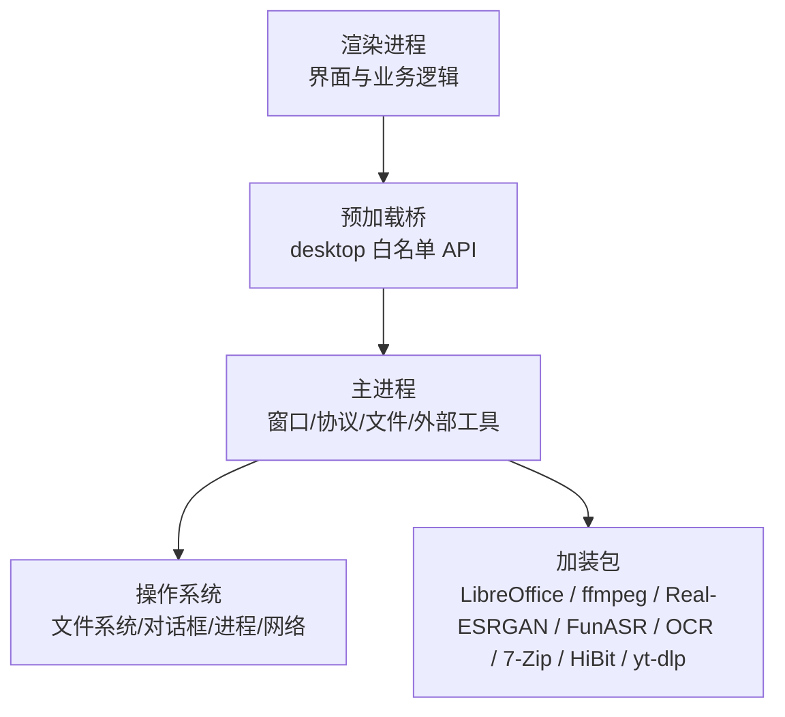
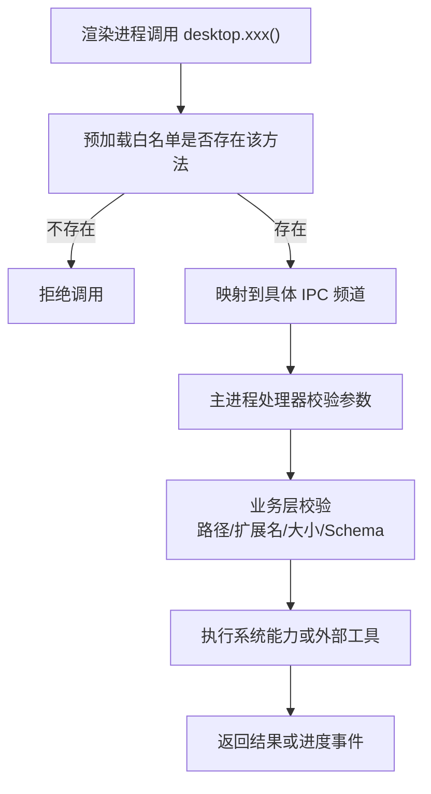
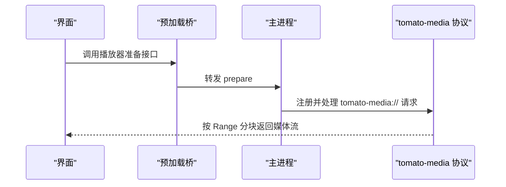
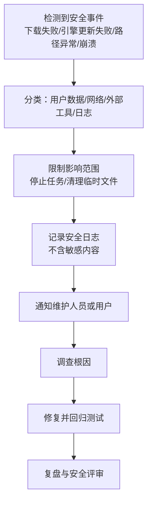

# 安全设计

<cite>
**本文引用的文件**   
- [app/main.js](file://app/main.js)
- [app/preload.js](file://app/preload.js)
- [app/package.json](file://app/package.json)
- [AGENTS.md](file://AGENTS.md)
- [README.md](file://README.md)
</cite>

## 目录
1. [引言](#引言)
2. [项目结构与安全边界](#项目结构与安全边界)
3. [IPC 白名单机制](#ipc-白名单机制)
4. [文件系统与权限控制](#文件系统与权限控制)
5. [网络安全与隐私保护](#网络安全与隐私保护)
6. [敏感数据处理与加密](#敏感数据处理与加密)
7. [XSS、CSRF 与输入验证](#xsscsrf-与输入验证)
8. [安全配置指南](#安全配置指南)
9. [安全审计清单](#安全审计清单)
10. [漏洞扫描与渗透测试建议](#漏洞扫描与渗透测试建议)
11. [安全事件响应、日志与监控告警](#安全事件响应日志与监控告警)
12. [结论](#结论)

## 引言
本项目的桌面端是一个基于 Electron 的“工具箱”应用，核心目标是把移动端图片混淆能力迁移到 Windows，并提供离线可用的媒体处理工具。从安全视角看，它涉及主进程（系统能力、原生模块、外部工具）、预加载桥（IPC 白名单）、渲染进程（界面）以及多个随包加装包（LibreOffice、ffmpeg、Real-ESRGAN、FunASR、OCR、7-Zip、HiBit、yt-dlp）。

该文档聚焦以下安全主题：
- IPC 白名单机制如何限制渲染进程访问系统能力；
- 如何通过预加载脚本建立主进程与渲染进程之间的安全边界；
- 文件读写、路径校验、压缩包解压等权限控制；
- 仅“视频下载”联网场景下的网络安全考虑；
- 设置落盘、用户数据目录、日志落盘的隐私影响；
- XSS、CSRF 防护策略与输入验证；
- 环境变量、证书与代理的安全配置；
- 安全审计、漏洞扫描、渗透测试建议；
- 安全事件响应、日志记录与监控告警。

## 项目结构与安全边界
项目采用 Electron 典型的主进程 + 预加载 + 渲染进程分层：
- 主进程负责窗口创建、协议注册、对话框、文件操作、外部工具调用和日志落盘；
- 预加载脚本通过 `contextBridge` 暴露最小化 API，作为渲染进程与主进程的“安全桥”；
- 渲染进程只接触 UI 逻辑与业务界面，不直接持有 Node/Electron 能力；
- 大量重型或需要原生能力的功能放在主进程侧执行（如 OCR、ffmpeg、AI 放大、语音识别、压缩解压、LibreOffice 转换、视频下载引擎）。

**图表来源** 
- [app/preload.js:1-193](file://app/preload.js#L1-L193)
- [app/main.js:1-200](file://app/main.js#L1-L200)

**章节来源**
- [app/main.js:1-200](file://app/main.js#L1-L200)
- [app/preload.js:1-193](file://app/preload.js#L1-L193)
- [README.md:1-120](file://README.md#L1-L120)

## IPC 白名单机制
### 设计原则
预加载脚本是渲染进程与主进程之间的唯一受控通道。其核心思想是：
- 渲染进程不能直接调用 `require('electron')` 中的危险对象；
- 所有系统能力必须通过 `contextBridge.exposeInMainWorld('desktop', {...})` 显式暴露；
- 每个方法对应一个明确的 IPC 频道名称，主进程再按频道分发到具体处理器；
- 新增能力时，应同时修改白名单，而不是扩大全局能力。

### 已暴露的安全桥接口分类
| 类别 | 接口职责 | 安全含义 |
|---|---|---|
| 系统信息与应用信息 | 读取 Electron/Chrome/Node 版本、应用版本号 | 只读、低风险 |
| 文件对话框 | 打开图片、文件夹、音视频、PDF、文档、压缩包、播放器视频、文件藏图素材等 | 由主进程控制可选扩展名和初始目录 |
| 文件读写 | 读取、写入、删除、路径信息、列出图片/文件、批量重命名 | 关键入口，需结合路径校验、目标目录白名单与覆盖保护 |
| 文件藏图 | 打包、解包、提取隐藏文件、进度回调 | 可能涉及任意文件隐藏，需校验容器格式与目标路径 |
| 视频播放器 | 查询缓存目录、清理缓存、准备播放 | 主要走自定义 `tomato-media://` 协议，避免直接使用 `file://` |
| 压缩解压 | 状态、列表、创建、解压、取消、进度 | 需防 zip-slip、路径穿越、大体积内存占用 |
| OCR | 状态、识别、取消、字体 | 主进程执行，绕过 CSP，需限制输入尺寸与超时 |
| ffmpeg | 探测、转码、多输入拼接、变换、按文件流处理、取消、进度 | 命令构造需严格参数化，禁止注入 shell 元字符 |
| HEIC 解码 | 状态、解码字节数组 | 防止超大图片导致内存溢出 |
| AI 放大 | 状态、超分、进度 | 原生模型推理，需限制输入分辨率与资源配额 |
| 语音识别 | 状态、转录、保存、取消、进度 | 主进程运行 FunASR，需隔离临时文件 |
| 卸载工具 | 状态、启动提权 | 使用系统 RunAs/UAC，测试模式空跑 |
| 视频下载 | 开始、取消、重试、列表、清空历史、显示文件、状态、引擎检查、引擎更新、变更通知、引擎进度 | 唯一联网入口，需校验 URL、引擎签名、下载目录、历史落盘 |
| PDF/文档 | 打开 PDF/文档/老格式文档、LibreOffice 状态与转换、Office 转 PDF | 依赖 LibreOffice 加装包，需处理不可信文档 |
| 设置 | 读取、写入、导出、导入 | 落盘为 JSON，需校验 schema，拒绝野字段 |
| 剪贴板 | 读取图片、写入图片 | 注意剪贴板内容来源与大小限制 |
| 拖拽文件路径 | 获取真实文件路径 | 避免把未经验证的 DOM File 对象直接交给主进程 |

**图表来源** 
- [app/preload.js:1-193](file://app/preload.js#L1-L193)
- [app/main.js:1-200](file://app/main.js#L1-L200)

**章节来源**
- [app/preload.js:1-193](file://app/preload.js#L1-L193)

## 文件系统与权限控制
### 绿色版用户数据目录
主进程将应用数据目录设置为软件目录下的 `userdata`，并据此确定 `settings.json` 位置。这种绿色版约定带来两个安全影响：
- 用户数据不与系统 AppData 强耦合，便于免安装部署；
- 如果软件目录可被普通用户完全写入，则本地恶意程序更容易篡改设置、日志或产物。

因此，部署时应考虑：
- 安装目录具备合理的操作系统权限；
- 不要让用户以管理员身份运行整个应用，除非必要；
- 对 `userdata/settings.json` 增加读写校验与备份恢复策略。

### 文件对话框与路径选择
预加载暴露了大量专用对话框接口，例如图片、视频、音频、PDF、文档、压缩包、播放器视频、文件藏图素材等。这比单一“打开任意文件”更安全，因为：
- 每个工具只暴露自己需要的对话框类型；
- 主进程可以进一步过滤扩展名；
- 测试夹具可以通过独立前缀避免互相污染。

但仍有风险点：
- 如果主进程接受任意路径并直接传给外部工具（如 ffmpeg、LibreOffice），攻击者可能通过符号链接、相对路径或特殊文件名访问非预期文件；
- “批量重命名”“文件藏图”“解压”等操作可能覆盖已有文件或写入危险路径。

### 路径与扩展名校验
安全实现应包含：
- 解析绝对路径后做规范化；
- 校验目标路径位于允许的用户数据目录或用户选定的输出目录；
- 校验扩展名白名单，尤其是 PDF、Office、压缩包、音视频等高风险类型；
- 对“批量重命名”“解压”“文件藏图”等做目标冲突检测与覆盖确认；
- 对压缩包解压启用 zip-slip 防护，确保解压路径不会跳出目标目录。

### 测试模式与系统对话框桩
主进程在自动测试模式下会关闭硬件加速，并使用测试目录的文件集合替代系统对话框，以避免测试卡在弹窗上。这说明系统对话框行为是可替换的，也意味着发布版本中不应开启测试模式。

**章节来源**
- [app/main.js:1-200](file://app/main.js#L1-L200)
- [app/preload.js:1-193](file://app/preload.js#L1-L193)

## 网络安全与隐私保护
### 默认离线策略
README 明确除“视频下载”外全部工具纯离线可用。“视频下载”天生需要联网，用于下载抖音、小红书、B站、YouTube、央视频、yt-dlp 支持的站点及直链。这一设计符合最小联网面原则。

### 视频下载的安全边界
视频下载是唯一明确联网的功能，其安全要点包括：
- 引擎为随包 yt-dlp，支持自更新；
- 对上游三项加固：可取消、历史落盘、引擎自更新校验不过即拒绝；
- 自检包含真实下载、取消清理、历史重启可读、缺包降级；
- 用户报告“下载不了”时，应优先查看 `userdata/videodl-history.json`，其中包含真实链接、报错原文、失败阶段和时间戳。

这意味着：
- 联网请求应集中在视频下载模块，而非通用网络库；
- 引擎更新必须做完整性或签名校验；
- 下载历史属于敏感日志，应避免上传到远程服务器；
- 下载目标目录应可配置且受权限控制。

### 自定义媒体协议
主进程注册了 `tomato-media://` 自定义协议，并将它标记为特权协议，启用标准协议、安全模式、Fetch API 支持和流式读取。这样做的原因是：
- 渲染进程处于沙箱和 CSP 环境，`file://` 可能被拦截；
- 自定义协议可以让主进程控制 Range 分块、Content-Type，使大视频能边读边播；
- 视频播放器通过该协议访问媒体，而不是直接暴露文件路径给前端。

**图表来源** 
- [app/main.js:1-200](file://app/main.js#L1-L200)
- [app/preload.js:1-193](file://app/preload.js#L1-L193)

**章节来源**
- [README.md:1-120](file://README.md#L1-L120)
- [app/main.js:1-200](file://app/main.js#L1-L200)
- [app/preload.js:1-193](file://app/preload.js#L1-L193)

## 敏感数据处理与加密
### 设置与用户数据
应用使用 `settings.json` 存储设置，支持设置导入导出。安全要求包括：
- 设置只合并已知键，拒绝野字段；
- 导入前应校验 Schema，避免破坏现有配置；
- 导出文件可能包含导航顺序、工具偏好、路径等隐私信息，不应自动上传；
- 导入失败时应保留原设置，不回滚到损坏状态。

### 文件藏图的加密
“文件藏图”支持两种容器：
- 默认动态混淆：图片尾部追加，网站/APP 打开即可解，不弹密码框，适合大文件；
- 图夹 PRO：V6 容器 + 可选密码，提供更强隐蔽性。

测试中包含官方互通裁判，确保我们生成的图片能被官方实现解密，反之亦然。这表明加密/混淆实现不是随意私有算法，而是尽量与参考实现兼容。

安全注意点：
- 无密码容器不提供机密性，仅提供混淆；
- 有密码容器应使用足够强度的密钥派生；
- 隐藏文件的原始内容不应进入浏览器内存，应通过主进程或 Worker 流式处理；
- 封面和水印生成不应泄露源文件内容。

### 压缩与解压的加密
压缩包支持密码 AES-256、分卷、免解压预览。安全重点：
- 密码不应进入日志；
- 大体积压缩包不应一次性加载到内存；
- 解压时必须禁用路径穿越；
- 解密过程应失败快速，避免长时间 DoS。

### 日志与调试信息
主进程实现了全局异常捕获和未处理 Promise 拒绝的兜底日志，写入 `logs/main.log`。这有助于排查崩溃，但也意味着：
- 不应记录用户文件内容、URL、令牌、密码；
- 日志文件应受目录权限保护；
- 崩溃堆栈若包含路径、用户名、工作目录，应避免对外公开。

**章节来源**
- [app/preload.js:1-193](file://app/preload.js#L1-L193)
- [app/main.js:1-200](file://app/main.js#L1-L200)
- [README.md:1-120](file://README.md#L1-L120)

## XSS、CSRF 与输入验证
### XSS 防护
渲染进程处于 Electron 沙箱和 CSP 环境中，CSP 声明 `default-src 'self'`，阻止加载任意外部脚本。此外，项目还包含 HTML 转义共享模块，说明在渲染层对内容进行转义是既有实践。

推荐做法：
- 不在界面中插入未经转义的 HTML；
- 不对用户提供的标题、路径、错误消息直接拼接到 DOM；
- 对富文本预览（如 Office 文档预览）使用隔离 iframe 或沙箱页面；
- 对视频下载历史中的链接只做展示，不直接作为 `<a href>` 跳转，除非用户明确触发。

### CSRF 防护
本项目主要是桌面应用，没有传统 Web 服务端的 Cookie+CSRF Token 场景。但如果未来引入本地 HTTP 服务（例如视频下载的中间服务），则需要：
- 不使用 Cookie 做会话认证；
- 使用同源校验、Token、Origin/Referer 校验；
- 本地服务只监听 `127.0.0.1`，不绑定 `0.0.0.0`；
- 对外暴露的接口区分只读与管理操作。

当前仓库中视频下载未移植上游的 HTTP 服务层，说明当前实现更倾向于避免在渲染进程启动额外 Web 服务。

### 输入验证策略
跨工具复用的输入验证应覆盖：
- 文件路径：是否为合法路径、是否越界、是否存在；
- 扩展名：是否在白名单内；
- 文件大小：是否超过内存或磁盘限额；
- 外部命令参数：是否经过参数化，不包含 shell 元字符；
- JSON 设置：是否符合已知 Schema；
- URL：视频下载链接是否合法、是否指向可信来源；
- 压缩包条目：是否包含路径穿越、超长文件名、重复条目。

**章节来源**
- [app/preload.js:1-193](file://app/preload.js#L1-L193)
- [README.md:1-120](file://README.md#L1-L120)

## 安全配置指南
### 环境变量管理
开发说明中提到 npm registry 和 Electron 二进制镜像使用国内镜像地址，并通过环境变量配置。安全注意事项：
- 不要把个人 token、Cookie、密码写入 `.env` 并提交；
- 不要把企业代理凭据硬编码进源码；
- 生产构建应使用 CI 注入的环境变量，而不是本地明文；
- 如果将来引入 HTTPS 证书或代理配置，应放在用户数据目录并加密存储。

### 证书验证
如果未来使用自定义 CA 或内部代理：
- 不要全局关闭证书验证；
- 只对受信任的内部域名或 IP 放宽校验；
- 在视频下载、引擎更新等联网路径单独配置；
- 记录证书指纹或颁发者，便于审计。

### 代理设置
代理常用于企业网络：
- 代理地址和端口可配置，但凭据应加密；
- 代理日志可能包含 URL、文件名、IP，不应上传到第三方；
- 代理失败时应回退到直连或给出明确错误；
- 对于视频下载，应区分下载代理和引擎更新代理。

### 运行权限
卸载工具使用 Windows 标准 RunAs 提权，并由系统 UAC 把关，不静默提权。这是正确的权限分离方式：
- 日常运行不需要管理员权限；
- 只有卸载等系统级操作才提权；
- 测试模式应跳过真实提权，避免自动化卡住。

**章节来源**
- [README.md:1-120](file://README.md#L1-L120)
- [AGENTS.md:1-98](file://AGENTS.md#L1-L98)

## 安全审计清单
### IPC 白名单审计
- [ ] 是否只通过 `contextBridge` 暴露必要 API；
- [ ] 是否移除未使用的 `desktop.xxx` 接口；
- [ ] 是否对每个 IPC 频道做参数校验；
- [ ] 是否避免暴露 `require`、`eval`、`exec`、`spawn` 等危险能力；
- [ ] 是否限制回调订阅的生命周期，避免泄漏监听器。

### 文件系统审计
- [ ] 是否限制用户数据目录写权限；
- [ ] 是否校验路径规范化后仍在允许目录；
- [ ] 是否对批量重命名做覆盖保护；
- [ ] 是否对压缩包解压做 zip-slip 防护；
- [ ] 是否避免把用户路径直接拼接到外部命令。

### 网络安全审计
- [ ] 是否只在“视频下载”模块发起网络请求；
- [ ] 是否校验引擎更新包的哈希或签名；
- [ ] 是否记录下载历史但不上传；
- [ ] 是否避免在日志中记录完整 URL、令牌或文件名；
- [ ] 是否限制下载并发和单文件大小。

### 加密与隐私审计
- [ ] 设置导入导出是否校验 Schema；
- [ ] 是否拒绝野字段；
- [ ] 是否避免记录敏感文件内容；
- [ ] 文件藏图无密码容器的风险是否向用户说明；
- [ ] 日志文件是否受权限保护。

### 外部工具审计
- [ ] ffmpeg 命令是否参数化；
- [ ] LibreOffice 是否处理不可信文档；
- [ ] OCR、AI、语音识别是否限制输入大小和超时；
- [ ] 7-Zip 解压是否启用路径校验；
- [ ] HiBit 卸载工具是否仅在必要时提权。

**章节来源**
- [app/preload.js:1-193](file://app/preload.js#L1-L193)
- [app/main.js:1-200](file://app/main.js#L1-L200)
- [README.md:1-120](file://README.md#L1-L120)

## 漏洞扫描与渗透测试建议
### 静态扫描
- 使用 ESLint、TypeScript 类型检查、Electron 安全规则扫描渲染进程代码；
- 使用依赖漏洞扫描工具检查 npm 依赖；
- 扫描源码是否意外包含密钥、token、路径、用户名；
- 检查 `.gitignore` 是否忽略 `notes/`、`.env`、私钥、证书、凭据。

### 动态扫描
- 针对视频下载模块进行联网路径测试；
- 针对压缩包、PDF、Office、音视频文件进行畸形输入测试；
- 针对文件藏图容器进行逆向测试，验证是否能伪造或逃逸；
- 针对自定义 `tomato-media://` 协议进行路径和范围请求测试。

### 渗透测试场景
| 场景 | 目标 | 预期结果 |
|---|---|---|
| 任意文件读取 | 通过 IPC 传入恶意路径 | 只能访问允许目录，不能越权读取系统文件 |
| 任意文件写入 | 通过保存接口写入系统目录 | 写入失败或仅写入用户目录 |
| 压缩包路径穿越 | 解压包含 `../` 的条目 | 拒绝或安全化解压到目标目录 |
| 外部命令注入 | 文件名或参数含 shell 元字符 | 参数转义或拒绝，不执行恶意命令 |
| 视频下载恶意链接 | 注入恶意指令或内网地址 | 校验 URL，拒绝非法来源 |
| 引擎更新篡改 | 替换更新包 | 校验失败，拒绝安装 |
| 设置注入 | 导入非法 JSON | 拒绝野字段，不破坏原有设置 |
| 日志泄露 | 查看 `logs/main.log` | 不包含密码、令牌、完整敏感路径 |

**章节来源**
- [AGENTS.md:1-98](file://AGENTS.md#L1-L98)
- [README.md:1-120](file://README.md#L1-L120)

## 安全事件响应、日志与监控告警
### 日志体系
主进程实现了基础日志能力：
- 捕获未捕获异常和未处理 Promise 拒绝；
- 写入 `logs/main.log`；
- 日志写入失败不会抛出异常，避免二次崩溃；
- 日志带时间戳和标签，便于定位。

建议扩展：
- 对安全相关事件单独记录，如下载失败、引擎更新失败、路径校验失败、解压异常；
- 对敏感字段脱敏后再记录；
- 日志轮转，避免无限增长；
- 提供“导出日志”功能，方便用户反馈问题。

### 安全事件响应流程

### 监控与告警
当前项目是桌面应用，没有集中式监控服务。合理做法是：
- 在本地收集错误摘要，不上传原始用户数据；
- 如果未来引入远程诊断，应获得用户授权；
- 对“视频下载”“引擎更新”“OCR”“ffmpeg”等高风险路径增加失败率统计；
- 对自动化测试中的冒烟测试、界面测试、端到端测试结果进行归档，作为交付质量证据。

**章节来源**
- [app/main.js:1-200](file://app/main.js#L1-L200)
- [README.md:1-120](file://README.md#L1-L120)

## 结论
该项目在安全设计上采用了 Electron 常见的“主进程 + 预加载桥 + 渲染进程”架构，并通过以下方式降低风险：
- 使用预加载脚本暴露最小化 IPC 白名单；
- 将系统能力、外部工具和重型计算放在主进程；
- 默认离线，仅“视频下载”联网；
- 使用自定义媒体协议控制视频流；
- 通过设置导入导出、日志、测试模式增强可维护性和可观测性；
- 通过 AGENTS.md 和 README.md 强调隐私防漏、敏感文件忽略、离线优先和交付质量。

未来改进方向应包括：
- 对 IPC 白名单进行形式化审查；
- 对所有外部命令执行路径做参数化与沙箱化；
- 对压缩包、PDF、Office、音视频输入做健壮性测试；
- 对视频下载引擎更新引入更强的签名校验；
- 对日志和设置增加更严格的隐私保护；
- 对安全事件建立标准化响应流程。