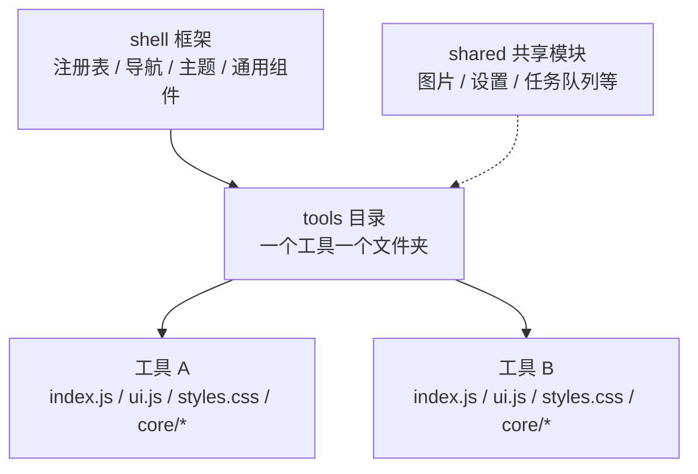
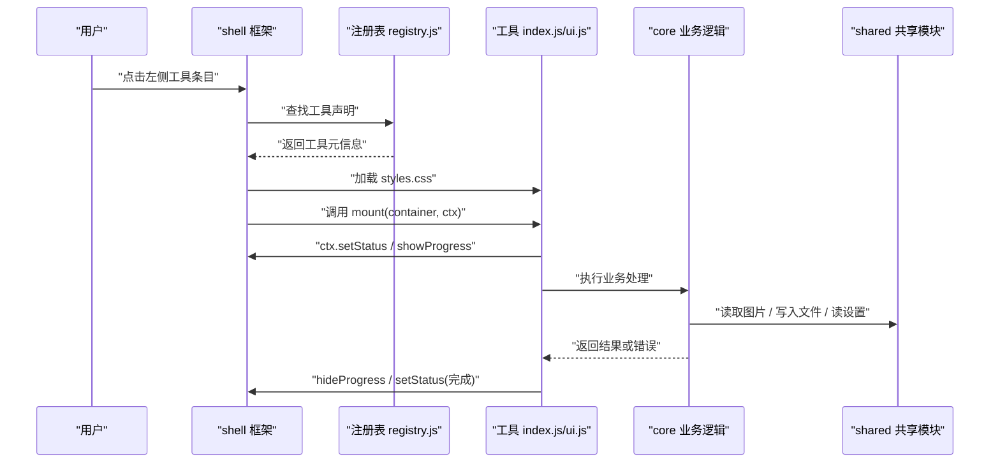
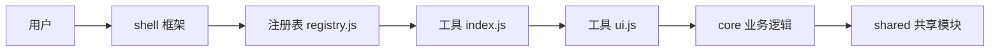
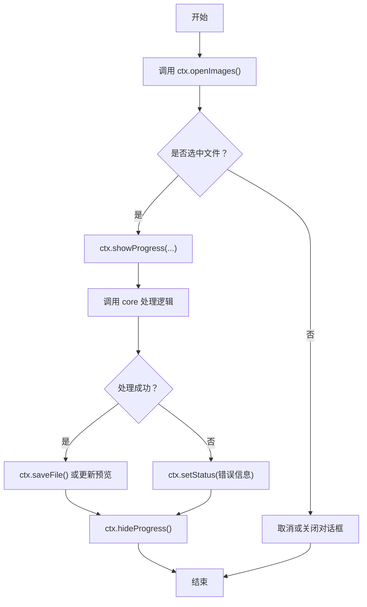
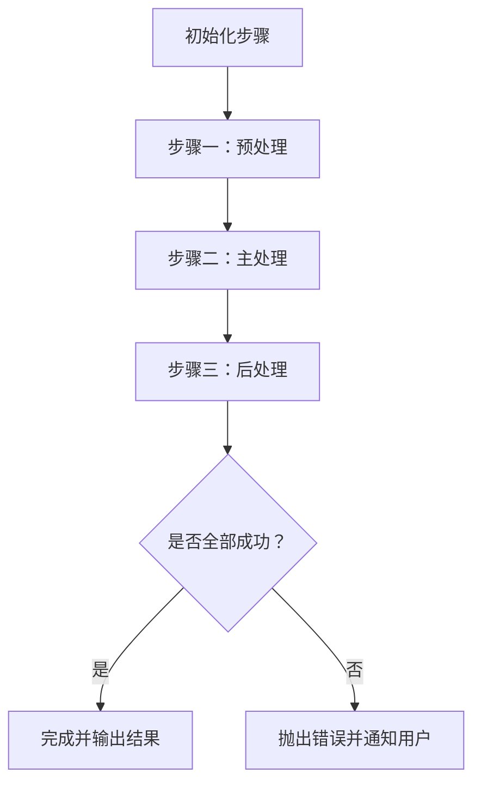

# 工具开发指南

<cite>
**本文引用的文件**   
- [新增工具指南.md](file://docs/新增工具指南.md)
- [toolkit.md](file://spec/modules/toolkit.md)
</cite>

## 目录
1. [简介](#简介)
2. [项目结构](#项目结构)
3. [核心组件](#核心组件)
4. [架构总览](#架构总览)
5. [详细组件分析](#详细组件分析)
6. [依赖关系分析](#依赖关系分析)
7. [性能考虑](#性能考虑)
8. [故障排查](#故障排查)
9. [结论](#结论)
10. [附录：从零到一开发示例](#附录从零到一开发示例)

## 简介
本指南面向希望在本工程中添加“新工具”的开发者。项目采用“一个工具一个文件夹”的自包含组织方式，通过统一的工具注册表接入左侧导航、页面保活与进度状态等框架能力。目标是让新增功能成为低成本、不改动既有代码的日常操作。

## 项目结构
项目的工具相关代码集中在 `app/src/tools` 下；每个工具都是一个独立目录，内部再按“入口声明 + UI + 样式 + core 业务逻辑”划分。跨工具复用的能力放在 `app/src/shared`，框架外壳（注册表、导航、主题、通用组件）位于 `app/src/shell`。

**图表来源**
- [新增工具指南.md:1-83](file://docs/新增工具指南.md#L1-L83)
- [toolkit.md:1-83](file://spec/modules/toolkit.md#L1-L83)

**章节来源**
- [新增工具指南.md:1-83](file://docs/新增工具指南.md#L1-L83)
- [toolkit.md:1-83](file://spec/modules/toolkit.md#L1-L83)

## 核心组件
工具由三个关键文件组成，外加可选的 `core/` 业务目录：

| 文件 | 职责 | 实现要点 |
|---|---|---|
| `index.js` | 工具声明与注册 | 导出统一对象：唯一标识、显示名、图标、分组、排序、样式数组、生命周期函数。由注册表收集并按组内 `order` 排序展示。 |
| `ui.js` | 用户界面与交互 | 在 `mount(container, ctx)` 中渲染界面并绑定事件；使用 `ctx.setStatus`、`ctx.showProgress`、`ctx.openImages`、`ctx.saveFile` 等框架能力；全局键盘/定时器要在 `deactivate/activate` 或 `unmount` 中正确管理。 |
| `styles.css` | 工具专属样式 | 使用 `shell/theme.css` 的设计令牌变量；类名建议加工具前缀避免冲突；通用组件直接复用 `components.css` 的类名，不要重写默认样式。 |
| `core/` | 业务逻辑与算法 | 与 UI 解耦，便于单独测试和复用；涉及图片解码/编码时使用 `shared/imageio.js`。 |

**章节来源**
- [新增工具指南.md:1-83](file://docs/新增工具指南.md#L1-L83)
- [toolkit.md:1-83](file://spec/modules/toolkit.md#L1-L83)

## 架构总览
下图展示了“从左侧点击工具 → 加载样式 → 挂载 UI → 调用框架上下文 → 执行 core 逻辑”的完整流程。

**图表来源**
- [新增工具指南.md:1-83](file://docs/新增工具指南.md#L1-L83)
- [toolkit.md:1-83](file://spec/modules/toolkit.md#L1-L83)

## 详细组件分析

### 工具声明：`index.js`
`index.js` 是工具的对外门面，负责向注册表暴露以下字段：

| 字段 | 类型 | 含义 | 约定 |
|---|---|---|---|
| `id` | 字符串 | 工具唯一标识 | 英文小写，避免重复 |
| `name` | 字符串 | 左侧列表显示名 | 中文可读名 |
| `icon` | 字符串 | 列表图标 | emoji 或内置 SVG 路径 |
| `group` | 字符串 | 分组标识 | `image`、`video`、`doc`、`archive`、`system` 等 |
| `order` | 数字 | 组内排序 | 数字越小越靠前 |
| `styles` | 数组 | 工具样式文件路径 | 相对 `src/shell/index.html`，如 `../tools/<标识>/styles.css` |
| `mount` | 函数 | 首次进入时渲染界面 | 接收容器与框架上下文 |
| `activate` | 函数 | 可选：切入时恢复全局交互 | 例如恢复快捷键、订阅 |
| `deactivate` | 函数 | 可选：切出时让位 | 停止事件监听、清理定时器 |
| `unmount` | 函数 | 页面销毁时清理资源 | LRU 回收或页面被释放时调用 |

注意事项：
- 新增工具后必须把 `index.js` 导入并加入注册表的 `TOOLS` 列表。
- 若需要新的分组，先在 `GROUPS` 定义分组，再给工具填对应 `group`。
- 未声明 `group` 的工具会归入末尾的“其它”组，不影响启动。

**章节来源**
- [新增工具指南.md:1-83](file://docs/新增工具指南.md#L1-L83)
- [toolkit.md:1-83](file://spec/modules/toolkit.md#L1-L83)

### 用户界面：`ui.js`
`ui.js` 只负责界面与交互，不应直接写复杂业务逻辑。推荐做法：

1. 在 `mount(container, ctx)` 中创建 DOM、绑定事件、初始化 UI。
2. 使用 `ctx` 提供的通用能力：
   - `ctx.setStatus(...)`：顶部状态提示。
   - `ctx.showProgress(...)` / `ctx.hideProgress()`：进度遮罩与进度条。
   - `ctx.openImages()` / `ctx.saveFile()`：文件选择与保存。
   - `ctx.isActive()`：判断当前是否活动页，用于保护全局键盘事件。
3. 使用 `shell/components.css` 的通用组件类名，例如按钮、输入框、卡片、模态框、进度条等。
4. 不要把全局交互挂在 `window`/`document` 上而不做清理；应在 `deactivate` 中让位，在 `activate` 中恢复。
5. 临时资源（定时器、blob URL、进度订阅、DOM 引用）必须在 `deactivate` 或 `unmount` 中释放。

生命周期语义：
- `mount`：首次进入时调用一次；工具页会被框架保活，切换走不会销毁。
- `activate/deactivate`：每次切入/切出时调用，适合管理全局交互。
- `unmount`：页面被销毁或被 LRU 回收时调用；正常切换不会调用它。

**章节来源**
- [新增工具指南.md:1-83](file://docs/新增工具指南.md#L1-L83)
- [toolkit.md:1-83](file://spec/modules/toolkit.md#L1-L83)

### 样式定义：`styles.css`
样式文件应遵循以下规范：

- 颜色、字号、间距、圆角、动效节奏优先使用 `shell/theme.css` 中的设计令牌变量。
- 类名建议以工具标识为前缀，避免与其他工具冲突。
- 通用组件直接使用 `shell/components.css` 已定义的类名，不要重写默认样式。
- 样式路径在 `index.js` 的 `styles` 中声明，相对于 `src/shell/index.html`。

**章节来源**
- [新增工具指南.md:1-83](file://docs/新增工具指南.md#L1-L83)

### 业务逻辑：`core/`
`core/` 目录存放与 UI 解耦的业务逻辑和算法，好处包括：

- 便于单独编写单元测试。
- 便于在多个工具间通过 `shared/` 复用。
- 避免 `ui.js` 膨胀，保持界面层清晰。
- 当图片解码/编码需求出现时，使用 `shared/imageio.js`，而不是自己实现底层细节。

典型拆分方式：
- `core/engine.mjs`：核心处理引擎。
- `core/plan.js`：处理计划或步骤编排。
- `core/formats.mjs`：格式说明与映射。
- `core/params.mjs`：参数校验与默认值。
- `core/convert.js`、`core/preprocess.js`、`core/postprocess.js`：转换管线各阶段。

**章节来源**
- [新增工具指南.md:1-83](file://docs/新增工具指南.md#L1-L83)

## 依赖关系分析
工具之间的依赖关系遵循“单向依赖”原则：

规则总结：
- 工具之间禁止互相 import。
- 需要复用的能力放入 `shared/`。
- 样式依赖 `theme.css`，组件依赖 `components.css`。
- 工具本身被 `registry.js` 引入并纳入 `TOOLS` 列表。

**图表来源**
- [新增工具指南.md:1-83](file://docs/新增工具指南.md#L1-L83)
- [toolkit.md:1-83](file://spec/modules/toolkit.md#L1-L83)

**章节来源**
- [新增工具指南.md:1-83](file://docs/新增工具指南.md#L1-L83)
- [toolkit.md:1-83](file://spec/modules/toolkit.md#L1-L83)

## 性能考虑
- 保活机制带来良好体验，但“动过”的工具页最多同时保活 5 个；超出时按 LRU 回收最久未用的一页，并调用其 `unmount` 清理资源。
- “动过”判定包括点按、打字、拖入文件等交互；仅切过来看一眼不算动过。
- 被回收的页面下次进入会重新 `mount`，因此 `mount` 必须能从零构建界面，`unmount` 必须清理所有资源。
- 后台任务归属任务队列，页面被回收时只退掉 UI 订阅，任务仍可继续运行。
- 进度遮罩是全局唯一的，但状态按页记账；切换工具时 shell 会恢复或关闭遮罩，工具侧无需自行兜底。

**章节来源**
- [toolkit.md:1-83](file://spec/modules/toolkit.md#L1-L83)

## 故障排查
常见问题和定位方法如下：

| 现象 | 可能原因 | 排查步骤 |
|---|---|---|
| 左侧没有新工具 | 未注册或未导入 `index.js` | 检查 `registry.js` 是否新增导入和 `TOOLS` 行；检查 `id` 是否重复。 |
| 样式不生效 | 样式路径错误 | 确认 `styles` 路径相对于 `src/shell/index.html`，形如 `../tools/<标识>/styles.css`。 |
| 切换工具后报错 | 未清理全局事件或残留 DOM 引用 | 检查 `deactivate`、`unmount` 中是否移除定时器、事件监听、blob URL、进度订阅。 |
| 界面状态异常保留 | 误以为 `mount` 每次都会重置表单 | 记住工具页保活；如需重置应在明确的用户操作处手动清理。 |
| 全局快捷键在其他工具也触发 | 未使用 `ctx.isActive()` 判断活动页 | 在 `window`/`document` 事件中先判断当前工具是否活动。 |
| 进度遮罩一直显示 | 忘记调用 `hideProgress` 或页面被回收后 UI 断开 | 确保成功路径和失败路径都隐藏进度；交由 shell 兜底，但自身仍应保持成对调用。 |

**章节来源**
- [新增工具指南.md:1-83](file://docs/新增工具指南.md#L1-L83)
- [toolkit.md:1-83](file://spec/modules/toolkit.md#L1-L83)

## 结论
新增工具的最佳实践可以概括为：复制模板、填写声明、编写 UI、迁移逻辑到 `core`、通过 `shared` 复用能力、最后注册到 `registry.js`。遵守分组、排序、样式变量、生命周期和保活约定后，新工具就能自然融入现有导航、主题和任务体系，且不影响既有功能。

## 附录：从零到一开发示例

### 示例一：最简单的 Hello World 工具
目标：在左侧列表中看到一个可点击的工具，点击后右侧显示一句问候语。

步骤：
1. 复制 `_template` 到新工具目录，例如 `compress`。
2. 修改 `index.js`，设置 `id`、`name`、`icon`、`group`、`order`、`styles`、`mount`、`unmount`。
3. 在 `ui.js` 的 `mount(container, ctx)` 中创建一个简单文本节点。
4. 在 `styles.css` 中加入工具前缀类名，并使用主题变量。
5. 在 `registry.js` 中导入该工具并加入 `TOOLS`。
6. 重启软件，左侧应出现新工具；点击后右侧显示问候语。

关键点：
- 即使没有 `core/`，也能完成最小可用工具。
- 如果只需要静态展示，可不写复杂交互。

**章节来源**
- [新增工具指南.md:1-83](file://docs/新增工具指南.md#L1-L83)

### 示例二：带文件选择的图片处理工具
目标：让用户选择图片，处理后显示预览或保存结果。

步骤：
1. 在 `ui.js` 中使用 `ctx.openImages()` 打开文件对话框。
2. 在回调中拿到文件后，调用 `core/` 中的处理函数。
3. 在处理前调用 `ctx.showProgress(...)`，完成后调用 `ctx.hideProgress()`。
4. 使用 `ctx.setStatus(...)` 显示“处理中”“成功”“失败”等状态。
5. 如果需要保存结果，使用 `ctx.saveFile()`。
6. 将图片解码/编码逻辑放入 `core/`，并通过 `shared/imageio.js` 访问图片能力。

流程图：

**图表来源**
- [新增工具指南.md:1-83](file://docs/新增工具指南.md#L1-L83)

**章节来源**
- [新增工具指南.md:1-83](file://docs/新增工具指南.md#L1-L83)

### 示例三：多步骤处理工具
目标：实现“预处理 → 主处理 → 后处理”的多步骤流程，并在 UI 中反馈每步进度。

步骤：
1. 在 `core/plan.js` 中定义步骤顺序、参数和错误策略。
2. 在 `core/engine.js` 中实现具体步骤逻辑。
3. 在 `ui.js` 中根据步骤数量显示进度条，每完成一步更新 `ctx.setStatus`。
4. 对于耗时步骤，使用异步控制流，避免阻塞 UI。
5. 在失败分支中记录错误原因，并允许用户重试或取消。
6. 所有中间结果尽量放在内存局部变量或 `core` 中，不在 UI 中持久化。

**图表来源**
- [新增工具指南.md:1-83](file://docs/新增工具指南.md#L1-L83)

**章节来源**
- [新增工具指南.md:1-83](file://docs/新增工具指南.md#L1-L83)

### 最佳实践清单
- 先写 spec，再写代码，明确目标、范围、输入输出和非目标。
- 工具之间不互相 import，复用能力放 `shared/`。
- 样式只用 `theme.css` 变量，类名加工具前缀。
- 通用组件不重写默认样式，直接使用 `components.css`。
- `mount` 要能从零构建界面；`unmount` 要清理所有资源。
- 全局交互使用 `ctx.isActive()` 保护，并在 `deactivate` 中让位。
- 开发完成后进行冒烟自检并提交。

**章节来源**
- [新增工具指南.md:1-83](file://docs/新增工具指南.md#L1-L83)