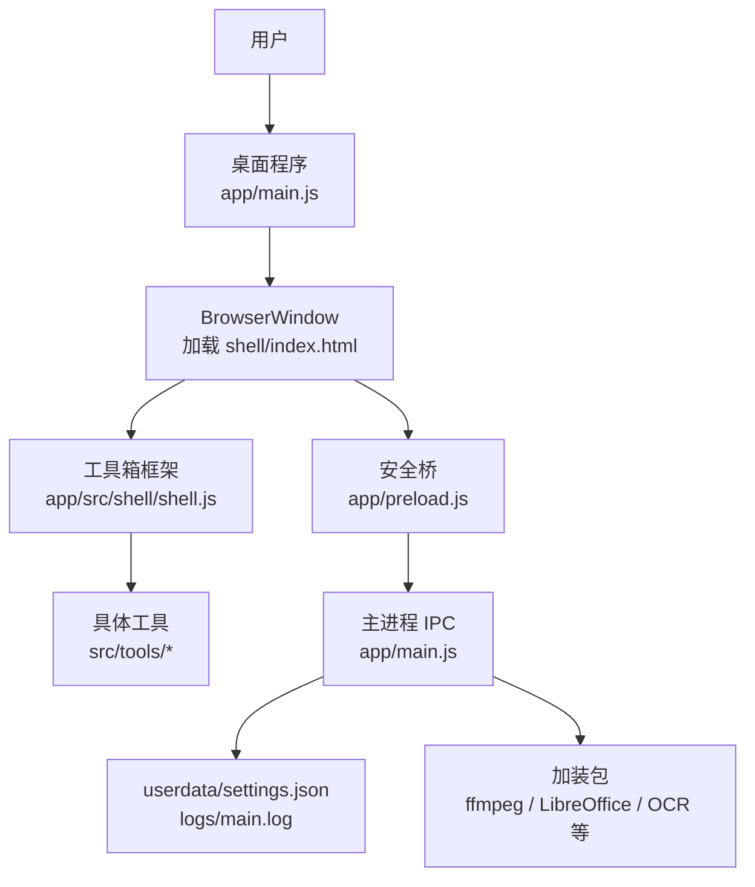
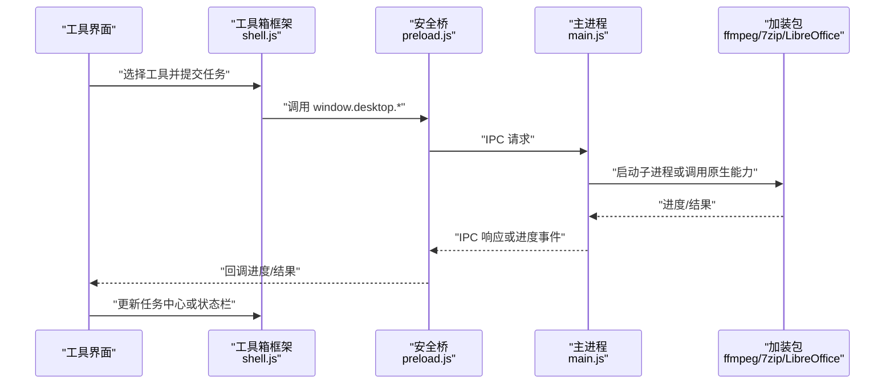
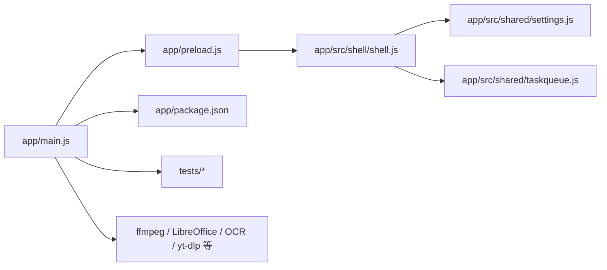
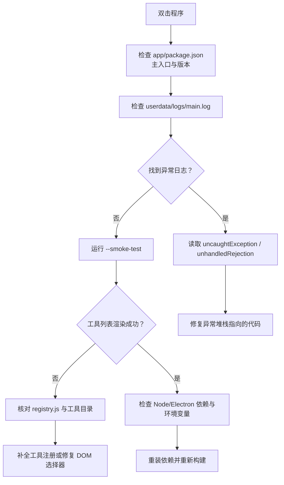
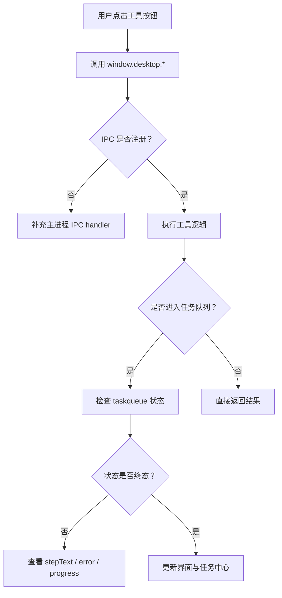
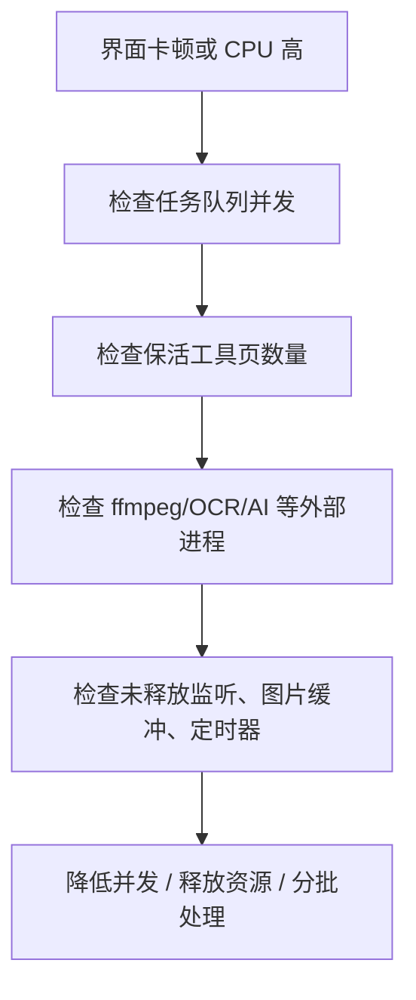
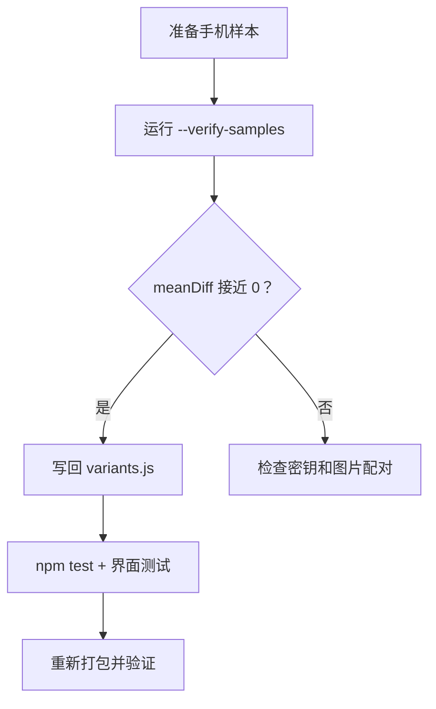
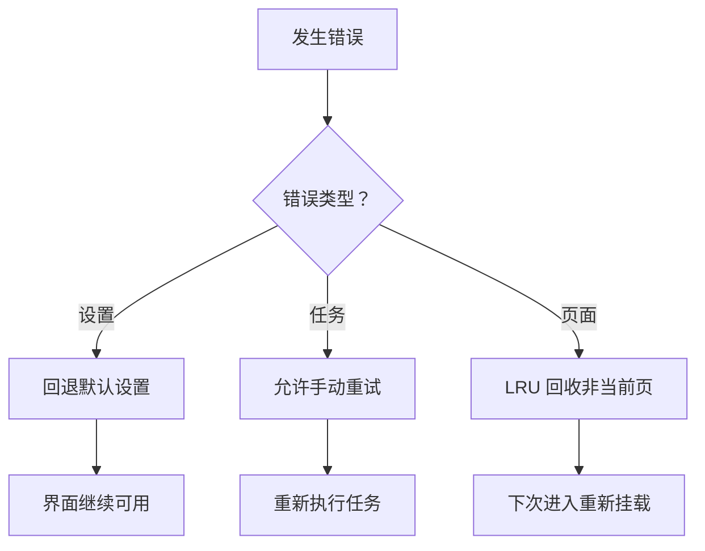

# 故障排除

<cite>
**本文引用的文件**   
- [README.md](file://README.md)
- [AGENTS.md](file://AGENTS.md)
- [app/main.js](file://app/main.js)
- [app/preload.js](file://app/preload.js)
- [app/package.json](file://app/package.json)
- [app/src/shared/settings.js](file://app/src/shared/settings.js)
- [app/src/shared/taskqueue.js](file://app/src/shared/taskqueue.js)
- [app/src/shell/shell.js](file://app/src/shell/shell.js)
- [docs/兼容性变体说明.md](file://docs/兼容性变体说明.md)
</cite>

## 目录

1. [引言](#引言)
2. [项目结构](#项目结构)
3. [核心组件](#核心组件)
4. [架构总览](#架构总览)
5. [详细组件分析](#详细组件分析)
6. [依赖关系分析](#依赖关系分析)
7. [性能注意事项](#性能注意事项)
8. [故障排除指南](#故障排除指南)
9. [结论](#结论)
10. [附录：日志与诊断清单](#附录日志与诊断清单)

## 引言

本指南面向最终用户、测试人员与维护者，目标是把「应用启动失败、功能异常、性能问题、兼容性问题」的排查流程标准化。文档基于仓库中的 Electron 主进程、渲染桥、工具箱框架、任务队列、设置模块和自测脚本编写，所有可验证行为都标注对应源码位置，便于读者直接定位根因。

本项目是 Windows 桌面版「番茄图片混淆 桌面版」，采用 Electron 架构：`main.js` 负责窗口、协议、系统能力、自动测试；`preload.js` 暴露安全 IPC 白名单；`src/shell` 提供工具箱框架、工具注册、保活与 LRU 回收；`src/shared` 提供跨工具设置、任务队列等共享能力；各工具以 `src/tools/<工具名>` 形式独立接入。

## 项目结构

从故障排除视角，需要重点关注以下层次：

| 层次 | 关键路径 | 故障排除意义 |
|---|---|---|
| 入口与打包 | `app/package.json` | 确认主入口、版本、Electron 依赖、启动脚本 |
| 主进程 | `app/main.js` | 窗口创建、日志兜底、自动测试、绿色版数据目录 |
| 渲染桥 | `app/preload.js` | IPC 白名单、工具能力边界 |
| 界面框架 | `app/src/shell/shell.js` | 工具挂载、LRU 保活、任务徽标、主题 |
| 共享逻辑 | `app/src/shared/settings.js`、`taskqueue.js` | 设置持久化、跨工具任务状态 |
| 自测与自检 | `README.md`、`AGENTS.md` | 启动参数、测试结果落盘位置、常见开关 |
| 兼容性 | `docs/兼容性变体说明.md` | 手机版兼容开关与样本锁定流程 |

**图示来源**
- [app/main.js:1-120](file://app/main.js#L1-L120)
- [app/preload.js:1-193](file://app/preload.js#L1-L193)
- [app/src/shell/shell.js:1-120](file://app/src/shell/shell.js#L1-L120)

**章节来源**
- [README.md:1-120](file://README.md#L1-L120)
- [AGENTS.md:1-98](file://AGENTS.md#L1-L98)

## 核心组件

### 主进程与日志兜底

主进程承担四个与排障密切相关的职责：

1. **创建窗口并加载界面**：使用 `BrowserWindow`，开启 context isolation、sandbox，并通过 preload 暴露有限 API。
2. **注册自定义媒体协议**：为视频播放器提供 `tomato-media` 流式读取，避免沙箱下 `file://` 被拦截。
3. **绿色版数据目录**：运行期设置放在软件目录下的 `userdata`，不是系统 `AppData`，方便便携迁移。
4. **全局错误兜底与日志**：捕获未捕获异常和未处理 Promise 拒绝，写入 `logs/main.log`。

排障要点：

- 如果应用双击后闪退或没有控制台输出，优先检查 `userdata/logs/main.log`。
- 日志追加失败不会抛错，因此磁盘不可写时可能没有日志，需先确认 `userdata` 是否可写。
- 自动测试模式下会关闭硬件加速，保证截图稳定；正常使用时不应出现此副作用。

**章节来源**
- [app/main.js:1-120](file://app/main.js#L1-L120)
- [app/main.js:201-350](file://app/main.js#L201-L350)
- [app/main.js:350-432](file://app/main.js#L350-L432)

### 渲染桥与安全边界

`preload.js` 通过 `contextBridge.exposeInMainWorld('desktop', ...)` 暴露一组 IPC 方法。它不直接开放 Node 或 Electron 能力，而是把文件对话框、文件读写、工具能力、设置、视频播放缓存、OCR、ffmpeg、AI 放大、语音识别、卸载、视频下载、LibreOffice 等集中在白名单中。

排障要点：

- 如果某个按钮点击无响应，先看 UI 层是否调用了 `window.desktop.*` 方法，再看主进程是否注册了对应 IPC handler。
- 如果渲染进程报权限或 CSP 相关错误，通常是绕过了白名单 API，直接访问受限资源。
- 订阅进度回调时必须保存取消函数，在工具卸载时移除监听，否则可能造成内存泄漏或重复回调。

**章节来源**
- [app/preload.js:1-193](file://app/preload.js#L1-L193)

### 设置模块

设置模块维护一份内存中的当前设置，并提供加载、读取、强制重载、更新、恢复默认等方法。默认值包括图像块大小、JPEG 质量、输出目录、导航折叠状态、导航排序、外观主题、视频下载目录和引擎自动检查开关。

排障要点：

- 首次加载失败会回退到默认值，因此配置损坏不一定导致程序崩溃，但可能出现“行为回到默认”的现象。
- 导入设置后需要调用重载，使内存态与磁盘一致。
- 更新设置落盘失败不会中断界面，但下次重启可能丢失修改。

**章节来源**
- [app/src/shared/settings.js:1-83](file://app/src/shared/settings.js#L1-L83)

### 跨工具任务队列

任务队列解决两个关键问题：

1. 批量任务不再由单个工具 for 循环执行，而是统一调度。
2. 工具页被 LRU 回收时，不能取消已在队列中的任务；任务归属队列，不归属工具页。

队列支持 `cpu` 和 `io` 两条通道，默认并发分别为 1 和 2；任务状态包括排队、运行、完成、失败、取消；最近完成记录默认保留 50 条；支持重试、等待终态、汇总统计。

排障要点：

- 如果切走工具后任务消失，检查工具是否在 `unmount()` 中调用了队列取消接口。
- 如果任务长时间停留在“运行中”，查看任务对象中的 `stepText`、`error`、`progress`。
- 如果批量任务顺序混乱，检查是否混用 `enqueue` 与 `runBatch`，以及是否正确等待每个任务终态。

**章节来源**
- [app/src/shared/taskqueue.js:1-250](file://app/src/shared/taskqueue.js#L1-L250)
- [app/src/shared/taskqueue.js:251-354](file://app/src/shared/taskqueue.js#L251-L354)

### 工具箱框架与页面保活

`shell.js` 负责左侧导航、工具挂载、通用上下文、主题、任务徽标和保活策略。关键设计是：

- 工具页首次进入时 mount。
- 切走时从文档树取下，但保留 DOM 与状态。
- 只有“动过”的工具页计入保活额度。
- 最多保活 5 个动过的页，超出时按 LRU 淘汰最久未使用的页。
- 被回收的工具再次进入时会重新 mount，并在状态栏提示内容已释放。

排障要点：

- 如果切换工具后列表状态丢失，可能是该工具页未被判定为“动过”，从而被 LRU 回收。
- 如果界面卡顿，检查是否同时打开过多工具页，或工具内部持有大对象未释放。
- 如果进度遮罩残留，检查工具是否正确调用 `showProgress` 和 `hideProgress`。

**章节来源**
- [app/src/shell/shell.js:1-120](file://app/src/shell/shell.js#L1-L120)
- [app/src/shell/shell.js:300-420](file://app/src/shell/shell.js#L300-L420)
- [app/src/shell/shell.js:420-600](file://app/src/shell/shell.js#L420-L600)

## 架构总览

下图展示一次典型工具调用路径，例如“压缩/解压”或“视频格式转换”。

**图示来源**
- [app/src/shell/shell.js:120-220](file://app/src/shell/shell.js#L120-L220)
- [app/preload.js:1-193](file://app/preload.js#L1-L193)
- [app/main.js:1-120](file://app/main.js#L1-L120)

## 详细组件分析

### 自动测试与自检入口

主进程解析命令行参数，判断是否处于各种测试模式，例如冒烟测试、端到端测试、界面自动测试、PDF 测试、媒体测试、音频测试、语音转文字、OCR 闸门、主题测试、任务队列、压缩解压、视频播放器、文件藏图、卸载、视频下载、文档转换等。

测试结果显示在控制台，部分测试还会把结果写到 `%TEMP%` 下的 JSON 文件，截图放到 `%TEMP%\tomato-uitest`。

排障要点：

- 遇到“工具数不一致”或“冒烟测试失败”，优先核对 `registry.js` 与实际工具目录。
- 界面类测试失败要看 JSON 结果中的 `pass`、`failures`、`ok`、`verified`、`skipped` 字段。
- 产物上某些能力预期 `verified:false`，开发树则要求 `verified:true`。

**章节来源**
- [app/main.js:1-120](file://app/main.js#L1-L120)
- [app/main.js:201-432](file://app/main.js#L201-L432)
- [README.md:1-120](file://README.md#L1-L120)
- [AGENTS.md:1-98](file://AGENTS.md#L1-L98)

### 绿色版数据目录与设置快照

绿色版约定运行期数据放在软件目录内，而不是系统 `AppData`。`PORTABLE_DIR` 根据是否打包决定，`USER_DATA_DIR` 指向 `userdata`，设置文件为 `settings.json`。

自动测试模式下，主进程会在启动前备份 `settings.json`，退出时还原或删除，避免测试改变用户真实配置。

排障要点：

- 如果升级后设置异常，检查 `userdata/settings.json` 是否包含旧版键或非法数据。
- 如果测试后发现界面状态被污染，确认是否误在普通模式运行了界面测试。
- 导出/导入设置时，只合并已知键，野文件会被拒绝，这是保护现有配置的机制。

**章节来源**
- [app/main.js:1-120](file://app/main.js#L1-L120)
- [app/src/shared/settings.js:1-83](file://app/src/shared/settings.js#L1-L83)

### 兼容性变体

与手机版兼容的关键在于三处算法开关：`gilbertRounding`、`blockVariant`、`pe1Chaining`。这些开关决定能否解开手机版生成的图片。

锁定流程包括：用手机生成样本、电脑端验证、命中最佳变体、写回 `variants.js`、回归测试、重新打包。

排障要点：

- 如果“解不开手机传来的图”，不要盲目改混淆逻辑，应先跑样本验证流程。
- 如果 `meanDiff` 接近 0，表示该组变体与手机版一致。
- 如果全部 `meanDiff` 很大，先检查密钥和配对文件名。

**章节来源**
- [docs/兼容性变体说明.md:1-61](file://docs/兼容性变体说明.md#L1-L61)

## 依赖关系分析

**图示来源**
- [app/main.js:1-120](file://app/main.js#L1-L120)
- [app/preload.js:1-193](file://app/preload.js#L1-L193)
- [app/src/shell/shell.js:1-120](file://app/src/shell/shell.js#L1-L120)
- [app/src/shared/settings.js:1-83](file://app/src/shared/settings.js#L1-L83)
- [app/src/shared/taskqueue.js:1-120](file://app/src/shared/taskqueue.js#L1-L120)
- [app/package.json:1-28](file://app/package.json#L1-L28)

**章节来源**
- [app/package.json:1-28](file://app/package.json#L1-L28)
- [AGENTS.md:1-98](file://AGENTS.md#L1-L98)

## 性能注意事项

### 任务队列并发

任务队列对 CPU 密集任务和 I/O 任务做了区分：

- `cpu` 通道默认并发为 1，避免 ffmpeg、PDF、OCR 同时吃满 CPU。
- `io` 通道默认并发为 2，适合 canvas 或轻量 I/O。
- 未知通道归入 `cpu`，属于保守策略。

优化建议：

- 批量图像处理可以评估使用 `io` 通道，但需确认工具逻辑可并行。
- 视频转码、OCR、AI 放大应避免人为提高并发，否则容易卡顿或崩溃。
- 如果任务堆积严重，先查是否有任务长期停留在 running 状态。

**章节来源**
- [app/src/shared/taskqueue.js:1-120](file://app/src/shared/taskqueue.js#L1-L120)
- [app/src/shared/taskqueue.js:251-354](file://app/src/shared/taskqueue.js#L251-L354)

### 页面保活与 LRU

框架最多保活 5 个“动过”的工具页。保活能减少重复挂载带来的状态丢失和闪烁，但也会占用内存。

优化建议：

- 不要在工具里长期持有大图片像素数组、未释放的事件监听或未清理的定时器。
- 工具 `unmount()` 应释放 UI 订阅和后台任务资源，但不取消队列中的任务。
- 如果频繁切换工具导致内存上涨，检查是否大量打开不同工具且每个工具都“动过”。

**章节来源**
- [app/src/shell/shell.js:300-420](file://app/src/shell/shell.js#L300-L420)

### 外部进程与加装包

项目大量依赖外部工具：ffmpeg、LibreOffice、Real-ESRGAN、FunASR、OCR、7-Zip、HiBit、yt-dlp。它们通常作为“加装包”随包分发，缺失时会触发降级或报错。

优化建议：

- 性能瓶颈常出现在外部进程启动、编解码、重编码阶段，而非纯 JS 逻辑。
- 排查时应先确认加装包是否存在、哈希是否匹配、权限是否正常。
- 对于大视频，优先使用流式或分块处理，避免一次性读入内存。

**章节来源**
- [README.md:1-120](file://README.md#L1-L120)
- [AGENTS.md:1-98](file://AGENTS.md#L1-L98)

## 故障排除指南

### 一、应用启动失败

#### 现象

- 双击 exe 无反应。
- 窗口一闪即关。
- 黑屏或白屏。
- 左侧工具列表为空。
- 控制台无输出。

#### 诊断步骤

1. **确认入口与版本**  
   检查 `app/package.json` 的 `name`、`productName`、`version`、`main` 字段，确认主入口是 `main.js`。

2. **检查主进程日志**  
   打开 `userdata/logs/main.log`，查找 `uncaughtException` 或 `unhandledRejection`。这类日志会把异常栈或消息写入文件。

3. **检查 userdata 权限**  
   绿色版把设置和日志写在软件目录下，如果安装目录不可写，可能导致设置初始化失败。

4. **使用冒烟测试**  
   运行带 `--smoke-test` 的命令，观察工具列表数量和默认工具是否能激活。若失败，说明界面框架或工具注册有问题。

5. **检查 Electron 环境**  
   使用仓库提供的 Node 便携版，并按 README 设置镜像后再安装依赖。Electron 二进制下载失败也可能导致启动异常。

**图示来源**
- [app/main.js:1-120](file://app/main.js#L1-L120)
- [app/main.js:201-432](file://app/main.js#L201-L432)
- [app/package.json:1-28](file://app/package.json#L1-L28)

#### 常见原因与解决方案

| 症状 | 可能原因 | 解决方案 |
|---|---|---|
| 无日志 | 日志目录不可写，或进程极早崩溃 | 确认 userdata 可写；先用命令行启动看控制台输出 |
| 冒烟测试失败 | 工具未注册、DOM 未渲染、工具数不一致 | 核对 `registry.js` 与 `src/tools` |
| 界面空白 | preload 加载失败、CSP 拦截、HTML 路径错误 | 检查 `preload.js` 和 `index.html` 路径 |
| 设置异常 | settings.json 损坏 | 备份后恢复默认设置或删除损坏项 |
| 依赖缺失 | Electron 或 npm 包未安装 | 使用仓库 Node 便携版重新安装依赖 |

**章节来源**
- [app/main.js:1-120](file://app/main.js#L1-L120)
- [app/main.js:201-432](file://app/main.js#L201-L432)
- [app/package.json:1-28](file://app/package.json#L1-L28)
- [README.md:1-120](file://README.md#L1-L120)

### 二、功能异常

#### 现象

- 某个工具点击无效。
- 文件对话框打不开。
- 转换结果错误。
- 任务中心显示数量但不更新。
- 进度条卡住。

#### 诊断步骤

1. **确认 IPC 白名单**  
   检查 `preload.js` 是否暴露了对应 `window.desktop.*` 方法。

2. **确认主进程 IPC handler**  
   主进程必须注册同名 IPC 通道，否则渲染进程调用会失败。

3. **检查任务队列状态**  
   使用任务中心的“列表”或“最近完成”能力查看任务状态，重点看 `status`、`error`、`progress`、`stepText`。

4. **检查工具生命周期**  
   如果工具切走后状态丢失，检查是否被 LRU 回收；如果任务消失，检查 `unmount()` 是否误取消任务。

5. **使用界面自动测试**  
   针对具体工具运行对应的 `--*-ui-test`，观察 JSON 结果中的 `pass`、`failures`、截图。

**图示来源**
- [app/preload.js:1-193](file://app/preload.js#L1-L193)
- [app/src/shared/taskqueue.js:1-250](file://app/src/shared/taskqueue.js#L1-L250)
- [app/src/shell/shell.js:120-220](file://app/src/shell/shell.js#L120-L220)

#### 常见原因与解决方案

| 症状 | 可能原因 | 解决方案 |
|---|---|---|
| 按钮无响应 | 未调用 `window.desktop.*` 或 IPC 未注册 | 对照 `preload.js` 白名单补齐调用 |
| 任务不推进 | 外部进程失败、任务被取消、回调未上报 | 检查任务 `error` 与外部进程日志 |
| 切工具后任务消失 | `unmount()` 取消了队列任务 | 改为只退订 UI，不取消队列任务 |
| 进度不更新 | 工具未调用 `report` 或进度值未限制在 0-100 | 检查任务 run 函数中的进度上报 |
| 文件无法保存 | 路径不可写、目标文件被占用 | 检查输出目录权限和目标文件占用情况 |

**章节来源**
- [app/preload.js:1-193](file://app/preload.js#L1-L193)
- [app/src/shared/taskqueue.js:1-250](file://app/src/shared/taskqueue.js#L1-L250)
- [app/src/shell/shell.js:300-420](file://app/src/shell/shell.js#L300-L420)

### 三、性能问题

#### 现象

- 大图片处理卡顿。
- 视频转码缓慢。
- 切换工具时界面冻结。
- 内存持续增长。
- CPU 长期 100%。

#### 诊断步骤

1. **观察任务队列**  
   如果多个 CPU 密集型任务同时运行，会导致整体卡顿。任务队列默认串行 CPU 任务，但工具仍可能自行并行。

2. **检查页面保活数量**  
   超过 5 个“动过”的工具页会增加内存压力，尤其当工具持有大图像素数据时。

3. **检查外部进程**  
   ffmpeg、OCR、AI 放大等都可能长时间占用 CPU。可通过任务状态和外部进程管理器辅助判断。

4. **检查内存泄漏**  
   重点排查：未移除的 IPC 进度监听、未释放的图片缓冲区、未清理的定时器、工具 `unmount()` 未释放资源。

5. **对比基准**  
   自测中包含 4000×3000 像素的性能参考数据，可用于粗略对比算法耗时变化。

**图示来源**
- [app/src/shared/taskqueue.js:1-120](file://app/src/shared/taskqueue.js#L1-L120)
- [app/src/shell/shell.js:300-420](file://app/src/shell/shell.js#L300-L420)
- [app/main.js:201-350](file://app/main.js#L201-L350)

#### 常见原因与解决方案

| 症状 | 可能原因 | 解决方案 |
|---|---|---|
| 批量任务慢 | 多任务并发过高或外部进程竞争 | 保持 CPU 通道串行，必要时分批处理 |
| 切换工具卡顿 | 工具页保活过多或持有大图 | 减少同时打开的工具，及时释放大对象 |
| 内存增长 | IPC 监听未移除、图片未释放 | 在工具卸载时取消监听并清空引用 |
| 视频转码慢 | 双遍编码、低性能 CPU、磁盘 I/O 慢 | 调整目标体积档位，检查磁盘速度 |
| AI 放大慢 | Real-ESRGAN 计算量大 | 降低分辨率或使用更低档位 |

**章节来源**
- [app/src/shared/taskqueue.js:1-120](file://app/src/shared/taskqueue.js#L1-L120)
- [app/src/shell/shell.js:300-420](file://app/src/shell/shell.js#L300-L420)
- [app/main.js:201-350](file://app/main.js#L201-L350)

### 四、兼容性问题

#### 现象

- 无法解密手机生成的图片。
- 手机版和本机混淆结果不一致。
- 某些机型或 App 变体下表现不同。

#### 诊断步骤

1. **准备样本**  
   在手机端生成原图和混淆图，保存到电脑同一目录。

2. **运行样本验证**  
   使用命令传入样本目录和密钥，查看每对样本的最佳匹配。

3. **解读 meanDiff**  
   `meanDiff` 接近 0 表示命中；全部很大说明密钥或配对错误。

4. **锁定变体**  
   将命中的 `gilbertRounding`、`blockVariant`、`pe1Chaining` 写回 `variants.js`。

5. **回归测试**  
   运行单元测试和界面测试，确保没有破坏其他功能。

**图示来源**
- [docs/兼容性变体说明.md:1-61](file://docs/兼容性变体说明.md#L1-L61)

**章节来源**
- [docs/兼容性变体说明.md:1-61](file://docs/兼容性变体说明.md#L1-L61)

### 五、错误恢复机制

#### 设置恢复

- 设置加载失败时回退到默认值。
- 更新设置落盘失败不影响内存态，界面仍可继续工作。
- 恢复默认操作会覆盖为用户设置的导航、主题、输出目录等。

#### 任务恢复

- 失败或取消的任务支持手动重试，但不会自动重试，避免重复覆盖产物。
- 最近完成记录默认保留 50 条，用于查看历史任务。
- 已完成任务可清除，但不清除正在运行的任务。

#### 页面恢复

- LRU 回收的是“没动过”或超额的“动过”工具页。
- 被回收的工具再次进入时会重新 mount，状态栏提示上次内容已释放。
- 当前工具页永不淘汰。

**图示来源**
- [app/src/shared/settings.js:1-83](file://app/src/shared/settings.js#L1-L83)
- [app/src/shared/taskqueue.js:251-354](file://app/src/shared/taskqueue.js#L251-L354)
- [app/src/shell/shell.js:300-420](file://app/src/shell/shell.js#L300-L420)

**章节来源**
- [app/src/shared/settings.js:1-83](file://app/src/shared/settings.js#L1-L83)
- [app/src/shared/taskqueue.js:251-354](file://app/src/shared/taskqueue.js#L251-L354)
- [app/src/shell/shell.js:300-420](file://app/src/shell/shell.js#L300-L420)

### 六、调试技巧与工具

#### 启动调试

- 使用仓库内置 Node 便携版。
- 安装依赖时使用国内镜像。
- 通过 `npm start` 启动 Electron。
- 如需禁用硬件加速（例如截图不稳定），可使用界面自动测试相关开关，但注意这会改变运行行为。

#### 日志收集

- 主进程全局异常日志：`userdata/logs/main.log`。
- 自动测试结果 JSON：`%TEMP%\tomato-*.json`。
- 自动测试截图：`%TEMP%\tomato-uitest`。
- 视频下载历史记录：`userdata/videodl-history.json`。
- 用户设置：`userdata/settings.json`。

#### 常见问题定位

- 应用启动失败：优先看 `main.log`。
- 功能异常：核对 `preload.js` 白名单与工具调用。
- 任务异常：查看任务队列状态和历史记录。
- 界面异常：运行对应 `--*-ui-test`，查看 JSON 和截图。
- 兼容性问题：跑样本验证流程，锁定变体。

**章节来源**
- [README.md:1-120](file://README.md#L1-L120)
- [AGENTS.md:1-98](file://AGENTS.md#L1-L98)
- [app/main.js:201-432](file://app/main.js#L201-L432)

### 七、社区支持与贡献

仓库中的 AGENTS.md 定义了工作守则、规格先行、构建测试命令、提交规范和安全红线。遇到问题时，建议按以下顺序沟通：

1. 复现步骤。
2. 实际行为。
3. 期望行为。
4. 相关日志或测试结果。
5. 操作系统、Electron 版本、Node 版本。
6. 是否使用免安装版或打包产物。
7. 是否影响所有工具还是仅特定工具。

贡献前应：

- 阅读 spec 目录中的目标规格。
- 新增功能先补 spec。
- 每次改动创建 git commit。
- 交付前运行全部自检和界面测试。
- 不提交敏感信息。

**章节来源**
- [AGENTS.md:1-98](file://AGENTS.md#L1-L98)
- [README.md:1-120](file://README.md#L1-L120)

## 结论

本项目的故障排除主线可概括为：

1. 先看日志：`userdata/logs/main.log` 和自动测试结果 JSON。
2. 再看边界：`preload.js` 白名单、IPC 通道、工具生命周期。
3. 再看状态：设置、任务队列、页面保活。
4. 再看外部依赖：ffmpeg、LibreOffice、OCR、AI、yt-dlp。
5. 最后看兼容：手机版样本验证与变体锁定。

按照本文的诊断流程图和章节索引，大多数启动失败、功能异常、性能问题和兼容性问题都能快速收敛到具体模块和源码位置。

## 附录：日志与诊断清单

### 日志位置

| 日志类型 | 位置 | 用途 |
|---|---|---|
| 主进程异常日志 | `userdata/logs/main.log` | 未捕获异常、未处理 Promise 拒绝 |
| 自动测试结果 | `%TEMP%\tomato-*.json` | 自动化测试判定结果 |
| 自动测试截图 | `%TEMP%\tomato-uitest` | 界面测试失败时人工复核 |
| 用户设置 | `userdata/settings.json` | 导航、主题、输出目录、视频下载设置 |
| 视频下载历史 | `userdata/videodl-history.json` | 链接、报错原文、失败阶段、时间戳 |

### 自检开关速查

| 开关 | 主要用途 | 关注字段 |
|---|---|---|
| `--smoke-test` | 冒烟硬断言 | 工具数、默认工具 |
| `--self-test` | 端到端图片往返 | `pngRoundTrip`、`pipelineRoundTrip` |
| `--ui-test` | 图片混淆界面流程 | `pass`、`failures` |
| `--pdf-test` / `--pdf-ui-test` | PDF 工具 | `ok`、`verified` |
| `--media-test` / `--media-ui-test` | 媒体工具 | `ok`、`failedFormats` |
| `--audio-test` / `--audio-ui-test` | 音频工具 | `ok`、`formatsTested` |
| `--asr-test` / `--asr-ui-test` | 语音转文字 | `ok`、`verified` |
| `--ocr-poc` | OCR 引擎闸门 | 召回、耗时、网络请求 |
| `--theme-test` | 外观主题 | `pass`、色值生效 |
| `--queue-ui-test` | 任务中心 | `pass`、切走任务继续跑完 |
| `--archive-test` / `--archive-ui-test` | 压缩解压 | `ok`、`failedFormats` |
| `--player-test` / `--player-ui-test` | 视频播放器 | `ok`、`failures` |
| `--imghide-test` / `--imghide-ui-test` | 文件藏图 | `ok`、`verified` |
| `--uninstall-test` | 软件卸载 | `pass`、`failures` |
| `--videodl-test` / `--videodl-ui-test` | 视频下载 | `ok`、`verified`、`skipped` |
| `--doc-test` / `--doc-ui-test` | 文档格式转换 | `ok`、`failures` |

**章节来源**
- [README.md:1-120](file://README.md#L1-L120)
- [AGENTS.md:1-98](file://AGENTS.md#L1-L98)
- [app/main.js:201-432](file://app/main.js#L201-L432)