# OCR 文字识别工具

<cite>
**本文引用的文件**   
- [index.js](file://app/src/tools/ocr/index.js)
- [ui.js](file://app/src/tools/ocr/ui.js)
- [styles.css](file://app/src/tools/ocr/styles.css)
- [preprocess.js](file://app/src/tools/ocr/core/preprocess.js)
- [convert.js](file://app/src/tools/ocr/core/convert.js)
- [docx.js](file://app/src/tools/ocr/core/docx.js)
- [searchable.js](file://app/src/tools/ocr/core/searchable.js)
- [ocr.md](file://spec/modules/ocr.md)
- [pdf-ocr-test.js](file://app/tests/pdf-ocr-test.js)
</cite>

## 目录
1. [引言](#引言)
2. [项目结构](#项目结构)
3. [核心组件](#核心组件)
4. [架构总览](#架构总览)
5. [详细组件分析](#详细组件分析)
6. [依赖关系分析](#依赖关系分析)
7. [性能考虑](#性能考虑)
8. [故障排查指南](#故障排查指南)
9. [结论](#结论)
10. [附录：完整工作流示例](#附录完整工作流示例)

## 引言
本技术文档面向「OCR 文字识别工具」，目标是将扫描件与扫描版 PDF 转化为可搜索 PDF、纯文本或 Word 文档。文档重点覆盖：
- 扫描件预处理的纯像素算法处理链：灰度化、反色、纠偏、去噪、锐化、黑白化。
- 预处理参数规范化与步骤生成机制。
- 投影方差搜索的自动纠偏算法及坐标回映射。
- 自适应阈值、大津法与手动阈值的黑白化策略。
- 与 ppu-paddle-ocr 引擎的集成方式与搜索结果生成流程。
- 可搜索 PDF 与 Word 文档构建过程。
- 端到端 OCR 工作流示例、性能优化技巧与识别质量调优建议。

该工具以 Electron 主进程承载 OCR 推理能力，界面层负责文件管理、参数编排、预览与输出；纯逻辑层（core）实现图像处理、结果转换、Word 与可搜索 PDF 构建。

**章节来源**
- [ocr.md:1-69](file://spec/modules/ocr.md#L1-L69)

## 项目结构
OCR 工具位于 `app/src/tools/ocr/`，采用“界面 + 纯逻辑”分层组织：
- 顶层入口 `index.js` 声明工具元信息并挂载 UI。
- `ui.js` 负责用户交互、文件列表、参数读取、执行流程编排。
- `styles.css` 提供专属样式。
- `core/` 下四个模块职责清晰：
  - `preprocess.js`：纯像素预处理。
  - `convert.js`：识别结果转文本、框数据与 PDF 坐标换算。
  - `docx.js`：最小 OOXML 打包为 Word。
  - `searchable.js`：叠隐形文字层成可搜索 PDF。

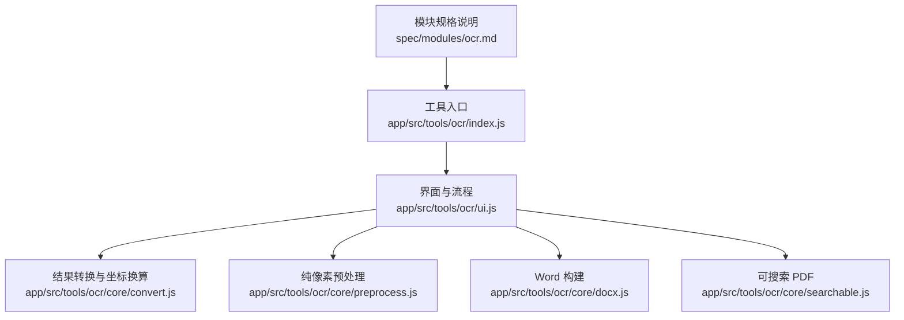

**图表来源**
- [index.js:1-14](file://app/src/tools/ocr/index.js#L1-L14)
- [ui.js:1-120](file://app/src/tools/ocr/ui.js#L1-L120)
- [preprocess.js:1-60](file://app/src/tools/ocr/core/preprocess.js#L1-L60)
- [convert.js:1-30](file://app/src/tools/ocr/core/convert.js#L1-L30)
- [docx.js:1-30](file://app/src/tools/ocr/core/docx.js#L1-L30)
- [searchable.js:1-40](file://app/src/tools/ocr/core/searchable.js#L1-L40)
- [ocr.md:1-30](file://spec/modules/ocr.md#L1-L30)

**章节来源**
- [index.js:1-14](file://app/src/tools/ocr/index.js#L1-L14)
- [ui.js:1-120](file://app/src/tools/ocr/ui.js#L1-L120)
- [ocr.md:1-30](file://spec/modules/ocr.md#L1-L30)

## 核心组件
- 工具注册与入口：导出 id、名称、分组、顺序与样式，并挂载 UI。
- 界面流程：
  - 输出模式选择：可搜索 PDF、纯文本、Word、纯文本+可搜索 PDF。
  - 扫描件增强开关：去灰底、自动纠偏、锐化，并显示即将执行的步骤。
  - 压缩瘦身：对 PDF 先压缩再识别，降低最终体积。
  - 文件添加与预览：支持图片与扫描版 PDF，PDF 逐页渲染预览。
- 纯逻辑层：
  - 预处理：灰度化、反色、纠偏、中值去噪、USM 锐化、黑白化。
  - 结果转换：行内片段拼接、行级/片段级数据导出、PDF 坐标换算。
  - Word 构建：手写最小 OOXML + JSZip 打包。
  - 可搜索 PDF：嵌入字体子集，叠加 RenderMode=Invisible 文字层。

**章节来源**
- [index.js:1-14](file://app/src/tools/ocr/index.js#L1-L14)
- [ui.js:1-120](file://app/src/tools/ocr/ui.js#L1-L120)
- [preprocess.js:1-60](file://app/src/tools/ocr/core/preprocess.js#L1-L60)
- [convert.js:1-30](file://app/src/tools/ocr/core/convert.js#L1-L30)
- [docx.js:1-30](file://app/src/tools/ocr/core/docx.js#L1-L30)
- [searchable.js:1-40](file://app/src/tools/ocr/core/searchable.js#L1-L40)

## 架构总览
OCR 整体架构分三层：
- 界面与流程层：接收用户输入，组织任务，协调各 core 模块。
- 纯逻辑层：不依赖 DOM/Electron，可在 Node 环境单测。
- 外部集成层：主进程 OCR 引擎、pdf-lib/fontkit、JSZip、pdfops。

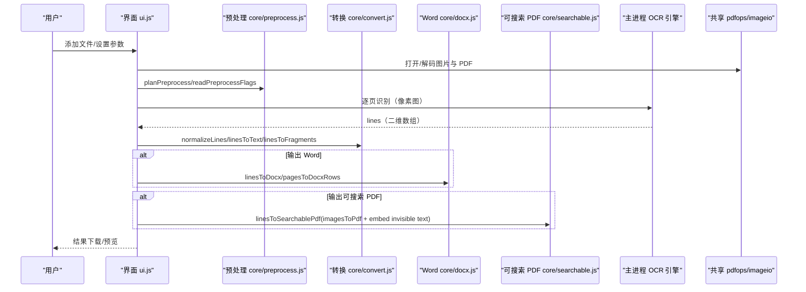

**图表来源**
- [ui.js:1-120](file://app/src/tools/ocr/ui.js#L1-L120)
- [preprocess.js:1-60](file://app/src/tools/ocr/core/preprocess.js#L1-L60)
- [convert.js:1-30](file://app/src/tools/ocr/core/convert.js#L1-L30)
- [docx.js:1-30](file://app/src/tools/ocr/core/docx.js#L1-L30)
- [searchable.js:1-40](file://app/src/tools/ocr/core/searchable.js#L1-L40)

**章节来源**
- [ocr.md:1-69](file://spec/modules/ocr.md#L1-L69)

## 详细组件分析

### 纯像素预处理（灰度化 → 反色 → 纠偏 → 去噪 → 锐化 → 黑白化）
预处理模块是核心算法区，所有算子针对单通道灰度 `Uint8ClampedArray`，避免 DOM/Canvas 耦合，便于 Node 单测与跨环境复用。

#### 参数规范化与步骤生成
- 默认参数定义包含灰度化、反色、纠偏范围、去噪、锐化强度、黑白化方法与窗口等。
- `planPreprocess` 将布尔选项与数值边界规范化，同时生成人类可读的步骤序列，用于界面提示。

关键点：
- 灰度化始终开启，除非整条链路未启用任何增强。
- 方法字段被归一化为 `adaptive` / `otsu` / `manual`。
- 窗口尺寸强制奇数并在允许范围内钳制。
- 手动阈值在 0~255 范围内钳制。

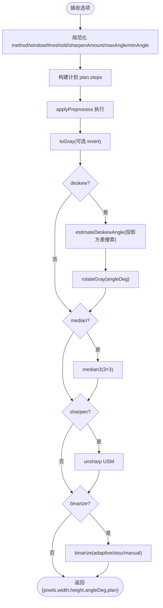

**图表来源**
- [preprocess.js:1-60](file://app/src/tools/ocr/core/preprocess.js#L1-L60)
- [preprocess.js:60-120](file://app/src/tools/ocr/core/preprocess.js#L60-L120)
- [preprocess.js:320-396](file://app/src/tools/ocr/core/preprocess.js#L320-L396)

**章节来源**
- [preprocess.js:1-60](file://app/src/tools/ocr/core/preprocess.js#L1-L60)
- [preprocess.js:60-120](file://app/src/tools/ocr/core/preprocess.js#L60-L120)

#### 灰度化与反色
- `toGray` 使用标准亮度权重计算灰度值，可选择反色（深底浅字场景）。
- 写回函数将灰度图填充到 RGBA 缓冲，alpha 拉满。

复杂度：O(w*h)，线性遍历像素。

**章节来源**
- [preprocess.js:120-180](file://app/src/tools/ocr/core/preprocess.js#L120-L180)

#### 纠偏与坐标回映射
- `estimateDeskewAngle` 通过降采样加速，在 ±maxAngle 范围内按步长旋转并计算行投影方差，取方差最大角度作为纠偏角度。
- `rotateGray` 使用双线性插值绕中心旋转，裁回原尺寸。
- `unrotateBox` 将纠偏后图像的框反向旋转到原图坐标系，取外接矩形作为结果。

关键特性：
- 降采样：盒平均采样，限制长边不超过 `maxDim`。
- 投影方差：每行灰度和的方差越大，表示行越水平。
- 回映射：四角点反向旋转后再取 min/max 得到轴对齐矩形。

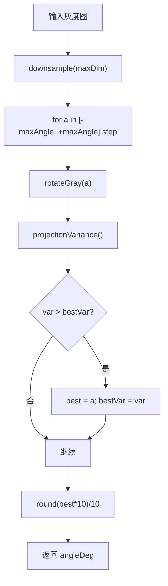

**图表来源**
- [preprocess.js:260-320](file://app/src/tools/ocr/core/preprocess.js#L260-L320)
- [preprocess.js:320-396](file://app/src/tools/ocr/core/preprocess.js#L320-L396)

**章节来源**
- [preprocess.js:200-260](file://app/src/tools/ocr/core/preprocess.js#L200-L260)
- [preprocess.js:320-396](file://app/src/tools/ocr/core/preprocess.js#L320-L396)

#### 去噪与锐化
- `median3`：3×3 中值滤波，就地处理，邻域值排序取中位数。
- `unsharp`：USM 锐化，用加权模板近似高斯模糊，再以原图 + 强度 × (原图 - 模糊) 增强边缘。

注意：
- 中值去噪默认关闭，实测会显著降低召回率，但保留能力供极端噪声场景按需开启。

**章节来源**
- [preprocess.js:200-260](file://app/src/tools/ocr/core/preprocess.js#L200-L260)

#### 黑白化策略（自适应阈值、大津法、手动阈值）
- 自适应阈值：积分图局部均值 + 偏移 c，背景较亮则判为背景，否则前景。
- 大津法：统计直方图，最大化类间方差确定全局阈值。
- 手动阈值：固定阈值比较。

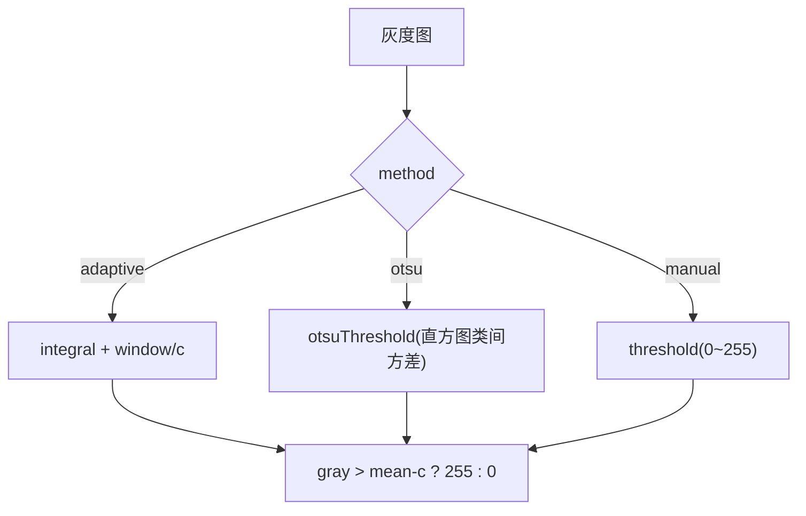

**图表来源**
- [preprocess.js:200-260](file://app/src/tools/ocr/core/preprocess.js#L200-L260)

**章节来源**
- [preprocess.js:200-260](file://app/src/tools/ocr/core/preprocess.js#L200-L260)

### 识别结果转换与 PDF 坐标换算
- 输入约定：主进程 OCR 返回二维数组 `[[{text, box:{x,y,width,height}, confidence}, ...], ...]`，box 为渲染位图的像素坐标（原点左上、y 向下）。
- `normalizeLines`：过滤空行与空片段。
- `rowToText`：按 x 排序拼接，片段间距超过行高一半时补空格。
- `linesToText/pagesToText`：生成纯文本。
- `linesToPlainRows/linesToFragments`：导出行级/片段级数据，供预览画框与隐形文字层定位。
- `computePdfTextPlacement`：像素坐标（y 向下）→ PDF 点坐标（y 向上），字号取框高，基线置于框底。

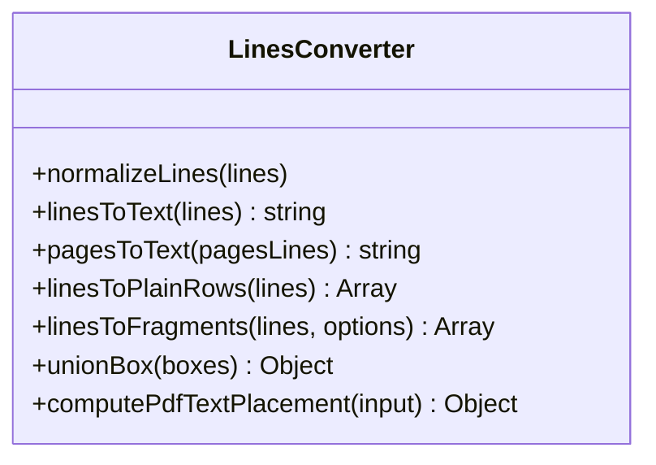

**图表来源**
- [convert.js:1-151](file://app/src/tools/ocr/core/convert.js#L1-L151)

**章节来源**
- [convert.js:1-151](file://app/src/tools/ocr/core/convert.js#L1-L151)

### Word 文档构建（最小 OOXML）
- 依赖 JSZip（UMD/CommonJS 双适配）。
- 手写最小 OOXML 三件套：`[Content_Types].xml`、`_rels/.rels`、`word/document.xml`。
- `escapeXml` 安全转义控制字符与 XML 特殊字符。
- `paragraph` 生成段落节点，支持加粗与空段落分隔。
- `linesToDocx` 异步打包为 Uint8Array。
- `pagesToDocxRows` 多页插入空段落分隔。

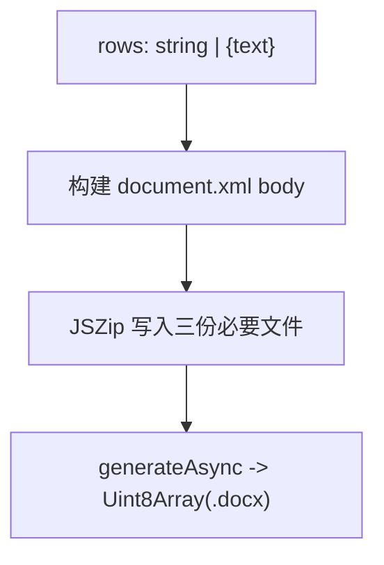

**图表来源**
- [docx.js:1-90](file://app/src/tools/ocr/core/docx.js#L1-L90)

**章节来源**
- [docx.js:1-90](file://app/src/tools/ocr/core/docx.js#L1-L90)

### 可搜索 PDF 构建（隐形文字层）
- 原理：在原 PDF 页面叠加 `RenderMode=Invisible` 的文字层，保持原貌不变但可搜索、可选中复制。
- 依赖 `@cantoo/pdf-lib` 与 `@cantoo/fontkit`，字体子集化大幅减少 PDF 体积。
- 浏览器端 fontkit 走 UMD 脚本加载，Node 端直接 import。
- `imagesToPdf`：将 PNG/JPG 装订成 PDF（1px=1pt）。
- `linesToSearchablePdf`：逐页写入隐形文字，统计绘制片段数、嵌入字符数、缺失字符及样例。
- 旋转页处理：若页面旋转角度非 0，跳过绘制并记录页号，避免坐标错位。

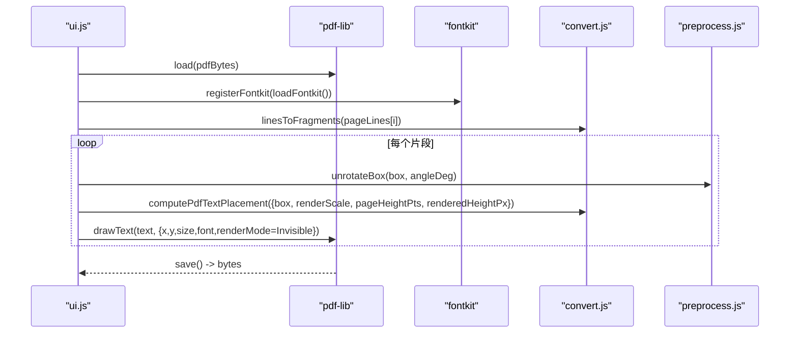

**图表来源**
- [searchable.js:1-174](file://app/src/tools/ocr/core/searchable.js#L1-L174)
- [convert.js:120-151](file://app/src/tools/ocr/core/convert.js#L120-L151)
- [preprocess.js:180-220](file://app/src/tools/ocr/core/preprocess.js#L180-L220)

**章节来源**
- [searchable.js:1-174](file://app/src/tools/ocr/core/searchable.js#L1-L174)
- [ocr.md:20-69](file://spec/modules/ocr.md#L20-L69)

### 与 ppu-paddle-ocr 引擎的集成与状态管理
- 引擎运行在主进程，通过 IPC 暴露 `ocrStatus`、`ocrRecognize`、`ocrCancel`、`ocrFont`。
- 模型缺失时禁用运行并提示放置路径；中文字体缺失时仅保留纯文本输出。
- 界面在启动时探测引擎状态，必要时延迟加载字体字节。

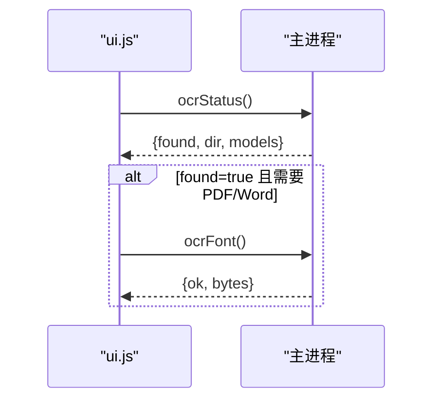

**图表来源**
- [ui.js:120-240](file://app/src/tools/ocr/ui.js#L120-L240)

**章节来源**
- [ui.js:120-240](file://app/src/tools/ocr/ui.js#L120-L240)
- [ocr.md:1-69](file://spec/modules/ocr.md#L1-L69)

## 依赖关系分析
- 界面层依赖：
  - `shared/pdfops.js`：PDF 打开、渲染、压缩。
  - `shared/imageio.js`：图片解码/编码。
  - `core/convert.js`、`core/preprocess.js`、`core/docx.js`、`core/searchable.js`。
- 纯逻辑层依赖：
  - `docx.js`：JSZip（UMD/CommonJS）。
  - `searchable.js`：`@cantoo/pdf-lib`、`@cantoo/fontkit`。
- 主进程集成：
  - `ppu-paddle-ocr`、`onnxruntime-node`、`@napi-rs/canvas`、`opencv-js` 等原生依赖。

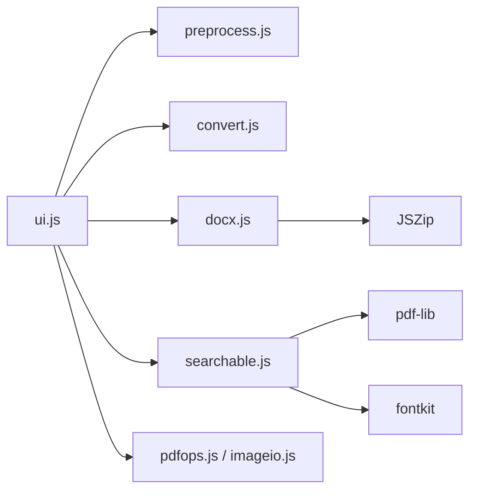

**图表来源**
- [ui.js:1-120](file://app/src/tools/ocr/ui.js#L1-L120)
- [docx.js:1-30](file://app/src/tools/ocr/core/docx.js#L1-L30)
- [searchable.js:1-40](file://app/src/tools/ocr/core/searchable.js#L1-L40)

**章节来源**
- [ocr.md:50-69](file://spec/modules/ocr.md#L50-L69)

## 性能考虑
- 渲染倍率平衡：PDF 页面识别渲染倍率为 2×，约 144DPI，兼顾识别率与耗时。
- 纠偏降采样：角度搜索前对灰度图降采样，限制长边不超过 `maxDim`，降低旋转与方差计算开销。
- 预处理就地改写：减少中间缓冲分配，提高内存效率。
- 字体子集化：仅嵌入实际用到的字形，极大缩小 PDF 体积。
- 批量处理：PDF 先压缩再识别，减小后续处理与输出体积。
- 资源释放：pdfjs 文档需显式销毁，避免内存泄漏。

[本节为通用指导，不直接分析具体文件]

## 故障排查指南
- 引擎不可用：
  - 现象：按钮禁用或提示缺少 OCR 能力。
  - 处理：确认 `addons/ocr` 下存在 `det.onnx`、`rec.onnx`、`dict.txt`，以及字体 `NotoSansSC-VF.ttf`。
- 中文字体缺失：
  - 现象：可搜索 PDF 与 Word 不可用，仅能导出纯文本。
  - 处理：放置字体文件，重启工具。
- 文件无法识别：
  - 现象：报错“不是能识别的图片格式”。
  - 处理：确认文件格式为 PNG/JPG 等受支持类型。
- 内存不足：
  - 现象：报错“out of memory”。
  - 处理：换小图片或降低扫描分辨率。
- 找不到文件：
  - 现象：报错“no such file/ENOENT”。
  - 处理：确认文件未被移动或删除。
- 旋转页文字缺失：
  - 现象：某些页未叠加文字层。
  - 原因：PDF 页面旋转角度非 0，坐标系不一致，跳过绘制并上报页号。
  - 处理：校正源 PDF 页面旋转角度。

**章节来源**
- [ui.js:120-240](file://app/src/tools/ocr/ui.js#L120-L240)
- [convert.js:120-151](file://app/src/tools/ocr/core/convert.js#L120-L151)
- [searchable.js:120-174](file://app/src/tools/ocr/core/searchable.js#L120-L174)
- [ocr.md:40-69](file://spec/modules/ocr.md#L40-L69)

## 结论
OCR 工具通过清晰的三层架构与纯像素预处理链，将扫描件与扫描版 PDF 高效转化为可搜索 PDF、纯文本与 Word。其关键技术包括：
- 参数规范化的预处理计划生成。
- 投影方差搜索的自动纠偏与坐标回映射。
- 自适应阈值、大津法与手动阈值的灵活黑白化。
- 隐形文字层与字体子集化保证可搜索性与体积优化。
- 与主进程 OCR 引擎解耦集成，保障 CSP 与性能。

该设计兼顾识别质量、处理速度与用户体验，适合工程落地与持续优化。

[本节为总结性内容，不直接分析具体文件]

## 附录：完整工作流示例
以下是一个从扫描件预处理到最终文档输出的端到端流程示例：

1. 用户选择输出模式（可搜索 PDF / 纯文本 / Word / 两者）。
2. 勾选扫描件增强项（去灰底、自动纠偏、锐化），界面显示即将执行的步骤。
3. 添加图片或 PDF，PDF 逐页检测页数与大小。
4. 若选择 PDF 瘦身：调用压缩接口，记录原始与压缩后大小。
5. 对每个页面：
   - PDF：渲染指定倍率图像；图片：解码一次并重编码 PNG。
   - 预处理：灰度化 → 反色 → 纠偏（投影方差搜索）→ 去噪（可选）→ 锐化（USM）→ 黑白化（自适应/大津/手动）。
   - 调用主进程 OCR 引擎识别，得到二维数组 lines。
   - 转换结果：生成纯文本、行级/片段级数据。
6. 输出：
   - 纯文本：直接保存。
   - Word：组装 OOXML 并通过 JSZip 打包。
   - 可搜索 PDF：先将图片装订为 PDF，再嵌入字体子集，叠加隐形文字层，统计绘制与缺失字符。
7. 反馈结果：文件列表显示成功/失败状态，预览区域展示识别框与文字。

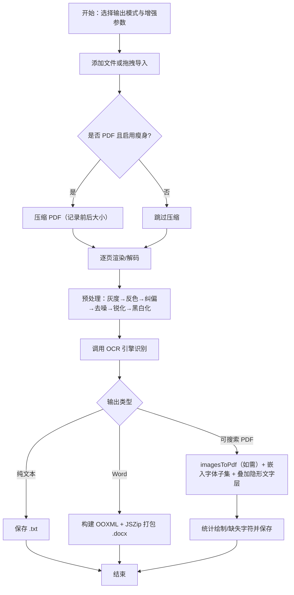

**图表来源**
- [ui.js:240-600](file://app/src/tools/ocr/ui.js#L240-L600)
- [preprocess.js:320-396](file://app/src/tools/ocr/core/preprocess.js#L320-L396)
- [convert.js:1-151](file://app/src/tools/ocr/core/convert.js#L1-L151)
- [docx.js:1-90](file://app/src/tools/ocr/core/docx.js#L1-L90)
- [searchable.js:1-174](file://app/src/tools/ocr/core/searchable.js#L1-L174)

**章节来源**
- [ui.js:240-600](file://app/src/tools/ocr/ui.js#L240-L600)
- [pdf-ocr-test.js:1-58](file://app/tests/pdf-ocr-test.js#L1-L58)
- [ocr.md:1-69](file://spec/modules/ocr.md#L1-L69)