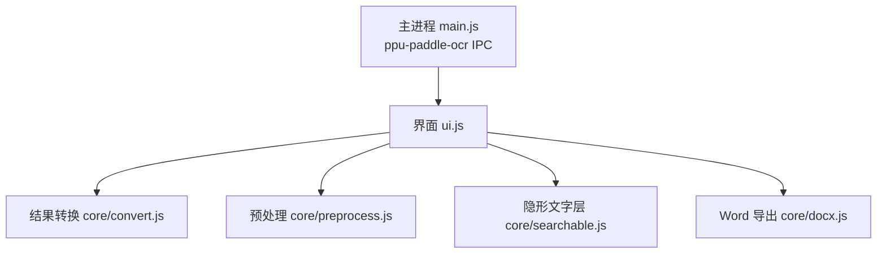
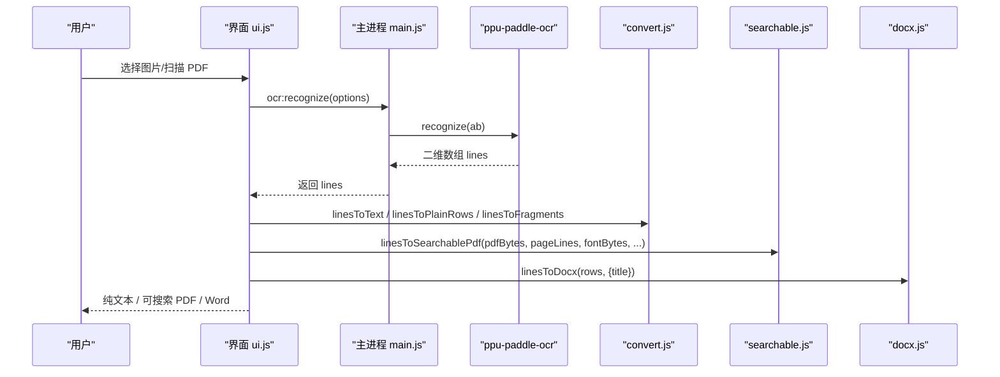
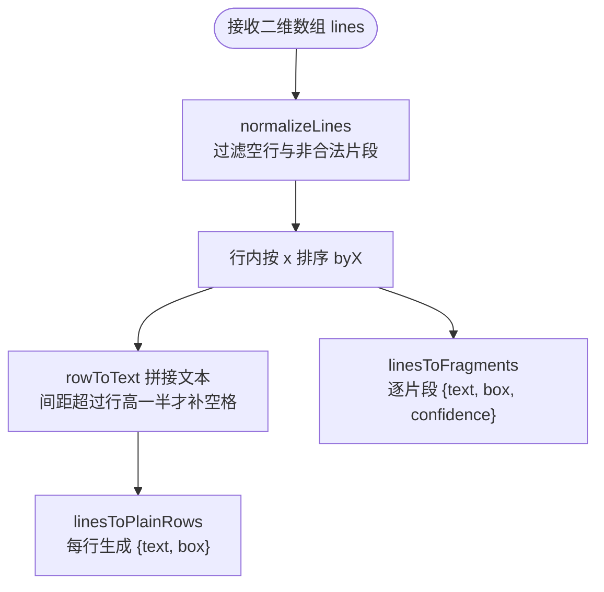
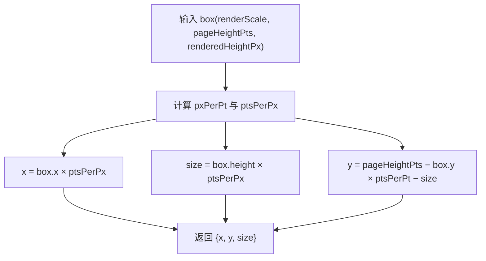
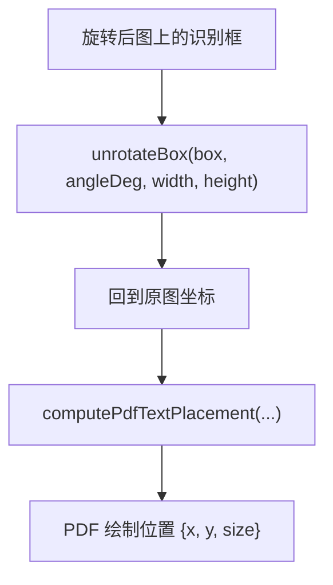
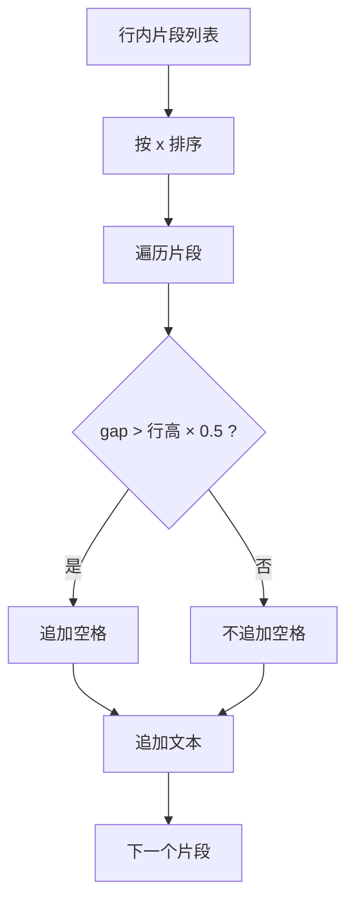
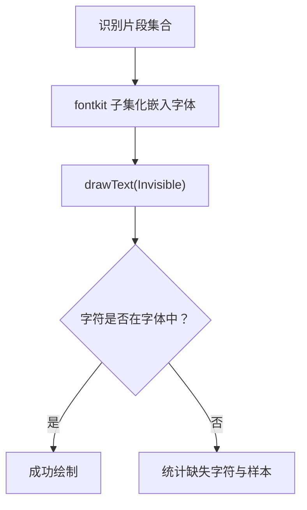
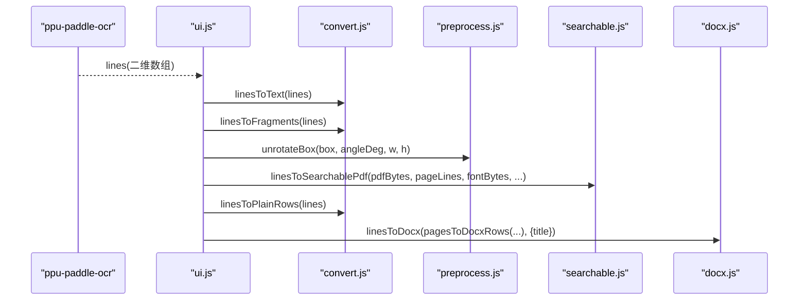
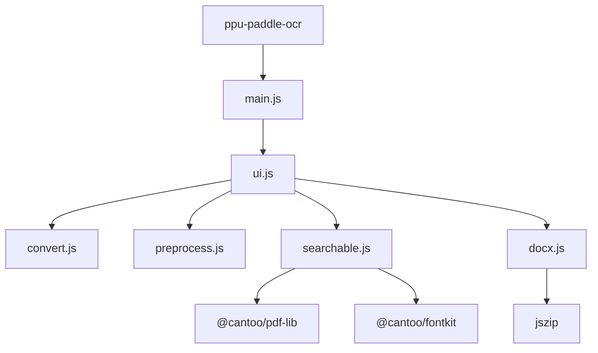

# OCR 结果转换模块

<cite>
**本文引用的文件**   
- [convert.js](file://app/src/tools/ocr/core/convert.js)
- [preprocess.js](file://app/src/tools/ocr/core/preprocess.js)
- [searchable.js](file://app/src/tools/ocr/core/searchable.js)
- [docx.js](file://app/src/tools/ocr/core/docx.js)
- [index.js](file://app/src/tools/ocr/index.js)
- [ui.js](file://app/src/tools/ocr/ui.js)
- [main.js](file://app/main.js)
- [ocr.md](file://spec/modules/ocr.md)
- [ocr-test.js](file://app/tests/ocr-test.js)
</cite>

## 目录
1. [简介](#简介)
2. [项目结构](#项目结构)
3. [核心组件](#核心组件)
4. [架构总览](#架构总览)
5. [详细组件分析](#详细组件分析)
6. [依赖关系分析](#依赖关系分析)
7. [性能考虑](#性能考虑)
8. [故障排查指南](#故障排查指南)
9. [结论](#结论)

## 简介
本技术文档聚焦于 OCR 结果转换模块，说明如何将 ppu-paddle-ocr 引擎返回的原始识别结果转换为标准化数据结构，并进一步映射到纯文本、可搜索 PDF 与 Word 输出。重点覆盖：

- 坐标系统转换：从渲染图像素坐标（y 向下）到 PDF 点坐标（y 向上）。
- 文本块合并与排序：行内片段按 x 坐标排序拼接，并按间距策略决定是否补空格。
- 识别结果格式规范：字段定义包括文本内容、位置信息、置信度评分等。
- 多语言处理与字符编码：PP-OCRv5 mobile 模型覆盖简体中文、英文、日文、繁体中文；字体子集化控制生僻字。
- 输出格式映射：纯文本、JSON（片段级）、结构化 Word 段落。
- 错误处理与数据验证：空输入过滤、低置信度过滤、坐标合法性校验、用户友好错误消息。
- 性能优化：归一化预处理、纠偏角度估计降采样、JSZip UMD 复用、避免多余 DOM 操作。

## 项目结构
OCR 工具位于 `app/src/tools/ocr/`，由入口声明、UI 集成与纯逻辑核心组成：

- `index.js`：工具注册，描述 id、名称、分组与顺序。
- `ui.js`：界面集成，负责调用 OCR 引擎、执行预处理、绘制预览框、生成纯文本和 Word。
- `core/convert.js`：识别结果 → 文本 / 行级数据 / 片段级数据的纯逻辑转换。
- `core/preprocess.js`：扫描件预处理（灰度化、反色、纠偏、去噪、锐化、黑白化）及坐标回映射。
- `core/searchable.js`：基于 pdf-lib 与 fontkit 将识别片段写入 PDF 隐形文字层。
- `core/docx.js`：手写最小 OOXML，把行数据打包成 .docx。



**图表来源**
- [index.js:1-14](file://app/src/tools/ocr/index.js#L1-L14)
- [ui.js:16-18](file://app/src/tools/ocr/ui.js#L16-L18)
- [convert.js:1-10](file://app/src/tools/ocr/core/convert.js#L1-L10)
- [preprocess.js:1-15](file://app/src/tools/ocr/core/preprocess.js#L1-L15)
- [searchable.js:1-17](file://app/src/tools/ocr/core/searchable.js#L1-L17)
- [docx.js:1-6](file://app/src/tools/ocr/core/docx.js#L1-L6)
- [main.js:897-946](file://app/main.js#L897-L946)

**章节来源**
- [index.js:1-14](file://app/src/tools/ocr/index.js#L1-L14)
- [ocr.md:1-69](file://spec/modules/ocr.md#L1-L69)

## 核心组件
本节概述各核心文件职责：

- convert.js：定义 normalizeLines、linesToText、pagesToText、linesToPlainRows、linesToFragments、unionBox、computePdfTextPlacement、friendlyOcrMessage。
- preprocess.js：定义 planPreprocess、applyPreprocess、rotateGray、unrotateBox、estimateDeskewAngle、binarize、otsuThreshold 等。
- searchable.js：定义 imagesToPdf、linesToSearchablePdf，封装 pdf-lib + fontkit 流程。
- docx.js：定义 linesToDocx、pagesToDocxRows、escapeXml，生成最小 OOXML ZIP。
- index.js：工具元信息。
- ui.js：编排 OCR 识别、预处理、可视化与输出。
- main.js：通过 IPC 调用 ppu-paddle-ocr。

**章节来源**
- [convert.js:1-151](file://app/src/tools/ocr/core/convert.js#L1-L151)
- [preprocess.js:1-396](file://app/src/tools/ocr/core/preprocess.js#L1-L396)
- [searchable.js:1-174](file://app/src/tools/ocr/core/searchable.js#L1-L174)
- [docx.js:1-90](file://app/src/tools/ocr/core/docx.js#L1-L90)
- [index.js:1-14](file://app/src/tools/ocr/index.js#L1-L14)
- [ui.js:16-18](file://app/src/tools/ocr/ui.js#L16-L18)
- [main.js:897-946](file://app/main.js#L897-L946)

## 架构总览
OCR 结果转换的整体流程如下：



**图表来源**
- [main.js:897-946](file://app/main.js#L897-L946)
- [ui.js:16-18](file://app/src/tools/ocr/ui.js#L16-L18)
- [convert.js:50-101](file://app/src/tools/ocr/core/convert.js#L50-L101)
- [searchable.js:103-174](file://app/src/tools/ocr/core/searchable.js#L103-L174)
- [docx.js:52-90](file://app/src/tools/ocr/core/docx.js#L52-L90)

## 详细组件分析

### 识别结果格式规范
paddle-ocr 返回的原始识别结果是二维数组：外层是行，内层是行内片段。每个片段至少包含：

- text：字符串，识别出的文本内容。
- box：对象，包含 x、y、width、height，表示渲染位图的像素坐标（左上原点，y 向下）。
- confidence：数值，置信度评分（可选）。

示例路径参考：[convert.js:1-10](file://app/src/tools/ocr/core/convert.js#L1-L10)。

数据校验与清洗：

- normalizeLines：过滤空行、非数组、text 非字符串或为空的情况。
- isBox：确保 box 存在且四个字段均为有限数值。
- linesToFragments：过滤无有效 box 的片段，并对 confidence 做默认值与阈值过滤。



**图表来源**
- [convert.js:22-53](file://app/src/tools/ocr/core/convert.js#L22-L53)
- [convert.js:70-101](file://app/src/tools/ocr/core/convert.js#L70-L101)

**章节来源**
- [convert.js:22-101](file://app/src/tools/ocr/core/convert.js#L22-L101)

### 坐标系统转换
OCR 的 box 使用渲染位图的像素坐标（y 向下），而 PDF 使用点坐标（y 向上）。转换关键步骤：

1. 计算像素到点的比例 pxPerPt：优先用 renderedHeightPx / pageHeightPts，否则退回 renderScale。
2. 计算 ptsPerPx = 1 / pxPerPt。
3. 计算 PDF 坐标：
   - x = box.x × ptsPerPx
   - size = box.height × ptsPerPx
   - y = pageHeightPts − box.y × ptsPerPt − size



**图表来源**
- [convert.js:127-151](file://app/src/tools/ocr/core/convert.js#L127-L151)

若开启纠偏，识别框在旋转后的图上，需要先用 unrotateBox 回原图坐标，再进行 PDF 坐标换算。



**图表来源**
- [preprocess.js:167-189](file://app/src/tools/ocr/core/preprocess.js#L167-L189)
- [searchable.js:135-145](file://app/src/tools/ocr/core/searchable.js#L135-L145)

**章节来源**
- [convert.js:127-151](file://app/src/tools/ocr/core/convert.js#L127-L151)
- [preprocess.js:167-189](file://app/src/tools/ocr/core/preprocess.js#L167-L189)
- [searchable.js:135-145](file://app/src/tools/ocr/core/searchable.js#L135-L145)

### 文本块合并与排序算法
- 行内排序：byX 按片段的 box.x 升序排列。
- 拼接策略：当相邻片段之间存在间隙且该间隙大于“行高的 GAP_RATIO（0.5）”时插入空格，避免中文误加空格。
- 行合并：rowsToText 拼接整行文本；linesToText 将各行以换行符连接。
- 多页合并：pagesToText 将多页文本以双换行分隔。

复杂度：

- 行内排序 O(n log n)，n 为片段数。
- 拼接 O(n)。
- 整体时间复杂度 O(N log N)，N 为所有片段总数。



**图表来源**
- [convert.js:12-21](file://app/src/tools/ocr/core/convert.js#L12-L21)
- [convert.js:22-53](file://app/src/tools/ocr/core/convert.js#L22-L53)

**章节来源**
- [convert.js:12-53](file://app/src/tools/ocr/core/convert.js#L12-L53)

### 多语言识别结果与字符编码
- 模型能力：PP-OCRv5 mobile 支持简体中文、英文、日文、繁体中文，无需切换模型，语言仅在界面说明中体现。
- 字体子集化：fontkit 只嵌入实际用到的字形，显著减小 PDF 体积。
- 生僻字处理：若字体不含某字符，linesToSearchablePdf 会捕获异常并统计缺失字符数量与样本。



**图表来源**
- [searchable.js:135-174](file://app/src/tools/ocr/core/searchable.js#L135-L174)
- [ocr.md:24-41](file://spec/modules/ocr.md#L24-L41)

**章节来源**
- [searchable.js:135-174](file://app/src/tools/ocr/core/searchable.js#L135-L174)
- [ocr.md:24-41](file://spec/modules/ocr.md#L24-L41)

### 输出格式映射
- 纯文本：linesToText 返回每行一条文本，pagesToText 将多页以双换行分隔。
- JSON（片段级）：linesToFragments 返回片段数组，包含 text、box、confidence。
- 结构化 Word：linesToPlainRows 得到行级数据，pagesToDocxRows 将多页行数据拼接为段落序列，linesToDocx 生成 OOXML ZIP。

```mermaid
classDiagram
    class Lines {
        +二维数组 rows
        +片段数组 fragments
    }
    class TextOutput {
        +string text
    }
    class JsonFragments {
        +Array~object~ items
        +text:string
        +box:{x,y,width,height}
        +confidence:number
    }
    class DocxRows {
        +Array~string~ paragraphs
    }

    Lines --> TextOutput : "linesToText/pagesToText"
    Lines --> JsonFragments : "linesToFragments"
    Lines --> DocxRows : "linesToPlainRows/pagesToDocxRows"
```

**图表来源**
- [convert.js:50-101](file://app/src/tools/ocr/core/convert.js#L50-L101)
- [docx.js:52-90](file://app/src/tools/ocr/core/docx.js#L52-L90)

**章节来源**
- [convert.js:50-101](file://app/src/tools/ocr/core/convert.js#L50-L101)
- [docx.js:52-90](file://app/src/tools/ocr/core/docx.js#L52-L90)

### 完整转换流程示例
以下示例展示从原始 OCR 结果到最终格式化输出的端到端过程：

1. 主进程通过 IPC 调用 ppu-paddle-ocr 获取二维数组 lines。
2. 界面调用 linesToText 生成纯文本。
3. 如需可搜索 PDF：
   - 先装订图片为 PDF（imagesToPdf），或直接使用扫描版 PDF。
   - 对每页调用 linesToFragments 获取片段。
   - 如开启纠偏，使用 unrotateBox 将框回原图坐标。
   - 调用 computePdfTextPlacement 换算 PDF 坐标。
   - 使用 drawText 写入 Invisible 文字层。
4. 如需 Word：
   - 调用 linesToPlainRows 得到行级数据。
   - pagesToDocxRows 拼接段落序列。
   - linesToDocx 生成 OOXML ZIP。



**图表来源**
- [main.js:897-946](file://app/main.js#L897-L946)
- [ui.js:520-522](file://app/src/tools/ocr/ui.js#L520-L522)
- [ui.js:611-633](file://app/src/tools/ocr/ui.js#L611-L633)
- [searchable.js:135-145](file://app/src/tools/ocr/core/searchable.js#L135-L145)
- [docx.js:52-90](file://app/src/tools/ocr/core/docx.js#L52-L90)

**章节来源**
- [main.js:897-946](file://app/main.js#L897-L946)
- [ui.js:520-522](file://app/src/tools/ocr/ui.js#L520-L522)
- [ui.js:611-633](file://app/src/tools/ocr/ui.js#L611-L633)
- [searchable.js:135-145](file://app/src/tools/ocr/core/searchable.js#L135-L145)
- [docx.js:52-90](file://app/src/tools/ocr/core/docx.js#L52-L90)

## 依赖关系分析
OCR 转换模块的核心依赖如下：

- ppu-paddle-ocr：主进程原生 OCR 引擎，返回二维数组 lines。
- pdf-lib + fontkit：用于生成可搜索 PDF 与字体子集化。
- jszip：用于打包最小 OOXML 生成 Word。
- 界面与主进程 IPC：ocr:recognize、ocr:status、ocr:cancel、ocr:font。



**图表来源**
- [main.js:897-946](file://app/main.js#L897-L946)
- [searchable.js:1-17](file://app/src/tools/ocr/core/searchable.js#L1-L17)
- [docx.js:1-6](file://app/src/tools/ocr/core/docx.js#L1-L6)
- [ocr.md:24-41](file://spec/modules/ocr.md#L24-L41)

**章节来源**
- [ocr.md:24-41](file://spec/modules/ocr.md#L24-L41)

## 性能考虑
- 预处理管线：
  - 灰度化、反色、纠偏、去噪、锐化、黑白化可按需组合。
  - 纠偏角度估计使用 downsample 降低计算量，maxDim 限制长边尺寸。
  - 中值去噪默认关闭，因实测召回下降明显。
- 坐标换算：
  - 优先使用 renderedHeightPx/pageHeightPts 修正 round/取整误差。
- 字体子集化：
  - fontkit 仅嵌入实际字符，减少 PDF 体积。
- 输出构建：
  - Word 导出使用随包 jszip UMD，避免新增依赖。
  - 纯逻辑函数不碰 DOM，便于 Node 单测。

**章节来源**
- [preprocess.js:1-15](file://app/src/tools/ocr/core/preprocess.js#L1-L15)
- [preprocess.js:201-396](file://app/src/tools/ocr/core/preprocess.js#L201-L396)
- [docx.js:1-6](file://app/src/tools/ocr/core/docx.js#L1-L6)
- [ocr.md:56-69](file://spec/modules/ocr.md#L56-L69)

## 故障排查指南
常见问题与处理方式：

- 图片格式不支持：
  - friendlyOcrMessage 将底层错误转为中文提示，例如“这个文件不是能识别的图片格式（支持 PNG / JPG）”。
- 内存不足：
  - 识别失败时提示“图片太大导致内存不足”，建议缩小图片或降低分辨率。
- 文件丢失：
  - 找不到文件时会提示“找不到文件，可能已被移动或删除”。
- 字体加载失败：
  - 提示检查字体路径 addons/ocr/fonts/NotoSansSC-VF.ttf。
- 生僻字无法嵌入：
  - linesToSearchablePdf 捕获字体缺失异常，统计 missingChars 与 missingSamples，界面可据此提示。
- 旋转页不叠加文字层：
  - 当页面 rotation 非 0 时跳过绘制，并在 rotatedPages 中记录页号。

数据验证规则：

- isBox：确保 box 存在且四字段为有限数值。
- normalizeLines：过滤空行与非合法片段。
- linesToFragments：过滤无效 box 与低置信度片段。
- imagesToPdf：仅接受 PNG/JPG 字节流。

**章节来源**
- [convert.js:102-151](file://app/src/tools/ocr/core/convert.js#L102-L151)
- [searchable.js:103-174](file://app/src/tools/ocr/core/searchable.js#L103-L174)
- [ocr-test.js:233-244](file://app/tests/ocr-test.js#L233-L244)

## 结论
OCR 结果转换模块以纯逻辑函数为核心，提供从 ppu-paddle-ocr 原始识别结果到纯文本、JSON 片段、可搜索 PDF 与 Word 的完整链路。其设计强调：

- 清晰的坐标系统转换与纠偏回映射。
- 稳健的数据清洗与验证。
- 可配置的多语言识别与字体子集化。
- 高效预处理与零额外依赖的 Word 导出。
- 完善的错误提示与故障定位。

这些特性使模块既适合界面交互，也便于 Node 环境下的单元测试与自动化测试。