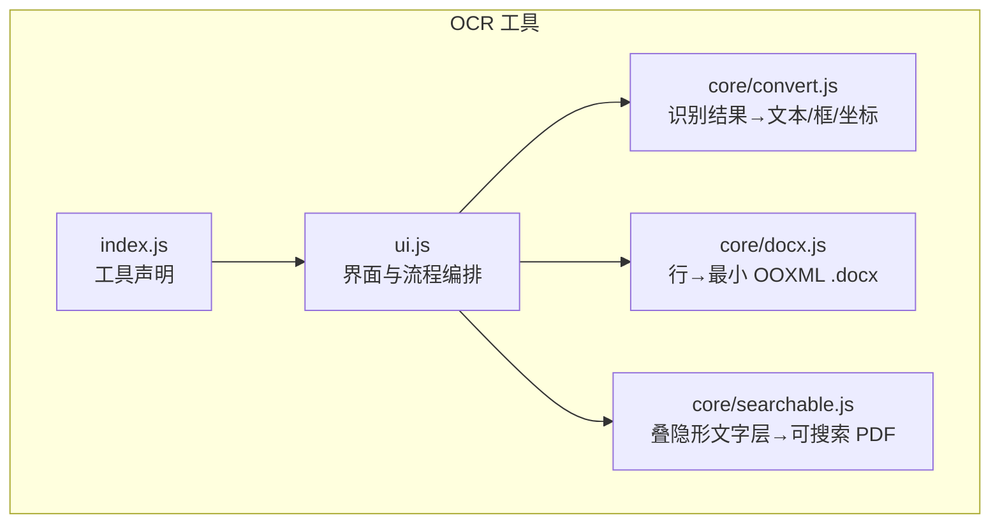
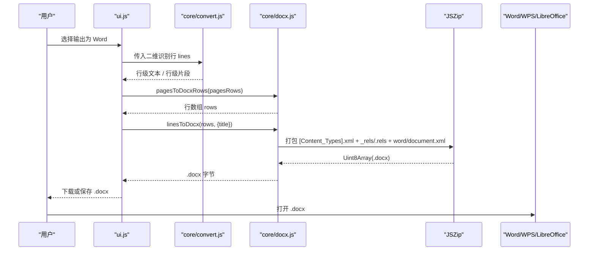
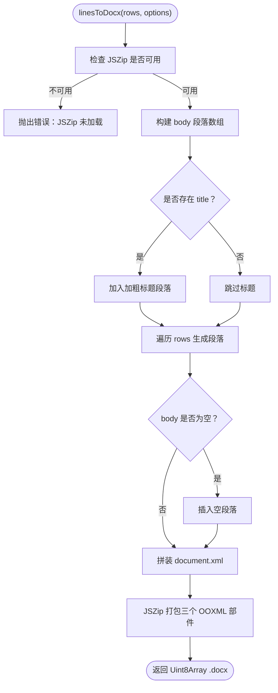
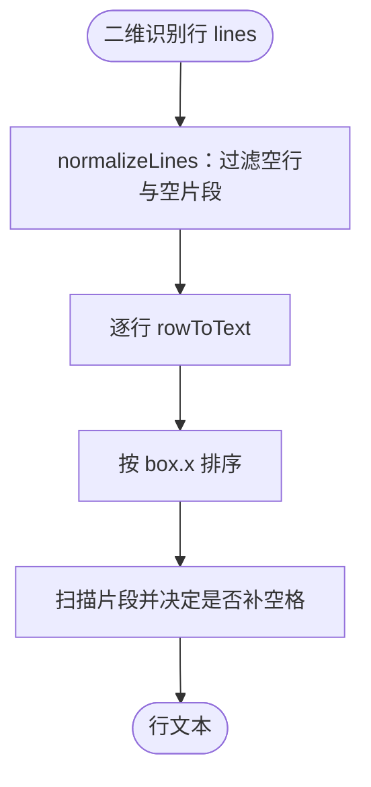
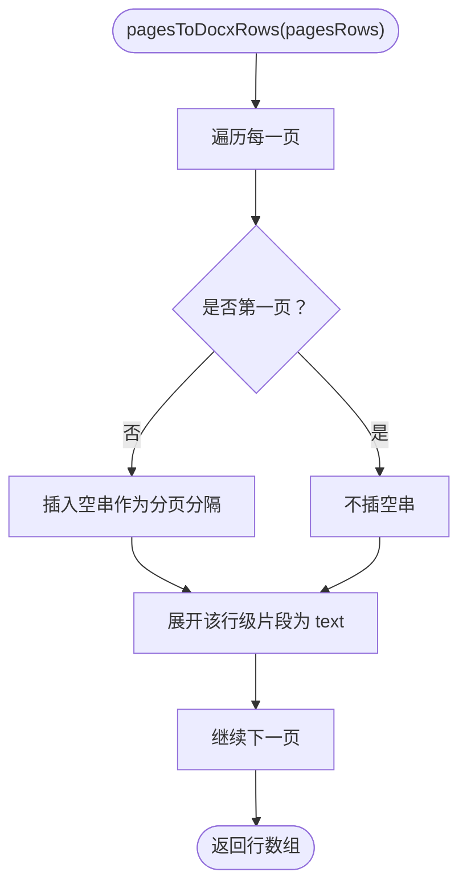
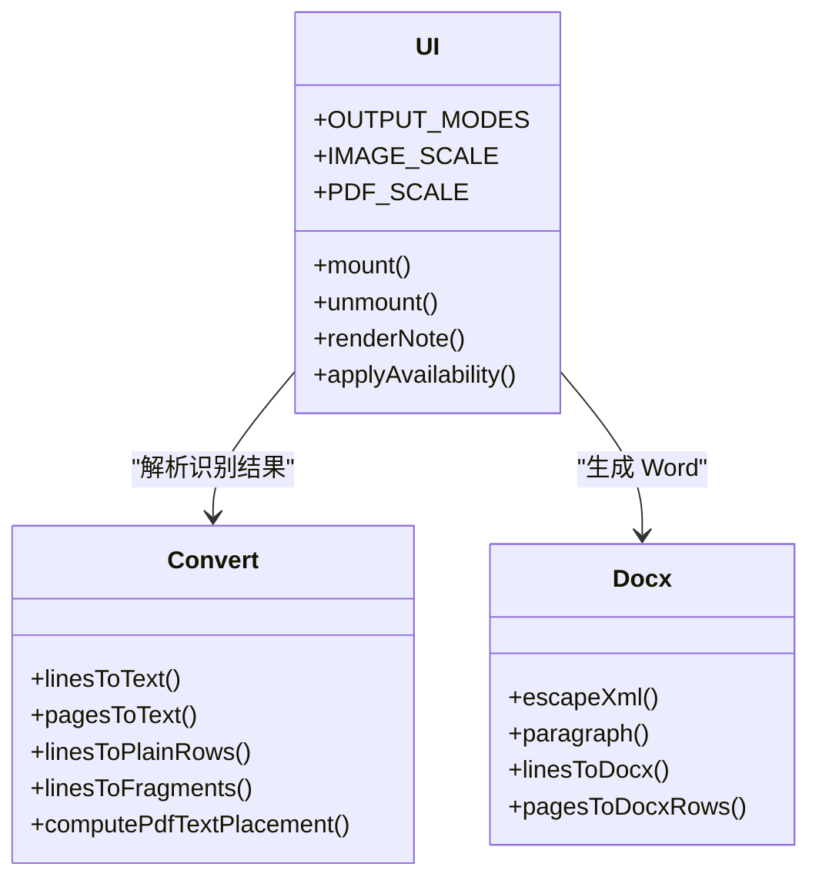
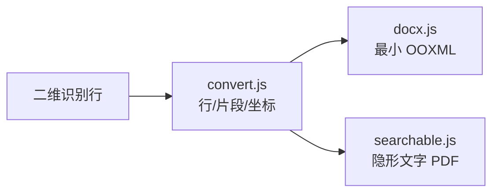
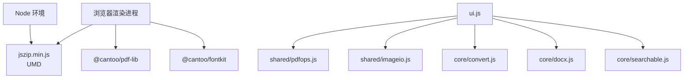

# Word 文档集成模块

<cite>
**本文引用的文件**   
- [app/src/tools/ocr/core/docx.js](file://app/src/tools/ocr/core/docx.js)
- [app/src/tools/ocr/core/convert.js](file://app/src/tools/ocr/core/convert.js)
- [app/src/tools/ocr/index.js](file://app/src/tools/ocr/index.js)
- [app/src/tools/ocr/ui.js](file://app/src/tools/ocr/ui.js)
- [app/src/tools/ocr/core/searchable.js](file://app/src/tools/ocr/core/searchable.js)
- [spec/modules/ocr.md](file://spec/modules/ocr.md)
- [README.md](file://README.md)
</cite>

## 目录
1. [引言](#引言)
2. [项目结构定位](#项目结构定位)
3. [核心组件](#核心组件)
4. [架构总览](#架构总览)
5. [详细组件分析](#详细组件分析)
6. [依赖关系分析](#依赖关系分析)
7. [性能与兼容性](#性能与兼容性)
8. [使用示例与最佳实践](#使用示例与最佳实践)
9. [故障排查指南](#故障排查指南)
10. [结论](#结论)

## 引言
本技术文档聚焦于仓库中“文字识别”工具里与 Word 文档相关的集成能力。该模块把 OCR 识别结果写成一份最小化的 OOXML `.docx`，实现“段落纯文本 + 分页”，而不是做复杂版面还原。它同时配套提供：
- 从二维识别框数据生成行级文本；
- 多页识别结果拼接为 Word 行序列；
- 与可搜索 PDF、纯文本输出共享同一预处理与坐标换算逻辑；
- 通过界面层暴露 Word 导出选项，并在主进程/渲染进程之间协作完成 OCR 与资源检测。

本说明的目标读者包括：需要理解 Word 产物如何生成的维护者、希望复用 `linesToDocx` 与 `pagesToDocxRows` 的开发者，以及关注 LibreOffice/WPS 兼容性的使用者。

## 项目结构定位
Word 文档写入能力集中在 OCR 工具的纯逻辑层中，不直接处理 Electron、DOM 或业务 UI。其位置与职责如下：

**图示来源**
- [app/src/tools/ocr/index.js:1-14](file://app/src/tools/ocr/index.js#L1-L14)
- [app/src/tools/ocr/ui.js:1-40](file://app/src/tools/ocr/ui.js#L1-L40)
- [app/src/tools/ocr/core/convert.js:1-15](file://app/src/tools/ocr/core/convert.js#L1-L15)
- [app/src/tools/ocr/core/docx.js:1-10](file://app/src/tools/ocr/core/docx.js#L1-L10)
- [app/src/tools/ocr/core/searchable.js:1-15](file://app/src/tools/ocr/core/searchable.js#L1-L15)

**章节来源**
- [app/src/tools/ocr/index.js:1-14](file://app/src/tools/ocr/index.js#L1-L14)
- [app/src/tools/ocr/ui.js:1-40](file://app/src/tools/ocr/ui.js#L1-L40)

## 核心组件
本节列出与 Word 文档集成直接相关的能力，并说明它们在整体流程中的角色。

| 组件 | 主要职责 | 关键输出/接口 | 与 Word 的关系 |
|---|---|---|---|
| `core/docx.js` | 将行级文本组装成最小 OOXML 包 | `escapeXml`、`paragraph`、`linesToDocx`、`pagesToDocxRows` | 直接生成 `.docx` 字节 |
| `core/convert.js` | 规范化 OCR 行、片段、外接矩形和 PDF 坐标换算 | `normalizeLines`、`linesToText`、`linesToFragments`、`computePdfTextPlacement` | 为 Word 与 PDF 提供统一行/片段语义 |
| `ui.js` | 挂载工具、读取配置、触发 OCR、选择输出类型 | 暴露 `mount/unmount`、输出模式 `pdf/txt/docx/both` | 用户侧选择 Word 导出入口 |
| `core/searchable.js` | 给扫描件叠加隐形文字层生成可搜索 PDF | `imagesToPdf`、`linesToSearchablePdf` | 与 Word 并列的输出路径 |
| `index.js` | 注册 OCR 工具元信息 | `id/name/icon/group/order/styles/mount/unmount` | 让工具箱加载 Word 导出能力 |

**章节来源**
- [app/src/tools/ocr/core/docx.js:1-90](file://app/src/tools/ocr/core/docx.js#L1-L90)
- [app/src/tools/ocr/core/convert.js:1-151](file://app/src/tools/ocr/core/convert.js#L1-L151)
- [app/src/tools/ocr/ui.js:1-60](file://app/src/tools/ocr/ui.js#L1-L60)
- [app/src/tools/ocr/core/searchable.js:1-30](file://app/src/tools/ocr/core/searchable.js#L1-L30)
- [app/src/tools/ocr/index.js:1-14](file://app/src/tools/ocr/index.js#L1-L14)

## 架构总览
OCR 到 Word 的整体数据流如下：

**图示来源**
- [app/src/tools/ocr/ui.js:1-60](file://app/src/tools/ocr/ui.js#L1-L60)
- [app/src/tools/ocr/core/convert.js:1-151](file://app/src/tools/ocr/core/convert.js#L1-L151)
- [app/src/tools/ocr/core/docx.js:1-90](file://app/src/tools/ocr/core/docx.js#L1-L90)

## 详细组件分析

### Word 文档写入器：`core/docx.js`
该文件是 Word 集成的核心。它不引入额外依赖，只使用随包提供的 JSZip，手写最小 OOXML 三件套：
- `[Content_Types].xml`
- `_rels/.rels`
- `word/document.xml`

#### 关键数据结构与复杂度
- 输入：
  - `rows`：字符串或 `{text}` 对象组成的数组。
  - `options.title`：可选标题，作为加粗首段。
- 时间复杂度：
  - 构建段落列表为 O(n)。
  - XML 拼接为 O(n)，其中 n 为段落数。
  - JSZip 异步打包由底层实现决定，但外层调用是 Promise。
- 空间复杂度：
  - 主要消耗在 `body` 数组与最终 XML 字符串上，线性增长。

#### 安全与健壮性
- `escapeXml` 会清理控制字符并转义 `& < > " '`，避免 Word 判定文件损坏。
- 空行被转换为空段落 `<w:p/>`，用于页面分隔。
- 若没有有效行，会插入一个空段落，保证至少有一个段落。

#### Word 结构与样式策略
- 每个段落使用 `<w:r><w:t xml:space="preserve">...</w:t></w:r>`，保留首尾空格。
- 标题段落支持加粗：通过 `<w:rPr><w:b/></w:rPr>` 注入。
- 页面尺寸与边距写在 `sectPr`：
  - 宽度 11906、高度 16838（近似 A4）；
  - 上下左右边距 1440（约 1 英寸）。

**图示来源**
- [app/src/tools/ocr/core/docx.js:15-90](file://app/src/tools/ocr/core/docx.js#L15-L90)

**章节来源**
- [app/src/tools/ocr/core/docx.js:1-90](file://app/src/tools/ocr/core/docx.js#L1-L90)

### 行与片段处理：`core/convert.js`
该文件定义 OCR 行数据的统一语义，既服务于 Word，也服务于可搜索 PDF。

#### 核心函数
| 函数 | 作用 | 对 Word 的意义 |
|---|---|---|
| `normalizeLines(lines)` | 过滤无效行和空片段 | 防止 Word 出现脏段落 |
| `rowToText(row)` | 按 x 排序、根据间距判断补空格 | 保持中文不被硬塞空格 |
| `linesToText(lines)` | 二维行 → 纯文本 | 用于纯文本输出 |
| `linesToFragments(lines, options)` | 二维行 → 片段数组 | 主要用于 PDF 隐形文字层 |
| `unionBox(boxes)` | 合并矩形 | 用于整行边界 |
| `linesToPlainRows(lines)` | 行 → `{text, box}` | 供预览与导出共用 |
| `computePdfTextPlacement(...)` | 像素坐标 → PDF 点坐标 | 与 Word 无关，但与 PDF 输出一致 |
| `friendlyOcrMessage(message)` | 引擎报错翻译为用户提示 | 提升体验 |

#### 行拼接算法要点
- 行内片段按 `box.x` 排序。
- 相邻片段间距超过“高的一半”才插入空格，避免中文误分词。
- 无有效 `box` 时视为横坐标 0，降低异常数据影响。

**图示来源**
- [app/src/tools/ocr/core/convert.js:15-75](file://app/src/tools/ocr/core/convert.js#L15-L75)

**章节来源**
- [app/src/tools/ocr/core/convert.js:1-151](file://app/src/tools/ocr/core/convert.js#L1-L151)

### 多页到 Word 行的转换：`pagesToDocxRows`
该函数把多页识别结果拼接成一个一维行数组，并在页与页之间插入一个空串，使 Word 中出现空段落分隔。

- 输入：`pagesRows`，每项是 `linesToPlainRows()` 的结果。
- 行为：
  - 跳过空页；
  - 非首项前插入空串；
  - 展开每页的行，取 `text` 字段，缺失时回退为空串。

**图示来源**
- [app/src/tools/ocr/core/docx.js:70-90](file://app/src/tools/ocr/core/docx.js#L70-L90)

**章节来源**
- [app/src/tools/ocr/core/docx.js:60-90](file://app/src/tools/ocr/core/docx.js#L60-L90)

### 界面集成：`ui.js`
界面层负责：
- 注册输出模式，包括 Word；
- 显示模型与字体状态；
- 将 OCR 结果交给 `core/docx.js` 生成 Word；
- 与可搜索 PDF、纯文本输出共用同一预处理管线。

Word 相关的关键约定：
- 输出模式包含 `docx`；
- 中文字体缺失时禁用 Word 和可搜索 PDF，仅允许纯文本；
- 图片输入默认 1px=1pt 装订；PDF 识别默认 2× 倍率；
- 使用 `shared/pdfops.js` 与 `shared/imageio.js` 处理 PDF 和图片。

**图示来源**
- [app/src/tools/ocr/ui.js:1-60](file://app/src/tools/ocr/ui.js#L1-L60)
- [app/src/tools/ocr/core/convert.js:1-151](file://app/src/tools/ocr/core/convert.js#L1-L151)
- [app/src/tools/ocr/core/docx.js:1-90](file://app/src/tools/ocr/core/docx.js#L1-L90)

**章节来源**
- [app/src/tools/ocr/ui.js:1-200](file://app/src/tools/ocr/ui.js#L1-L200)

### 与可搜索 PDF 的关系
虽然本模块目标是 Word，但 Word 与可搜索 PDF 共享以下逻辑：
- 行规范化、片段提取；
- 纠偏后的坐标反旋；
- 渲染倍率与页面高度的换算；
- 中文字体可用性判断。

差异在于：
- Word 输出的是最小 OOXML，只做段落与分页；
- PDF 输出使用 `@cantoo/pdf-lib` 叠加 RenderMode=Invisible 的文字层，并通过 fontkit 子集化字体。

**图示来源**
- [app/src/tools/ocr/core/convert.js:1-151](file://app/src/tools/ocr/core/convert.js#L1-L151)
- [app/src/tools/ocr/core/docx.js:1-90](file://app/src/tools/ocr/core/docx.js#L1-L90)
- [app/src/tools/ocr/core/searchable.js:1-174](file://app/src/tools/ocr/core/searchable.js#L1-L174)

**章节来源**
- [app/src/tools/ocr/core/searchable.js:1-174](file://app/src/tools/ocr/core/searchable.js#L1-L174)

## 依赖关系分析
Word 文档集成依赖的外部能力和内部模块如下：

**图示来源**
- [app/src/tools/ocr/core/docx.js:1-20](file://app/src/tools/ocr/core/docx.js#L1-L20)
- [app/src/tools/ocr/core/searchable.js:1-30](file://app/src/tools/ocr/core/searchable.js#L1-L30)
- [app/src/tools/ocr/ui.js:1-40](file://app/src/tools/ocr/ui.js#L1-L40)

### 外部依赖与版本兼容性
- **JSZip**：
  - 通过 CommonJS 导入 `jszip.min.js`；
  - Node 环境中取 `default`；
  - 浏览器环境中挂到 `globalThis.JSZip`；
  - 使用异步 `generateAsync({ type: 'uint8array', compression: 'DEFLATE' })`。
- **pdf-lib 与 fontkit**：
  - 可搜索 PDF 使用 `@cantoo/pdf-lib` 与 `@cantoo/fontkit`；
  - fontkit 在浏览器端通过 UMD 脚本动态加载；
  - Node 端直接 import ESM。
- **Electron 与主进程 IPC**：
  - OCR 引擎运行在主进程；
  - 界面通过 `ctx.ocrStatus`、`ctx.ocrRecognize`、`ctx.ocrFont` 等接口协作。

**章节来源**
- [app/src/tools/ocr/core/docx.js:1-20](file://app/src/tools/ocr/core/docx.js#L1-L20)
- [app/src/tools/ocr/core/searchable.js:1-60](file://app/src/tools/ocr/core/searchable.js#L1-L60)
- [app/src/tools/ocr/ui.js:1-60](file://app/src/tools/ocr/ui.js#L1-L60)

## 性能与兼容性

### 性能特征
- Word 生成阶段主要开销：
  - 段落数组构建；
  - XML 字符串拼接；
  - JSZip 压缩打包。
- 由于只写最小 OOXML，不包含图片、表格、复杂样式，体积通常较小。
- 多页场景下，分页只是插入空段落，不是复杂布局计算。

### 兼容性策略
- **Word、WPS、LibreOffice**：
  - 使用标准 OOXML Content Types 与 Relationships；
  - 段落使用标准 `w:p`、`w:r`、`w:t`；
  - 页面尺寸使用常见 A4 数值；
  - 不依赖 Microsoft 专有扩展。
- **纯文本优先**：
  - 设计目标明确为“段落纯文本 + 分页”，不做版式还原；
  - 因此不需要处理表格、批注、图片替换等复杂结构。

### 已知限制
根据规范说明，OCR 工具的非目标包括：
- 不做 OCR 结果的可视化编辑；
- 不做版面还原；
- 不做手写体专项优化；
- 多栏排版文本顺序可能不理想。

这些限制直接解释了为什么 Word 输出是简单段落，而不是完整版式还原。

**章节来源**
- [spec/modules/ocr.md:1-69](file://spec/modules/ocr.md#L1-L69)

## 使用示例与最佳实践

### 示例一：模板填充思路
虽然当前实现不直接加载现有 `.docx` 模板，但可以复用 `pagesToDocxRows` 和 `linesToDocx` 的思路，自行构造带标题的 Word 行数组：
1. 从 OCR 得到每页 `linesToPlainRows`；
2. 用 `pagesToDocxRows` 拼接为行数组；
3. 把文件名或业务标题作为 `title` 传给 `linesToDocx`；
4. 在需要分页的位置插入空串，形成空段落。

这种“先拼行、再打包”的方式适合模板填充类需求：你可以把模板理解为固定标题 + 可变内容区域。

**章节来源**
- [app/src/tools/ocr/core/docx.js:35-90](file://app/src/tools/ocr/core/docx.js#L35-L90)

### 示例二：批量处理
当输入是多页 PDF 或多张图片时：
1. 逐页获取 OCR 结果；
2. 每页转为 `linesToPlainRows`；
3. 用 `pagesToDocxRows` 合并所有页；
4. 一次调用 `linesToDocx` 生成完整 `.docx`。

这种方式保证：
- 页与页之间有清晰空段落；
- 每页内段落顺序稳定；
- 单次打包减少重复 IO。

**章节来源**
- [app/src/tools/ocr/core/docx.js:60-90](file://app/src/tools/ocr/core/docx.js#L60-L90)

### 示例三：样式定制
当前 Word 输出只有基础样式：
- 可选加粗标题；
- 普通正文段落；
- 固定页面尺寸与边距。

如果需要进一步定制：
- 可扩展 `paragraph` 参数，增加字号、字体、对齐方式；
- 可在 `document.xml` 中追加更多 `w:rPr` 属性；
- 对于表格、图片、批注，应扩展数据结构而非强行复用纯文本段落。

注意：这类改动会偏离当前“零新增依赖、最小 OOXML”的设计约束，需要评估兼容性和测试覆盖。

**章节来源**
- [app/src/tools/ocr/core/docx.js:20-60](file://app/src/tools/ocr/core/docx.js#L20-L60)

### 示例四：与 LibreOffice 或 Microsoft Office 的兼容性
- 该模块故意采用最小 OOXML，避免依赖特定厂商扩展；
- 已验证 Word、WPS 可直接打开；
- LibreOffice 能解析标准 OOXML Content Types 与 Relationships；
- 如果未来要增强样式，建议：
  - 先在 Word 中创建期望样式；
  - 导出参考 XML；
  - 对比本模块输出的最小结构，谨慎追加必要节点。

**章节来源**
- [app/src/tools/ocr/core/docx.js:1-20](file://app/src/tools/ocr/core/docx.js#L1-L20)
- [spec/modules/ocr.md:45-69](file://spec/modules/ocr.md#L45-L69)

## 故障排查指南

### 常见问题与恢复机制
| 现象 | 可能原因 | 处理方式 |
|---|---|---|
| 导出时报“JSZip 未加载” | 运行时缺少 JSZip | 确保 `jszip.min.js` 可通过 CommonJS default 或 `globalThis.JSZip` 访问 |
| Word 提示文件损坏 | XML 未正确转义或结构不完整 | 检查 `escapeXml` 是否处理控制字符和特殊符号；确认 `document.xml` 包含 `body` 与 `sectPr` |
| Word 中没有换页 | 未插入空串或空段落 | 多页时使用 `pagesToDocxRows`，或在行数组中显式插入空串 |
| 中文乱码或无法编辑 | 字体缺失导致界面禁用 Word 输出 | 检查 `addons/ocr/fonts/NotoSansSC-VF.ttf` 是否存在；缺字体时只能导出纯文本 |
| OCR 失败提示内存不足 | 图片过大或分辨率过高 | 降低图片尺寸或扫描分辨率，或使用“扫描件瘦身”功能 |
| 找不到文件 | 输入文件被移动或删除 | 提示用户重新选择输入文件 |

### 错误消息友好化
`friendlyOcrMessage` 会把底层英文错误映射为用户可读中文，例如：
- 不支持的图片类型；
- 内存不足；
- 文件不存在；
- 字体加载失败。

这有助于快速定位问题，而不必让用户直接看原生引擎错误。

**章节来源**
- [app/src/tools/ocr/core/docx.js:15-35](file://app/src/tools/ocr/core/docx.js#L15-L35)
- [app/src/tools/ocr/core/convert.js:110-151](file://app/src/tools/ocr/core/convert.js#L110-L151)
- [app/src/tools/ocr/ui.js:60-120](file://app/src/tools/ocr/ui.js#L60-L120)

## 结论
该仓库的 Word 文档集成模块是一个轻量、明确的实现：
- 以“段落纯文本 + 分页”为目标；
- 不引入额外依赖，只使用随包 JSZip；
- 通过最小 OOXML 三件套保证 Word、WPS、LibreOffice 的基本可读性；
- 与可搜索 PDF 和纯文本输出共享 OCR 行/片段/坐标语义；
- 界面层负责输出模式切换、字体检测和流程编排。

如果你需要更复杂的 Word 能力，如模板填充、图片替换、表格处理和批注添加，应在当前 `docx.js` 基础上扩展段落、图表、批注等 OOXML 节点，并补充对应的结构校验、错误恢复和数据完整性断言。