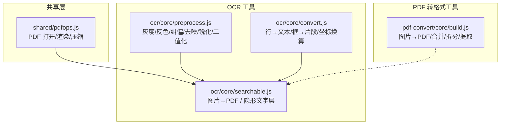
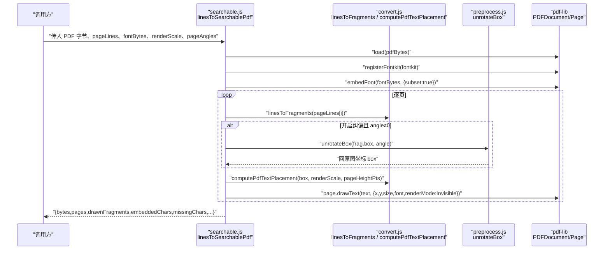
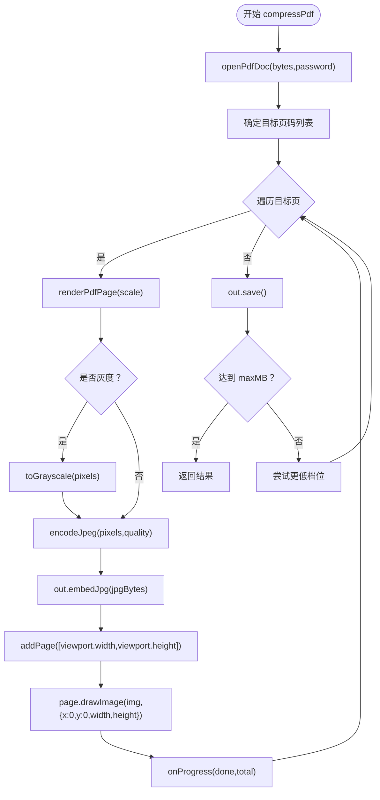
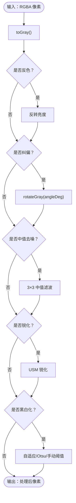
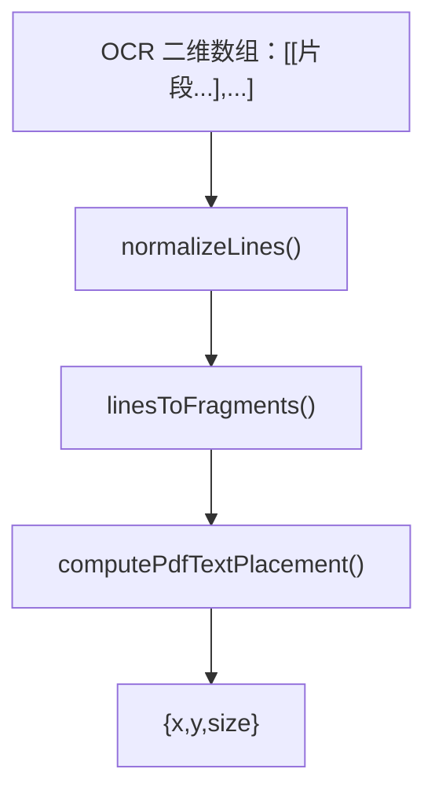
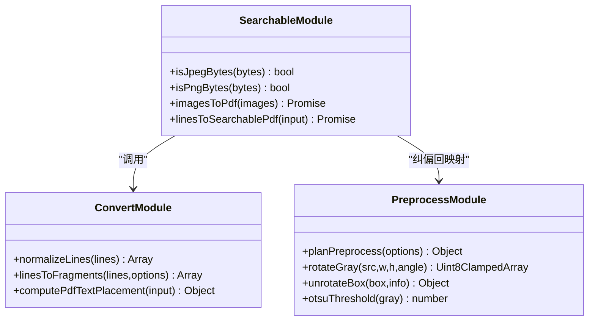
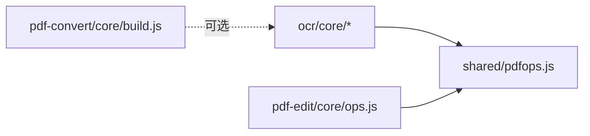

# 可搜索文档生成模块

<cite>
**本文引用的文件**
- [pdfops.js](file://app/src/shared/pdfops.js)
- [searchable.js](file://app/src/tools/ocr/core/searchable.js)
- [preprocess.js](file://app/src/tools/ocr/core/preprocess.js)
- [convert.js](file://app/src/tools/ocr/core/convert.js)
- [build.js](file://app/src/tools/pdf-convert/core/build.js)
- [pages.js（pdf-edit）](file://app/src/tools/pdf-edit/core/pages.js)
- [ops.js（pdf-edit）](file://app/src/tools/pdf-edit/core/ops.js)
- [ocr.md](file://spec/modules/ocr.md)
- [pdf-convert.md](file://spec/modules/pdf-convert.md)
</cite>

## 目录
1. [引言](#引言)
2. [项目结构](#项目结构)
3. [核心组件](#核心组件)
4. [架构总览](#架构总览)
5. [详细组件分析](#详细组件分析)
6. [依赖关系分析](#依赖关系分析)
7. [性能与体积优化](#性能与体积优化)
8. [故障排查指南](#故障排查指南)
9. [结论](#结论)
10. [附录：端到端流程清单](#附录端到端流程清单)

## 引言
本技术文档围绕“基于 OCR 识别结果构建可搜索 PDF”的可搜索文档生成模块展开。该能力由文字识别工具提供，通过给扫描版 PDF 叠加“隐形文字层”，使原本只有位图的页面具备 Ctrl+F 搜索、选中复制和文本提取能力，同时保持原图视觉不变。

模块覆盖以下关键主题：
- PDF 结构与内容流操作：使用 pdf-lib 创建/加载文档、嵌入图片与字体、逐页绘制不可见文本。
- 文本层叠加：将 OCR 输出的像素坐标转换为 PDF 点坐标，按片段粒度绘制 RenderMode=Invisible 的文字。
- 索引构建：隐形文字层即 PDF 内部文本索引；无需额外索引库。
- 元数据与页面布局：页面尺寸来自原页面或图片像素；压缩时保留原始显示宽高。
- 字体嵌入与颜色管理：子集化中文字体，缺失字符统计并提示；颜色解析与降级策略复用 pdf-edit。
- 端到端流程：从图片/PDF 输入、OCR、预处理纠偏、坐标换算，到最终可搜索 PDF 输出。
- 兼容性与标准：遵循 PDF 的 Tr=3 渲染模式；基于 Apache-2.0 的 pdfjs-dist 与 MIT 的 pdf-lib；规避 AGPL 工具。

## 项目结构
可搜索文档生成相关代码分布在两个层面：
- shared 层：跨工具复用的 PDF 打开、渲染、压缩能力。
- ocr 工具层：OCR 预处理、识别结果转换、隐形文字层生成。
- pdf-convert 层：图片转 PDF、合并/拆分等基础 PDF 生成能力，供需要“先装订为 PDF 再叠文字层”的场景复用。

图表来源
- [pdfops.js:1-198](file://app/src/shared/pdfops.js#L1-L198)
- [preprocess.js:1-200](file://app/src/tools/ocr/core/preprocess.js#L1-L200)
- [convert.js:1-151](file://app/src/tools/ocr/core/convert.js#L1-L151)
- [searchable.js:1-174](file://app/src/tools/ocr/core/searchable.js#L1-L174)
- [build.js:1-126](file://app/src/tools/pdf-convert/core/build.js#L1-L126)

章节来源
- [ocr.md:1-69](file://spec/modules/ocr.md#L1-L69)
- [pdf-convert.md:1-87](file://spec/modules/pdf-convert.md#L1-L87)

## 核心组件
- PDF 通用操作（shared/pdfops.js）
  - 打开 PDF、安全释放 pdfjs 文档对象。
  - 将指定页渲染为 RGBA 像素，用于后续重编码压缩。
  - 多档位 JPEG 重压缩，支持灰度化、目标体积自动降档。
- OCR 预处理（ocr/core/preprocess.js）
  - 灰度化、反色、纠偏（绕中心旋转 + 同尺寸裁回）、中值去噪、USM 锐化、自适应阈值/大津法/手动黑白化。
  - 提供 `unrotateBox`，把纠偏后图像上的识别框映射回原图坐标。
- OCR 结果转换（ocr/core/convert.js）
  - 行规范化、片段拼接空格判定、行级/片段级数据结构导出。
  - `computePdfTextPlacement`：像素坐标 → PDF 点坐标，含比例校正。
- 可搜索 PDF 生成（ocr/core/searchable.js）
  - 图片直接装订成 PDF。
  - 遍历每页，按片段绘制 RenderMode=Invisible 的文本，完成隐形文字层。
  - 处理字体子集化、缺失字符统计、旋转页跳过上报。
- PDF 基础构建（pdf-convert/core/build.js）
  - 图片→PDF、A4 适配居中、合并/拆分/提取页、页数读取。

章节来源
- [pdfops.js:1-198](file://app/src/shared/pdfops.js#L1-L198)
- [preprocess.js:1-200](file://app/src/tools/ocr/core/preprocess.js#L1-L200)
- [convert.js:1-151](file://app/src/tools/ocr/core/convert.js#L1-L151)
- [searchable.js:1-174](file://app/src/tools/ocr/core/searchable.js#L1-L174)
- [build.js:1-126](file://app/src/tools/pdf-convert/core/build.js#L1-L126)

## 架构总览
下图展示从 OCR 结果到最终可搜索 PDF 的调用链：主逻辑在 searchable.js，它依赖 convert.js 做片段与坐标计算，依赖 preprocess.js 做纠偏坐标回映射，并通过 pdf-lib 写入 PDF。

图表来源
- [searchable.js:1-174](file://app/src/tools/ocr/core/searchable.js#L1-L174)
- [convert.js:1-151](file://app/src/tools/ocr/core/convert.js#L1-L151)
- [preprocess.js:1-200](file://app/src/tools/ocr/core/preprocess.js#L1-L200)

## 详细组件分析

### PDF 通用操作（shared/pdfops.js）
- 打开 PDF
  - 封装 pdfjs-dist 的 getDocument，设置 CMap 与标准字体路径。
  - 对 PasswordException、InvalidPDFException 进行友好错误转换。
- 渲染页面
  - 使用 Canvas 获取 RGBA 像素，viewport.width/height 作为页面尺寸依据。
- 压缩
  - 按档位 scale/quality 重新渲染为 JPEG，再用 pdf-lib 重建 PDF。
  - 支持 grayscale 灰度化、maxMB 目标体积自动降档重试。
  - 释放 pdfjs 文档避免 worker 侧内存增长。

图表来源
- [pdfops.js:1-198](file://app/src/shared/pdfops.js#L1-L198)

章节来源
- [pdfops.js:1-198](file://app/src/shared/pdfops.js#L1-L198)

### OCR 预处理（ocr/core/preprocess.js）
- 处理计划
  - planPreprocess 将用户选项规范化为固定步骤序列，并生成界面说明。
- 像素算子
  - toGray：RGBA → 单通道灰度。
  - rotateGray：绕中心双线性采样旋转，裁回原尺寸。
  - unrotateBox：四角反向旋转后取外接矩形，还原识别框。
- 阈值算法
  - otsuThreshold：大津法直方图阈值。
  - 自适应阈值与 USM 锐化在文件中实现（本段不粘贴代码）。

图表来源
- [preprocess.js:1-200](file://app/src/tools/ocr/core/preprocess.js#L1-L200)

章节来源
- [preprocess.js:1-200](file://app/src/tools/ocr/core/preprocess.js#L1-L200)

### OCR 结果转换（ocr/core/convert.js）
- 行与片段
  - normalizeLines：过滤空行与空片段。
  - rowToText：按 x 排序，间距超过行高一半补空格。
  - linesToFragments：输出片段数组，支持 minConfidence 过滤。
- 坐标换算
  - computePdfTextPlacement：像素坐标 → PDF 点坐标。
  - 关键：pxPerPt = renderedHeightPx / pageHeightPts；size = box.height × ptsPerPx；y = pageHeight − box.y × ptsPerPx − size。

图表来源
- [convert.js:1-151](file://app/src/tools/ocr/core/convert.js#L1-L151)

章节来源
- [convert.js:1-151](file://app/src/tools/ocr/core/convert.js#L1-L151)

### 可搜索 PDF 生成（ocr/core/searchable.js）
- 图片装订
  - imagesToPdf：PNG/JPG 校验 → embedPng/embedJpg → addPage → drawImage。
- 隐形文字层
  - loadFontkit：浏览器走 UMD `<script>` 注入 fontkit；Node 直接 import。
  - embedFont：使用 @cantoo/fontkit 子集化，显著减小体积。
  - 逐页绘制：
    - 跳过非零旋转页，记录 rotatedPages。
    - 若开启 pageAngles，先用 unrotateBox 回原图坐标。
    - 调用 computePdfTextPlacement 得到 x/y/size。
    - 以 TextRenderingMode.Invisible 绘制 text。
  - 缺失字符统计：widthOfTextAtSize 失败时计数并收集样本。

图表来源
- [searchable.js:1-174](file://app/src/tools/ocr/core/searchable.js#L1-L174)
- [convert.js:1-151](file://app/src/tools/ocr/core/convert.js#L1-L151)
- [preprocess.js:1-200](file://app/src/tools/ocr/core/preprocess.js#L1-L200)

章节来源
- [searchable.js:1-174](file://app/src/tools/ocr/core/searchable.js#L1-L174)

### PDF 基础构建（pdf-convert/core/build.js）
- imagesToPdf：按 original/a4 模式建页并嵌入图片。
- mergePdfs/splitPdf/extractPages：基于 pdf-lib 的 copyPages/addPage。
- getPageCount：轻量读取页数。

章节来源
- [build.js:1-126](file://app/src/tools/pdf-convert/core/build.js#L1-L126)

### 页码范围解析（pdf-edit/pages.js）
- parsePageRange/formatPageRange：支持“1-3,5”“1～3，5”“1 2 3”等，越界起点报错、终点截断。

章节来源
- [pages.js（pdf-edit）:1-53](file://app/src/tools/pdf-edit/core/pages.js#L1-L53)

### 字体与颜色（pdf-edit/ops.js）
- loadFontkit：与 searchable.js 一致的 UMD 注入方案。
- loadCjkFontBytes：优先 IPC 读取字体，回退相对路径；找不到返回 null。
- pickFont：优先嵌入中文字体（子集化），失败降级 Helvetica。
- parseColor：支持多种颜色格式，非法回退浅灰。
- closePdfDoc：释放 pdfjs 文档，兼容 destroy/loadingTask.destroy。

章节来源
- [ops.js（pdf-edit）:1-200](file://app/src/tools/pdf-edit/core/ops.js#L1-L200)

## 依赖关系分析
- 外部库
  - pdfjs-dist（Apache-2.0）：PDF 打开与渲染。
  - pdf-lib（MIT）：PDF 创建、嵌入图片/字体、页面操作。
  - @cantoo/pdf-lib/@cantoo/fontkit：社区分支支持加密与字体子集化。
- 工具间约定
  - 工具之间禁止互相 import；共享能力放 shared/。
  - 浏览器端字体引擎通过 UMD 动态脚本加载。
- 依赖耦合
  - searchable.js 依赖 convert.js、preprocess.js 与 pdf-lib。
  - pdfops.js 被 ocr 与 pdf-edit 复用。
  - pdf-convert/build.js 提供基础 PDF 构建能力，可被上层拼装复用。

图表来源
- [pdfops.js:1-198](file://app/src/shared/pdfops.js#L1-L198)
- [ops.js（pdf-edit）:1-200](file://app/src/tools/pdf-edit/core/ops.js#L1-L200)
- [build.js:1-126](file://app/src/tools/pdf-convert/core/build.js#L1-L126)

章节来源
- [ocr.md:1-69](file://spec/modules/ocr.md#L1-L69)
- [pdf-convert.md:1-87](file://spec/modules/pdf-convert.md#L1-L87)

## 性能与体积优化
- 隐形文字层最小开销
  - 使用 RenderMode=Invisible 仅写文本流，不改变可见像素。
  - 字体子集化：只嵌入实际用到的字形，极大降低体积。
- 扫描件压缩
  - 按档位 scale/quality 重编码 JPEG；支持 grayscale 进一步压体积。
  - maxMB 目标体积：自动从选定档位降到最低档重试。
- 渲染 DPI
  - 默认 scale≈2（约 144DPI），兼顾定位精度与性能。
- 进度与取消
  - compressPdf 暴露 onProgress；支持 shouldCancel 中断批量任务。
- 内存管理
  - 显式 release/close 释放 pdfjs 文档，避免 worker 缓存泄漏。

章节来源
- [pdfops.js:1-198](file://app/src/shared/pdfops.js#L1-L198)
- [ocr.md:1-69](file://spec/modules/ocr.md#L1-L69)

## 故障排查指南
- 无法识别的图片格式
  - friendlyOcrMessage 会把底层 decode/invalid/corrupt 错误翻译为中文提示。
- 内存不足
  - out of memory/limit/allocation failed 统一提示换小图或降低分辨率。
- 字体缺失
  - searchable.js 要求 fontBytes；pdf-edit 中 loadCjkFontBytes 回退读取字体，失败则降级内置 Helvetica。
- 加密 PDF
  - pdfops.openPdfDoc 对 PasswordException 给出明确提示；pdf-edit/ops.js 也统一友好错误。
- 旋转页未叠加文字层
  - 当页面存在非零 rotation 时，跳过绘制并返回 rotatedPages，便于界面提示。
- 生僻字丢失
  - widthOfTextAtSize 失败会累计 missingChars 并收集缺失字符样本，界面可提示用户。
- 页码范围错误
  - parsePageRange 对非法格式、越界起点抛出可读错误，终点越界自动截断。

章节来源
- [convert.js:1-151](file://app/src/tools/ocr/core/convert.js#L1-L151)
- [ops.js（pdf-edit）:1-200](file://app/src/tools/pdf-edit/core/ops.js#L1-L200)
- [pages.js（pdf-edit）:1-53](file://app/src/tools/pdf-edit/core/pages.js#L1-L53)
- [searchable.js:1-174](file://app/src/tools/ocr/core/searchable.js#L1-L174)

## 结论
可搜索文档生成模块以“隐形文字层”为核心思路，将 OCR 识别结果精准映射到 PDF 页面坐标，在不改变原图的前提下赋予文档可搜索与可复制能力。模块采用 pdfjs-dist 与 pdf-lib 的组合，既保证渲染与编辑能力，又通过字体子集化与 JPEG 重编码控制体积。配合预处理中的纠偏与二值化，提升复杂扫描件识别质量。整体设计遵循工具解耦、shared 复用与 CSP 友好的工程约定，具备良好的可扩展性与兼容性。

## 附录：端到端流程清单
- 输入准备
  - 图片：PNG/JPG（其他格式需先解码）。
  - 扫描 PDF：逐页识别，支持多页。
- OCR 执行
  - 主进程 OCR 引擎返回二维数组 lines（行内片段）。
- 预处理（可选）
  - 灰度化、反色、纠偏、去噪、锐化、黑白化。
  - 若启用纠偏，需在叠加前用 unrotateBox 回原图坐标。
- 坐标换算
  - linesToFragments 输出片段；computePdfTextPlacement 计算 PDF 坐标。
- 字体与嵌入
  - 加载 fontkit；子集化嵌入中文字体；统计缺失字符。
- 生成可搜索 PDF
  - imagesToPdf（图片先装订）或 linesToSearchablePdf（直接叠加隐形文字层）。
- 压缩与交付
  - 按需调用 compressPdf 调整体积；返回 bytes、pages、scale、quality 等信息。

章节来源
- [searchable.js:1-174](file://app/src/tools/ocr/core/searchable.js#L1-L174)
- [convert.js:1-151](file://app/src/tools/ocr/core/convert.js#L1-L151)
- [preprocess.js:1-200](file://app/src/tools/ocr/core/preprocess.js#L1-L200)
- [pdfops.js:1-198](file://app/src/shared/pdfops.js#L1-L198)
- [build.js:1-126](file://app/src/tools/pdf-convert/core/build.js#L1-L126)
- [ocr.md:1-69](file://spec/modules/ocr.md#L1-L69)