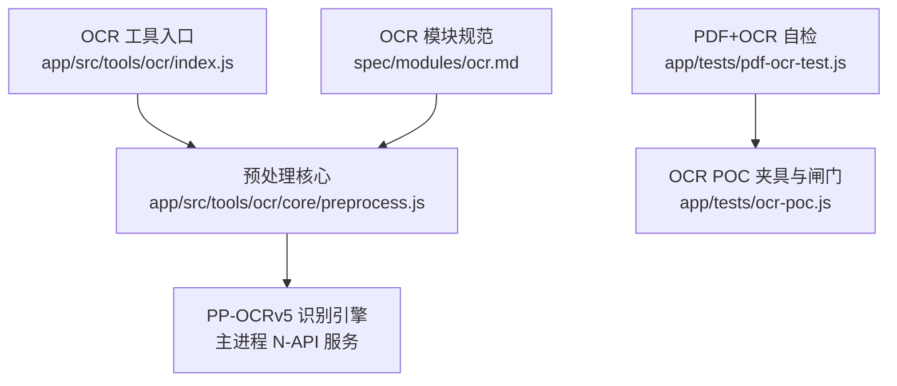
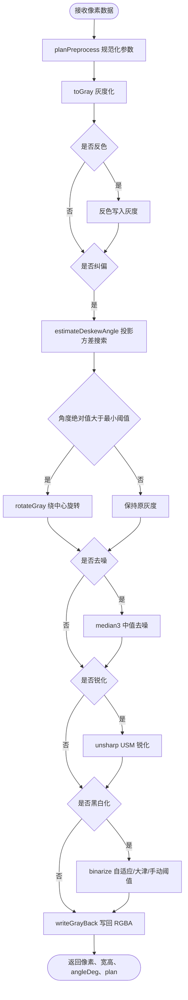
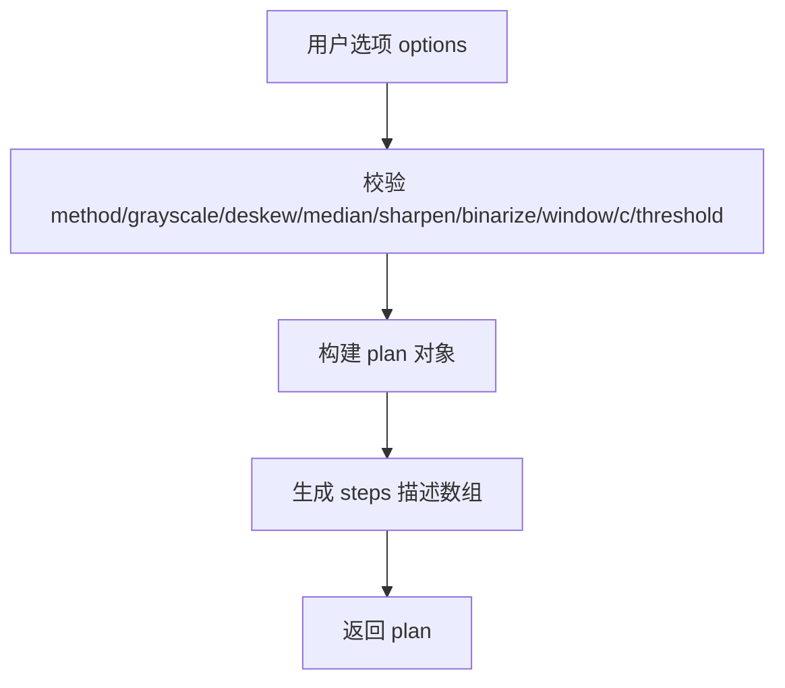
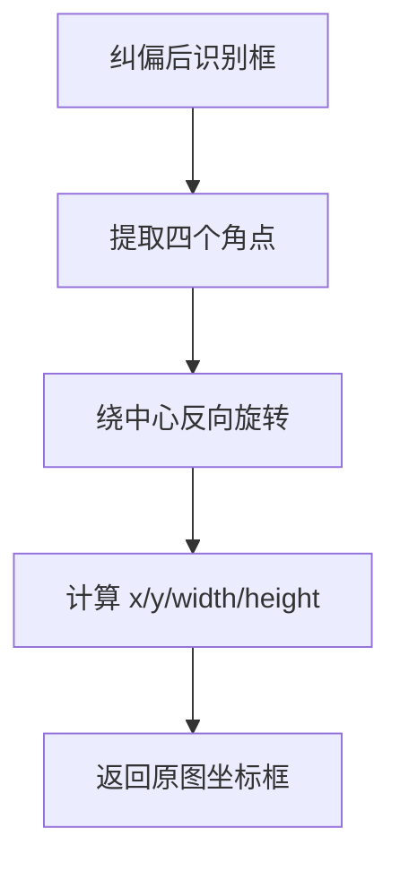
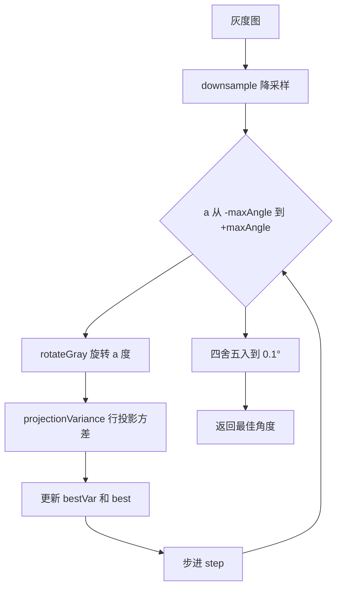
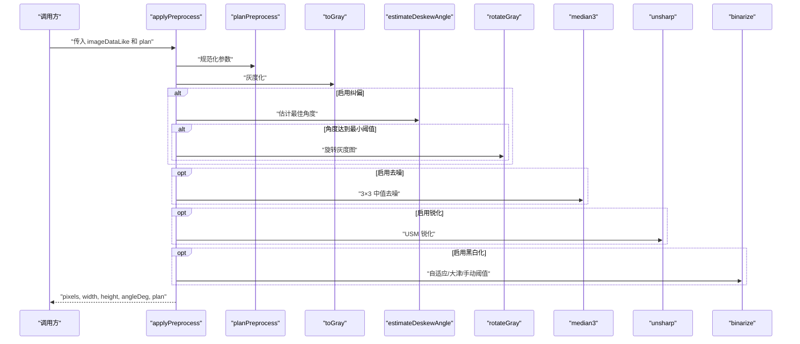
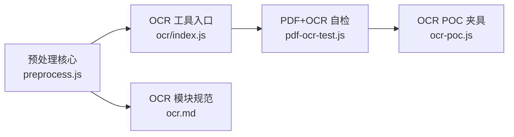

# 扫描件预处理模块

<cite>
**本文引用的文件**   
- [preprocess.js](file://app/src/tools/ocr/core/preprocess.js)
- [ocr/index.js](file://app/src/tools/ocr/index.js)
- [ocr.md](file://spec/modules/ocr.md)
- [pdf-ocr-test.js](file://app/tests/pdf-ocr-test.js)
- [ocr-poc.js](file://app/tests/ocr-poc.js)
</cite>

## 目录
1. [简介](#简介)
2. [项目结构](#项目结构)
3. [核心组件](#核心组件)
4. [架构总览](#架构总览)
5. [详细组件分析](#详细组件分析)
6. [依赖关系分析](#依赖关系分析)
7. [性能考虑](#性能考虑)
8. [故障排查指南](#故障排查指南)
9. [结论](#结论)
10. [附录：参数与步骤速查](#附录参数与步骤速查)

## 简介
本模块为 OCR 工具的纯像素级扫描件预处理子系统，负责在文字识别前对扫描图像进行灰度化、反色、纠偏、去噪、锐化和二值化（黑白化）处理。其实现完全基于像素数组运算，不直接操作 DOM 或 canvas，因此既能被 Node 环境单元测试使用，也能在浏览器渲染进程中对已渲染的整页位图进行处理。

该模块的核心价值是提升 OCR 召回率：通过去除灰底、校正微小倾斜、抑制噪声并增强笔画边缘，让后续 PP-OCRv5 等识别模型获得更干净的输入。

## 项目结构
OCR 工具入口声明位于 `app/src/tools/ocr/index.js`，其中注册工具 id、名称、分组和挂载函数；真正的纯逻辑实现集中在 `app/src/tools/ocr/core/preprocess.js`。规范说明见 `spec/modules/ocr.md`，端到端自检脚本在 `app/tests/pdf-ocr-test.js`，POC 夹具与引擎闸门测试在 `app/tests/ocr-poc.js`。

**图表来源**
- [ocr/index.js:1-14](file://app/src/tools/ocr/index.js#L1-L14)
- [preprocess.js:1-20](file://app/src/tools/ocr/core/preprocess.js#L1-L20)
- [ocr.md:1-69](file://spec/modules/ocr.md#L1-L69)
- [pdf-ocr-test.js:1-58](file://app/tests/pdf-ocr-test.js#L1-L58)
- [ocr-poc.js:1-200](file://app/tests/ocr-poc.js#L1-L200)

**章节来源**
- [ocr/index.js:1-14](file://app/src/tools/ocr/index.js#L1-L14)
- [ocr.md:1-69](file://spec/modules/ocr.md#L1-L69)

## 核心组件
预处理模块对外暴露的关键能力包括：

| 能力 | 作用 | 关键导出 |
|---|---|---|
| 参数规范化 | 将界面勾选项转换为稳定、安全的执行计划 | `planPreprocess` |
| 灰度化与反色 | 把 RGBA 像素转为单通道灰度，支持深底浅字场景的反色 | `toGray` |
| 旋转与坐标回映射 | 绕图像中心旋转灰度图，并把纠偏后检测框转回原图坐标 | `rotateGray`、`unrotateBox` |
| 大津法阈值 | 自动计算全局二值化阈值 | `otsuThreshold` |
| 中值去噪 | 3×3 中值滤波，用于极噪声传真件等场景 | `median3` |
| USM 锐化 | 用高斯近似模糊做非锐化掩蔽增强 | `unsharp` |
| 自适应阈值黑白化 | 基于积分图的局部均值黑白化，压掉不均匀灰底 | 内部 `adaptiveBinarize` |
| 统一黑白化入口 | 按策略选择自适应、大津法或手动阈值 | `binarize` |
| 角度估计 | 投影方差搜索最佳微角度 | `estimateDeskewAngle` |
| 完整预处理流水线 | 顺序执行灰度化、反色、纠偏、去噪、锐化、黑白化 | `applyPreprocess` |

**章节来源**
- [preprocess.js:21-200](file://app/src/tools/ocr/core/preprocess.js#L21-L200)
- [preprocess.js:201-396](file://app/src/tools/ocr/core/preprocess.js#L201-L396)

## 架构总览
预处理模块采用“固定处理链 + 可开关步骤”的设计：

1. 用户传入原始勾选项。
2. `planPreprocess` 规范化为内部 plan。
3. `applyPreprocess` 按固定顺序执行：灰度化 → 反色 → 纠偏 → 中值去噪 → USM 锐化 → 黑白化。
4. 最终写回灰度值到 RGBA 缓冲，alpha 拉满，便于后续 OCR 或可视化叠加。
5. 若启用纠偏，返回实际旋转角度，调用方可用 `unrotateBox` 把识别框映射回原图。

**图表来源**
- [preprocess.js:21-200](file://app/src/tools/ocr/core/preprocess.js#L21-L200)
- [preprocess.js:201-396](file://app/src/tools/ocr/core/preprocess.js#L201-L396)

**章节来源**
- [preprocess.js:1-20](file://app/src/tools/ocr/core/preprocess.js#L1-L20)
- [preprocess.js:21-200](file://app/src/tools/ocr/core/preprocess.js#L21-L200)
- [preprocess.js:201-396](file://app/src/tools/ocr/core/preprocess.js#L201-L396)

## 详细组件分析

### 参数规范化与步骤生成
`planPreprocess` 是纯函数，负责把任意用户输入规范化为安全、稳定的 plan。它默认开启灰度化和黑白化，根据 `method` 选择自适应阈值、大津法或手动阈值；对 `maxAngle`、`minAngle`、`sharpenAmount`、`window`、`c`、`threshold` 等参数进行边界约束和奇偶修正。同时生成 `steps` 字符串数组，供界面展示即将执行的步骤。

关键规则：
- `grayscale` 默认为真，除非整条链路都不需要。
- `invert` 控制深底浅字反色。
- `deskew` 启用后，`maxAngle` 限制在 0~15°，`minAngle` 限制为非负。
- `median` 默认关闭，因为实测会降低中文召回。
- `sharpenAmount` 限制在 0~3。
- `window` 强制为奇数，范围 3~199。
- `method` 只接受 `adaptive`、`otsu`、`manual`。
- `threshold` 仅在手动模式下生效，范围 0~255。

**图表来源**
- [preprocess.js:21-96](file://app/src/tools/ocr/core/preprocess.js#L21-L96)

**章节来源**
- [preprocess.js:21-96](file://app/src/tools/ocr/core/preprocess.js#L21-L96)

### 灰度化与反色
`toGray` 使用标准亮度权重对 RGB 三通道加权得到灰度，支持可选反色。灰度结果保存在长度等于 `width × height` 的 `Uint8ClampedArray` 中。后续 `writeGrayBack` 会把灰度值复制回 RGBA 缓冲，alpha 设为 255。

复杂度：
- 时间复杂度 O(w × h)。
- 空间复杂度 O(w × h)，用于输出灰度缓冲。

适用场景：
- 所有彩色扫描件首步统一为灰度，降低后续算法通道复杂度。
- 深底浅字扫描件启用反色，使文本更接近黑字白底，利于阈值和二值化。

**章节来源**
- [preprocess.js:97-140](file://app/src/tools/ocr/core/preprocess.js#L97-L140)

### 旋转与坐标回映射
`rotateGray` 实现绕图像中心的灰度图旋转，使用双线性采样处理非整数坐标，越界时取最近边缘像素。旋转后图像尺寸保持不变，便于后续裁剪和坐标换算。

`unrotateBox` 将纠偏后的识别框四个角反向旋转，再取外接矩形，从而把像素坐标还原到原图坐标系。

复杂度：
- 旋转 O(w × h)，每次调用一次。
- 坐标回映射 O(1)，仅处理 4 个角点。

**图表来源**
- [preprocess.js:141-199](file://app/src/tools/ocr/core/preprocess.js#L141-L199)

**章节来源**
- [preprocess.js:141-199](file://app/src/tools/ocr/core/preprocess.js#L141-L199)

### 大津法阈值
`otsuThreshold` 通过统计 256 级灰度直方图，遍历阈值 t=0..255，计算前景与背景类间方差，选取使类间方差最大的 t 作为全局阈值。

复杂度：
- 直方图统计 O(w × h)。
- 阈值搜索 O(256)，常数级别。
- 总体时间复杂度 O(w × h)。

适用场景：
- 整体对比度较好、背景相对均匀的扫描件。
- 配合 `method === 'otsu'` 使用，适合快速黑白化。

**章节来源**
- [preprocess.js:201-219](file://app/src/tools/ocr/core/preprocess.js#L201-L219)

### 中值去噪
`median3` 对每个像素取其 3×3 邻域的中值，就地修改灰度缓冲。该算子对椒盐噪声有效，但会模糊细小笔画。

复杂度：
- 时间复杂度 O(w × h × 9)，常数邻域。
- 空间复杂度 O(w × h)，用于保存源快照和长度为 9 的排序缓冲区。

注意：
- 模块默认关闭中值去噪，因为夹具测试显示它会显著降低中文召回。
- 建议在噪点极密、类似传真件的极端场景下手动启用。

**章节来源**
- [preprocess.js:221-239](file://app/src/tools/ocr/core/preprocess.js#L221-L239)
- [preprocess.js:1-20](file://app/src/tools/ocr/core/preprocess.js#L1-L20)

### USM 锐化
`unsharp` 实现非锐化掩蔽：先构造 3×3 近似高斯模糊核，计算模糊图像，再用原图减去模糊图得到细节，最后按强度累加回原图。

复杂度：
- 时间复杂度 O(w × h × 9)。
- 空间复杂度 O(w × h)，用于保存源快照。

参数：
- `amount` 控制锐化强度，推荐 0~3，默认 0.6。

适用场景：
- 扫描字体略模糊、笔画不够清晰的情况。
- 通常放在去噪之后、黑白化之前，有助于提高字符边缘对比度。

**章节来源**
- [preprocess.js:241-260](file://app/src/tools/ocr/core/preprocess.js#L241-L260)

### 自适应阈值黑白化
`adaptiveBinarize` 使用积分图加速局部区域求和，窗口半径由 `window` 决定。对每个像素比较当前灰度与局部均值减去偏移量 `c`，超过则判为背景（255），否则判为前景（0）。

复杂度：
- 积分图构建 O(w × h)。
- 逐像素局部均值计算 O(w × h)，每个像素 O(1)。
- 总体时间复杂度 O(w × h)。

参数：
- `window`：奇数窗口大小，默认 31。
- `c`：局部均值偏移，默认 12。

适用场景：
- 光照不均、灰底深浅不一的扫描件。
- 模块默认策略，能较好保留字符细节。

**章节来源**
- [preprocess.js:262-286](file://app/src/tools/ocr/core/preprocess.js#L262-L286)

### 统一黑白化入口
`binarize` 根据 plan 中的 `method` 选择：
- `adaptive`：调用 `adaptiveBinarize`。
- `otsu`：调用 `otsuThreshold` 得到全局阈值。
- `manual`：使用 `threshold`，未设置时退化为 160。

**章节来源**
- [preprocess.js:288-297](file://app/src/tools/ocr/core/preprocess.js#L288-L297)

### 投影方差自动纠偏
`estimateDeskewAngle` 的工作流程如下：

1. 校验图像尺寸，小于 8×8 直接返回 0。
2. 对灰度图降采样，长边不超过 `maxDim`，默认 600，以降低角度扫描开销。
3. 在 `[-maxAngle, maxAngle]` 范围内以 `step` 步进扫描角度。
4. 对每个角度旋转小图，计算行投影方差。
5. 选择方差最大对应的角度作为最佳纠偏角。
6. 返回四舍五入到一位小数的角度，避免 `-0` 等展示问题。

**图表来源**
- [preprocess.js:313-351](file://app/src/tools/ocr/core/preprocess.js#L313-L351)
- [preprocess.js:299-312](file://app/src/tools/ocr/core/preprocess.js#L299-L312)
- [preprocess.js:141-199](file://app/src/tools/ocr/core/preprocess.js#L141-L199)

参数：
- `maxAngle`：默认 5°，即 ±5° 扫描范围。
- `step`：默认 0.5°，控制精度。
- `maxDim`：默认 600，控制降采样目标尺寸。

复杂度：
- 假设扫描角度数量为 A，每次旋转 O(w' × h')，其中 w', h' 为降采样尺寸。
- 总体约 O(A × w' × h')，远小于全尺寸旋转。

**章节来源**
- [preprocess.js:299-351](file://app/src/tools/ocr/core/preprocess.js#L299-L351)

### 完整预处理流水线
`applyPreprocess` 是最终入口，负责顺序执行并返回处理结果：

1. 读取像素缓冲并调用 `planPreprocess` 规范化 plan。
2. 灰度化，可选反色。
3. 若启用纠偏，估计角度；若角度绝对值达到 `minAngle`，则旋转灰度图。
4. 可选中值去噪。
5. 可选 USM 锐化。
6. 可选黑白化。
7. 写回灰度到 RGBA 缓冲。
8. 返回 `{ pixels, width, height, angleDeg, plan }`。

**图表来源**
- [preprocess.js:353-396](file://app/src/tools/ocr/core/preprocess.js#L353-L396)
- [preprocess.js:21-200](file://app/src/tools/ocr/core/preprocess.js#L21-L200)

**章节来源**
- [preprocess.js:353-396](file://app/src/tools/ocr/core/preprocess.js#L353-L396)

### 典型扫描件处理示例

#### 模糊扫描件
建议配置：
- 灰度化：开启。
- 反色：根据底色判断。
- 纠偏：若扫描未放正则开启。
- 中值去噪：默认关闭，除非噪点极密。
- 锐化：开启，强度适中。
- 黑白化：自适应阈值。

原因：
- 模糊图像需要 USM 锐化增强笔画边缘。
- 自适应阈值能更好处理灰底不均。

#### 倾斜扫描件
建议配置：
- 灰度化：开启。
- 纠偏：开启，`maxAngle` 根据倾斜程度调整。
- 黑白化：自适应阈值或大津法。

原因：
- 投影方差纠偏能自动估计 ±5° 范围内的微倾斜。
- 若倾斜较大，可适当增大 `maxAngle`，但会增加角度扫描耗时。

#### 噪声严重的扫描件
建议配置：
- 灰度化：开启。
- 反色：视情况。
- 纠偏：视情况。
- 中值去噪：谨慎开启，仅在噪点非常密集时使用。
- 锐化：谨慎开启，避免放大噪声。
- 黑白化：优先自适应阈值。

原因：
- 中值去噪会模糊笔画，夹具测试表明可能显著降低召回。
- 自适应阈值比全局阈值更能抵抗局部噪声。

**章节来源**
- [preprocess.js:1-20](file://app/src/tools/ocr/core/preprocess.js#L1-L20)
- [preprocess.js:21-200](file://app/src/tools/ocr/core/preprocess.js#L21-L200)
- [preprocess.js:201-396](file://app/src/tools/ocr/core/preprocess.js#L201-L396)

## 依赖关系分析
预处理模块本身没有外部运行时依赖，所有图像处理都是纯像素算法。它与 OCR 工具和规范文档的关系如下：

**图表来源**
- [preprocess.js:1-20](file://app/src/tools/ocr/core/preprocess.js#L1-L20)
- [ocr/index.js:1-14](file://app/src/tools/ocr/index.js#L1-L14)
- [ocr.md:1-69](file://spec/modules/ocr.md#L1-L69)
- [pdf-ocr-test.js:1-58](file://app/tests/pdf-ocr-test.js#L1-L58)
- [ocr-poc.js:1-200](file://app/tests/ocr-poc.js#L1-L200)

耦合性：
- 预处理模块是低层纯逻辑模块，不感知 UI、DOM、Canvas 或 OCR 模型。
- OCR 工具入口仅负责注册工具元数据和挂载 UI。
- 规范文档描述 OCR 整体能力，包含预处理、隐形文字层、Word 导出等。
- 测试脚本覆盖端到端流程和 POC 引擎可用性。

内聚性：
- 所有像素算子集中在一个文件中，职责清晰。
- 参数规范化、步骤生成、角度估计、黑白化、旋转、坐标回映射各司其职。

**章节来源**
- [preprocess.js:1-20](file://app/src/tools/ocr/core/preprocess.js#L1-L20)
- [ocr/index.js:1-14](file://app/src/tools/ocr/index.js#L1-L14)
- [ocr.md:1-69](file://spec/modules/ocr.md#L1-L69)
- [pdf-ocr-test.js:1-58](file://app/tests/pdf-ocr-test.js#L1-L58)
- [ocr-poc.js:1-200](file://app/tests/ocr-poc.js#L1-L200)

## 性能考虑
1. **灰度化与反色**：O(w × h)，单次线性扫描，开销很低。
2. **旋转**：O(w × h)，仅纠偏时执行一次；角度估计阶段使用降采样图，显著降低扫描成本。
3. **中值去噪**：O(w × h × 9)，默认关闭以避免召回下降。
4. **USM 锐化**：O(w × h × 9)，适合轻度增强，不建议过度锐化。
5. **自适应阈值**：O(w × h)，积分图一次性构建，逐像素 O(1)。
6. **大津法**：O(w × h) 直方图统计 + O(256) 阈值搜索。
7. **角度估计**：约 O(A × w' × h')，其中 A 为角度数量，w'、h' 为降采样尺寸。

优化建议：
- 大图像上优先使用自适应阈值，避免全局阈值对灰底不均效果差。
- 不调用纠偏时跳过旋转和角度估计。
- 不调用中值去噪时跳过 3×3 邻域扫描。
- 调节 `maxAngle` 和 `step` 平衡纠偏精度与耗时。
- 调节 `maxDim` 控制角度估计阶段的降采样分辨率。

[本节为通用性能讨论，不直接分析具体代码片段]

## 故障排查指南

### 预处理后识别召回下降
可能原因：
- 启用了中值去噪，导致笔画丢失。
- 锐化强度过高，放大噪声。
- 自适应窗口过大，吞掉细字。
- 手动阈值选择不当。

解决方式：
- 关闭中值去噪。
- 降低 `sharpenAmount`。
- 调小 `window`。
- 改用自适应阈值或重新调整 `threshold`。

**章节来源**
- [preprocess.js:1-20](file://app/src/tools/ocr/core/preprocess.js#L1-L20)
- [preprocess.js:21-200](file://app/src/tools/ocr/core/preprocess.js#L21-L200)
- [preprocess.js:201-396](file://app/src/tools/ocr/core/preprocess.js#L201-L396)

### 纠偏无效或误纠
可能原因：
- `maxAngle` 太小，无法覆盖真实倾斜。
- `minAngle` 太大，导致真实角度被忽略。
- 图像内容缺少水平行结构，投影方差信号弱。

解决方式：
- 增大 `maxAngle`。
- 降低 `minAngle`。
- 先做灰度化和适当锐化，再纠偏。

**章节来源**
- [preprocess.js:299-351](file://app/src/tools/ocr/core/preprocess.js#L299-L351)

### 黑白化后字符断裂或粘连
可能原因：
- 自适应阈值窗口过大，局部均值过于平滑。
- 全局大津法不适合灰底不均图像。
- 手动阈值太接近背景。

解决方式：
- 减小 `window`。
- 切换为自适应阈值。
- 调整 `c` 或 `threshold`。

**章节来源**
- [preprocess.js:262-297](file://app/src/tools/ocr/core/preprocess.js#L262-L297)

### 识别框坐标错位
可能原因：
- 使用了纠偏但未用 `unrotateBox` 回映射。
- 调用方使用的宽高或角度信息与预处理返回不一致。

解决方式：
- 始终使用 `applyPreprocess` 返回的 `angleDeg`。
- 调用 `unrotateBox(box, { angleDeg, width, height })` 把框转回原图。

**章节来源**
- [preprocess.js:141-199](file://app/src/tools/ocr/core/preprocess.js#L141-L199)
- [preprocess.js:353-396](file://app/src/tools/ocr/core/preprocess.js#L353-L396)

## 结论
OCR 扫描件预处理模块以纯像素算法实现了完整的预处理链：灰度化、反色、纠偏、去噪、锐化和二值化。它通过参数规范化保证稳定性，通过投影方差搜索实现自动纠偏，通过自适应阈值、大津法和手动阈值提供灵活的黑白化策略。模块默认关闭中值去噪，以避免牺牲识别召回换取噪声抑制。

对于常见扫描件类型，建议优先使用灰度化、纠偏、USM 锐化和自适应阈值；仅在噪点极密时谨慎开启中值去噪。调用方应重视 `angleDeg` 和 `unrotateBox`，确保识别框坐标正确回到原图。

[本节为总结性内容，不直接分析具体代码片段]

## 附录：参数与步骤速查

### 主要参数表

| 参数 | 类型 | 默认值 | 含义 | 常用取值范围 |
|---|---|---:|---|---|
| `grayscale` | boolean | true | 是否灰度化 | true/false |
| `invert` | boolean | false | 是否反色 | true/false |
| `deskew` | boolean | false | 是否纠偏 | true/false |
| `maxAngle` | number | 5 | 纠偏搜索半宽 | 0~15 |
| `minAngle` | number | 0.4 | 最小旋转阈值 | ≥0 |
| `median` | boolean | false | 是否中值去噪 | true/false |
| `sharpen` | boolean | false | 是否锐化 | true/false |
| `sharpenAmount` | number | 0.6 | USM 强度 | 0~3 |
| `binarize` | boolean | true | 是否黑白化 | true/false |
| `method` | string | adaptive | 黑白化策略 | adaptive/otsu/manual |
| `window` | number | 31 | 自适应阈值窗口 | 3~199，奇数 |
| `c` | number | 12 | 自适应阈值偏移 | 数值 |
| `threshold` | number/null | null | 手动阈值 | 0~255 |

### 黑白化策略对比

| 策略 | 原理 | 优点 | 缺点 | 适用场景 |
|---|---|---|---|---|
| 自适应阈值 | 局部均值比较 | 适应灰底不均 | 受窗口大小影响 | 光照不均、灰底深浅变化 |
| 大津法 | 全局类间方差最大 | 简单快速 | 对灰底不均敏感 | 对比度较好、背景均匀 |
| 手动阈值 | 固定阈值比较 | 可控性强 | 需要经验调参 | 已知稳定阈值条件 |

### 处理链顺序
固定顺序为：
1. 灰度化
2. 反色
3. 纠偏
4. 中值去噪
5. USM 锐化
6. 黑白化

**章节来源**
- [preprocess.js:1-20](file://app/src/tools/ocr/core/preprocess.js#L1-L20)
- [preprocess.js:21-200](file://app/src/tools/ocr/core/preprocess.js#L21-L200)
- [preprocess.js:201-396](file://app/src/tools/ocr/core/preprocess.js#L201-L396)