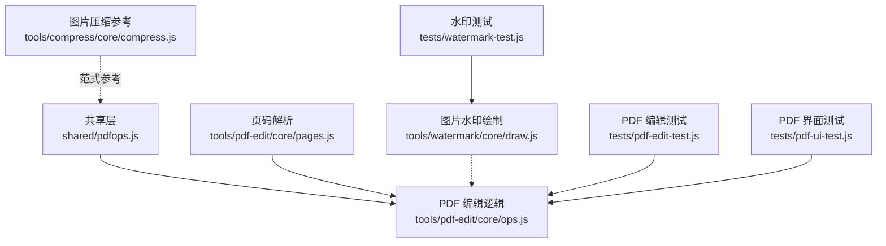
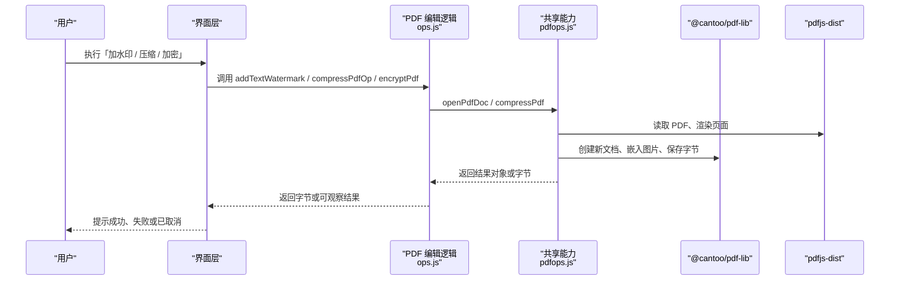
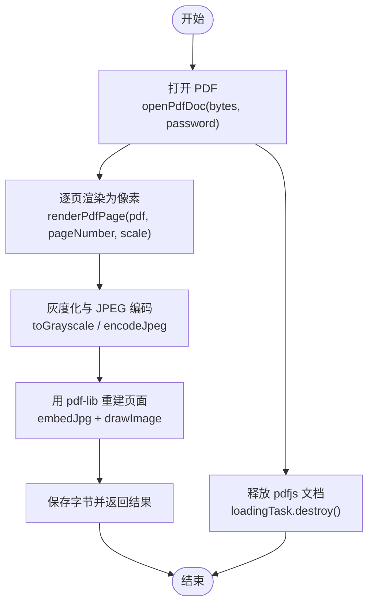
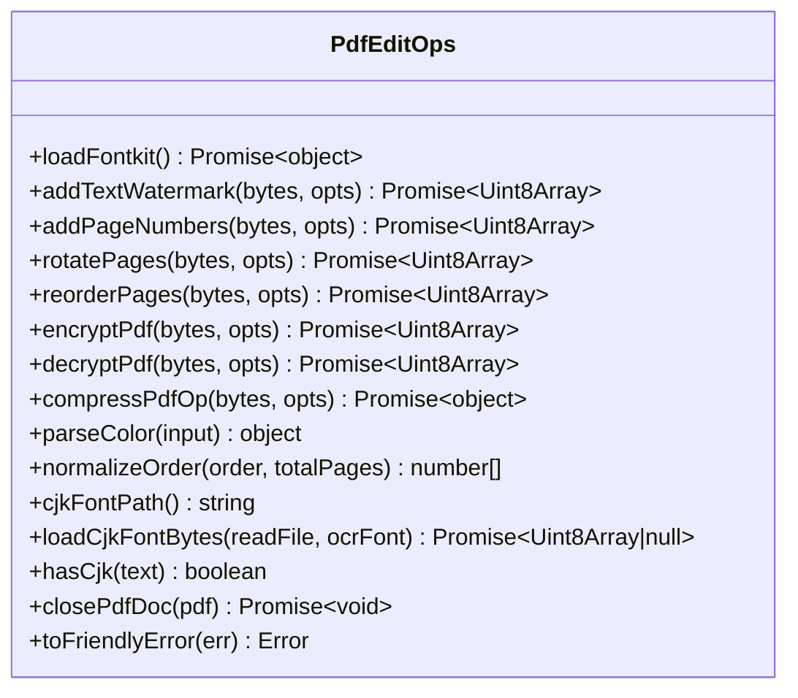
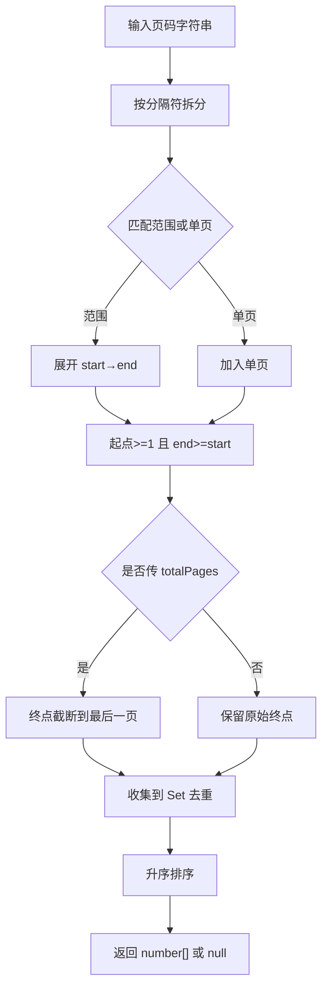
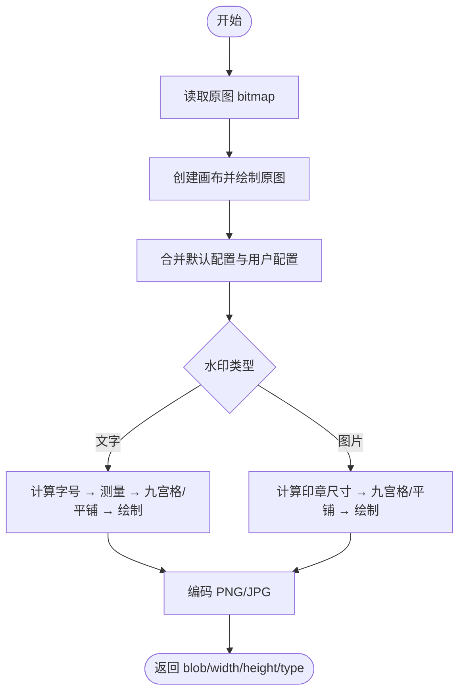
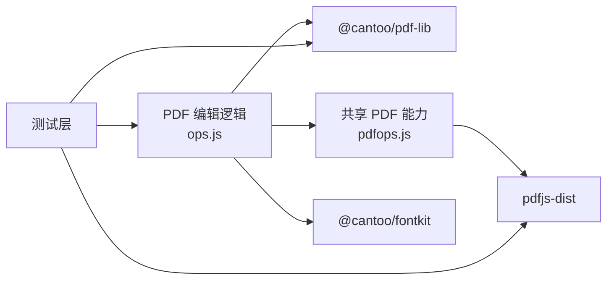

# PDF 编辑工具

<cite>
**本文引用的文件**   
- [pdfops.js](file://app/src/shared/pdfops.js)
- [ops.js](file://app/src/tools/pdf-edit/core/ops.js)
- [pages.js](file://app/src/tools/pdf-edit/core/pages.js)
- [draw.js](file://app/src/tools/watermark/core/draw.js)
- [compress.js](file://app/src/tools/compress/core/compress.js)
- [pdf-edit-test.js](file://app/tests/pdf-edit-test.js)
- [watermark-test.js](file://app/tests/watermark-test.js)
- [pdf-ui-test.js](file://app/tests/pdf-ui-test.js)
</cite>

## 目录
1. [简介](#简介)
2. [项目结构](#项目结构)
3. [核心组件](#核心组件)
4. [架构总览](#架构总览)
5. [详细组件分析](#详细组件分析)
6. [依赖关系分析](#依赖关系分析)
7. [性能与内存优化](#性能与内存优化)
8. [故障排查指南](#故障排查指南)
9. [结论](#结论)
10. [附录：常见编辑操作示例](#附录常见编辑操作示例)

## 简介
本技术文档聚焦仓库中的 PDF 编辑能力，围绕基于 @cantoo/pdf-lib 的 PDF 文档操作展开，覆盖水印添加、文本插入、图像嵌入、页面旋转、页序重组、加密解密和压缩。文档重点解释字体系统（中文字体动态加载、fontkit 子集化、Helvetica 降级）、九宫格位置系统、用户友好的中文错误翻译、取消操作的统一处理模式，以及 PDF 文档生命周期管理与资源释放策略，并给出批量加水印、文本替换与页面重组等实操路径。

## 项目结构
PDF 相关代码分布在共享层、工具逻辑层与测试层三个层次：

- 共享层 `shared/pdfops.js`：提供跨工具的 PDF 打开、渲染与压缩能力，内部组合 pdfjs-dist 与 pdf-lib。
- 工具逻辑层 `tools/pdf-edit/core/ops.js`：实现 PDF 编辑整理的所有业务操作，包括水印、页码、旋转、重排、加密解密与压缩调用。
- 工具逻辑层 `tools/pdf-edit/core/pages.js`：提供页码范围解析与格式化纯函数，供多个工具复用。
- 图片水印绘制层 `tools/watermark/core/draw.js`：提供图片水印绘制、九宫格定位、平铺坐标、字号计算等通用像素级绘制能力。
- 图片压缩参考实现 `tools/compress/core/compress.js`：展示 OffscreenCanvas 缩放、二分画质与目标大小压缩策略，作为 PDF 压缩之外的通用图像压缩范式。
- 测试层 `tests/pdf-edit-test.js`、`tests/watermark-test.js`、`tests/pdf-ui-test.js`：用真实运行态验证 PDF 编辑、水印绘制与界面流程。

**图表来源**
- [pdfops.js:1-198](file://app/src/shared/pdfops.js#L1-L198)
- [ops.js:1-531](file://app/src/tools/pdf-edit/core/ops.js#L1-L531)
- [pages.js:1-53](file://app/src/tools/pdf-edit/core/pages.js#L1-L53)
- [draw.js:1-337](file://app/src/tools/watermark/core/draw.js#L1-L337)
- [compress.js:1-140](file://app/src/tools/compress/core/compress.js#L1-L140)
- [pdf-edit-test.js:1-807](file://app/tests/pdf-edit-test.js#L1-L807)
- [watermark-test.js:1-477](file://app/tests/watermark-test.js#L1-L477)
- [pdf-ui-test.js:1-345](file://app/tests/pdf-ui-test.js#L1-L345)

**章节来源**
- [pdfops.js:1-198](file://app/src/shared/pdfops.js#L1-L198)
- [ops.js:1-531](file://app/src/tools/pdf-edit/core/ops.js#L1-L531)
- [pages.js:1-53](file://app/src/tools/pdf-edit/core/pages.js#L1-L53)
- [draw.js:1-337](file://app/src/tools/watermark/core/draw.js#L1-L337)
- [compress.js:1-140](file://app/src/tools/compress/core/compress.js#L1-L140)
- [pdf-edit-test.js:1-807](file://app/tests/pdf-edit-test.js#L1-L807)
- [watermark-test.js:1-477](file://app/tests/watermark-test.js#L1-L477)
- [pdf-ui-test.js:1-345](file://app/tests/pdf-ui-test.js#L1-L345)

## 核心组件
- PDF 打开与压缩共享能力：提供安全打开、逐页渲染、按档位压缩、灰度优化、进度回调与取消支持。
- PDF 编辑逻辑：封装水印、页码、旋转、重排、加密解密等操作，统一错误翻译、字体选择与取消语义。
- 页码解析：纯函数解析“1-3,5”等范围，并提供反向格式化输出。
- 水印绘制：提供九宫格与平铺布局、文字测量、透明度、描边对比色、OffscreenCanvas 编码等。
- 图片压缩参考：展示尺寸计算、高质量重采样、二分画质与目标大小压缩闭环。
- 测试套件：从单元到 UI 走查，覆盖字体缺失降级、加密解密、页序、水印可读性、压缩体积与渲染质量。

**章节来源**
- [pdfops.js:1-198](file://app/src/shared/pdfops.js#L1-L198)
- [ops.js:1-531](file://app/src/tools/pdf-edit/core/ops.js#L1-L531)
- [pages.js:1-53](file://app/src/tools/pdf-edit/core/pages.js#L1-L53)
- [draw.js:1-337](file://app/src/tools/watermark/core/draw.js#L1-L337)
- [compress.js:1-140](file://app/src/tools/compress/core/compress.js#L1-L140)
- [pdf-edit-test.js:1-807](file://app/tests/pdf-edit-test.js#L1-L807)
- [watermark-test.js:1-477](file://app/tests/watermark-test.js#L1-L477)

## 架构总览
PDF 编辑工具采用“共享层 + 工具逻辑层 + 测试层”的分层设计。共享层负责 PDF 与图片的基础能力；工具逻辑层只做业务编排；测试层保证行为稳定与回归防护。

**图表来源**
- [ops.js:1-531](file://app/src/tools/pdf-edit/core/ops.js#L1-L531)
- [pdfops.js:1-198](file://app/src/shared/pdfops.js#L1-L198)

## 详细组件分析

### PDF 打开、渲染与压缩共享层
共享层对外暴露两个关键入口：打开 PDF 文档与压缩 PDF。打开流程通过 pdfjs-dist 构建 worker、配置 CMAP 与标准字体路径，捕获密码异常与无效 PDF 异常并转换为中文提示；渲染流程将页面转为 RGBA 像素，并清理 page 以释放缓存。压缩流程使用 pdfjs 渲染位图，按预设档位重新编码 JPEG，再用 pdf-lib 重建页面，支持灰度转换、目标体积自动降档、页码过滤、进度回调与取消检查。

**图表来源**
- [pdfops.js:21-64](file://app/src/shared/pdfops.js#L21-L64)
- [pdfops.js:66-101](file://app/src/shared/pdfops.js#L66-L101)
- [pdfops.js:103-198](file://app/src/shared/pdfops.js#L103-L198)

关键点：
- 打开时复制底层 ArrayBuffer，避免 pdfjs worker 转移后调用方无法复用原字节。
- 压缩档位语义与清晰度一致：light/standard/strong/extreme 对应不同 scale 与 quality。
- maxMB 目标体积未达标时自动降档重试，直到最低档仍不达标则如实返回。
- releasePdfDoc 兼容旧版 destroy 与新版 loadingTask.destroy，防止 OOM。

**章节来源**
- [pdfops.js:1-198](file://app/src/shared/pdfops.js#L1-L198)

### PDF 编辑逻辑层
编辑逻辑层集中定义所有 PDF 编辑 API：
- 字体引擎：动态加载 fontkit UMD，浏览器端挂载 globalThis.fontkit，Node 端直接 import。
- 中文字体：优先通过主进程通道获取字体字节，回退到相对路径读取；若缺失则检测是否含 CJK 字符并提前报错。
- 错误翻译：把加密、密码错误、无效 PDF、WinAnsi 编码错误转成中文提示。
- 颜色解析：支持对象、数组、短十六进制与长十六进制，非法值回退浅灰。
- 九宫格定位：anchorXY 根据 position、pageW/H、文本宽高与 margin 计算左下角坐标。
- 文本水印：单点或全页平铺，支持透明度、旋转、字体子集化。
- 页码：模板占位 {n}/{total}，支持起始页、跳过首页、CJK 字体校验。
- 页面旋转：角度仅允许 90°/180°/270°，对指定页叠加旋转。
- 页面重排：copyPages + addPage 生成新文档，顺序由 normalizeOrder 规范。
- 加密：AES-256，权限键集合白名单，所有者密码缺省时复用打开密码。
- 解密：先判断是否加密，再用 pdfjs 校验密码，复制页面到新文档再保存，避免 /Encrypt 残留。

**图表来源**
- [ops.js:1-200](file://app/src/tools/pdf-edit/core/ops.js#L1-L200)
- [ops.js:201-531](file://app/src/tools/pdf-edit/core/ops.js#L201-L531)

取消与进度：
- 所有循环前检查 shouldCancel，抛出 CancelledError，界面据此区分用户取消与真失败。
- onProgress 可返回 Promise，便于界面换帧而不阻塞主线程。

字体策略：
- 优先 embedFont(fontBytes, { subset: true })，失败则记录警告并降级到 Helvetica。
- hasCjk 检测中文/日文/韩文，缺失字体时提前拒绝并给出明确提示。

**章节来源**
- [ops.js:1-531](file://app/src/tools/pdf-edit/core/ops.js#L1-L531)

### 页码解析模块
页码范围解析是纯函数，支持逗号、中文逗号、分号、空格分隔，支持“数字-数字”区间，越界起点抛错、终点截断到最后一页。formatPageRange 把去重排序后的页码压缩为“1-3,5”格式。

**图表来源**
- [pages.js:1-53](file://app/src/tools/pdf-edit/core/pages.js#L1-L53)

**章节来源**
- [pages.js:1-53](file://app/src/tools/pdf-edit/core/pages.js#L1-L53)

### 图片水印绘制模块
水印绘制模块独立于 PDF 编辑逻辑，专注图片水印：
- 九宫格位置：anchorRect 返回左上角坐标，未知位置回落到 center。
- 平铺坐标：tilePositions 控制步长与最大项数 MAX_TILE_ITEMS 防卡死。
- 字号计算：按图宽百分比换算，最小 8px。
- 文本测量：escapeForMeasure 统一换行与制表符，measureTextWidth 临时设置 font 并还原。
- 对比描边：contrastStrokeColor 根据亮度选黑边或白边。
- 绘制函数：drawTextWatermark 支持多行、透明度、旋转、描边；drawImageWatermark 支持印章缩放与高斯平滑。
- renderWatermark：合成原图与水印，JPG 时补白底避免透明变黑，最终编码 Blob。

**图表来源**
- [draw.js:1-337](file://app/src/tools/watermark/core/draw.js#L1-L337)

**章节来源**
- [draw.js:1-337](file://app/src/tools/watermark/core/draw.js#L1-L337)

### 图片压缩参考实现
图片压缩参考实现展示了与 PDF 压缩不同的思路：直接在像素缓冲上缩放与编码，支持目标大小二分搜索画质，必要时缩小边长最多三轮。它体现了“高质量重采样 + 目标大小自适应”的工程范式，可作为其他图像处理任务的参考。

**章节来源**
- [compress.js:1-140](file://app/src/tools/compress/core/compress.js#L1-L140)

### 测试体系
测试分为三类：
- PDF 编辑自检：构造样本 PDF，逐一验证加密、解密、旋转、重排、水印、页码、压缩；读回时用 pdfjs 与 pdf-lib 双重校验。
- 水印自检：验证九宫格坐标、平铺数量、字号换算、文字测量、透明度、描边对比色，并通过像素差异统计证明水印确实叠加。
- PDF 界面走查：模拟点击按钮，完成 PDF→图片、图片→PDF、合并/拆分/提取、Word/Excel→PDF、PDF→Word 降级提示等流程，截图留证。

**章节来源**
- [pdf-edit-test.js:1-807](file://app/tests/pdf-edit-test.js#L1-L807)
- [watermark-test.js:1-477](file://app/tests/watermark-test.js#L1-L477)
- [pdf-ui-test.js:1-345](file://app/tests/pdf-ui-test.js#L1-L345)

## 依赖关系分析
- pdf-edit 工具依赖 @cantoo/pdf-lib 社区分支，支持带密码载入与 AES-256 加密；同时依赖 pdfjs-dist 用于扫描件压缩与打开校验。
- fontkit 必须使用 @cantoo/fontkit，ESM 产物在浏览器环境需走 UMD 脚本注入；Node 环境可直接 import。
- shared/pdfops.js 被 pdf-edit 与 OCR 工具共用，但 tools 之间禁止互相 import，因此共享层保持最薄依赖。
- 测试层显式引用 pdf-lib 与 pdfjs 的实际路径，确保被测的是运行时代码而非打包产物。

**图表来源**
- [ops.js:1-200](file://app/src/tools/pdf-edit/core/ops.js#L1-L200)
- [pdfops.js:1-64](file://app/src/shared/pdfops.js#L1-L64)
- [pdf-edit-test.js:1-120](file://app/tests/pdf-edit-test.js#L1-L120)

**章节来源**
- [ops.js:1-200](file://app/src/tools/pdf-edit/core/ops.js#L1-L200)
- [pdfops.js:1-64](file://app/src/shared/pdfops.js#L1-L64)
- [pdf-edit-test.js:1-120](file://app/tests/pdf-edit-test.js#L1-L120)

## 性能与内存优化
- 扫描件压缩路径唯一有效：pdfjs 渲染位图 → JPEG 重压 → pdf-lib 重建。原生文字版 PDF 会因文字变图而体积增加，界面应明确提示。
- 灰度优化：黑白扫描件转灰度可进一步节省体积。
- 档位自动降档：当设置 maxMB 且结果仍超标时，依次尝试更低档位，直至最低档。
- 渲染比例：scale=1≈72DPI，scale=2≈144DPI，scale=3≈216DPI；压缩质量与清晰度权衡。
- 内存释放：pdfjs 文档必须调用 loadingTask.destroy，避免只涨不落导致批量任务 OOM。
- 水印绘制上限：平铺最大项数限制，防止极小间距导致无限绘制。
- 图片压缩二分画质：在 [20,95] 区间二分找最高不超目标大小的画质，必要时缩小边长最多三轮。

[本节为通用性能建议，不直接分析具体文件]

## 故障排查指南
常见错误与对应处理：
- “这个 PDF 有打开密码，需要先输入密码”：使用 openPdfDoc 传入 password，或在加密场景中先解密。
- “文件不是有效的 PDF（或已损坏）”：确认源文件后缀与实际内容一致，检查下载是否完整。
- “这个 PDF 已加密，不能直接编辑：请先用本工具的「解密」去掉密码”：先调用 decryptPdf，再执行编辑。
- “密码不对，打不开这个 PDF”：检查 owner/user 密码，或用 pdfjs 复验。
- “中文字体缺失：内置字体只能画英文与数字”：安装 OCR 加装包或改用英文/数字；测试会检测 cjkFont.found 并视为失败。
- “旋转角度只能选 90°、180° 或 270°”：调整 angle 参数。
- “页码超出范围”：检查 order 或 pages 是否在 1..totalPages。
- “水印文字不能为空 / 字号需大于 0 / 页码格式不能为空”：补齐必填参数。

调试建议：
- 使用 test 输出 shouldCancel 与 onProgress，确认取消与进度回调正常触发。
- 用 pdfjs 打开产出的 PDF，检查页数、可见文字与旋转状态。
- 对于加密/解密，同时检查字节流中是否存在 /Encrypt 条目，并用 pdf-lib 无密码载入验证。

**章节来源**
- [ops.js:1-200](file://app/src/tools/pdf-edit/core/ops.js#L1-L200)
- [ops.js:201-531](file://app/src/tools/pdf-edit/core/ops.js#L201-L531)
- [pdfops.js:21-64](file://app/src/shared/pdfops.js#L21-L64)
- [pdf-edit-test.js:201-505](file://app/tests/pdf-edit-test.js#L201-L505)

## 结论
PDF 编辑工具通过共享层与工具逻辑层解耦，既保证了功能复用，也维持了边界清晰。@cantoo/pdf-lib 与 pdfjs-dist 的组合覆盖了从加密解密、页面操作到扫描件压缩的完整链路；fontkit 子集化与 Helvetica 降级保障了中英文混合场景的稳定显示；九宫格与平铺布局让水印体验直观可控；统一的 CancelledError 与中文错误翻译提升了用户体验。测试体系从单元到 UI 层层把关，尤其对中文字体缺失、加密解密正确性与压缩效果做了强约束，有助于持续稳定演进。

[本节为总结性内容，不直接分析具体文件]

## 附录：常见编辑操作示例
以下示例描述操作步骤与注意事项，不直接粘贴源码。读者可结合对应函数签名与测试用例路径进行集成。

- 批量加水印
  - 调用 addTextWatermark，传入 text、fontSize、opacity、rotation、position 或 tile=true。
  - 对包含中文的文本，必须提供 fontBytes；否则抛出“中文字体缺失”错误。
  - 大文档建议传入 onProgress 与 shouldCancel，避免界面卡顿与长时间等待。
  - 参考路径：[ops.js:240-320](file://app/src/tools/pdf-edit/core/ops.js#L240-L320)、[pdf-edit-test.js:360-420](file://app/tests/pdf-edit-test.js#L360-L420)。

- 文本替换
  - PDF 编辑层目前提供 addTextWatermark 与 addPageNumbers，不直接提供全文替换。
  - 典型做法：先用 pdfjs 提取文本内容，识别需要替换的位置；再用 pdf-lib 新建文档，复制页面并写入新文本。
  - 若涉及中文，同样需要 fontBytes 与 fontkit 子集化。
  - 参考路径：[ops.js:320-420](file://app/src/tools/pdf-edit/core/ops.js#L320-L420)、[pdfops.js:21-64](file://app/src/shared/pdfops.js#L21-L64)。

- 页面重组
  - 使用 reorderPages，传入 order 数组或“2-3,1”文本；normalizeOrder 会规范化为 1 基页码序列。
  - 输出是新 PDF，不会修改原文件。
  - 参考路径：[ops.js:420-500](file://app/src/tools/pdf-edit/core/ops.js#L420-L500)、[pdf-edit-test.js:420-470](file://app/tests/pdf-edit-test.js#L420-L470)。

- 加密与解密
  - encryptPdf 设置 userPassword、ownerPassword 与 permissions，算法固定为 AES-256。
  - decryptPdf 先判断是否加密，再用 pdfjs 校验密码；复制页面到新文档保存，避免 /Encrypt 残留。
  - 参考路径：[ops.js:500-531](file://app/src/tools/pdf-edit/core/ops.js#L500-L531)、[pdf-edit-test.js:201-300](file://app/tests/pdf-edit-test.js#L201-L300)。

- 压缩
  - 调用 compressPdfOp，传入 preset、grayscale、maxMB、pages、onProgress、shouldCancel。
  - 若设 maxMB，压缩失败会自动降档重试；gray 适合黑白扫描件。
  - 参考路径：[ops.js:201-240](file://app/src/tools/pdf-edit/core/ops.js#L201-L240)、[pdfops.js:103-198](file://app/src/shared/pdfops.js#L103-L198)、[pdf-edit-test.js:470-505](file://app/tests/pdf-edit-test.js#L470-L505)。

- 图片水印
  - 使用 renderWatermark，传入 bitmap 与 config；支持文字与图片两种类型，九宫格与平铺布局。
  - JPG 输出会自动补白底；透明度、旋转、描边对比色均受控。
  - 参考路径：[draw.js:1-337](file://app/src/tools/watermark/core/draw.js#L1-L337)、[watermark-test.js:1-200](file://app/tests/watermark-test.js#L1-L200)。

**章节来源**
- [ops.js:201-531](file://app/src/tools/pdf-edit/core/ops.js#L201-L531)
- [pdfops.js:103-198](file://app/src/shared/pdfops.js#L103-L198)
- [draw.js:1-337](file://app/src/tools/watermark/core/draw.js#L1-L337)
- [pdf-edit-test.js:201-505](file://app/tests/pdf-edit-test.js#L201-L505)
- [watermark-test.js:1-200](file://app/tests/watermark-test.js#L1-L200)