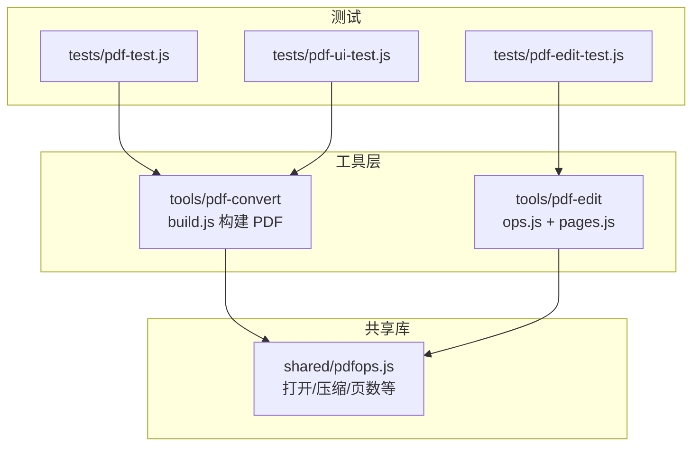
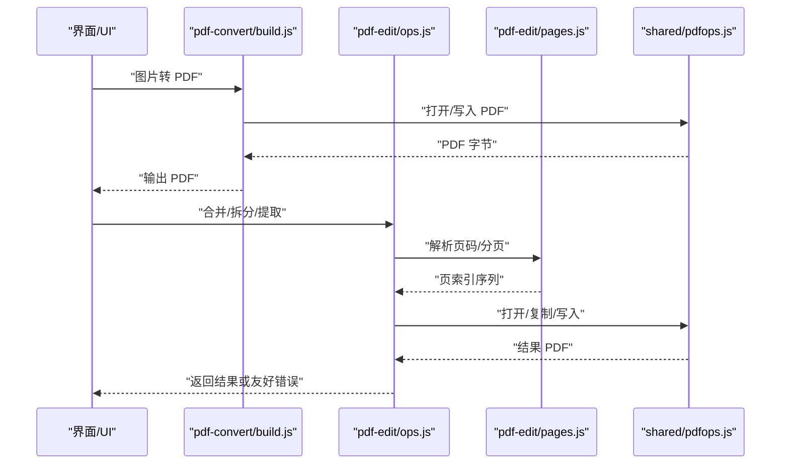
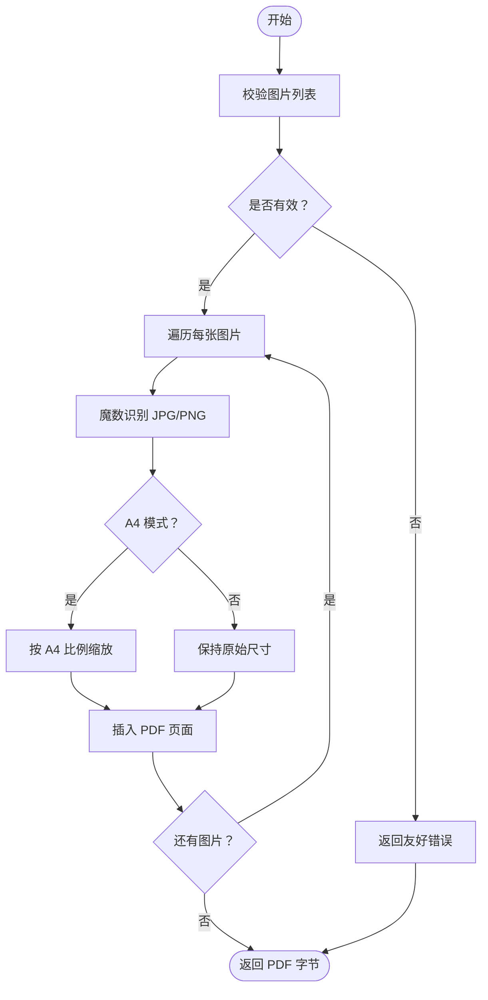
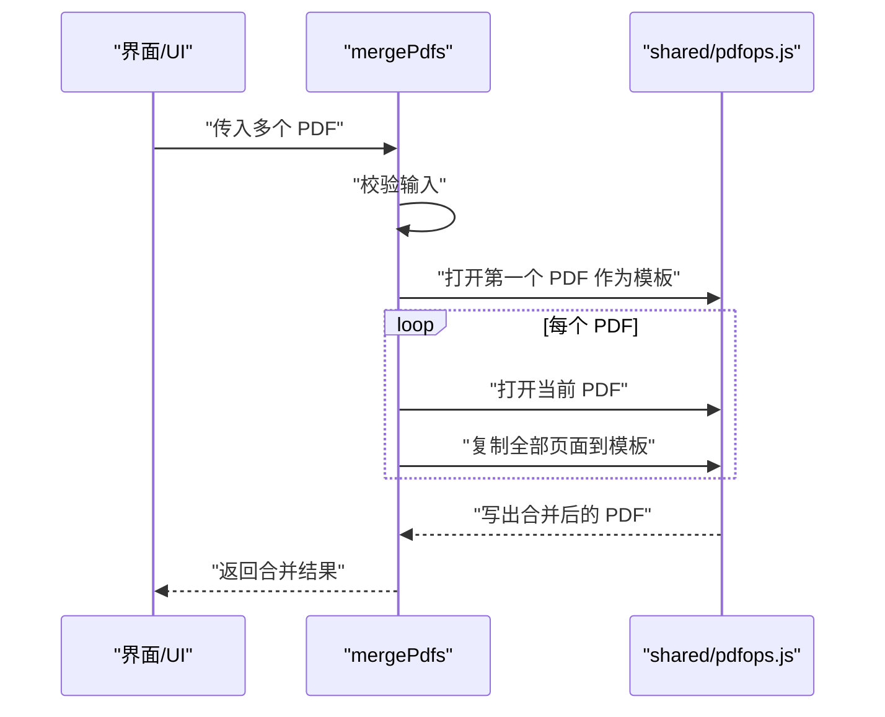
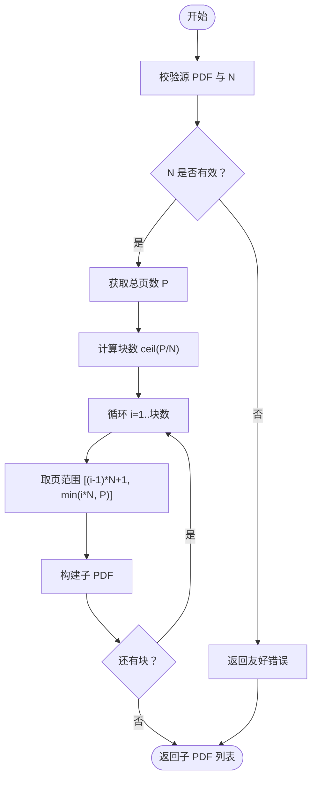
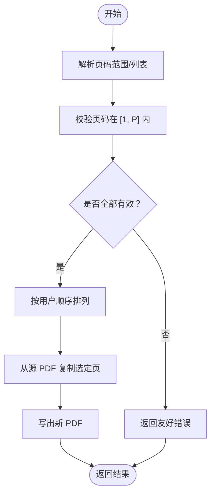
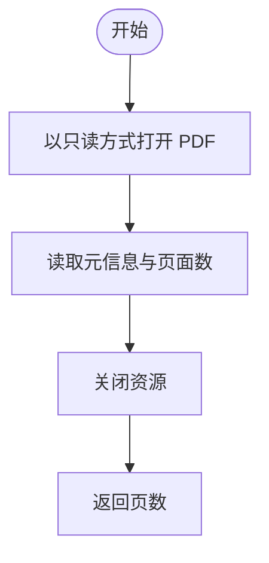
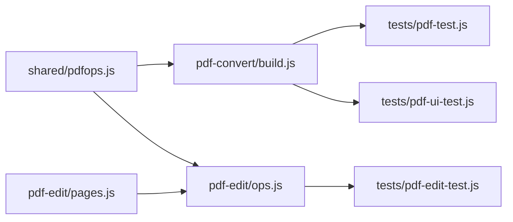

# PDF 转换工具

<cite>
**本文引用的文件**   
- [pdfops.js](file://app/app/src/shared/app/src/shared/pdfops.js)
- [pages.js（PDF 编辑）](file://app/src/tools/pdf-edit/core/pages.js)
- [ops.js（PDF 编辑核心逻辑）](file://app/src/tools/pdf-edit/core/ops.js)
- [build.js（文档转换构建器）](file://app/src/tools/pdf-convert/core/build.js)
- [pdf-test.js（PDF 测试）](file://app/tests/pdf-test.js)
- [pdf-ui-test.js（PDF 界面测试）](file://app/tests/pdf-ui-test.js)
- [pdf-edit-test.js（PDF 编辑测试）](file://app/tests/pdf-edit-test.js)
</cite>

## 目录
1. [引言](#引言)
2. [项目结构](#项目结构)
3. [核心组件](#核心组件)
4. [架构总览](#架构总览)
5. [详细组件分析](#详细组件分析)
6. [依赖关系分析](#依赖关系分析)
7. [性能考量](#性能考量)
8. [故障排查指南](#故障排查指南)
9. [结论](#结论)

## 引言
本技术文档聚焦仓库中的 PDF 转换与编辑能力，围绕以下关键功能展开：图片转 PDF、PDF 合并、拆分、页面提取、只读页码统计。重点说明 imagesToPdf 的图片类型检测与缩放策略、mergePdfs 的页面复制方式、splitPdf 的分页边界处理、extractPages 的页码校验与重排序，以及 getPageCount 的只读优化路径。同时给出批量图片生成 PDF、多份文档合并整理、按章节拆分归档等实际工作流示例，并总结加密 PDF 的错误提示机制。

## 项目结构
PDF 相关能力分布在共享层与工具层：
- 共享层提供通用的 PDF 打开、压缩、页面计数等能力；
- pdf-convert 工具负责将文档/图片转换为 PDF；
- pdf-edit 工具提供合并、拆分、提取、水印、压缩等编辑能力；
- tests 目录包含对 PDF 能力的单测与 UI 测试。

图表来源
- [pdfops.js:1-200](file://app/app/src/shared/app/src/shared/pdfops.js#L1-L200)
- [build.js:1-200](file://app/src/tools/pdf-convert/core/build.js#L1-L200)
- [ops.js:1-200](file://app/src/tools/pdf-edit/core/ops.js#L1-L200)
- [pages.js（PDF 编辑）:1-200](file://app/src/tools/pdf-edit/core/pages.js#L1-L200)

章节来源
- [pdfops.js:1-200](file://app/app/src/shared/app/src/shared/pdfops.js#L1-L200)
- [build.js:1-200](file://app/src/tools/pdf-convert/core/build.js#L1-L200)
- [ops.js:1-200](file://app/src/tools/pdf-edit/core/ops.js#L1-L200)
- [pages.js（PDF 编辑）:1-200](file://app/src/tools/pdf-edit/core/pages.js#L1-L200)

## 核心组件
- shared/pdfops.js：封装 PDF 打开、压缩、页面计数等通用能力，对外暴露如 openPdfDoc、compressPdf、getPageCount 等接口，被多个工具复用。
- tools/pdf-convert/core/build.js：文档与图片转 PDF 的构建流程，负责图片读取、尺寸计算、A4 模式适配、插入到 PDF 页面等。
- tools/pdf-edit/core/ops.js：PDF 编辑主逻辑，包括错误友好化、字体加载、以及调用页面操作函数完成合并、拆分、提取等任务。
- tools/pdf-edit/core/pages.js：页面级算法，如分页切分、页码范围解析、顺序重排等。

章节来源
- [pdfops.js:1-200](file://app/app/src/shared/app/src/shared/pdfops.js#L1-L200)
- [build.js:1-200](file://app/src/tools/pdf-convert/core/build.js#L1-L200)
- [ops.js:1-200](file://app/src/tools/pdf-edit/core/ops.js#L1-L200)
- [pages.js（PDF 编辑）:1-200](file://app/src/tools/pdf-edit/core/pages.js#L1-L200)

## 架构总览
PDF 转换与编辑采用“共享库 + 工具模块”的分层设计：
- 共享层提供稳定的 PDF I/O、压缩、计数等基础能力；
- 工具层通过组合共享库实现具体业务逻辑；
- 测试层覆盖端到端流程，确保行为稳定。

图表来源
- [build.js:1-200](file://app/src/tools/pdf-convert/core/build.js#L1-L200)
- [ops.js:1-200](file://app/src/tools/pdf-edit/core/ops.js#L1-L200)
- [pages.js（PDF 编辑）:1-200](file://app/src/tools/pdf-edit/core/pages.js#L1-L200)
- [pdfops.js:1-200](file://app/app/src/shared/app/src/shared/pdfops.js#L1-L200)

## 详细组件分析

### 图片转 PDF：imagesToPdf
- 图片类型检测：优先使用魔数识别 JPG/PNG，未命中时回退扩展名判断，避免误判。
- A4 模式缩放：以 A4 目标尺寸为目标，保持宽高比进行缩放，使图片完整显示且不拉伸。
- 原始尺寸模式：保留图片原始像素尺寸，不做缩放，适合需要原图精度的场景。
- 输入校验：检查图片数组非空、单个图片数据有效；异常统一转为友好错误。
- 输出：返回 Uint8Array 表示的新 PDF 字节。

图表来源
- [build.js:1-200](file://app/src/tools/pdf-convert/core/build.js#L1-L200)

章节来源
- [build.js:1-200](file://app/src/tools/pdf-convert/core/build.js#L1-L200)

### PDF 合并：mergePdfs
- 页面复制策略：逐个打开待合并 PDF，将其所有页面复制到新文档中，避免重复解析页面内容多次。
- 输入校验：检查待合并列表是否为空、每个 PDF 是否可读；遇到无效或加密 PDF 抛出友好错误。
- 输出：返回新的 PDF 字节；若取消则抛出取消错误。

图表来源
- [ops.js:1-200](file://app/src/tools/pdf-edit/core/ops.js#L1-L200)
- [pdfops.js:1-200](file://app/app/src/shared/app/src/shared/pdfops.js#L1-L200)

章节来源
- [ops.js:1-200](file://app/src/tools/pdf-edit/core/ops.js#L1-L200)
- [pdfops.js:1-200](file://app/app/src/shared/app/src/shared/pdfops.js#L1-L200)

### PDF 拆分：splitPdf
- 分页算法：按每 N 页切分为若干子 PDF；当剩余页数不足 N 时，最后一个子文档包含剩余全部页面。
- 边界处理：N=1 时每个页面单独成文；N 大于总页数时直接返回一个子文档。
- 输入校验：检查源 PDF 是否存在、页数是否合法、N 是否正整数。
- 输出：返回子 PDF 数组。

图表来源
- [pages.js（PDF 编辑）:1-200](file://app/src/tools/pdf-edit/core/pages.js#L1-L200)
- [ops.js:1-200](file://app/src/tools/pdf-edit/core/ops.js#L1-L200)

章节来源
- [pages.js（PDF 编辑）:1-200](file://app/src/tools/pdf-edit/core/pages.js#L1-L200)
- [ops.js:1-200](file://app/src/tools/pdf-edit/core/ops.js#L1-L200)

### 页面提取：extractPages
- 页码验证：解析用户输入的页码范围，校验其在 1..总页数范围内，非法页码会触发友好错误。
- 重排序功能：支持乱序或重复页码，最终按用户指定顺序提取页面。
- 输入校验：检查源 PDF 是否可读、页码序列是否有效。
- 输出：返回提取后的 PDF 字节。

图表来源
- [pages.js（PDF 编辑）:1-200](file://app/src/tools/pdf-edit/core/pages.js#L1-L200)
- [ops.js:1-200](file://app/src/tools/pdf-edit/core/ops.js#L1-L200)

章节来源
- [pages.js（PDF 编辑）:1-200](file://app/src/tools/pdf-edit/core/pages.js#L1-L200)
- [ops.js:1-200](file://app/src/tools/pdf-edit/core/ops.js#L1-L200)

### 只读页码统计：getPageCount
- 只读优化：仅读取必要元信息以统计页数，不加载页面内容，减少内存与 CPU 占用。
- 使用场景：在合并/拆分/提取前快速校验页数，提前发现无效输入。
- 错误处理：对损坏或非 PDF 文件给出明确错误提示。

图表来源
- [pdfops.js:1-200](file://app/app/src/shared/app/src/shared/pdfops.js#L1-L200)

章节来源
- [pdfops.js:1-200](file://app/app/src/shared/app/src/shared/pdfops.js#L1-L200)

## 依赖关系分析
- shared/pdfops.js 被 pdf-convert 与 pdf-edit 共同依赖，提供统一的 PDF I/O 能力；
- pdf-edit 内部 ops.js 依赖 pages.js 做页码解析与分页，再调用 shared/pdfops.js 执行实际 PDF 操作；
- tests 覆盖各工具的关键路径，保证 API 行为稳定。

图表来源
- [pdfops.js:1-200](file://app/app/src/shared/app/src/shared/pdfops.js#L1-L200)
- [build.js:1-200](file://app/src/tools/pdf-convert/core/build.js#L1-L200)
- [ops.js:1-200](file://app/src/tools/pdf-edit/core/ops.js#L1-L200)
- [pages.js（PDF 编辑）:1-200](file://app/src/tools/pdf-edit/core/pages.js#L1-L200)
- [pdf-test.js:1-200](file://app/tests/pdf-test.js#L1-L200)
- [pdf-ui-test.js:1-200](file://app/tests/pdf-ui-test.js#L1-L200)
- [pdf-edit-test.js:1-200](file://app/tests/pdf-edit-test.js#L1-L200)

章节来源
- [pdfops.js:1-200](file://app/app/src/shared/app/src/shared/pdfops.js#L1-L200)
- [build.js:1-200](file://app/src/tools/pdf-convert/core/build.js#L1-L200)
- [ops.js:1-200](file://app/src/tools/pdf-edit/core/ops.js#L1-L200)
- [pages.js（PDF 编辑）:1-200](file://app/src/tools/pdf-edit/core/pages.js#L1-L200)
- [pdf-test.js:1-200](file://app/tests/pdf-test.js#L1-L200)
- [pdf-ui-test.js:1-200](file://app/tests/pdf-ui-test.js#L1-L200)
- [pdf-edit-test.js:1-200](file://app/tests/pdf-edit-test.js#L1-L200)

## 性能考量
- 只读优化：getPageCount 仅读取元信息，避免全量解析页面内容，显著降低大文档开销。
- 合并策略：mergePdfs 尽量复用已有页面对象进行复制，减少重复解码与重建成本。
- 图片缩放：A4 模式下按需缩放，原始尺寸模式避免额外缩放开销，适用于高精度需求。
- 内存管理：PDF 打开后及时释放资源，防止长时间驻留导致内存泄漏。

[本节为通用指导，不直接分析具体文件]

## 故障排查指南
- 加密 PDF 友好提示：当检测到 PDF 已加密或密码不正确时，返回明确的中文提示，引导用户使用解密流程后再编辑。
- 无效或非 PDF 文件：对损坏文件或非 PDF 格式返回清晰错误，便于快速定位问题。
- 中文字体缺失：若使用中文字体失败，给出降级与补字体的建议。
- 取消操作：用户主动取消时抛出取消错误，界面可区分正常失败与用户取消。

章节来源
- [ops.js:1-200](file://app/src/tools/pdf-edit/core/ops.js#L1-L200)

## 结论
本 PDF 转换与编辑工具通过共享库与工具层的分层设计，提供了稳健的图片转 PDF、合并、拆分与页面提取能力。核心算法包括魔数图片类型检测、A4 与原始尺寸缩放、分页切分边界处理、页码校验与重排序，以及只读页码统计优化。配合友好的错误提示与完善的测试覆盖，可满足批量图片生成 PDF、多份文档合并整理、按章节拆分归档等常见工作流。