# 文档处理工具

<cite>
**本文引用的文件**   
- [index.js](file://app/src/tools/pdf-edit/index.js)
- [ops.js](file://app/src/tools/pdf-edit/core/ops.js)
- [pages.js](file://app/src/tools/pdf-edit/core/pages.js)
- [index.js](file://app/src/tools/pdf-convert/index.js)
- [build.js](file://app/src/tools/pdf-convert/core/build.js)
- [pdfjs.js](file://app/src/tools/pdf-convert/core/pdfjs.js)
- [pages.js](file://app/src/tools/pdf-convert/core/pages.js)
- [index.js](file://app/src/tools/doc-convert/index.js)
- [plan.mjs](file://app/src/tools/doc-convert/core/plan.mjs)
- [index.js](file://app/src/tools/ocr/index.js)
- [preprocess.js](file://app/src/tools/ocr/core/preprocess.js)
- [searchable.js](file://app/src/tools/ocr/core/searchable.js)
- [convert.js](file://app/src/tools/ocr/core/convert.js)
- [docx.js](file://app/src/tools/ocr/core/docx.js)
- [pdf-convert.md](file://spec/modules/pdf-convert.md)
- [ocr.md](file://spec/modules/ocr.md)
</cite>

## 目录
1. [引言](#引言)
2. [项目结构](#项目结构)
3. [核心组件](#核心组件)
4. [架构总览](#架构总览)
5. [详细组件分析](#详细组件分析)
6. [依赖关系分析](#依赖关系分析)
7. [性能与质量考量](#性能与质量考量)
8. [故障排查指南](#故障排查指南)
9. [结论](#结论)
10. [附录：实际工作流示例](#附录实际工作流示例)

## 引言
本技术文档聚焦仓库中的四个文档相关工具：PDF 编辑、PDF 转换、文档格式转换以及 OCR 文字识别。目标是以代码级事实为依据，说明它们的职责边界、处理流程、数据结构、错误处理和可扩展点；同时给出批量转换、OCR 后编辑和文档归档等可落地的端到端工作流示例。

## 项目结构
四个工具都遵循“工具声明 + UI + core 纯逻辑”的布局，core 层不依赖界面与其他工具，便于测试和复用。

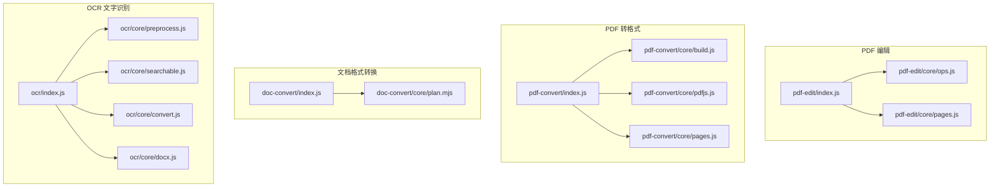

**图表来源**
- [index.js:1-14](file://app/src/tools/pdf-edit/index.js#L1-L14)
- [index.js:1-14](file://app/src/tools/pdf-convert/index.js#L1-L14)
- [index.js:1-14](file://app/src/tools/doc-convert/index.js#L1-L14)
- [index.js:1-14](file://app/src/tools/ocr/index.js#L1-L14)

**章节来源**
- [index.js:1-14](file://app/src/tools/pdf-edit/index.js#L1-L14)
- [index.js:1-14](file://app/src/tools/pdf-convert/index.js#L1-L14)
- [index.js:1-14](file://app/src/tools/doc-convert/index.js#L1-L14)
- [index.js:1-14](file://app/src/tools/ocr/index.js#L1-L14)

## 核心组件
- PDF 编辑：提供压缩、加密解密、水印、页码、旋转、重排等编辑能力；核心逻辑在 ops.js，页面范围解析在 pages.js。
- PDF 转格式：图片转 PDF、PDF 合并/拆分/提取页、PDF 转图片；渲染走 pdfjs，生成/结构操作走 pdf-lib。
- 文档格式转换：基于 LibreOffice 的 .doc/.xls/.ppt 与 .docx/.xlsx/.pptx 互转，并统一输出 PDF；规则由 plan.mjs 定义。
- OCR 文字识别：扫描件预处理（灰度化、反色、纠偏、去噪、锐化、二值化）、隐形文字层生成、纯文本与 Word 导出。

**章节来源**
- [ops.js:1-200](file://app/src/tools/pdf-edit/core/ops.js#L1-L200)
- [build.js:1-126](file://app/src/tools/pdf-convert/core/build.js#L1-L126)
- [pdfjs.js:1-75](file://app/src/tools/pdf-convert/core/pdfjs.js#L1-L75)
- [plan.mjs:1-97](file://app/src/tools/doc-convert/core/plan.mjs#L1-L97)
- [preprocess.js:1-200](file://app/src/tools/ocr/core/preprocess.js#L1-L200)
- [searchable.js:1-174](file://app/src/tools/ocr/core/searchable.js#L1-L174)

## 架构总览
四个工具共享一些底层能力：pdf-lib 用于创建/修改 PDF，pdfjs 用于读取与渲染，fontkit 用于中文字体子集化，shared/pdfops.js 提供压缩与打开能力，主进程通过 IPC 暴露 OCR 引擎与字体。

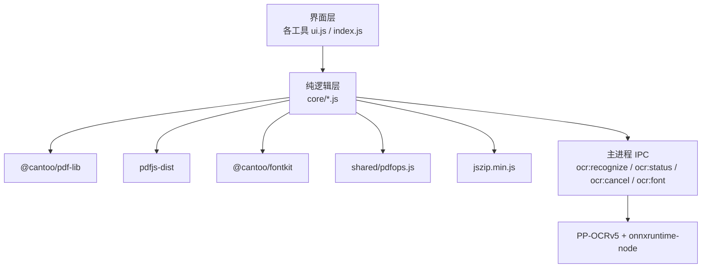

**图表来源**
- [ops.js:1-200](file://app/src/tools/pdf-edit/core/ops.js#L1-L200)
- [pdfjs.js:1-75](file://app/src/tools/pdf-convert/core/pdfjs.js#L1-L75)
- [searchable.js:1-174](file://app/src/tools/ocr/core/searchable.js#L1-L174)
- [docx.js:1-90](file://app/src/tools/ocr/core/docx.js#L1-L90)
- [ocr.md:1-69](file://spec/modules/ocr.md#L1-L69)

## 详细组件分析

### PDF 编辑工具
#### 功能定位
- 与「PDF 转格式」互补：后者专注格式转换，前者专注编辑整理。
- 支持能力包括压缩瘦身、文字水印、页码、页面旋转、页面重排、加密/解密等。

#### 核心数据与处理
- 除压缩外，所有编辑函数返回新 PDF 字节数组；压缩透传 shared/pdfops.js 的结果对象。
- 用户取消统一抛 CancelledError，界面据此区分取消与失败。
- 字体选择优先嵌入中文字体（子集化），失败回退 Helvetica。
- 中文检测使用正则判断是否含 CJK 字符。
- 错误翻译将 pdf-lib/pdfjs 英文错误转为中文提示，如“已加密”“密码不对”“不是有效 PDF”。

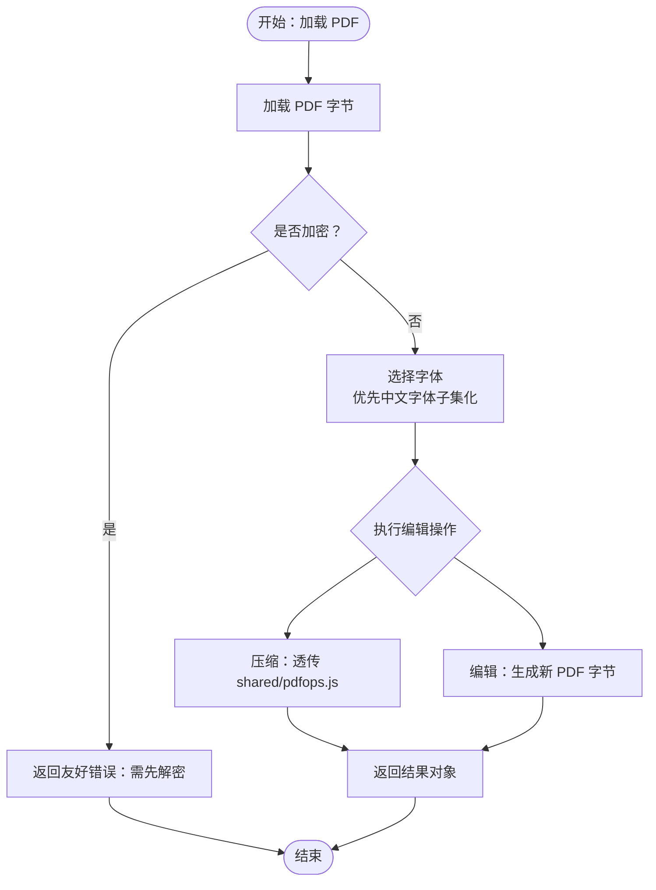

**图表来源**
- [ops.js:1-200](file://app/src/tools/pdf-edit/core/ops.js#L1-L200)

#### 页面范围解析
- 支持 “1-3,5”、“1～3，5”、“1 2 3” 等多种输入。
- 空字符串表示全部页；越界时起点越界报错，终点越界自动截到最后一页。
- 提供升序去重后的页码数组与可读范围文本。

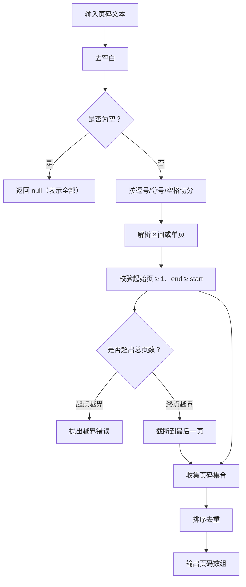

**图表来源**
- [pages.js:1-53](file://app/src/tools/pdf-edit/core/pages.js#L1-L53)

**章节来源**
- [index.js:1-15](file://app/src/tools/pdf-edit/index.js#L1-L15)
- [ops.js:1-200](file://app/src/tools/pdf-edit/core/ops.js#L1-L200)
- [pages.js:1-53](file://app/src/tools/pdf-edit/core/pages.js#L1-L53)

### PDF 转换工具
#### 功能定位
- 图片转 PDF、PDF 转图片、PDF 合并/拆分/提取页。
- 当存在 LibreOffice 加装包时，还负责 Word/Excel 转 PDF 与 PDF 转 Word。

#### 图片转 PDF
- 直接识别 JPG/PNG 魔数，避免无意义编码失败。
- 支持两种页面模式：原始尺寸或 A4 居中缩放；A4 模式下支持页边距。
- 每张图片一页，顺序即页序。

#### PDF 合并/拆分/提取页
- 合并：按传入顺序复制所有页面到新文档。
- 拆分：每 N 页一个文件，返回每个文件的起止页码与字节。
- 提取：根据 1 起页码数组生成新 PDF，可用作删页/重排。

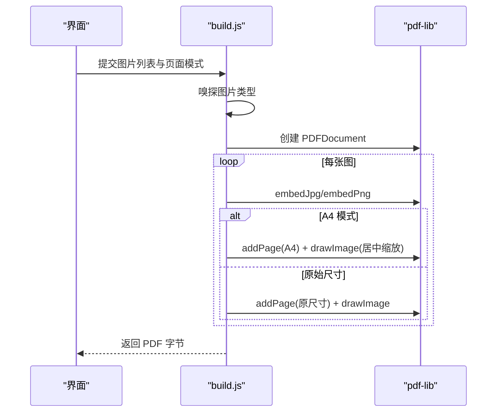

**图表来源**
- [build.js:1-126](file://app/src/tools/pdf-convert/core/build.js#L1-L126)

#### PDF 读取与渲染
- 使用 pdfjs-dist 打开 PDF，设置 cmaps 与标准字体数据以正确显示中文。
- openPdf 对 PasswordException/InvalidPDFException 做中文友好错误。
- renderPageToPixels 用真实 canvas 渲染指定页，返回 RGBA 像素。

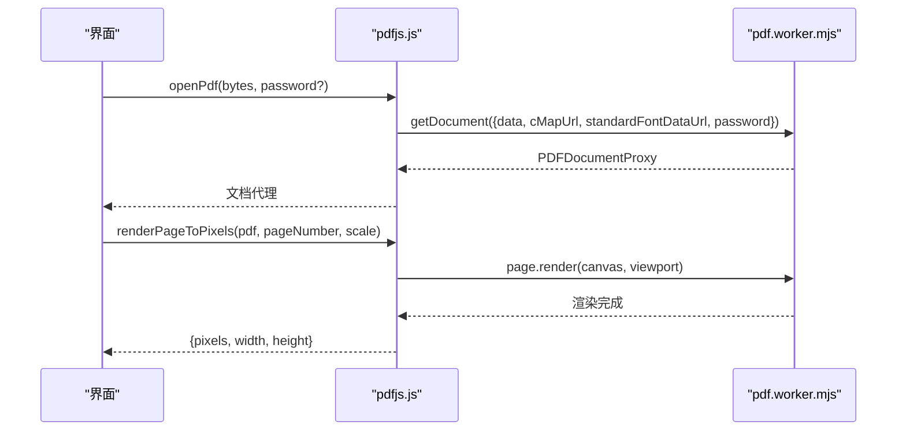

**图表来源**
- [pdfjs.js:1-75](file://app/src/tools/pdf-convert/core/pdfjs.js#L1-L75)

**章节来源**
- [index.js:1-14](file://app/src/tools/pdf-convert/index.js#L1-L14)
- [build.js:1-126](file://app/src/tools/pdf-convert/core/build.js#L1-L126)
- [pdfjs.js:1-75](file://app/src/tools/pdf-convert/core/pdfjs.js#L1-L75)
- [pdf-convert.md:1-87](file://spec/modules/pdf-convert.md#L1-L87)

### 文档格式转换工具
#### 功能定位
- 面向 .doc/.docx/.xls/.xlsx/.ppt/.pps/.rtf 与 PDF 之间的格式转换。
- 转换规则与显示文案独立于界面，保证 UI 不会出现不可能的组合。

#### 支持的输入输出
- 输入扩展名：.doc、.docx、.xls、.xlsx、.ppt、.pptx、.pps、.rtf。
- 家族划分：Word 文字、Excel 表格、PPT 演示。
- 智能模式：老格式自动转到对应新格式；已是新格式则提示无需转换。
- 输出目标：auto、docx、xlsx、pptx、pdf。

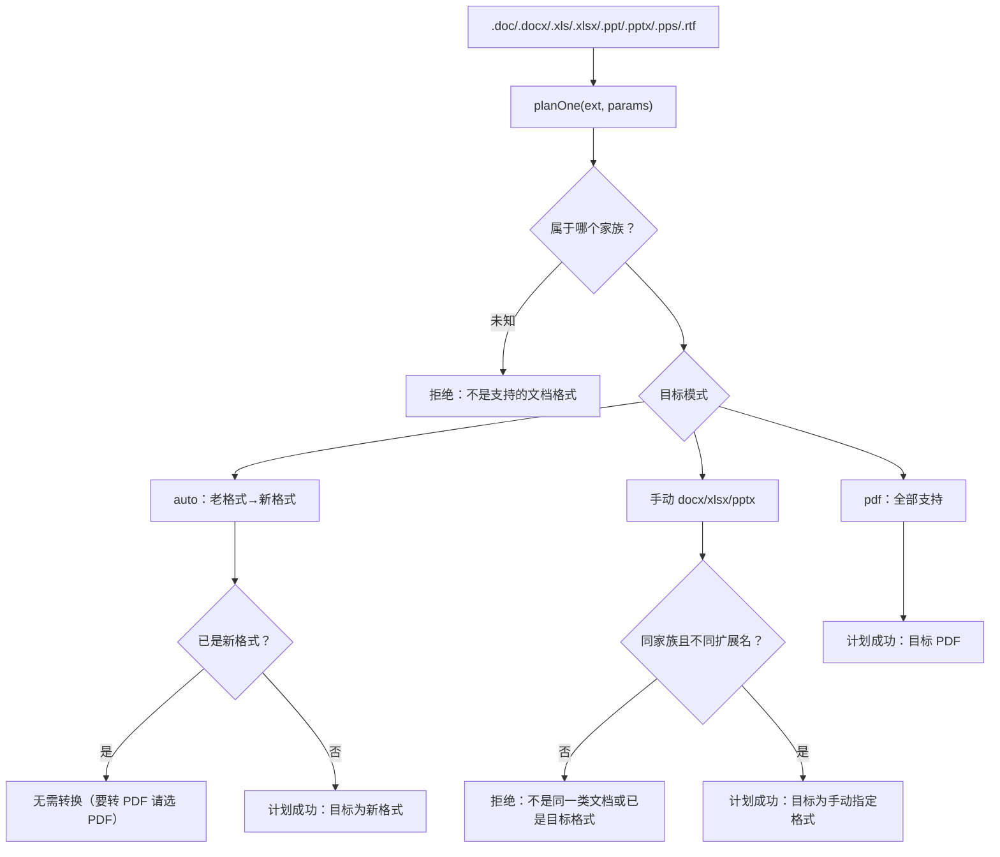

**图表来源**
- [plan.mjs:1-97](file://app/src/tools/doc-convert/core/plan.mjs#L1-L97)

**章节来源**
- [index.js:1-14](file://app/src/tools/doc-convert/index.js#L1-L14)
- [plan.mjs:1-97](file://app/src/tools/doc-convert/core/plan.mjs#L1-L97)

### OCR 文字识别工具
#### 功能定位
- 扫描版 PDF/图片 → 可搜索 PDF、纯文本、Word。
- 配套扫描件增强与瘦身；语言覆盖简体中文/英文/日文/繁体。

#### 预处理算法
- 固定处理顺序：灰度化 → 反色（可选）→ 纠偏（投影方差搜索微角度）→ 中值去噪（可选，默认关闭）→ 锐化（USM）→ 黑白化/去灰底。
- 二值化方法：自适应阈值、Otsu、手动阈值。
- 纠偏坐标回映射：旋转后的框经反向旋转回到原图坐标。
- 默认不开中值去噪，因实测会降低召回率。

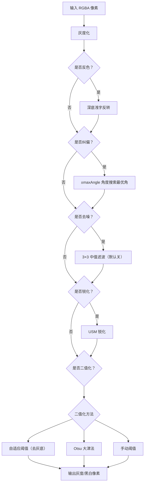

**图表来源**
- [preprocess.js:1-200](file://app/src/tools/ocr/core/preprocess.js#L1-L200)

#### 文字识别引擎集成与结果处理
- 引擎运行在主进程，通过 IPC 暴露识别、状态、取消与字体通道。
- convert.js 负责把二维行片段结果转换为纯文本、行级数据、片段级数据，并提供 PDF 坐标换算。
- 关键坐标换算：renderScale ≈ pxPerPt；size = box.height × ptsPerPx；y_pdf = pageHeightPts - box.y × ptsPerPx - size。

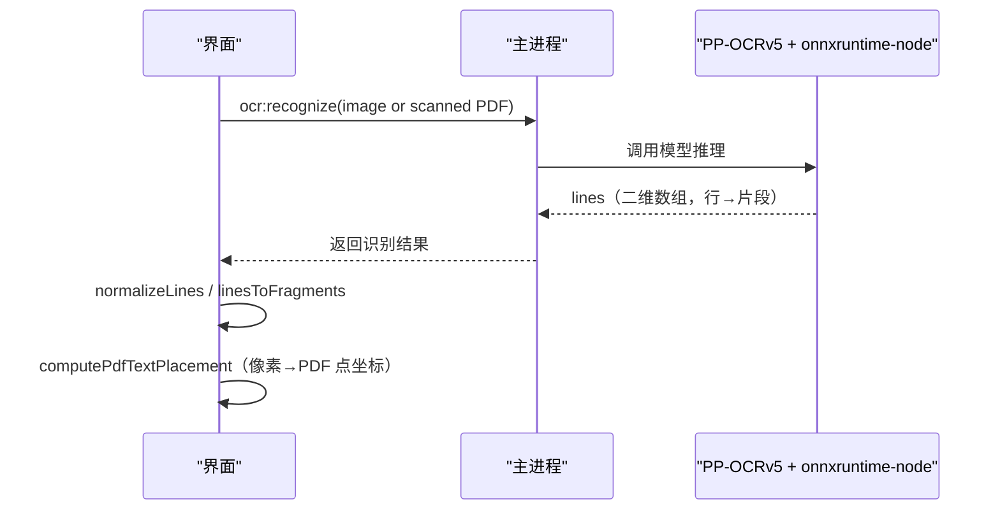

**图表来源**
- [ocr.md:1-69](file://spec/modules/ocr.md#L1-L69)
- [convert.js:1-151](file://app/src/tools/ocr/core/convert.js#L1-L151)

#### 可搜索 PDF 生成
- 原理：在原 PDF 上叠加 RenderMode=Invisible 的文字层，使 Ctrl+F、复制、屏幕阅读器可用。
- 字体子集化：通过 @cantoo/fontkit 仅嵌入用到的字形，显著减小 PDF 体积。
- 旋转页处理：若页面 Rotate 非 0，跳过该页并上报，避免坐标系错位。
- 低置信度过滤：可按 minConfidence 丢弃片段。

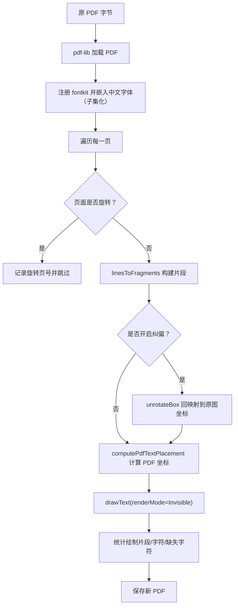

**图表来源**
- [searchable.js:1-174](file://app/src/tools/ocr/core/searchable.js#L1-L174)
- [convert.js:1-151](file://app/src/tools/ocr/core/convert.js#L1-L151)
- [preprocess.js:1-200](file://app/src/tools/ocr/core/preprocess.js#L1-L200)

#### Word 导出
- 手写最小 OOXML：[Content_Types].xml、_rels/.rels、word/document.xml。
- 使用随包 JSZip 打包为 .docx；段落保留首尾空格。
- 多页识别结果之间插入空段落作为分页分隔。

**章节来源**
- [index.js:1-14](file://app/src/tools/ocr/index.js#L1-L14)
- [preprocess.js:1-200](file://app/src/tools/ocr/core/preprocess.js#L1-L200)
- [convert.js:1-151](file://app/src/tools/ocr/core/convert.js#L1-L151)
- [searchable.js:1-174](file://app/src/tools/ocr/core/searchable.js#L1-L174)
- [docx.js:1-90](file://app/src/tools/ocr/core/docx.js#L1-L90)
- [ocr.md:1-69](file://spec/modules/ocr.md#L1-L69)

## 依赖关系分析
- 工具间禁止互相 import，能力复用放在 shared 或各自 core 内复制稳定纯函数。
- pdf-edit 与 ocr 共用 fontkit 加载策略（浏览器 UMD 动态加载，Node 直引）。
- pdf-convert 与 pdf-edit 均依赖 pdf-lib；pdf-convert 额外依赖 pdfjs 进行渲染。
- doc-convert 的规则层与主进程 libreoffice:convert 解耦，只定义转换计划。
- OCR 依赖主进程 IPC 与 PP-OCRv5 模型；可搜索 PDF 依赖 @cantoo/pdf-lib 与 @cantoo/fontkit。

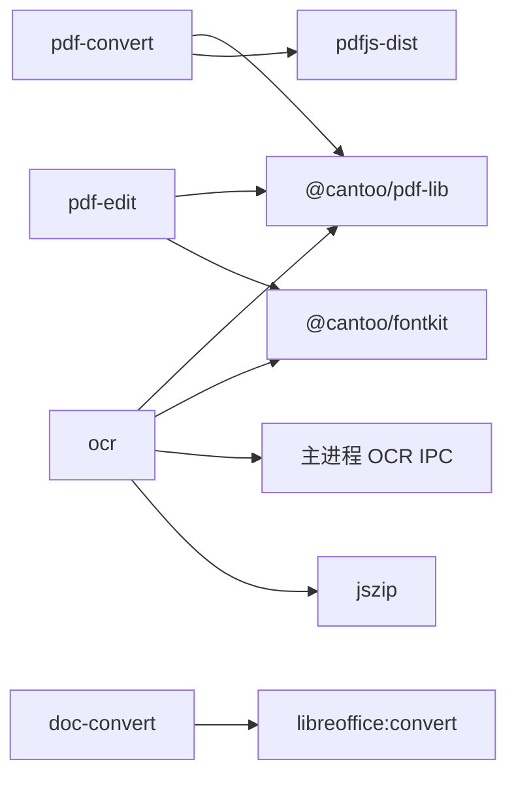

**图表来源**
- [ops.js:1-200](file://app/src/tools/pdf-edit/core/ops.js#L1-L200)
- [pdfjs.js:1-75](file://app/src/tools/pdf-convert/core/pdfjs.js#L1-L75)
- [plan.mjs:1-97](file://app/src/tools/doc-convert/core/plan.mjs#L1-L97)
- [searchable.js:1-174](file://app/src/tools/ocr/core/searchable.js#L1-L174)
- [docx.js:1-90](file://app/src/tools/ocr/core/docx.js#L1-L90)
- [ocr.md:1-69](file://spec/modules/ocr.md#L1-L69)

**章节来源**
- [ops.js:1-200](file://app/src/tools/pdf-edit/core/ops.js#L1-L200)
- [pdfjs.js:1-75](file://app/src/tools/pdf-convert/core/pdfjs.js#L1-L75)
- [plan.mjs:1-97](file://app/src/tools/doc-convert/core/plan.mjs#L1-L97)
- [searchable.js:1-174](file://app/src/tools/ocr/core/searchable.js#L1-L174)
- [docx.js:1-90](file://app/src/tools/ocr/core/docx.js#L1-L90)
- [ocr.md:1-69](file://spec/modules/ocr.md#L1-L69)

## 性能与质量考量
- PDF 生成与结构操作：pdf-lib 为纯 JS，无原生依赖，适合在界面进程直接引用 ESM 产物。
- PDF 渲染：pdfjs 需要 worker 与 cmaps/standard_fonts；渲染使用真实 canvas，像素交给 imageio 编码。
- 字体子集化：fontkit 子集化可大幅降低 PDF 体积，尤其对包含大量中文字符的可搜索 PDF。
- OCR 预处理：默认关闭中值去噪以避免召回下降；纠偏角度搜索范围可调，避免过度旋转。
- LibreOffice 批量：内部串行排队，批量应依次调用并显示进度。
- PDF→Word：复杂文档可能产生大量浮动文本框，推荐“可编辑文本（压平）”输出方式以提升打开性能。

[本节为通用指导，不直接分析具体文件]

## 故障排查指南
- PDF 加密/密码：
  - pdf-edit：遇到加密 PDF 会返回友好错误，提示先解密。
  - pdf-convert：打开 PDF 时区分 PasswordException 与 InvalidPDFException，给出中文提示。
- 字体缺失：
  - pdf-edit：WinAnsi 无法编码时提示中文字体缺失，降级 Helvetica。
  - ocr：缺少中文字体无法生成可搜索 PDF，但纯文本仍可用。
- 图片解码失败：
  - ocr：friendlyOcrMessage 会把 unsupported image type/decode/invalid image 等英文错误翻译为“PNG/JPG 格式问题”。
- 内存不足：
  - ocr：out of memory 等错误会被翻译为建议降低分辨率或换小图。
- 页面旋转导致错位：
  - ocr：Rotate 非 0 的页面不叠加文字层，并在汇总中如实上报。
- 页码范围错误：
  - pdf-edit 与 pdf-convert 的 parsePageRange 对非法范围、越界起点有明确错误信息。

**章节来源**
- [ops.js:1-200](file://app/src/tools/pdf-edit/core/ops.js#L1-L200)
- [pdfjs.js:1-75](file://app/src/tools/pdf-convert/core/pdfjs.js#L1-L75)
- [convert.js:1-151](file://app/src/tools/ocr/core/convert.js#L1-L151)
- [searchable.js:1-174](file://app/src/tools/ocr/core/searchable.js#L1-L174)
- [pages.js:1-53](file://app/src/tools/pdf-edit/core/pages.js#L1-L53)
- [pages.js:1-49](file://app/src/tools/pdf-convert/core/pages.js#L1-L49)

## 结论
这四个工具围绕“PDF 与文档”的全链路处理形成互补：pdf-edit 负责编辑与整理，pdf-convert 负责格式与页面结构转换，doc-convert 负责 Office 与 PDF 的高保真转换，ocr 让扫描件可搜索、可导出。它们共同遵守工具自包含、纯逻辑与界面解耦、错误中文友好的设计原则，并通过共享库与 IPC 打通底层能力。

[本节为总结性内容，不直接分析具体文件]

## 附录：实际工作流示例

### 批量转换工作流（Office → PDF）
- 步骤：
  1. 使用文档格式转换工具批量导入 .doc/.xls/.ppt 及其新格式变体。
  2. 选择“智能”模式，让工具自动把老格式转为对应新格式；如需统一归档，选择“PDF 文档”。
  3. 若未安装 LibreOffice 加装包，界面会提示获取与放置说明；安装后可获得高保真转换。
  4. 观察转换计划与输出路径，确认无“已是新格式无需转换”的误报。
- 适用场景：教务系统导出的 .doc/.xls/.ppt 批量归档为 PDF。

**章节来源**
- [plan.mjs:1-97](file://app/src/tools/doc-convert/core/plan.mjs#L1-L97)
- [pdf-convert.md:1-87](file://spec/modules/pdf-convert.md#L1-L87)

### OCR 后编辑工作流（扫描件 → 可搜索 PDF → 编辑整理）
- 步骤：
  1. 使用 OCR 工具导入扫描版 PDF 或图片。
  2. 根据需要开启灰度化、反色、纠偏、锐化、二值化；保持中值去噪默认关闭。
  3. 生成可搜索 PDF；检查是否出现“旋转页未叠加”的提示。
  4. 将可搜索 PDF 转入 PDF 编辑工具，执行压缩、加水印、添加页码或页面重排。
  5. 如需进一步格式化，再进入 PDF 转格式工具做合并/拆分/提取页。
- 关键点：
  - 若页面被旋转，OCR 不会在该页叠加文字层，应先校正方向或使用 PDF 编辑旋转后再 OCR。
  - 中文字体缺失时，可搜索 PDF 不可用，但纯文本仍可导出。

**章节来源**
- [preprocess.js:1-200](file://app/src/tools/ocr/core/preprocess.js#L1-L200)
- [searchable.js:1-174](file://app/src/tools/ocr/core/searchable.js#L1-L174)
- [ops.js:1-200](file://app/src/tools/pdf-edit/core/ops.js#L1-L200)
- [build.js:1-126](file://app/src/tools/pdf-convert/core/build.js#L1-L126)

### 文档归档工作流（PDF 合并 + OCR + 压缩）
- 步骤：
  1. 先用 PDF 转格式工具的合并功能，把多个 PDF 按顺序合成一份。
  2. 对合成后的 PDF 执行 OCR，生成可搜索版本。
  3. 使用 PDF 编辑工具的压缩功能，按档位与灰度开关控制体积。
  4. 最后按需添加水印、页码或进行页面旋转/重排，完成归档。
- 适用场景：会议资料、项目交付物归档，要求既体积小又全文可搜。

**章节来源**
- [build.js:1-126](file://app/src/tools/pdf-convert/core/build.js#L1-L126)
- [searchable.js:1-174](file://app/src/tools/ocr/core/searchable.js#L1-L174)
- [ops.js:1-200](file://app/src/tools/pdf-edit/core/ops.js#L1-L200)