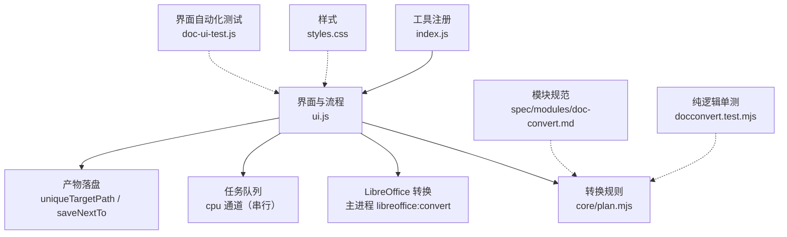
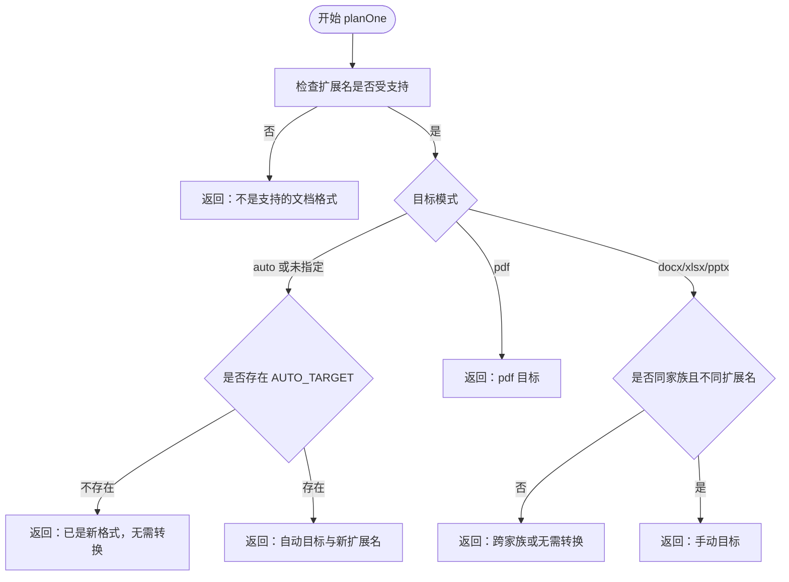
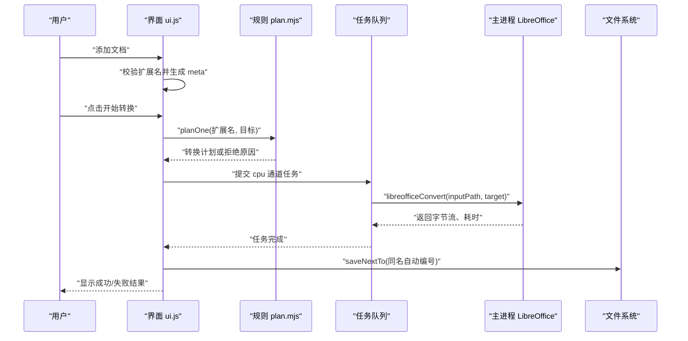
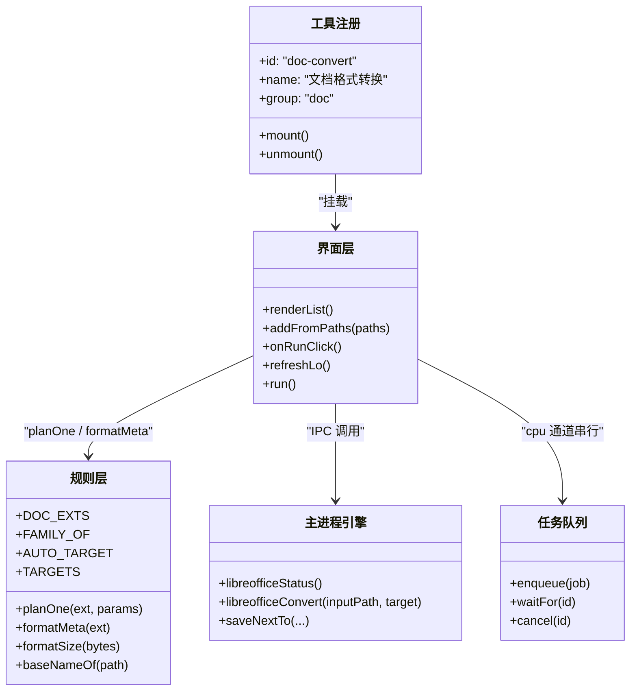
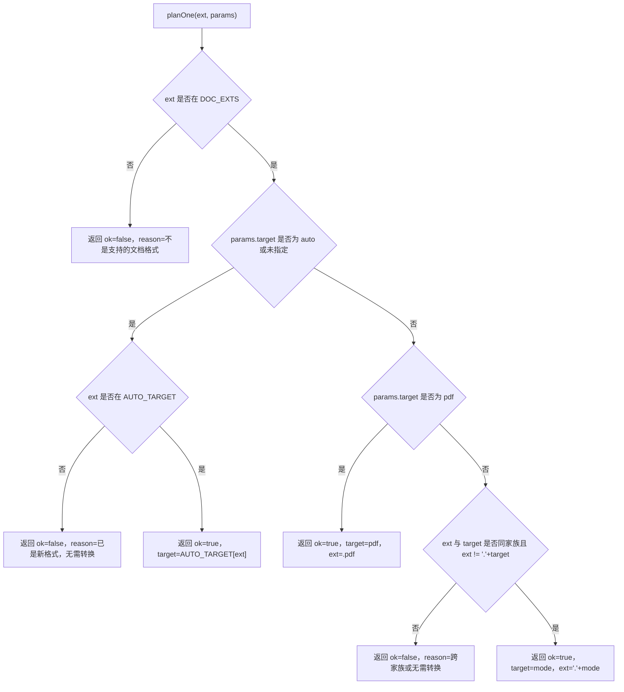
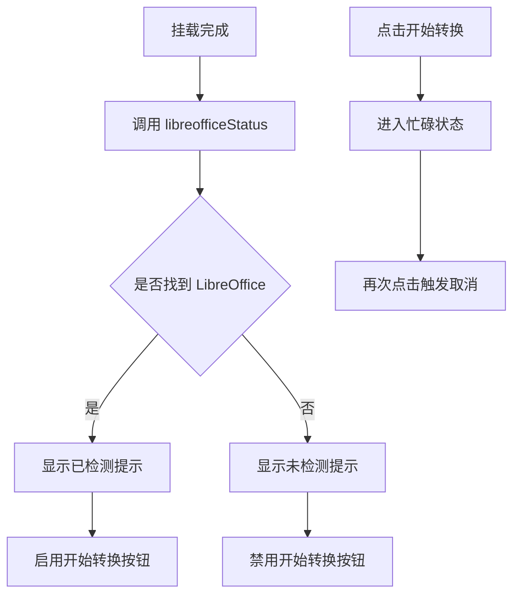
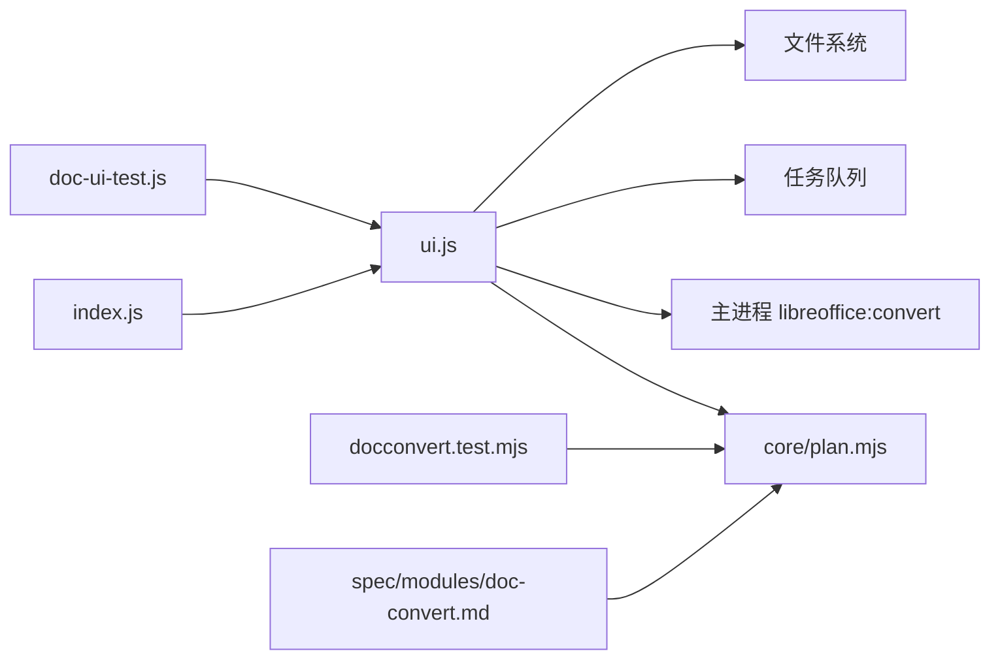

# 文档格式转换工具

<cite>
**本文引用的文件**   
- [index.js](file://app/src/tools/doc-convert/index.js)
- [ui.js](file://app/src/tools/doc-convert/ui.js)
- [plan.mjs](file://app/src/tools/doc-convert/core/plan.mjs)
- [styles.css](file://app/src/tools/doc-convert/styles.css)
- [doc-convert.md](file://spec/modules/doc-convert.md)
- [doc-ui-test.js](file://app/tests/doc-ui-test.js)
- [docconvert.test.mjs](file://app/tests/docconvert.test.mjs)
- [README.md](file://README.md)
</cite>

## 目录
1. [简介](#简介)
2. [项目结构](#项目结构)
3. [核心组件](#核心组件)
4. [架构总览](#架构总览)
5. [详细组件分析](#详细组件分析)
6. [依赖关系分析](#依赖关系分析)
7. [性能与并发特性](#性能与并发特性)
8. [错误处理与用户提示](#错误处理与用户提示)
9. [实际转换场景示例](#实际转换场景示例)
10. [结论](#结论)

## 简介
文档格式转换工具用于把老版 Office 文档和富文本批量转换为现代通用格式。它支持 `.doc`、`.docx`、`.xls`、`.xlsx`、`.ppt`、`.pptx`、`.pps`、`.rtf` 输入，并输出 `docx`、`xlsx`、`pptx` 或 `pdf`。智能模式会根据输入自动选择对应的新格式；已经是新格式的文件会给出“无需转换”的友好提示，但仍可手动导出为 PDF。

该工具的核心规则（家族分类、智能目标、显示文案）集中在纯函数模块中，界面只负责交互、状态编排和任务调度；真正的转换由主进程的 LibreOffice 调用完成。

## 项目结构
`doc-convert` 工具位于应用工具箱中的“文档”分组，入口是一个轻量工具注册对象：暴露工具 ID、名称、图标、分组、排序、样式和挂载函数。真正的工作被拆成三层：

| 层级 | 文件 | 职责 |
|---|---|---|
| 工具注册层 | `index.js` | 声明工具元数据，挂载 UI |
| 界面与流程层 | `ui.js` | 渲染列表、添加文件、检测 LibreOffice、执行队列、保存产物 |
| 规则层 | `core/plan.mjs` | 定义支持的扩展名、家族映射、智能目标、转换计划、显示文案 |
| 样式层 | `styles.css` | 卡片、下拉、拖放区、文件列表、按钮、结果信息的专属样式 |
| 规范层 | `spec/modules/doc-convert.md` | 模块目标、输入输出表、技术选型、已知限制与验收说明 |
| 测试层 | `tests/docconvert.test.mjs`、`tests/doc-ui-test.js` | 纯逻辑单测与界面自动化测试 |

**图表来源**
- [index.js:1-14](file://app/src/tools/doc-convert/index.js#L1-L14)
- [ui.js:1-419](file://app/src/tools/doc-convert/ui.js#L1-L419)
- [plan.mjs:1-97](file://app/src/tools/doc-convert/core/plan.mjs#L1-L97)
- [doc-convert.md:1-54](file://spec/modules/doc-convert.md#L1-L54)
- [docconvert.test.mjs:1-111](file://app/tests/docconvert.test.mjs#L1-L111)
- [doc-ui-test.js:1-200](file://app/tests/doc-ui-test.js#L1-L200)

**章节来源**
- [index.js:1-14](file://app/src/tools/doc-convert/index.js#L1-L14)
- [doc-convert.md:1-54](file://spec/modules/doc-convert.md#L1-L54)

## 核心组件
### 规则模块 `core/plan.mjs`
这是整个工具的“转换大脑”，不关心界面，也不直接调用 LibreOffice，因此可以独立测试。

| 导出项 | 作用 |
|---|---|
| `DOC_EXTS` | 允许输入的扩展名集合，包括 `.doc/.docx/.xls/.xlsx/.ppt/.pptx/.pps/.rtf` |
| `FAMILY_OF` | 将扩展名映射到家族：`word`、`excel`、`ppt` |
| `AUTO_TARGET` | 老格式到现代格式的自动映射：`.doc→.docx`、`.rtf→.docx`、`.xls→.xlsx`、`.ppt/.pps→.pptx` |
| `TARGETS` | 下拉菜单选项，值与主进程引擎的 target 白名单对齐 |
| `targetOf(value)` | 根据下拉 value 取目标信息，未知值回退到智能模式 |
| `planOne(ext, params)` | 单个文件的转换计划验证函数 |
| `formatMeta(ext)` | 生成列表项元信息文案，如“XLS · 表格 → 转 .xlsx” |
| `formatSize(bytes)` | 字节数转为人类可读单位 |
| `baseNameOf(filePath)` | 从完整路径提取文件名 |

#### 家族分类系统
家族是“同族转换限制”的基础：

- Word 文字：`.doc`、`.docx`、`.rtf`
- Excel 表格：`.xls`、`.xlsx`
- PPT 演示：`.ppt`、`.pps`、`.pptx`

同一家族内允许“老格式 → 新格式”的强制转换；跨家族会被拒绝，例如 `.xls` 不能转成 `.docx`，因为前者是表格、后者是文字文档。

#### 智能模式算法 `AUTO_TARGET`
智能模式的行为如下：

1. 如果输入是老格式（存在于 `AUTO_TARGET`），返回对应的新格式扩展名。
2. 如果输入已经是新格式（`.docx`、`.xlsx`、`.pptx`），智能模式不会自动升级，而是返回失败原因，提示“已是新格式，无需转换（要转 PDF 请选「PDF 文档」）”。
3. 用户手动选择 `pdf` 时，所有支持的输入都允许导出 PDF。
4. 用户手动选择 `docx`、`xlsx`、`pptx` 时，必须满足两个条件：
   - 输入与目标属于同一家族；
   - 输入扩展名不等于目标扩展名。

**图表来源**
- [plan.mjs:38-86](file://app/src/tools/doc-convert/core/plan.mjs#L38-L86)

**章节来源**
- [plan.mjs:1-97](file://app/src/tools/doc-convert/core/plan.mjs#L1-L97)
- [docconvert.test.mjs:1-111](file://app/tests/docconvert.test.mjs#L1-L111)

### 界面与流程 `ui.js`
界面模块负责：

- 渲染目标下拉框，默认选中“智能（推荐）”
- 检测 LibreOffice 加装包状态
- 添加单个文件或文件夹
- 展示每个文件的原始格式、智能目标、转换结果
- 使用任务队列串行执行转换
- 保存产物并与原文件放在相同目录
- 提供“开始转换”“取消”“清空”等交互

**图表来源**
- [ui.js:1-200](file://app/src/tools/doc-convert/ui.js#L1-L200)
- [ui.js:201-419](file://app/src/tools/doc-convert/ui.js#L201-L419)
- [plan.mjs:38-86](file://app/src/tools/doc-convert/core/plan.mjs#L38-L86)

**章节来源**
- [ui.js:1-419](file://app/src/tools/doc-convert/ui.js#L1-L419)

### 样式模块 `styles.css`
样式模块遵循项目主题令牌，不使用自定义颜色类，保证浅色/深色模式下一致表现。主要覆盖：

- 顶部控制区：目标下拉、LibreOffice 状态提示
- 中部文件区：拖放区域、文件列表、移除按钮
- 底部操作区：开始转换、清空、结果摘要

关键视觉语义：

| 样式类 | 含义 |
|---|---|
| `.dc-note.is-ok` | LibreOffice 检测成功 |
| `.dc-note.is-warn` | LibreOffice 未检测到 |
| `.dc-item-meta.is-error` | 单项转换失败 |
| `.dc-icon-btn:disabled` | 忙碌时禁用移除等操作 |

**章节来源**
- [styles.css:1-126](file://app/src/tools/doc-convert/styles.css#L1-L126)

## 架构总览
整体架构采用“规则与界面解耦 + 主进程引擎复用”的设计：

**图表来源**
- [index.js:1-14](file://app/src/tools/doc-convert/index.js#L1-L14)
- [ui.js:1-419](file://app/src/tools/doc-convert/ui.js#L1-L419)
- [plan.mjs:1-97](file://app/src/tools/doc-convert/core/plan.mjs#L1-L97)

**章节来源**
- [index.js:1-14](file://app/src/tools/doc-convert/index.js#L1-L14)
- [ui.js:1-419](file://app/src/tools/doc-convert/ui.js#L1-L419)
- [plan.mjs:1-97](file://app/src/tools/doc-convert/core/plan.mjs#L1-L97)

## 详细组件分析

### 输入格式与输出目标
#### 支持的输入
| 扩展名 | 典型内容 | 智能模式输出 |
|---|---|---|
| `.doc` | Word 97-2003 二进制或 Word 2003 XML | `.docx` |
| `.docx` | 现代 Word 格式 | 智能模式不升级；可手动转 PDF |
| `.xls` | Excel 97-2003 二进制或 Excel 2003 XML（含教务系统导出的“假 .xls”） | `.xlsx` |
| `.xlsx` | 现代 Excel 格式 | 智能模式不升级；可手动转 PDF |
| `.ppt` | PowerPoint 97-2003 | `.pptx` |
| `.pps` | PowerPoint 放映格式 | `.pptx` |
| `.pptx` | 现代 PPT 格式 | 智能模式不升级；可手动转 PDF |
| `.rtf` | 富文本 | `.docx` |

#### 输出的目标类型
| 目标值 | 含义 | 适用场景 |
|---|---|---|
| `auto` | 智能模式 | 普通批量升级 |
| `docx` | Word 新格式 | 老 Word/RTF 升级 |
| `xlsx` | Excel 新格式 | 老 Excel/假 .xls 升级 |
| `pptx` | PowerPoint 新格式 | 老 PPT/PPS 升级 |
| `pdf` | PDF 文档 | 打印、归档、跨设备预览 |

**章节来源**
- [doc-convert.md:1-54](file://spec/modules/doc-convert.md#L1-L54)
- [plan.mjs:10-36](file://app/src/tools/doc-convert/core/plan.mjs#L10-L36)
- [docconvert.test.mjs:1-111](file://app/tests/docconvert.test.mjs#L1-L111)

### `planOne` 转换规则验证逻辑
`planOne` 是转换流程的关键闸门。它的行为可以概括为五步：

1. **扩展名校验**：不在 `DOC_EXTS` 中的扩展名直接拒绝。
2. **智能模式分支**：若目标为 `auto` 或未指定，则查 `AUTO_TARGET`。
3. **新格式保护**：若输入已是 `.docx`、`.xlsx`、`.pptx`，返回“无需转换”。
4. **PDF 全量支持**：目标为 `pdf` 时直接放行。
5. **手动目标校验**：
   - 必须与输入同家族；
   - 输入扩展名不能等于目标扩展名。

**图表来源**
- [plan.mjs:38-86](file://app/src/tools/doc-convert/core/plan.mjs#L38-L86)

**章节来源**
- [plan.mjs:38-86](file://app/src/tools/doc-convert/core/plan.mjs#L38-L86)
- [docconvert.test.mjs:27-100](file://app/tests/docconvert.test.mjs#L27-L100)

### `formatMeta` 显示文案生成
`formatMeta` 用于在文件列表中展示“这是什么格式、智能模式会转什么”。

| 输入扩展名 | 输出文案含义 |
|---|---|
| `.xls` | “XLS · 表格 → 转 .xlsx” |
| `.doc` | “DOC · 文字 → 转 .docx” |
| `.ppt` | “PPT · 演示 → 转 .pptx” |
| `.pps` | “PPS · 演示 → 转 .pptx” |
| `.rtf` | “RTF · 文字 → 转 .docx” |
| `.docx` | “DOCX · 文字（已是新格式）” |
| `.xlsx` | “XLSX · 表格（已是新格式）” |
| `.pptx` | “PPTX · 演示（已是新格式）” |

这个文案对用户体验很重要：用户能一眼看出智能目标，而不会被“自动升级已经很好的格式”干扰。

**章节来源**
- [plan.mjs:88-97](file://app/src/tools/doc-convert/core/plan.mjs#L88-L97)
- [docconvert.test.mjs:102-111](file://app/tests/docconvert.test.mjs#L102-L111)

### LibreOffice 状态检测与运行按钮控制
界面在挂载后异步检测 LibreOffice 状态：

- 已检测到：显示绿色提示，启用“开始转换”
- 未检测到：显示警告提示，禁用“开始转换”，并在点击运行时提示安装位置
- 正在转换：按钮文本变为“取消”，再次点击会触发取消

**图表来源**
- [ui.js:35-80](file://app/src/tools/doc-convert/ui.js#L35-L80)
- [ui.js:201-220](file://app/src/tools/doc-convert/ui.js#L201-L220)
- [ui.js:340-380](file://app/src/tools/doc-convert/ui.js#L340-L380)

**章节来源**
- [ui.js:35-80](file://app/src/tools/doc-convert/ui.js#L35-L80)
- [ui.js:201-220](file://app/src/tools/doc-convert/ui.js#L201-L220)
- [ui.js:340-380](file://app/src/tools/doc-convert/ui.js#L340-L380)

## 依赖关系分析
### 模块间依赖

**图表来源**
- [index.js:1-14](file://app/src/tools/doc-convert/index.js#L1-L14)
- [ui.js:1-419](file://app/src/tools/doc-convert/ui.js#L1-L419)
- [plan.mjs:1-97](file://app/src/tools/doc-convert/core/plan.mjs#L1-L97)
- [docconvert.test.mjs:1-111](file://app/tests/docconvert.test.mjs#L1-L111)
- [doc-ui-test.js:1-200](file://app/tests/doc-ui-test.js#L1-L200)
- [doc-convert.md:1-54](file://spec/modules/doc-convert.md#L1-L54)

### 外部依赖
| 依赖 | 用途 | 特点 |
|---|---|---|
| LibreOffice | 老格式转新格式、PDF 导出 | 随包附带，走独立 profile，避免配置冲突 |
| SheetJS | 测试期读回 xlsx 校验数据 | 本工具不依赖其转换能力，仅用于测试 |
| jszip | 测试期读回 docx 校验内容 | 通过 dist UMD 路径引入 |
| 任务队列 | 管理跨工具任务 | 文档转换使用 cpu 通道串行执行 |

**章节来源**
- [doc-convert.md:1-54](file://spec/modules/doc-convert.md#L1-L54)
- [doc-ui-test.js:1-60](file://app/tests/doc-ui-test.js#L1-L60)

## 性能与并发特性
### 串行队列设计
文档转换使用任务的 **cpu 通道**，这意味着同一时刻只有一个转换在执行。原因是 LibreOffice 转换共用同一个 profile 目录，多个 `soffice` 实例同时运行可能产生 profile 锁冲突。

### 取消语义
点击“取消”时：

- 当前正在运行的 LibreOffice 转换无法立即中断；
- 转换完成后不会保存产物；
- 当前条目标记为“已取消”；
- 后续任务不再继续；
- 这样能保证 profile 锁随进程退出释放，不影响队列后续任务。

### 文件大小与耗时展示
转换成功后，界面显示：

- 输出文件名
- 产物大小（B/KB/MB）
- 转换耗时（秒，保留一位小数）

这些信息由 `formatSize` 和 LibreOffice 返回的耗时计算得出，便于用户评估批量转换的性能。

**章节来源**
- [ui.js:201-340](file://app/src/tools/doc-convert/ui.js#L201-L340)
- [plan.mjs:90-97](file://app/src/tools/doc-convert/core/plan.mjs#L90-L97)
- [doc-convert.md:1-54](file://spec/modules/doc-convert.md#L1-L54)

## 错误处理与用户提示
### 常见错误与提示
| 错误场景 | 用户可见提示 | 处理策略 |
|---|---|---|
| 不支持的扩展名 | “不是支持的文档格式” | 拒绝加入转换计划 |
| 智能模式下已是新格式 | “已经是新格式，无需转换（要转 PDF 请选「PDF 文档」）” | 阻止无意义转换 |
| 跨家族转换 | “xxx 是某类文档，转不成 .xxx（不是同一类文档）” | 明确告知家族限制 |
| 手动目标与输入扩展名相同 | “已经是 .xxx，无需转换” | 阻止重复转换 |
| 未检测到 LibreOffice | 页面提示安装位置，按钮禁用 | 引导用户解压加装包 |
| LibreOffice 转换失败 | “✗ 转换失败”或具体错误信息 | 列表项标红，底部显示失败原因 |
| 用户取消 | “已取消” | 当前任务丢弃产物，不影响已完成任务 |
| 源文件损坏或加密 | LibreOffice 可能返回空文档或报错 | 工具侧不做内容校验，失败时提示错误 |

### 用户友好的提示信息设计
- 列表项失败时使用红色样式，方便快速定位问题文件。
- 底部结果区显示最后一个成功产物的路径，或失败原因。
- 顶栏状态栏汇总成功、失败、取消数量。
- LibreOffice 状态用绿色/黄色区分，降低用户排查门槛。

**章节来源**
- [ui.js:201-340](file://app/src/tools/doc-convert/ui.js#L201-L340)
- [styles.css:60-126](file://app/src/tools/doc-convert/styles.css#L60-L126)
- [doc-convert.md:1-54](file://spec/modules/doc-convert.md#L1-L54)

## 实际转换场景示例

### 场景一：批量格式升级
**需求**：教务系统导出一批老格式文档，包括“假 .xls”、`.doc`、`.rtf`，希望统一升级到手机和新电脑都能打开的现代格式。

**操作步骤**：

1. 打开“文档格式转换”工具。
2. 点击“添加文档”，选择包含老格式文件的文件夹。
3. 保持目标为“智能（推荐）”。
4. 查看文件列表，确认每条记录都显示对应的智能目标。
5. 点击“开始转换”。
6. 等待队列完成，查看底部结果和顶栏状态。

**预期结果**：

- `.xls` 升级为 `.xlsx`；
- `.doc`、`.rtf` 升级为 `.docx`；
- `.ppt`、`.pps` 升级为 `.pptx`；
- 产物与原文件同目录，重名自动加序号。

**相关实现**
- 智能目标由 `AUTO_TARGET` 决定；
- 列表元信息由 `formatMeta` 生成；
- 实际转换由 `libreofficeConvert` 执行。

**章节来源**
- [plan.mjs:10-36](file://app/src/tools/doc-convert/core/plan.mjs#L10-L36)
- [ui.js:120-200](file://app/src/tools/doc-convert/ui.js#L120-L200)
- [ui.js:201-340](file://app/src/tools/doc-convert/ui.js#L201-L340)

### 场景二：跨格式转换尝试与限制
**需求**：用户误以为可以把 `.xls` 直接转成 `.docx`。

**行为**：

1. 选择目标为 `Word 文档（.docx）`。
2. 添加 `.xls` 文件。
3. 点击“开始转换”。
4. 转换计划被拒绝，提示“.xls 是表格，转不成 .docx（不是同一类文档）”。

**设计意图**：防止用户误操作导致无意义的转换请求，同时解释清楚家族限制。

**章节来源**
- [plan.mjs:58-86](file://app/src/tools/doc-convert/core/plan.mjs#L58-L86)
- [docconvert.test.mjs:60-76](file://app/tests/docconvert.test.mjs#L60-L76)

### 场景三：PDF 导出
**需求**：把一份 `.docx` 导出为 PDF，用于打印或微信/QQ 预览。

**行为**：

1. 选择目标为“PDF 文档（.pdf，全部支持）”。
2. 添加 `.docx` 文件。
3. 智能模式不会阻止 PDF 导出。
4. 转换完成后生成 `.pdf` 文件。

**注意**：PDF 是“全部支持”的输出目标，但保真度取决于 LibreOffice 的 PDF 过滤器。

**章节来源**
- [plan.mjs:48-57](file://app/src/tools/doc-convert/core/plan.mjs#L48-L57)
- [doc-convert.md:1-54](file://spec/modules/doc-convert.md#L1-L54)

### 场景四：界面自动化测试中的真实转换
自动化测试构造了“假 .xls”和 RTF 文件，走真实界面流程，验证：

- 目标下拉有 5 项；
- LibreOffice 状态就绪；
- 列表显示智能目标；
- 产物可被 SheetJS/jszip 读回；
- 测试结束后清理“测试老文档”家族文件，避免污染其他测试。

这说明工具不仅能在逻辑上正确，还能在实际 Electron 环境中完成端到端转换。

**章节来源**
- [doc-ui-test.js:1-200](file://app/tests/doc-ui-test.js#L1-L200)

## 结论
文档格式转换工具通过清晰的三层结构实现了稳定、可测试、可扩展的文档转换能力：

- **规则层**集中维护输入格式、家族分类、智能目标和显示文案，便于单元测试和回归验证；
- **界面层**负责用户交互、LibreOffice 状态检测、任务调度和产物保存；
- **引擎层**复用主进程的 LibreOffice 调用机制，避免重复实现进程管理。

智能模式适合大多数用户的日常升级需求；手动模式则提供明确的家族限制和错误提示，防止误操作。对于 PDF 导出，所有支持的输入均可转换，但保真度仍取决于 LibreOffice 的导入导出过滤器。

对于维护者来说，新增输入格式或调整转换规则时，应优先修改 `core/plan.mjs`，并同步更新纯逻辑单测；界面行为应保持对规则的单向依赖，不复制转换逻辑。