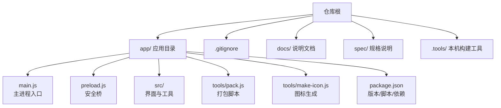
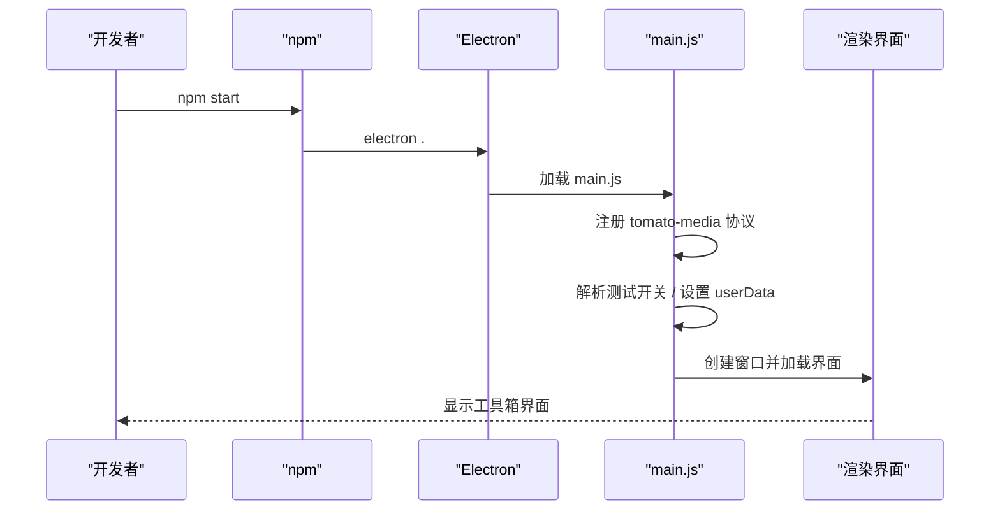
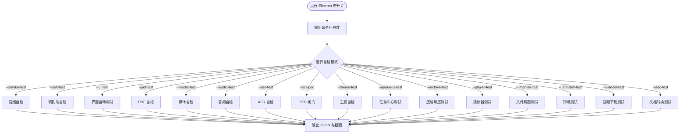
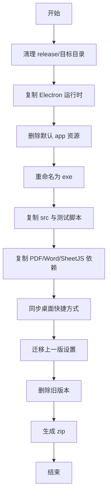
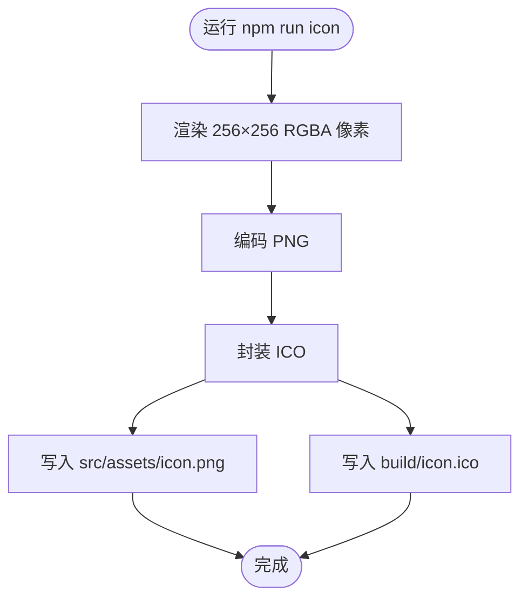
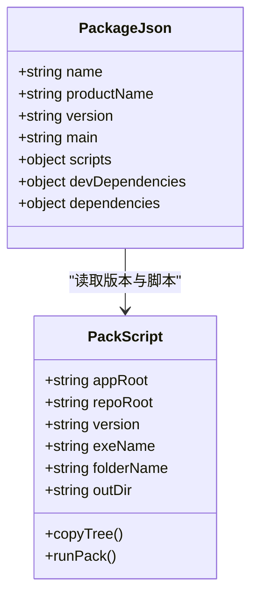
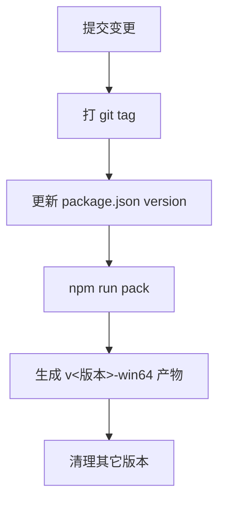

# 构建与部署

<cite>
**本文引用的文件**
- [README.md](file://README.md)
- [AGENTS.md](file://AGENTS.md)
- [app/package.json](file://app/package.json)
- [app/main.js](file://app/main.js)
- [app/preload.js](file://app/preload.js)
- [app/tools/pack.js](file://app/tools/pack.js)
- [app/tools/make-icon.js](file://app/tools/make-icon.js)
- [.gitignore](file://.gitignore)
</cite>

## 目录
1. [简介](#简介)
2. [项目结构](#项目结构)
3. [开发环境搭建](#开发环境搭建)
4. [本地调试](#本地调试)
5. [测试与自检](#测试与自检)
6. [构建流程](#构建流程)
7. [图标生成](#图标生成)
8. [打包配置与产物](#打包配置与产物)
9. [签名与安全分发](#签名与安全分发)
10. [版本管理策略](#版本管理策略)
11. [自动更新机制](#自动更新机制)
12. [部署指南](#部署指南)
13. [回滚方案](#回滚方案)
14. [故障排除](#故障排除)
15. [结论](#结论)

## 简介
本项目是「番茄图片混淆」的 Windows 桌面版，基于 Electron 实现，目标是把 Android 端的图片混淆/解混淆能力搬到桌面端，提供免安装绿色版、纯离线工具集。当前版本为 v2.13.0，包含图片、视频、音频、文档、压缩和系统类等 23 个工具，除「视频下载」外均支持纯离线运行。

本文面向维护者，聚焦构建、打包、部署、版本管理与排障：如何准备 Node 环境、安装依赖、启动调试、运行测试、生成图标、打包免安装包、理解产物结构与后续扩展点（签名、自动更新、分发渠道）。

**章节来源**
- [README.md:1-234](file://README.md#L1-L234)
- [AGENTS.md:1-98](file://AGENTS.md#L1-L98)

## 项目结构
仓库采用“应用源码 + 打包脚本 + 规格说明”的分层组织：

- `app/`：Electron 应用源码与依赖定义
  - `main.js`：主进程入口，负责窗口、协议、测试模式、日志、用户数据目录等。
  - `preload.js`：渲染进程安全桥，暴露受控 IPC 方法给界面。
  - `src/`：界面框架、工具模块、共享逻辑与资源。
  - `tools/pack.js`：免安装打包脚本。
  - `tools/make-icon.js`：程序图标生成脚本。
  - `package.json`：应用元信息、脚本、依赖。
- `.tools/`：本机构建工具（Node 便携版），不入库。
- `spec/`、`docs/`：规格与使用文档。
- `app/release/`：打包产物目录，不入库。
- `.gitignore`：忽略依赖、构建产物、用户数据与隐私目录。



**图示来源**
- [app/main.js:1-200](file://app/main.js#L1-L200)
- [app/preload.js:1-193](file://app/preload.js#L1-L193)
- [app/package.json:1-28](file://app/package.json#L1-L28)
- [app/tools/pack.js:1-200](file://app/tools/pack.js#L1-L200)
- [app/tools/make-icon.js:1-180](file://app/tools/make-icon.js#L1-L180)
- [.gitignore:1-47](file://.gitignore#L1-L47)

**章节来源**
- [AGENTS.md:3-40](file://AGENTS.md#L3-L40)
- [README.md:1-60](file://README.md#L1-L60)

## 开发环境搭建
### Node.js 版本与环境路径
- 项目要求使用 `.tools/node/node.exe`（便携版 v22.20.0），该目录不入库，需在本机准备。
- 启动前将 `.tools/node` 加入 PATH，避免污染系统 Node。

推荐在 PowerShell 中执行：
```powershell
$env:PATH = "<仓库路径>\.tools\node;" + $env:PATH
cd app
npm install --registry=https://registry.npmmirror.com
```

### 镜像与 Electron 二进制
- npm registry 使用国内镜像：`https://registry.npmmirror.com`。
- Electron 二进制通过环境变量获取：
  ```powershell
  $env:ELECTRON_MIRROR = "https://registry.npmmirror.com/-/binary/electron/"
  ```
- 依赖安装后，Electron 可执行位于 `app/node_modules/electron/dist/electron.exe`。

### 依赖范围
- 运行时依赖包括 PDF、OCR、HEIC 解码、ONNX Runtime、Word 预览等库。
- 开发依赖主要是 Electron 运行时。

**章节来源**
- [README.md:60-120](file://README.md#L60-L120)
- [AGENTS.md:40-80](file://AGENTS.md#L40-L80)
- [app/package.json:1-28](file://app/package.json#L1-L28)

## 本地调试
### 启动方式
进入 `app` 目录后执行：
```powershell
npm start
```
该脚本等价于 `electron .`，会加载 `main.js` 并打开主窗口。

### 主进程关键行为
- 注册自定义媒体协议 `tomato-media`，供视频播放器按 Range 分块流式播放。
- 解析命令行开关以启用各类自检与界面测试模式。
- 设置绿色版用户数据目录到软件目录内 `userdata/`，保证配置随文件夹移动。
- 捕获未处理异常与 Promise 拒绝，写入 `userdata/logs/main.log`。



**图示来源**
- [app/main.js:1-200](file://app/main.js#L1-L200)
- [app/package.json:1-28](file://app/package.json#L1-L28)

**章节来源**
- [README.md:90-120](file://README.md#L90-L120)
- [app/main.js:1-200](file://app/main.js#L1-L200)
- [app/package.json:1-28](file://app/package.json#L1-L28)

## 测试与自检
### 纯逻辑单测
```powershell
cd app
npm test
```
该命令串联多个 Mocha 风格或自写 Node 测试，覆盖引擎、任务队列、压缩解压、文件藏图、导航排序、卸载、设置校验、唯一路径分配、视频下载、文档转换等。

### 端到端与界面测试
Electron 启动时可通过命令行开关触发不同自检：
- `--smoke-test`：冒烟自检，确认窗口能加载并统计工具数。
- `--self-test`：图片编解码与算法链路。
- `--ui-test`：图片混淆界面全流程截图与像素级校验。
- `--pdf-test` / `--pdf-ui-test`：PDF 工具与界面测试。
- `--media-test` / `--media-ui-test`：媒体工具链路与界面测试。
- `--audio-test` / `--audio-ui-test`：音频格式转码与界面测试。
- `--asr-test` / `--asr-ui-test`：语音转文字自检与界面测试。
- `--ocr-poc`：OCR 引擎闸门。
- `--theme-test`：主题三态与深浅色值验证。
- `--av-test`：视频压缩与音频剪辑。
- `--imgbatch-test`：批量重命名、加水印、拼接、切图。
- `--settingsio-test`：设置导入导出。
- `--queue-ui-test`：任务中心。
- `--archive-test` / `--archive-ui-test`：压缩解压。
- `--player-test` / `--player-ui-test`：视频播放器。
- `--imghide-test` / `--imghide-ui-test`：文件藏图。
- `--uninstall-test`：卸载自检。
- `--videodl-test` / `--videodl-ui-test`：视频下载。
- `--doc-test` / `--doc-ui-test`：文档格式转换。

结果写入 `%TEMP%\tomato-*.json`，截图在 `%TEMP%\tomato-uitest`。判定字段多为 `pass:true`、`ok:true`，部分用例有 `verified` 字段表示第三方裁判是否可用。



**图示来源**
- [app/main.js:1-200](file://app/main.js#L1-L200)
- [README.md:100-234](file://README.md#L100-L234)
- [AGENTS.md:60-98](file://AGENTS.md#L60-L98)

**章节来源**
- [README.md:100-234](file://README.md#L100-L234)
- [AGENTS.md:60-98](file://AGENTS.md#L60-L98)
- [app/main.js:1-200](file://app/main.js#L1-L200)

## 构建流程
本项目没有 Webpack/Vite 等前端打包器，而是通过 `pack.js` 直接复制 Electron 运行时与应用源码，形成免安装绿色版。

### 构建阶段总览
1. 清理目标输出目录。
2. 用 `robocopy` 复制 `node_modules/electron/dist` 到产物目录。
3. 删除默认示例应用资源。
4. 将 `electron.exe` 改名为 `番茄图片混淆桌面版.exe`。
5. 复制应用源码与必要测试脚本。
6. 复制 PDF、Word 预览、SheetJS 等依赖。
7. 同步桌面快捷方式、迁移上一版设置、删除旧版本。
8. 压缩生成同名 zip。



**图示来源**
- [app/tools/pack.js:1-200](file://app/tools/pack.js#L1-L200)

**章节来源**
- [AGENTS.md:80-98](file://AGENTS.md#L80-L98)
- [app/tools/pack.js:1-200](file://app/tools/pack.js#L1-L200)

## 图标生成
### 作用
图标生成脚本用于产出：
- `app/src/assets/icon.png`：窗口图标，256×256。
- `app/build/icon.ico`：ICO 容器，供打包进可执行文件时使用。

### 生成方式
```powershell
cd app
npm run icon
```

### 实现要点
- 纯 Node 实现，无第三方依赖。
- 使用 4× 超采样平滑边缘。
- 绘制圆角底、番茄果体、高光与叶子。
- 手动编码 PNG 与 ICO 头，避免引入图形库。



**图示来源**
- [app/tools/make-icon.js:1-180](file://app/tools/make-icon.js#L1-L180)
- [AGENTS.md:80-98](file://AGENTS.md#L80-L98)

**章节来源**
- [app/tools/make-icon.js:1-180](file://app/tools/make-icon.js#L1-L180)
- [AGENTS.md:80-98](file://AGENTS.md#L80-L98)

## 打包配置与产物
### 执行命令
```powershell
cd app
npm run pack
```

### 产物结构
- 免安装文件夹：`app/release/番茄图片混淆-桌面版-v<版本>-win64/`
- 压缩包：同名 `.zip`

### 关键配置项
- 应用名称与版本号来自 `app/package.json`。
- 主入口为 `main.js`。
- 产物 exe 名称固定为 `番茄图片混淆桌面版.exe`。
- 产物目录结构遵循绿色版约定：Electron 运行时 + `resources/app` 应用源码。

### 打包细节
- 使用 `robocopy` 复制 Electron 运行时，提升中文路径稳定性。
- 删除 `default_app.asar` 与内置 `resources/app`。
- 复制 `src/`、`tests/` 中的若干自检脚本。
- 复制 PDF、Word 预览、SheetJS 等依赖，保持相对路径结构。
- 新增测试文件必须同步加入 `pack.js` 白名单，否则产物上无法运行对应测试。



**图示来源**
- [app/package.json:1-28](file://app/package.json#L1-L28)
- [app/tools/pack.js:1-200](file://app/tools/pack.js#L1-L200)

**章节来源**
- [app/package.json:1-28](file://app/package.json#L1-L28)
- [app/tools/pack.js:1-200](file://app/tools/pack.js#L1-L200)
- [AGENTS.md:80-98](file://AGENTS.md#L80-L98)

## 签名与安全分发
当前仓库未包含代码签名证书、签名脚本或签名配置；现有构建流程也不执行签名步骤。若需要数字签名，应额外引入：
- 代码签名证书（`.pfx` 或企业证书）。
- 签名工具链（如 `signtool`）。
- CI 中注入密钥的安全变量。
- 在打包完成后对 `番茄图片混淆桌面版.exe` 进行签名与时间戳校验。

由于仓库未提供相关实现，本节为扩展建议，不构成现有构建流程的一部分。

[本节不分析具体源文件]

## 版本管理策略
### 语义化版本
项目采用语义化版本 `x.y.z`：
- 修 bug：补丁版本 `z+1`。
- 添加功能：次版本 `y+1`。
- 重要改动：主版本 `x+1`。
- 达到可交付状态时更新版本号并打 git tag。

### 版本位置
版本号定义在 `app/package.json` 的 `version` 字段。打包脚本读取该字段生成产物目录名与压缩包名。

### 历史回溯
旧版本构建产物不保留在 `release/`，历史版本通过 git tag 回溯。



**图示来源**
- [app/package.json:1-28](file://app/package.json#L1-L28)
- [app/tools/pack.js:1-200](file://app/tools/pack.js#L1-L200)
- [AGENTS.md:80-98](file://AGENTS.md#L80-L98)

**章节来源**
- [app/package.json:1-28](file://app/package.json#L1-L28)
- [AGENTS.md:80-98](file://AGENTS.md#L80-L98)

## 自动更新机制
当前仓库未提供通用安装包、在线更新服务或自动更新客户端逻辑。现有仅涉及：
- 「视频下载」工具的引擎自更新：检查上游引擎指纹并尝试更新，校验失败则拒绝。
- 其他工具均为离线运行。

因此，对于整体应用的自动更新，需要另行设计：
- 更新服务器：提供最新版本清单、增量包或完整包。
- 客户端更新器：比较版本、校验哈希、下载并替换 `resources/app`。
- 权限与回滚：管理员权限、更新失败回滚、灰度发布。

本节为概念性扩展说明，不涉及仓库现有实现。

[本节不分析具体源文件]

## 部署指南
### 免安装部署
用户可直接复制 `app/release/番茄图片混淆-桌面版-v<版本>-win64/` 到任意目录运行，双击 `番茄图片混淆桌面版.exe`。

### 桌面快捷方式
打包脚本会在删旧版之前同步桌面快捷方式：
- 快捷方式目标指向当前版本 exe。
- 起始位置指向当前版本目录。
- 图标位置指向当前版本图标。

若同步失败，会出现警告，需手工补全快捷方式，否则可能出现双击打不开或图标变白。

### 用户升级流程
当前无自动更新，升级流程为：
1. 获取新版本免安装文件夹。
2. 备份旧版本 `userdata/settings.json`。
3. 替换整个免安装目录。
4. 重启应用。

打包脚本会在同一版本重复打包时跳过设置迁移，不同版本之间不会自动迁移设置，因此升级时需关注用户设置保留问题。

**章节来源**
- [AGENTS.md:80-98](file://AGENTS.md#L80-L98)
- [app/tools/pack.js:1-200](file://app/tools/pack.js#L1-L200)

## 回滚方案
### 代码回滚
使用 git 标签与提交历史回滚到指定版本：
```powershell
git checkout <tag>
git clean -fd
cd app
npm install
npm test
npm run pack
```

### 产品回滚
- 保留最近两个版本的免安装文件夹。
- 若新版本出现问题，直接切换回旧版本目录。
- 注意 `userdata/settings.json` 可能因版本差异产生兼容性问题，必要时恢复备份。

**章节来源**
- [AGENTS.md:80-98](file://AGENTS.md#L80-L98)

## 故障排除
### 构建失败
常见原因：
- 未安装 Electron 运行时：提示缺少 `node_modules/electron/dist`。
- `robocopy` 不可用或退出码大于等于 8。
- 输出目录被占用：已有正在运行的应用或残留文件夹。

解决方式：
- 确保已在 `app` 目录执行 `npm install`。
- 关闭正在运行的应用后重试。
- 手动删除 `app/release/番茄图片混淆-桌面版-v<版本>-win64` 后重新打包。

**章节来源**
- [app/tools/pack.js:1-200](file://app/tools/pack.js#L1-L200)

### 依赖冲突
常见问题：
- Node 版本不一致导致原生模块编译失败。
- Electron 二进制下载失败。
- pdfjs-dist、pdf-lib、@cantoo/pdf-lib、fontkit 等依赖路径缺失。

解决方式：
- 使用 `.tools/node/node.exe`（v22.20.0）。
- 设置 `ELECTRON_MIRROR` 并使用国内 npm registry。
- 清理 `node_modules` 后重装依赖。
- 确认 `pack.js` 复制的依赖路径存在。

**章节来源**
- [README.md:60-120](file://README.md#L60-L120)
- [AGENTS.md:40-80](file://AGENTS.md#L40-L80)
- [app/tools/pack.js:1-200](file://app/tools/pack.js#L1-L200)

### 部署异常
常见问题：
- 桌面快捷方式未同步，双击无响应或图标变白。
- 设置文件损坏或版本不兼容。
- 测试模式误改用户设置。

解决方式：
- 重新执行 `npm run pack` 让脚本同步快捷方式。
- 恢复 `userdata/settings.json` 备份。
- 测试模式下，主进程会记录设置快照并在退出时还原，避免污染用户数据。

**章节来源**
- [AGENTS.md:80-98](file://AGENTS.md#L80-L98)
- [app/main.js:1-200](file://app/main.js#L1-L200)

### 内存与性能问题
- 大视频播放走 `tomato-media` 协议，按 Range 分块，不一次性加载整个文件。
- 界面测试关闭硬件加速以保证截图稳定。
- 产物瘦身已移除多语言字典、翻译、DirectML、sourcemap 等不必要内容。

**章节来源**
- [app/main.js:1-200](file://app/main.js#L1-L200)
- [README.md:1-60](file://README.md#L1-L60)

## 结论
本项目采用轻量构建策略：以 Electron 为基础，通过 `pack.js` 直接组装运行时与应用源码，配合丰富的命令行自检与界面测试保障交付质量。开发环境强调使用便携 Node、国内镜像与绿色版用户数据布局；版本管理采用语义化版本与 git tag；部署以免安装文件夹为主，快捷方式由打包脚本同步。

若未来需要企业级分发，可扩展签名、增量更新、灰度发布与在线更新服务；但在当前仓库范围内，这些能力尚未实现，应作为独立扩展模块规划。

[本节不分析具体源文件]