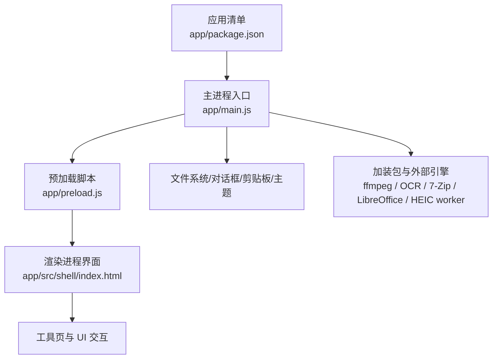
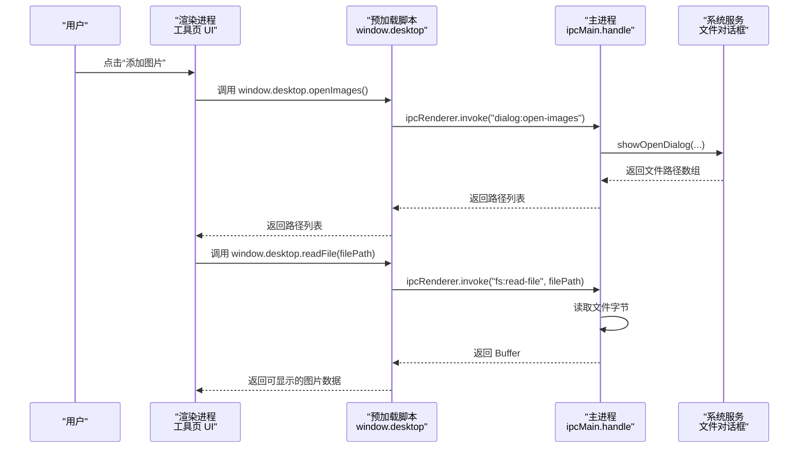
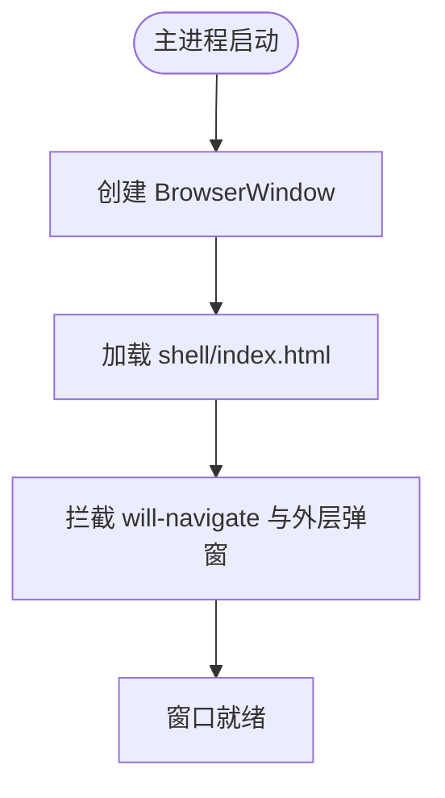
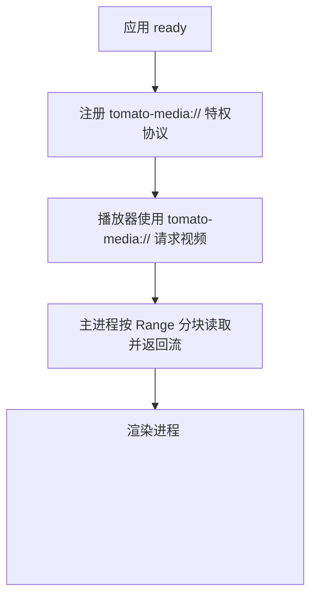
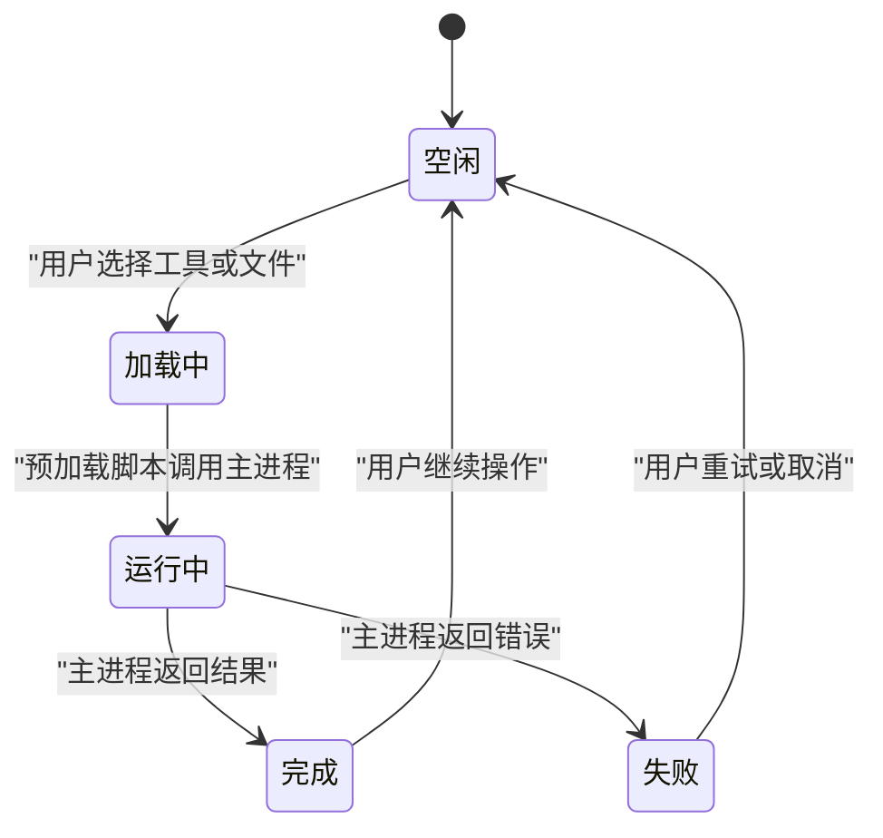
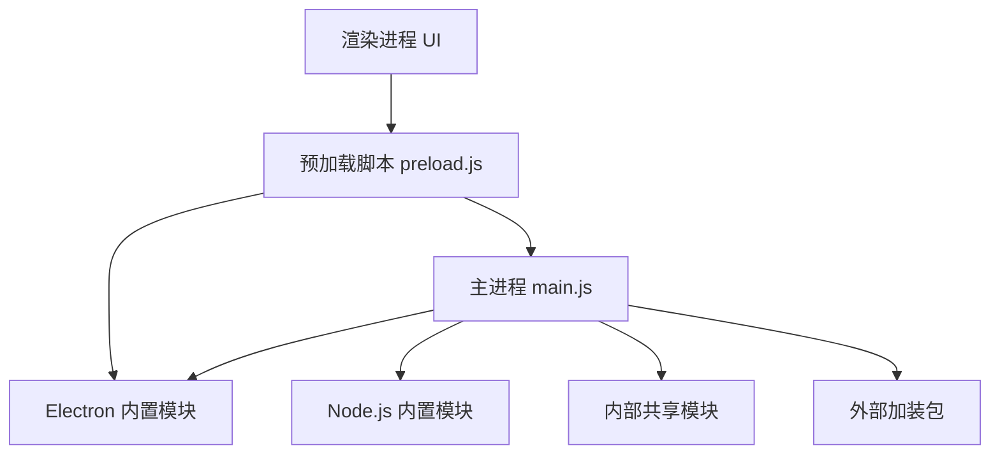

# Electron 双进程模型

<cite>
**本文引用的文件**   
- [main.js](file://app/main.js)
- [preload.js](file://app/preload.js)
- [package.json](file://app/package.json)
- [README.md](file://README.md)
</cite>

## 目录
1. [引言](#引言)
2. [项目结构](#项目结构)
3. [核心组件](#核心组件)
4. [架构总览](#架构总览)
5. [详细组件分析](#详细组件分析)
6. [依赖关系分析](#依赖关系分析)
7. [性能与安全考量](#性能与安全考量)
8. [故障排查指南](#故障排查指南)
9. [结论](#结论)

## 引言
本文面向「番茄图片混淆 桌面版」的 Electron 双进程架构，解释主进程与渲染进程的职责边界、预加载脚本的安全桥作用、自定义媒体协议的设计动机，以及从用户操作到系统能力调用的完整数据流。文档同时对比其他 Electron 架构模式，帮助读者理解当前设计的选择与取舍。

## 项目结构
本应用采用典型的 Electron 双进程布局：

- **主进程入口**：`app/main.js`，负责窗口生命周期、IPC 路由、文件系统、对话框、主题、日志、测试模式和各类加装包调度。
- **预加载脚本**：`app/preload.js`，通过 `contextBridge.exposeInMainWorld('desktop', ...)` 暴露白名单 API，供渲染进程调用。
- **渲染界面**：由 `app/src/shell/index.html` 启动，加载工具页、导航栏和任务中心；所有需要 Node/Electron 能力的调用都走 `window.desktop`。
- **配置与打包**：`app/package.json` 声明 `main: "main.js"`、产品名称、版本、Electron 版本及运行时依赖。



**图表来源**
- [package.json:1-28](file://app/package.json#L1-L28)
- [main.js:1-20](file://app/main.js#L1-L20)
- [preload.js:1-20](file://app/preload.js#L1-L20)

**章节来源**
- [package.json:1-28](file://app/package.json#L1-L28)
- [README.md:1-40](file://README.md#L1-L40)

## 核心组件
本节按职责划分主进程、预加载脚本和渲染进程的关键能力。

### 主进程（main.js）
主进程是系统级能力的唯一入口，承担以下职责：

| 职责 | 说明 |
|---|---|
| 创建窗口 | 构造 `BrowserWindow`，设置尺寸、最小尺寸、背景色、标题、图标、菜单栏隐藏策略，并启用安全选项：预加载、上下文隔离、禁用 Node 集成、启用沙箱。 |
| 加载界面 | 加载本地 `src/shell/index.html`，并限制导航和外层弹窗，只允许应用内资源。 |
| 注册媒体协议 | 在 `app ready` 前注册特权协议 `tomato-media://`，开启标准协议、安全模式、Fetch API 支持和流式读取，使播放器能边读边播大视频。 |
| 文件对话框 | 集中维护「打开文件对话框规格表」，为每个工具提供专用通道，测试模式下返回夹具路径，避免真实用户目录被污染。 |
| 文件系统访问 | 暴露读取、写入、删除、列出图片和指定扩展名文件、保存产物等 IPC 通道，保证输出文件名不覆盖已有文件。 |
| 设置管理 | 读写 `userdata/settings.json`，实现原子写、导入导出，导入时仅合并已知键并通过共享 schema 校验值类型。 |
| 原生主题与剪贴板 | 根据设置或系统偏好决定窗口初始背景色；通过剪贴板读写 PNG 图像。 |
| 测试模式与日志 | 解析大量 `--xxx-test` 参数，自动禁用硬件加速、还原测试设置、记录 `logs/main.log`，并在未捕获异常或拒绝时落盘。 |
| 工具与加装包调度 | 作为 ffmpeg、OCR、7-Zip、LibreOffice、HEIC worker、Real-ESRGAN、FunASR、yt-dlp 等能力的统一调度者，向渲染进程暴露稳定 IPC 接口。 |

关键实现要点：

- **安全窗口初始化**：窗口使用 `contextIsolation: true`、`nodeIntegration: false`、`sandbox: true`，并挂载 `preload.js`，渲染进程不能直接访问 Node 模块。
- **纵深防御**：拦截 `will-navigate`，阻止非 `file://` 跳转；外层弹窗一律拒绝，防止注入代码打开外链。
- **测试模式收敛**：通过 `testMode()` 汇总所有测试标志，对话框、设置落盘、卸载提权等行为在测试下切换为桩实现。
- **日志兜底**：全局捕获未捕获异常和未处理 Promise 拒绝，写入 `userData/logs/main.log`，即使控制台不可用也不抛错。

**章节来源**
- [main.js:1-20](file://app/main.js#L1-L20)
- [main.js:650-740](file://app/main.js#L650-L740)
- [main.js:740-820](file://app/main.js#L740-L820)
- [main.js:820-1027](file://app/main.js#L820-L1027)
- [main.js:1200-1483](file://app/main.js#L1200-L1483)

### 预加载脚本（preload.js）
预加载脚本是唯一连接渲染进程与主进程的桥梁。它只做三件事：

1. 引入 `contextBridge`、`ipcRenderer`、`webUtils`。
2. 把有限方法挂到全局 `window.desktop`。
3. 每个方法内部调用一个明确的 IPC 通道，例如 `ipcRenderer.invoke('dialog:open-images')`。

这形成了 **IPC 白名单机制**：

- 渲染进程只能调用 `window.desktop` 上已暴露的方法。
- 主进程只响应 `ipcMain.handle` 中显式注册的通道。
- 不存在通用 RPC，无法随意调用任意主进程函数。
- 进度类回调通过 `ipcRenderer.on(...)` 订阅，并返回取消订阅函数，要求工具在卸载时清理监听器。

白名单大致分为以下几类：

| 类别 | 示例方法 | 主要用途 |
|---|---|---|
| 应用信息 | `versions`、`appInfo` | 显示 Electron/Chrome/Node 版本和应用名称、版本号。 |
| 文件对话框 | `openImages`、`openFolder`、`saveFile`、`openVideos`、`openAudios` 及各工具专用对话框 | 选择输入文件或保存产物。 |
| 基础文件操作 | `readFile`、`writeFile`、`removeFile`、`pathInfo`、`listImages`、`listFiles` | 在沙箱渲染进程中读写文件。 |
| 工具专属能力 | `hidePack`、`playerCacheDir`、`archiveCreate`、`ocrRecognize`、`ffmpegConvert`、`heicDecode`、`aiUpscale`、`asrTranscribe`、`hibitLaunch`、`videodlStart`、`libreofficeConvert` | 调用主进程中的加装包、外部命令或 Worker。 |
| 设置 | `settingsRead`、`settingsWrite`、`settingsExport`、`settingsImport` | 读取、合并、导出、导入用户配置。 |
| 剪贴板 | `readClipboardImage`、`writeClipboardImage` | 在主进程侧读取/写入 PNG 图像。 |
| 路径辅助 | `getPathForFile` | 在新版 Electron 中获取拖拽文件的真实路径。 |

**章节来源**
- [preload.js:1-193](file://app/preload.js#L1-L193)

### 渲染进程（UI 层）
渲染进程负责：

- 加载 `shell/index.html`，渲染左侧工具导航、右侧工具页面和顶部任务中心。
- 响应用户点击、拖拽、粘贴、键盘快捷键等操作。
- 通过 `window.desktop` 调用 IPC 白名单，完成文件选择、文件读写、转码、压缩解压、OCR、播放、设置等操作。
- 展示工具状态、进度、错误提示，并管理工具页的生命周期。

由于渲染进程处于沙箱且禁用 Node 集成，它不能直接调用 `fs`、`dialog`、`clipboard`、`nativeTheme` 等 Electron 模块，必须经过预加载脚本转发。

**章节来源**
- [main.js:650-740](file://app/main.js#L650-L740)
- [README.md:1-40](file://README.md#L1-L40)

## 架构总览
下图展示一次典型操作：用户在渲染进程中选择图片，最终由主进程打开系统文件对话框。



**图表来源**
- [preload.js:10-40](file://app/preload.js#L10-L40)
- [main.js:740-820](file://app/main.js#L740-L820)
- [main.js:1200-1280](file://app/main.js#L1200-L1280)

## 详细组件分析

### 主进程职责分解

#### 窗口创建与加载
主进程创建一个固定尺寸的 BrowserWindow，并根据设置或系统深色模式计算窗口背景色，避免首次闪烁。窗口加载本地 HTML，并强制只允许本地资源。



**图表来源**
- [main.js:650-740](file://app/main.js#L650-L740)

**章节来源**
- [main.js:650-740](file://app/main.js#L650-L740)

#### 自定义媒体协议 tomato-media://
主进程在应用可用之前注册 `tomato-media` 协议，并赋予 `standard`、`secure`、`supportFetchAPI`、`stream` 权限。这样 `<video>` 可以流式请求 Range 分块，适合大视频边读边播，而不是一次性加载整个文件。



**图表来源**
- [main.js:1-20](file://app/main.js#L1-L20)

**章节来源**
- [main.js:1-20](file://app/main.js#L1-L20)

#### 系统级操作：文件对话框、剪贴板、原生主题
- **文件对话框**：通过统一规格表注册多个 `dialog:*` 通道，测试模式下返回夹具路径，正常模式下调用系统对话框。
- **剪贴板**：渲染进程通过 `clipboard:read-image`、`clipboard:write-image` 在主进程侧读取或写入 PNG。
- **原生主题**：主进程根据设置判断浅色或深色，并据此设置窗口背景色；同时提供设置读写接口，让界面更新主题变量。

**章节来源**
- [main.js:820-1027](file://app/main.js#L820-L1027)
- [main.js:1200-1483](file://app/main.js#L1200-L1483)

#### 测试模式与日志
主进程解析大量命令行开关，包括冒烟自检、端到端自检、界面自动测试、工具自检、主题自检等。测试模式下：

- 禁用硬件加速，确保截图稳定。
- 将设置快照保存到内存，退出时还原或删除测试修改过的 `settings.json`。
- 将未捕获异常和未处理 Promise 拒绝写入 `logs/main.log`。
- 对话框和提权行为替换为桩实现，避免卡住自动化流程。

**章节来源**
- [main.js:20-200](file://app/main.js#L20-L200)
- [main.js:200-650](file://app/main.js#L200-L650)

### 预加载脚本的安全桥
预加载脚本的核心思想是：**渲染进程只认识 `window.desktop`，不认识 Electron**。

```mermaid
classDiagram
    class 渲染进程 {
        +调用 window.desktop 方法
        +展示 UI
        +管理工具页生命周期
    }

    class 预加载脚本 {
        +exposeInMainWorld("desktop", {...})
        +封装 ipcRenderer.invoke
        +封装 ipcRenderer.on
        +封装 webUtils.getPathForFile
    }

    class 主进程 {
        +ipcMain.handle
        +文件系统
        +对话框
        +剪贴板
        +主题
        +加装包调度
    }

    渲染进程 --> 预加载脚本 : "调用白名单 API"
    预加载脚本 --> 主进程 : "转发 IPC 通道"
```

**图表来源**
- [preload.js:1-193](file://app/preload.js#L1-L193)

这个设计实现了三层约束：

1. **接口白名单**：只有 `preload.js` 中暴露的方法可见。
2. **通道白名单**：只有 `main.js` 中注册的 `ipcMain.handle` 通道有效。
3. **权限分离**：Node、文件系统、原生模块、外部进程只在主进程运行。

**章节来源**
- [preload.js:1-193](file://app/preload.js#L1-L193)

### 渲染进程职责与工具页生命周期
渲染进程并不直接访问操作系统，而是通过 UI 事件触发 `window.desktop` 调用。典型生命周期如下：



**图表来源**
- [preload.js:10-193](file://app/preload.js#L10-L193)
- [main.js:740-1027](file://app/main.js#L740-L1027)

**章节来源**
- [preload.js:10-193](file://app/preload.js#L10-L193)
- [main.js:740-1027](file://app/main.js#L740-L1027)

## 依赖关系分析
主进程对外部能力和内部模块存在明确依赖：

- **Electron 内置模块**：`app`、`BrowserWindow`、`ipcMain`、`dialog`、`clipboard`、`nativeImage`、`nativeTheme`、`protocol`、`shell`。
- **Node.js 内置模块**：`path`、`fs/promises`、`fs`、`os`、`crypto`、`stream`、`string_decoder`、`child_process`、`url`、`worker_threads`。
- **内部共享模块**：图片编解码、任务队列、设置 schema、唯一目标路径等。
- **外部加装包**：ffmpeg、OCR、7-Zip、LibreOffice、HEIC worker、Real-ESRGAN、FunASR、yt-dlp。



**图表来源**
- [main.js:1-20](file://app/main.js#L1-L20)
- [preload.js:1-10](file://app/preload.js#L1-L10)

**章节来源**
- [main.js:1-20](file://app/main.js#L1-L20)
- [preload.js:1-10](file://app/preload.js#L1-L10)

## 性能与安全考量

### 为什么选择这种双进程架构
当前架构与常见 Electron 模式相比有如下特点：

| 架构模式 | 特点 | 本项目的取舍 |
|---|---|---|
| 单进程直连 Node | 渲染进程可直接访问 Node 和 Electron，开发简单但安全风险高。 | 本项目禁用 Node 集成并启用沙箱，降低渲染进程攻击面。 |
| 主进程 + 渲染进程 + 预加载桥 | 通过白名单 IPC 暴露能力，安全可控。 | 本项目采用此模式，所有系统能力集中在主进程。 |
| 多渲染进程隔离 | 每个工具独立渲染进程，崩溃隔离更好。 | 当前以单渲染进程为主，通过保活页 LRU 回收和任务队列提升稳定性；未来可按工具复杂度拆分。 |
| 主进程 + 子进程/Worker | 重型计算移出事件循环。 | 本项目对 HEIC 解码使用 Worker，对 ffmpeg/7-Zip/LibreOffice 使用子进程，避免阻塞 UI。 |

### 安全设计
- 渲染进程无 Node 集成、无全局 Electron 对象。
- 所有系统能力通过预加载脚本白名单暴露。
- 导航和外层弹窗被严格限制。
- 设置导入只合并已知键，并通过 schema 校验值类型。
- 文件输出遵循“绝不覆盖已有文件”约定，由主进程做最终裁决。

### 性能设计
- 大视频播放使用 `tomato-media://` 流式读取，避免一次性加载。
- HEIC 解码放在 Worker 线程，避免阻塞主进程事件循环。
- ffmpeg、7-Zip、LibreOffice 等重型操作通过子进程执行，主进程只拼装参数、转发进度和清理临时文件。
- 测试模式禁用硬件加速，提高截图和像素级测试的可重复性。

**章节来源**
- [main.js:1-20](file://app/main.js#L1-L20)
- [main.js:1700-2025](file://app/main.js#L1700-L2025)

## 故障排查指南
当出现界面卡顿、文件操作失败、工具无法启动或测试卡住时，可从以下方向排查：

| 现象 | 可能原因 | 排查建议 |
|---|---|---|
| 界面启动后闪白或颜色异常 | 窗口背景色未正确匹配主题 | 检查设置文件中 theme 字段，或确认首次读取失败时回退到系统深色模式。 |
| 打开文件对话框卡住 | 测试模式下夹具路径缺失 | 检查测试目录是否包含对应前缀的夹具文件。 |
| 文件写入失败或产物丢失 | 跨盘复制失败、磁盘空间不足 | 查看主进程日志 `logs/main.log`，确认是否触发复制+删源降级逻辑。 |
| 设置损坏或重置 | JSON 写入中途被中断 | 确认应用使用原子写：先写临时文件再 rename。 |
| OCR 或 ffmpeg 不可用 | 加装包未放置到 `addons/...` | 根据主进程返回的错误信息检查加装包目录和可执行文件。 |
| 视频播放器无法播放大视频 | 自定义媒体协议未生效或 Range 请求失败 | 检查 `tomato-media://` 是否在 `app ready` 前注册。 |
| 测试用例卡住 | 自动测试模式仍弹出系统对话框或 UAC | 确认使用了正确的 `--xxx-ui-test` 参数，并避免真实用户目录干扰。 |

**章节来源**
- [main.js:20-200](file://app/main.js#L20-L200)
- [main.js:200-650](file://app/main.js#L200-L650)
- [main.js:820-1027](file://app/main.js#L820-L1027)
- [main.js:1200-1483](file://app/main.js#L1200-L1483)

## 结论
番茄图片混淆桌面版的 Electron 架构以主进程为中心，把系统能力、文件系统、对话框、主题、日志和外部加装包全部收敛到受控入口；预加载脚本通过 `window.desktop` 建立最小化 IPC 白名单；渲染进程专注 UI 和用户交互。这种设计在安全性、可测试性和可扩展性之间取得平衡：新增工具只需增加预加载方法和主进程通道，而不必放宽渲染进程权限。对于未来更大规模的功能，可在保持这一边界的前提下，逐步将更重的工具拆分为独立渲染进程或更多 Worker。