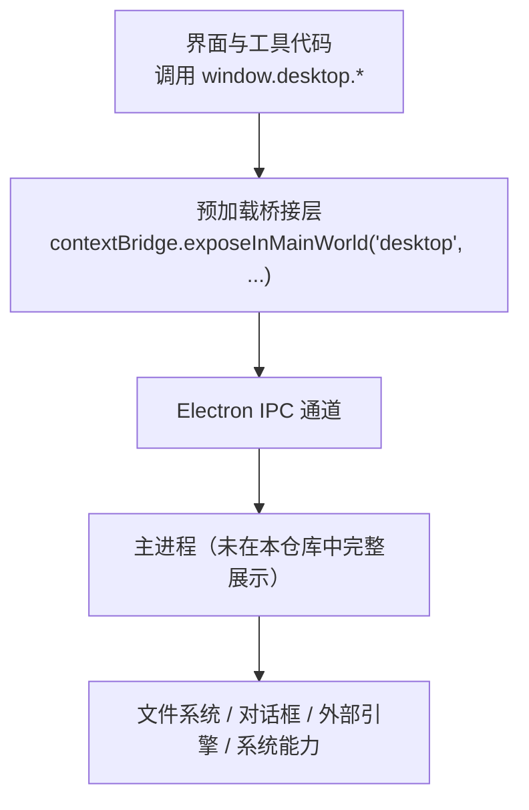
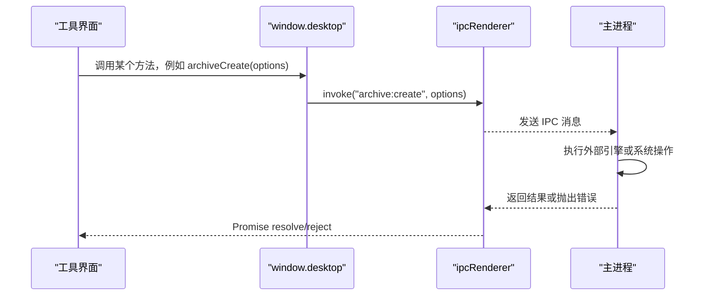
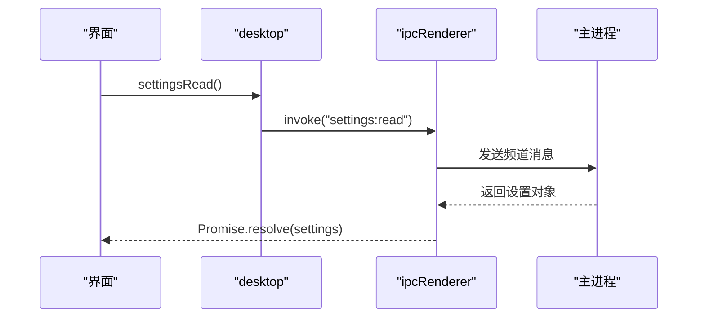
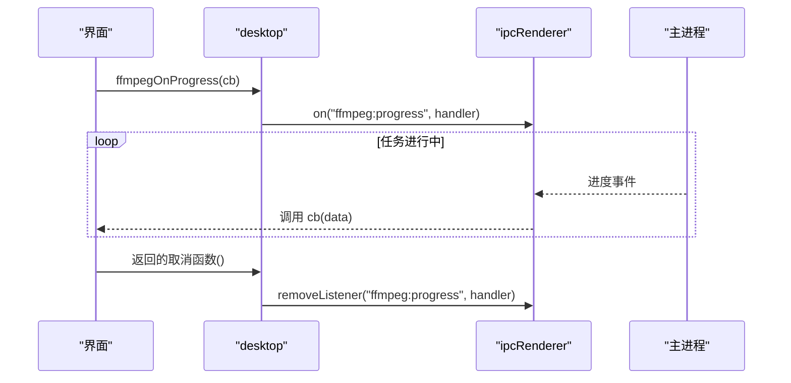
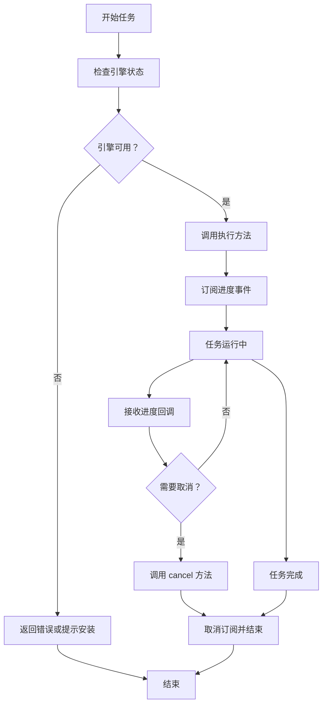
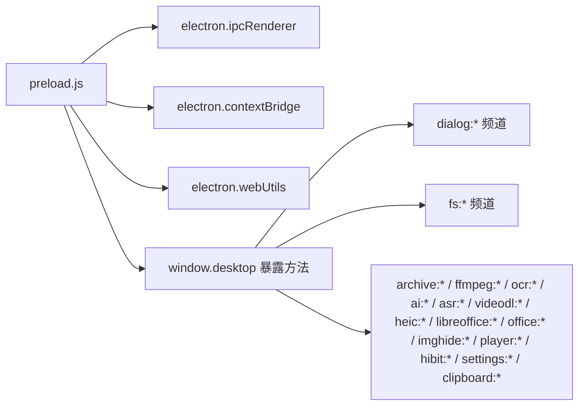

# IPC 通信机制

<cite>
**本文引用的文件**   
- [app/preload.js](file://app/preload.js)
</cite>

## 目录
1. [引言](#引言)
2. [项目结构中的 IPC 定位](#项目结构中的-ipc-定位)
3. [核心组件：安全桥接层](#核心组件安全桥接层)
4. [架构总览](#架构总览)
5. [IPC API 分类体系](#ipc-api-分类体系)
6. [请求-响应模式与事件订阅模式](#请求-响应模式与事件订阅模式)
7. [异步任务处理统一模式](#异步任务处理统一模式)
8. [数据传输格式与大对象优化](#数据传输格式与大对象优化)
9. [依赖关系分析](#依赖关系分析)
10. [最佳实践](#最佳实践)
11. [常见使用场景](#常见使用场景)
12. [故障排查](#故障排查)
13. [结论](#结论)

## 引言
本文件面向“番茄混淆桌面版”的开发者，系统性说明 Electron 渲染进程与主进程之间的 IPC 通信机制。文档基于仓库中实际暴露的 `desktop` 接口进行归纳，重点覆盖：
- 两种 IPC 模式：请求-响应、事件订阅
- API 分类：文件操作、对话框、工具专用、外部引擎、设置管理、剪贴板等
- 异步任务处理：进度回调、取消机制、错误处理
- 数据格式：JSON、二进制、大文件路径传输
- 命名约定与性能建议

## 项目结构中的 IPC 定位
当前仓库中，渲染进程侧通过预加载脚本暴露一个名为 `desktop` 的全局对象，所有 IPC 调用都围绕该对象展开。主进程负责监听对应频道并执行业务逻辑；界面代码不直接访问 Node/Electron 能力，而是走白名单通道。

**图示来源**
- [app/preload.js:1-193](file://app/preload.js#L1-L193)

**章节来源**
- [app/preload.js:1-10](file://app/preload.js#L1-L10)

## 核心组件：安全桥接层
预加载脚本是 IPC 的唯一入口。它把原生能力封装成稳定的 `desktop` 方法，并采用两类实现方式：

| 类别 | 典型方法 | 行为 |
|---|---|---|
| 请求-响应 | `appInfo`、`readFile`、`settingsRead`、`ocrRecognize` | 调用 `ipcRenderer.invoke(channel, payload)`，返回 Promise |
| 事件订阅 | `hideOnProgress`、`archiveOnProgress`、`ffmpegOnProgress`、`aiOnProgress`、`asrOnProgress`、`videodlOnChanged` | 调用 `ipcRenderer.on(channel, handler)`，返回取消函数 |

关键设计点：
- 所有外部能力通过 `contextBridge.exposeInMainWorld('desktop', {...})` 暴露，避免直接访问 `electron`。
- 事件订阅方法返回“取消订阅函数”，要求工具在卸载时调用，防止内存泄漏。
- 部分底层能力如 `getPathForFile` 使用 try/catch 包裹，保证沙箱环境下的健壮性。

**章节来源**
- [app/preload.js:1-193](file://app/preload.js#L1-L193)

## 架构总览
从 IPC 视角看，整个系统可划分为三层：

| 层级 | 职责 | 代表能力 |
|---|---|---|
| 界面/工具层 | 用户交互、业务编排 | 图片压缩、视频转码、OCR、归档等工具 |
| IPC 桥接层 | 白名单暴露、频道命名、事件注册 | `window.desktop` |
| 主进程能力层 | 文件、对话框、外部引擎、系统调用 | 文件读写、7zip、ffmpeg、LibreOffice、ASR、HEIC、AI 放大等 |

**图示来源**
- [app/preload.js:1-193](file://app/preload.js#L1-L193)

## IPC API 分类体系
根据 `desktop` 暴露的方法，可将 IPC API 分为以下类别。

### 应用信息
用于显示 Electron、Chrome、Node 版本及应用基础信息。

| 方法 | 通道 | 用途 |
|---|---|---|
| `versions` | 属性 | 返回 Electron/Chrome/Node 版本 |
| `appInfo` | `app:info` | 获取应用信息 |

**章节来源**
- [app/preload.js:1-193](file://app/preload.js#L1-L193)

### 对话框 API
负责打开系统文件选择对话框。按用途进一步细分：

| 类别 | 方法 | 典型通道 |
|---|---|---|
| 通用图像 | `openImages` | `dialog:open-images` |
| 文件夹 | `openFolder` | `dialog:open-folder` |
| 保存文件 | `saveFile(options)` | `dialog:save-file` |
| 任意图片 | `openImageAny` | `dialog:open-image-any` |
| 视频 | `openVideos` | `dialog:open-videos` |
| 媒体 | `openMedia` | `dialog:open-media` |
| 音频 | `openAudios` | `dialog:open-audios` |
| 批量重命名 | `openBatchRename` | `dialog:open-batch-rename` |
| 水印 | `openWatermark`、`openWatermarkStamp` | `dialog:open-watermark`、`dialog:open-watermark-stamp` |
| 拼接 | `openStitch` | `dialog:open-stitch` |
| 网格切片 | `openGridSlice` | `dialog:open-grid-slice` |
| PDF 编辑 | `openPdfEdit` | `dialog:open-pdf-edit` |
| OCR | `openOcr` | `dialog:open-ocr` |
| 归档文件 | `openArchiveFiles`、`openArchives` | `dialog:open-archive-files`、`dialog:open-archives` |
| 播放器视频 | `openPlayerVideos` | `dialog:open-player-videos` |
| 藏图相关 | `openHideCover`、`openHideImage`、`openHideFiles` | `dialog:open-hide-*` |
| PDF/文档 | `openPdfs`、`openDocuments`、`openDocConvert` | `dialog:open-pdfs`、`dialog:open-documents`、`dialog:open-doc-convert` |

**章节来源**
- [app/preload.js:1-193](file://app/preload.js#L1-L193)

### 文件操作 API
文件读写和路径信息查询由主进程完成，避免界面进程直接访问文件系统。

| 方法 | 通道 | 说明 |
|---|---|---|
| `readFile(filePath)` | `fs:read-file` | 读取文件 |
| `writeFile(filePath, bytes)` | `fs:write-file` | 写入文件字节 |
| `removeFile(filePath)` | `fs:remove-file` | 删除文件 |
| `pathInfo(filePath)` | `fs:path-info` | 查询路径信息 |
| `listImages(dirPath)` | `fs:list-images` | 列出图片 |
| `listFiles(dirPath, exts)` | `fs:list-files` | 按扩展名列出文件 |
| `saveImageNextTo(options)` | `fs:save-image` | 在指定位置附近保存图片 |
| `renameBatch(renames)` | `fs:rename-batch` | 两阶段批量改名，避免覆盖 |

**章节来源**
- [app/preload.js:1-193](file://app/preload.js#L1-L193)

### 工具专用 API
不同工具通过独立前缀暴露功能，便于隔离状态、日志和错误。

| 工具 | 方法 | 通道 |
|---|---|---|
| 文件藏图 | `hidePack`、`hideUnpack`、`hideReveal` | `imghide:*` |
| 文件藏图进度 | `hideOnProgress(callback)` | `imghide:progress` |
| 视频播放器缓存 | `playerCacheDir`、`playerCleanCache`、`playerPrepare(options)` | `player:*` |
| 归档压缩解压 | `archiveStatus`、`archiveList`、`archiveCreate`、`archiveExtract`、`archiveCancel` | `archive:*` |
| 归档进度 | `archiveOnProgress(callback)` | `archive:progress` |
| LibreOffice 转换 | `libreofficeStatus`、`libreofficeConvert`、`officeToPdf` | `libreoffice:*`、`office:*` |
| PDF 与文档对话框 | `openPdfs`、`openDocuments`、`openDocConvert` | `dialog:open-*` |

**章节来源**
- [app/preload.js:1-193](file://app/preload.js#L1-L193)

### 外部引擎 API
外部引擎通常具备“状态检查 + 任务执行 + 进度订阅 + 取消”的统一结构。

| 引擎 | 状态检查 | 执行方法 | 进度订阅 | 取消 |
|---|---|---|---|---|
| OCR | `ocrStatus` | `ocrRecognize(options)` | `ocrOnProgress` | `ocrCancel(jobId)` |
| ffmpeg | `ffmpegStatus` | `ffmpegConvert`、`ffmpegTransform`、`ffmpegTransformFile`、`ffmpegConvertTwoPass`、`ffmpegConvertMulti` | `ffmpegOnProgress` | `ffmpegCancel(jobId)` |
| HEIC/HEIF | `heicStatus` | `heicDecode(bytes)` | 无 | 无 |
| AI 放大 | `aiStatus` | `aiUpscale(options)` | `aiOnProgress` | 无 |
| 语音识别 | `asrStatus` | `asrTranscribe(options)`、`asrSave(options)` | `asrOnProgress` | `asrCancel(jobId)` |
| 视频下载 | `videodlStatus`、`videodlEngineCheck`、`videodlEngineUpdate` | `videodlStart(options)`、`videodlRetry(id)` | `videodlOnChanged`、`videodlOnEngineProgress` | `videodlCancel(id)` |
| 软件卸载 | `hibitStatus` | `hibitLaunch()` | 无 | 无 |

**章节来源**
- [app/preload.js:1-193](file://app/preload.js#L1-L193)

### 设置管理 API
设置以 JSON 形式序列化，支持读取、写入、导出、导入。

| 方法 | 通道 | 说明 |
|---|---|---|
| `settingsRead()` | `settings:read` | 读取设置 |
| `settingsWrite(patch)` | `settings:write` | 增量写入设置 |
| `settingsExport()` | `settings:export` | 导出设置 |
| `settingsImport()` | `settings:import` | 导入设置 |

**章节来源**
- [app/preload.js:1-193](file://app/preload.js#L1-L193)

### 剪贴板与路径辅助
| 方法 | 通道 | 说明 |
|---|---|---|
| `getPathForFile(file)` | 本地方法 | 将拖拽 File 对象转为真实路径，失败返回空字符串 |
| `readClipboardImage()` | `clipboard:read-image` | 读取剪贴板图片 |
| `writeClipboardImage(bytes)` | `clipboard:write-image` | 写入剪贴板图片字节 |

**章节来源**
- [app/preload.js:1-193](file://app/preload.js#L1-L193)

## 请求-响应模式与事件订阅模式
本项目同时使用两种 Electron IPC 模式。

### 请求-响应模式
- 使用 `ipcRenderer.invoke(channel, ...args)`。
- 适用于一次性操作：读文件、打开对话框、启动转码、读取设置等。
- 调用方得到 Promise，成功时解析为返回值，失败时抛出错误。

典型流程：

**图示来源**
- [app/preload.js:1-193](file://app/preload.js#L1-L193)

### 事件订阅模式
- 使用 `ipcRenderer.on(channel, handler)`。
- 适用于长任务进度、列表变更、引擎更新等持续通知。
- 每个订阅方法返回取消函数，必须保存并在组件卸载时调用。

典型流程：

**图示来源**
- [app/preload.js:1-193](file://app/preload.js#L1-L193)

## 异步任务处理统一模式
多数重型任务遵循“状态检查 → 启动任务 → 订阅进度 → 可选取消 → 清理订阅”的模式。

该模式在以下 API 中体现：
- 归档：`archiveStatus` → `archiveCreate`/`archiveExtract` → `archiveOnProgress` → `archiveCancel`
- ffmpeg：`ffmpegStatus` → `ffmpegConvert`/`ffmpegTransform`/`ffmpegTransformFile` → `ffmpegOnProgress` → `ffmpegCancel`
- OCR：`ocrStatus` → `ocrRecognize` → `ocrOnProgress` → `ocrCancel`
- ASR：`asrStatus` → `asrTranscribe`/`asrSave` → `asrOnProgress` → `asrCancel`
- 视频下载：`videodlStatus` → `videodlStart` → `videodlOnChanged`/`videodlOnEngineProgress` → `videodlCancel`

**章节来源**
- [app/preload.js:1-193](file://app/preload.js#L1-L193)

## 数据传输格式与大对象优化
### JSON 序列化
大多数配置类参数、设置、状态、列表数据使用 JSON 可序列化对象。例如：
- 设置读写：`settingsRead`、`settingsWrite(patch)`
- 对话框选项：`saveFile(options)`
- 工具参数：`archiveCreate(options)`、`ffmpegConvert(options)`、`aiUpscale(options)`

### 二进制数据处理
二进制数据主要通过两种方式传递：
- 直接字节数组：`writeFile(filePath, bytes)`、`heicDecode(bytes)`、`writeClipboardImage(bytes)`
- 路径引用：文件路径作为字符串传入，主进程直接读取磁盘，避免将大文件载入渲染进程内存

### 大文件传输优化
- 文件读取/写入：通过 `fs:read-file`、`fs:write-file` 在主进程处理，减少渲染进程内存压力。
- ffmpeg 文件模式：提供 `ffmpegTransformFile(options)`，说明源文件可直接以路径参与处理，适合 GB 级视频波形提取等场景。
- 播放器缓存：通过 `playerCacheDir`、`playerCleanCache`、`playerPrepare(options)` 管理网络视频缓存，而不是在界面中缓存大流。
- 剪贴板图片：通过字节数组写入，适合中等大小图片；超大图片应优先使用文件路径。

**章节来源**
- [app/preload.js:1-193](file://app/preload.js#L1-L193)

## 依赖关系分析
`preload.js` 是渲染进程对 Electron 能力的唯一依赖入口。

**图示来源**
- [app/preload.js:1-193](file://app/preload.js#L1-L193)

**章节来源**
- [app/preload.js:1-193](file://app/preload.js#L1-L193)

## 最佳实践
### 命名约定
- 使用短横线分隔的频道名，例如 `dialog:open-images`、`fs:read-file`、`ffmpeg:convert`。
- 按模块划分前缀：`dialog:`、`fs:`、`archive:`、`ffmpeg:`、`ocr:`、`ai:`、`asr:`、`videodl:`、`heic:`、`libreoffice:`、`office:`、`imghide:`、`player:`、`hibit:`、`settings:`、`clipboard:`、`app:`。
- 工具方法名应表达意图：`archiveCreate`、`ffmpegTransformFile`、`settingsWrite`。

### 错误处理
- 请求-响应方法返回 Promise，调用方应捕获异常，区分网络/IPC 错误与业务错误。
- 引擎状态检查应先于任务启动，避免在未就绪时触发耗时操作。
- 对可能失败的底层调用，如 `getPathForFile`，应保留 try/catch 兜底。

### 性能优化
- 大文件尽量传路径而非字节数组。
- 长时间任务必须订阅进度，并允许取消。
- 事件订阅必须保存取消函数，在组件卸载时调用，避免重复监听和内存泄漏。
- 避免频繁刷新大量列表数据；优先使用增量更新或分页。
- 对外部引擎的状态检查要缓存，但也要提供重新检查能力。

### 安全性
- 不要绕过 `desktop` 直接调用 `ipcRenderer`。
- 不在渲染进程直接操作文件系统。
- 对话框、文件路径、设置内容都应视为不可信输入，交由主进程校验。

## 常见使用场景
以下示例描述调用步骤，不展示具体源码。

### 场景一：打开图片对话框并读取文件
1. 调用 `desktop.openImages()` 获取用户选择的图片路径。
2. 调用 `desktop.readFile(filePath)` 读取文件字节。
3. 在界面中预览图片。
4. 若不需要继续持有，及时释放引用。

**章节来源**
- [app/preload.js:1-193](file://app/preload.js#L1-L193)

### 场景二：执行 ffmpeg 视频转码并显示进度
1. 调用 `desktop.ffmpegStatus()` 确认引擎可用。
2. 调用 `desktop.ffmpegConvert(options)` 或 `desktop.ffmpegTransformFile(options)` 启动任务。
3. 调用 `desktop.ffmpegOnProgress(cb)` 订阅进度。
4. 在界面中更新进度条。
5. 如需停止，调用 `desktop.ffmpegCancel(jobId)`。
6. 组件卸载时调用 `ffmpegOnProgress` 返回的取消函数。

**章节来源**
- [app/preload.js:1-193](file://app/preload.js#L1-L193)

### 场景三：OCR 文字识别
1. 调用 `desktop.ocrStatus()` 检查 OCR 引擎。
2. 调用 `desktop.ocrRecognize(options)` 启动识别。
3. 调用 `desktop.ocrOnProgress(cb)` 观察识别进度。
4. 调用 `desktop.ocrCancel(jobId)` 取消任务。
5. 在 UI 中展示识别结果。

**章节来源**
- [app/preload.js:1-193](file://app/preload.js#L1-L193)

### 场景四：读取和修改设置
1. 启动时调用 `desktop.settingsRead()` 加载设置。
2. 用户修改后调用 `desktop.settingsWrite(patch)` 保存。
3. 换机或迁移时调用 `desktop.settingsExport()` 导出、`desktop.settingsImport()` 导入。

**章节来源**
- [app/preload.js:1-193](file://app/preload.js#L1-L193)

### 场景五：归档压缩
1. 调用 `desktop.archiveStatus()` 检查 7zip 状态。
2. 调用 `desktop.archiveCreate(options)` 创建压缩包。
3. 订阅 `desktop.archiveOnProgress(cb)` 显示进度。
4. 必要时调用 `desktop.archiveCancel(jobId)` 取消。
5. 完成后释放进度回调。

**章节来源**
- [app/preload.js:1-193](file://app/preload.js#L1-L193)

### 场景六：HEIC 图片解码
1. 调用 `desktop.heicStatus()` 检查解码引擎。
2. 将手机照片转换为字节数组后调用 `desktop.heicDecode(bytes)`。
3. 在界面中渲染解码后的图片。

**章节来源**
- [app/preload.js:1-193](file://app/preload.js#L1-L193)

### 场景七：视频下载任务
1. 调用 `desktop.videodlStatus()` 或 `desktop.videodlEngineCheck()`。
2. 调用 `desktop.videodlStart(options)` 开始下载。
3. 订阅 `desktop.videodlOnChanged(cb)` 查看任务列表变化。
4. 订阅 `desktop.videodlOnEngineProgress(cb)` 查看引擎进度。
5. 使用 `desktop.videodlCancel(id)`、`desktop.videodlRetry(id)` 控制任务。
6. 卸载时取消两个事件订阅。

**章节来源**
- [app/preload.js:1-193](file://app/preload.js#L1-L193)

## 故障排查
| 现象 | 可能原因 | 建议处理 |
|---|---|---|
| 调用 `desktop.*` 报错找不到方法 | 预加载脚本未正确执行或方法未被暴露 | 检查 `contextBridge.exposeInMainWorld('desktop', ...)` 是否生效 |
| 进度回调多次触发 | 重复订阅且未调用取消函数 | 保存取消函数，在组件卸载时调用 |
| 大文件导致界面卡顿 | 将大文件字节传入渲染进程 | 改用路径传输或主进程处理 |
| 外部引擎未就绪 | 引擎尚未安装或未初始化 | 先调用状态检查方法，再启动任务 |
| 设置写入无效 | patch 格式不符合预期 | 检查 JSON 结构，确认字段名和类型 |
| 剪贴板图片为空 | 剪贴板中没有图片数据 | 先判断剪贴板类型，再调用读取方法 |
| 拖拽文件路径为空 | 浏览器或 Electron 版本限制 | 使用 `desktop.getPathForFile(file)` 的 try/catch 回退逻辑 |

**章节来源**
- [app/preload.js:1-193](file://app/preload.js#L1-L193)

## 结论
“番茄混淆桌面版”的 IPC 通信以预加载脚本为中心，通过 `window.desktop` 暴露统一、可维护的 API。其设计遵循：
- 明确区分请求-响应与事件订阅两种模式
- 按模块划分 API 前缀
- 对重型任务提供状态检查、进度回调、取消机制
- 优先使用路径传输大对象，减少渲染进程内存压力
- 强调事件订阅的生命周期管理和错误兜底

对于新增工具，推荐复用现有模式：先定义清晰的频道命名，再实现状态检查、执行方法、进度事件和取消方法，最后通过 `contextBridge` 暴露到 `desktop`。这样既能保持 IPC 边界清晰，又能降低界面与主进程之间的耦合度。