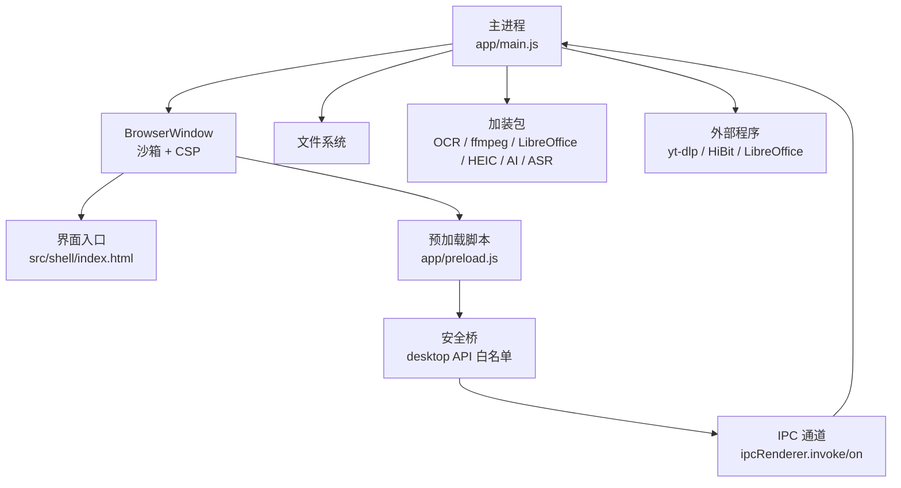
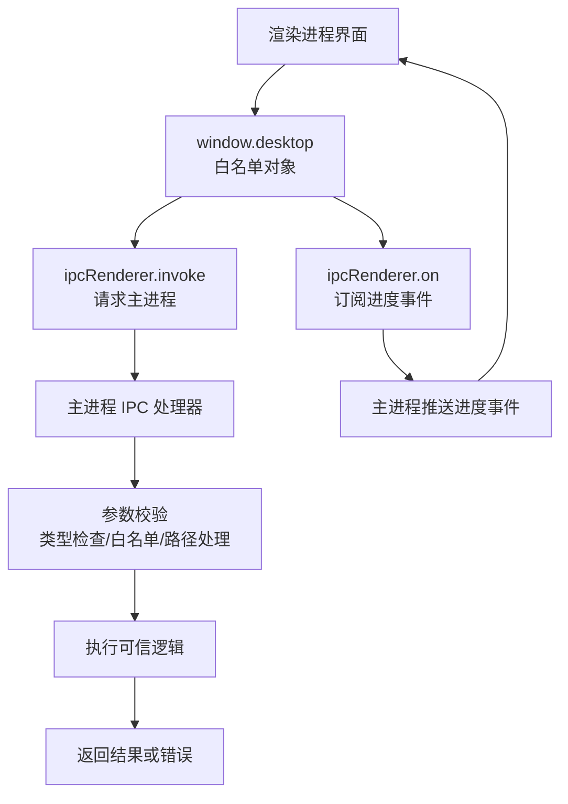
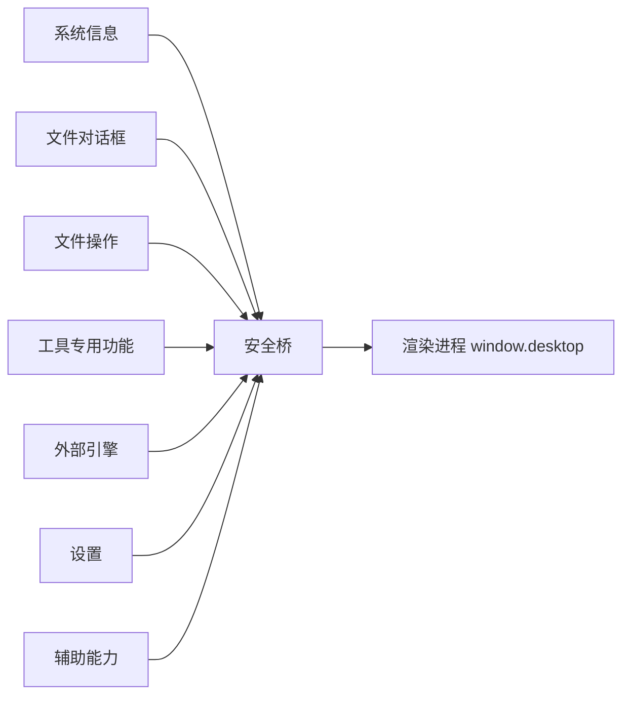
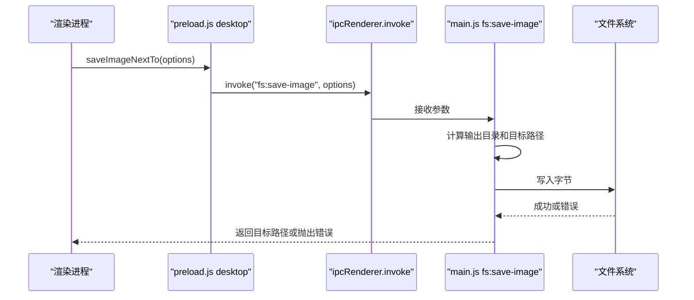
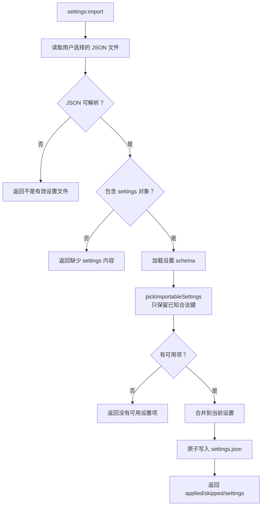
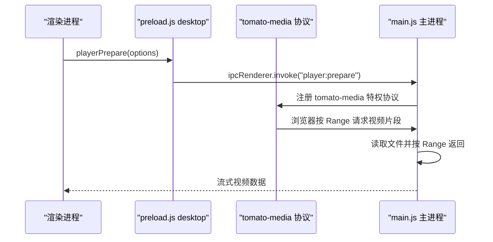
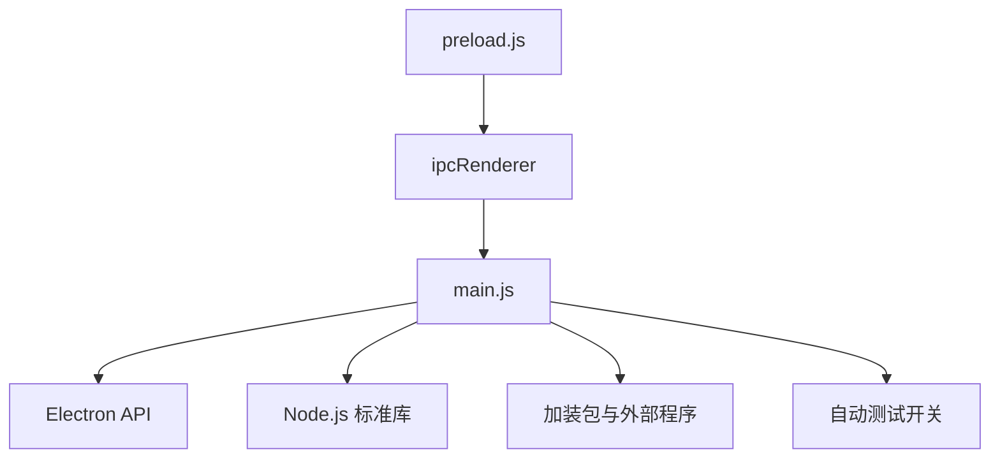

# 安全边界设计

<cite>
**本文引用的文件**   
- [app/preload.js](file://app/preload.js)
- [app/main.js](file://app/main.js)
- [README.md](file://README.md)
- [AGENTS.md](file://AGENTS.md)
</cite>

## 目录
1. [引言](#引言)
2. [项目结构与安全上下文](#项目结构与安全上下文)
3. [IPC 白名单机制](#ipc-白名单机制)
4. [API 分组策略](#api-分组策略)
5. [安全防护措施](#安全防护措施)
6. [XSS 与数据泄露防护](#xss-与数据泄露防护)
7. [关键处理流程](#关键处理流程)
8. [依赖关系分析](#依赖关系分析)
9. [性能与安全权衡](#性能与安全权衡)
10. [故障排查](#故障排查)
11. [安全最佳实践](#安全最佳实践)
12. [结论](#结论)

## 引言

番茄混淆桌面版是一个基于 Electron 的 Windows 工具箱应用。它把移动端「番茄图片混淆」的图片混淆能力迁移到桌面端，并提供图片、视频、音频、文档、压缩、系统等工具。从安全视角看，这个项目的核心风险点是：渲染进程如果可以直接访问 Node.js 和 Electron API，就可能绕过业务逻辑、读取任意文件、执行系统命令或发起网络请求。

因此，该项目采用「主进程做可信操作、渲染进程只调用白名单方法」的安全边界设计。`preload.js` 通过 `contextBridge.exposeInMainWorld` 暴露有限方法，`main.js` 作为 IPC 主入口校验并执行真实系统操作；同时使用沙箱模式、CSP、协议限制和输入校验来降低 XSS、路径穿越、配置注入等风险。

## 项目结构与安全上下文

项目源码集中在 `app/` 下，其中：

| 路径 | 职责 | 安全意义 |
|---|---|---|
| `app/main.js` | Electron 主进程入口、窗口创建、IPC 处理器、加装包管理、测试驱动 | 拥有 Node.js、文件系统、子进程、剪贴板、原生模块等完整权限 |
| `app/preload.js` | 渲染进程安全桥，仅暴露受控方法 | 是渲染进程与主进程之间的唯一可信接口 |
| `app/src/shell/index.html` | 界面 HTML 入口 | 被加载进受限渲染进程 |
| `app/src/package.json` | 声明前端资源为 ESM | 控制页面脚本加载方式 |
| `app/tests/*` | 单元测试、界面自动测试、端到端测试 | 验证安全行为，如设置导入导出、压缩解压、卸载、视频下载等 |
| `docs/` | 用户说明、新增工具指南、兼容性说明 | 不直接参与运行时安全，但影响扩展开发约束 |
| `spec/` | 模块规格与验收标准 | 定义工具边界，间接约束 IPC 暴露范围 |

**图表来源**
- [app/main.js:1-120](file://app/main.js#L1-L120)
- [app/preload.js:1-193](file://app/preload.js#L1-L193)

**章节来源**
- [README.md:1-120](file://README.md#L1-L120)
- [app/main.js:1-120](file://app/main.js#L1-L120)
- [app/preload.js:1-193](file://app/preload.js#L1-L193)

## IPC 白名单机制

### 设计原则

`preload.js` 的注释明确指出：渲染进程与主进程之间是「安全桥」，只暴露白名单方法，界面代码不得直接接触 Node/Electron 能力。其实现方式是：

1. 在 `preload.js` 中引入 Electron 的 `contextBridge`、`ipcRenderer`、`webUtils`。
2. 通过 `contextBridge.exposeInMainWorld('desktop', {...})` 向渲染进程全局对象挂载一个名为 `desktop` 的对象。
3. `desktop` 上的每个属性都是经过筛选的方法或只读信息，例如 `versions`、`appInfo`、`openImages`、`readFile`、`hidePack`、`ocrRecognize`、`ffmpegConvert` 等。
4. 渲染进程只能调用 `desktop.xxx(...)`，无法直接访问 `require`、`process`、`electron`、`fs`、`child_process` 等危险对象。

这种设计的核心好处是：即使渲染进程存在漏洞，攻击者也只能通过已暴露的 `desktop` 方法进入主进程，而不能直接打开任意 Node.js 模块。

### 白名单暴露方式

`preload.js` 暴露的内容大致分为以下几类：

| 类别 | 典型 API | 主要用途 |
|---|---|---|
| 系统信息 | `versions`、`appInfo` | 显示 Electron/Chrome/Node 版本和应用名称 |
| 文件对话框 | `openImages`、`openFolder`、`openVideos`、`openArchiveFiles` 等 | 让用户选择文件或文件夹 |
| 文件读写 | `readFile`、`writeFile`、`removeFile`、`pathInfo`、`listImages`、`listFiles`、`saveImageNextTo`、`renameBatch` | 在沙箱模式下由主进程完成磁盘操作 |
| 工具专用功能 | `hidePack`、`hideUnpack`、`playerPrepare`、`archiveCreate`、`libreofficeConvert` | 按工具划分的能力入口 |
| 外部引擎调用 | `ocrRecognize`、`ffmpegConvert`、`heicDecode`、`aiUpscale`、`asrTranscribe`、`videodlStart` | 在主进程调用原生模块或外部程序 |
| 设置 | `settingsRead`、`settingsWrite`、`settingsExport`、`settingsImport` | 读写绿色版 settings.json |
| 辅助能力 | `getPathForFile`、`readClipboardImage`、`writeClipboardImage` | 获取拖拽文件真实路径、剪贴板图片 |

**图表来源**
- [app/preload.js:1-193](file://app/preload.js#L1-L193)
- [app/main.js:201-432](file://app/main.js#L201-L432)

**章节来源**
- [app/preload.js:1-193](file://app/preload.js#L1-L193)

## API 分组策略

项目没有用一个单独的「API 分类表」，而是通过在 `preload.js` 中按语义区域组织方法，配合注释说明用途。这种分组方式便于开发者理解每种能力应该放在哪一类，也便于后续审计。

### 分组方式

| 分组 | 对应代码位置 | 分组理由 |
|---|---|---|
| 系统信息与版本 | `preload.js` 开头 | 只读、低风险，用于帮助和关于页 |
| 文件对话框 | `preload.js` 中段 | 所有文件选择都走主进程 `dialog`，避免渲染进程直接访问文件系统 |
| 通用文件读写 | `preload.js` 文件对话框之后 | 沙箱下必须经由主进程的文件系统能力 |
| 工具专用对话框 | `preload.js` 新工具段落 | 不同工具需要不同扩展名过滤器，避免夹具互相污染 |
| 文件藏图 | `preload.js` imghide 段落 | 独立工具，包含打包、解包、提取隐藏内容、进度回调 |
| 视频播放器 | `preload.js` player 段落 | 缓存目录、清理、准备播放、进度订阅 |
| 压缩与解压 | `preload.js` archive 段落 | 7zip 引擎在主进程运行，支持状态、列表、创建、解压、取消 |
| OCR | `preload.js` ocr 段落 | 原生 ONNX 模型在主进程加载，需无 CSP 限制 |
| ffmpeg | `preload.js` ffmpeg 段落 | 视频/音频转码、波形、多输入、两遍编码、取消、进度 |
| HEIC 解码 | `preload.js` heic 段落 | WASM + libheif，浏览器内核无法直接解码 HEIC |
| AI 放大 | `preload.js` ai 段落 | Real-ESRGAN 主进程 worker 线程运行 |
| 语音识别 | `preload.js` asr 段落 | FunASR 离线语音转文字 |
| 软件卸载 | `preload.js` hibit 段落 | Windows RunAs 提权，测试模式空跑 |
| 视频下载 | `preload.js` videodl 段落 | 唯一联网工具，含引擎更新、历史、任务队列 |
| PDF 与文档转换 | `preload.js` PDF 段落 | LibreOffice 加装包、老格式文档转换 |
| 设置 | `preload.js` settings 段落 | 绿色版设置读写、导出导入 |
| 辅助能力 | `preload.js` 末尾 | 拖拽文件路径、剪贴板图片 |

**图表来源**
- [app/preload.js:1-193](file://app/preload.js#L1-L193)

**章节来源**
- [app/preload.js:1-193](file://app/preload.js#L1-L193)

## 安全防护措施

### 1. 沙箱模式

窗口创建时明确启用以下选项：

| 选项 | 值 | 作用 |
|---|---|---|
| `preload` | `preload.js` 路径 | 加载安全桥 |
| `contextIsolation` | `true` | 隔离渲染上下文与 preload 上下文 |
| `nodeIntegration` | `false` | 禁止渲染进程直接使用 Node.js |
| `sandbox` | `true` | 启用 Chromium 沙箱，进一步限制渲染进程能力 |

这意味着渲染进程不能直接 `require('fs')`、`require('child_process')` 或访问 Electron 内部对象。任何系统级能力都必须通过 `ipcRenderer.invoke` 调用主进程。

**章节来源**
- [app/main.js:201-432](file://app/main.js#L201-L432)

### 2. CSP（内容安全政策）

虽然当前仓库未直接展示 `<meta http-equiv="Content-Security-Policy">` 的具体内容，但主进程注释和架构多处体现 CSP 约束：

- 自定义媒体协议 `tomato-media` 的注释说明：因为界面进程处于沙箱且 CSP 限制为 `default-src 'self'`，所以不能用 `file://` 直接加载大视频，必须用自定义协议进行 Range 分块传输。
- OCR 引擎解释为什么放在主进程：主进程没有渲染进程的 CSP 限制，可以直接加载 ONNX 原生模块，不必放宽 `script-src` 或 `worker-src`。
- 自定义协议注册时使用 `registerSchemesAsPrivileged`，要求特权协议在 `app ready` 之前注册。

这表示项目在安全上倾向于「默认拒绝」，只在必要时通过主进程提供受限能力。

**章节来源**
- [app/main.js:1-120](file://app/main.js#L1-L120)
- [app/main.js:650-1027](file://app/main.js#L650-L1027)

### 3. 导航与弹窗限制

主进程对界面跳转做了纵深防御：

- `will-navigate` 中阻止非本地 `file://` 导航。
- `setWindowOpenHandler` 直接拒绝所有弹窗。

这可以防止渲染进程被注入后跳转到外部网页、触发外链点击或打开新窗口。

**章节来源**
- [app/main.js:201-432](file://app/main.js#L201-L432)

### 4. 权限控制

权限控制体现在多个层面：

| 层级 | 控制点 | 说明 |
|---|---|---|
| 渲染进程 | `nodeIntegration: false`、`sandbox: true` | 不允许直接调用 Node/Electron |
| 预加载层 | `contextBridge.exposeInMainWorld` | 只暴露 `desktop` 白名单 |
| IPC 层 | `ipcMain.handle` | 每个频道对应具体业务，而不是统一转发 |
| 文件系统 | 主进程校验路径、扩展名、目标文件名 | 避免覆盖已有文件、减少随意写入 |
| 设置导入 | schema 白名单 | 只合并已知键，未知键忽略 |
| 外部程序 | 测试模式空跑、UAC 提权 | 卸载工具不静默提权，视频下载引擎有更新校验 |

**章节来源**
- [app/preload.js:1-193](file://app/preload.js#L1-L193)
- [app/main.js:650-1027](file://app/main.js#L650-L1027)

## XSS 与数据泄露防护

### 输入验证

项目中比较明显的输入验证体现在设置导入逻辑：

1. 先尝试解析 JSON。
2. 检查是否为对象。
3. 检查是否包含 `settings` 字段且类型为对象。
4. 使用共享 schema 的 `pickImportableSettings` 过滤出可导入的键。
5. 如果没有可用项，返回失败。
6. 合并时只合并合法 patch，不会把任意字段写进设置。

这能防止恶意设置的 JSON 注入未知配置项，从而降低配置被篡改或界面拼接 HTML 时被注入的风险。

**章节来源**
- [app/main.js:650-1027](file://app/main.js#L650-L1027)

### 输出转义

仓库中没有看到统一的「HTML 转义库」用于渲染进程输出，但从安全角度应遵循：

- 渲染进程不应直接把不可信字符串拼入 `innerHTML`。
- 用户可见文本应优先使用文本节点、模板绑定或安全的 DOM API。
- 来自 IPC 的结果应先确认类型，再决定是否放入 UI。
- 文件路径、文件名、日志内容可能包含特殊字符，应避免直接插入 HTML。

当前仓库中的 `shared/htmlescape.js` 存在于共享目录结构中，但本安全文档以实际分析的 `preload.js`、`main.js` 为依据，不对其具体实现做未经读取的断言。

**章节来源**
- [app/main.js:650-1027](file://app/main.js#L650-L1027)

### 敏感操作审计

主进程提供了基础日志能力：

- 全局捕获 `uncaughtException` 和 `unhandledRejection`。
- 将异常信息追加到 `userdata/logs/main.log`。
- 日志写入失败时不抛错，避免掩盖原始崩溃。
- 测试模式下会快照并还原 `settings.json`，避免测试结果污染用户环境。

这有助于排查 IPC 调用失败、外部引擎初始化失败、文件写入失败等问题。

**章节来源**
- [app/main.js:1-200](file://app/main.js#L1-L200)

## 关键处理流程

### 渲染进程调用文件保存流程

**图表来源**
- [app/preload.js:1-193](file://app/preload.js#L1-L193)
- [app/main.js:650-1027](file://app/main.js#L650-L1027)

### 设置导入流程

**图表来源**
- [app/main.js:650-1027](file://app/main.js#L650-L1027)

### 视频播放器自定义协议流程

**图表来源**
- [app/main.js:1-120](file://app/main.js#L1-L120)
- [app/preload.js:1-193](file://app/preload.js#L1-L193)

## 依赖关系分析

### 主进程依赖

`main.js` 直接依赖 Electron、Node.js 标准库以及多个外部能力：

| 依赖 | 用途 | 安全风险 |
|---|---|---|
| `electron` | 窗口、IPC、对话框、剪贴板、协议、shell | 高权限，需严格入口控制 |
| `fs/promises` | 异步文件读写 | 路径校验不足可能导致任意文件读写 |
| `child_process` | 启动外部程序 | 若参数来自用户输入，可能命令注入 |
| `worker_threads` | 后台任务、HEIC 解码 | 内存占用、阻塞风险 |
| 加装包 | OCR、LibreOffice、yt-dlp、Real-ESRGAN、FunASR | 原生模块、外部二进制、潜在漏洞面 |

### 预加载脚本依赖

`preload.js` 依赖：

| 依赖 | 用途 |
|---|---|
| `contextBridge` | 暴露安全桥 |
| `ipcRenderer` | 调用主进程 IPC |
| `webUtils` | 获取拖拽文件真实路径 |

### 组件耦合

**图表来源**
- [app/preload.js:1-193](file://app/preload.js#L1-L193)
- [app/main.js:1-200](file://app/main.js#L1-L200)

**章节来源**
- [app/preload.js:1-193](file://app/preload.js#L1-L193)
- [app/main.js:1-200](file://app/main.js#L1-L200)

## 性能与安全权衡

| 场景 | 安全考虑 | 性能考量 |
|---|---|---|
| 大视频播放 | 使用 `tomato-media` 协议而非 `file://`，避免 CSP 和沙箱限制 | 按 Range 分块读取，边读边播，适合 GB 级视频 |
| OCR 推理 | 在主进程加载 ONNX 模型，避免放宽 CSP | 模型约 20MB，懒加载并复用实例 |
| ffmpeg 转码 | 不在渲染进程执行二进制 | 支持两遍编码、多输入、取消、进度回调 |
| 设置写入 | 原子写入临时文件再 rename | 避免中断导致 JSON 损坏 |
| 批量重命名 | 两阶段改名，不覆盖已有文件 | 跨盘回退复制+删除，失败时尽量恢复临时名 |

**章节来源**
- [app/main.js:1-120](file://app/main.js#L1-L120)
- [app/main.js:650-1027](file://app/main.js#L650-L1027)

## 故障排查

### 渲染进程无法访问 Node.js

**现象**：渲染进程调用 `require` 报错。  
**原因**：`nodeIntegration: false`，这是预期安全行为。  
**解决**：通过 `desktop` 白名单调用主进程能力。

**章节来源**
- [app/main.js:201-432](file://app/main.js#L201-L432)

### 设置导入失败

**现象**：导入设置返回“不是有效设置文件”或“没有可用设置项”。  
**原因**：JSON 结构不符合导出格式，或 `settings` 字段缺失/非法。  
**解决**：检查导出文件结构，确认 `_app`、`_format`、`settings` 字段存在。

**章节来源**
- [app/main.js:650-1027](file://app/main.js#L650-L1027)

### OCR 不可用

**现象**：OCR 状态检测失败，或提示缺少模型。  
**原因**：`addons/ocr` 目录下缺少 `det.onnx`、`rec.onnx`、`dict.txt` 或字体文件。  
**解决**：放置正确模型文件，或重新安装随包加装包。

**章节来源**
- [app/main.js:650-1027](file://app/main.js#L650-L1027)

### 主进程崩溃无控制台输出

**现象**：绿色版没有控制台，异常静默丢失。  
**原因**：传统 `console.error` 在无控制台环境下不可见。  
**解决**：查看 `userdata/logs/main.log`，其中记录未捕获异常和未处理 Promise 拒绝。

**章节来源**
- [app/main.js:1-200](file://app/main.js#L1-L200)

## 安全最佳实践

### 对开发者

1. **新增功能优先走 IPC**  
   不要为了省事在渲染进程直接访问文件系统或外部程序。所有系统能力都应通过 `preload.js` 暴露，并在 `main.js` 中实现对应处理器。

2. **保持白名单最小化**  
   只暴露工具真正需要的 `desktop` 方法。不要为了方便而暴露 `exec`、`spawn`、`eval`、`require`、`process.env` 等高危能力。

3. **对 IPC 参数做类型和范围校验**  
   尤其是文件路径、扩展名、目标文件名、用户输入 URL、外部程序参数。

4. **输出到界面时避免直接 innerHTML**  
   用户可控数据应作为文本节点或通过安全模板渲染。

5. **日志不要记录敏感信息**  
   不要记录密码、密钥、用户完整路径、账号信息。

6. **测试模式要可区分**  
   现有项目通过命令行开关进入多种测试模式，避免弹 UAC、弹出系统对话框、修改用户真实设置。

7. **新增工具遵循模板约定**  
   AGENTS.md 明确要求新功能做成独立工具目录，禁止写进 shell，复用能力放 `shared/`。

8. **敏感信息不进 git**  
   AGENTS.md 的安全红线强调 token、cookie、密码、密钥、凭据必须忽略，提交前扫描暂存区。

### 对使用者

1. **不要随意替换加装包**  
   OCR、LibreOffice、yt-dlp 等外部二进制可能带来安全影响，应使用官方或可信来源。
2. **谨慎导入设置文件**  
   设置文件可能包含路径、主题、导出时间等信息，不要导入来源不明的 JSON。
3. **注意视频下载工具的联网特性**  
   README 明确除视频下载外工具纯离线，视频下载天生需要联网。

**章节来源**
- [AGENTS.md:1-98](file://AGENTS.md#L1-L98)
- [README.md:1-120](file://README.md#L1-L120)

## 结论

番茄混淆桌面版的安全边界建立在三个层次上：

1. **渲染进程隔离**：通过 `contextIsolation`、`nodeIntegration: false`、`sandbox: true` 限制渲染进程能力。
2. **预加载白名单**：通过 `contextBridge.exposeInMainWorld('desktop', {...})` 暴露最小必要方法，集中管理系统信息、文件操作、工具专用功能和外部引擎调用。
3. **主进程可信执行**：所有真实系统操作集中在 `main.js`，包括文件 IO、对话框、协议、IPC、外部程序、加装包、设置导入导出、日志和测试模式。

这套设计能有效降低渲染进程直接滥用 Node.js 和 Electron API 的风险，同时通过 CSP、导航限制、输入校验、原子写入和日志记录形成纵深防御。未来新增功能时，应继续坚持「渲染进程只调用白名单、主进程做权限校验」的原则，避免为了便利而扩大攻击面。