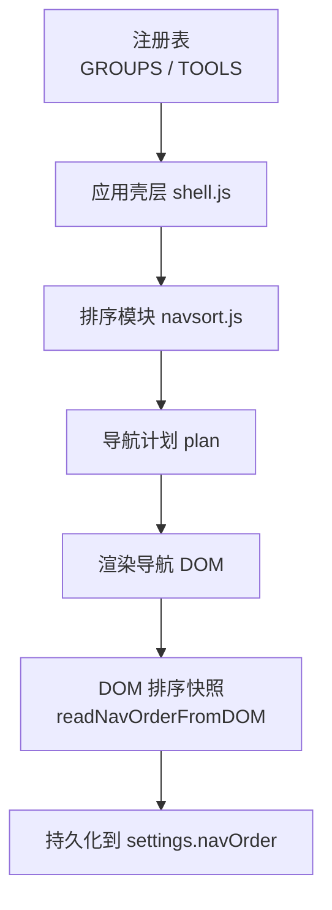
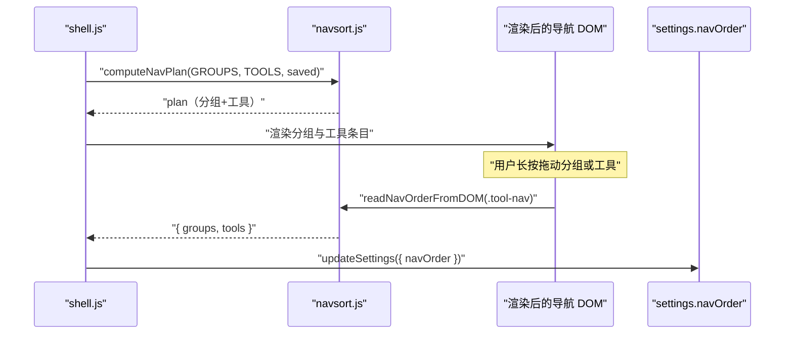
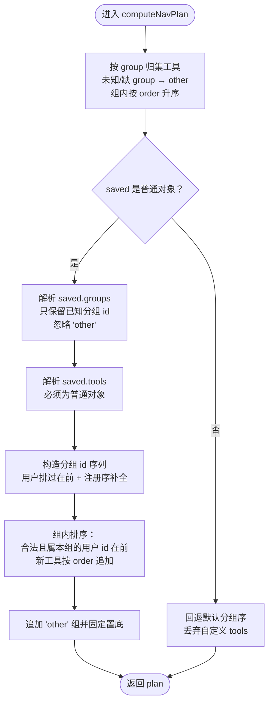
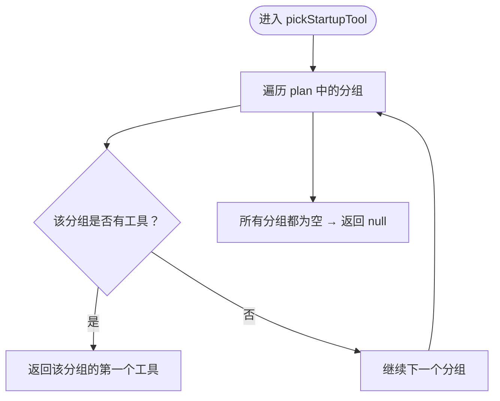
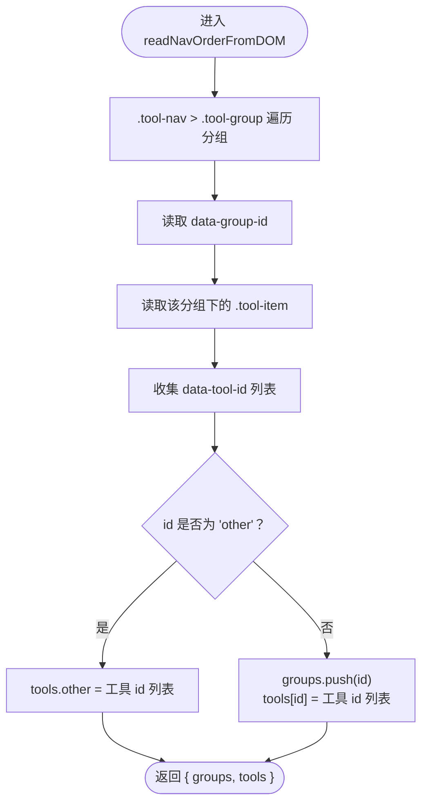
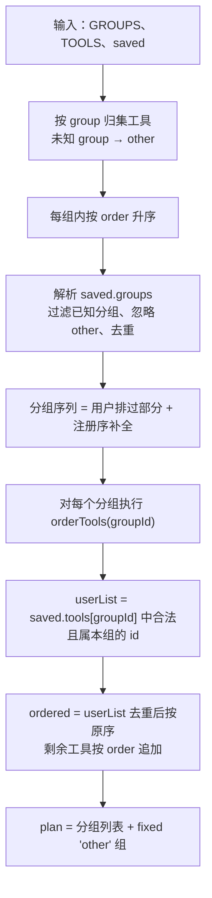
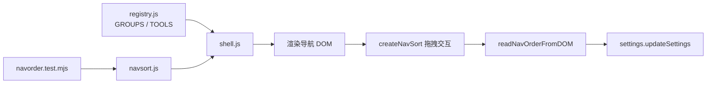

# 导航排序算法

<cite>
**本文引用的文件**   
- [navsort.js](file://app/src/shell/navsort.js)
- [shell.js](file://app/src/shell/shell.js)
- [navorder.test.mjs](file://app/tests/navorder.test.mjs)
</cite>

## 目录
1. [引言](#引言)
2. [项目结构](#项目结构)
3. [核心组件](#核心组件)
4. [架构总览](#架构总览)
5. [详细组件分析](#详细组件分析)
6. [依赖关系分析](#依赖关系分析)
7. [性能考虑](#性能考虑)
8. [故障排查指南](#故障排查指南)
9. [结论](#结论)

## 引言
本文聚焦番茄混淆桌面版「左侧导航」的排序与渲染逻辑，重点说明以下能力：
- 将注册分组 GROUPS 与全部工具 TOOLS 组合为最终导航计划；
- 对用户保存的配置 saved.navOrder 做严格数据净化；
- 实现「分组级排序 + 组内工具排序」两级算法；
- 选择启动时默认打开的工具；
- 从已渲染的 DOM 读取当前排序快照。

这些逻辑由 navsort.js 提供纯函数接口，shell.js 负责加载注册表、渲染导航并触发拖拽排序。navorder.test.mjs 覆盖了非法输入、跨组走私防护、other 组置底、幂等回写等关键场景。

## 项目结构
与导航排序直接相关的代码位于 shell 层：
- app/src/shell/navsort.js：排序纯逻辑与拖拽控制器；
- app/src/shell/shell.js：应用壳层，导入 TOOLS/GROUPS 注册表，调用 computeNavPlan、pickStartupTool 并创建拖拽实例；
- app/tests/navorder.test.mjs：针对 computeNavPlan 与 pickStartupTool 的纯逻辑单测。

**图示来源**
- [shell.js:1-20](file://app/src/shell/shell.js#L1-L20)
- [navsort.js:1-120](file://app/src/shell/navsort.js#L1-L120)

**章节来源**
- [shell.js:1-20](file://app/src/shell/shell.js#L1-L20)
- [navsort.js:1-120](file://app/src/shell/navsort.js#L1-L120)

## 核心组件
- computeNavPlan(groups, tools, saved)：计算最终导航计划，返回分组数组，每个分组包含 id、name、icon 和已排序的 tools。
- pickStartupTool(plan)：根据最终计划选择启动工具。
- readNavOrderFromDOM(navEl)：从渲染后的 .tool-nav 中读取当前分组与工具的视觉顺序。
- createNavSort(...)：拖拽排序控制器（非本次文档重点，但会与上述函数配合使用）。

**章节来源**
- [navsort.js:1-120](file://app/src/shell/navsort.js#L1-L120)
- [navsort.js:120-200](file://app/src/shell/navsort.js#L120-L200)

## 架构总览
computeNavPlan 是导航排序的核心入口。它不依赖 DOM，因此可在 Node 环境下测试；renderNav 在浏览器环境中把 plan 渲染成 DOM，createNavSort 监听指针事件进行拖拽，最后通过 readNavOrderFromDOM 取回新的排序并持久化。

**图示来源**
- [shell.js:1-20](file://app/src/shell/shell.js#L1-L20)
- [navsort.js:1-120](file://app/src/shell/navsort.js#L1-L120)
- [navsort.js:200-388](file://app/src/shell/navsort.js#L200-L388)

## 详细组件分析

### computeNavPlan：分组与工具的组合、净化与排序
computeNavPlan 接收三个参数：
- groups：注册分组列表，其声明顺序即默认分组顺序；
- tools：全部工具声明，组内默认按 order 升序；
- saved：settings.navOrder，可能为 null 或被用户手动修改为任意形状。

主要处理阶段如下：

1. **按组归集工具**  
   所有工具按 group 字段归入对应分组；若 group 未声明或不属于已知分组，则归入 'other'。同一组内工具按 order 升序排列。

2. **净化 saved**  
   - 整个 saved 必须是普通对象；否则视为无效，回退默认顺序。  
   - saved.groups 必须存在且为数组；只保留字符串类型且属于已知分组的 id，同时忽略 'other'。  
   - saved.tools 必须存在且为普通对象；否则视为无效，该字段被丢弃。

3. **分组排序**  
   - 先输出用户排过的分组（去重），再按注册顺序追加未排过的分组。  
   - 'other' 不参与用户分组排序，始终固定放在结果末尾。

4. **组内工具排序**  
   - 对于某个分组，如果 saved.tools[groupId] 是数组，则只保留字符串类型的工具 id，并且进一步过滤掉不属于该组的 id；去重后按用户顺序排列。  
   - 未被用户排序的新工具，按其原始 order 追加到尾部。  
   - 如果该分组没有有效的用户排序，则整组保持默认 order 顺序。

5. **构建 plan**  
   对每个有效分组构造 { id, name, icon, tools }，最后追加 'other' 分组。

**图示来源**
- [navsort.js:20-120](file://app/src/shell/navsort.js#L20-L120)

#### 数据净化规则摘要
- 顶层 saved 不是普通对象：整体回退默认，不丢任何工具。
- saved.groups 非数组或元素不是已知分组 id：该字段失效，回退默认分组序。
- 'other' 出现在 saved.groups 中：被忽略，不参与用户分组排序。
- saved.tools 不是普通对象：该字段失效，各分组按默认 order 排序。
- saved.tools[groupId] 不是数组：该分组的用户排序失效。
- saved.tools[groupId] 中的 id 不是字符串：被忽略。
- 工具 id 不属于该分组：被拒绝，工具仍留在其声明组或 'other'。
- 重复 id：去重，只保留一次。

**章节来源**
- [navsort.js:20-120](file://app/src/shell/navsort.js#L20-L120)
- [navorder.test.mjs:1-127](file://app/tests/navorder.test.mjs#L1-L127)

### pickStartupTool：启动工具选择逻辑
pickStartupTool 接收 computeNavPlan 的输出 plan，遍历分组，返回第一个非空分组的第一个工具；如果所有分组都没有工具，则返回 null。

行为要点：
- 分组顺序受 computeNavPlan 影响：用户拖到最前的分组优先。
- 组内顺序也受 computeNavPlan 影响：用户排序会改变该组第一个工具。
- 当只有 'other' 有工具时，仍可启动 'other' 的第一个工具。
- 没有任何工具时返回 null，避免上层启动逻辑出错。

**图示来源**
- [navsort.js:120-160](file://app/src/shell/navsort.js#L120-L160)

**章节来源**
- [navsort.js:120-160](file://app/src/shell/navsort.js#L120-L160)
- [navorder.test.mjs:100-127](file://app/tests/navorder.test.mjs#L100-L127)

### readNavOrderFromDOM：从 DOM 读取排序快照
readNavOrderFromDOM 从渲染后的导航容器 navEl 中解析出当前视觉顺序，供拖放成功后落盘。

DOM 约定：
- navEl 是 .tool-nav 根元素；
- 每个分组包裹在 .tool-group 元素中，并通过 data-group-id 标识分组 id；
- 分组内的工具条目是 .tool-item，通过 data-tool-id 标识工具 id；
- 对于 'other' 分组，tools.other 单独记录；其他分组的工具记录在 tools[groupId]。

返回值结构：
- groups：按视觉顺序出现的分组 id 列表，不包含 'other'；
- tools：以分组 id 为键的工具 id 数组，其中 'other' 作为独立键。

**图示来源**
- [navsort.js:160-200](file://app/src/shell/navsort.js#L160-L200)

**章节来源**
- [navsort.js:160-200](file://app/src/shell/navsort.js#L160-L200)

### 排序算法流程图：分组与组内工具
下面用一张图把「分组排序」和「组内工具排序」串起来：

**图示来源**
- [navsort.js:20-120](file://app/src/shell/navsort.js#L20-L120)

### 数据转换示例
假设注册分组为 image、video、audio，工具包括 img-a/img-b/img-c、vid-a/vid-b、aud-a，以及一个 group 为未知值的 odd 和一个没有 group 的 none。

- 当 saved 为 null 时：
  - 分组顺序为 image、video、audio；
  - image 组内按 order 得到 img-a、img-b、img-c；
  - odd 和 none 聚合到 'other'，并固定在末尾。

- 当用户把 audio 拖到第一位，并把 image 组内改为 img-c、img-a：
  - 分组顺序变为 audio、image、video；
  - image 组内用户顺序生效，img-b 作为新工具按 order 追加到末尾；
  - video 组若无用户排序，则保持 vid-a、vid-b。

- 当用户尝试把 img-a 放入 video 组：
  - img-a 不属于 video，被过滤；
  - img-a 仍回到 image 组；
  - video 组只保留 vid-b、vid-a。

这些行为与 navorder.test.mjs 中的断言一致，覆盖默认序、完整重排、缺组补全、未知 id 忽略、跨组走私保护、other 置底、幂等回写、启动工具选择等场景。

**章节来源**
- [navorder.test.mjs:1-127](file://app/tests/navorder.test.mjs#L1-L127)

## 依赖关系分析
- shell.js 从 registry.js 导入 TOOLS 与 GROUPS，并从 navsort.js 导入 computeNavPlan、pickStartupTool、createNavSort。
- navsort.js 是纯逻辑层，不依赖 DOM 的部分可直接在 Node 环境运行；createNavSort 部分依赖 DOM API，仅在浏览器中使用。
- navorder.test.mjs 直接 import navsort.js 中的纯函数，验证数据净化与排序不变性。

**图示来源**
- [shell.js:1-20](file://app/src/shell/shell.js#L1-L20)
- [navsort.js:1-200](file://app/src/shell/navsort.js#L1-L200)
- [navorder.test.mjs:1-20](file://app/tests/navorder.test.mjs#L1-L20)

**章节来源**
- [shell.js:1-20](file://app/src/shell/shell.js#L1-L20)
- [navorder.test.mjs:1-20](file://app/tests/navorder.test.mjs#L1-L20)

## 性能考虑
- 分组归集与工具排序的时间复杂度大致为 O(T log T)，其中 T 为工具总数，主要消耗在各组内按 order 排序。
- 分组序列构造涉及一次遍历 saved.groups 与一次遍历 groups，复杂度为 O(G + U)，G 为分组数，U 为用户配置的分组长度。
- 组内工具排序对每个分组扫描 saved.tools[groupId] 与原始工具列表，总体接近线性于工具数量。
- 由于导航规模有限，这些操作均为轻量级 CPU 计算，不会成为界面卡顿瓶颈。
- readNavOrderFromDOM 使用 querySelectorAll 遍历 DOM，时间复杂度与可见节点数量成正比，适合拖放结束后的少量快照采集。

[本节为通用性能讨论，不直接分析具体代码行]

## 故障排查指南
常见问题及定位建议：

1. **导航顺序异常或崩溃**  
   - 检查 settings.navOrder 是否被手动编辑为非法形状；computeNavPlan 会对非法 saved 回退默认，但分组顺序可能不符合预期。  
   - 使用 navorder.test.mjs 的思路验证 saved 的结构：顶层应为普通对象，groups 为字符串数组，tools 为普通对象。

2. **工具出现在错误分组**  
   - 确认工具声明中的 group 字段是否正确；未知或不存在 group 会被归入 'other'。  
   - 检查 saved.tools 中是否出现跨组 id；算法会拒绝不属于该组的 id，工具仍留在其声明组。

3. **'other' 组位置不对**  
   - 'other' 不应出现在 saved.groups 中；即使出现也会被忽略，并始终固定在 plan 末尾。

4. **启动工具不正确**  
   - 检查 computeNavPlan 输出的 plan 中第一个非空分组；pickStartupTool 只取该分组的第一个工具。  
   - 如果分组为空，确保至少有一个分组包含工具，否则返回 null。

5. **DOM 快照与显示不一致**  
   - 确认渲染结构符合 readNavOrderFromDOM 的约定：.tool-nav > .tool-group > .tool-group-items > .tool-item，且 data-group-id 与 data-tool-id 正确设置。

**章节来源**
- [navsort.js:20-200](file://app/src/shell/navsort.js#L20-L200)
- [navorder.test.mjs:1-127](file://app/tests/navorder.test.mjs#L1-L127)

## 结论
computeNavPlan 通过严格的输入净化与两级排序，保证导航计划在用户自定义配置、损坏配置和新工具加入三种情况下都保持稳定：
- 分组层面：用户排过的分组在前，未排过的按注册序追加，'other' 固定置底；
- 工具层面：只接受同组合法 id，去重后按用户顺序排列，新工具按 order 追加；
- 启动层面：优先选择第一个非空分组的第一个工具；
- 持久化层面：readNavOrderFromDOM 能准确还原当前视觉顺序，供 createNavSort 落盘。

这套设计使「长按拖动」无需额外排序模式，既不影响点击切换工具与展开收起分组，也能在用户手改配置时做到“不丢工具、不跨组、不崩溃”。