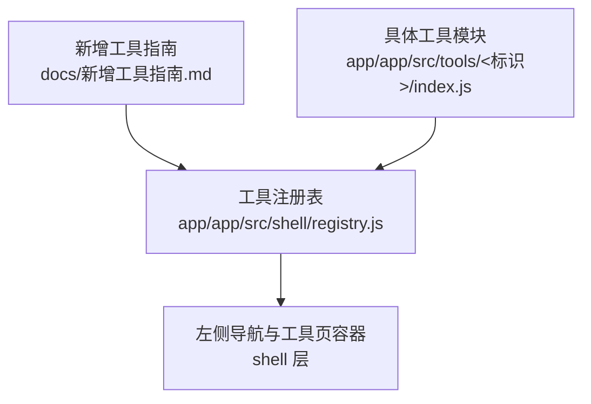
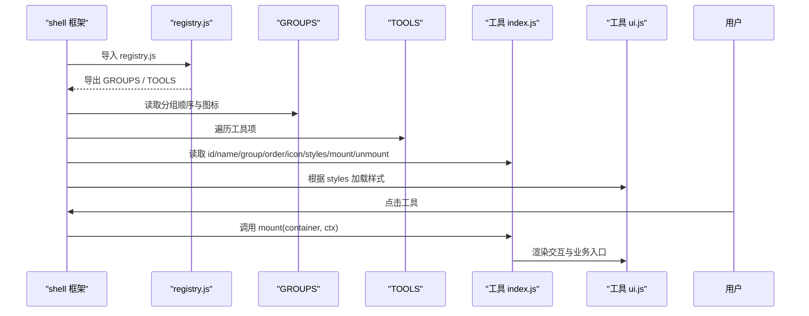
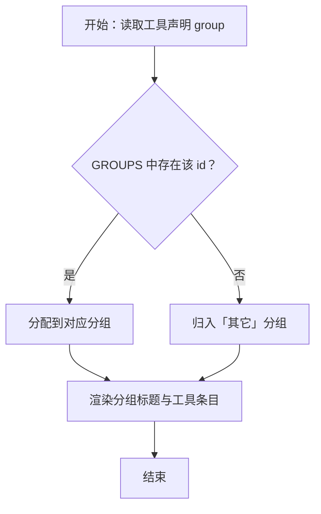
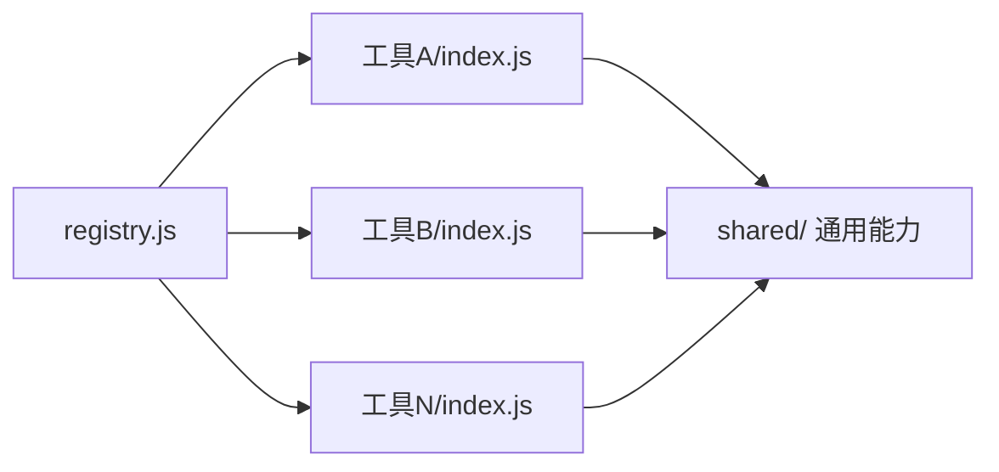
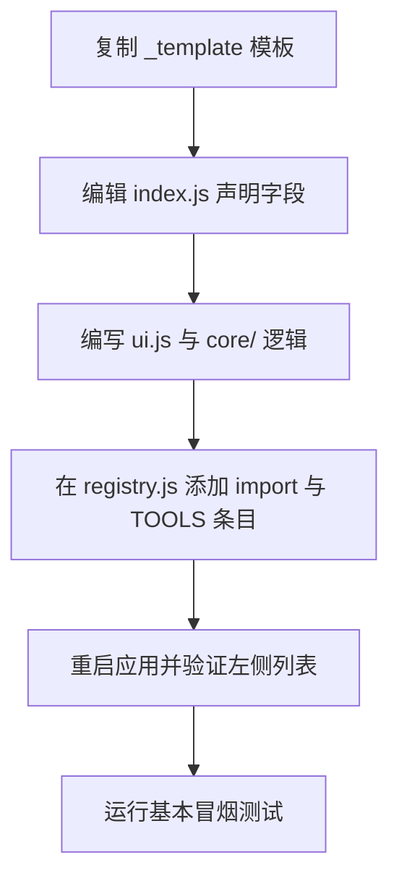

# 工具注册机制

<cite>
**本文引用的文件**   
- [registry.js](file://app/app/src/shell/registry.js)
- [新增工具指南.md](file://docs/新增工具指南.md)
</cite>

## 目录
1. [引言](#引言)
2. [项目结构定位](#项目结构定位)
3. [核心组件](#核心组件)
4. [架构总览](#架构总览)
5. [详细组件分析](#详细组件分析)
6. [依赖关系分析](#依赖关系分析)
7. [性能与健壮性](#性能与健壮性)
8. [故障排查](#故障排查)
9. [结论](#结论)
10. [附录：新增工具标准流程](#附录新增工具标准流程)

## 引言
本文面向“番茄混淆桌面版”的开发者与维护者，系统化说明工具注册机制。重点围绕 `registry.js` 中的全局工具清单、分组定义、工具声明规范、分组与工具的关联规则，以及新增工具的标准流程展开，帮助读者在不动既有代码的前提下快速扩展功能。

## 项目结构定位
该项目的工具注册逻辑位于前端壳工程内，主要涉及两个位置：
- 工具注册表：`app/app/src/shell/registry.js`，集中导出工具分组与工具清单。
- 新增工具指南：`docs/新增工具指南.md`，描述模板、声明字段、注册步骤和注意事项。

图表来源
- [registry.js:1-200](file://app/app/src/shell/registry.js#L1-L200)
- [新增工具指南.md:1-83](file://docs/新增工具指南.md#L1-L83)

章节来源
- [registry.js:1-200](file://app/app/src/shell/registry.js#L1-L200)
- [新增工具指南.md:1-83](file://docs/新增工具指南.md#L1-L83)

## 核心组件
- 工具分组 `GROUPS`：定义图片、视频、音频、文档、压缩、系统六个分组及其图标与显示顺序。
- 工具清单 `TOOLS`：通过导入每个工具的默认导出对象后加入数组，形成全局唯一的工具清单。
- 工具声明对象：每个工具通过 `index.js` 暴露一个包含 `id`、`name`、`group`、`order`、`icon`、`styles`、`mount`、`unmount` 等字段的对象。

章节来源
- [registry.js:1-200](file://app/app/src/shell/registry.js#L1-L200)
- [新增工具指南.md:12-30](file://docs/新增工具指南.md#L12-L30)

## 架构总览
工具注册的数据流可概括为：框架加载 `registry.js` → 读取 `GROUPS` 与 `TOOLS` → 渲染左侧分组标题与工具条目 → 用户点击后挂载对应工具的 UI。

图表来源
- [registry.js:1-200](file://app/app/src/shell/registry.js#L1-L200)
- [新增工具指南.md:31-83](file://docs/新增工具指南.md#L31-L83)

## 详细组件分析

### 分组定义 `GROUPS`
- 作用：定义六个分组（图片、视频、音频、文档、压缩、系统）及其图标和显示顺序。
- 关键点：
  - 分组以 `id` 作为唯一键，用于被工具声明引用。
  - 分组显示顺序由其在 `GROUPS` 中的排列决定。
  - 若某分组没有工具，则不会显示该分组小标题。
- 设计意图：将“视觉分组”与“工具归属”解耦，新增分组只需修改 `GROUPS`，无需改动现有工具。

章节来源
- [registry.js:1-200](file://app/app/src/shell/registry.js#L1-L200)
- [新增工具指南.md:18-24](file://docs/新增工具指南.md#L18-L24)

### 工具清单 `TOOLS`
- 作用：全局唯一的工具清单，框架据此渲染所有可用工具。
- 组织方式：
  - 每个工具通过 `import` 引入其 `index.js` 的默认导出对象。
  - 将导入的工具对象追加到 `TOOLS` 数组中。
  - 数组顺序影响工具在分组内的排序（通常配合工具声明的 `order`）。
- 约束：
  - `id` 必须全局唯一。
  - 未声明或未知分组的工具会自动归入「其它」，保证不丢失可见性。

章节来源
- [registry.js:1-200](file://app/app/src/shell/registry.js#L1-L200)
- [新增工具指南.md:64-72](file://docs/新增工具指南.md#L64-L72)

### 工具声明对象规范
每个工具在 `index.js` 中默认导出一个对象，关键字段如下：
- `id`：工具的唯一标识符，英文小写，全局唯一。
- `name`：左侧列表显示名称。
- `group`：所属分组标识，需匹配 `GROUPS` 中的某个 `id`；若缺失或不存在，自动归入「其它」。
- `order`：组内排序值，数值越小越靠前。
- `icon`：分组前或列表前的图标，可使用 emoji。
- `styles`：工具专属样式路径数组，相对 `src/shell/index.html`，例如 `../tools/<标识>/styles.css`。
- `mount(container, ctx)`：页面创建时挂载 UI 并绑定事件。
- `unmount()`：页面被销毁时清理资源（如 LRU 回收）。

补充约定来自指南：
- 工具之间禁止互相 import；复用能力放 `shared/`。
- 样式使用 shell 的设计令牌变量，类名加工具前缀避免冲突。
- `mount` 是页面“从零构建”的地方，`unmount` 负责释放资源。
- 全局交互需在 `deactivate()/activate()` 或回调中判断当前活跃状态。

章节来源
- [新增工具指南.md:12-30](file://docs/新增工具指南.md#L12-L30)
- [新增工具指南.md:31-63](file://docs/新增工具指南.md#L31-L63)
- [新增工具指南.md:64-83](file://docs/新增工具指南.md#L64-L83)

### 分组与工具的关联规则
- 工具声明的 `group` 字段应等于 `GROUPS` 中某个分组的 `id`。
- 如果 `group` 未声明或对应的分组不存在，则该工具会被归入「其它」分组。
- 这样设计的优点是：即使忘记维护分组，也不会导致工具不可见；同时鼓励保持分组完整。

图表来源
- [registry.js:1-200](file://app/app/src/shell/registry.js#L1-L200)
- [新增工具指南.md:18-24](file://docs/新增工具指南.md#L18-L24)

## 依赖关系分析
- `registry.js` 依赖各工具的 `index.js` 默认导出对象。
- 工具模块不应相互依赖，应通过 `shared/` 共享通用能力。
- 样式依赖 `shell/theme.css` 与 `shell/components.css`，避免硬编码颜色与尺寸。

图表来源
- [registry.js:1-200](file://app/app/src/shell/registry.js#L1-L200)
- [新增工具指南.md:64-83](file://docs/新增工具指南.md#L64-L83)

章节来源
- [registry.js:1-200](file://app/app/src/shell/registry.js#L1-L200)
- [新增工具指南.md:64-83](file://docs/新增工具指南.md#L64-L83)

## 性能与健壮性
- 工具切换采用保活策略：动过的页面最多保活若干页，超出按 LRU 回收，触发 `unmount`。
- 因此：
  - `mount` 必须能从零构建界面。
  - `unmount` 必须释放定时器、DOM 引用、事件监听等。
  - 全局交互要正确处理激活/失活状态，避免在其他工具下误触发。
- 样式与组件尽量复用 shell 层，减少重复实现带来的维护成本。

章节来源
- [新增工具指南.md:31-63](file://docs/新增工具指南.md#L31-L63)

## 故障排查
常见问题与定位方法：
- 左侧没出现新工具：
  - 检查是否在 `registry.js` 中添加了 import 与 `TOOLS` 条目。
  - 检查 `id` 是否与其他工具重复。
- 样式不生效：
  - 检查 `styles` 路径是否相对于 `src/shell/index.html`。
- 切换工具后报错：
  - 检查 `unmount` 是否清理了定时器、事件订阅与旧 DOM 引用。
- 想先做空壳验证：
  - 仅完成复制模板、修改声明、注册三步即可看到入口。

章节来源
- [新增工具指南.md:73-83](file://docs/新增工具指南.md#L73-L83)

## 结论
通过 `GROUPS` 与 `TOOLS` 的清晰分离，番茄混淆桌面版的工具注册机制既保证了分组与排序的可配置性，又降低了新增工具的门槛。遵循声明字段规范、样式与生命周期约定，并在 `registry.js` 中添加 import 与条目，即可完成工具接入。

## 附录：新增工具标准流程
以新增一个工具为例，标准流程如下：
1. 复制模板
   - 将 `app/src/tools/_template/` 复制为目标工具目录，不要修改 `_template` 本身。
2. 修改工具声明
   - 编辑目标工具的 `index.js`，填写 `id`、`name`、`icon`、`group`、`order`、`styles`、`mount`、`unmount`。
   - `group` 必须是 `GROUPS` 中已定义的分组 id；否则工具会归入「其它」。
3. 编写界面与逻辑
   - 界面放在 `ui.js`，逻辑放在 `core/`。
   - 复用 `shared/` 中的通用能力，样式使用 shell 变量。
4. 注册工具
   - 在 `registry.js` 中添加对工具 `index.js` 的 import。
   - 在 `TOOLS` 数组中加入该工具对象。
5. 启动验证
   - 重启应用后，左侧列表应出现新工具；进入后可正常切换与使用。

图表来源
- [新增工具指南.md:12-30](file://docs/新增工具指南.md#L12-L30)
- [新增工具指南.md:64-72](file://docs/新增工具指南.md#L64-L72)

章节来源
- [新增工具指南.md:12-30](file://docs/新增工具指南.md#L12-L30)
- [新增工具指南.md:64-83](file://docs/新增工具指南.md#L64-L83)