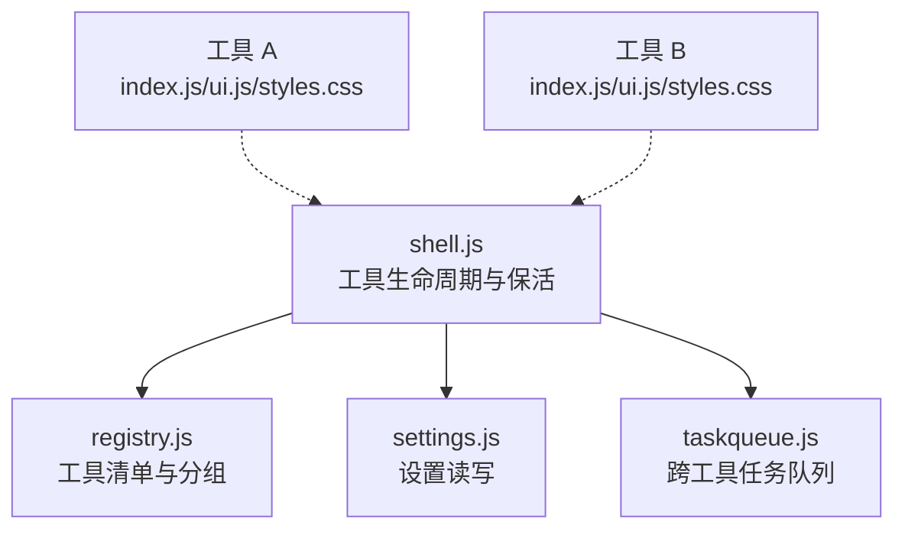
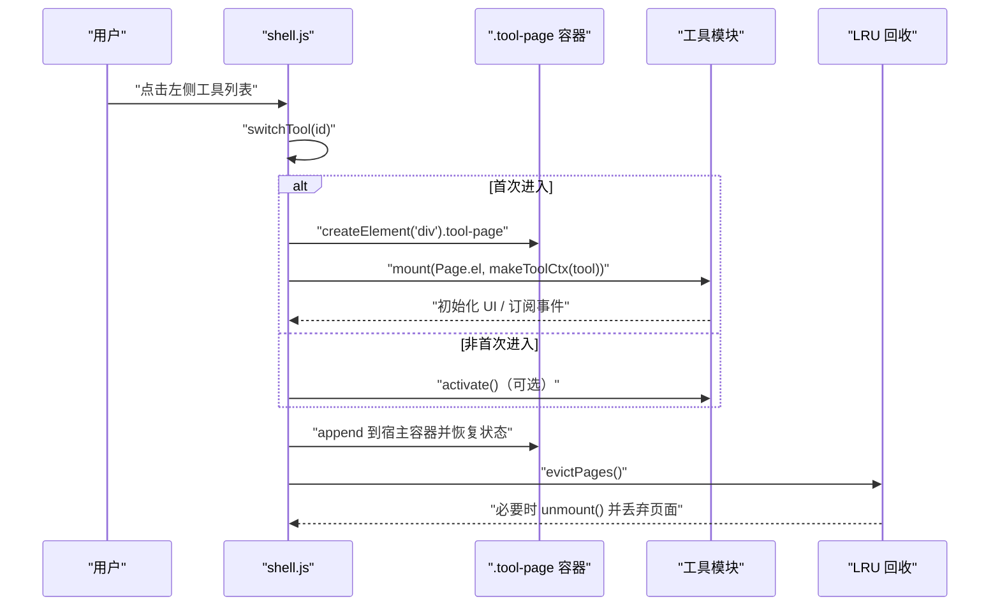
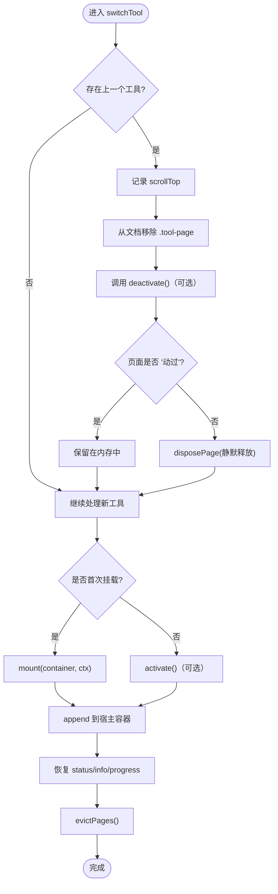
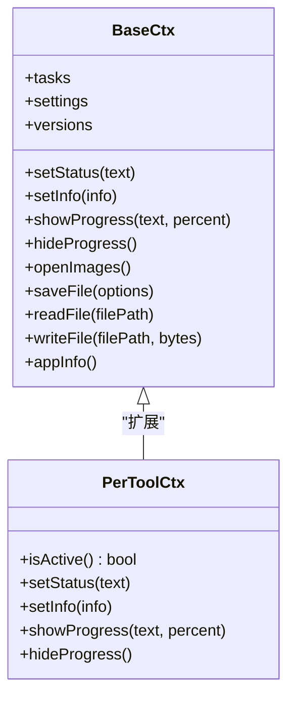
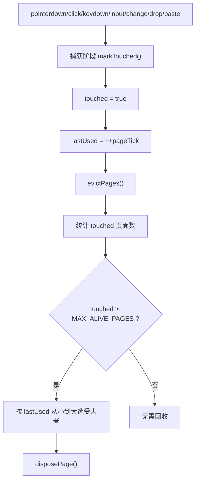
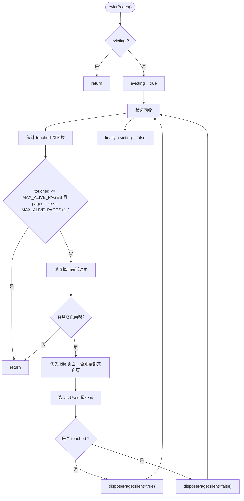
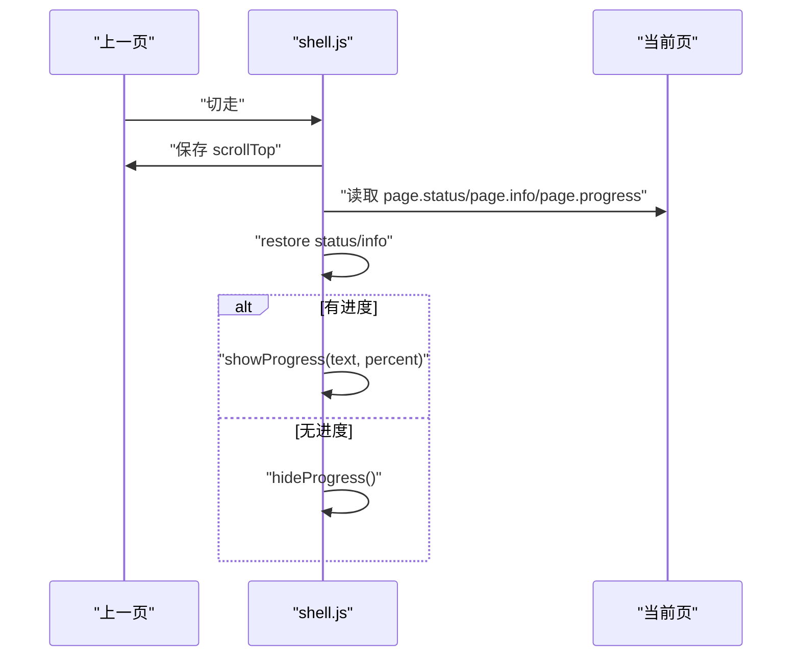
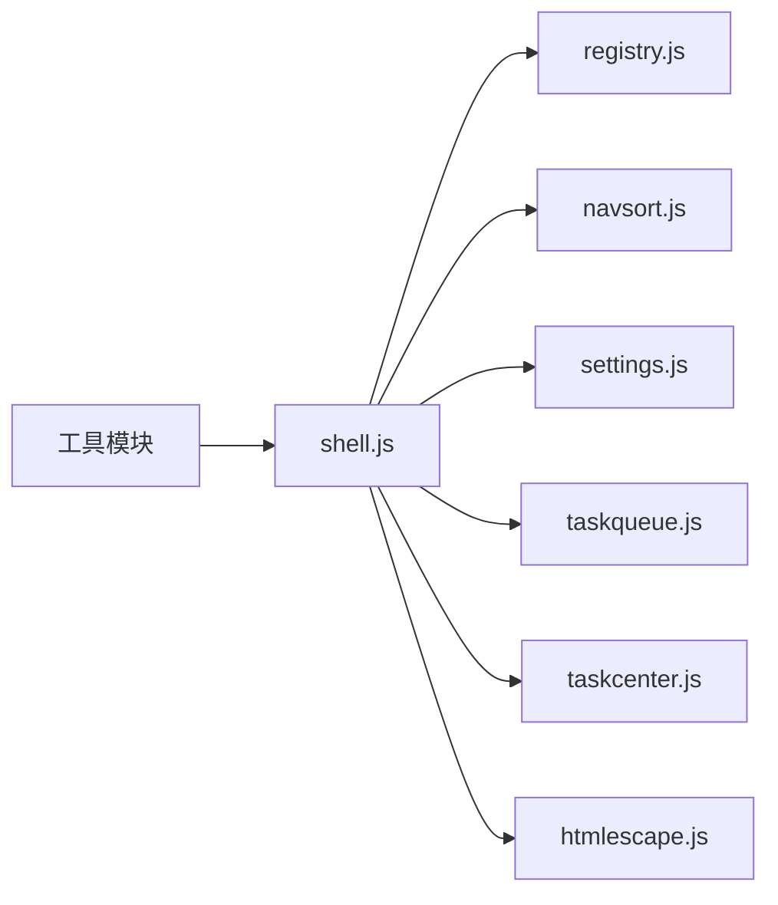

# 工具生命周期管理

<cite>
**本文引用的文件**   
- [shell.js](file://app/src/shell/shell.js)
- [toolkit.md](file://spec/modules/toolkit.md)
</cite>

## 目录
1. [简介](#简介)
2. [项目结构中的定位](#项目结构中的定位)
3. [核心组件](#核心组件)
4. [架构总览](#架构总览)
5. [详细组件分析](#详细组件分析)
6. [依赖关系分析](#依赖关系分析)
7. [性能与保活策略](#性能与保活策略)
8. [故障排查指南](#故障排查指南)
9. [结论](#结论)

## 简介
本文聚焦番茄混淆桌面版「工具箱框架」中的工具生命周期管理，重点解释：
- 工具页的挂载（mount）与卸载（unmount）过程；
- 工具上下文 ctx 的创建与管理；
- LRU 保活策略、「动过」页面判定；
- 页面回收算法 evictPages；
- 工具切换时的状态恢复机制。

该能力由 shell 层统一管理，使多个工具可以共存、切换时保留状态，同时通过 LRU 控制内存增长。

## 项目结构中的定位
- 工具生命周期逻辑集中在 `app/src/shell/shell.js`：负责导航、工具注册表消费、工具页容器管理、LRU 保活、ctx 包装、状态/进度持久化。
- 规范说明位于 `spec/modules/toolkit.md`：定义工具生命周期约定、ctx 能力、保活语义、LRU 行为与用户交互体验要求。

图表来源
- [shell.js:1-40](file://app/src/shell/shell.js#L1-L40)
- [toolkit.md:1-83](file://spec/modules/toolkit.md#L1-L83)

章节来源
- [shell.js:1-40](file://app/src/shell/shell.js#L1-L40)
- [toolkit.md:1-83](file://spec/modules/toolkit.md#L1-L83)

## 核心组件
- 工具页容器与保活池：
  - `pages`：Map，维护每个工具的页面记录 `{ el, status, info, progress, mounted, scrollTop, lastUsed, touched }`。
  - `.tool-page`：为每个工具创建的 DOM 容器，首次进入挂载，切走时从文档移除但保留在内存中。
- 访问计数与阈值：
  - `pageTick`：单调递增时间戳，用于 `lastUsed` 排序。
  - `MAX_ALIVE_PAGES = 5`：最多保活的「动过」页面数。
  - `releasedTools`：被 LRU 回收过的工具集合，下次进入时提示内容已释放。
  - `evicting`：防止回收过程中触发递归回收。
- 「动过」判定：
  - `TOUCH_EVENTS = ['pointerdown','click','keydown','input','change','drop','paste']`，在捕获阶段监听并标记 `touched=true`。
- 上下文工厂：
  - `makeToolCtx(tool)`：为每个工具生成隔离的 ctx，包装 setStatus/setInfo/showProgress/hideProgress，使其按页记账并在当前页生效。
- 页面回收：
  - `evictPages()`：按 lastUsed 淘汰最久未用的页面；若只有「没动过」的页面则静默释放。

章节来源
- [shell.js:220-360](file://app/src/shell/shell.js#L220-L360)
- [toolkit.md:18-56](file://spec/modules/toolkit.md#L18-L56)

## 架构总览
工具生命周期围绕「切换工具」这一关键动作展开：首次进入创建 .tool-page 并调用 mount(ctx)，切走时从文档移除但保留在内存；当保活数量超过阈值或页面从未被「动过」时执行回收。

图表来源
- [shell.js:600-760](file://app/src/shell/shell.js#L600-L760)
- [toolkit.md:24-56](file://spec/modules/toolkit.md#L24-L56)

## 详细组件分析

### 工具页挂载与卸载
- 首次进入：
  - `pageFor(tool)` 检查是否已有 `.tool-page`，若无则创建并缓存到 `pages`。
  - 在捕获阶段绑定「动过」事件，标记 `touched=true` 并更新 `lastUsed`。
  - `switchTool` 中调用 `tool.mount(page.el, makeToolCtx(tool))` 渲染界面。
- 切走时：
  - 如果页面已被「动过」，保存 `scrollTop`，移除 `is-active` 类并从文档中 remove，但不清理内存。
  - 调用 `deactivate()`（可选），让工具让出全局交互。
  - 如果页面「没动过」，直接 `disposePage(..., {silent:true})`，静默释放。
- 卸载：
  - `disposePage` 先调用工具 `unmount()`，再移除 DOM、清空 innerHTML，并从 `pages` 删除记录。
  - 若非静默释放，加入 `releasedTools`，下次进入时提示内容已自动释放。

图表来源
- [shell.js:600-760](file://app/src/shell/shell.js#L600-L760)
- [shell.js:220-360](file://app/src/shell/shell.js#L220-L360)

章节来源
- [shell.js:220-360](file://app/src/shell/shell.js#L220-L360)
- [shell.js:600-760](file://app/src/shell/shell.js#L600-L760)

### 上下文对象 ctx 的创建与管理
- 基础 ctx：包含状态提示、参数信息、进度显示、文件对话框、文件读写、专用工具对话框、任务队列等通用能力。
- 每工具一份 ctx：`makeToolCtx(tool)` 在基础 ctx 之上增加：
  - `isActive()`：判断工具是否当前显示。
  - `setStatus(text)`：写入本页面 status，仅当前页显示。
  - `setInfo(info)`：写入本页面 info，仅当前页显示。
  - `showProgress(text, percent)`：写入本页面 progress，仅当前页显示遮罩。
  - `hideProgress()`：清空本页面 progress，仅当前页隐藏遮罩。
- 作用：避免隐藏工具误改全局状态，确保切回时能恢复。

图表来源
- [shell.js:1-220](file://app/src/shell/shell.js#L1-L220)
- [shell.js:320-360](file://app/src/shell/shell.js#L320-L360)

章节来源
- [shell.js:1-220](file://app/src/shell/shell.js#L1-L220)
- [shell.js:320-360](file://app/src/shell/shell.js#L320-L360)

### LRU 保活策略与「动过」判定
- MAX_ALIVE_PAGES：最多保活 5 个「动过」页面。
- lastUsed：每次页面被访问或「动过」时自增 pageTick 并写入 lastUsed。
- touched：由捕获阶段的 TOUCH_EVENTS 标记，表示用户在页面内做过实质交互。
- 保活规则：
  - 仅「动过」的页面计入保活额度。
  - 「没动过」的页面切走即静默释放，不占额度。
  - 当前活动页面永不淘汰。
- 回收时机：
  - 每当页面变为「动过」时立即校验一次。
  - 每次切换新工具后再次校验。

图表来源
- [shell.js:220-360](file://app/src/shell/shell.js#L220-L360)
- [toolkit.md:24-56](file://spec/modules/toolkit.md#L24-L56)

章节来源
- [shell.js:220-360](file://app/src/shell/shell.js#L220-L360)
- [toolkit.md:24-56](file://spec/modules/toolkit.md#L24-L56)

### 页面回收算法 evictPages
- 防重入：`evicting` 标志防止 unmount 引发的连锁事件再次触发回收。
- 计算条件：
  - 统计 touched 页面数，若不超过 MAX_ALIVE_PAGES 且总页数不超过 MAX_ALIVE_PAGES+1，直接返回。
  - 排除当前活动页面。
- 选择受害者：
  - 优先选择「没动过」的页面进行静默释放。
  - 如果没有 idle 页面，则选择 lastUsed 最小的「动过」页面进行非静默释放。
- 释放流程：
  - 调用工具 unmount() 清理事件、订阅等。
  - 移除 DOM、清空 innerHTML、删除 pages 记录。
  - 非静默释放时加入 releasedTools，下次进入时提示。

图表来源
- [shell.js:220-360](file://app/src/shell/shell.js#L220-L360)

章节来源
- [shell.js:220-360](file://app/src/shell/shell.js#L220-L360)

### 工具切换时的状态恢复机制
- 滚动位置：
  - 切走前保存 `scrollTop`，切回后恢复。
- 状态与参数信息：
  - `setStatus` 与 `setInfo` 始终写入本页面记录，仅在当前页显示。
  - 切回时恢复 status 与 info。
- 进度遮罩：
  - `showProgress`/`hideProgress` 同样按页记账。
  - 切回时根据本页 progress 决定是否显示或关闭遮罩。
- 回收提示：
  - 若页面曾被 LRU 回收，下次进入时 status 追加「用过的工具较多，上次的内容已自动释放」。

图表来源
- [shell.js:600-760](file://app/src/shell/shell.js#L600-L760)
- [shell.js:320-360](file://app/src/shell/shell.js#L320-L360)

章节来源
- [shell.js:600-760](file://app/src/shell/shell.js#L600-L760)
- [shell.js:320-360](file://app/src/shell/shell.js#L320-L360)

## 依赖关系分析
- shell.js 依赖：
  - registry.js：获取 TOOLS 与 GROUPS。
  - navsort.js：导航排序与分组折叠。
  - settings.js：设置读写。
  - taskqueue.js：跨工具任务队列。
  - taskcenter.js：任务中心面板。
  - htmlescape.js：安全转义。
- 工具模块：
  - 每个工具提供 id/name/icon/group/order/styles/mount/activate/deactivate/unmount。
  - 工具之间禁止互相 import，保持自包含。

图表来源
- [shell.js:1-40](file://app/src/shell/shell.js#L1-L40)
- [toolkit.md:56-83](file://spec/modules/toolkit.md#L56-L83)

章节来源
- [shell.js:1-40](file://app/src/shell/shell.js#L1-L40)
- [toolkit.md:56-83](file://spec/modules/toolkit.md#L56-L83)

## 性能与保活策略
- 保活目标：
  - 提升多工具切换体验：切回不丢状态。
- 风险控制：
  - 仅「动过」页面计入保活额度，避免「随便看看」挤掉有用页面。
  - MAX_ALIVE_PAGES=5，日常使用远低于上限。
  - LRU 按 lastUsed 淘汰最久未用页面。
- 后台任务不受影响：
  - 任务归属队列而非工具页；工具 unmount 只退订 UI 订阅，不取消队列任务。
- 建议：
  - 工具应避免持有不必要的像素数据或大对象。
  - 长任务应使用 ctx.tasks 提交，交由任务队列管理。
  - 工具内部全局交互需使用 ctx.isActive() 判断，避免抢占其他工具。

[本节为通用指导，不直接分析具体代码行]

## 故障排查指南
- 切回后状态丢失：
  - 检查工具是否正确通过 ctx.setStatus/setInfo 更新状态，而不是直接操作全局 DOM。
  - 确认未被 LRU 回收；若被回收，status 会追加释放提示。
- 进度遮罩卡住：
  - 检查工具是否在适当时机调用 hideProgress。
  - 注意：即使页面被回收，shell 也会在切回时兜底关闭遮罩。
- 全局快捷键冲突：
  - 工具必须使用 ctx.isActive() 判断自身是否当前页，隐藏时让位。
- 保活过多导致内存增长：
  - 确认工具没有长期持有大对象。
  - 检查是否存在大量「动过」页面，必要时引导用户减少同时使用的工具数量。

章节来源
- [shell.js:220-360](file://app/src/shell/shell.js#L220-L360)
- [shell.js:600-760](file://app/src/shell/shell.js#L600-L760)
- [toolkit.md:24-56](file://spec/modules/toolkit.md#L24-L56)

## 结论
番茄混淆桌面版的工具生命周期管理通过 shell 层统一实现：
- 首次进入创建 .tool-page 并调用 mount(ctx)，切走时从文档移除但保留在内存；
- 每工具拥有隔离的 ctx，状态与进度按页记账；
- 仅「动过」页面参与保活，结合 LRU 控制内存增长；
- 页面回收在极端场景下触发，保证后台任务持续运行；
- 切换时恢复 scrollTop、status、info、progress，提升用户体验。

这套设计在保证流畅切换的同时，有效控制了资源占用，并为后续新增工具提供了稳定契约。