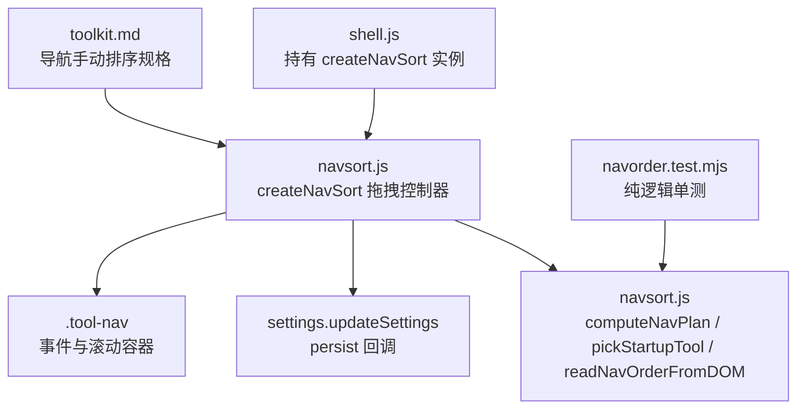
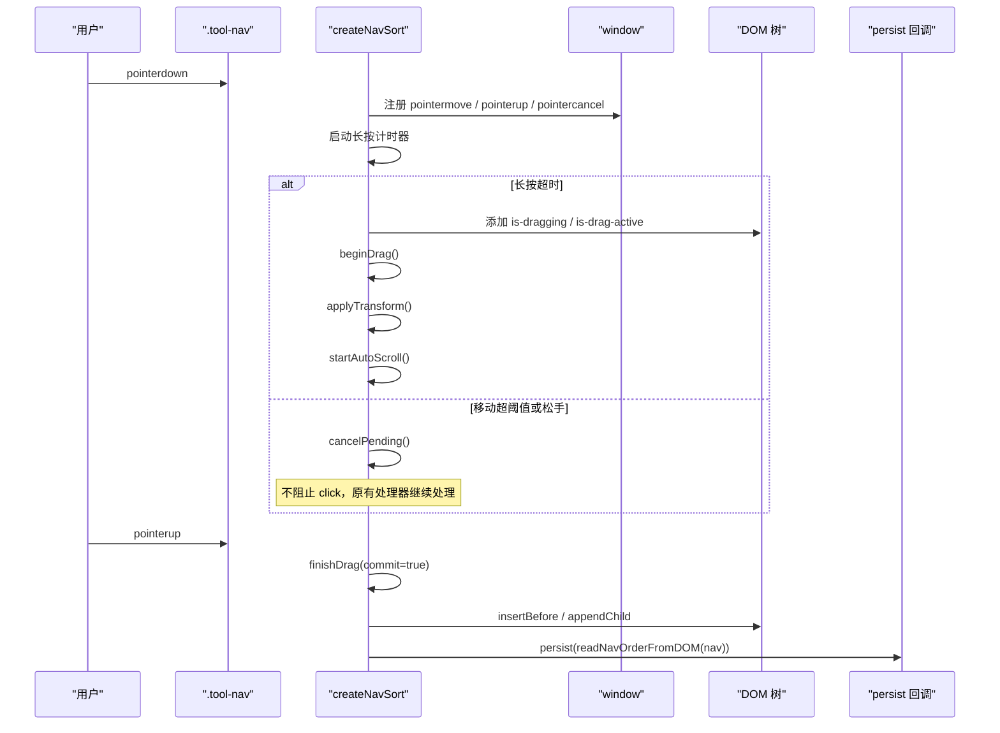
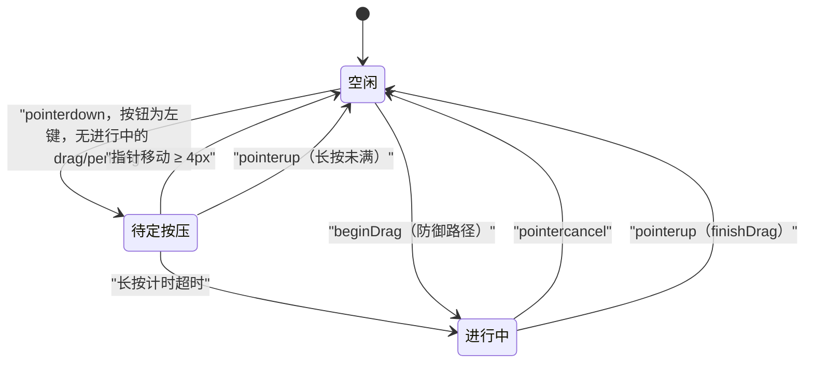
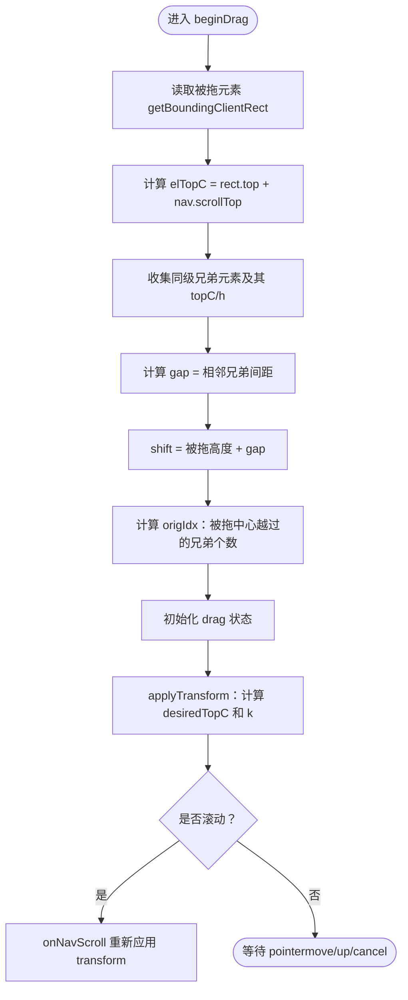
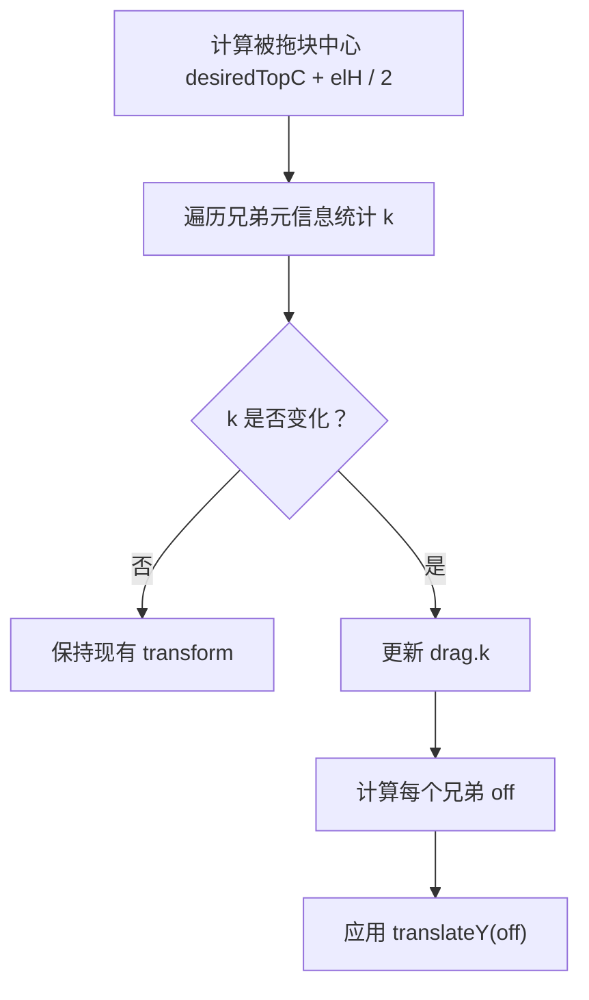
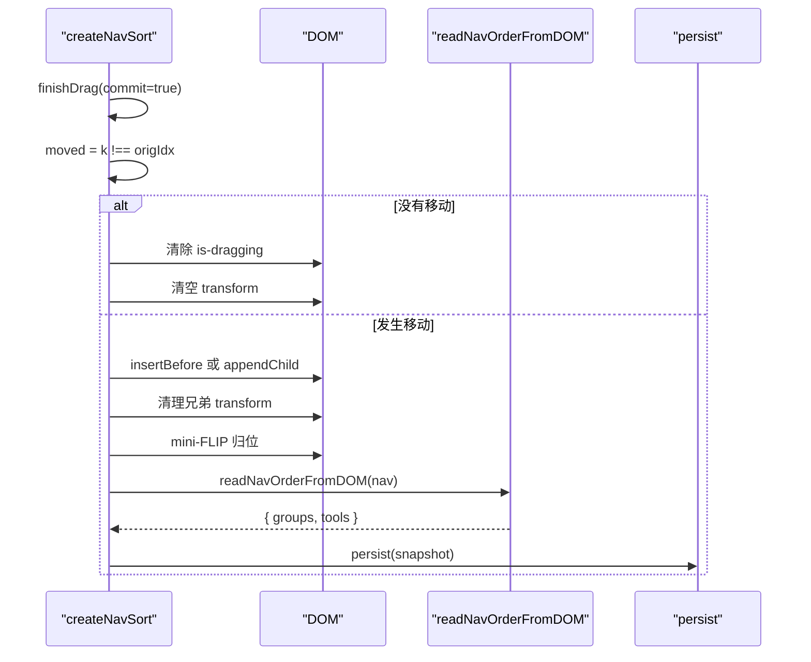
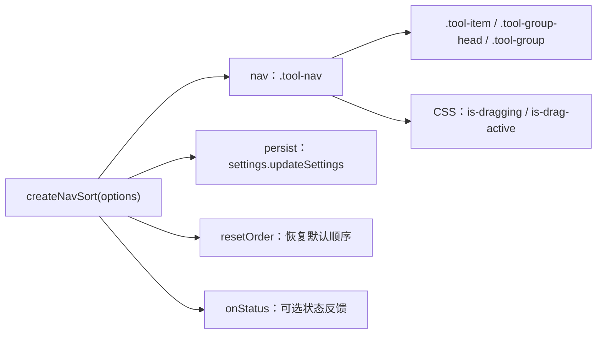

# 拖拽交互接口

<cite>
**本文引用的文件**   
- [navsort.js](file://app/src/shell/navsort.js)
- [toolkit.md](file://spec/modules/toolkit.md)
- [navorder.test.mjs](file://app/tests/navorder.test.mjs)
</cite>

## 目录
1. [引言](#引言)
2. [项目结构定位](#项目结构定位)
3. [核心组件](#核心组件)
4. [架构总览](#架构总览)
5. [详细组件分析](#详细组件分析)
6. [依赖关系分析](#依赖关系分析)
7. [性能与可访问性](#性能与可访问性)
8. [故障排查指南](#故障排查指南)
9. [结论](#结论)

## 引言
本文面向番茄混淆桌面版左侧导航的「长按拖动排序」交互，聚焦 `createNavSort` 函数及其配套纯逻辑。该设计的目标是：用户只需长按工具条目或分组标题即可进入拖拽状态，无需开启专门的排序模式；普通点击行为（切换工具、展开/收起分组）完全不受影响；拖拽结束后把视觉顺序映射回 DOM 并持久化到设置中。

关键约束包括：
- 长按检测使用约 400ms 延迟阈值和 4px 移动取消阈值。
- Pointer Events 处理 `pointerdown` / `pointermove` / `pointerup` / `pointercancel`，不依赖 `setPointerCapture` 的正确性。
- 坐标统一采用内容坐标 `clientY + nav.scrollTop`，以屏蔽容器滚动和列表自身滚动的干扰。
- 被拖元素呈现玻璃卡效果，兄弟元素通过 `transform` 让位，松手后执行 mini-FLIP 动画落位。
- 拖拽类型分为两类：工具条目（组内移动）和分组标题（整组移动）。

## 项目结构定位
导航排序功能位于前端 shell 层，由两个层面组成：

| 层次 | 文件 | 职责 |
|---|---|---|
| 纯逻辑层 | [navsort.js](file://app/src/shell/navsort.js) | 计算渲染顺序、选择启动工具、从 DOM 读取已排顺序、提供拖拽控制器 |
| 规格说明层 | [toolkit.md](file://spec/modules/toolkit.md) | 描述导航手动排序的用户需求、交互规则、持久化约定和降级策略 |
| 单测层 | [navorder.test.mjs](file://app/tests/navorder.test.mjs) | 验证 `computeNavPlan` 和 `pickStartupTool` 的数据净化与幂等行为 |

**图示来源**
- [navsort.js:1-388](file://app/src/shell/navsort.js#L1-L388)
- [toolkit.md:1-83](file://spec/modules/toolkit.md#L1-L83)
- [navorder.test.mjs:1-127](file://app/tests/navorder.test.mjs#L1-L127)

**章节来源**
- [navsort.js:1-60](file://app/src/shell/navsort.js#L1-L60)
- [toolkit.md:1-83](file://spec/modules/toolkit.md#L1-L83)

## 核心组件
`createNavSort` 是一个工厂函数，返回一个带 `cancelDrag` 方法的对象。它负责：

| 能力 | 说明 |
|---|---|
| 长按检测 | `pointerdown` 起计时器，约 400ms 才升级成拖拽 |
| 按压取消 | 长按未到时指针移动超过 4px 或松手，视为普通点击 |
| 拖拽类型区分 | `.tool-item` 为工具条目，`.tool-group-head` 为分组标题 |
| 视觉反馈 | 被拖条增加 `is-dragging` 类，兄弟元素用 `translateY` 让位 |
| 坐标处理 | 全部按内容坐标计算，自动跟随 `nav.scrollTop` |
| 自动滚动 | 接近列表上下边缘时加速滚动 |
| DOM 重排 | 松手后按视觉插入位置调用 `insertBefore` 或 `appendChild` |
| 持久化 | 调用 `readNavOrderFromDOM` 生成快照，交给 `persist` 回调 |
| 防御收尾 | 重建 DOM 前调用 `cancelDrag`，避免带着拖拽状态重新挂载 |

**章节来源**
- [navsort.js:61-120](file://app/src/shell/navsort.js#L61-L120)
- [navsort.js:121-200](file://app/src/shell/navsort.js#L121-L200)
- [navsort.js:201-388](file://app/src/shell/navsort.js#L201-L388)

## 架构总览
`createNavSort` 与外部系统的协作关系如下：

**图示来源**
- [navsort.js:121-200](file://app/src/shell/navsort.js#L121-L200)
- [navsort.js:201-388](file://app/src/shell/navsort.js#L201-L388)

## 详细组件分析

### 拖拽类型区分：工具条目 vs 分组标题
拖拽入口在 `pointerdown` 中判断目标元素：

| 拖拽起点 | CSS 选择器 | 拖拽范围 | 语义 |
|---|---|---|---|
| 工具条目 | `.tool-item` | 同组 `.tool-item` 之间 | 组内移动，不跨组 |
| 分组标题 | `.tool-group-head` | `.tool-group` 之间 | 整组移动，改变分组顺序 |

实现上，若命中 `.tool-item`，则 `kind = 'tool'`；若命中 `.tool-group-head`，则向上找到其父级 `.tool-group`，`kind = 'group'`。后续兄弟元素集合、父容器、插入目标都根据 `kind` 分支计算。

**章节来源**
- [navsort.js:121-170](file://app/src/shell/navsort.js#L121-L170)
- [navsort.js:201-240](file://app/src/shell/navsort.js#L201-L240)

### 长按检测与点击保护机制
长按流程不是简单的“按住即拖”，而是三段式状态机：

关键参数：

| 参数 | 值 | 含义 |
|---|---:|---|
| `LONG_PRESS_MS` | 400 | 长按阈值，毫秒 |
| `CANCEL_MOVE_PX` | 4 | 放弃按压的移动阈值，像素 |
| `CLICK_GUARD_MS` | 500 | 拖拽结束后拦截 click 的时间窗，毫秒 |

点击保护分两层：
1. `pending` 阶段：如果长按未到就松手，不调用任何拖拽逻辑，只清理监听器和计时器，让浏览器正常派发 `click`。
2. `drag` 阶段：只要曾经进入过拖拽（含原地松手、取消），`dragEndedAt` 会被更新；nav 在捕获阶段拦截 500ms 内的 `click`，防止拖完后误切工具或误折叠分组。

**章节来源**
- [navsort.js:121-170](file://app/src/shell/navsort.js#L121-L170)
- [navsort.js:171-200](file://app/src/shell/navsort.js#L171-L200)
- [navsort.js:201-240](file://app/src/shell/navsort.js#L201-L240)

### 拖拽视觉反馈
拖拽视觉反馈由三类样式变化共同完成：

| 阶段 | 被拖元素 | 兄弟元素 | 容器 |
|---|---|---|---|
| 按下但未开始拖 | 无 | 无 | 无 |
| 开始拖 | 添加 `is-dragging`，应用 `translateY` 和放大 | 按需应用 `translateY` 让位 | 添加 `is-drag-active` |
| 拖拽结束 | 清除 transform，执行 mini-FLIP 归位 | 清空 transform | 清除 `is-drag-active` |

其中：
- `is-dragging` 表示“已被拿起”，通常配合玻璃卡阴影、轻微缩放等视觉效果。
- `is-drag-active` 用于临时放开 `.tool-group-items` 的 `overflow: hidden`，避免玻璃卡阴影和兄弟让位位移被裁剪。
- 兄弟元素的让位动画仅通过 `transform`，不触发布局回流。
- 当系统启用“减少动态效果”时，CSS 会降速让位和落位动画，但拖拽跟随不受影响。

**章节来源**
- [navsort.js:241-300](file://app/src/shell/navsort.js#L241-L300)
- [toolkit.md:1-83](file://spec/modules/toolkit.md#L1-L83)

### 坐标计算与滚动处理
坐标体系的核心原则是：**所有纵向位置都使用内容坐标**。

| 场景 | 计算方式 | 目的 |
|---|---|---|
| 元素顶部 | `rect.top + nav.scrollTop` | 忽略 `.tool-nav` 容器的滚动偏移 |
| 指针纵向位置 | `clientY + nav.scrollTop` | 拖拽中指针粘在被拖元素相对抓取点的位置 |
| 兄弟元素静态位置 | 拖拽开始时一次性量取 | 避免 `transform` 后的测量结果错误 |
| 拖拽目标位置 | `desiredTopC = pointerC - grabDy` | 让被拖块中心随指针移动 |
| 滚动回调 | `onNavScroll` 调用 `applyTransform(null)` | 用户滚轮或自动滚动后仍保持指针跟随 |

抓取点 `grabDy` 是“指针内容坐标减去被拖元素顶部内容坐标”，因此即使列表滚动，被拖块也能始终对齐指针。

**图示来源**
- [navsort.js:241-300](file://app/src/shell/navsort.js#L241-L300)

**章节来源**
- [navsort.js:201-240](file://app/src/shell/navsort.js#L201-L240)
- [navsort.js:241-300](file://app/src/shell/navsort.js#L241-L300)

### 让位算法与插入位置
让位算法的关键变量：

| 变量 | 含义 |
|---|---|
| `origIdx` | 拖拽开始时的原位插入序 |
| `k` | 当前视觉插入序，等于被拖块中心越过的兄弟个数 |
| `shift` | 每个兄弟让位的像素距离，等于被拖块高度加兄弟间距 |
| `sibMeta` | 拖拽开始时采集的兄弟元素元信息 |

让位规则：

| 条件 | 受影响兄弟 | 偏移方向 |
|---|---|---|
| `k > origIdx` | 下标 ∈ `[origIdx, k)` | 上移 `-shift` |
| `k < origIdx` | 下标 ∈ `[k, origIdx)` | 下移 `+shift` |
| `k === origIdx` | 无 | 不动 |

这种设计的优点是：
- 兄弟元素高度可以不一致（分组展开/收起混在一起）。
- 让位偏移与被拖块高度相关，而不是兄弟高度。
- `transform` 不会触发回流，频繁更新性能较好。

**图示来源**
- [navsort.js:241-300](file://app/src/shell/navsort.js#L241-L300)

**章节来源**
- [navsort.js:241-300](file://app/src/shell/navsort.js#L241-L300)

### 拖拽结束与数据持久化
拖拽结束时，`finishDrag` 负责：

1. 清理定时器、滚动监听、窗口事件监听。
2. 移除 `is-drag-active` 和滚动监听。
3. 判断是否发生真实移动：`moved = commit && k !== origIdx`。
4. 如果没有移动：
   - 清除 `is-dragging`。
   - 清空 transform，让元素平滑回到当前位置。
5. 如果发生移动：
   - 根据 `k` 决定插入目标：有兄弟则 `insertBefore`，否则 `appendChild`。
   - 清空兄弟的 transform。
   - 执行 mini-FLIP：先清 transform 获取新自然位置，再临时设置 transform 到旧视觉位置，强制回流后过渡到最终位置。
   - 调用 `readNavOrderFromDOM(nav)` 生成完整顺序快照。
   - 调用 `persist(snapshot)` 落盘。

**图示来源**
- [navsort.js:301-388](file://app/src/shell/navsort.js#L301-L388)

**章节来源**
- [navsort.js:301-388](file://app/src/shell/navsort.js#L301-L388)

### 纯逻辑组件：渲染顺序与启动工具
除了拖拽交互，`navsort.js` 还导出三个纯函数：

| 函数 | 输入 | 输出 | 职责 |
|---|---|---|---|
| `computeNavPlan` | `groups`、`tools`、`saved` | 排序后的分组计划 | 净化用户保存的顺序，回退默认，保证不丢工具 |
| `pickStartupTool` | 分组计划 | 工具声明或 `null` | 返回排在最前的非空分组中的第一个工具 |
| `readNavOrderFromDOM` | `.tool-nav` 元素 | `{ groups, tools }` | 从当前 DOM 快照导航顺序 |

`computeNavPlan` 的净化规则包括：
- 整个 `saved` 不是普通对象时回退默认。
- `saved.groups` 只保留已知分组 id，去重，忽略 `'other'`。
- `saved.tools[groupId]` 只保留真正属于该组的工具 id，去重。
- 未排过的工具按 `order` 追加。
- `'other'` 组永远置底。

这些规则由单测覆盖，确保用户手工修改 `settings.json` 也不会导致工具丢失或跨组走私。

**章节来源**
- [navsort.js:1-60](file://app/src/shell/navsort.js#L1-L60)
- [navorder.test.mjs:1-127](file://app/tests/navorder.test.mjs#L1-L127)

## 依赖关系分析
`createNavSort` 对外部环境的耦合点如下：

| 依赖 | 用途 | 耦合强度 | 风险 |
|---|---|---|---|
| `nav` | 拖拽容器、事件源、滚动容器 | 高 | 必须传入正确 `.tool-nav` |
| `persist` | 写 `settings.navOrder` | 中 | 失败不应阻塞 UI |
| `resetOrder` | “恢复默认顺序”按钮回调 | 低 | 可选回调 |
| `onStatus` | 状态栏反馈 | 低 | 可选回调 |
| DOM 选择器 | `.tool-item`、`.tool-group-head`、`.tool-group`、`.tool-group-items` | 中 | 渲染结构变更会影响拖拽 |
| Pointer Events | `pointerdown/move/up/cancel` | 高 | 合成环境可能不支持 capture |
| CSS 类名 | `is-dragging`、`is-drag-active` | 中 | 样式缺失会导致视觉异常 |

**图示来源**
- [navsort.js:121-200](file://app/src/shell/navsort.js#L121-L200)
- [navsort.js:301-388](file://app/src/shell/navsort.js#L301-L388)

**章节来源**
- [navsort.js:121-200](file://app/src/shell/navsort.js#L121-L200)
- [navsort.js:301-388](file://app/src/shell/navsort.js#L301-L388)

## 性能与可访问性
- **触摸友好**：使用 Pointer Events，而非 Mouse Events，天然支持鼠标、触控笔和触摸屏。
- **低开销让位**：兄弟元素让位使用 `transform`，避免频繁回流。
- **批量采样**：兄弟元素静态位置在拖拽开始时一次性采集，拖拽过程中不再查询。
- **节流合理**：自动滚动使用 `requestAnimationFrame`，按帧推进。
- **防抖点击**：拖拽结束后 500ms 内拦截 click，避免误操作。
- **无障碍提示**：规格文档指出悬停显示抓手、光标变为 grab，暗示长按可拖。
- **减少动效兼容**：遵循全局“减少动态效果”规则，让位和落位动画降速，拖拽跟随不变。

**章节来源**
- [navsort.js:241-388](file://app/src/shell/navsort.js#L241-L388)
- [toolkit.md:1-83](file://spec/modules/toolkit.md#L1-L83)

## 故障排查指南

| 现象 | 可能原因 | 排查步骤 | 建议处理 |
|---|---|---|---|
| 长按没反应 | 不是左键、已有 pending/drag、目标不在 `.tool-item` 或 `.tool-group-head` | 检查 `event.button`、`drag`、`pending`、`closest` 结果 | 确认点击的是可拖元素 |
| 长按一移动就取消 | 移动超过 4px | 查看 `CANCEL_MOVE_PX` 和 `Math.hypot` 判定 | 这是预期行为，防止误触 |
| 拖完还能切工具 | 拖拽结束后 500ms 外 click 未被拦截 | 检查 `dragEndedAt` 和捕获阶段 click 监听 | 属于正常放行窗口 |
| 拖拽后布局错乱 | 拖拽期间触发了重渲染 | 检查是否在拖拽状态下调用了 `renderNav` | 先调用 `cancelDrag` 再重建 DOM |
| 兄弟元素没有让位 | 兄弟元素没有 `transform` 或 CSS 选择器变更 | 检查 `.tool-group-items` 是否包含兄弟元素 | 核对渲染结构和 CSS |
| 自动滚动不工作 | `nav.getBoundingClientRect()` 或 `requestAnimationFrame` 异常 | 检查容器尺寸和 RAF 可用性 | 在非浏览器环境降级 |
| 设置没有落盘 | `persist` 不是函数或抛出异常 | 检查 `typeof persist === 'function'` 和 try/catch | 落盘失败不应阻断界面 |
| 重置按钮无效 | 没有 `btnSortReset` 或 `resetOrder` | 检查按钮 ID 和回调 | 由 shell 控制按钮显隐和回调 |

**章节来源**
- [navsort.js:121-200](file://app/src/shell/navsort.js#L121-L200)
- [navsort.js:201-388](file://app/src/shell/navsort.js#L201-L388)

## 结论
`createNavSort` 将导航排序从“显式排序模式”迁移为“零门槛长按拖动”。它通过清晰的长按状态机、稳定的内容坐标体系、基于 `transform` 的低成本让位动画，以及完整的视觉—DOM—设置闭环，实现了以下体验目标：

- 长按约 400ms 即可拖动，无需切换模式。
- 工具条目只在组内移动，分组标题可移动整组。
- 普通点击完全不受影响。
- 拖拽视觉反馈明确，兄弟元素让位自然。
- 松手后自动把视觉顺序映射回 DOM，并持久化到 `settings.navOrder`。
- 在重渲染、取消、合成指针等边界条件下具备防御能力。

对于扩展者而言，新增工具或调整导航结构时，应优先保证 `.tool-item`、`.tool-group-head`、`.tool-group`、`.tool-group-items` 等选择器稳定，并确保在拖拽进行中不重建 `.tool-nav`。若需要新的排序语义，应在 `computeNavPlan` 和 `createNavSort` 之间保持“纯逻辑层”与“交互层”的清晰边界。