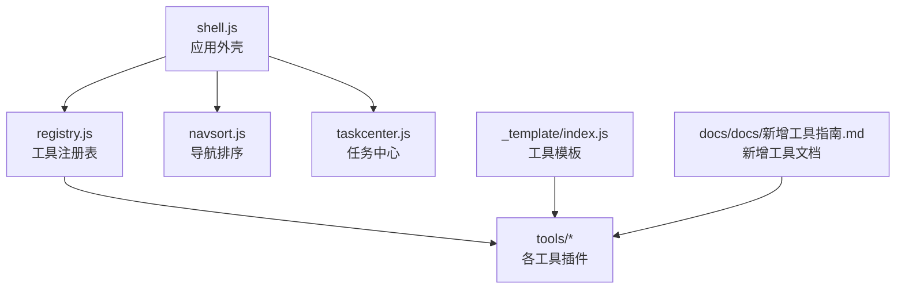
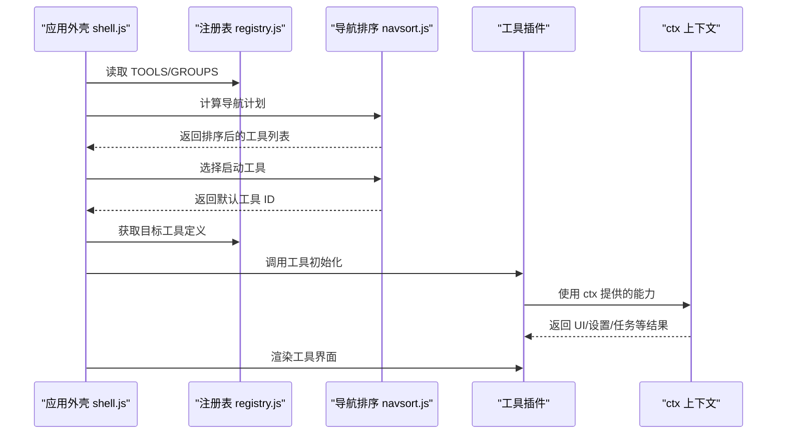
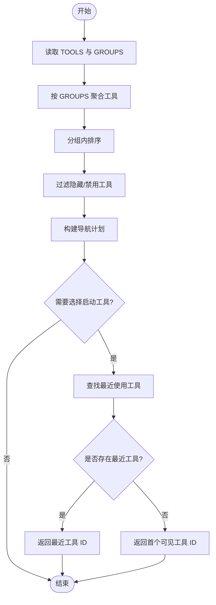
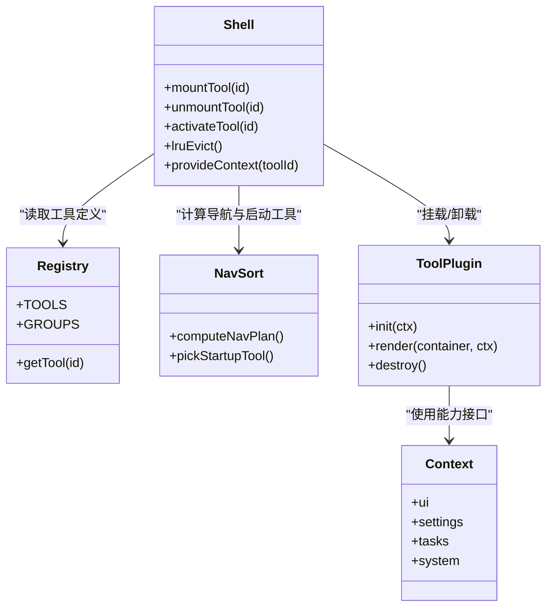
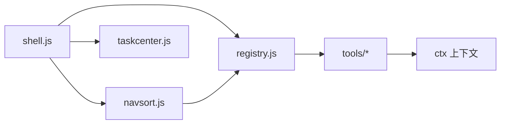

# 插件式工具架构

<cite>
**本文引用的文件**   
- [app/src/shell/registry.js](file://app/src/shell/registry.js)
- [app/src/shell/navsort.js](file://app/src/shell/navsort.js)
- [app/src/shell/shell.js](file://app/src/shell/shell.js)
- [app/src/tools/_template/index.js](file://app/src/tools/_template/index.js)
- [docs/docs/新增工具指南.md](file://docs/docs/新增工具指南.md)
- [spec/modules/toolkit.md](file://spec/modules/toolkit.md)
</cite>

## 目录
1. [引言](#引言)
2. [项目结构](#项目结构)
3. [核心组件](#核心组件)
4. [架构总览](#架构总览)
5. [详细组件分析](#详细组件分析)
6. [依赖关系分析](#依赖关系分析)
7. [性能考量](#性能考量)
8. [故障排查指南](#故障排查指南)
9. [结论](#结论)
10. [附录：扩展现有分组与新增工具分组](#附录扩展现有分组与新增工具分组)

## 引言
本文面向“番茄混淆桌面版”的插件式工具箱，目标是帮助开发者理解并扩展该框架。文档围绕以下关键点展开：
- 每个工具作为独立插件模块，遵循统一结构规范。
- 通过 registry.js 中的 TOOLS 数组完成工具注册，GROUPS 组织导航分组。
- 工具生命周期由框架管理，包含挂载、卸载和 LRU 保活策略。
- 工具与框架解耦：通过 ctx 上下文对象提供能力接口，避免工具直接操作 DOM 或系统资源。
- 导航排序算法 computeNavPlan 与 pickStartupTool 决定启动顺序与展示顺序。
- 如何扩展现有工具组与新增工具分组。

## 项目结构
本项目采用“框架 + 工具插件”的分层组织方式：
- shell 层负责 UI 外壳、导航、任务中心与工具编排。
- tools 层按功能划分工具包，每个工具包包含 index.js（插件入口）、ui.js（界面逻辑）、styles.css（样式）以及 core/（核心实现）。
- _template 提供标准模板，用于快速创建新工具。
- docs/spec 提供新增工具指南与模块规格说明。

**图表来源**
- [app/src/shell/shell.js](file://app/src/shell/shell.js)
- [app/src/shell/registry.js](file://app/src/shell/registry.js)
- [app/src/shell/navsort.js](file://app/src/shell/navsort.js)
- [app/src/tools/_template/index.js](file://app/src/tools/_template/index.js)
- [docs/docs/新增工具指南.md](file://docs/docs/新增工具指南.md)

**章节来源**
- [app/src/shell/shell.js](file://app/src/shell/shell.js)
- [app/src/shell/registry.js](file://app/src/shell/registry.js)
- [app/src/shell/navsort.js](file://app/src/shell/navsort.js)
- [app/src/tools/_template/index.js](file://app/src/tools/_template/index.js)
- [docs/docs/新增工具指南.md](file://docs/docs/新增工具指南.md)

## 核心组件
- 工具注册表 registry.js
  - 维护 TOOLS 数组，描述所有可用工具及其元数据。
  - 维护 GROUPS 分组，组织工具的导航分组与显示顺序。
- 导航排序 navsort.js
  - computeNavPlan：根据分组、排序规则生成最终导航计划。
  - pickStartupTool：选择首次启动时默认加载的工具。
- 应用外壳 shell.js
  - 协调工具挂载、卸载、LRU 保活。
  - 为工具实例提供 ctx 上下文，封装 UI、设置、任务等能力。
- 工具模板 _template/index.js
  - 定义工具插件的最小可运行结构，包括元信息、UI 挂载点与初始化流程。

**章节来源**
- [app/src/shell/registry.js](file://app/src/shell/registry.js)
- [app/src/shell/navsort.js](file://app/src/shell/navsort.js)
- [app/src/shell/shell.js](file://app/src/shell/shell.js)
- [app/src/tools/_template/index.js](file://app/src/tools/_template/index.js)

## 架构总览
下图展示了工具、框架与注册表的交互关系：
- 工具插件通过 registry.js 暴露元数据，供框架扫描。
- shell.js 在启动时依据 navsort.js 的计算结果决定默认工具，并在用户切换时按需挂载。
- 工具运行时通过 ctx 访问 UI、设置、任务队列等能力，不直接操作 DOM 或系统资源。

**图表来源**
- [app/src/shell/shell.js](file://app/src/shell/shell.js)
- [app/src/shell/registry.js](file://app/src/shell/registry.js)
- [app/src/shell/navsort.js](file://app/src/shell/navsort.js)

## 详细组件分析

### 工具注册表 registry.js
- TOOLS 数组
  - 每个元素描述一个工具，通常包含 id、名称、分组、图标、是否支持后台处理、最小尺寸等元数据。
  - 框架通过遍历 TOOLS 构建工具索引，并为每个工具生成唯一标识。
- GROUPS 分组
  - 将多个工具按业务领域组织，如媒体处理、文档转换、图像增强等。
  - 分组顺序影响导航栏展示顺序；分组内部可通过 TOOLS 的顺序或额外字段控制排序。

典型职责：
- 导出 TOOLS 与 GROUPS，供 shell 与 navsort 读取。
- 保证工具元数据的稳定性与一致性，便于测试与文档生成。

**章节来源**
- [app/src/shell/registry.js](file://app/src/shell/registry.js)

### 导航排序 navsort.js
- computeNavPlan
  - 输入：TOOLS、GROUPS、用户偏好（如有）。
  - 输出：按分组与排序规则生成的导航计划，用于渲染左侧导航栏。
  - 关键逻辑：
    - 先按 GROUPS 顺序聚合工具。
    - 在每个分组内按 TOOLS 的定义顺序或优先级排序。
    - 对隐藏或禁用的工具进行过滤。
- pickStartupTool
  - 输入：TOOLS、GROUPS、上次使用的工具记录（如有）。
  - 输出：推荐的首次启动工具 ID。
  - 关键逻辑：
    - 优先选择最近使用的工具。
    - 若无历史记录，则选择第一个可见且可用的工具。
    - 若存在标记为“建议启动”的工具，可将其作为兜底。

**图表来源**
- [app/src/shell/navsort.js](file://app/src/shell/navsort.js)

**章节来源**
- [app/src/shell/navsort.js](file://app/src/shell/navsort.js)

### 应用外壳 shell.js
- 工具生命周期
  - 挂载：当用户选择某工具时，shell.js 从 registry.js 解析工具定义，调用工具的初始化函数，并将其 UI 挂载到指定容器。
  - 卸载：当工具被切换出可视区域或达到 LRU 上限时，shell.js 调用工具的销毁函数，释放资源。
  - LRU 保活：维护一个“活跃工具池”，限制最大数量；每次激活新工具时将旧工具按最近使用时间淘汰。
- ctx 上下文
  - 为工具提供统一的能力接口，例如：
    - UI 能力：创建控件、更新状态、监听事件。
    - 设置能力：读写用户配置。
    - 任务能力：提交后台任务、获取进度与结果。
    - 系统能力：文件选择、路径处理、日志输出。
  - 工具不得直接操作 DOM 或系统 API，必须通过 ctx 调用，以保障隔离性与可测试性。

**图表来源**
- [app/src/shell/shell.js](file://app/src/shell/shell.js)
- [app/src/shell/registry.js](file://app/src/shell/registry.js)
- [app/src/shell/navsort.js](file://app/src/shell/navsort.js)
- [app/src/tools/_template/index.js](file://app/src/tools/_template/index.js)

**章节来源**
- [app/src/shell/shell.js](file://app/src/shell/shell.js)

### 工具模板 _template/index.js
- 模板定义了工具插件的标准入口：
  - 声明工具元数据（id、名称、分组等），以便被 registry.js 识别。
  - 提供 init 与 render 方法，接收 ctx 上下文。
  - 提供 destroy 方法，用于清理定时器、事件监听与 DOM 引用。
- 开发新工具时应复制模板并修改：
  - 保持 id 唯一。
  - 将工具加入 GROUPS 对应分组。
  - 在 ui.js 中实现界面交互，在 core/ 中实现核心逻辑。

**章节来源**
- [app/src/tools/_template/index.js](file://app/src/tools/_template/index.js)

### 工具与框架的解耦设计
- 通过 ctx 抽象能力边界：
  - UI：避免工具直接操作 DOM，减少副作用。
  - 设置：集中管理用户偏好，便于迁移与恢复。
  - 任务：统一调度后台工作，避免阻塞主线程。
  - 系统：封装文件、路径、日志等操作，提升安全性与可移植性。
- 优势：
  - 工具之间互不感知，降低耦合。
  - 更容易编写单元测试与集成测试。
  - 便于替换底层实现而不影响工具代码。

**章节来源**
- [app/src/shell/shell.js](file://app/src/shell/shell.js)
- [spec/modules/toolkit.md](file://spec/modules/toolkit.md)

## 依赖关系分析
- shell.js 依赖：
  - registry.js：获取 TOOLS 与 GROUPS。
  - navsort.js：计算导航计划与启动工具。
  - taskcenter.js：管理任务的执行与进度。
- navsort.js 依赖：
  - registry.js：读取 TOOLS 与 GROUPS。
- 工具插件依赖：
  - ctx：由 shell.js 注入，提供统一能力。
  - 可选依赖 core/ 下的实现模块。

**图表来源**
- [app/src/shell/shell.js](file://app/src/shell/shell.js)
- [app/src/shell/registry.js](file://app/src/shell/registry.js)
- [app/src/shell/navsort.js](file://app/src/shell/navsort.js)

**章节来源**
- [app/src/shell/shell.js](file://app/src/shell/shell.js)
- [app/src/shell/registry.js](file://app/src/shell/registry.js)
- [app/src/shell/navsort.js](file://app/src/shell/navsort.js)

## 性能考量
- LRU 保活
  - 限制活跃工具数量，避免同时挂载过多 UI 与后台任务。
  - 建议在工具销毁时主动释放大对象、取消网络请求与清理定时器。
- 导航计算
  - computeNavPlan 应在应用启动或分组变化时计算一次，避免频繁重算。
  - 对大型工具集合可考虑分页或懒加载分组。
- 工具初始化
  - 避免在 init 中进行耗时操作，必要时拆分为异步初始化与延迟加载。
- 任务队列
  - 使用 taskcenter.js 统一管理任务，避免重复任务与资源竞争。

[本节为通用性能指导，不直接分析具体文件]

## 故障排查指南
- 工具未出现在导航栏
  - 检查 registry.js 中 TOOLS 是否已添加且未被隐藏。
  - 确认 GROUPS 分组是否正确引用该工具。
  - 验证 navsort.js 的 computeNavPlan 是否过滤了该工具。
- 启动工具不正确
  - 检查 pickStartupTool 的选择逻辑，确认最近使用记录是否存在。
  - 校验是否有“建议启动”标记覆盖默认行为。
- 工具无法卸载或内存泄漏
  - 检查 destroy 方法是否释放了 DOM 引用、事件监听与定时器。
  - 确保 ctx.ui 与 ctx.tasks 的资源已被正确清理。
- 工具越权访问 DOM 或系统资源
  - 移除工具中对 DOM 或系统 API 的直接调用，改用 ctx 提供的能力。
  - 在 shell.js 中审查 ctx 的实现，确保能力边界清晰。

**章节来源**
- [app/src/shell/shell.js](file://app/src/shell/shell.js)
- [app/src/shell/navsort.js](file://app/src/shell/navsort.js)
- [app/src/shell/registry.js](file://app/src/shell/registry.js)

## 结论
本插件式工具架构通过 registry.js 与 navsort.js 将工具元数据与导航逻辑解耦，shell.js 作为协调者负责工具的生命周期管理与 ctx 上下文注入。该设计提升了可扩展性、可测试性与可维护性。开发者只需遵循模板结构与 ctx 接口，即可快速新增工具或扩展分组。

[本节为总结性内容，不直接分析具体文件]

## 附录：扩展现有分组与新增工具分组
- 扩展现有分组
  - 在 registry.js 的 GROUPS 中找到目标分组。
  - 将新工具的 id 加入该分组的工具列表。
  - 如需调整顺序，可在 TOOLS 中调整定义顺序或使用分组内的排序字段。
- 新增工具分组
  - 在 registry.js 新增 GROUPS 条目，定义分组名称与顺序。
  - 为该分组分配一组工具，或在后续迭代中逐步增加。
- 新增工具
  - 参考 _template/index.js 创建工具目录与文件。
  - 在工具入口中声明元数据，并在 registry.js 中将工具加入某个分组。
  - 在 ui.js 中实现界面逻辑，在 core/ 中实现核心算法。
  - 在 docs/docs/新增工具指南.md 中补充使用说明与示例。

**章节来源**
- [app/src/shell/registry.js](file://app/src/shell/registry.js)
- [app/src/tools/_template/index.js](file://app/src/tools/_template/index.js)
- [docs/docs/新增工具指南.md](file://docs/docs/新增工具指南.md)