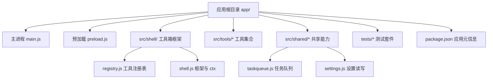
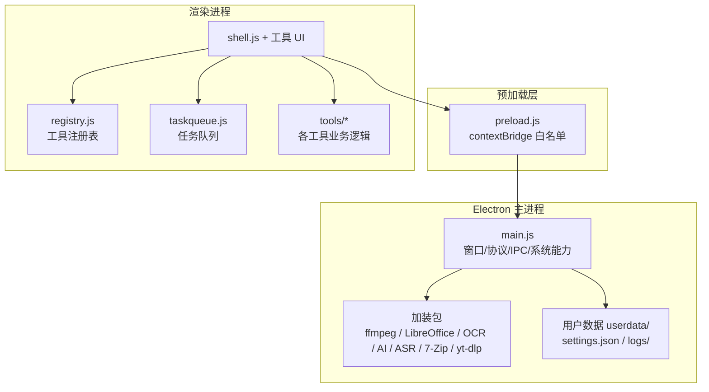
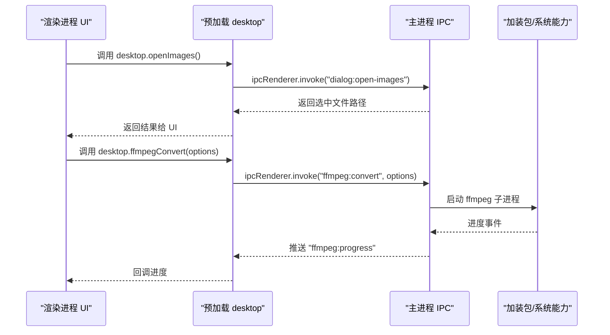
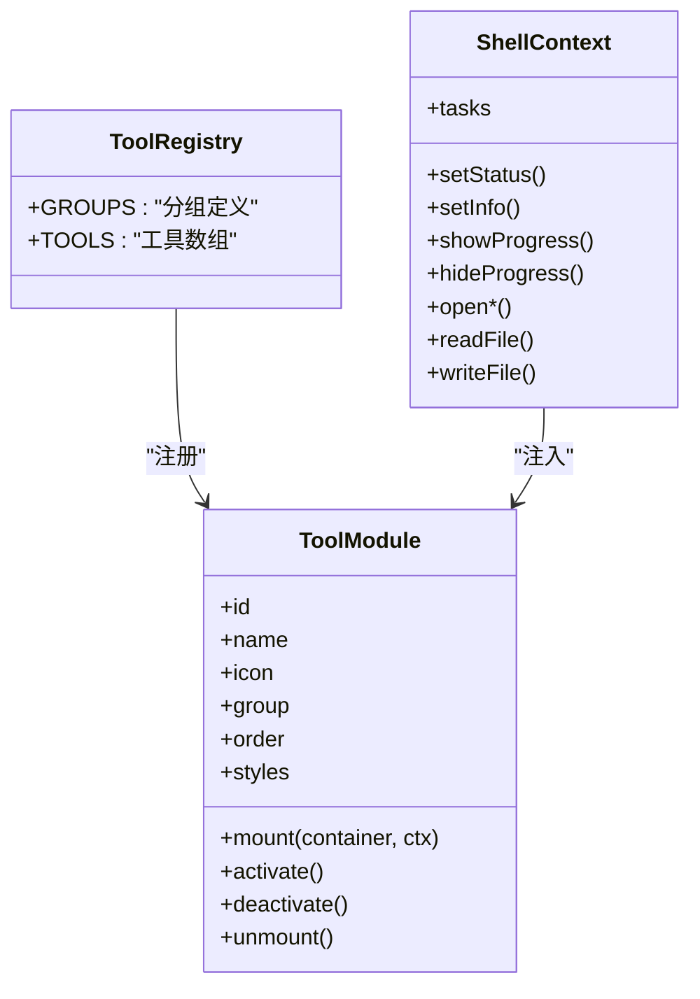
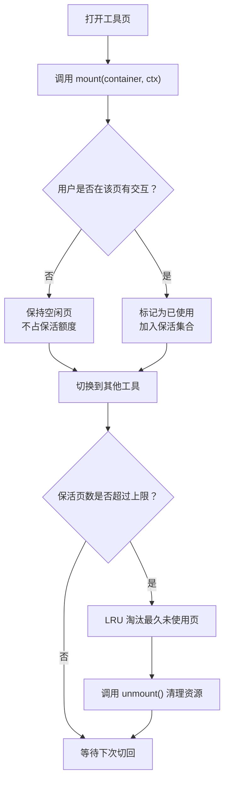
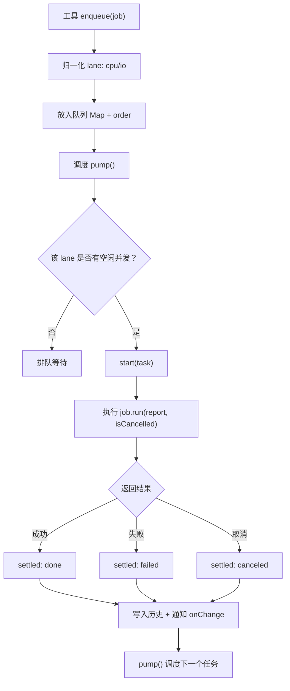
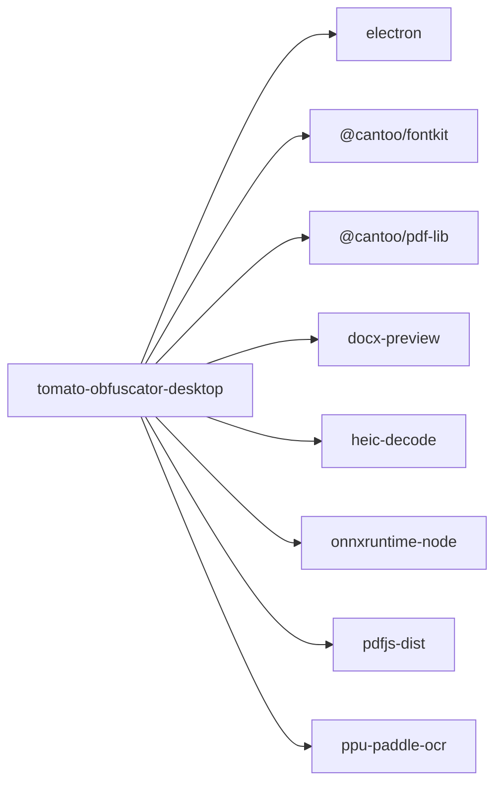
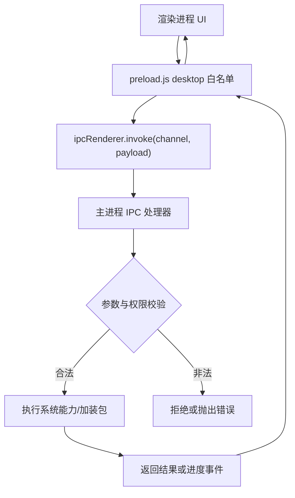
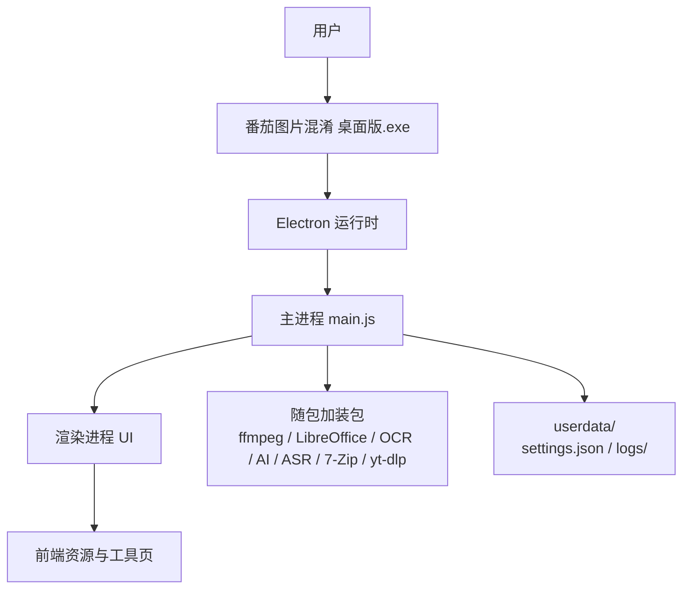

# 架构设计

<cite>
**本文引用的文件**   
- [README.md](file://README.md)
- [AGENTS.md](file://AGENTS.md)
- [app/main.js](file://app/main.js)
- [app/preload.js](file://app/preload.js)
- [app/package.json](file://app/package.json)
- [app/src/shell/registry.js](file://app/src/shell/registry.js)
- [app/src/shell/shell.js](file://app/src/shell/shell.js)
- [app/src/shared/taskqueue.js](file://app/src/shared/taskqueue.js)
- [spec/modules/toolkit.md](file://spec/modules/toolkit.md)
- [docs/新增工具指南.md](file://docs/新增工具指南.md)
</cite>

## 目录
1. [引言](#引言)
2. [项目结构](#项目结构)
3. [核心组件](#核心组件)
4. [架构总览](#架构总览)
5. [详细组件分析](#详细组件分析)
6. [依赖关系分析](#依赖关系分析)
7. [性能与保活策略](#性能与保活策略)
8. [安全边界与 IPC 白名单](#安全边界与-ipc-白名单)
9. [技术决策权衡](#技术决策权衡)
10. [基础设施与部署拓扑](#基础设施与部署拓扑)
11. [故障排查指南](#故障排查指南)
12. [结论](#结论)

## 引言
番茄混淆桌面版是一个面向 Windows 的 Electron 工具箱应用。它把移动端「番茄图片混淆」的能力迁移到桌面端，采用「工具箱」形态组织二十多个独立工具；除视频下载外，其余能力纯离线运行，并以免安装绿色版形式交付。主进程负责系统级能力、加装包调用和 IPC 桥接，渲染进程只负责用户界面；预加载脚本通过 `contextBridge` 暴露严格白名单方法，构成安全隔离边界。

本架构设计文档重点说明：
- Electron 双进程模型与安全桥接。
- 插件式工具注册机制、生命周期约定与 LRU 保活策略。
- IPC 白名单如何约束渲染进程权限。
- 整体架构图、数据流向与集成模式。
- 选择 Electron 的技术权衡、扩展性考虑与部署拓扑。

**章节来源**
- [README.md:1-120](file://README.md#L1-L120)
- [AGENTS.md:1-98](file://AGENTS.md#L1-L98)

## 项目结构
仓库以 `app/` 为 Electron 应用根目录，`app/src/` 下按三层组织：
- `shell/`：工具箱框架，包括工具注册表、左侧导航、主题、任务中心与通用上下文。
- `tools/<工具名>/`：每个工具自包含，通常包含入口声明、UI、样式与 `core/` 业务逻辑。
- `shared/`：跨工具复用模块，如设置读写、任务队列、图片 I/O、HEIC 解码等。

**图表来源**
- [app/main.js:1-200](file://app/main.js#L1-L200)
- [app/preload.js:1-193](file://app/preload.js#L1-L193)
- [app/src/shell/registry.js:1-67](file://app/src/shell/registry.js#L1-L67)
- [app/src/shell/shell.js:1-200](file://app/src/shell/shell.js#L1-L200)
- [app/src/shared/taskqueue.js:1-200](file://app/src/shared/taskqueue.js#L1-L200)
- [app/package.json:1-28](file://app/package.json#L1-L28)

**章节来源**
- [AGENTS.md:1-98](file://AGENTS.md#L1-L98)
- [app/package.json:1-28](file://app/package.json#L1-L28)

## 核心组件
- **主进程**：创建窗口、注册自定义媒体协议、处理系统对话框、读取/写入用户设置、调用 ffmpeg、LibreOffice、OCR、AI 放大、语音识别、压缩解压、视频下载等加装包能力。
- **预加载脚本**：通过 `contextBridge.exposeInMainWorld('desktop', ...)` 暴露有限 API，作为渲染进程与主进程之间的唯一授权通道。
- **工具箱框架**：由 `registry.js` 提供工具清单与分组，`shell.js` 实现工具页挂载、保活、LRU 回收、主题切换、任务中心与通用上下文 `ctx`。
- **任务队列**：跨工具共享的并发调度器，保证任务在工具页被 LRU 回收后仍可继续执行。
- **工具集合**：每个工具遵循统一接口，包含 `id`、`name`、`icon`、`group`、`order`、`styles`、`mount`、可选 `activate/deactivate/unmount`。

**章节来源**
- [app/main.js:1-200](file://app/main.js#L1-L200)
- [app/preload.js:1-193](file://app/preload.js#L1-L193)
- [app/src/shell/registry.js:1-67](file://app/src/shell/registry.js#L1-L67)
- [app/src/shell/shell.js:1-200](file://app/src/shell/shell.js#L1-L200)
- [app/src/shared/taskqueue.js:1-200](file://app/src/shared/taskqueue.js#L1-L200)
- [spec/modules/toolkit.md:1-83](file://spec/modules/toolkit.md#L1-L83)
- [docs/新增工具指南.md:1-83](file://docs/新增工具指南.md#L1-L83)

## 架构总览
应用采用典型的 Electron 双进程架构：主进程持有 Node 运行时和系统 API，渲染进程运行 Chromium 沙箱中的页面代码；预加载脚本是两者之间受控的安全桥梁。

**图表来源**
- [app/main.js:1-200](file://app/main.js#L1-L200)
- [app/preload.js:1-193](file://app/preload.js#L1-L193)
- [app/src/shell/registry.js:1-67](file://app/src/shell/registry.js#L1-L67)
- [app/src/shell/shell.js:1-200](file://app/src/shell/shell.js#L1-L200)
- [app/src/shared/taskqueue.js:1-200](file://app/src/shared/taskqueue.js#L1-L200)

**章节来源**
- [README.md:1-120](file://README.md#L1-L120)
- [AGENTS.md:1-98](file://AGENTS.md#L1-L98)

## 详细组件分析

### Electron 双进程模型与安全桥接
主进程职责集中在 `app/main.js`：
- 初始化 Electron 应用并禁用自动硬件加速用于界面测试场景。
- 注册 `tomato-media` 自定义协议，使播放器能使用 Range 分块流式播放大视频。
- 定义便携模式下的用户数据目录，并在自动测试模式下快照/还原 `settings.json`。
- 全局捕获未捕获异常与未处理 Promise 拒绝，写入 `logs/main.log`。
- 根据命令行参数启用各类自检模式，例如冒烟测试、端到端测试、PDF/媒体/音频/ASR/归档/播放器/藏图/卸载/视频下载/文档转换等。

预加载脚本 `app/preload.js` 是安全桥：
- 仅暴露 `desktop` 对象，内部方法全部通过 `ipcRenderer.invoke` 调用具体 IPC 通道。
- 白名单覆盖：应用信息、文件对话框、文件读写、批量重命名、专用文件选择器、文件藏图、视频播放器缓存管理、压缩解压、OCR、ffmpeg、HEIC 解码、AI 放大、语音识别、软件卸载、视频下载、PDF 与文档转换、设置读写、剪贴板等。
- 所有长耗时或需要原生能力的操作（如 ffmpeg 转码、OCR 识别、LibreOffice 转换）都在主进程中执行，避免在渲染进程直接加载原生模块。

**图表来源**
- [app/preload.js:1-193](file://app/preload.js#L1-L193)
- [app/main.js:1-200](file://app/main.js#L1-L200)

**章节来源**
- [app/main.js:1-200](file://app/main.js#L1-L200)
- [app/preload.js:1-193](file://app/preload.js#L1-L193)

### 插件式工具架构与生命周期
工具采用“注册即接入”的设计。`app/src/shell/registry.js` 是唯一的工具清单，导入各工具的 `index.js` 并汇总为 `TOOLS` 数组；同时维护 `GROUPS` 分组：图片、视频、音频、文档、压缩、系统。

新增工具必须遵循以下流程：
1. 复制 `_template` 模板到新工具目录。
2. 在工具 `index.js` 中导出标准声明：`id`、`name`、`icon`、`group`、`order`、`styles`、`mount` 等。
3. 将工具模块导入 `registry.js` 的 `TOOLS` 数组。
4. 如需新分组，先在 `GROUPS` 中增加分组定义。

框架层通过 `shell.js` 提供 `ctx` 上下文，工具不得直接操作受限 DOM 或绕过预加载白名单。

**图表来源**
- [app/src/shell/registry.js:1-67](file://app/src/shell/registry.js#L1-L67)
- [docs/新增工具指南.md:1-83](file://docs/新增工具指南.md#L1-L83)
- [spec/modules/toolkit.md:1-83](file://spec/modules/toolkit.md#L1-L83)

**章节来源**
- [app/src/shell/registry.js:1-67](file://app/src/shell/registry.js#L1-L67)
- [docs/新增工具指南.md:1-83](file://docs/新增工具指南.md#L1-L83)
- [spec/modules/toolkit.md:1-83](file://spec/modules/toolkit.md#L1-L83)

### 工具页保活与 LRU 回收策略
框架对工具页采用“保活优先、内存上限兜底”的策略：
- 首次进入时调用 `mount` 渲染工具界面。
- 切走工具时不销毁页面，而是从文档中取下容器，保留 DOM 和内部状态。
- 再次切回时重新插入文档，恢复上次状态。
- 对“动过”的工具页进行 LRU 保活，最多同时保活 5 个页面。
- “没动过”的页面切走即静默释放，下次进入重新 `mount`。
- 当保活的“动过”页面超过限额，淘汰最久未使用的页面，先调用 `unmount()` 清理资源，再丢弃 DOM。

**图表来源**
- [spec/modules/toolkit.md:1-83](file://spec/modules/toolkit.md#L1-L83)
- [app/src/shell/shell.js:1-200](file://app/src/shell/shell.js#L1-L200)

**章节来源**
- [spec/modules/toolkit.md:1-83](file://spec/modules/toolkit.md#L1-L83)
- [app/src/shell/shell.js:1-200](file://app/src/shell/shell.js#L1-L200)

### 跨工具任务队列与生命周期契约
任务队列位于 `app/src/shared/taskqueue.js`，由 `shell.js` 创建唯一实例并通过 `ctx.tasks` 暴露给工具。其关键设计如下：
- 任务入队后归属队列，不再归属工具页。
- 工具 `unmount()` 只能退订 UI 订阅，不能取消队列任务。
- 支持 `cpu` 与 `io` 两条通道，默认并发分别为 1 和 2。
- 任务状态包括排队、运行、完成、失败、取消；最近完成记录可配置保留数量。
- 批量任务推荐使用统一 `runBatch` 风格，减少工具自行管理 for 循环的风险。

**图表来源**
- [app/src/shared/taskqueue.js:1-200](file://app/src/shared/taskqueue.js#L1-L200)
- [app/src/shell/shell.js:1-200](file://app/src/shell/shell.js#L1-L200)

**章节来源**
- [app/src/shared/taskqueue.js:1-200](file://app/src/shared/taskqueue.js#L1-L200)
- [app/src/shell/shell.js:1-200](file://app/src/shell/shell.js#L1-L200)

### 系统集成点
- **文件协议**：`tomato-media` 协议用于视频播放器 Range 播放，避免 `file://` 被 CSP 拦截。
- **用户数据**：便携模式下使用应用目录内的 `userdata/settings.json`，测试模式下会快照还原。
- **日志**：主进程未捕获异常与未处理拒绝写入 `logs/main.log`。
- **命令行开关**：大量 `--*-test` 开关用于自动化自检与界面自动测试。
- **设置导入导出**：通过 IPC 暴露设置读写、导出与导入接口，供工具与界面使用。

**章节来源**
- [app/main.js:1-200](file://app/main.js#L1-L200)
- [app/preload.js:1-193](file://app/preload.js#L1-L193)

## 依赖关系分析
应用依赖集中在 `app/package.json`：
- 开发依赖：Electron。
- 运行时依赖：字体解析、PDF 库、HEIC 解码、ONNX Runtime、PDFJS、PaddleOCR 等。
- 主进程还通过 `child_process`、`worker_threads` 调用外部工具与线程。

**图表来源**
- [app/package.json:1-28](file://app/package.json#L1-L28)

**章节来源**
- [app/package.json:1-28](file://app/package.json#L1-L28)

## 性能与保活策略
- **任务串行与并发分层**：CPU 密集型任务默认单并发，I/O 型任务允许适度并行，避免 ffmpeg、PDF、OCR 等抢占全部 CPU。
- **任务历史限制**：最近完成记录默认保留固定条数，防止长期运行后历史无限增长。
- **工具页保活上限**：最多保活 5 个“动过”的工具页，超出 LRU 回收，防止图片像素数据等占用持续增长。
- **保活语义优化**：只保“动过”的页面，单纯查看不会挤掉之前用过的工具，改善用户体验。
- **后台任务不受页面回收影响**：任务归属队列，页面被 LRU 回收后仍继续执行，切回后可看到最终结果。

这些策略共同解决“保活提升体验”和“内存不可无限增长”之间的矛盾。

**章节来源**
- [app/src/shared/taskqueue.js:1-200](file://app/src/shared/taskqueue.js#L1-L200)
- [spec/modules/toolkit.md:1-83](file://spec/modules/toolkit.md#L1-L83)

## 安全边界与 IPC 白名单
安全边界由三层构成：
1. **Chromium 沙箱**：渲染进程默认无法直接访问 Node/Electron 系统 API。
2. **预加载白名单**：只有 `preload.js` 中显式暴露的方法可在渲染进程使用。
3. **主进程 IPC 处理器**：主进程对每条 IPC 通道做具体校验与处理。

白名单覆盖的典型通道包括：
- 文件对话框：`dialog:open-images`、`dialog:open-folder`、`dialog:save-file` 与各工具专用对话框。
- 文件系统：`fs:read-file`、`fs:write-file`、`fs:remove-file`、`fs:path-info`、`fs:list-images`、`fs:list-files`、`fs:rename-batch`。
- 工具能力：`imghide:*`、`player:*`、`archive:*`、`ocr:*`、`ffmpeg:*`、`heic:*`、`ai:*`、`asr:*`、`hibit:*`、`videodl:*`、`libreoffice:*`、`office:*`、`settings:*`。
- 剪贴板与路径：`clipboard:*`、`getPathForFile`。

这种设计确保渲染进程只能通过受控通道访问系统能力，降低 XSS 或恶意工具页直接操作文件系统的风险。

**章节来源**
- [app/preload.js:1-193](file://app/preload.js#L1-L193)
- [app/main.js:1-200](file://app/main.js#L1-L200)

## 技术决策权衡
- **选择 Electron 的原因**：
  - 桌面端需要 Node 能力：文件系统、子进程、原生模块、剪贴板、系统对话框。
  - 需要丰富的前端生态：HTML/CSS/JS、Web Worker、Canvas、PDFJS、DocxPreview 等。
  - 需要打包成免安装绿色版，并与现有 Web 工具链兼容。
  - 视频下载、ffmpeg、LibreOffice、OCR、AI 放大等能力需要本地执行，不适合纯 Web。
- **为什么不选纯 Web 方案**：
  - 纯 Web 难以直接访问文件系统、子进程、原生模块。
  - 视频播放器需要自定义协议与 Range 分块，浏览器 `file://` 会被 CSP 拦截。
- **为什么不选更轻量的桌面框架**：
  - 当前项目已有完整前端 UI、测试、工具和第三方库生态，迁移成本高。
  - Electron 可直接复用现有前端代码，同时保留 Node 能力。
- **保活 vs 内存占用**：
  - 保活提升“切回不丢状态”的体验，但会占用更多内存。
  - LRU 只对“动过”的页面保活，且设上限回收，避免长期运行后内存泄漏。
- **任务归属队列 vs 工具页**：
  - 任务归属队列保证后台任务不被页面回收误杀。
  - 代价是工具 `unmount()` 不能再简单取消任务，必须由队列统一管理。

**章节来源**
- [README.md:1-120](file://README.md#L1-L120)
- [app/main.js:1-200](file://app/main.js#L1-L200)
- [spec/modules/toolkit.md:1-83](file://spec/modules/toolkit.md#L1-L83)

## 基础设施与部署拓扑
- **运行环境**：Windows 桌面环境。
- **安装包形态**：免安装绿色版，双击 exe 即可运行。
- **随包加装包**：LibreOffice、ffmpeg、Real-ESRGAN、FunASR、OCR、7-Zip、HiBit、yt-dlp 等。
- **用户数据位置**：便携模式下位于应用目录内 `userdata/settings.json`。
- **日志位置**：`userdata/logs/main.log`。
- **测试产物位置**：自动测试输出 JSON 到 `%TEMP%`，截图到 `%TEMP%\tomato-uitest`。

**图表来源**
- [README.md:1-120](file://README.md#L1-L120)
- [app/main.js:1-200](file://app/main.js#L1-L200)
- [app/package.json:1-28](file://app/package.json#L1-L28)

**章节来源**
- [README.md:1-120](file://README.md#L1-L120)
- [AGENTS.md:1-98](file://AGENTS.md#L1-L98)

## 故障排查指南
常见排障切入点：
- **主进程崩溃无提示**：检查 `userdata/logs/main.log`，主进程会记录未捕获异常与未处理 Promise 拒绝。
- **设置异常**：便携模式下设置位于 `userdata/settings.json`；自动测试模式会在退出时尝试还原设置快照。
- **工具页状态丢失**：如果页面被 LRU 回收且属于“动过”的页面，再次进入会重新 `mount`，可能重置表单状态；这是预期行为。
- **后台任务中断**：确认任务是否通过 `ctx.tasks` 入队；如果是工具自行 for 循环执行，可能被页面 `unmount` 中断。
- **IPC 报错**：检查预加载白名单是否暴露对应方法，以及主进程是否监听对应 IPC 通道。
- **视频无法播放**：确认 `tomato-media` 协议是否正确注册，播放器是否使用 Range 分块。
- **工具未出现在左侧列表**：检查 `registry.js` 是否导入并加入 `TOOLS` 数组，`id` 是否重复。
- **打包后功能缺失**：检查 `pack.js` 的逐文件白名单与产物瘦身步骤，某些测试文件或调试资源可能被排除。

**章节来源**
- [app/main.js:1-200](file://app/main.js#L1-L200)
- [app/preload.js:1-193](file://app/preload.js#L1-L193)
- [AGENTS.md:1-98](file://AGENTS.md#L1-L98)

## 结论
番茄混淆桌面版的架构围绕 Electron 双进程模型构建：主进程守护系统级能力与加装包，渲染进程专注界面交互，预加载脚本提供最小权限白名单。工具体系通过注册表解耦，配合保活与 LRU 回收，在保证用户体验的同时控制内存增长；任务队列则保证后台处理不因页面切换而中断。整体设计适合“工具箱”形态的应用，具备明确的扩展边界、安全隔离和可测试性。未来若引入第三方动态插件或远程能力，应继续遵循白名单、参数校验、权限分级与落盘审计原则。