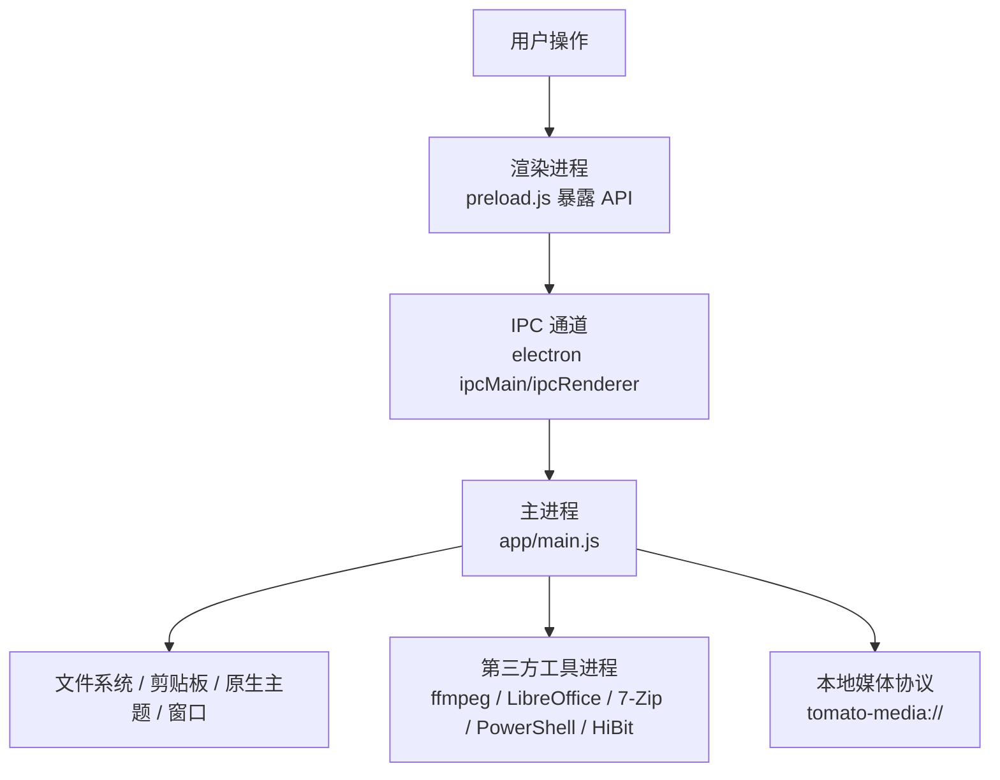
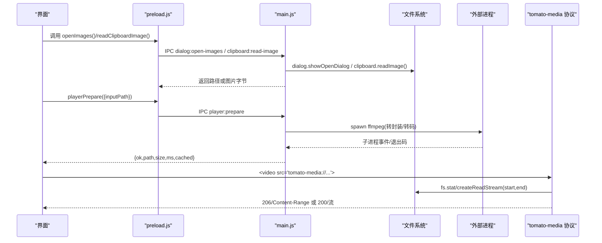
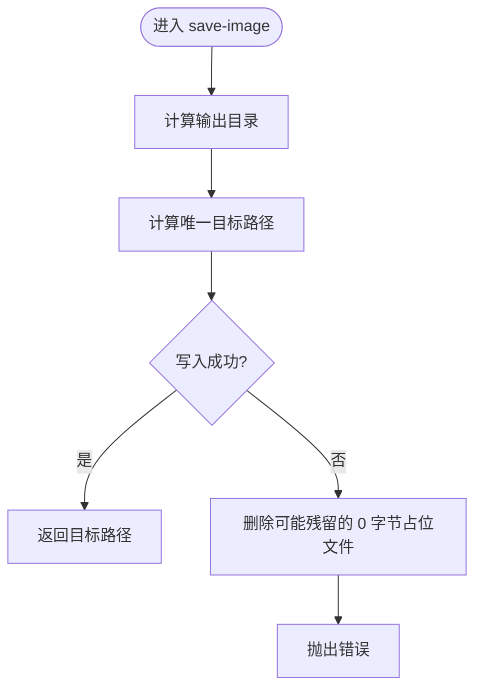
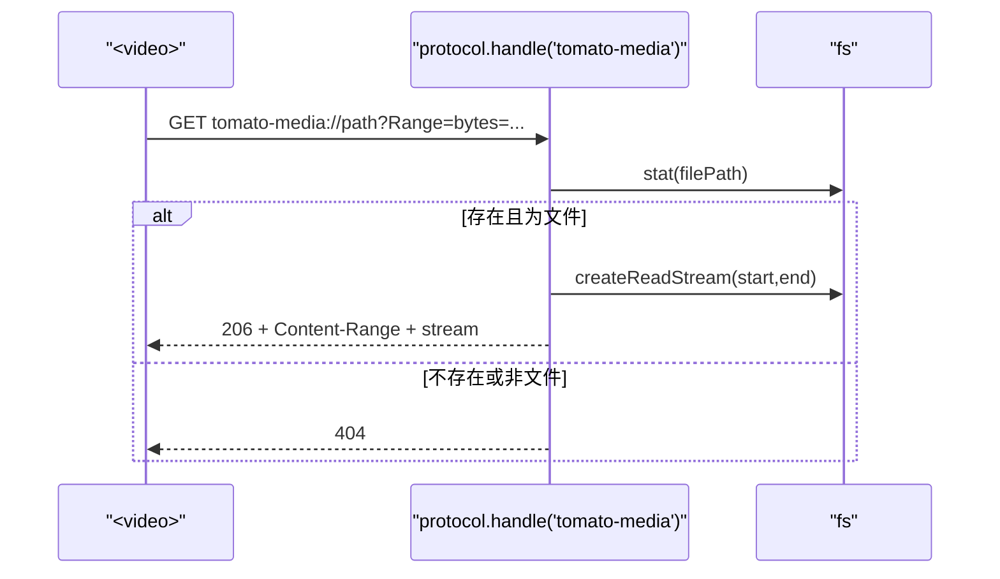
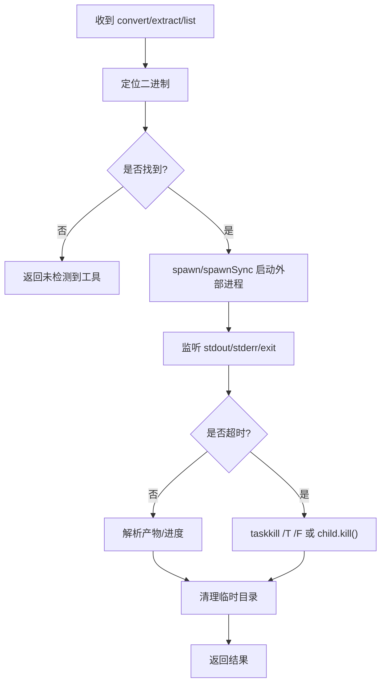
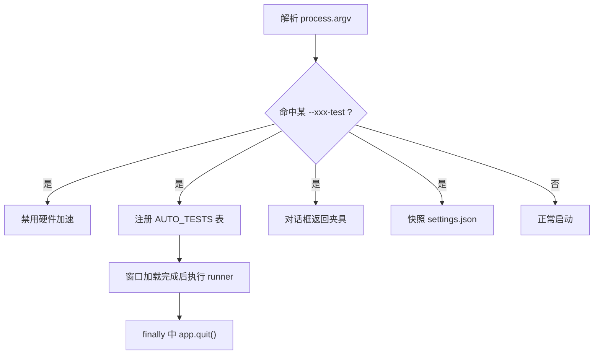
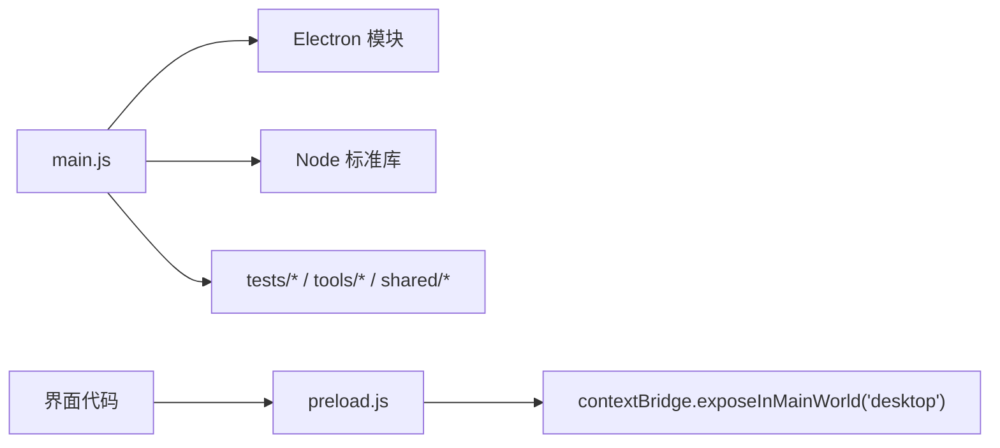

# 系统集成层

<cite>
**本文引用的文件**   
- [app/main.js](file://app/main.js)
- [app/preload.js](file://app/preload.js)
- [app/package.json](file://app/package.json)
- [README.md](file://README.md)
</cite>

## 目录
1. [引言](#引言)
2. [项目结构](#项目结构)
3. [核心组件](#核心组件)
4. [架构总览](#架构总览)
5. [详细组件分析](#详细组件分析)
6. [依赖关系分析](#依赖关系分析)
7. [性能与资源特性](#性能与资源特性)
8. [故障排查指南](#故障排查指南)
9. [结论](#结论)

## 引言
本文件面向“番茄混淆桌面版”的系统集成层，聚焦主进程如何桥接操作系统能力与前端界面。内容覆盖：
- 文件对话框、剪贴板、原生主题、窗口管理
- 自定义协议 `tomato-media://` 的注册、Range 请求与分块传输
- 外部进程管理：ffmpeg、LibreOffice、7-Zip、PowerShell/HiBit 等
- 平台适配（Windows UAC、短路径联接、taskkill）
- 测试模式与各种 `--test` 参数
- 绿色版数据目录策略

## 项目结构
本项目采用 Electron 单入口架构：
- 主进程入口：`app/main.js`
- 渲染进程安全桥：`app/preload.js`
- 应用元信息与脚本：`app/package.json`
- 使用说明与自检清单：`README.md`

图表来源
- [app/main.js:1-25](file://app/main.js#L1-L25)
- [app/preload.js:1-30](file://app/preload.js#L1-L30)

章节来源
- [app/main.js:1-25](file://app/main.js#L1-L25)
- [app/preload.js:1-30](file://app/preload.js#L1-L30)
- [app/package.json:1-28](file://app/package.json#L1-L28)
- [README.md:1-40](file://README.md#L1-L40)

## 核心组件
- 协议与窗口：在应用启动前注册 `tomato-media` 特权协议；创建 BrowserWindow、处理激活与关闭。
- IPC 白名单：通过 preload 仅暴露系统级方法，避免渲染进程直接访问 Node/Electron。
- 文件对话框与读写：集中式 `OPEN_FILE_DIALOGS` 规格表 + 原子设置写入 + 唯一目标路径分配。
- 外部进程：统一 spawn/spawnSync 控制 ffmpeg、LibreOffice、7-Zip、PowerShell、HiBit。
- 主题与日志：读取设置决定窗口底色；全局异常捕获并追加日志到 userdata/logs。
- 测试模式：解析大量 `--xxx-test` 标志，自动切换 UI 行为与禁用硬件加速。

章节来源
- [app/main.js:1-25](file://app/main.js#L1-L25)
- [app/main.js:500-560](file://app/main.js#L500-L560)
- [app/main.js:750-813](file://app/main.js#L750-L813)
- [app/main.js:1258-1300](file://app/main.js#L1258-L1300)
- [app/main.js:2050-2116](file://app/main.js#L2050-L2116)
- [app/preload.js:1-30](file://app/preload.js#L1-L30)

## 架构总览
主进程承担三类职责：
1. 系统能力封装：对话框、文件 I/O、剪贴板、主题、窗口、协议。
2. 工具编排：调度 ffmpeg/LibreOffice/7-Zip/OCR/AI/ASR 等外部或主线程任务。
3. 测试与交付：冒烟/端到端/界面测试、样本生成与校验、结果落盘。

图表来源
- [app/preload.js:10-30](file://app/preload.js#L10-L30)
- [app/main.js:548-574](file://app/main.js#L548-L574)
- [app/main.js:970-984](file://app/main.js#L970-L984)
- [app/main.js:2150-2160](file://app/main.js#L2150-L2160)
- [app/main.js:2064-2116](file://app/main.js#L2064-L2116)

## 详细组件分析

### 文件对话框与文件 I/O
- 统一规格表 `OPEN_FILE_DIALOGS`：为每个工具提供标题、过滤器扩展名、夹具匹配规则，测试模式下按夹具前缀或精确文件名返回固定样本。
- 批量重命名：两阶段改名（临时名→最终名），跨盘回退复制+删除源；默认不覆盖已有文件，可选 overwrite 时走备份-覆盖-删备份流程。
- 保存路径分配：使用 `uniqueTargetPath` 保证并发下文件名唯一，避免静默覆盖。
- 设置写入：先写 `.tmp` 再 rename，保障 JSON 完整性。

图表来源
- [app/main.js:706-726](file://app/main.js#L706-L726)

章节来源
- [app/main.js:1258-1300](file://app/main.js#L1258-L1300)
- [app/main.js:548-574](file://app/main.js#L548-L574)
- [app/main.js:608-706](file://app/main.js#L608-L706)
- [app/main.js:750-813](file://app/main.js#L750-L813)

### 剪贴板与原生主题
- 剪贴板：只暴露读/写图片能力；读取转为 PNG，写入由 nativeImage 构造。
- 原生主题：根据 settings.theme 或系统偏好选择窗口背景色，避免首帧闪白。
- 应用信息：向界面暴露 electron/chrome/node 版本与应用名称、打包状态。

章节来源
- [app/main.js:970-984](file://app/main.js#L970-L984)
- [app/main.js:240-270](file://app/main.js#L240-L270)

### 自定义协议 tomato-media://
- 特权协议：在 app ready 之前注册 scheme，启用 standard/secure/supportFetchAPI/stream。
- 运行时处理器：对 file URL 做 stat 校验，拒绝非普通文件；支持 Range 请求返回 206/Content-Range，否则返回 200 完整流。
- MIME 映射：按扩展名设置 Content-Type，缺失时回退 octet-stream。
- 流式传输：使用 createReadStream 与 Readable.toWeb，避免大视频整图载入内存。

图表来源
- [app/main.js:19-25](file://app/main.js#L19-L25)
- [app/main.js:2064-2116](file://app/main.js#L2064-L2116)

章节来源
- [app/main.js:19-25](file://app/main.js#L19-L25)
- [app/main.js:2064-2116](file://app/main.js#L2064-L2116)

### 外部进程管理（ffmpeg、LibreOffice、7-Zip、PowerShell/HiBit）
- ffmpeg：探测版本、probe 媒体、转码/变换、多输入拼接、取消任务；进度通过 IPC 推送。
- LibreOffice：查找加装包与系统安装；短路径 junction 绕过长路径/中文问题；超时 killConvertTree 连杀 soffice.bin；PDF→Word 可压平浮动文本框。
- 7-Zip：加载 engine.mjs，支持压缩/解压/列表/取消；复合格式（如 tar 外层）中间产物放临时目录并清理。
- Windows 特有：taskkill /T /F 终止进程树；PowerShell 执行提权脚本；HiBit 卸载工具 RunAs 触发 UAC。

图表来源
- [app/main.js:1069-1113](file://app/main.js#L1069-L1113)
- [app/main.js:1568-1586](file://app/main.js#L1568-L1586)
- [app/main.js:2551-2551](file://app/main.js#L2551-L2551)

章节来源
- [app/main.js:1069-1113](file://app/main.js#L1069-L1113)
- [app/main.js:1568-1586](file://app/main.js#L1568-L1586)
- [app/main.js:2551-2551](file://app/main.js#L2551-L2551)

### 平台特定功能（Windows）
- UAC 提权：通过 PowerShell 执行脚本，再由 system shell 以 RunAs 方式弹出 UAC，测试模式下空跑。
- 短路径联接：为 LibreOffice 在系统临时目录/Public 建立 junction，规避长路径/中文导致的导入失败。
- taskkill 进程树：确保 soffice.bin 被连带杀掉，防止 userdata/profile 被占用。

章节来源
- [app/main.js:1069-1113](file://app/main.js#L1069-L1113)
- [app/main.js:2551-2551](file://app/main.js#L2551-L2551)

### 测试模式与设计
- 标志位：`--smoke-test`、`--self-test`、`--ui-test`、`--pdf-*`、`--media-*`、`--audio-*`、`--asr-*`、`--ocr-poc`、`--theme-test`、`--av-test`、`--imgbatch-test`、`--settingsio-test`、`--pdf-ocr-test`、`--queue-ui-test`、`--archive-*`、`--player-*`、`--imghide-*`、`--uninstall-test`、`--videodl-*`、`--doc-*`。
- 行为差异：
  - 自动测试模式关闭硬件加速，保证截图稳定。
  - 所有对话框在测试模式下返回固定夹具目录或指定文件，避免阻塞真实弹窗。
  - 测试结束还原 settings.json（保留或重建出厂态）。
  - 测试结果输出到控制台，并在需要时落盘 `%TEMP%\tomato-*.json`。

图表来源
- [app/main.js:25-120](file://app/main.js#L25-L120)
- [app/main.js:270-340](file://app/main.js#L270-L340)

章节来源
- [app/main.js:25-120](file://app/main.js#L25-L120)
- [app/main.js:270-340](file://app/main.js#L270-L340)

### 绿色版实现
- 运行期数据目录：`PORTABLE_DIR = app.isPackaged ? execPath.dirname : __dirname`；`USER_DATA_DIR = PORTABLE_DIR/userdata`；设置文件 `userdata/settings.json`。
- 将 Electron userData 指向 USER_DATA_DIR，使设置随软件目录移动。
- 播放器缓存位于 `USER_DATA_DIR/player-cache`，便于随软件迁移与清理。
- 导出/导入设置：导出为 JSON，含格式版本号与应用版本；导入只做已知键合并，非法值跳过。

章节来源
- [app/main.js:120-140](file://app/main.js#L120-L140)
- [app/main.js:750-813](file://app/main.js#L750-L813)
- [app/main.js:2050-2060](file://app/main.js#L2050-L2060)

## 依赖关系分析
- 主进程依赖：
  - Electron：app、BrowserWindow、ipcMain、dialog、clipboard、nativeTheme、protocol、shell
  - Node：fs/promises、fs、os、crypto、stream、child_process.spawn/spawnSync、worker_threads、url.pathToFileURL
  - 内部模块：tests/*、tools/*、shared/*（HEIC worker、imageio、settings-schema 等）
- 渲染进程依赖：
  - 仅通过 preload 暴露的 `desktop.*` 方法访问系统能力，保持 CSP 与沙箱隔离。

图表来源
- [app/main.js:1-25](file://app/main.js#L1-L25)
- [app/preload.js:1-30](file://app/preload.js#L1-L30)

章节来源
- [app/main.js:1-25](file://app/main.js#L1-L25)
- [app/preload.js:1-30](file://app/preload.js#L1-L30)

## 性能与资源特性
- 大视频播放：基于 Range 的分块流式传输，避免整文件入内存；MIME 正确识别减少解码器回退。
- 外部进程超时：LibreOffice 转换按输入大小动态计算超时上限（下限 5 分钟，上限 30 分钟），并用 taskkill /T 终止进程树。
- 原子写入：设置文件采用 tmp+rename 策略，避免崩溃留下截断 JSON。
- 并发安全：唯一目标路径分配在主进程完成，避免多线程/任务队列竞态。

[本节为通用指导，无需列出具体文件]

## 故障排查指南
- 无法打开文件对话框：确认未在测试模式导致夹具目录不可用；检查 OPEN_FILE_DIALOGS 扩展名配置是否与目标工具一致。
- 播放器无法拖动进度：检查 tomato-media 协议是否已注册；确认请求头包含 Range，服务端返回 206/Content-Range。
- LibreOffice 转换失败：检查 addons/libreoffice 是否存在；观察是否因长路径/中文路径导致导入失败；查看 stderr 是否提示 source file could not be loaded。
- 外部进程残留：若 soffice.bin 未被杀掉，检查 killConvertTree 是否被执行；必要时手动 taskkill。
- 设置丢失或损坏：检查 userdata/settings.json 是否为有效 JSON；确认 writeSettingsFile 的 tmp+rename 是否成功。

章节来源
- [app/main.js:1069-1113](file://app/main.js#L1069-L1113)
- [app/main.js:2064-2116](file://app/main.js#L2064-L2116)
- [app/main.js:750-813](file://app/main.js#L750-L813)

## 结论
系统集成层通过主进程集中封装系统能力，并以 IPC 白名单形式暴露给渲染进程。自定义协议解决了沙箱内视频播放与 Range 分块的关键瓶颈；外部进程统一管理 ffmpeg、LibreOffice、7-Zip 等工具的生命周期与错误恢复；Windows 特有的 UAC、junction、taskkill 组合确保了可移植性与健壮性。测试模式贯穿全链路，确保自动化验收与交付质量。绿色版设计让应用真正做到“免安装、纯离线、随目录迁移”。